# CCF-A/B 年度论文精读

2026-11-18 · 第一期 · 当年录用主会长文 · 中文完整精读

本期读五篇：怎样让 SFT 吃进专家知识而少遗忘，怎样训练一步生成器，怎样控制预训练知识边界，怎样缓解量化后的无效长思考，以及怎样把 SFT/RL 标注预算分配从小模型迁移到大模型。核心不是罗列涨点，而是把机制、实现与证据边界放在一起读。

## 0. 选题与证据口径

本方向按会议/期刊的 2026 录用年度筛选，不按预印本首次发布日期限制最近一个月。日期与引用统计截至北京时间 2026-11-18。NeurIPS 2026 尚未召开，本文的 oral/poster 指官方已公布的录用展示安排，不表示现场报告已经发生。

| 论文 | CCF 与官方展示 | 首次公开 / 精读版本 | OpenAlex 引用数 |
| --- | --- | --- | --- |
| Finetuning with Sampling，简称 FWS | NeurIPS 2026，A，poster | 2026-10-01 / arXiv v1，19 页 | 3 |
| Generative Modeling via Drifting | NeurIPS 2026，A，oral | 2026-02-04 / arXiv v2，28 页 | 165 |
| LittleLearner | NeurIPS 2026，A，oral | 2026-08-13 / arXiv v3，39 页 | 1 |
| Quantized Reasoning Models Think They Need to Think Longer, but They Do Not | NeurIPS 2026，A，oral | 2026-05-29 / arXiv v1，22 页 | 20 |
| Scaling Near-Optimal SFT-RL Annotation Budget Allocation from Small to Large LLMs | EMNLP 2026，B，poster | 2026-09-01 / ACL 正式版，30 页 | 1 |

等级取自 [CCF 当前目录入口](https://www.ccf.org.cn/Academic_Evaluation/By_category/) 所链接的 2026 正式目录：2026-03-31 发布、04-09 修订。人工智能部分 PDF 物理第 57 页把 NeurIPS 列为 A，第 58 页把 EMNLP 列为 B。正式目录只认可 full/regular paper；主会长文以 poster 展示不等于短文。未纳入 workshop、Findings、demo、摘要、技术简报。四篇 NeurIPS 在主会论文页面且具有完整长文，EMNLP 在 main proceedings，页码 55601-55630；不把 spotlight 算作 oral。

官方展示证据：[FWS poster](https://neurips.cc/virtual/2026/poster/150118)、[Drifting oral](https://neurips.cc/virtual/2026/oral/154241)、[LittleLearner oral](https://neurips.cc/virtual/2026/oral/148221)、[Quantized Reasoning oral](https://neurips.cc/virtual/2026/oral/151669)。EMNLP 的[正式论文记录](https://aclanthology.org/2026.emnlp-main.2450/)证明主会收录，[官方日程入口](https://2026.emnlp.org/program/)链接的[排期表](https://docs.google.com/spreadsheets/d/1aXGTy_7Xeh-OXIs3iJSbDpUsZ6YhbfA76b17kBZH0Yk/edit?gid=943432490#gid=943432490)中 ID 8117-MAIN 标记 Poster、2026-10-27、Hall H、Poster Session F。

引用记录均在查询日从 OpenAlex API 实际返回并按标题、作者、DOI 交叉核对：[FWS](https://api.openalex.org/works/W7216244021)、[Drifting](https://api.openalex.org/works/W7127967205)、[LittleLearner](https://api.openalex.org/works/W7203459302)、[Quantized Reasoning](https://api.openalex.org/works/W7163178833)、[Budget Allocation](https://api.openalex.org/works/W7206153012)。这些是数据库当时的 cited_by_count，可能滞后且不等同于质量。Budget 记录已合并到正式 DOI；其中 publication_date 的 2026-01-01 不能用作首次公开日期，后者按 arXiv 版本历史记录。未把搜索页的点赞、阅读量或 GitHub stars 混入引用数。

本期遵循 4A+1B、3oral+2poster 的偏好。Drifting 已公开约九个月，引用积累不能与公开约一个半月的 FWS 横比；LittleLearner 与 Budget 的引用积累也较短。选择综合主题覆盖、原文可读性、正式证据与引用信号，不声称完成全体 2026 接收论文的全局引用排名。候选 ELF 的已核验页面只证明 poster，未将其当作 oral 补数。

对历史 sources.json 和全部 manifest 的 arXiv 去版本 ID、DOI、规范 URL、规范标题及更名前后标题做跨日期、跨方向查重，本期五篇均为首次收录。特别把 FWS 会议题名 “Finetuning with Sampling: Make SFT Generalize, Not Forget” 与预印本题名绑定，避免下次重复。

以下“原文事实”指所列版本正文/附录；“本文推导”是教学说明或核算，非作者新增实验；“未披露”不擅自补全。图表均裁自对应原始 PDF，图号与物理页码写在图注，完整裁切坐标和源文件哈希存于 assets/figures.json。公式采用可搜索的线性数学表达；^T 表示转置，^+ 与 ^- 是正负样本标记，_t 表示时间下标；log 默认自然对数。我们没有运行模型训练或复现论文实验。

## 1. FWS：先把专家答案变成学生更容易学的分布

### 1.1 问题、身份与一句话直觉

原文：[arXiv 2610.02140v1](https://arxiv.org/pdf/2610.02140v1)，Aayush Karan、Sitan Chen、Yilun Du。官方 poster 页面题名已更改；该页面直接链接的[作者项目页](https://aakaran.github.io/finetuning_with_sampling/)再链接同一 arXiv 与[代码仓库](https://github.com/aakaran/finetuning-with-sampling)，作者一致，故按同一研究去重。正文/附录共 19 页均纳入本次阅读。

原文事实：通常 SFT 直接模仿专家答案；若专家表达和学生原分布相距很远，梯度可能改变很多已有行为。RL 常在学生自己的轨迹上学习，分布更贴近学生，却可能抽不到需要的新解法。FWS 把成本前移到离线数据处理：借助专家信息重采样训练答案，保留任务所需信息、提高学生对这些答案的似然，然后仍用普通 SFT。

本文直觉：老师先把证明“翻译成这个学生会用的语言”，再让学生练习。不是只取学生已经会做的题，也不是换一个新奖励函数。是否真保留信息、是否真接近目标分布，需要分别验证。

### 1.2 从自回归与 SFT 到信息投影

给定问题 q，答案 x=(x₁,…,x_T)，冻结基础模型为 p。自回归概率 p(x∣q)=∏_t p(x_t∣q,x_<t)。SFT 损失 L_SFT(θ)=E_(q,x)∼D[-Σ_t log p_θ(x_t∣q,x_<t)]。θ 是待训练参数，T 是答案 token 数，D 是训练数据；通常仅对 response token 计损失，具体 mask 必须按实现核对。

固定 q 后省略条件。令 C 为“与专家答案在任务要求上等价”的轨迹集合，例如最终答案正确或事实信息一致；P_C 是只在 C 上赋概率的所有分布。论文目标为 p_C=argmin_(π∈P_C) KL(π∥p)。KL(π∥p)=Σ_x π(x)log[π(x)/p(x)]，方向不能调换：这里要求新数据分布 π 不把质量放到学生极不可能的轨迹上。

本文推导：若 Z=Σ_(x∈C)p(x)>0，则 p_C(x)=p(x)·1[x∈C]/Z。对任意支持集在 C 内的 π，把 p(x)=Zp_C(x) 代入，得到 KL(π∥p)=KL(π∥p_C)-log Z。第二项与 π 无关，第一项最小为 0，因此最优 π=p_C。若 Z=0，这个条件分布不存在，不能借此证明一个完全没有支持的模型必能学会。

这一定义的理想解保留的是 C 所表达的约束，非无条件保留专家整段推理。C 如果仅检查最终数值，错误中间推理也可能通过；如果 C 依赖 LLM 事实判别器，还会继承其漏检。

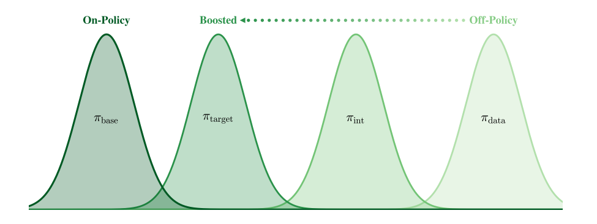

图 1-1 · 原文 Figure 2，PDF 物理第 4 页，[来源](https://arxiv.org/pdf/2610.02140v1)。这是作者的概念分布图，横轴没有实测单位。由浅到深表示让专家数据分布逐渐接近基础模型；它不是证明任意有限重采样都单调提高任务准确率的实验曲线。

### 1.3 理想 MH 采样与实际贪心实现的差别

原文的理想过程使用带专家轨迹 τ 的 proposal κ_C。当前轨迹 x，候选 x′，Metropolis-Hastings 接受率为 A(x′;x)=min{1, p(x′)κ_C(x∣x′,τ)/[p(x)κ_C(x′∣x,τ)]}。分子是候选的基础模型概率乘反向 proposal 概率；分母是当前概率乘正向 proposal 概率。比值中不需要知道 Z。实际计算应使用 log 概率，避免长序列乘积下溢。

满足正确 MH 转移、支持与连通性等条件时，p_C 是平稳分布。本文推导：用同一个保持 p_C 不变的转移核 K，KL 的数据处理不等式给出 KL(πK∥p_CK)≤KL(π∥p_C)；因为 p_CK=p_C，再利用上节恒等式，可得理想链对 KL(π∥p) 的不增性质。该结论讨论分布而非每个样本，并不直接承诺下游 SFT 的准确率或遗忘量。

为应对长文本，算法按 B 个 token 分块扩展。每轮在已有前缀中随机选截断位置，再用同一冻结模型在专家提示下重写后缀，运行 N_MCMC 次候选更新。B=32，最大 T=1856，N_MCMC=10 是论文实验配置。块内前缀的中间目标与最终序列目标也要区分，有限步不是“已经收敛”。

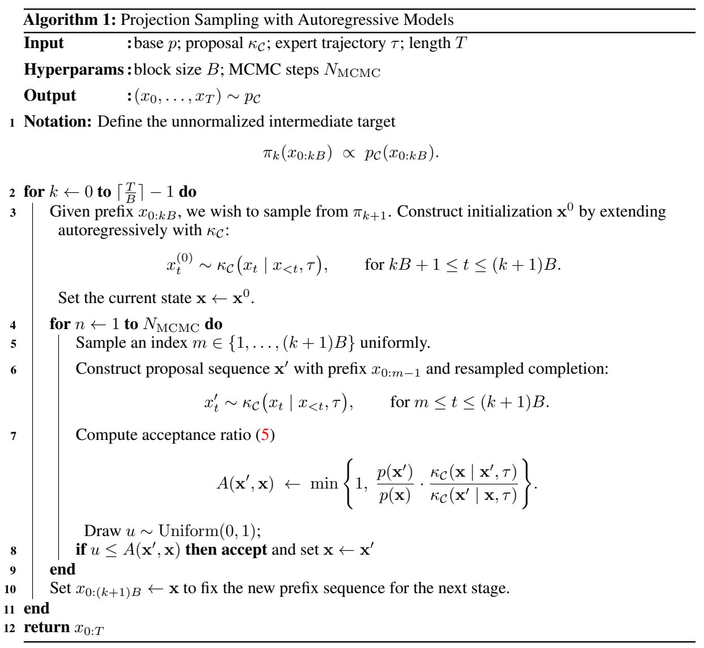

图 1-2 · 原文 Algorithm 1，PDF 物理第 7 页，[来源](https://arxiv.org/pdf/2610.02140v1)。这是含正反 proposal 概率的理想接受规则；读图时先看输入 p、τ，再看分块、随机截断、重采样、接受四层关系。图中公式不应直接等同于实验中的加速实现。

原文事实与关键限制：附录 C.2（物理第 18 页）说明，为降低开销，实际实现不计算完整反向 proposal 比率，只在候选的基础模型似然更高时贪心替换。因此它不是上面那个精确 MH 核。正文的平稳分布与 KL 理论不能未经补证直接移植到该实现；该实现的有效性主要由实验支持。

本文手算：C 里只有两个正确答案 a、b，基础概率分别 .06、.04，故 Z=.10，理想条件分布为 (.6,.4)。proposal 若对称，从 a 到 b 应以 min(1,.04/.06)=2/3 接受。贪心版本会永远拒绝这次降概率移动，容易向 a 集中；这清楚展示“增加单样本似然”和“从条件分布采样”不是同一件事。若专家只写 b，采样可让更多训练质量落在 a，但不能凭这个例子推断全部任务都有收益。

### 1.4 训练与推理实现路线

```text
输入：问题、专家答案、冻结学生 p，块长 B，重采样次数 K
对每条专家数据：从空前缀开始，分块生成专家条件下的答案
每块重复 K 次：随机截断，按专家提示重采样后缀
实验近似：候选在 p 下 logprob 更高时替换当前答案
保存原始/候选轨迹、评分、截断位置、接受记录与事实校验
用变换后的数据对 p 做普通 response SFT
推理：使用微调后模型正常自回归生成，无需专家答案
```

原文事实：数据变换是一次性离线开销，不在每个训练 epoch 内重新 online rollout。化学用 SciKnowEval L3 的 2400 题，1800 训练、600 测试，专家轨迹由 GPT-5 生成；基础模型包括 Qwen2.5-7B-Instruct 与 Olmo3-7B-Instruct。数学从 MATH 难度 3/4/5 的 9254 题中取 8230 训练、1024 测试，模型 Qwen2.5-3B；医疗使用 HuatuoGPT-o1 的 19704 条 SFT 训练数据；从其 RL 数据集中均匀随机抽取 1000 条作为训练期间从未见过的评估题，测试正确性用 GPT-5-mini 判别。医疗和科学判别器分数不等于独立临床或科学真实性认证。

SFT 网格：epoch 为 1 或 2，学习率 5e-5、1e-5、5e-6，batch 为 16、32、64；医疗扩展到 1、2、4、6 epoch。AdamW、cosine schedule、梯度裁剪 1。论文说明 H100/H200，但没为每个最终单元给出选中超参、训练步数、卡数、用时、峰值显存、GPU-hours 或总费用。不能把搜索空间写成每个模型都用了相同固定配置。

没有新的训练奖励：SFT 最大化新轨迹似然；RL、OPSD、UFT 是比较项或后续组合，不能把它们的奖励当成 FWS 必备部件。复现须锁定教师提示、轨迹生成温度、事实过滤、采样评分是否长度归一化、优化器细节及评估模板。长序列用总 logprob 比较与平均 logprob 比较会产生不同的长度偏好。

### 1.5 原始结果、消融与不能泛化的结论

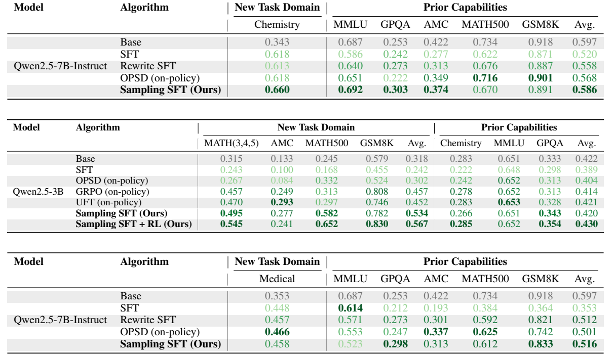

图 1-3 · 原文 Table 1，PDF 物理第 9 页，[来源](https://arxiv.org/pdf/2610.02140v1)。上、中、下三块分别是化学、数学、医疗。每块左侧是新任务，右侧是旧能力；只在同一块、同一模型与评估列里比较。绿色/加粗表示作者的重点结果，不表示所有指标都优于所有基线。

| 对比条件 | 原文结果 | 应怎样解读 |
| --- | --- | --- |
| Qwen 7B 化学准确率 | Base .343；SFT .618；Rewrite .613；OPSD .618；FWS .660 | FWS 比 SFT 高 4.2 个百分点；比单次重写强，但采样成本更多 |
| 同组旧能力平均 | Base .597；SFT .520；OPSD .568；FWS .586 | 遗忘减少但没完全恢复基模；平均值不能掩盖单任务退化 |
| Qwen 3B 数学新任务主列 | Base .315；SFT .243；GRPO .457；UFT .470；FWS .495；FWS+RL .545 | SFT 数据分布影响很大；采样后仍能叠加 RL |
| Qwen 7B 医疗准确率 | SFT .448；OPSD .466；FWS .458 | FWS 不胜过此项 OPSD；旧能力平均 .516 高于 OPSD .501 |
| Olmo 7B 化学单次准确率（附录表2） | OPSD .597；FWS .583 | “所有模型单次正确率更好”不成立；需与 pass@k 分开 |

进一步的反例：医疗 MMLU 列，FWS .523 低于普通 SFT .614。化学训练数据跨模型移植也受限：为 Olmo 优化的数据拿去训 Qwen 得 57.33%，低于普通 SFT 61.8%；混合 50% 这类数据约 62.14%，仍低于针对 Qwen 构造的 66.0%。这支持“数据处理具有模型特异性”，不支持存在一个通用最优改写集。

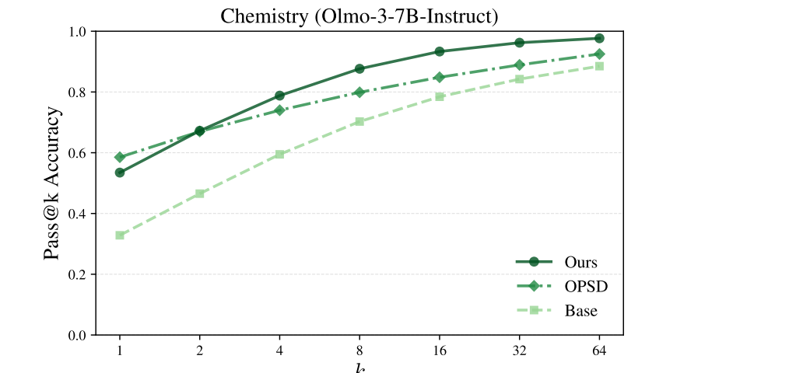

图 1-4 · 原文 Figure 4，PDF 物理第 11 页，[来源](https://arxiv.org/pdf/2610.02140v1)。模型为 Olmo3-7B-Instruct，任务为化学，横轴是采样次数 k，纵轴 pass@k。FWS 在多样本覆盖上有优势，但 k 的增大同时增大推理预算，不能拿其 k=64 与另一个方法的 k=1 比效率。

本文统计提醒：64 次采样未命中不证明原模型“绝对不可能解题”；零成功时成功概率的 95% 单侧上限约为 1-0.05^(1/64)=4.57%，常用近似 3/64=4.69%。因此以有限 pass@k 证明产生了基础模型支持集之外的新能力，证据不足。

原文 Figure 5 的 0、2、4、6、8、10 步消融：KL 估计总体下降、准确率总体上升但局部不单调。作者用生成 proposal 的 logprob 估算分布差距，它不等于对真实有限链边缘分布的精确 KL 测量。单步重写弱于多步采样说明迭代有价值，仍未剥离额外计算量的贡献。

### 1.6 成本、复现优先级与阅读结论

原文近似输出 token 成本：C_tokens≈∣D∣·N_MCMC·T²/(4B)。∣D∣ 是样本量，T 是长度，B 是块长；来自每个块平均重采样半段前缀，再对递增前缀长度求和。它不包含所有初始生成、prefill、候选评分及教师生成，也不是 GPU-hours。

本文上限式示例：若 1800 条化学训练轨迹都达到 T=1856，N_MCMC=10、B=32，则上述项为 484,416,000 个重采样输出 token。真实长度分布更短时会减少，不能把该估算写成作者实测用量。T 翻倍会使此项约增四倍，所以数据准备未必比训练便宜。

原文的信息保留评估并非 100%：Qwen/Olmo 化学约 94.33%/93.94%，数学 95.33%，医疗 95.86%。复现首要检查应是人工分层审阅低保真样本，以及最终答案对但中间理由错的比例；随后才复现少量样本的采样步数消融。还要逐题查清 MATH 训练集、1024 测试集与 MATH500 等评估的去重方式，不能仅凭名字假定互不重叠。

结论：这是一个值得试的“模型定制数据预处理 + 普通 SFT”方法。理论解释了理想目标为什么合理；实际贪心采样、非完美语义保留以及不完整成本核算，决定了复现时应同时报告准确率、旧能力、保真率与离线采样开销。

## 2. Drifting：把分布搬运放进训练，一步生成

### 2.1 从生成分布而非单张图开始理解

原文：[arXiv 2602.04770v2](https://arxiv.org/pdf/2602.04770v2)，Mingyang Deng、He Li、Tianhong Li、Yilun Du、Kaiming He；[NeurIPS oral](https://neurips.cc/virtual/2026/oral/154241)。精读含附录共 28 页。作者[项目页](https://lambertae.github.io/projects/drifting/)链接[官方代码](https://github.com/lambertae/drifting)。下面描述论文版本，不宣称已运行代码仓库。

原文事实：扩散或 flow 常在推理时做多次网络调用，把噪声逐步变成图像。Drifting 用一次网络 x=f_θ(ε) 生成，ε 来自固定噪声先验；训练时不断改变 θ，使生成分布 q=f_θ#p_noise 接近真实分布 p。“#”表示推前分布：把噪声经过函数后的输出分布，而非对密度作简单代入。

本文直觉：每轮让当前生成样本朝真实样本群靠近、同时避开生成样本过度拥挤处，再训练网络一次跳到这些目标。迭代仍然存在于优化过程，不再要求用户生成每张图时走同样的长轨迹。与先训练扩散老师再蒸馏不同，生成器从头训练；但整个系统仍依赖预训练特征编码器与可选 VAE。

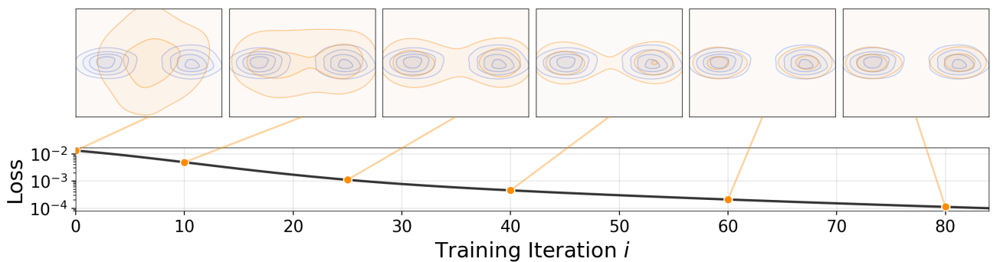

图 2-1 · 原文 Figure 1，PDF 物理第 1 页，[来源](https://arxiv.org/pdf/2602.04770v2)。橙色是模型分布、蓝色是目标分布；横轴为训练迭代 i，损失用对数坐标。上方多个小图是不同训练时刻的分布，不是一次生成的多个推理步骤。

### 2.2 漂移场的全部核心关系

原文核心要求 V_(p,q)(x)=-V_(q,p)(x)，即交换数据与生成分布会反转漂移方向。p=q 时 V=0，给出目标平衡点。仅由这一条不能反推 V=0 一定意味着 p=q，退化核、有限样本或不充分特征都可能使不同分布看起来一样。

取核 k(x,y)=exp(-∥x-y∥₂/τ)，τ>0 是邻域尺度；注意这是 L2 距离，不是高斯核常用的距离平方。记 Z_p(x)=E_(y^+∼p)[k(x,y^+)]，Z_q 同理。吸引项 V^+=E_p[k(x,y^+)(y^+-x)]/Z_p；排斥参照项 V^-=E_q[k(x,y^-)(y^--x)]/Z_q；最终漂移 V=V^+-V^-。

符号含义：x 是正在更新的生成样本；y^+ 是真实样本；y^- 是生成样本；“负样本”是统计分布角色，不是坏图标签。距离近的邻居权重大，τ 小时更局部。把两项通分后，x 抵消，得到 V=E_(y^+,y^-)[k(x,y^+)k(x,y^-)(y^+-y^-)]/(Z_pZ_q)。这解释了为什么只拉向真实数据、不处理当前生成密度，通常不足以得到好分布。

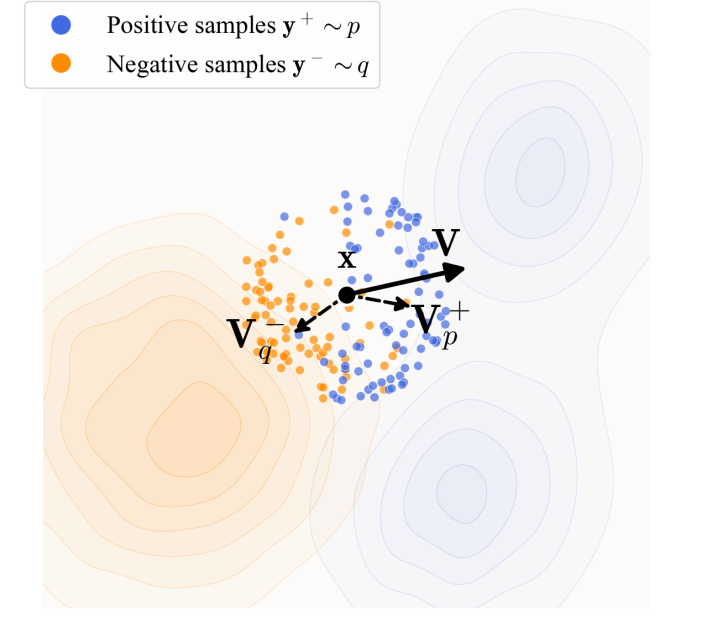

图 2-2 · 原文 Figure 2，PDF 物理第 4 页，[来源](https://arxiv.org/pdf/2602.04770v2)。蓝点为真实样本、橙点为生成样本，黑色合力是 V^+ 与减去 V^- 的结果。图是概念示意，箭头长度不能当作 ImageNet 的实测梯度或收敛速度。

论文回归目标为 L=E_ε[∥f_θ(ε)-sg(f_θ(ε)+V(f_θ(ε)))∥²]。sg 表示 stop-gradient；右侧目标以当前网络产生，但反向传播时视为常数。数值上残差等于 -V，不意味着可以删去 sg 然后直接优化 ∥V∥²。

本文推导：令 x=f_θ(ε)，t=sg(x+V(x))。对当前输出求导 ∂∥x-t∥²/∂x=2(x-t)=-2V；对参数的梯度是 -2J_f^TV，J_f 是输出对参数的雅可比。梯度下降把输出朝 V 方向移动。若让目标也反传，就会出现 V 的导数甚至 x-x 的抵消，训练动力学已不同。优化器步长、参数共享和不同样本的雅可比意味着实际 x 更新也不等于逐点严格执行 x←x+V。

本文一维手算：某轮 x=0，只有一个真实邻居 y^+=2 和一个非自身生成邻居 y^-=-1。分别归一化后，V^+=2，V^-=-1，所以 V=3，目标 t=3。若把 x 当作直接可训练标量，L=(x-3)²，在 x=0 处梯度 -6，学习率 .1 后 x=.6，向真实簇移动。例子演示方向，不能据此推断多峰问题的一步收敛。

### 2.3 从理论期望到批量计算与特征空间

原文实现对正负邻居一起计算距离/logits，使用行 softmax 与列 softmax 的几何平均 A=sqrt(A_row·A_col)。A 不是简单的单行归一化高斯权重。拆出 A_pos、A_neg 后，W_pos=A_pos·ΣA_neg，W_neg=A_neg·ΣA_pos，V=W_pos Y_pos-W_neg Y_neg。对作为负样本的自身位置屏蔽；原算法用大距离避免自排斥。复现须逐项对齐，不应只照上节无限样本公式写一个外形相近的损失。

实际在冻结特征编码器 φ 中定义漂移，L_j=E[∥φ_j(x)-sg(φ_j(x)+V_j(φ_j(x)))∥²]，对多个层/特征/温度组合。冻结 φ 的参数不等于把 φ(x) detach：左分支仍必须保留从特征回到生成器的梯度，否则生成器无法学习。

附录归一化：特征维数 C，S 是平均样本距离除以 √C，先用 φ/S 统一距离尺度，温度也按 √C 调整。再以 λ_V=√(E∥V∥²/C) 缩放漂移，避免不同特征的尺度主导损失。温度为 .02、.05、.2。注意正文/表8“每个温度一个 loss 后相加”和附录 A.6“先组合归一化漂移场”的表达需要对照代码确认聚合顺序；平方损失中的交叉项使两者一般不等价，本报告不把此细节假定为已经核实一致。

条件生成还使用训练期 CFG：把负分布改为 q_mix=(1-γ)q_cond+γp_uncond。若理想平衡满足 q_mix=p_cond，代数上 q_cond=αp_cond-(α-1)p_uncond，其中 α=1/(1-γ)。这是解释引导强度的形式关系，右边可能出现负值，不能对任意分布宣称它总是合法概率密度。实现将引导强度作为模型条件，推理时一次前向就能响应 α；仍须报告选取的 α 与 FID/IS 权衡。

```text
采样类别与引导强度、真实正样本、噪声和无条件样本
x = generator(noise, class, guidance)
对冻结编码器的多层特征：保留左支梯度
计算正负距离、屏蔽自身、归一化权重与漂移
target = stop_gradient(features(x) + normalized_drift)
回归到 target，更新 generator，更新 EMA
推理：一次 generator；latent 模型额外经 VAE decoder
```

### 2.4 数据、模型与训练资源

原文主实验是 ImageNet 256×256 类条件生成，FID 使用 50,000 张生成图。latent 模型使用 SD-VAE，输入潜变量 32×32×4；B/2 生成器约 133M 参数，L/2 约 463M，VAE decoder 另加 49M。pixel 模型 B/16 约 134M、L/16 约 464M，不需要同一个 VAE 解码路径。1 NFE 计生成器网络调用，不代表系统只有一个算子或没有编码/解码成本。

最终 latent L/2：200k 优化步、约 1280 epoch、有效 batch 8192，128 个类别×每类 64 个生成样本；每类 64 个正样本，32 个无条件样本用于相关构造。AdamW β=(.9,.95)，学习率 4e-4，weight decay .01，10k warmup，梯度裁剪 2；EMA 在 .999、.9995、.9998、.9999 中选择。pixel L/16 为 100k 步、约 640 epoch。ablation 的 B/2、4096 batch、100 epoch 不等于最终模型预算。

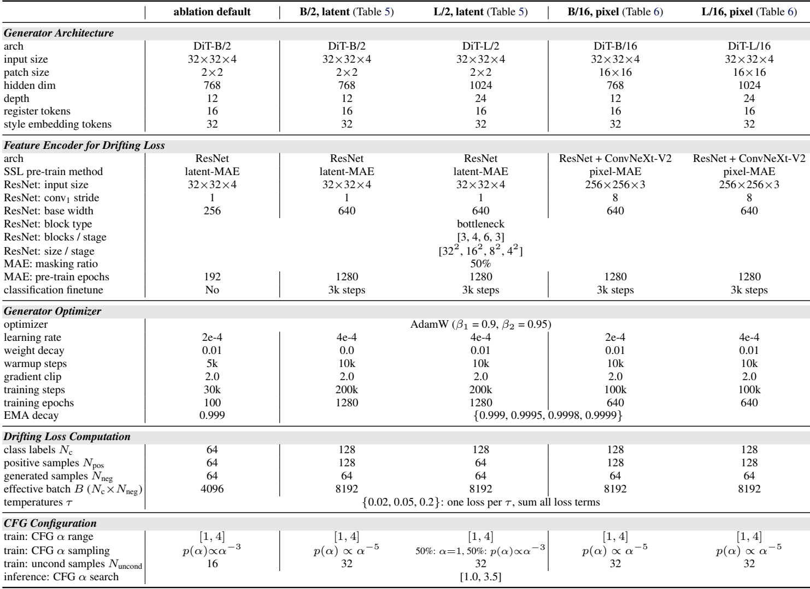

图 2-3 · 原文 Table 8，PDF 物理第 13 页，[来源](https://arxiv.org/pdf/2602.04770v2)。列分别是消融配置与四个最终配置。读表时把生成器、特征预训练、优化器、正负样本和 CFG 一起计入；“生成器训练步数相同”不能说明全系统训练成本相同。

高质量特征不是免费条件：最终 latent-MAE 编码器预训练 1280 epoch，mask ratio .5，附录给出学习率 4e-3、batch 8192，再做 3k 步分类微调。最终特征 base width 640，优于消融时的较小编码器。论文致谢提及 TPU 资源，但未披露足以核算每组实验的设备型号/数量、墙钟时间、峰值显存、总 TPU-hours 与费用。不能用 1 NFE 或 87 GFLOPs 推算训练总成本。

### 2.5 原始结果、消融与可比性

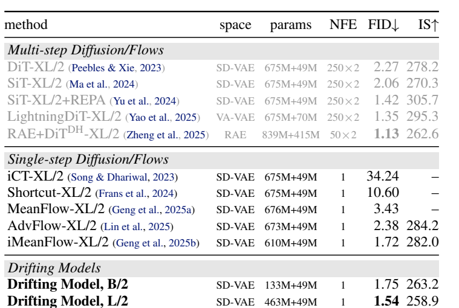

图 2-4 · 原文 Table 5，PDF 物理第 7 页，[来源](https://arxiv.org/pdf/2602.04770v2)。条件为 ImageNet 256×256、50k 样本、各方法相应 CFG 设置。参数列把生成器与 decoder 分开；NFE 里 ×2 通常涉及条件/无条件评估。FID 越低越好，IS 越高越好；不同预训练特征与模型规模仍是混杂因素。

原文最终 latent L/2 的 FID=1.54、IS=258.9，pixel L/16 的 FID=1.61、IS=307.5。表中单步 iMeanFlow 的 FID=1.72，参数约 610M+49M；但多步 SiT+REPA 可到 1.42，RAE 方案可到 1.13。因此结果支持很强的一步生成质量，不支持在所有预算下全面超过多步方法。

本文指标解释：FID 在特征高斯近似下为 ∥μ_r-μ_g∥²+Tr(Σ_r+Σ_g-2(Σ_r^(1/2)Σ_gΣ_r^(1/2))^(1/2))，μ、Σ 分别是均值与协方差。样本数、特征实现、真实统计版本都影响值；FID 不是逐图真实程度概率。IS=exp(E_x KL[p(y∣x)∥p(y)])，奖励清晰且类别多样的预测，也不直接证明训练集之外泛化。论文的更高 IS 采样配置可牺牲 FID，不能把不同 α 下两个最好数字拼成同一个 operating point。

消融给出的机制证据很具体：100 epoch B/2 默认 FID=8.46；只吸引变为 177.14；把吸引或排斥分别乘 1.5，FID 为 41.05/46.28。单边拉近不够，平衡也敏感。固定有效 batch 的负样本配置从 8 增至 64，FID 11.82→8.46；正样本从 1 增至 64，20.43→8.46。这里比较的是作者控制的实验设定，不代表所有训练资源完全相等。

特征质量同样关键：原消融特征对应 8.46；扩大并更久训练 latent-MAE 到 4.28，加分类微调到 3.36；后续生成器加长训练到 320/1280 epoch 可到 2.51/1.75，再加大生成器到 1.54。不能把全部收益归于某一个漂移公式。机器人任务用 1 次而非 100 次调用有不错表现，但例如视觉 ToolHang 成功率 .67 对 .73，并非所有任务更好。

### 2.6 理论和复现边界

原文附录 C 在有限基、非退化独立性等附加条件下分析分布可辨识；不是对任意神经特征、核和有限 batch 的全局收敛保证。与 MMD 梯度的联系在特定未归一化高斯核等条件下成立，不应将实际归一化 Laplacian 实现直接叫作完全等价的 MMD 训练。

复现先做二维多峰分布，检查 p=q 时经验漂移随样本量增加是否趋近 0，验证 stop-gradient 与自身屏蔽，再做小图像实验。正式对比必须同时固定 feature encoder、generator、训练步数、正负样本数、引导强度和 FID 计算设置，并单列预训练特征成本；公开代码入口只证明有实现资源，不证明本报告已验证训练结果。

结论：它展示了用训练期样本相互作用获得高质量一步生成的路线。可迁移的思想是“构造局部目标再回归”；最终图像质量依赖特征、批量统计与训练资源共同作用，不能只复制损失的一行外形。

## 3. LittleLearner：把“模型以前见过什么”变成可研究的变量

### 3.1 为什么普通基模不够干净

原文：[arXiv 2608.13545v3](https://arxiv.org/pdf/2608.13545v3)，Fanfei Li 等七位作者；[NeurIPS oral](https://neurips.cc/virtual/2026/oral/148221)。作者与资源见[项目页](https://littlelearner-ll.github.io/)、[模型](https://huggingface.co/littlelearner/)、[LittleCurriculum 数据](https://huggingface.co/datasets/littlelearner/LittleCurriculum)。本次读取 2026-11-06 修订版共 39 页。会议页面仍写早期 2B 模型，v3 已扩展至 5B；本节数字按 v3，录用展示身份按官方页面，二者版本差异明确保留。

原文问题：当大模型答对一道新题，我们难以知道它是在组合原有能力、从上下文新学到知识，还是曾在预训练中见过相关内容。LittleLearner 从一开始把训练材料限制在美国 K-5（幼儿园至五年级）课程范围，形成具有可解释知识边界的实验环境。

本文直觉：研究“加一本初中教材能学到什么”，先要尽量知道学生以前的书架。这里的小学范围是数据筛选规则，不是把模型当作真实儿童；语言熟练度、教育年级与参数规模也没有天然的一一对应。

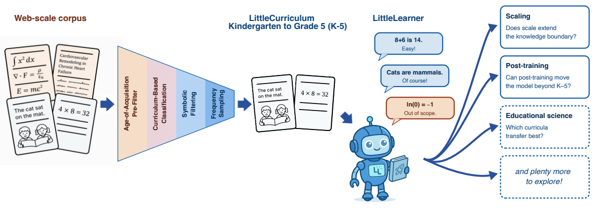

图 3-1 · 原文 Figure 1，PDF 物理第 1 页，[来源](https://arxiv.org/pdf/2608.13545v3)。从网页语料经多级过滤得到课程语料，再从头训练并研究扩规模、后训练与上下文学习。小机器人是作者示意，不能据此把模型能力解释为人的发展阶段。

### 3.2 五级数据管线：每一级阻挡不同的泄漏

原文从 FineWeb-Edu 构造 88B token 的 LittleCurriculum。最终训练目标预算约 80B token；“可用语料总量”和“某次训练实际 token 数”应分开。

第一层是词汇习得年龄 AoA。作者从词频/Zipf 量估计部分缺失词的习得年龄，若一篇文档中超过 5% 的词 AoA>12 则过滤。约 10% 的词缺少原始 AoA 信息；这个代理指标会误伤简单但含罕见名字的文章，也会放过只用简单词讲复杂概念的文本。

第二层用 Gemini 3 Flash 对复杂度、语境、学科/课程标准进行判定，采用三个提示集合并，冲突时倾向较高年级。提示搜索涉及 OpenEvolve 50 轮，以及 DSPy/GEPA 与 GPT-5 反思；标注温度 0、最大输出 1024。课程边界同时依赖教材标准和 LLM 判别器，不是客观无误的标签。

第三层先 FastText、后 ModernBERT 做大规模文档分类。约 266M 条样本具有可用的一致标签，ModernBERT 的单文档成本约是 FastText 的 50 倍。级联的动机是先低成本淘汰大部分，再把较强判别器留给边界样本，而非把数十亿网页全送大模型。

第四层用符号规则过滤明显超纲公式，例如某些求和、微积分、代数表达。其只额外去掉分类后约 0.1% 文档，说明它主要堵显式符号漏洞；“没有高等符号”当然不等于没有高等知识。

第五层按与超纲语料的词频关联进一步采样。本文用便于理解的形式写关联分数 s(w)=log₂[f_Beyond(w)/f_K5(w)]，f 是各集合归一化频率；s 越高表示词更偏向超纲材料。实现必须处理零计数、平滑与稀有词阈值；论文没有为所有筛选阈值提供足够独立重建的细节，不能把上式当作完整可执行筛选器。

本文手算：词 w 在超纲集每百万词出现 80 次，在 K-5 集出现 10 次，s=log₂8=3；另一个词两边都是 20 次，s=0。前者是应检查的泄漏线索，但如果它只是人名或普通词的罕见用法，删除会造成误伤。词频相关性提供线索，不提供语义证明。

### 3.3 数据验证、预训练和评估公式

原文验证包含 CommonCoreText 的 460 段课程文本，以及 WeeBit 的 2218 条 K-5、6000 条更高年级材料。CommonCoreText 上超纲保留为 0、K-5 保留约 35%；WeeBit 超纲保留 2.48%，人工检查其中真正超纲的有 3 条，占原 6000 条约 .05%。另有 126 个高风险 n-gram 审计，覆盖约 .09% 语料文档。这说明筛选严格但不是“数学证明训练集无泄漏”。用于提示优化、人工检查和最终报告的集合独立性，也要在进一步复现时审计。

原文基于 Qwen3 dense 架构从头训练 .6B、1.3B、5B 模型，并单独训练 K-5 tokenizer，以减少 tokenizer 自带超纲词片段信息的干扰。匹配对照 Unfiltered 使用相同架构、训练方案与 token 预算，但不过同样课程过滤。Gemma 2B 等外部模型的训练语料量达到不同量级，适合作背景，不能作严格唯一变量对照。

论文没有提出新的预训练损失。本文教学公式为 L_CE=-E_x Σ_t log p_θ(x_t∣x_<t)，仍是下一 token 预测。分布改变发生在输入数据、tokenizer 和训练范围，而非把“小学知识”写成一个特殊正则项。

为比较不同 tokenizer，本文解释 BPB（bits per byte）：BPB=[-Σ_t log p_θ(x_t∣x_<t)]/[n_bytes·ln2]。分子是同一原始字符串的负对数似然，分母把自然对数换成 bit 并除原始 UTF-8 字节数；应使用一致文本和字节定义。它避免简单的“每 token 困惑度”在不同词表下直接比较，但仍受语料难度影响。论文用 BPB 表征范围内外语料的拟合差异，本式为教学展开。

大量采样能力用 pass@k。若一题共采样 n 次，其中 c 次正确，无放回取 k 个样本的标准估计是 pass@k=1-C(n-c,k)/C(n,k)。C(a,b) 是组合数；如果 n-c<k，则没有全部失败的组合，估计为 1。本文例子 n=4、c=1、k=2，pass@2=1-3/6=.5。这里的 k 不能随意与不同样本总数或不同解码配置混用；高 k 也同时提高推理成本。

### 3.4 后训练和上下文学习具体做了什么

原文训练末段 cool-off 混合为 91% K-5 预训练、5% 数学推理、2% 数学指令、2% 通用指令，后几项也经过 Gemini Flash 改写到 K-5 范围。因此“纯预训练模型从未见过任何对话/指令”的解释不成立。要研究 SFT 的独立作用，应把这种预训练末期指令暴露记在实验账本里。

SFT 使用约 108k 数学和 526k 阅读样本，总计约 46M token、训练 1 epoch。GRPO 用合成 MathCAMPS 与 GSM8K 等材料，分 150-300 步的段进行；作者使用 16 次 rollout 中答对 1-15 次的题，避免全错无信号和全对无区分度。具体总步数、所有损失系数和后训练成本未完整披露，不能把“每段步数”当作总训练步数。

本文解释奖励与优势：数学可用最终答案匹配的 0/1 奖励 r_i；组内优势 A_i=(r_i-mean(r))/(std(r)+δ)，δ 是防止除零的小常数。若四次奖励为 (1,0,0,0)，使用总体标准差 √.1875≈.433，优势约 (1.732,-.577,-.577,-.577)。优化提高相对成功轨迹概率，仍需模型在当前采样中偶尔成功；这解释为何选 1-15/16 成功的题有信号。论文不提出新的 GRPO 理论，本段是对其训练机制的教学说明。

上下文实验提供 few-shot 示例或自然语言解法说明，研究不改参数的知识注入。为避免题库形式造成伪难度，作者过滤答案种类不足 30、题干直接泄露 gold string 等情况，并注意到六年级标准 6.EE.B.7 的某些实例可类似三年级题。年级标签不能独立证明模型必须用了高年级推理。

```text
划定课程范围，按同一规则构造训练集与泄漏审计集
从头训练受限模型与匹配的 Unfiltered 对照
在 K-5 / Beyond-K5 上固定模板、解码与采样次数评估
分别开展 SFT、SFT+GRPO、few-shot、文字解释干预
每次比较范围内收益、范围外收益及不确定性
同时复查新训练材料是否确实引入了目标新知识
```

### 3.5 原始图与“能力边界”的证据强弱

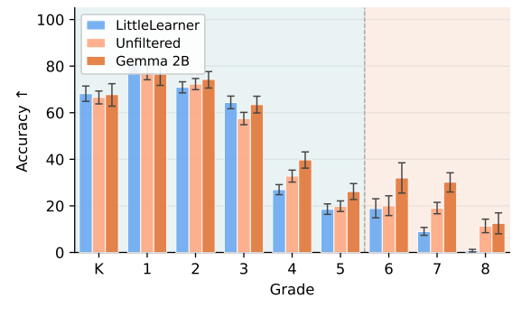

图 3-2 · 原文 Figure 6，PDF 物理第 6 页，[来源](https://arxiv.org/pdf/2608.13545v3)。MathCAMPS 按年级分组，图中为 pass@1，由每题 1024 次 rollout 估计，误差棒为 95% CI。受限模型在更高年级下降明显，但五到六年级不是绝对断崖；先看同预算 Unfiltered，再看外部 Gemma 对照。

原文发现不仅是模型较小或总 token 少：匹配 Unfiltered 的范围外表现更强，扩到 5B 也主要改善边界以内，远超范围内容提升有限。自然语言/事实 BPB 与问答也出现相似边界，支持“预训练暴露影响下游能力”，但筛选同时改变文体、词频与任务分布，未把这些因素完全拆开。

原文有一处应保留的数字口径差异：正文物理第 6 页描述八年级 pass@1024 时称受限模型解题数量不到 Unfiltered 的一半，附录 C.2.3（第 27 页）相近讨论写约三分之二。本报告不把其中任一比例当作确定结论；可确认的方向是受限模型更弱，精确比值需作者澄清对应版本/设置。

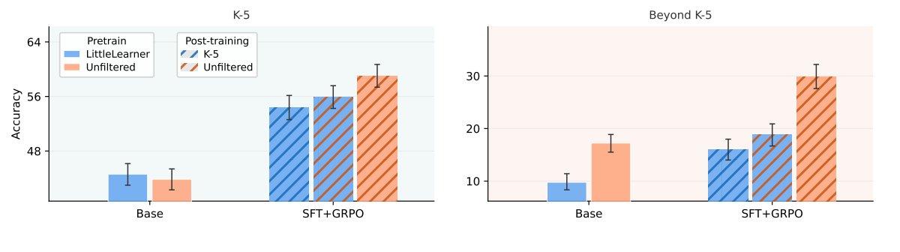

图 3-3 · 原文 Figure 8，PDF 物理第 8 页，[来源](https://arxiv.org/pdf/2608.13545v3)。横轴是 Base 与 SFT+GRPO，左侧 K-5、右侧 Beyond-K5，误差棒为 95% CI；颜色/斜线区分预训练与后训练数据范围。右图的受限模型不是完全零提升，但没有追上未过滤对照。不能把“在这些设置下没突破”改写成 RL 普遍不可能学新知识。

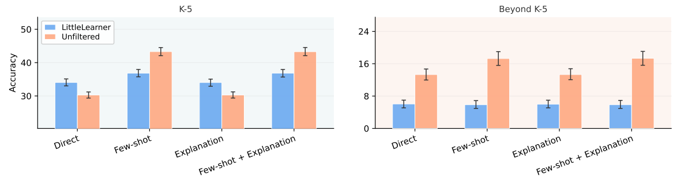

图 3-4 · 原文 Figure 9，PDF 物理第 8 页，[来源](https://arxiv.org/pdf/2608.13545v3)。Direct、Few-shot、Explanation、Few-shot+Explanation 使用同一类任务比较；误差棒为 95% CI。范围内 few-shot 有帮助，范围外帮助很有限。图中有限的提示方案不代表所有检索、工具、长上下文课程都无效。

附录对表达形式的检查也有价值：SFT 5B 在直接提问时 K-5/Beyond 为 34.0%/6.0%；自然语言说明为 36.8%/5.9%；紧凑说明 17.0%/1.6%；QA 形式 9.2%/.2%。短提示的字符数更少不保证更易懂，给知识的形式本身是干预变量。数字 tokenization 的 2B 消融也能改动绝对分数，但没有消除受限/非受限差距。

### 3.6 硬件、成本与复现建议

原文 5B 训练使用 8 张 B200、约 100 小时，参数存储 BF16、计算 MXFP8，8 路分片 Muon；基于 Megatron Core 0.17.1，纯数据并行，TP/PP/CP 均为 1。本文核算单次该训练约 800 GPU-hours；这不包括数据清洗、教师标注、其他模型、对照、超参试验和后训练。峰值显存、实际总费用、完整学习率/batch/step 日志在论文中未完整给出。

原文提到把 6.95B 篇文档全部用 LLM 标注，若每篇 .0066 美元，将约需 45.87M 美元；这是说明级联筛选必要性的反事实估算，不是作者实际花费。不能与前述 800 GPU-hours 相加当作项目账单。实际 API 请求数、缓存与去重比例、失败重试成本仍待公开日志。

复现最有价值的起点不是立即从头训练 5B，而是审计已公开语料：随机抽样、边界概念定向检索、用不同判别器与人工复核，测量泄漏/误杀；随后在固定架构和 token 预算的小模型上比较。后训练研究应预注册目标新概念、设独立测试，记录每个概念在 pretrain、SFT、RL、prompt 四处的出现情况。

结论：LittleLearner 的主要贡献是一个可控研究平台和一组负面结果。它把“以前可能看过”从无法追问的背景变成可审计的数据设计；但知识边界仍是操作性定义，不能把课程标签、自动筛选或有限干预失败升级为普遍能力定理。

## 4. 量化推理：更长的思考有时只是更难停下来

### 4.1 从权重压缩到行为改变

原文：[arXiv 2606.00206v1](https://arxiv.org/pdf/2606.00206v1)，Sanae Lotfi、Polina Kirichenko、Steven Li、Zechun Liu；[NeurIPS oral](https://neurips.cc/virtual/2026/oral/151669)，[作者解读页](https://sanaelotfi.github.io/blog/quantized-reasoning-models/)。首发元数据为 2026-05-29，稿件显示 June 2；本报告不把稿内页眉日期当作首次公开日期。正文与附录 22 页全部纳入精读，作者页未提供可核验的完整复现代码链接，故不擅自宣称开源代码齐备。

原文问题：PTQ（训练后量化）降低权重/激活精度，通常为了减少推理资源。对推理模型，激进量化不仅降低正确率，还可能延长思维链。很多失败轨迹中间已经出现正确答案，随后又犹豫、改写，最终给错或不收束。

本文直觉：压缩让模型在“继续检查还是提交答案”的分叉点更不稳定。作者用少量 logits 惩罚抑制反复犹豫的语言标记，不重新训练；它不修复所有算术或知识错误，也不等价于把所有长推理截短。

### 4.2 量化基础及误差如何传播

本文教学定义：b 位均匀量化 q=clip(round(w/s+z),0,2^b-1)，重建值 ŵ=s(q-z)。w 是原浮点权重，s 为缩放，z 为零点，q 为整数；具体方法可用对称范围或按组缩放，因此不能把这一形式误写为全部实验的逐位实现。组大小 128 表示一组权重共享相关量化参数。

GPTQ 的局部动机可写为 min_Ŵ ∥XŴ^T-XW^T∥²_F，X 是校准激活，W 是原层权重；用输入统计减轻重要方向误差。AWQ 使用激活信息选择尺度，保持等价关系 XW^T=(XS)(WS^-¹)^T，再量化适当缩放后的权重；S 为对角缩放矩阵。FlatQuant 对权重、激活与 KV cache 等作相应变换和量化。重点不是把 b 降低本身，而是降精度后函数输出分布怎样变。

本文手算：若 s=.1、z=0、允许范围足够，w=.26 被四舍五入到 q=3，ŵ=.3，误差 .04。单个误差很小，但深层矩阵乘积和自回归反馈会改变下一步分支。一个早期 token 变了，后续前缀也变了，最终长短/答案差异就不能只解释为独立噪声的简单累加。

论文比较 BF16 模型 p 与量化模型 q，在完全相同的上下文 h 下计算 D_KL(p∥q)=Σ_v p(v∣h)log[p(v∣h)/q(v∣h)]，并计算 H(p)=-Σ_v p(v∣h)log p(v∣h)。v 遍历整个词表；KL 描述两个下一词分布的差异，H 描述 BF16 本身的不确定程度。共享前缀隔离当前分布误差，比各跑各的完整轨迹直接比 logits 更可解释。

原文将位置级 KL 与该位置采样到的 token 关联后取平均，并过滤出现少于 50 次的 token。因此所谓“某 token 的 KL 高”是该 token 常出现位置的平均完整分布 KL，不是把某个 v 的 KL 求和贡献单独拿出来；二者不同，不能过度赋予一个词本身的因果含义。

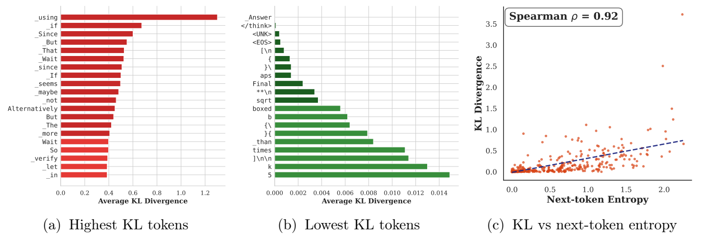

图 4-1 · 原文 Figure 4，PDF 物理第 6 页，[来源](https://arxiv.org/pdf/2606.00206v1)。Qwen-1.5B、3-bit AWQ、MATH-500 的分析；左/中为高低关联 KL 的 token，右为位置 KL 与熵关系，Spearman ρ=.92。高相关说明错误集中在不确定分叉附近，不能单独证明特定“犹豫词”造成全部量化误差。

### 4.3 惩罚公式、概率作用和实现顺序

原文用人工整理的 50 个 overthinking marker token 集合 S，包括 wait、but、alternatively 等相应词表 token。每一步把 logits 改为 z′_v=z_v-λ·1[v∈S]，λ>0 为强度，随后按常规采样。它不是硬禁用，也没有增加一次大模型前向；仍存在 logits 处理、索引与采样开销，工程上不应理解为字面零成本。

本文推导：softmax 温度为 T。若惩罚加在除温度之前，对集合内 u 与集合外 v，p′(u)/p′(v)=[p(u)/p(v)]exp(-λ/T)。因此 λ 的同一数值在不同温度下效应不同；如果实现把惩罚加在温度处理后，因子是 exp(-λ)。复现必须固定顺序，还要确认 top-p 是在惩罚后截断。

本文手算：假设某步只有 “wait” 和 “answer” 两个选项，原概率 .4/.6，温度 1，λ=ln2。wait 未归一化质量减半为 .2，answer 仍 .6，归一化后为 .25/.75。不是直接从 .4 减去 λ，也不是保证下一词一定提交答案；全词表和 top-p 会让真实变化更复杂。

```text
按该模型 tokenizer 把完整 marker 列表映射为 token IDs
每个 decode step 取得 logits
对 marker IDs 减去 lambda
按明确顺序执行 temperature、top-p 和采样
保存答案、完整轨迹、token 数、停止原因及是否触及长度上限
使用独立验证集选择 lambda，再冻结到测试集
```

最后一行是本文的严格复现建议。论文表1按每个报告 benchmark 选择最佳 λ，不能假定已经具有独立验证选参过程；部署时也不能期待自动知道每个任务的最优惩罚。

### 4.4 实验对象、校准数据与评估条件

原文模型为 DeepSeek-R1-Distill-Qwen 1.5B/7B/14B、DeepSeek-R1-Distill-Llama 8B、QwQ-32B。AWQ/GPTQ 使用 3-bit 与 4-bit 权重量化，group size 128；FlatQuant 包括 W4A4KV4 与 W8A8KV8。QwQ-32B 的表格并未覆盖所有同样配置，不能据此宣传完整五模型×全部精度的无缺项矩阵。

校准语料并不相同：GPTQ 使用 128×2048 的 NuminaMath 生成轨迹；AWQ 使用 128×512 的 Pile uncopyrighted；FlatQuant 使用 128×2048 Wikitext-2，部分 Qwen 1.5B/7B 配置因 K outlier 使用 4096 长度。不同量化方法的比较混入了校准数据与长度差异；同一个量化模型加/不加惩罚的比较更接近单变量干预。

任务覆盖 GSM8K、MATH-500、AIME-120、GPQA-Diamond、LiveCodeBench，采样温度 .6、top-p=.95。λ 网格为 .5、.7、1、1.5、2、2.6、3、4。主要 marker ablation 包含四组各 50 token 的列表、六种配置、五个 benchmark、八个 λ，共 960 个组合外加 30 基线；反向惩罚实验也有额外组合。没有训练参数更新不等于整项研究没有计算成本。

未披露或不足以统一复现的部分包括：全部实验的硬件/卡数、墙钟时间、峰值显存、GPU-hours、总费用以及统一明确的最大生成长度/截断对比账本。结果中的长轨迹与触顶错误很相关，这些设置应作为第一优先级补齐。

### 4.5 原始错误分类与准确率/长度结果

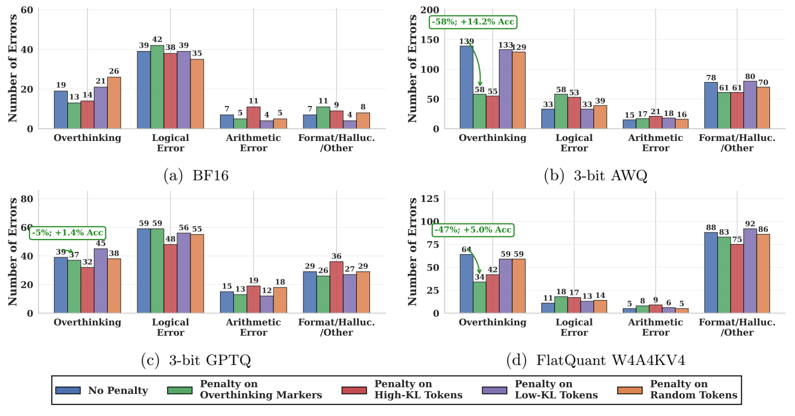

图 4-2 · 原文 Figure 3，PDF 物理第 5 页，[来源](https://arxiv.org/pdf/2606.00206v1)。Qwen-1.5B 在 MATH-500 的错误分类，分别为 BF16、3-bit AWQ、3-bit GPTQ、FlatQuant W4A4KV4。纵轴是错误条数，各面板量程不同，不能比较柱子视觉高度来判断倍数。先看每组蓝柱，再看同组 marker 惩罚后的绿柱。

原文使用 GPT-5 做错误类型归类，在人工核对的子集中一致率超过 95%，但未明确给出该人工子集规模。若中间到过正确答案而最终失败，归到 overthinking；其他类别包括逻辑、算术、格式/幻觉等。这个操作性标签依赖识别轨迹文字，不是对隐藏内部思考过程的直接测量。

最容易误读的百分比：3-bit AWQ 在 MATH-500 有 265 个错误，其中 139 个归为 overthinking，139/265=52.45%。这是错误中的比例，不是全部 500 题的 52%。惩罚后该类错误从 139 降到 58，减少约 58.27%；不是总错误减少 58%，总错误从 265 到 194，正确率从 47.0% 到 61.2%。

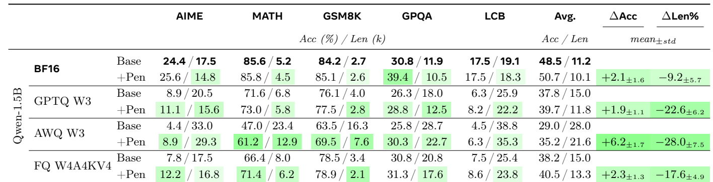

图 4-3 · 原文 Table 1 的 Qwen-1.5B 区块，PDF 物理第 8 页，[来源](https://arxiv.org/pdf/2606.00206v1)。保留原表头与该模型全部行，其他模型见原表全文。每个格子以 accuracy/length(k) 表示；“+Pen”是 benchmark 上所选最佳 λ。右侧 ± 描述 λ 变化下的统计，不是多随机种子的置信区间。

| Qwen-1.5B / MATH-500 | 正确率 | 平均 CoT token 数 |
| --- | --- | --- |
| BF16 基线 | 85.6% | 约 5156 |
| 3-bit AWQ | 47.0% | 约 23444 |
| 3-bit AWQ + marker 惩罚 | 61.2% | 约 12900 |

惩罚显著改善这一量化配置，但离 BF16 的 85.6% 还有 24.4 个百分点，不能叫作恢复完整精度。跨五 benchmark，Qwen-1.5B AWQ3 的平均正确率 29.0%→35.2%，平均长度 28.0k→21.6k；表中平均相对长度改善 -28% 是逐 benchmark 的相对变化再平均，不能用“均值的比值”替代，后者约为 -22.9%。

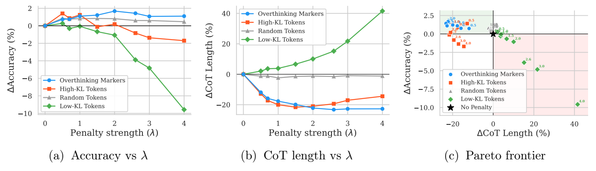

图 4-4 · 原文 Figure 5，PDF 物理第 7 页，[来源](https://arxiv.org/pdf/2606.00206v1)。Qwen-1.5B 跨量化配置与任务的平均结果：左为准确率随 λ，中为长度随 λ，右为二者权衡。marker 列表优于高 KL、低 KL、随机 token 等对照。原文“12-23%”对应这组平均消融语境，不是所有模型、全部任务都节省该比例。

反例同样应记录：Qwen-14B FlatQuant4 的总体平均正确率约 70.7%→70.5%；Qwen-7B AWQ3 在 MATH-500 约 91.2%→90.2%。不同模型/配置平均长度改善范围也更广，不能保证不掉点。给 marker 加正向偏置的反向实验会使长度大幅增加、准确率变差，支持这组词对行为有干预作用；但 marker 同时可能承担必要的纠错功能，惩罚过强会扼杀有用自检。

### 4.6 工程收益怎样真实计账

本文粗算权重容量：N 个参数、每个 b bit 时约 Nb/8 字节，尚未加 scale、zero point、未量化层和分配碎片。例如 7B 权重从 16 bit 到 4 bit 的裸容量约 14GB→3.5GB（十进制）。但自回归 KV cache 随上下文长度增长；权重压缩若使推理长度增加四倍，延迟和 KV 占用可能抵消部分收益，不能只看权重文件大小。

token 减少也不自动等于同百分比的端到端加速，prefill、量化 kernel、batch 和停止不均衡都影响吞吐。复现应记录同硬件下 tokens/s、每题墙钟、峰值显存、质量、触顶比例；校准成本与 λ 搜索成本应单列。一个合理小试验是冻结单个 1.5B 模型的 tokenizer/校准集，在独立验证集选 λ，测试 BF16、AWQ3、AWQ3+penalty 三组，并人工检查被抑制的“必要纠错”样本。

结论：最可移植的是一个低侵入解码干预及其诊断方法。论文提示低比特部署的风险不仅是数值精度，而是生成策略改变；最佳 λ 的选择偏差、校准混杂和不完整系统性能披露，仍限制了将 token 节省直接当作部署收益承诺。

## 5. 标注预算分配：从小模型迁移“够好的区域”

### 5.1 把找最优点改成找可接受集合

原文：[ACL 正式 PDF](https://aclanthology.org/2026.emnlp-main.2450.pdf)，Jingtan Wang、Arun Verma、Xiaoqiang Lin、Zhengyuan Liu、Nancy F. Chen、Daniela Rus、Bryan Kian Hsiang Low；EMNLP 2026 主会长文、CCF-B、poster。正文与附录共 30 页均纳入本次阅读。[正式记录](https://aclanthology.org/2026.emnlp-main.2450/)给出 DOI 10.18653/2026.emnlp-main.2450；[预印本](https://arxiv.org/abs/2609.01573)作为同论文别名。没有找到作者在所核验论文/官方记录中提供的完整实验代码入口，数据与基础算法入口见原文附录 A。

原文问题：固定标注预算下，多少给 SFT 示范，多少给后续 DPO/GRPO？每改一次比例都需要重新从同一基础模型跑 SFT，再跑其对应 RL 阶段；大模型全网格搜索昂贵。最佳比例可能随模型大小变化，但一段“差不多好”的比例集合可能更稳定。

本文直觉：饭菜的最优盐量也许是一个不稳定的尖峰估计，能被接受的范围却足够宽。找一个能迁移的区间，比执着于一次测量中最高的那一格更实用。这篇没有提出新 RL 优化器，而是提出分配问题的统计定义并做实证研究。

### 5.2 符号、目标、区域宽度与迁移率

令 N 为模型参数规模，B 为总标注样本预算，r∈[0,1] 为给 SFT 的比例；SFT 约用 rB 条，RL 约用 (1-r)B 条，分别按论文的取整规则分配。P(N,r,B) 是非负任务分数。先 SFT 再 RL，顺序不可交换。

点最优 r*=argmax_r P(N,r,B)。容忍相对损失 ε 后，近优区域 R_ε(N,B)={r:P(N,r,B)≥(1-ε)max_(r′)P(N,r′,B)}。ε=.05 表示保留峰值的 95%，不是允许掉 5 个绝对百分点。峰值若为 .8，门槛是 .76，允许降 4 个百分点；峰值 .2 时只允许降 1 个百分点。

实际只测 G={0,.25,.5,.75,1}，因此用 Rg_ε={r∈G:P(N,r,B)≥(1-ε)max_(r′∈G)P(N,r′,B)}。Rg 表示网格估计；这是已测网格的近优集合，不是证明连续区间内每一个比例都近优；网格最优也可能低于真正连续最优。

原文 range width w_rng=max(Rg)-min(Rg)，count width w_cnt=∣Rg∣/∣G∣。前者看端点跨度，后者看合格网格比例。本文提醒：即使集合连续相邻，这两个数也一般不相等；例如单点集合的 range=0，count=.2。若集合为 {0,1}，range=1 但 count=.4，中间全空；因此可视化网格空洞与加密网格很必要。

迁移率 T_ε(N_s→N_t;B)=∣Rg_ε(N_s,B)∩Rg_ε(N_t,B)∣/∣Rg_ε(N_s,B)∣。N_s 是小代理，N_t 是大目标。它问“从小模型近优集合中均匀选一个候选，多少也在大模型近优集合里”，是非对称量，不能与反方向或 Jaccard 相似度混淆。论文再对不同 B 等条件聚合；单个比例跨预算的 hit rate 与集合重叠率也不是同一个统计。

本文手算：小模型五格成绩 (.60,.76,.80,.78,.70)，ε=.05，阈值 .76，近优集合 {.25,.5,.75}，range=.5，count=.6。大模型若为 (.75,.84,.88,.87,.86)，阈值 .836，集合 {.25,.5,.75,1}。从小到大迁移率 3/3=1，反向 3/4=.75。这个例子没有“最优 r 必须一样”的要求，且看出高峰值会放宽绝对容忍量。

### 5.3 SFT、DPO 与 GRPO 的训练机制

SFT 损失为 L_SFT=-E_(x,y)∼D_SFT log π_θ(y∣x)，x 是 prompt，y 是示范回答。DPO 使用偏好三元组 (x,y_w,y_l)，w 为胜出回答、l 为失败回答；损失 L_DPO=-E log σ{β[log(π_θ(y_w∣x)/π_ref(y_w∣x))-log(π_θ(y_l∣x)/π_ref(y_l∣x))]}。σ 为 sigmoid，β 控制相对参考策略的尺度；π_ref 通常对应进入该阶段的参考模型。DPO 不需要在线采样每个训练样本，却需要偏好对，和单条 SFT 示范的标注成本未必相同。

本文推导：设相对参考的 winner log-ratio 为 a、loser 为 b，则 margin=β(a-b)。当 a=b，损失 ln2；提升 winner 相对概率或降低 loser 相对概率都会增大 margin、减小损失。β=.1、a-b=2 时 margin=.2，损失约 .598，小于 .693。这个例子说明方向，不能把 β 当学习率。

GRPO 则对同一个 prompt 生成 G 个回答，用任务奖励 r_i 形成 A_i=(r_i-mean(r))/(std(r)+δ)。令 ρ_i=π_θ(y_i∣x)/π_old(y_i∣x)，标准 clipped surrogate 为 min(ρ_iA_i,clip(ρ_i,1-η,1+η)A_i)，对样本取平均并最大化；η 是裁剪范围，π_old 是 rollout 策略。实际实现通常按 token 处理比率/长度归一化；本文给出简化教学形式，不补造论文没有完整列出的 KL、clip 或长度配置。

原文 GRPO 使用任务特定评估信号：数学答案、指令约束、摘要 ROUGE-L、helpfulness 奖励模型等。摘要 GRPO 使用偏好数据中的 preferred response 作为参考；指令遵循专门换成 Tülu3 RLVR/IFEval 数据。不同奖励的尺度与可靠性不同，因此 P 不能跨任务直接相加，预算规律也应逐任务看。

### 5.4 数据、模型、训练设置与可执行流程

| 任务 | SFT / RL 数据 | 测试与指标 |
| --- | --- | --- |
| 小学数学 | GSM8K 的 GPT-4o generations / preferences；相关公开数据见附录表2 | GSM8K accuracy |
| 指令遵循 | Tülu3 personas instruction-following / preference；GRPO 用 RLVR-IFEval | IFEval |
| 摘要 | Reddit TL;DR / comparisons | 测试集 ROUGE-L F1 |
| Helpfulness | HelpSteer、HelpSteer2 | 本地留出 200 条；GPT2-large helpful reward model 打分 |

原文模型包括 Llama3 系列 1B/3B/8B、Qwen2.5 多尺度至 14B，以及 Qwen3 1.7B/4B/8B。图中的 Qwen2.5 “2B”指 1.5B，Qwen3 “2B”指 1.7B，不能把这些标签都写成精确 2B。主预算扫到 15k 样本，主要跨尺度分析聚焦 B≥5k；更小预算曲线噪声大，低预算消融另报。

所有实验使用 LoRA，rank=32、α=32、dropout=0、无 bias，作用于 attention modules。主实验 seed=42，在 L40s 与 H200s 上运行。不是全参数微调，因此不能直接保证全参大模型也有同样区间。

SFT 学习率 1e-5，DPO/GRPO 为 1e-6，有效 batch 16；通常 1 epoch，指令任务 2 epoch；warmup ratio .1，cosine schedule，adamw_8bit，weight decay .01。DPO β=.1；GRPO 每题 4 次生成，temperature=.9，top-p=1、top-k=-1、min-p=0、repetition penalty=1。具体硬件卡数、每个运行的峰值显存与全研究总训练用时未完整给出。

本文步数核算示例：B=10000、r=.5、batch16、1 epoch 时，SFT 和 DPO 各约 ceil(5000/16)=313 个 optimizer step；分布式 sampler、梯度累积、丢弃尾 batch 等会改变精确值，GRPO 的 rollout 与实际更新次数也不能简单照搬此式。该数只是配置推导，不是作者公布日志。

```text
固定任务、预算 B、数据池与独立验证/测试切分
对五个比例 r：从同一 pretrained checkpoint 开始
抽取 rB 个 SFT 样本，训练 SFT；再跑对应 (1-r)B 的 DPO/GRPO
在小模型验证集得到五个成绩，按 epsilon 建立近优候选集合
选择已测试的集合中部候选，保留集合不连续时的空洞
用选定比例训练目标模型，在未参与选择的测试集评估
保存数据子集 ID、随机种子、所有成本和失败运行
```

这是根据论文思想整理的复现流程；严格独立验证/测试与失败运行日志是本报告建议。不能从区间的两个端点直接推出中点可用；如果中点未测，优先取最近的已通过网格点。

### 5.5 主要结果与原图解读

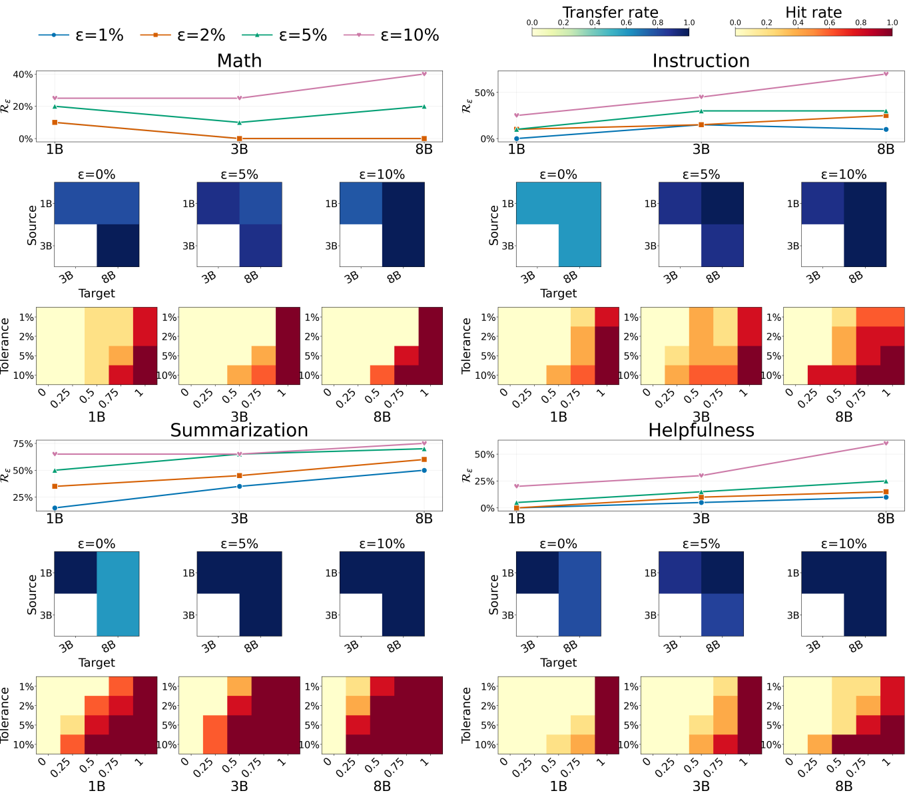

图 5-1 · 原文 Figure 2，PDF 物理第 5 页，[来源](https://aclanthology.org/2026.emnlp-main.2450.pdf)。Llama 系列 SFT→DPO；四个任务各有三层：上层是区间宽度随模型规模变化，中层是跨尺度迁移，底层是各比例跨预算命中率。颜色图例不同，蓝色迁移率与红色 hit rate 不可互读。ε=0 的精确最优通常比容忍 5%-10% 的区域更难迁移。

原文实证：近优区域通常随容忍度与模型规模变宽，代理模型识别的区域比单点最优更稳定地迁移。作者三步策略为小模型网格搜索、确定容忍区间、在大模型用区间中的候选；在汇总设置中 5%/10% 容忍的近优命中约 94.3%/97.1%。这是已测试实验组合的频率，不是对未来任意任务的统计保证，也不自动适用于更大的预算或参数规模。

附录的针对性对比更清晰：代理建议与固定 r=.5 比较，在 5% 容忍下，Llama HelpSteer 为 .95 对 .20，Llama 指令 .95 对 .40，Qwen2.5 指令 .90 对 .60；10% 容忍时分别 1.00 对 .70、.95 对 .70、1.00 对 1.00。固定 50/50 并非永远差，尤其容忍更宽时可能足够。

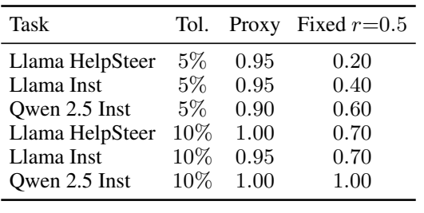

图 5-2 · 原文 Table 6，PDF 物理第 28 页，[来源](https://aclanthology.org/2026.emnlp-main.2450.pdf)。表中是目标模型近优区间命中比例，不是任务准确率，也不是“每次训练成功概率”的普适估计。取值来自既定任务、预算与目标规模的聚合。

### 5.6 消融、反例与指标本身的陷阱

网格分辨率消融把五点加密至九点，补 .125、.375、.625、.875；在数学与摘要、Llama 系列上，定性宽度/迁移趋势保持。它降低了粗网格造成假象的疑虑，仍不是所有任务/所有比例的连续性证明。

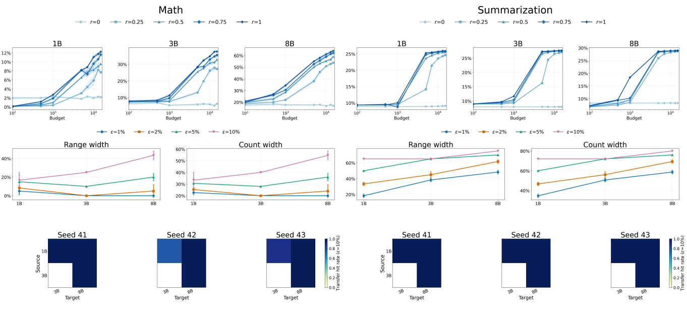

图 5-3 · 原文 Figure 22，PDF 物理第 24 页，[来源](https://aclanthology.org/2026.emnlp-main.2450.pdf)。Llama 的数学与摘要三种随机种子验证；上/中层阴影为跨三 seed 的 ±1 标准差，下层分别画各 seed 的迁移矩阵。随机性同时影响抽样子集与训练顺序；不能将局部三种子结果说成全研究每个单元都三次复现。

原文主网格多为单种子，完整多种子成本很高。另有减少 epoch、加倍学习率的指令任务扰动，主要定性结论保留；低预算 B≈1k 时曲线更噪、较常偏向 SFT，此时直接小网格搜索本身可能不贵，代理转移的优势较弱。

关键混杂是相对容忍门槛：大模型峰值更高，固定 ε 就允许更大的绝对误差。论文附录 E.6 以最小模型峰值锚定绝对容忍 δ_ε(B)=ε·max_r P(N_min,r,B)，改用 Rg_abs={r:P(N,r,B)≥max_r′P(N,r′,B)-δ_ε(B)}。部分 Qwen 趋势保留，但 Llama-Math 的宽度随规模可下降；所以“区间更宽”部分来自指标定义，不能全部解释为优化曲面本质变平。

另一个退化情况是任务饱和：Qwen7B 在 helpfulness 基线已较高，后训练增加有限，很多比例都差不多；宽区间可能只是任何训练都没改变太多。奖励模型分数的零点/尺度也重要：将所有 P 加一个常数会改变相对容忍的绝对宽度，而不改变哪个模型更好。研究和部署都应同时报告原始任务分数、相对/绝对门槛、近优集合，不能只报一个“区域宽度”。

### 5.7 标注费用不对称与真实计算账单

主实验 B 按标注样本数计，默认 SFT/RL 单样本成本相当；论文明确暂不计工程与基础设施成本。费用不对称时 B 改为金额，c_S、c_R 分别为单样本标注费，r 变成给 SFT 的金额比例，则 n_S=rB/c_S、n_R=(1-r)B/c_R。ρ=c_S/c_R 扫 1、2、5、10；相同 r 不再等价于相同样本比例。

本文手算：B=10 美元，c_R=.001、c_S=.005，r=.5 时 n_S=1000、n_R=5000，样本比例是 1:5 而非 1:1。若把 r 误解成样本比例，预算会被错误分配。该实验某些配置排除表现过差/数据要求特殊的 r=0，应按原图图例核对候选集合，不能与完整五点无条件混用。

原文按当时 L40 云价与测得用时估算，单样本训练费用从约 2e-5 美元（1B SFT）到 3e-4 美元（8B DPO）。与人工标注 .5-1 美元比，约低 3-4 个数量级；与 .001 美元的廉价合成标注比差距小得多。这里是论文采用的历史价格与配置，不是查询日可购买价格，也不是对所有 RL rollout 的成本定律。

附录 E.7 给出更具体例子：1B 代理的五比例搜索与单次 8B 训练分别约 100 GPU-minutes；按 1.25 美元/GPU-hour，分别约 2.1 美元。代理+一次目标约 200 GPU-minutes，相比目标五点全搜约 500 GPU-minutes，约便宜 2.5 倍。这是所述 10k/run 设置的局部核算；不能外推为整项研究只花 4.2 美元，论文整体有数百至数千运行。

附录还分析纯计算时间预算，DPO 约比 SFT 贵 2-3 倍，可对应 ρ≈.5；该数学设置在小模型上近优区间退化成单一比例，跨规模迁移恰好完全命中。它表明框架可换成本轴，不表示所有时间预算也有宽阔区域。

复现建议：先测本任务每条示范/偏好/rollout 的真实成本，区分已有数据沉没成本与新增标注费用；再做小模型搜索，设置独立测试，至少复核边界附近多个 seed。超出 14B、超出 15k、全参微调、交替 SFT/RL、强分布外测试的可迁移性均未由本论文完整证明。

结论：可落地的是先找小模型的稳健候选集合，再用少量目标实验验证。把“够好”定义清楚比寻找一个脆弱的最优点更有价值；但近优区域、相对门槛和历史局部成本都不能当作普遍保证。

## 6. 五篇放在一起：下一步应验证什么

| 论文 | 主要改变的对象 | 最低成本的第一项检查 | 最需要补齐的证据 |
| --- | --- | --- | --- |
| FWS | SFT 训练轨迹的分布 | 少量题的保真率、接受率与采样成本 | 贪心实现的分布性质、完整离线成本 |
| Drifting | 生成器的训练目标与分布更新 | 二维多峰、小 batch 的漂移/梯度检查 | 全系统训练成本、特征与损失聚合细节 |
| LittleLearner | 预训练知识暴露 | 公开语料的定向泄漏审计 | 标注/筛选成本、全套训练日志、边界独立验证 |
| Quantized Reasoning | 解码时 marker 的相对概率 | 独立验证选 λ、同硬件测延迟与质量 | 无测试选参的泛化、统一截断与校准设置 |
| Budget Allocation | SFT/RL 的数据/费用分配 | 同任务的小代理五点搜索 | 大规模/全参/OOD 迁移与完整多种子成本 |

五篇的共同方法论是控制变量：FWS 改数据分布，Drifting 改生成训练动态，LittleLearner 改知识暴露，量化论文在固定模型上改解码，预算论文改训练数据份额。每个结果都要问：比较对象是否固定，质量与成本是否在同一个设置测量，理论假设是否真的被实现满足。

本期没有执行训练、生成推理基准或统计复现实验；只完成原文/附录精读、官方身份核验、原图保留、公式推导和可复现性审查。下载版本、引用查询、录用证据、全仓查重和制品检查均保留在 manifest 与 assets 的审计文件中。

## 7. 按难度分级的辅助阅读

这些材料帮助理解概念，均不计入本期五篇，也不因其年代较早而影响本方向的年度录用口径。项目页只用作作者资源导航，正文结论以对应论文 PDF 为依据。

| 难度与对应主题 | 一手材料 | 建议先弄懂什么 |
| --- | --- | --- |
| 入门：五篇共用 | [动手学深度学习：概率与统计](https://d2l.ai/chapter_preliminaries/probability.html) | 条件概率、期望、抽样与误差；再看 KL 与近优区域 |
| 入门：FWS / LittleLearner | [动手学深度学习：语言模型](https://d2l.ai/chapter_recurrent-neural-networks/language-model.html) | 自回归分解、负对数似然与困惑度；再读数据分布变化 |
| 中级：LittleLearner | [Datasheets for Datasets](https://arxiv.org/abs/1803.09010) | 数据来源、筛选、用途与限制怎样记录；配合泄漏审计 |
| 中级：Budget / LittleLearner | [DPO 原论文](https://arxiv.org/abs/2305.18290)、[DeepSeekMath / GRPO](https://arxiv.org/abs/2402.03300) | 偏好 margin、参考策略、组内相对奖励与训练信号 |
| 中高级：Quantized Reasoning | [GPTQ](https://arxiv.org/abs/2210.17323)、[AWQ](https://arxiv.org/abs/2306.00978) | 校准激活、量化误差、通道缩放与真实系统收益 |
| 高级：Drifting | [Flow Matching](https://arxiv.org/abs/2210.02747) | 连续概率路径与向量场回归；再比较训练期漂移与推理期积分 |
| 高级：FWS | [本篇附录与算法](https://arxiv.org/pdf/2610.02140v1) | MH 细致平衡、信息投影、有限链与贪心近似的差别 |

作者解读资源：FWS、Drifting、LittleLearner 的项目页已在各节链接；量化论文有独立作者博客；Budget 在已核验正式记录与 PDF 中未发现独立作者博客/完整代码入口。未将第三方复刻仓库冒充官方实现。所有资源与图源的访问日均为 2026-11-18。
