# CCF-A/B 年度论文图文精读 · 2026-11-19

北京时间 2026 年 11 月 19 日。主题：提示词进化、无训练采样、可信域强化学习、连续语言流与 SFT–RL 动态混合。

本期实际收录 5 篇，按 2026 年正式会议录用年度筛选，预印本允许早于 2026 年。已阅读五份完整 PDF（含附录，共 215 页），静态核对作者公开代码；未运行模型训练、推理评测或论文复现实验。以下数值来自论文；标注“本文推导”的例子仅用于解释机制。

## 本期选题与证据口径

| 论文 | 正式录用与 CCF | 官方展示形式 | 首次公开 | OpenAlex 引用快照 |
| --- | --- | --- | --- | --- |
| GEPA | ICLR 2026，A | oral | 2025-07-25 | 703 |
| Reasoning with Sampling | ICLR 2026，A | oral | 2025-10-16 | 98 |
| TROLL | ICLR 2026，A | oral | 2025-10-04 | 9 |
| ELF | NeurIPS 2026，A | poster | 2026-05-11 | 87 |
| GAC | EMNLP 2026 主会长文，B | Virtual Pres；oral/poster 未确认 | 2026-05-25 | 1 |

配比为 4A+1B、3 oral+1 poster+1 线上展示。目标中的第二篇 poster 未满足：GAC 的官方排程仅标注 Virtual Pres，本期保留其与后训练主题的相关性，不把线上展示擅自归为 poster。未纳入 spotlight，也不将 workshop、Findings 或短文算作主会长文。

CCF 等级采用[官网当前目录](https://www.ccf.org.cn/Academic_Evaluation/By_category/)链接的 2026 正式版（2026-03-31 发布、2026-04-09 修订），物理第 57 页列 ICLR、NeurIPS 为 A，第 58 页列 EMNLP 为 B。录用和展示形式逐篇取自会议官网或正式论文集，不以作者自述替代。所有引用数于 2026-11-19 查询 OpenAlex，保存原始记录；计数不代表相同公开时长的公平排名，也不是全球最高引用的穷尽筛选。GEPA 与 RwS 已公开一年左右，ELF、GAC 约半年；因此同时考虑主题和公开时长，不把 703 与 1 直接解释为质量差距。

全仓按 arXiv 去版本 ID、DOI、规范 URL、Unicode/标点/大小写归一标题及别名查重，并人工复核近似题名。昨日的 Finetuning with Sampling 没有重收；今天的 Reasoning with Sampling 是另一篇论文，作者相同、机制相关，但研究对象和 arXiv ID 均不同。检索范围、排除理由与证据快照见 manifest.json 和 assets/。

## 1. GEPA：把执行失败变成可复用的提示词改进

**论文全名：GEPA: Reflective Prompt Evolution Can Outperform Reinforcement Learning。** [ICLR 2026 官方 oral 页面](https://iclr.cc/virtual/2026/oral/10009494)确认主会录用及展示；精读 [arXiv v2 全文](https://arxiv.org/pdf/2507.19457v2)，96 页，版本日期 2026-02-14。引用快照：[OpenAlex W4416411532](https://api.openalex.org/works/W4416411532)，703 次。作者[项目页](https://gepa-ai.github.io/gepa/)和[官方代码](https://github.com/gepa-ai/gepa)可用；本次固定读取提交 ce5b0d6e3d6af6c6dbec6de2c54536bbb961d309。

### 1.1 基础概念、问题与小白直觉

一个复杂 AI 系统可能先检索，再摘要，再回答。每个模块都有提示词；模型参数不变，提示词却会改变整个系统的行为。GEPA 把提示词当作可搜索的“程序参数”：让模型看见真实执行轨迹、失败原因和评价，再改写负责该错误的模块。直觉类似带着批改意见改解题步骤，且保留擅长不同题型的多个版本。

“反思”是一次额外模型调用，不是模型真的理解了错误；“进化”指候选提示词的变异、选择和可选合并；“Pareto”在这里用于保留不同验证样本上的强项，不能简化为只留平均分最高者。GEPA 优化的是提示词 Π，系统结构 Φ、模型权重 Θ 在主实验中固定，目标是在有限 rollout 预算 B 下提高测试表现。一次 rollout 是运行一次系统任务，可能包含多次 LLM 调用，故 rollout 数不等于 token 数或费用。

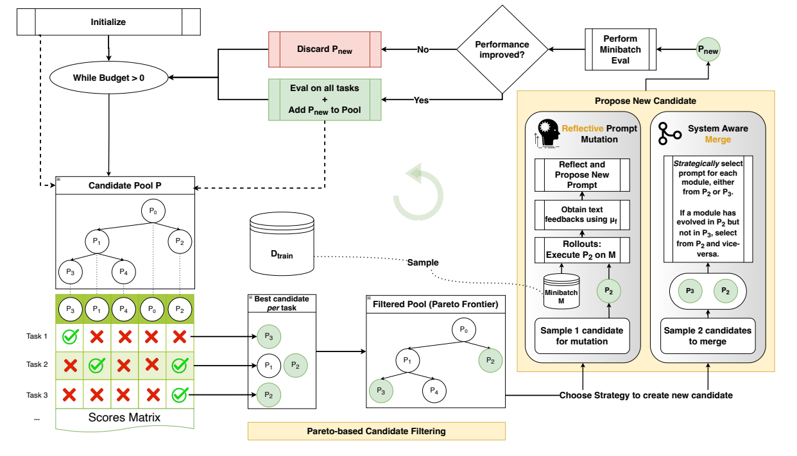

图 1-1｜原文 Figure 3，v2 PDF 物理第 5 页，[原 PDF](https://arxiv.org/pdf/2507.19457v2)。上方是预算循环与小批量验收，左下是候选在各验证样本上的得分矩阵，右侧是反思变异和系统感知合并。箭头表示候选与反馈的流动，不是梯度反传；各模块的模型权重保持固定。图为原图裁切，无重画。

### 1.2 机制、目标函数与可手算例子

记 x 为任务，Φ(x; Π, Θ) 为系统输出，μ 为任务评价器。目标可以写成：

```text
Π* = argmax_Π E_x[ μ(Φ(x; Π, Θ)) ]，受 rollout 预算 B 约束。
S[k,i] = 第 k 个候选提示词在验证样本 i 上的得分。
P[i] = {k : S[k,i] 等于该样本上的最高分}。
f(k) = Σ_i 1{k 属于经支配关系过滤后的 P[i]}。
Pr(选 k 为父代) = f(k) / Σ_j f(j)。
```

Π 是多个模块提示词组成的集合，不是模型参数；S 是候选×验证样本矩阵；P[i] 允许并列；f 是入选次数。删除被支配候选后按 f 抽样，既利用已有成绩，又保留局部专长。完整算法中的过滤规则与只按平均分排序不同。

本文推导例子：三个样本上，A 得分为 (1,1,0)，B 为 (1,0,1)，C 为 (0,0,0)。C 被支配；A、B 各在两个样本上并列或独占最优，故各以 1/2 概率成为父代。若只保留一个平均分最高者，A 与 B 的互补能力可能因任意打破平局而丢失。此例解释选择机制，不是原论文实验。

每次先从训练集抽 3 个样本，运行父代并收集轨迹与反馈；按轮转策略选一个模块，让反思模型提出新提示词；在同一小批量重评候选。只有得分严格改善才在 Pareto 验证集完整评估、加入候选池，并记录父子关系。验证集用于搜索选择，测试集只做最终评价，三者不能混用。

可选 Merge 从有共同祖先的候选中组合相容模块的修改。它利用系统结构和历史，而不是把两段长提示词直接拼起来；合并后仍需评价。论文每次运行最多尝试 5 次合并。主表表明合并并不总有益。

GEPA 没有需要反传的 token loss；任务评价可包含准确率、指令约束、隐私约束或检索反馈。与 GRPO 的比较中，GEPA 能使用“为什么错”的文字反馈，GRPO 主要消费标量奖励；这属于信息接口差异，不能将效果差全部归因于优化器优劣。

### 1.3 数据构造、模型与流程

HotpotQA 和 HoVer 分别使用 150 个训练样本、300 个 Pareto 验证样本和 300 个测试样本。IFBench 为 150/300/294，测试包含新的约束类型；PUPA 为 111/111/221。AIME 用 2022–2024 年的 90 题分成 45/45 做搜索，2025 年 30 题做测试并重复采样 5 次：150 次回答不等于 150 道不同题。LiveBench 采用 2025-07-30 的 368 题，固定随机种子拆分三份。不同任务反馈中可能含缺失检索文档、约束失败原因或隐私评分。

Qwen3-8B 的执行温度为 0.6、top-p 为 0.95、top-k 为 20，上下文上限 16,384；闭源实验使用 GPT-4.1-mini-2025-04-14，温度 1。本文不把“无需权重更新”写成“无需训练数据或评价器”：候选搜索仍然需要带反馈的数据、验证集和计算预算。

```text
输入：系统、初始提示词、训练集、Pareto 验证集、预算
评估初始候选，建立逐样本得分矩阵
while 预算未耗尽:
    从过滤后的逐样本最优候选中按频次抽父代
    抽训练小批量，运行父代，保存轨迹和评价反馈
    轮转选模块；反思模型提出新提示词
    在同一小批量评估新候选
    if 新分数严格高于父代:
        在验证集评估，更新候选池、得分矩阵和谱系
    按配置尝试相容模块合并，并执行相同评价约束
按验证集选最终候选，仅在最后使用测试集
```

静态代码阅读覆盖 core/engine.py、strategies/candidate_selector.py、gepa_utils.py 和 proposer/reflective_mutation/。当前代码仍能找到逐样本前沿抽样、严格改善验收、反思轨迹接口，但已增加批处理、缓存和多提案等工程能力。当前提交不自动等于论文实验版本；复现应另外固定论文对应配置、依赖、评价器版本与数据拆分。

### 1.4 核心结果、可比性与消融

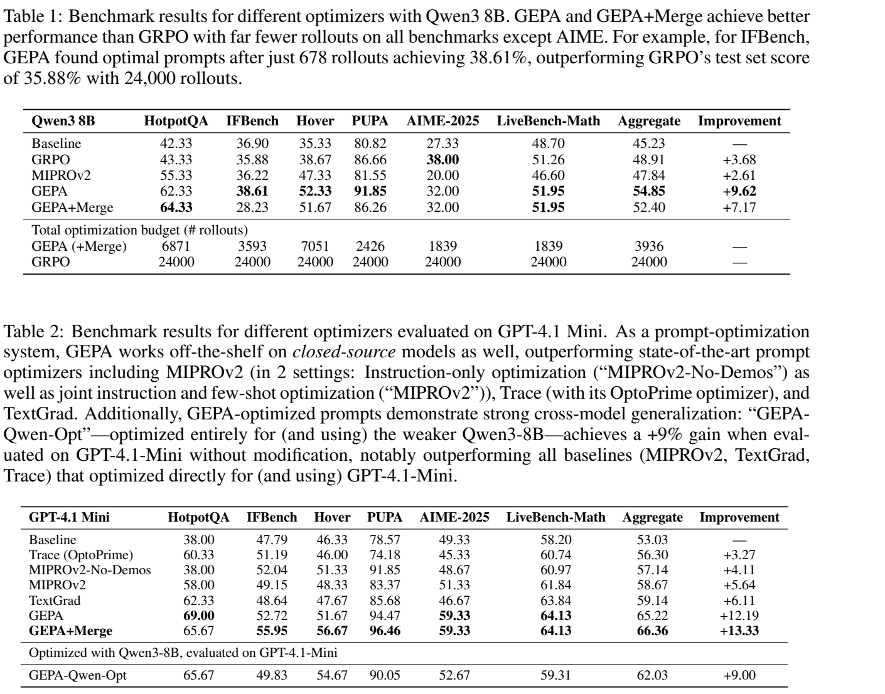

图 1-2｜原文 Tables 1–2，v2 PDF 物理第 8 页，[原 PDF](https://arxiv.org/pdf/2507.19457v2)。上表固定 Qwen3-8B，比较基线、GRPO、MIPROv2、GEPA 与合并变体；下表为 GPT-4.1 mini 的提示词优化比较。看同一列、同一模型的绝对分数，再看 rollout 预算；两个表不能横向当成完全相同模型的比较。

Qwen3-8B 六任务平均分：初始提示词 45.23、GRPO 48.91、MIPROv2 47.84、GEPA 54.85、GEPA+Merge 52.40。GEPA 比 GRPO 高 5.94 个百分点，不能写成相对提高 5.94%。但 AIME-2025 上 GEPA 为 32.00，低于 GRPO 的 38.00；Merge 在 IFBench 上降至 28.23，低于普通 GEPA 的 38.61。因此标题中的 can 不能扩写成所有任务都胜过 RL。

GPT-4.1 mini 上，初始提示词 53.03、MIPROv2 58.67、TextGrad 59.14、Trace 56.30、GEPA 65.22、GEPA+Merge 66.36。把 Qwen3-8B 上优化的提示词迁移到 GPT-4.1 mini，平均 62.03，较该模型初始提示词高 9.00 点。这支持一定的跨模型可迁移性，未证明任意新模型、领域都有效。

预算尤其容易误读。Qwen 六任务的 GEPA 总优化预算为 6,871、3,593、7,051、2,426、1,839、1,839 次 rollout；GRPO 每任务 24,000 次。“约 35 倍更省”对应 IFBench 找到最佳候选时的 678 次与 24,000 次相比，24,000/678≈35.4；不是整次 GEPA 搜索仅运行 678 次。总搜索 3,593 次对应约 6.7 倍 rollout 差，且文字反思调用、输入长度和系统多模块调用尚需另计。

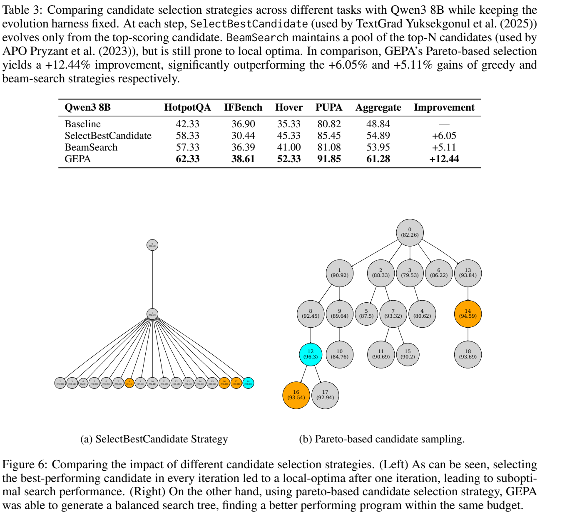

图 1-3｜原文 Table 3 与 Figure 6，v2 PDF 物理第 10 页，[原 PDF](https://arxiv.org/pdf/2507.19457v2)。表格在四个任务上固定演化框架，仅改变候选选择；下图节点为提示词候选、边为变异谱系。左侧贪心选择集中在同一父代，右侧保留不同分支。节点示意说明搜索过程，不代表通用收敛保证。

四任务消融中 GEPA 平均 61.28，贪心 54.89，beam 53.95，初始提示词 48.84；说明逐样本保留专长在这些设置中有帮助。不同预算、反思提示词、文字反馈质量都会影响比较，尤其不能在删除反馈后还期待同样收益。

### 1.5 成本、局限与复现边界

GRPO 对照采用 LoRA：rank 16、alpha 64、dropout 0.05，覆盖注意力和 MLP 投影，bf16、学习率 1e-5、KL 系数 0.01、梯度裁剪 0.1。每步 4 个问题×12 个回答、500 步，共 24,000 rollout；梯度累积 20。论文报告一张 H100/A100 80GB 做训练，另有推理 GPU；80GB 是设备容量，不是测得的峰值显存。额外全参数控制实验使用 8 卡，与主 LoRA 对照必须分开。

附录报告 GPT-4.1 mini 对应实验整体开销低于 500 美元，其中 GEPA 约 86 美元、合并变体约 67 美元、MIPROv2 约 76 美元、Trace 与 TextGrad 合计约 172 美元。这是作者当时的 API 账单口径，不是今天报价；未找到可逐实验核验的总 GPU-hours、完整墙钟时长或峰值显存。反思调用也有成本，例如 GPT-4.1 mini 六任务对应 24/34/69/21/92/46 次反思调用。

最值得防范的是对小验证集过拟合、反馈评价器被利用、提示词越来越长，以及搜索出看似合理却包含错误规则的指令。论文附录给出大量候选提示词，阅读这些文本不能替代独立事实验证。复现时应保存每次候选、反馈、逐样本得分、累计 token/API 费用，重复多个搜索种子，并在完全未参与优化的新题型上评估。不要把重跑当前库的示例宣称为复现论文六任务结论。

入门材料：[D2L 语言模型](https://d2l.ai/chapter_recurrent-neural-networks/language-model.html)帮助理解模型概率与提示词；进阶阅读 [TextGrad 原论文](https://arxiv.org/abs/2406.07496)理解文字反馈优化。作者项目页提供论文讲解，未另找到需要单列的独立作者博客。这些材料不计入五篇。

## 2. Reasoning with Sampling：不更新权重，也能重新分配推理概率

**论文全名：Reasoning with Sampling: Your Base Model is Smarter Than You Think。** 作者 Aayush Karan、Yilun Du。[ICLR 2026 官方 oral 页面](https://iclr.cc/virtual/2026/oral/10009094)确认录用与展示。精读 [arXiv v1 全文](https://arxiv.org/pdf/2510.14901v1)，2025-10-16，20 页；这份旧预印本首页仍是投稿状态，2026 年录用依据来自正式会议页面，二者不混淆。引用快照：[OpenAlex W4416146743](https://api.openalex.org/works/W4416146743)，98 次。[作者项目](https://aakaran.github.io/reasoning_with_sampling/)与[官方代码](https://github.com/aakaran/reasoning-with-sampling)可用；固定提交 720a8e9d084c87a630595e316f5260f1d7c3446c。

### 2.1 小白直觉与问题定义

语言模型会给整段答案一个概率。普通采样可能走进概率不高的完整推理链；把分布整体“压尖”，可能更常抽中模型原本就擅长的答案。本文研究的是推理时改变采样分布，不是增加训练样本、奖励模型或外部判题器。

关键区别在“整段答案”与“每个 token”。常见温度采样只在当前前缀下压尖下一个 token 的分布；power sampling 希望按完整序列概率的幂重新分配权重。这两个分布通常不同，因此不能简单把 temperature 调低就视为实现了论文。

设提示词固定，x=(x_1,…,x_T)，p 为原模型，α>1 为压尖强度，Z 为全序列归一化常数：

```text
p(x) = ∏_t p(x_t | x_<t)
π_α(x) = p(x)^α / Z，Z = Σ_x p(x)^α
普通低温：q_τ(x) = ∏_t p(x_t|x_<t)^α / Z_t(x_<t)，τ=1/α
```

x_<t 是当前位置之前的 token；Z_t 是该前缀下对词表求和的局部归一化量。局部归一化量依赖已经生成的路径，乘积不会消成一个全局常数，所以 q_τ 一般不等于 π_α。α 越大越偏向高概率完整序列，但最高概率不保证答案正确。

本文手算例子：两步序列 aa、ab、ba、bb 的原概率分别为 0.1、0.4、0.25、0.25。首 token 为 a 或 b 的概率均为 0.5。令 α=2，完整 power 权重为 0.01、0.16、0.0625、0.0625，总和 0.295，因此 π_2(首 token=a)=0.17/0.295≈0.5763。局部低温在第一步仍是 0.5 对 0.5。这个归一化后的玩具例子只说明二者不同，不涉及任何真实模型效果。

### 2.2 Metropolis–Hastings 如何绕开全局归一化

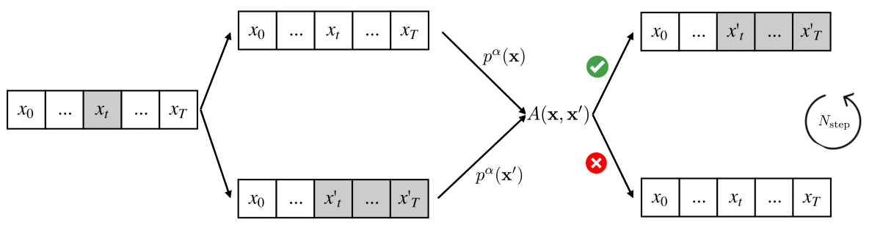

图 2-1｜原文 Figure 3，v1 PDF 物理第 6 页，[原 PDF](https://arxiv.org/pdf/2510.14901v1)。随机选切点，保留左侧前缀，用 proposal 重新生成后缀，再按接受概率选择新旧序列。绿色/红色表示接受或拒绝；这里只使用原模型概率，没有真实答案校验。

MH 是在难以直接采样的目标分布上构造马尔可夫链：先提议新状态，再用接受率修正 proposal 的偏差。设 q(x'|x) 为从当前序列 x 提议 x' 的概率，则：

```text
A(x→x') = min(1, p(x')^α q(x|x') / [p(x)^α q(x'|x)])
log r = α[log p(x')−log p(x)] + log q(x|x')−log q(x'|x)
若 log U < min(0, log r)，接受；U ~ Uniform(0,1)。
```

α、p、q 的含义与上文一致；Z 在比值中相消，因此无需枚举所有答案。随机切点的共同概率在满足相同提议构造时也可约去。详尽平衡保证的是理想链的目标不变分布；有限 10 次更新不保证已经混合，更不保证获得正确答案。

本文手算接受率：若新旧完整序列概率比为 1.2，α=4，反向/正向 proposal 比为 0.5，则 r=1.2^4×0.5=1.0368，必接受。若概率比为 0.8，其他不变，r=0.2048，只以约 20.48% 概率接受。允许接受较差状态使链不完全等同于贪心搜索。

直接对长序列反复重采样代价很大。论文采用逐块扩展：最大长度 3,072，每块 192 token；每次扩展后执行 10 次 MH 更新。切点可以位于当前已生成序列的任意位置，不只是新加的 192 token，所以旧推理也能被改写。proposal 使用低温自回归采样，主实验 power 强度通常 α=4；AlpacaEval 等设置另有 proposal 温度差异，不能用一组参数覆盖所有实验。

```text
x = 提示词；保存目标与 proposal 的逐 token log 概率
重复分块生成，直到长度上限或结束符:
    用低温 proposal 追加一个块
    重复 N 次:
        在当前响应中均匀选切点 m
        保留前缀 x[:m]，重采样剩余后缀得到 x'
        计算新旧后缀的 target/proposal log 概率差
        用 MH 接受率保留 x' 或原 x
输出最终响应；不调用答案判题器选择候选
```

代码 power_samp_utils.py 中的 mcmc_power_samp 明确缓存两种 log 概率，并使用四项相加减计算 log_r；naive_temp 同时读取原 logits 与经过生成参数处理的 scores。max_swap 是另一种极限/贪心变体，不应误作主 MH 实现。公开实现使用 exp(log_r) 比较随机数；复现工程上可采用上面的 log 空间比较避免上溢，但需记录这是数值等价改写。结束符、变长后缀、tokenizer 和 generate 默认 top-k/top-p 都必须固定，并检查实际 proposal 概率是否与采样过程一致。

### 2.3 数据、基线与核心实验

评估覆盖 MATH500（500 题）、HumanEval（164 个编程任务）、GPQA Diamond（198 题）、AlpacaEval 2.0（805 条指令、使用其评价协议）。数学 GRPO 对照在 MATH 训练数据上更新参数，而 power sampling 使用同一基础模型，仅增加推理计算。模型包括 Qwen2.5-Math-7B、Qwen2.5-7B、Phi-3.5-mini-instruct；后者本身已是指令模型，“base”在表格中指各模型未进行论文额外 RL 的起点，不能全称为纯预训练模型。

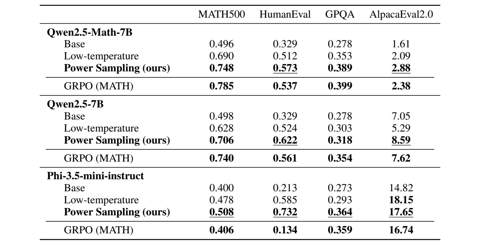

图 2-2｜原文 Table 1，v1 PDF 物理第 9 页，[原 PDF](https://arxiv.org/pdf/2510.14901v1)。每个模型分块比较原采样、局部低温、power sampling 和数学 GRPO。前三列为正确率，最后一列为 AlpacaEval 指标，量纲不同；先比较同一模型同一列，不能对整表求未经定义的均值。

Qwen2.5-Math-7B 的 MATH500：原采样 49.6%、低温 69.0%、power 74.8%、GRPO 78.5%。power 相对原采样增加 25.2 个百分点，但仍低于 GRPO 3.7 点；HumanEval 则为 57.3% 对 53.7%，power 更高。Qwen2.5-7B 的 HumanEval 为 62.2% 对 GRPO 56.1%；Phi 的 HumanEval 为 73.2% 对 GRPO 13.4%，后者提示该特定数学 RL 对照存在明显跨任务退化，不能泛化成所有 RL 都会如此。

低温本身已贡献很大改善，正确比较应保留它。比如 Qwen-Math 上 power 相对低温的数学提升是 5.8 点，而不是将 25.2 点全归因于 MH。论文的主张更接近“训练不是唯一释放已有能力的途径”，不是训练无用。

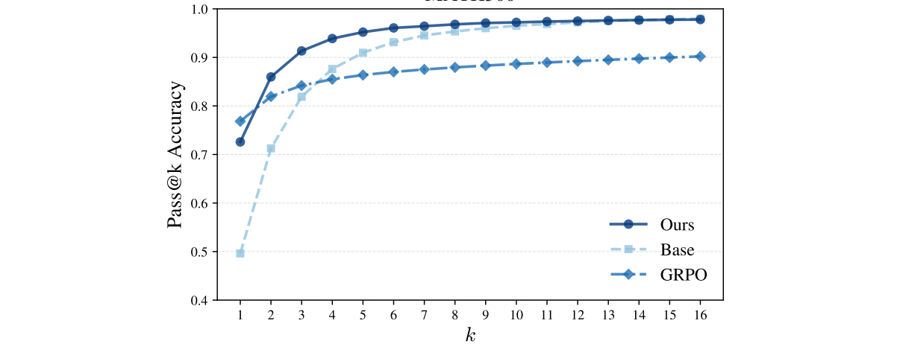

图 2-3｜原文 Figure 5，v1 PDF 物理第 10 页，[原 PDF](https://arxiv.org/pdf/2510.14901v1)。横轴是候选数 k，纵轴是 MATH500 的 pass@k；三条线对应 power、原模型与 GRPO。每个 power 样本内部已消耗额外 MCMC 计算，因此横轴相同不表示 token 或墙钟预算相同。较高 pass@k 说明这一设置下未明显丢失所有可用多样性，不保证没有模式收缩。

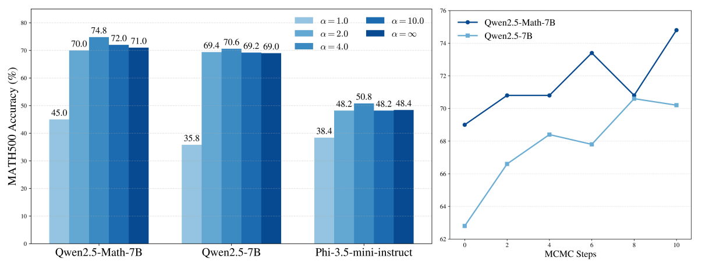

图 2-4｜原文 Figure 6，v1 PDF 物理第 11 页，[原 PDF](https://arxiv.org/pdf/2510.14901v1)。左图为不同 α 下三种模型的数学正确率；右图为 MH 步数。α 过小增强不足，极大值接近最大化并可能损失探索；步数增加总体有益但有波动，曲线不是单调理论定律。

### 2.4 计算开销、局限与复现

本文推导：令最终响应长度 T、块长 B、每块 MCMC 次数 N。切点均匀时，平均重采样后缀约当前长度的一半；将各块长度相加，主要额外生成量近似 N T²/(4B)。再除以普通生成 T，倍率约 NT/(4B)。代入论文平均 T≈679、B=192、N=10，约 8.84 倍。这只是主要重采样 token 的粗略估算，未完整计入初始生成、概率计算、KV 缓存行为、提前结束和系统利用率，绝不是测得的 8.84 倍延迟。

作者报告平均数学响应长度约为原模型 600、GRPO 671、power 679 token；“最终答案长度相近”并不意味着推理代价相近。论文认为在大量重复查询时 RL 的一次性训练费用可摊薄，因此不能只看省掉训练这一面。

没有找到主实验可逐项核验的 GPU 型号、峰值显存、完整推理时长、GPU-hours 或实际费用。仓库有 Slurm 运行脚本，这类资源申请不等于作者实际消耗记录。本方法不训练，不涉及新的训练 loss、奖励或教师模型；原模型训练成本也未包含在“零额外训练”中。

复现应先固定模型/tokenizer、提示模板、低温参数、16 个块与 10 次更新、随机种子、完整采样和接受日志，再按仓库 eval_math、eval_gpqa、eval_he 与 AlpacaEval 协议评分。官方说明支持多 seed 和分片；HumanEval 的程序执行必须采用相应评测隔离环境。需要额外验证 MH 变长实现的概率口径与收敛情况，而不能仅以准确率升高证明严格采到了 π_α。

适用边界是基础模型的概率与正确性有足够相关性；若模型对错误答案自信，power 会强化错误。长序列的二次重采样成本、局部混合不足、最高概率模板化以及不同任务的 α 敏感性都是主要限制。入门读 [D2L 概率基础](https://d2l.ai/chapter_preliminaries/probability.html)，进阶读作者项目中的采样解释与 [DeepSeekMath/GRPO 原论文](https://arxiv.org/abs/2402.03300)，理解对照训练方式；未找到独立于项目页的作者博客。

## 3. TROLL：让每个 token 的更新落在 KL 可信域内

**论文全名：TROLL: Trust Regions Improve Reinforcement Learning for Large Language Models。** [ICLR 2026 官方 oral 页面](https://iclr.cc/virtual/2026/oral/10008999)与[正式论文集](https://proceedings.iclr.cc/paper_files/paper/2026/hash/56fbf5a2109a6c17372209c9fa698857-Abstract-Conference.html)确认主会。精读 [arXiv v3 全文](https://arxiv.org/pdf/2510.03817v3)，2026-02-23，40 页，首次公开 2025-10-04。引用快照：[OpenAlex W4414969876](https://api.openalex.org/works/W4414969876)，9 次。[项目页](https://niklasfreymuth.github.io/troll/)可访问，但[官方仓库](https://github.com/NiklasFreymuth/troll_public)固定提交 ba9c141d9c83d135ee0c610d79aea75849d04ed4 的 README 仍写 Code coming soon；实际取得的是项目网页材料，未取得完整训练实现。

### 3.1 从 PPO clipping 理解问题

RL 会增加高奖励回答的概率，但一步改得太多会破坏已有行为。PPO 常把“新策略对采样 token 的概率 / 旧策略概率”裁在一定范围内，限制目标函数激励。这个标量裁剪不是完整词表分布的严格距离约束；有些 token 的概率仍可能移动很远。

TROLL 的做法是在计算 RL 目标前，把当前完整 categorical 分布投影到旧策略附近。可类比在地图上先划一个允许移动的区域，再把计划落点拉回边界。这里的距离是 KL，不是欧氏距离；每个回答位置都有自己的分布与约束。

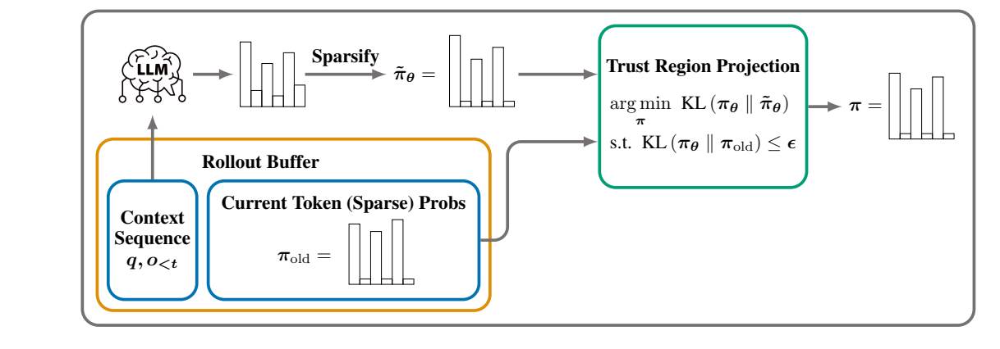

图 3-1｜原文 Figure 2，v3 PDF 物理第 4 页，[原 PDF](https://arxiv.org/pdf/2510.03817v3)。上方是当前模型的输出分布，下方是采集 rollout 时的旧分布；先稀疏化，再求可信域投影，输出投影后的分布供训练目标使用。旧策略是上次采样策略，不是永远固定的 SFT 参考模型。

### 3.2 投影公式、推导和例子

对某一前缀，令 p 为旧策略，q_raw 为当前模型原始 softmax，q 为投影结果，ε 为 KL 上限：

```text
q* = argmin_q KL(q || q_raw)
s.t. KL(q || p) ≤ ε，Σ_i q_i=1，q_i≥0
KL(q || p) = Σ_i q_i log(q_i/p_i)
```

i 遍历词表。KL 有方向，上述方向不能交换。为约束引入非负乘子 η，为概率和约束引入乘子 ν。对 q_i 求导可得：

```text
(1+η)(log q_i+1) − log q_raw,i − η log p_i + ν = 0
q_i(η) ∝ exp[(log q_raw,i + η log p_i)/(1+η)]
D(η) = −ηε − (1+η) log Σ_i exp[(log q_raw,i+η log p_i)/(1+η)]
```

归一化后就是两个对数分布的加权插值。η=0 时 q=q_raw；若原分布超出约束，求使 KL 达到边界的 η>0。D 为一维对偶目标，避免直接在大词表概率单纯形上求解高维约束问题。

本文手算：p=(0.5,0.5)，q_raw=(0.9,0.1)，原 KL≈0.3681。若目标投影 q=(0.6,0.4)，则 KL=0.6 ln1.2+0.4 ln0.8≈0.02014。因为新旧赔率满足 ln(0.6/0.4)=ln9/(1+η)，可得 η≈4.419。于是原来某 token 的概率比 0.9/0.5=1.8 被变为 0.6/0.5=1.2。这个二元例子说明几何平均投影，不等于独立裁剪每个概率。

投影还要能反传。定义 F(η,l)=KL(q(η,l)||p)−ε=0，l 为当前 logits。在约束活跃且满足可微条件时，隐函数求导给出 dη/dl=−(∂F/∂l)/(∂F/∂η)，再与 softmax 的 Jacobian diag(q)−qq^T 结合。这样不必反传整段数值寻根循环。边界切换、极小概率和稀疏集合改变仍需工程处理。

训练目标的核心可以写成：

```text
最大化 E[ (q*(被采样 token)/p(被采样 token)) × A
           − α KL(q_raw || stopgrad(q*)) ]
```

A 为优势估计，α 为回归惩罚强度，stopgrad 表示把投影结果当目标时阻止该分支反传。第一项利用可信域内策略改善奖励，第二项把原始网络拉向投影结果。不同 GRPO/PPO/GSPO 配置的长度归一化和优势估计保持各自设置。推理时直接使用原始模型，不做投影；所以不能声称每次参数更新后原始网络对所有前缀都严格满足 ε。

### 3.3 稀疏化、数据与训练流程

完整词表 KL 太贵。论文默认取 top-K=64，并用累计质量 1−δ、δ=1e-5 筛选，还保留真实采样 token；对丢弃部分使用很小的默认质量并归一化。实际常保留 5–10 个 token，但这是所测模型的平均现象。误差分析依赖保留集合和保留质量等条件，不意味着任意不同 top-K 截断都能无条件保持原始全词表 KL 保证。

主参数包含 ε=0.05、α=1、学习率 1e-6、梯度裁剪 1；一批 256 个问题，划分为 8 个 32 问题小批量，组内采样 8 个回答。数学数据包括 DAPO（训练 16,893、验证 1,024）及 GSM8K、Eurus-Math；代码数据从 Eurus 构建，训练 25,276、验证 1,024，使用最多前 10 个测试和 10 秒超时，奖励为通过比例。不同数据集的样本量与奖励构造不能混成一套统一训练过程。

模型覆盖约 0.5B–14B，含 Qwen2.5、Qwen3 及其他模型族。评估七个数学集合；AIME、AMC 等小集合平均 32 次采样的结果，不等于报告 pass@32。论文主要用相同底座、数据、优化设置进行 clipping 与 TROLL 的成对比较，比跨论文单点对比更有解释力。

```text
用旧策略采样回答，保存每个位置的旧分布与奖励
按所选 RL 算法计算优势 A
对每个训练小批量:
    前向得到当前 logits，构造一致的稀疏概率集合
    若 KL(q_raw || p) 已在范围内，保持原分布
    否则一维求解 η，得到投影 q*
    用投影概率比计算 RL 项，加原分布到投影目标的惩罚
    通过投影的隐式梯度更新模型
按训练循环刷新旧策略；部署时直接用模型原分布
```

上述是根据论文整理的解释性伪代码。作者附录给出算法和代码片段，但公开仓库当前未包含可直接复现实验的完整训练代码，不能把这里的伪代码宣称为已验证实现。

### 3.4 核心实验与不能省略的退化项

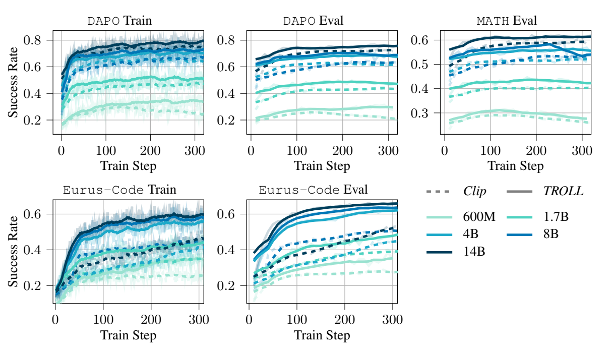

图 3-2｜原文 Figure 3，v3 PDF 物理第 7 页，[原 PDF](https://arxiv.org/pdf/2510.03817v3)。颜色对应模型规模，实线 TROLL、虚线 clipping；上排是数学训练/验证/综合评估，下排是代码任务。横轴是训练步数，纵轴成功率；平滑线与浅色原始轨迹不能解读成跨随机种子的置信区间。

主表中 Qwen3-8B+GRPO 的 DAPO 验证从 64.0% 到 69.1%，七数学集合平均从 54.1% 到 55.1%；Qwen2.5-7B+GRPO 的数学平均从 31.3% 到 35.0%。但 Qwen3+Dr.GRPO 的平均为 54.9% 到 54.6%，并非所有组合都提高。

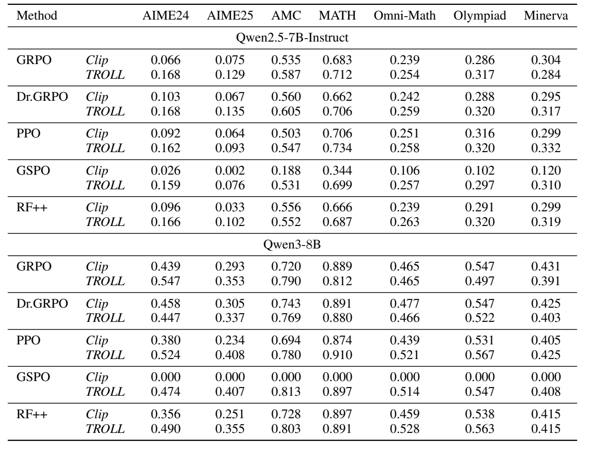

图 3-3｜原文 Table 4，v3 PDF 物理第 28 页，[原 PDF](https://arxiv.org/pdf/2510.03817v3)。比较相同底座与优势估计下的 Clip/TROLL，数字为成功率。平均改进必须与逐列结果同时阅读；不可只挑最高提升的一列。

以 Qwen3-8B+GRPO 为例，AIME24 从 43.9% 到 54.7%，AIME25 从 29.3% 到 35.3%，AMC 从 72.0% 到 79.0%；但 MATH500 从 88.9% 降到 81.2%，Olympiad 从 54.7% 降到 49.7%，Minerva 从 43.1% 降到 39.1%。它改善更新稳定性，不代表对所有能力维度同时改进。

消融显示 ε=0.01 较保守、学习更慢，ε=0.25 可能不够稳定；K=16 损失较大，K=256 未带来同等额外收益。把 batch 从 256 扩到 2,048 时 TROLL 的稳定性较好，但这是所测设置，不能推出对任意更大 batch 或 MoE 的结论。

### 3.5 实际代价与复现限制

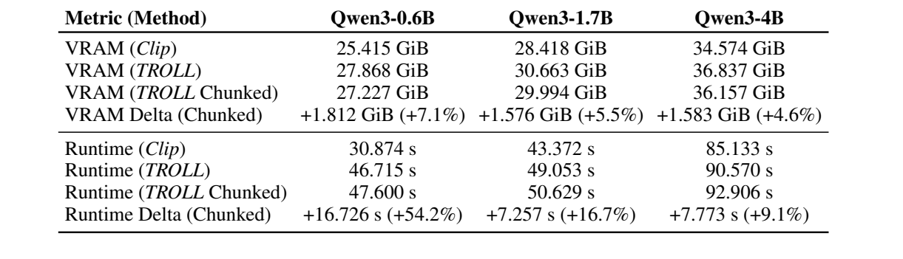

图 3-4｜原文 Table 5，v3 PDF 物理第 34 页，[原 PDF](https://arxiv.org/pdf/2510.03817v3)。固定 4 张 A100 40GB、GSM8K、最长 256 个回答 token，比较 Clip、TROLL 与分块实现。VRAM 为该实验显存，Runtime 为该实验测得运行时间；此表不是全部主实验训练费用表。

0.6B 上，分块 TROLL 的显存 27.227 GiB，对照 25.415 GiB；时间 47.600 秒，对照 30.874 秒，增幅 54.2%。4B 上为 36.157 对 34.574 GiB，92.906 对 85.133 秒，时间增幅 9.1%。因此“几乎没有额外开销”不能无条件套到小模型；模型规模和实现方式影响摊销。

主训练使用 4 张同类型 A100/H100/H200，配对实验硬件一致，多数运行至多约 2 天、部分约 4 天。本文条件推导：若 4 卡连续满配运行 2/4 天，对应 192/384 GPU-hours；这是上限时长的换算示例，不是每个实验实际计费记录，更不是全部论文总 GPU-hours。完整总时长、总费用与各主实验峰值显存未完整披露。

复现需要作者训练实现、稀疏分布处理、数值求根容差、隐式梯度、数据过滤和每种 RL 算法的配置。当前只能静态核对论文算法与公开项目，无法声称端到端复现。建议后续优先用小词表枚举检查投影可行性与梯度，再做同资源成对实验；这里没有执行这些建议实验。入门读 [Spinning Up 的 PPO 说明](https://spinningup.openai.com/en/latest/algorithms/ppo.html)，进阶读 [TRPO 原论文](https://arxiv.org/abs/1502.05477)；项目页之外未找到独立作者博客。

## 4. ELF：让文本先在连续空间中流动，最后再变回词

**论文全名：ELF: Embedded Language Flows。** [NeurIPS 2026 官方 poster 页面](https://neurips.cc/virtual/2026/poster/148278)确认主会录用及 poster；不归为 oral。精读 [arXiv v3](https://arxiv.org/pdf/2605.10938v3)，2026-11-05，42 页；首次公开 2026-05-11。引用快照：[OpenAlex W7160895307](https://api.openalex.org/works/W7160895307)，87 次。[官方代码与项目说明](https://github.com/lillian039/ELF)固定提交 5ad6bbbdd324c4ed5a914605aacc0ab7f975fba1；作者另有[渐进蒸馏博客](https://linlu-qiu.github.io/assets/html/elf_pd.html)及相应代码分支。

### 4.1 基础概念与模型结构

自回归模型逐个 token 生成；扩散/流模型则可以反复修正整段表示。文本 token 离散，图像像素连续，因此把图像领域的连续生成机制搬到文本上并不直接。ELF 先用冻结的 T5 编码器把文本变成连续向量，在这个向量空间完成大部分去噪，最后一次才映射回离散词表。

直觉是先把整句话看作一团连续的“语义草稿”，逐步纠正它，最后排版成词。这个比喻不能理解成向量本身一定语义正确：最终仍可能生成不通顺、重复或事实错误的句子。

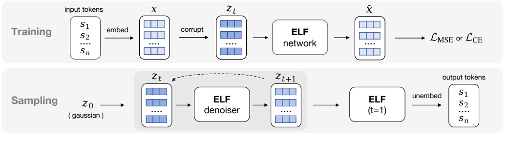

图 4-1｜原文 Figure 3，v3 PDF 物理第 3 页，[原 PDF](https://arxiv.org/pdf/2605.10938v3)。训练上支路把 token 编成 x，再扰动为 z_t；同一 ELF 网络按模式使用去噪 MSE 或词表 CE。采样下支路从高斯噪声开始连续迭代，t=1 才切换解码模式。共享的是去噪/解码主网络，不是说无需任何词表输出层。

默认冻结 T5-small 编码器约 35M 参数，输出每 token 512 维；ELF-B 主模型 105M、12 层、隐藏宽度 768、12 个头，ELF-M 为 342M，ELF-L 为 652M。结构使用 128 维瓶颈、SwiGLU、RMSNorm、RoPE 和 qk-norm；时间、guidance、模式各用 4 个控制 token，共 12 个。

无条件生成从噪声出发时不必编码一段目标文本；条件生成仍需要提供输入前缀的干净 embedding，不能把“无条件采样无需编码目标”扩写成任意条件请求的全链路都不需要编码器。训练与条件评估也应避免把答案信息泄漏到前缀表示。

### 4.2 Flow Matching、解码 loss 与手算例子

设 s 是 token 序列，x=normalize(Encoder(s)) 为干净 embedding，e 为缩放高斯噪声，t∈[0,1] 为时间。前向路径和目标速度为：

```text
z_t = t x + (1−t)e
u = d z_t/dt = x−e
x_hat = f_θ(z_t,t,模式=denoise)
v_hat = (x_hat−z_t)/(1−t)
L_flow = E[||v_hat−u||²]
       = E[||x_hat−x||²/(1−t)²]
```

θ 是 ELF 参数；x_hat 是预测的干净表示，v_hat 是由它换算的速度，E 对数据、噪声与 t 求期望。第二行等式来自 x−z_t=(1−t)(x−e)。因此名义上预测 x，训练却按速度误差加权；t 越接近 1，相同 x 误差权重越高。实际代码用 max(1−t,0.05) 防止分母过小，理想式与稳定化实现应分开。

本文标量例子：x=2，e=−2，t=0.25，则 z=−1、真实速度 u=4。若网络预测 x_hat=1.7，v_hat=(1.7+1)/0.75=3.6，平方误差为 0.16；等价地，(1.7−2)²/0.75²=0.16。以 dt=0.1 做 Euler 步，z 从 −1 移到 −0.64；如果速度精确，则到 −0.6。这里只是一步数值演示。

解码模式把有噪声的干净 embedding 映回 token：每位置采混合系数 a，a=sigmoid(N(0.8,0.8²))，构造 z_dec=a x+(1−a)e_dec，在 t=1 用共享网络及 unembedding 输出词表概率，最小化 CE=−Σ log P_θ(s_i|z_dec)。默认无条件任务解码噪声尺度 5，去噪尺度 2；条件任务的解码噪声设置不同。

训练约 80% 去噪、20% 解码。论文将两类模式组织在共享网络框架中；本次读取的 train_step.py 使用 Bernoulli 在每步选择分支，不能把当前实现描述成两个完整模型同时训练。解码输入也要加噪，是为了缩小生成表示与真实编码表示之间的偏差。这里没有 RL 奖励，目标是连续 MSE 与离散交叉熵。

### 4.3 自条件、guidance 与推理流程

自条件把前一次预测的 x_hat 拼接给下一次预测。训练以 0.5 概率启用，并对初次预测停止梯度。Classifier-free guidance（CFG）通常写成 v_guided=ωv_cond+(1−ω)v_uncond；ω 为引导强度，大于 1 时强化条件方向，也可能降低多样性。

ELF 把自条件引导的一部分放进训练目标。令基础速度目标为 u，当前条件/无条件预测为 v_c、v_u，则采用停止梯度的目标 u+(1−1/ω)(v_c−v_u)。在理想拟合固定点下整理可得到 v_c=ωu+(1−ω)v_u，从而把原本推理时需要组合的方向吸收到网络中。这里是目标构造的解释，不是有限训练一定达到固定点的证明。自条件 CFG 可减少相应推理分支，输入前缀 CFG 仍可能需要条件和无条件两次前向。

```text
训练:
    冻结编码器得到 x，保留条件位置的干净表示
    抽 t 和噪声，构造 z_t；按概率准备自条件预测
    约 80% 步优化速度 MSE，约 20% 步优化解码 CE
    更新共享网络与 EMA 权重
推理（ODE）:
    z = 高斯噪声，固定条件位置
    生成包含 0、1 的排序时间网格
    对每个区间:
        预测 x_hat，换算 v，z = z + dt × v
        恢复条件位置，并保存自条件状态
    t=1 切换解码模式，词表 argmax 得到全部 token
```

时间网格使用 logit-normal（均值参数 −1.5、标准差 0.8），通常在噪声较强区域更密。N 次去噪还要加最终解码前向，不能直接把 N 写成全部网络调用数。

论文还提出 SDE-inspired 采样：每步回注噪声，用 a=1−γdt、t_back=at、z_back=az+(1−a)e，再估计速度。它是受 SDE 启发的具体采样器，不应声称与某连续 SDE 严格等价。**版本差异：**论文物理第 24 页 Algorithm 6 最后更新为 z+dt×v；本次代码 sampling_utils.py 的 _sde_step 返回 z_back+(t_next−t_back)×v，并对 a 裁剪到 [0,1]。两者一般不相同，复现应明确选用哪一版本并保留结果，不能静默混用。

### 4.4 数据、实验结果与指标边界

无条件训练用 OpenWebText，约 9.04B token，长度 1,024，ELF-B 训练 5 个 epoch，累计有效训练 token 45.2B。条件任务包括 WMT14 德英翻译、XSum 摘要；数学用 TinyGSM 的约 11.8M 样本、约 1.96B token，目标为 Python 解题程序，在 GSM8K 执行验证。代码针对 T5 tokenizer 丢失换行、缩进和部分符号的问题，使用 sentinel 转义，忽略这一步会破坏程序任务的评测。

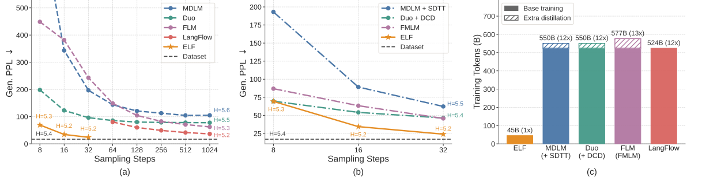

图 4-2｜原文 Figure 7，v3 PDF 物理第 8 页，[原 PDF](https://arxiv.org/pdf/2605.10938v3)。左、中图横轴为采样步数、纵轴为 generative perplexity，分别与普通及蒸馏 DLM 比较；右图为估算训练 token。ELF-B 为 105M，部分对照约 170M；训练步数、编码器先验和架构不同，不能视作完全等算力消融。

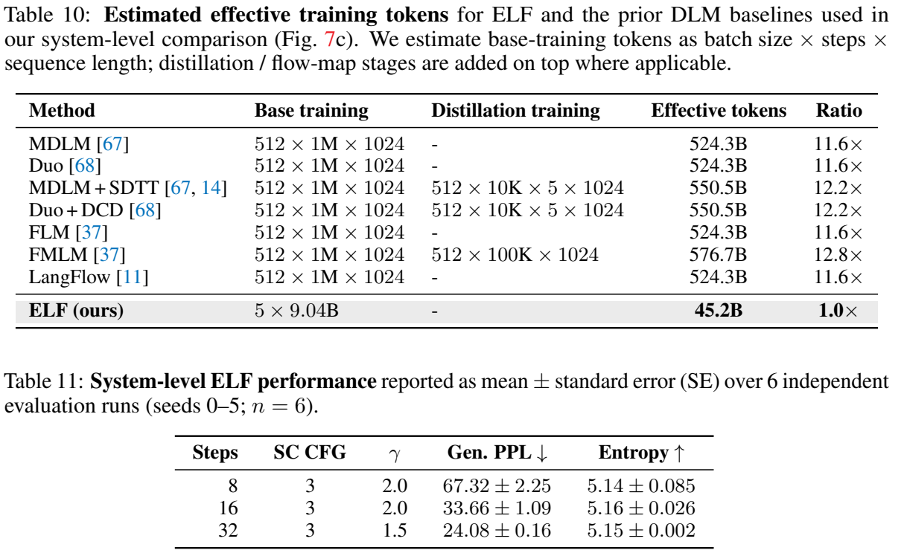

图 4-3｜原文 Tables 10–11，v3 PDF 物理第 32 页，[原 PDF](https://arxiv.org/pdf/2605.10938v3)。上表包含基线额外蒸馏阶段的训练 token，但不计冻结 T5 的先前预训练；下表是 6 次独立生成评估的均值与标准误，不是 6 次独立训练。不同步数还使用不同 γ，因此不是只改变步数的纯单因素实验。

32 步 SDE、SC-CFG=3、γ=1.5 时，ELF-B 的 Gen.PPL=24.08±0.16，unigram entropy=5.15±0.002。Gen.PPL 是让预训练 GPT-2 Large 给生成文本打分，越低通常说明更像该评价模型熟悉的文字；不是 ELF 自己对真实测试数据的似然困惑度。Unigram entropy 只衡量词频分散程度，也不是完整语义多样性。

WMT14 的 BLEU 为 26.4，对照 AR 为 25.2；XSum 的 ROUGE-1/2/L 为 36.0/12.2/27.8，对照 AR 为 30.5/10.2/24.4，使用 64 步 ODE、输入 CFG=2 等设置。数学 GSM8K 为 39.7%（ODE）与 40.8%（SDE），但使用 1,024 步；不能把语言生成的 32 步优势移植成“32 步推理达 40.8%”。公开代码默认条件评价运行 validation，而论文数字取 test，复现时必须改对集合。

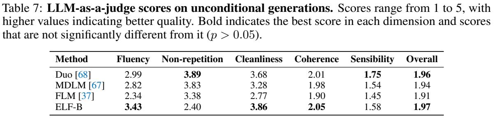

图 4-4｜原文 Table 7，v3 PDF 物理第 26 页，[原 PDF](https://arxiv.org/pdf/2605.10938v3)。模型裁判按 1–5 分评价无条件生成，500 个样本；ELF-B 32 步，若干基线 1,024 步。总体 ELF-B 为 1.97、Duo 为 1.96，未显示显著总体优势；不重复性 ELF 为 2.40，Duo 为 3.89。该表防止把低 Gen.PPL 解读成全面质量胜出。

消融中 x-prediction 在 512/768/1,024 维表示上较稳定，epsilon-prediction 出现坍塌；共享解码、预训练上下文 embedding、时间网格和 guidance 都有贡献。附录的渐进蒸馏额外进行五轮训练，从多步教师走向 16/8/4/2/1 步学生，并非基础 ELF 不蒸馏即可高质量一步生成；一步结果 Gen.PPL 约 136.1，仍明显弱于八步约 23.18。

### 4.5 成本、代码核对与复现

默认 ELF-B 使用 Muon，有效学习率 0.002、batch 512、warmup 0.5 epoch、EMA 0.9999，约 95K 步，TPU v5p×64，作者报告约每 epoch 1.5 小时。本文推导 5 epoch 约 7.5 小时、480 TPU-device-hours；不能改写为 GPU-hours。完整峰值显存、付费金额和全部消融总开销未披露；冻结编码器的既有预训练不包含在 45.2B 中。

静态阅读覆盖 train_step.py、sampling_utils.py、generation_utils.py、默认训练 YAML 和 README。配置 blr=0.001 不是与论文 lr=0.002 矛盾：train.py 按总 batch/256 缩放，在 batch 512 时正好得到 0.002。真正需要核对的是上述 SDE 更新版本差异，以及默认验证集与论文测试集区别。仓库同时提供 JAX/TPU、PyTorch 和蒸馏分支，本次主要阅读固定提交的 JAX 主实现，未执行任何分支。

风险包括评价模型偏好、重复、事实幻觉、固定长度和大量采样步数。论文自身摘要例子就出现排名方向偏差等问题，不能把流畅表述当事实正确。复现优先从已发布权重、1,000 条无条件样本、固定采样参数开始，再核对 GPT-2 评价与 entropy 计算；条件任务另核对输入掩码和数据划分。基础阅读可先看 [D2L 语言模型](https://d2l.ai/chapter_recurrent-neural-networks/language-model.html)，进阶阅读 [Flow Matching 原论文](https://arxiv.org/abs/2210.02747)与作者渐进蒸馏博客；它们是辅助材料。

## 5. GAC：依据梯度噪声，动态调节 SFT 与 RL 的比例

**论文全名：GAC: Noise-Aware Adaptive Mixing for Hybrid SFT-RL Post-Training。** 作者 Yuelin Hu、Wei Liu、Zhenbo Yu、Zhengxue Cheng、Li Song。[ACL Anthology 正式页面](https://aclanthology.org/2026.emnlp-main.119/)确认 EMNLP 2026 主会长文，论文集页码 2763–2779；本次精读其[17 页正式 PDF](https://aclanthology.org/2026.emnlp-main.119.pdf)。预印本 arXiv:2605.26184 首次公开 2026-05-25，视为同篇，不重复计数。

[会议官方程序](https://2026.emnlp.org/program/)链接的[排程表](https://docs.google.com/spreadsheets/d/1aXGTy_7Xeh-OXIs3iJSbDpUsZ6YhbfA76b17kBZH0Yk/edit?gid=943432490#gid=943432490)中，312-MAIN 对应本标题，标签为 Virtual Pres，Virtual Presentations 3，2026-10-26 07:00–08:30 CET。该标签证明线上展示，未证明 oral 或 poster。引用快照：[OpenAlex W7162516042](https://api.openalex.org/works/W7162516042)，1 次；arXiv 查询映射到正式 ACL DOI 合并记录，日期仍以预印本历史为准。

[作者代码](https://github.com/huyuelin/GAC)固定提交 d69cc9a372883359c8585a6519ad71d1927c9540。控制器和 loss 已公开，但 hybrid_loss.py 明确是需要接入 GRPO/PPO trainer 的模板，不是可直接重跑论文全部实验的完整训练入口。

### 5.1 为什么固定混合比例不够

SFT 用标准答案教模型，稳定但可能限制探索；RL 让模型自己生成并依据奖励调整，能探索但噪声更大。固定 μ=0.5 相当于不管两位老师今天谁更可靠，都各听一半。GAC 希望根据 SFT/RL 梯度噪声与方向差异决定混合比例，并加上平滑和先验限制，避免比例来回跳。

这里 μ 是 SFT loss 权重，1−μ 是 RL 权重，不是训练样本数比例，也不是“先 SFT 再 RL”的阶段长度。高 μ 会更偏向 SFT，但不意味着最终参数更新恰好有 μ 的幅度来自 SFT，因为两项梯度范数可能不同。

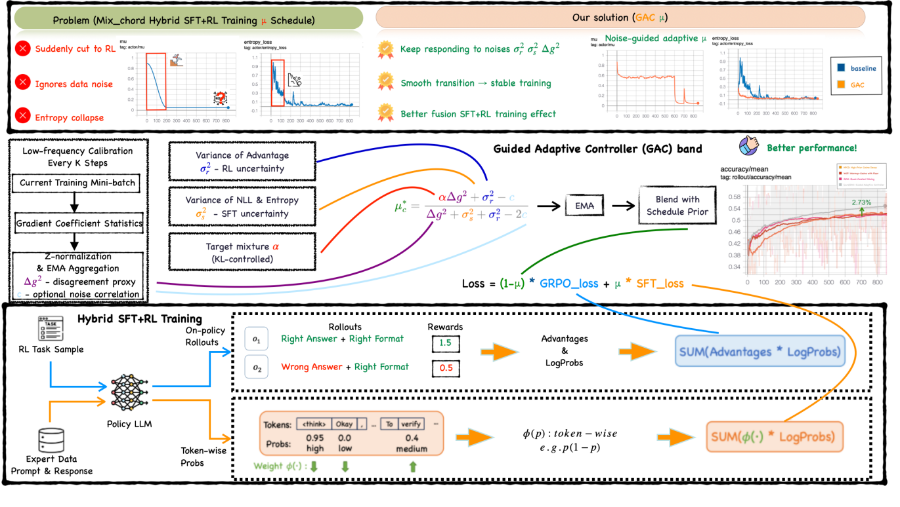

图 5-1｜原文 Figure 1，正式 PDF 物理第 2 页（论文集第 2764 页），[原 PDF](https://aclanthology.org/2026.emnlp-main.119.pdf)。底部两支是 on-policy RL 与专家 SFT；中间收集噪声和方向差异代理，求 μ，再经过 EMA、先验混合和变化上限。右侧曲线是原作者图内示例，不是本报告新增实验。

### 5.2 MSE 目标的完整推导

令 g_s*、g_r* 为理想 SFT/RL 梯度，观测梯度为 g_s=g_s*+e_s、g_r=g_r*+e_r，e 为随机误差。目标梯度 g*=αg_s*+(1−α)g_r*，α 是希望追随的任务目标比例；实际混合估计 g(μ)=μg_s+(1−μ)g_r。

假设两种噪声均值为零、彼此独立，令 D=||g_s*−g_r*||²，σ_s²=E||e_s||²，σ_r²=E||e_r||²，则：

```text
g(μ)−g* = (μ−α)(g_s*−g_r*) + μe_s + (1−μ)e_r
E(μ) = E||g(μ)−g*||²
     = (μ−α)²D + μ²σ_s² + (1−μ)²σ_r²
E'(μ)/2 = (μ−α)D + μσ_s² − (1−μ)σ_r²
μ* = (αD + σ_r²)/(D + σ_s² + σ_r²)
```

交叉项消失依赖零均值与独立假设；分母为正时二阶导数为正，得到此局部 MSE 问题的唯一极小值。若 D=0，结果是逆噪声方差权衡：RL 更吵，则 μ 更大、多听 SFT；若 D 很大，μ 趋近 α，表示两种目标本来不同，不能单靠噪声择一。若协方差 c=E[e_s·e_r] 不为零，分子变为 αD+σ_r²−c，分母增加 −2c；若存在系统偏差，原推导也不再直接成立。因此它不是任意后训练场景的全局最优配方。

本文手算：D=0.2、σ_s²=0.1、σ_r²=0.4、α=0.5，则 μ*=0.5/0.7≈0.7143；RL 噪声降到 0.04 时，μ*=0.14/0.34≈0.4118。注意降低 RL 噪声才使 RL 权重增加，而不是见到 RL 训练步数变多就机械降低 μ。

真实完整梯度方差昂贵，论文用三个廉价代理：RL 的序列归一化优势离散度，SFT 的长度归一化 NLL 方差（两端各截掉 10%），以及 SFT/RL token 梯度系数的差异。论文公式 (10) 对系数做 z-score 标准化；代理与真实梯度统计的 Pearson 相关约 0.82、0.76、0.84，来自有限诊断检查点，不意味着代理等于真实梯度。

外层 α 控制器监测 KL，目标 0.02、范围 [0.10,0.95]，采用滞回和 EMA；内层 μ 使用 β=0.99 平滑、与调度先验按 λ=0.5 混合，再限制每次变化不超过 0.01，最后裁到允许范围。本文手算延续上例：若上一 μ=0.5，原始最优 0.7143，则平滑后约 0.50214；先验为 0.6 时，混合后 0.55107；变化上限使实际下一 μ 仅为 0.51。实践算法的输出明显不同于直接使用闭式 0.7143。

### 5.3 Loss、奖励、数据与实现

```text
L = (1−μ)L_GRPO + μL_SFT-φ
L_SFT-φ = −平均[ stopgrad(φ(p_t)) × log p_t ]
φ(p) = p(1−p)
```

p_t 是专家答案 token 的模型概率；φ 使中间置信度 token 权重较大，对 0 或 1 附近权重小。该 token 权重来自 CHORD，GAC 的新部分主要是全局比例控制，不应把 φ 也说成 GAC 首创。GRPO 使用组内奖励构造优势，回答正确性与格式等由规则判定；这与存在系统偏差的学习型奖励模型是不同场景。

```text
每个训练步取得 SFT 专家批和 on-policy RL 批
计算响应掩码、token log 概率、规则奖励和组内优势
每 f=10 步更新噪声与分歧代理及其 EMA
依据 KL 更新 α；用闭式公式计算 μ_raw
平滑 μ_raw，混合调度先验，限制每步变化并裁剪
用 μ 混合两个分支的 loss，反传更新同一模型
保存 μ、α、代理量、奖励、长度、KL 与完整训练配置
```

正式论文主设置从 OpenR1-Math-220k 抽 5,000 条 SFT 与 20,000 个 RL prompts，主模型 Qwen2.5-7B-Instruct，并测 1.5B/14B；SFT batch 64、AdamW 学习率 2e-5，RL prompt batch 32、每组 8 个回答，报告 3 个随机种子。各方法匹配约 1.2B 训练 token 预算；相同 token 数不自动等于相同 FLOPs、生成时间或设备费用。

**代码与论文差异需保留：**当前默认 YAML 的 sft_dataset 写 AI-MO/NuminaMath-1.5，而正文写 OpenR1-Math-220k；controller.py 对差异系数直接求平方，没有显式实现正文公式 (10) 的 z-score。RL 方差做分布式汇总，SFT 截尾方差在所读函数中按本地张量计算，需核对接入 trainer 后的全局数据口径。sft_loss.py 默认 detach_weights=True 与上述停止梯度相符。公开 hybrid_loss.py 将实际 RL loss 留给调用方，因此这些文件证明核心组件公开，不能证明完整实验链已公开并一致。

### 5.4 核心结果、消融与可比条件

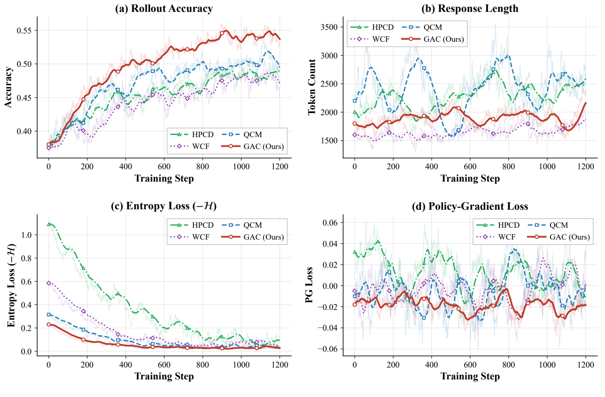

图 5-2｜原文 Figure 2，正式 PDF 物理第 6 页，[原 PDF](https://aclanthology.org/2026.emnlp-main.119.pdf)。四图分别为 rollout 正确率、回答长度、负熵项和策略梯度 loss；横轴训练步数，浅线为原始轨迹、粗线为平滑。GAC 红线在该设置较早提升并保持较适中长度；负熵数值更低不能独立推出真实任务泛化更好。

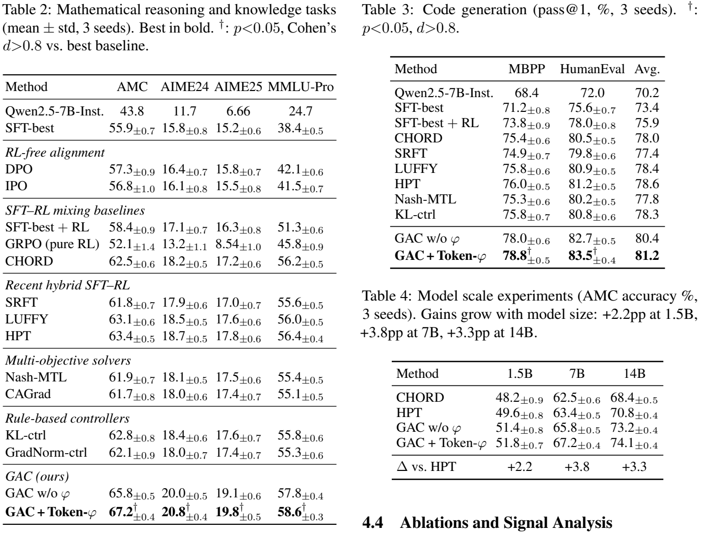

图 5-3｜原文 Tables 2–4，正式 PDF 物理第 8 页，[原 PDF](https://aclanthology.org/2026.emnlp-main.119.pdf)。数学、知识与代码任务按同底座/预算比较，报告 3 seed 的均值±标准差；右下为规模实验。表中的显著性标记需要结合作者同时要求 p<0.05、效应量 d>0.8 的规则读取，3 seed 仅提供有限统计证据。

主模型 AMC：HPT 63.4±0.5，GAC 去掉 φ 为 65.8±0.5，完整 GAC 为 67.2±0.4，即完整方法比 HPT 高 3.8 点。AIME24 为 20.8 对 18.7，AIME25 为 19.8 对 17.8，MMLU-Pro 为 58.6 对 56.4。MBPP/HumanEval 为 78.8/83.5，对 HPT 的 76.0/81.2；其他报告任务包含 GPQA、SciBench、BBH。

消融中 QCM 62.1、加入 EMA 的相应基线 62.3、CHORD+φ 62.5、GAC 无 φ 65.8、完整 67.2、oracle 67.8。移除变化上限降到 64.7，移除 EMA 为 65.4，移除先验为 66.1。无 φ 的 GAC 仍包含平滑和先验等机制，因此不能把它与固定比例基线的全部差值都归于闭式估计器单一组件。

规模收益在 1.5B、7B、14B 分别约 +2.2、+3.8、+3.3 点，体现跨规模有效性，但不是随模型大小严格单调递增。打乱优势或将系数变常数会明显降低代理相关性，支持它利用了部分真实结构，仍不能排除跨任务失配。

### 5.5 成本、内部口径与复现边界

资源表在 Qwen2.5-7B、FSDP、8 GPU、microbatch 1 下测序列长 2,048/4,096/8,192：步时分别 1.00/1.73/3.38 秒，每 GPU 峰值显存 22.4/31.8/42.6 GB；控制器相对 token-φ 基线额外开销约 0.6%/0.7%/0.8%。未披露此表 GPU 型号，也没有可直接核验的全程训练总时长、GPU-hours 或实际费用。不能把图上 1,200 步与另一测量条件的单步时间直接相乘当真实总成本。

论文还有需要作者澄清的记录口径：配置限制每步 |Δμ|≤0.01，但稳定性表仍出现 |Δμ|>0.02 的比例，固定 μ 的 QCM 也出现此类跳变率；可能采用不同采样间隔或不同定义，但正文未足以解释。μ 初始化 0.5、图中早期较高权重与调度先验之间的具体时间口径也需原始日志确认。这里记录的是可复现性疑点，不据此指控结果造假，也不删除这些不一致。

方法适用于同一步联合 SFT–RL、近似无偏且噪声占主导的设定。强 reward bias、过强 clipping、两类梯度高度相关、代理尺度漂移或任务切换时，理论最优性不能直接沿用。复现首先要统一数据身份、实现 z-score 与分布式统计、补齐 trainer、固定评估集和种子，再核对 μ 全轨迹及费用。仓库后续提供的其他模型 checkpoint 也不能替代论文 Qwen2.5-7B 的证据。

基础阅读为 [D2L 优化基础](https://d2l.ai/chapter_optimization/optimization-intro.html)，进阶读 [DeepSeekMath/GRPO](https://arxiv.org/abs/2402.03300)以理解组内优势。未找到独立作者项目页或博客，官方代码 README 是本期提供的作者辅助说明。

## 阅读后的横向判断

| 方法 | 改变什么 | 主要监督信号 | 新增代价 | 最关键的复现限制 |
| --- | --- | --- | --- | --- |
| GEPA | 多模块提示词 | 评价器分数、执行轨迹、文字反馈 | 搜索 rollout 与反思调用 | 反馈信息和完整搜索预算必须公平计入 |
| RwS | 推理采样分布 | 原模型概率 | 后缀反复采样 | 有限步混合与变长 proposal 概率 |
| TROLL | RL 更新中的策略分布 | 任务奖励与优势 | KL 投影、稀疏分布与反传 | 完整训练代码仍未发布 |
| ELF | 文本生成的表示空间与路径 | 连续速度 MSE、token CE | 多步去噪与冻结编码器 | SDE 论文/代码差异、指标与测试集口径 |
| GAC | SFT/RL loss 比例 | 噪声与分歧代理、KL | 低频统计与双分支训练 | 模板非完整 trainer，数据/代理实现差异 |

五篇论文共同提醒：性能增益往往来自重新分配计算或监督，而不是没有成本。GEPA/RwS 把一部分成本放到搜索或推理；TROLL/GAC 改善后训练更新；ELF 改变生成表示与步骤。不同模型、数据和评价协议下的数字不能拼成跨论文排行榜。

本报告所有教学例子、公式整理和资源换算均已单独标注。18 张图片全部来自原论文，保留图号、版本、物理页码、裁切坐标及哈希；没有生成、重画或拼造实验曲线。原图来源见 assets/SOURCES.md，完整 PDF 检查记录见 assets/QA.md 与 assets/pdf-check.json，录用/引用/代码/去重与排除记录见 manifest.json 及配套证据文件。PDF 由本 Markdown 全文生成，包含本报告全部中文、公式、代码和图表。
