# CCF-A/B 年度已录用论文精读 · 2026-11-20

今天串起一条训练与推理链：如何预测继续做 RL 的收益，如何自适应截断 token 分布，如何用凸优化提高多草稿接受率，如何检验 RL 学到的是正确推理，以及如何把检索反馈放进逐步生成。五篇均有 2026 年主会正式录用依据；不是五篇当月预印本。

## 选题、证据与阅读范围

按北京时间 2026-11-20 执行。共 5 篇，4 篇 CCF-A、1 篇 CCF-B；3 篇 oral、2 篇 poster，spotlight 0，未知 0。本期达到目标比例。CCF 使用[官方当前目录入口](https://www.ccf.org.cn/Academic_Evaluation/By_category/)链接的 2026 最终目录（3 月 31 日发布、4 月 9 日修订），人工核对 PDF 物理第 57 页 ICLR 为 A、第 58 页 EMNLP 为 B。等级属于会议，不是对某一篇论文质量的打分。

| 论文与主题 | 正式录用与展示 | 首次公开 | OpenAlex 引用快照 |
| --- | --- | --- | --- |
| The Art of Scaling Reinforcement Learning Compute for LLMs（ScaleRL） | ICLR 2026，A，oral | 2025-10-15 | 115；W4415277433 |
| p-less Sampling: A Robust Hyperparameter-Free Approach for LLM Decoding | ICLR 2026，A，oral | 2025-09-27 | 3；W4415332241 |
| Global Resolution: Optimal Multi-Draft Speculative Sampling via Convex Optimization | ICLR 2026，A，oral | 2025-11-19 | 3；W4416550118 |
| Reinforcement Learning with Verifiable Rewards Implicitly Incentivizes Correct Reasoning in Base LLMs | ICLR 2026，A，poster | 2025-06-17 | 326；W4415311663 |
| STORM: Stepwise Token Optimization with Reward-Guided Beam Search | EMNLP 2026，B，poster | 2026-06-09 | 0；W7164131871 |

引用数均于 2026-11-20 查询 OpenAlex works API，核对标题、作者及 DOI/arXiv 身份，原始 JSON 保存在 assets/citation-records/。它们是索引当时返回的计数，0 不代表无人阅读。排序综合主题、公开时长与证据质量，没有把五篇包装成全领域引用数前五。RLVR、ScaleRL 的较高引用具有更长传播时间；低引用的采样方法和 B 类检索论文仍有学习价值。

先读取仓库两级 AUTOMATION.md、sources.json 与全部方向历史 manifest：本次基线含 60 条来源、12 份历史 manifest。按去版本 arXiv、DOI、规范 URL、Unicode/标点/大小写归一标题及别名去重，五篇均未收录。Global Resolution 的预印本题名结尾为 Convex Minimization，会议题名为 Convex Optimization；作者、arXiv 身份与方法一致，合并为一篇。首日指定的 Finetuning with Sampling 已于 11 月 18 日收录，本期不重复。

全文阅读范围：ScaleRL 28 页、p-less 44 页、Global Resolution 34 页、RLVR 正式会议版 34 页、STORM 正式会议版 16 页，共 156 页，含附录与局限。三个作者代码仓库进行了关键实现静态核读；另两篇未找到作者公开完整实现。所有实验数字来自原论文；本次没有运行模型训练、推理性能测试或复现实验。下文“原文事实”“本文推演”“未披露/未找到”分别标示来源边界。原图只做 PDF 裁切与无损嵌入，不生成实验图。

## 1. ScaleRL：先判断曲线形状，再决定是否继续烧算力

### 身份、来源与一句话结论

原文事实：[ICLR 2026 官方 oral 页面](https://iclr.cc/virtual/2026/oral/10010608)与 [OpenReview 入口](https://openreview.net/forum?id=FMjeC9Msws)确认主会录用和 oral。本次阅读 [arXiv:2510.13786v1 全文](https://arxiv.org/pdf/2510.13786v1)，28 页，首次公开 2025-10-15；较早预印本的页眉不改变正式会议年度。[OpenAlex 快照来源](https://api.openalex.org/works/W4415277433)返回引用 115。

论文把 RL 设计的两个效果分开：同样花费下学得更快，与无限延长训练时能达到更高水平。作者用超过 400,000 个 NVIDIA GB200 GPU-hours 的实验，形成 ScaleRL 配方，并用较短运行拟合后续表现。经验可预测性成立在给定模型、数据、训练方式与测量范围内，不是所有 RL 任务都遵守的物理定律。

### 基础概念与问题定义

小白直觉：练习题库固定时，有的学习方法让学生更快到达同一个上限，有的才会提高最终上限。只比较训练前半程，容易误判这两种改进。横轴 C 是累计 GPU-hours，纵轴 R(C) 是留出集平均解题成功率；不是每个题目采样 16 次“任一成功”的 pass@16，而是每题 16 次生成的平均通过率 mean@16。

原文从 Polaris-53K 中随机留出 1,000 个 prompts，剩余用于训练；每 100 个训练步评估一次，每题 16 次生成。在分布内留出集拟合曲线，再单独检查 AIME-24 等任务表现。留出集代表性、训练与验证去污染、奖励可验证性决定曲线能否用于预算决策。

### 关键公式：有上限的 sigmoid，而非无限幂律

```text
R(C) = R0 + (A - R0) / [1 + (Cmid / C)^B]
u = (R(C) - R0) / (A - R0)
u / (1 - u) = (C / Cmid)^B
log[u / (1 - u)] = B × (log C - log Cmid)
```

逐符号：R0 是起点表现；A 是拟合的渐近上限；Cmid 是完成一半提升所需计算量；B 为曲线陡峭程度，C 必须为正。令 C=Cmid，分母为 2，所以 R=(R0+A)/2。将第一式减 R0、除以 A−R0 得 u；取赔率 u/(1−u) 后，计算量的幂次关系变成对数空间直线。这里拟合上限 A 的误差会影响 B，不能只看一个参数。

本文推演：假设 R0=0.4、A=0.6、Cmid=1,000 GPUh、B=2。在 C=500、1,000、2,000 时，R 分别为 0.44、0.50、0.56。再翻倍计算量的绝对增益逐渐改变，最后趋向 0.6。较大 B 并不在所有 C 上都更优：C<Cmid 时会使曲线更低，跨越 Cmid 后才更快靠近上限；因此不能脱离 R0、A、Cmid 宣称“B 大总是计算效率高”。这些数值为教学手算，不是论文测量。

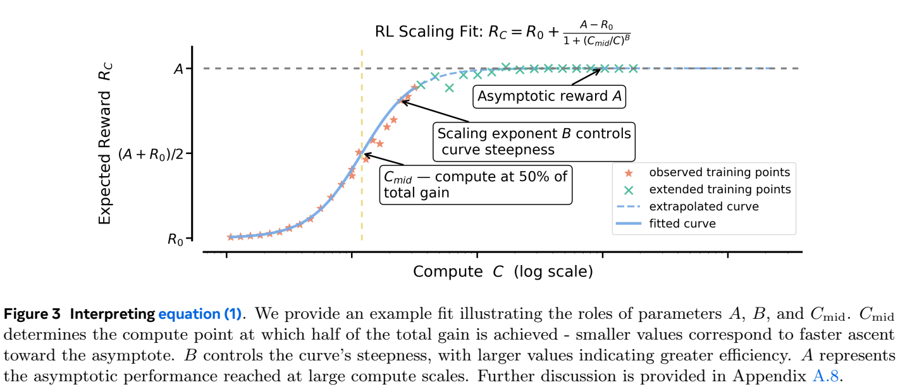

图 1-1｜原 Figure 3，arXiv v1，PDF 物理第 5 页，[来源 PDF](https://arxiv.org/pdf/2510.13786v1)。这是作者解释拟合参数的概念曲线，不是独立 benchmark，也没有实验基线。读图先找 R0、A、半程 Cmid，再看斜率 B。原文没有完整训练系统架构图；本报告引用其参数机制图，并在文字中给出训练流程。

### 从 GRPO 基线到 ScaleRL 配方

原文事实：基线每轮 48 个 prompts，每题 16 个回答，共 768 个 completions；正确奖励 +1、错误 −1，采用组内均值中心化、无 KL 的 GRPO 类训练与非对称 DAPO 裁剪。标准长度预算为 16,384，包括输入 2,048、思考 12,288、答案 2,048。论文也研究 32k 长上下文与更大 batch。

ScaleRL 的关键是组合已知工程选择：PipelineRL 异步生成和训练，允许最大陈旧度 8；生成中可更新权重而缓存仍来自较旧状态；在 logits/LM head 路径提高到 FP32；思考达到约 10k–12k tokens 时强制中断以留出答案空间；采用 CISPO 截断重要性权重；先按 prompt 汇总 loss，再在 prompts 之间平均；优势使用 batch 层面的标准差归一化；过滤组内奖励全相同的样本；对已高概率成功的题目采用 No-Positive-Resampling。

为什么最后两项重要：某题所有 16 个回答都正确或都错误时，组内中心化后优势全为零，继续参与梯度平均只会改变有效 batch 和吞吐。历史通过率达到约 0.9 后停止重采易题，减少重复解题成本，但也隐含了“学会后不会忘”的假设。本文推演：若模型后来能力漂移，这种永久排除策略应额外检查遗忘。

```text
rho_t = pi_train(y_t | x,y_<t) / pi_gen(y_t | x,y_<t)
A_norm = (reward - mean_reward_of_prompt) / batch_std
J = mean_over_prompts[
      sum_over_response_tokens(stop_grad(min(rho_t, cap))
                               × A_norm × log pi_train(y_t)) / T_prompt]
loss = -J
```

pi_train 是当前训练策略，pi_gen 是采样时记录的策略；rho 纠正异步带来的分布差异。cap 为截断上界，T_prompt 是该 prompt 汇总的有效回答 token 数，stop_grad 表示权重不参与求导。上式省去掩码等实现细节，说明 CISPO 的主要机制：更新方向来自 log 概率，离策略样本只通过截断系数改变梯度强度；不能把它实现为对 rho 再求导的普通乘积损失。

本文推演：同一题两份回答奖励 +1、−1，均值 0，若 batch_std=1，则优势为 +1、−1；当前/生成概率比分别为 3、0.5，cap=2，则正回答系数 2，负回答系数 −0.5。随后还要按回答长度和 prompt 汇总规则归一。这个例子说明正负权重，不代表论文只采两份回答。

```python
for prompt_batch in streaming_generator(max_staleness=8):
    trajectories = sample_with_logged_probs(prompt_batch, n=16)
    rewards = verify_answers(trajectories)
    trajectories = remove_zero_variance_groups(trajectories, rewards)
    advantages = center_per_prompt_then_scale_by_batch_std(rewards)
    loss = cispo_prompt_average(trajectories, advantages)
    optimizer.step(loss)
    publish_weights_to_generators()
    update_easy_prompt_history()
# 每100步在固定1000题上做16次采样评估；按累计GPUh拟合曲线。
```

这是本文依据论文整理的机制伪代码，不是作者发布的训练程序。数据准备还包含对 SFT 推理轨迹的过滤：去掉简单题上的过长轨迹，控制约 12k 的思考长度，并对 AIME24/25、MATH500 等做去污染。数学主实验使用 Polaris 数据；代码实验使用 DeepCoder。奖励检查器与答案格式仍可能影响学习曲线。

### 核心实验与可比条件

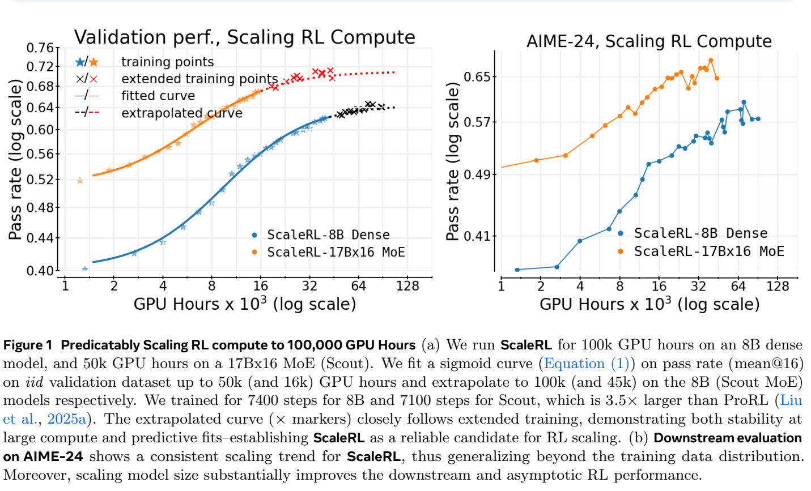

图 1-2｜原 Figure 1，arXiv v1，PDF 物理第 1 页，[来源 PDF](https://arxiv.org/pdf/2510.13786v1)。8B dense 与 17B×16 MoE 的长程训练；左侧为同分布 mean@16，右侧为 AIME-24。实线用于拟合、虚线外推、叉号为延长运行结果。图注分别写约 100k 与 50k GPUh，拟合/外推终点对 MoE 写到约 45k，属于图中范围与总预算的不同表述；不要把拟合线当额外运行数据。

原文报告 8B 单次训练约 100,000 GPUh、7,400 步；Llama-4 Scout 17B×16 MoE 约 50,000 GPUh、7,100 步。MoE 的 17B×16 是作者模型标识，不能直接与 8B 稠密模型按同样显存或每 token FLOPs 比较。长程曲线支持可外推性，但并不代表新数据分布的全部能力同步提高。

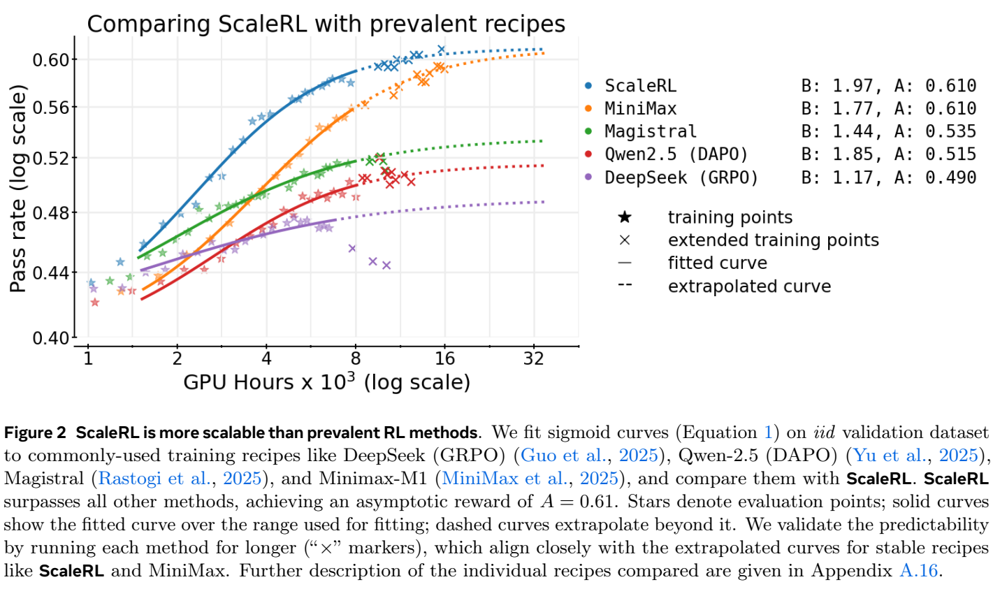

图 1-3｜原 Figure 2，arXiv v1，PDF 物理第 3 页，[来源 PDF](https://arxiv.org/pdf/2510.13786v1)。固定实验系统中复现 ScaleRL、MiniMax、Magistral、DAPO、GRPO 配方，再比较拟合 A/B 与续跑点。这里不是这些团队已发布模型的排行榜。DAPO 动态重采样等实现有实验统一化调整，读结论须以附录 A.16 的内部复现为准。

图中 ScaleRL 与 MiniMax 的 A 都约 0.610，B 分别 1.97、1.77；Magistral A=0.535，DAPO A=0.515，GRPO A=0.490。这说明在作者系统内，配方既可能改变效率，也可能改变最终上限。提高 logits 数值精度的前向消融使拟合上限从约 0.52 升到约 0.61；但单项贡献依赖其余组件，不能把增益机械相加。

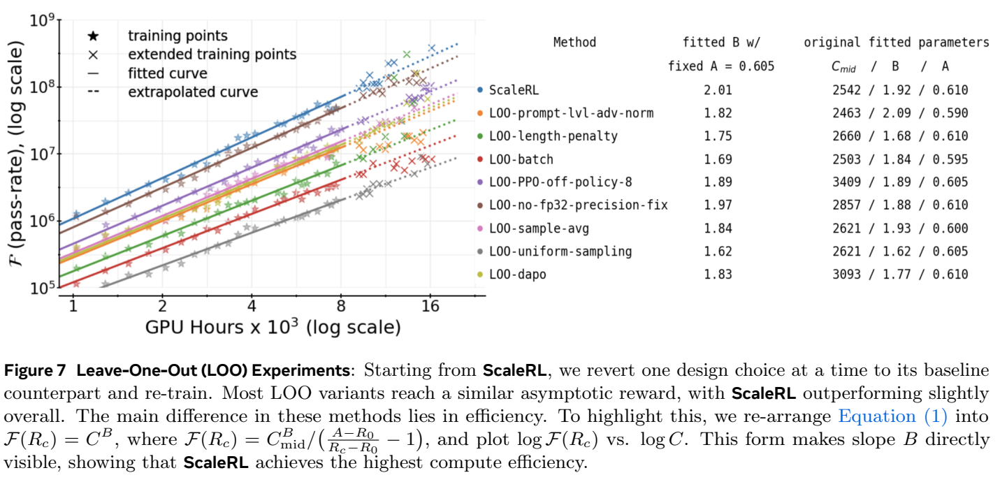

图 1-4｜原 Figure 7，arXiv v1，PDF 物理第 9 页，[来源 PDF](https://arxiv.org/pdf/2510.13786v1)。Leave-One-Out：从完整 ScaleRL 各移除一个选择后重新训练；比较线性化的曲线斜率及拟合参数。多数渐近 A 接近，差别更多落在效率。论文以三次独立运行估计拟合波动；图中的点和拟合线不是多次随机种子的置信带。

正文的 LOO 运行使用前 8k GPUh 拟合，再外推到 16k。附录参数表中标准 ScaleRL 为 Cmid=2,542、B=1.92、A=0.610；32k 长上下文对应 11,272、1.89、0.645。长上下文提高拟合上限，却大幅推迟半程点，是“最终更好、早期更贵”的例子。不同图拟合范围造成 B=1.92 与 1.97 等差别，不应当成同一实验的两个精确一致估计。

### 资源账、公开代码与复现限制

| 项目 | 原文披露或本次核读结果 |
| --- | --- |
| SFT 起点 | 32 个 H100 GPU nodes；4 epochs；32B tokens；batch 2M tokens；学习率 3e−5。原文写 nodes，不能转写为 32 张卡 |
| RL 硬件 | 80 张 GB200，64 张生成、16 张训练 |
| 优化器 | AdamW，学习率 5e−7，epsilon 1e−15，weight decay 0.01，warmup 100 步 |
| 研究规模 | 总计超过 400k GB200 GPUh；前向消融约 3.5k–4k，LOO 约 16k/运行，更大实验约 30k–100k |
| 峰值显存、准确墙钟、费用 | 未找到可按配置完整复核的逐项表；不把设备额定显存当峰值使用量，不虚构美元成本 |

本文推演：如果 80 张卡完全占用，16,000 GPUh 对应 200 小时；这只是 GPUh/卡数的理想换算，不是论文测得墙钟。真实费用还取决于卡时单价、利用率及共享资源，不能由型号猜价格。论文“2048”大 batch 在正文/附录的命名口径需要留意，不能无核对地当成 2,048 份回答。

[作者代码](https://github.com/devvrit/ScaleRL-Curve-Fitting)固定提交 ff2c8afa3074243dd0260c2ee011a71ad0fa6759，实际提供曲线拟合及数据，不是完整 RL 训练系统。核读 README.md、fitting_curves.py：代码以首个观测性能作为 C0 对应的基线，网格 A 为约 0.500–0.745、Cmid 为 4,000–16,000；论文方法描述还有更宽搜索范围。复现拟合时应确认所选数据和搜索网格，不能把当前仓库当作所有训练实验的封存版本。[论文列出的作者项目入口](https://www.devvrit.com/scalerl_curve_fitting)本次仅取得跳转页面，代码链接可用；未找到另一个可完整访问的作者解读博客。

复现优先级：先用公开曲线数据复核留出外推误差，再考虑昂贵的训练。最主要缺口是完整训练流水线、确切数据过滤产物与逐配置资源账。教程可先读 [D2L 概率](https://d2l.ai/chapter_preliminaries/probability.html)和[语言模型](https://d2l.ai/chapter_recurrent-neural-networks/language-model.html)，理解概率、对数与逐 token 分解，再读论文的异步 RL 章节。

## 2. p-less：让分布自己决定截断阈值

### 身份与核心直觉

原文事实：[ICLR 2026 官方 oral](https://iclr.cc/virtual/2026/oral/10010258)、[OpenReview](https://openreview.net/forum?id=ItFuNJQGH4)确认主会与展示。本次读 [arXiv:2509.23234v6](https://arxiv.org/pdf/2509.23234v6)，2026-02-27 版本，44 页，首次公开 2025-09-27；[OpenAlex](https://api.openalex.org/works/W4415332241)引用 3。

语言模型给每个下一 token 一个概率。top-p 要人为指定累计保留质量，min-p 要指定相对最大概率的比例。p-less 用整个概率向量的平方和作阈值：分布尖时少留候选，分布平时多留候选。它省掉“截断阈值”这一超参数，温度、最大生成长度、提示词和模型选择仍需确定。

### 公式、推导与可手算例子

```text
p_i = exp(z_i / T) / sum_j exp(z_j / T)
L = sum_i p_i^2
S = {i: p_i >= L}
p'_i = p_i × indicator(i in S) / sum_(j in S) p_j
L_norm = (V × L - 1) / (V - 1),  V > 1
```

z_i 为 token i 的 logit，T 为温度，V 为词表大小，p 为温度处理后的完整分布，L 为阈值，S 为保留集合，p' 为重新归一化后的采样分布。归一化变体用 L_norm 替换 L。最直接的概率解释：独立从同一个 p 抽两次，碰巧相等的概率就是 Σp_i²。这是分布碰撞概率；把其中一次解释为真实目标需要“模型近似真实目标分布”的额外假设，不是语义正确率定理。

本文推演：由 Cauchy–Schwarz，1=(Σp_i)²≤VΣp_i²，所以 L≥1/V；又因 p_i≤max p，Σp_i²≤max p×Σp_i=max p。因此总有至少一个 token 保留，精确算术下不会全被掩码。二阶 Rényi 熵 H2=−logΣp_i²，所以 L=exp(−H2)。H2 不大于 Shannon 熵只给出同一个分布上的界，不能据此证明不同分布间 Shannon 熵与 L 总按同一种顺序变化。

本文推演手算：p=(0.4,0.3,0.2,0.1)，L=0.16+0.09+0.04+0.01=0.30。保留前两个 token，新概率为 (4/7,3/7,0,0)。V=4 时 L_norm=(4×0.30−1)/3≈0.0667，四个均保留；这说明归一化变体可能更宽松。L−L_norm=(1−L)/(V−1)≤1/V，真实大词表上的绝对阈值差通常很小。均匀分布时 L=1/V，原方法保留全部，归一化阈值为 0。

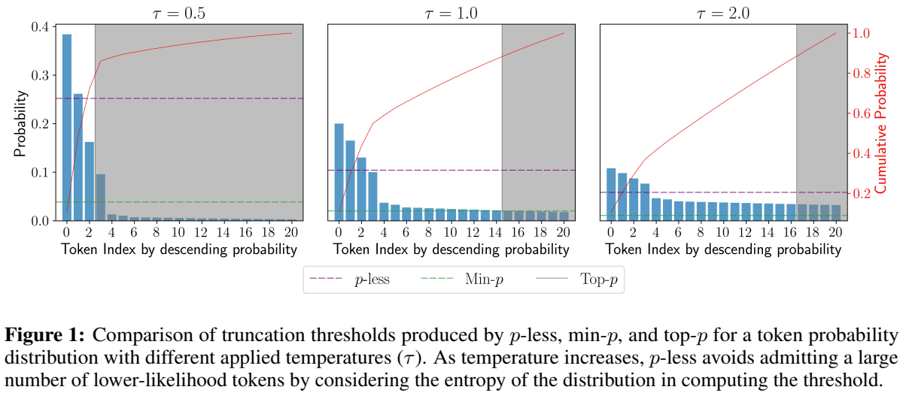

图 2-1｜原 Figure 1，arXiv v6，PDF 物理第 2 页，[来源 PDF](https://arxiv.org/pdf/2509.23234v6)。同一示意 token 分布在温度 0.5、1、2 下，比较 p-less、min-p、top-p 的截断位置。横轴按 token 概率排序，柱为概率，红线为累计概率。它是机制说明，不是题目准确率实验；原文没有另一个神经网络架构图，因为方法不改模型结构。

### 实现流程与数据设置

```python
# 本文整理，概率已经过温度softmax；不修改模型权重
p = softmax(logits.float() / temperature, dim=-1)
threshold = (p * p).sum(dim=-1, keepdim=True)
keep = p >= threshold
filtered = p * keep
filtered = filtered / filtered.sum(dim=-1, keepdim=True)
next_token = multinomial(filtered, num_samples=1)
```

原文事实：计算平方和与掩码只需 O(V)，无排序。top-p 常需排序；min-p 需要最大概率，具体实现与融合核影响真实开销。此算法有意改变完整分布，不能称为保持原始 p 的无损采样。没有新训练、奖励或 loss；新增训练步数为 0，而推理仍需原模型前向。

[官方仓库](https://github.com/ryttry/p-less)固定提交 a681f23682a329099306eea9cf7b1dd0447e2eec，核读 README 与 p_less_samplers.py。实现直接对传入概率张量置零并归一化，有原地修改行为；调用方若复用该张量，需先复制。代码假设输入有限、非负且已归一；极平分布在低精度下也值得检查数值边界。README 的环境例子为 Python 3.10.12、torch 2.6、transformers 4.55.2，不等于把论文全部评测脚本、模型版本和随机种子都完整封存。没有找到独立作者项目页或解读博客，仓库 README 为主要作者辅助材料。

实验主模型为 Llama-2-7B-Chat、Mistral-7B-Instruct、Llama-3-70B-Instruct，另测 DeepSeek-R1-Distill-Qwen-7B。CSQA、GSM8K、QASC 使用 8-shot，示例取自相应其他 train/validation 划分；GPQA 为 zero-shot CoT。温度主扫描 0.5、0.7、1.0、1.5、2.0，附录扩到 2.25、2.5。WritingPrompts 抽 100 个 prompts，每种方法/温度生成一次。

默认基线包括 top-p=0.9、min-p=0.1、epsilon/eta=0.0002、mirostat 目标 4；附录补阈值扫描。主结论是对温度变化较稳健，不能等同“在每个任务都优于充分调参的所有采样器”。Llama-2 主结果有三种子，Mistral 和 70B 因资源限制主要是一种子，统计强度不同。

### 核心结果、消融与准确读图

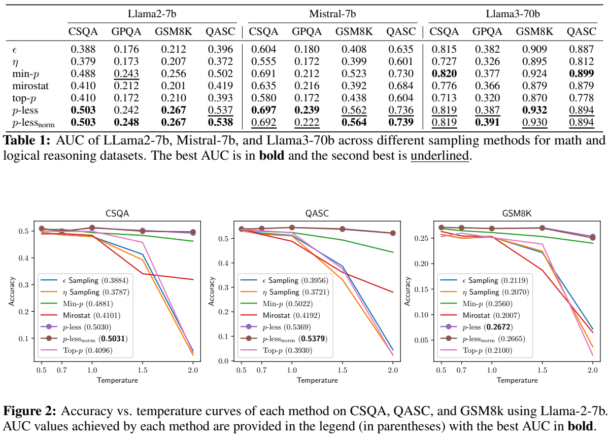

图 2-2｜原 Table 1 与 Figure 2，arXiv v6，PDF 物理第 7 页，[来源 PDF](https://arxiv.org/pdf/2509.23234v6)。表比较三个模型在四任务上的温度曲线归一化面积；图展示 Llama-2-7B 的 CSQA/QASC/GSM8K。AUC 是准确率随温度的面积，不是分类 ROC-AUC。先比较同模型同任务，再观察高温端退化，不能把跨模型 AUC 当相同算力成绩。

原文事实：Mistral-7B 的 GSM8K AUC，p-less 0.562，min-p 0.523，top-p 0.438；Llama-3-70B 的 QASC 则 min-p 0.899 略高于 p-less 0.894，CSQA 为 0.820 对 0.819。附录 Table 5 中 Mistral GSM8K 在 T=2 时，p-less 53.7%、min-p 45.7%、top-p 0.2%；在 T=0.5 时分别 58.1%、56.5%、57.0%。这更像高温稳健性优势，不是每个温度都有巨大收益。

与确定性搜索比较也有边界：Mistral GSM8K 上 beam width 5 为 61.6%，greedy 57.6%，p-less 在 T=1 为 57.5%。数学题偏向集中概率质量时，随机采样不一定最好；创作任务才更需要多样性。阈值归一化变体往往保留更多候选，但也不保证处处优于原版。

WritingPrompts 的自动长度校正胜率在 T=2 时，Llama-2 p-less 65.64%、min-p 48.94%；Mistral 为 60.32%、54.11%。人工评审包含三位作者与三位非作者，每个故事四个标注，100 个 prompts；多数投票偏好 p-less 为 58.8%，平局占 26.9%。全体一致子集只有约 23.7%，其 72.7% 偏好不能冒充全部样本的胜率。评审规模和作者参与均是局限。

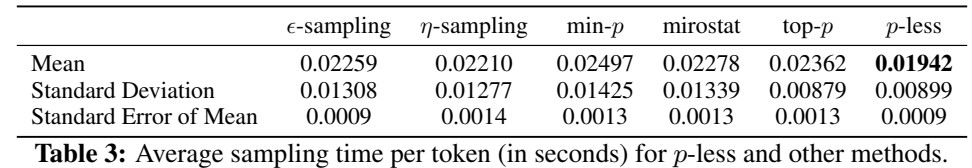

图 2-3｜原 Table 3，arXiv v6，PDF 物理第 8 页，[来源 PDF](https://arxiv.org/pdf/2509.23234v6)。200 次 Mistral-7B 生成，GSM8K/GPQA 条件下的每 token 采样耗时（秒），基线为六种截断方法。p-less 0.01942 对 min-p 0.02497，约低 22.2%。这是采样环节计时，不是模型端到端吞吐提高 22.2%。

附录细粒度 CPU profiling 中，p-less 约 0.62 ms/步，min-p 0.83、top-p 0.79；这些与主表的不同计时范围不能混用。进程 RAM 约 2.456 GB 对 2.545/2.535 GB 也不是 GPU 峰值显存。与 eta 的效率检验 p 值 0.0902，不能说对所有基线均达到 5% 显著性。GPU 型号、全部 GPU-hours、端到端价格和峰值显存未找到完整披露。

### 局限与复现判断

高置信 token 仍可能构成错误推理：附录示例把 2592+432+864+7344 算成 12132，而正确和为 11232；另有题意误读。截断调整只修整分布尾部，不提供事实验证器。温度在超出已测试区间时怎样，单种子模型结论是否稳定，以及现代推理框架中融合核后的净收益，都需另测。

可复现的最小单元是概率向量→阈值→采样的函数，完整质量复现还需要固定 prompt、模型 revision、温度扫描、评判方式和随机种子。入门先读 [D2L 概率](https://d2l.ai/chapter_preliminaries/probability.html)与[语言模型概率分解](https://d2l.ai/chapter_recurrent-neural-networks/language-model.html)；本节手算说明算法，本次未执行论文评测。

## 3. Global Resolution：多草稿的最优接受率如何变成凸问题

### 身份与问题边界

原文事实：[ICLR 2026 官方 oral](https://iclr.cc/virtual/2026/oral/10008116)、[OpenReview](https://openreview.net/forum?id=gpsczXOsHn)确认正式题名结尾为 Convex Optimization。本次读 [arXiv:2511.15898v1](https://arxiv.org/pdf/2511.15898v1)，34 页，题名结尾为 Convex Minimization，首次公开 2025-11-19。作者及正文身份核对一致，别名已写入 manifest。[OpenAlex](https://api.openalex.org/works/W4416550118)引用 3。

小白直觉：便宜的小模型一次交几张候选答案，大模型希望尽量从中直接选一个，同时保持自己本来会输出的概率分布。这里“接受”只是 token 可复用，不代表答案在语义上正确。多张草稿如何联合分配概率，是一个最优运输问题；逐张贪心验证不一定最优。

设词表大小 V，目标分布 p，草稿分布 q，n 个下一 token 草稿独立同分布，记组合 ω=(ω1,…,ωn)。构造联合分布 C(i,ω)，其行和为 p_i，列和为 q 的 n 次乘积。最大化 i 出现在 ω 中的概率质量，就最大化草稿复用率。直接枚举约有 V^(n+1) 个变量，真实词表无法照搬通用线性规划。

### 最优值、手算耦合与集合切分

```text
q_n(omega) = product_(j=1..n) q_(omega_j)
psi(H) = p(H) - q(H)^n
alpha_star = 1 + min_(H subset vocabulary) psi(H)
p(H) = sum_(i in H) p_i ; q(H) = sum_(i in H) q_i
```

H 是词表子集，alpha_star 是最优接受率。理解最小割：如果草稿全部落在 H 的概率 q(H)^n 大于目标允许给 H 的总质量 p(H)，那超出的质量必然需要拒绝草稿。最坏集合决定至少应拒绝多少。论文利用子模结构及 q_i/p_i 排序，将寻找关键集合 H* 化为检查排序前缀，时间 O(V log V)；零概率项需按论文边界处理，不能直接除以零。

本文推演：V=2，token 为 A/B，p=(0.5,0.5)，q=(0.8,0.2)，n=2。四个集合的 psi 值依次为 0、0.5−0.64=−0.14、0.5−0.04=0.46、0。最优接受率 0.86，高于单草稿的 min(0.5,0.8)+min(0.5,0.2)=0.70。

怎样同时实现正确目标分布：AA 出现概率 0.64，其中以 0.5/0.64=0.78125 输出 A，其余输出 B；AB、BA 总概率 0.32，都输出 B；BB 概率 0.04，也输出 B。最终 A 质量 0.50，B 质量 0.14+0.32+0.04=0.50；接受草稿质量 0.50+0.32+0.04=0.86。AA 时改输出 B 的 0.14 就是拒绝部分。这个例子说明不能只逐条提高接受率而不检查输出边缘分布。

### 为什么凸优化能解大问题

先只在 i 属于草稿集合的边上构造接受流 S，行和不超过 p_i，列和不超过 q_n(ω)，再将行/列剩余质量按外积补成完整耦合 C。最优条件把问题划成草稿全在 H* 的 inner 系统与其余的 outer 系统。通过多态体的贪心结构求出残余 r_i 后，outer 目标行质量 p'_i=p_i−r_i。论文附录给出集合差分的求解方式，这一步不能被随意设为 p_i。

为便于阅读，下式只展示论文凸目标的结构，集合求和范围按 inner/outer 子系统限定：

```text
Phi(a) = sum_omega q_n(omega) × log(sum_(i in set(omega) outside H*) exp(a_i))
         - sum_i p'_i × a_i
Theta(a) = sum_omega q_n(omega) × log(1 + sum_(i in set(omega)) exp(a_i))
           - sum_i p_i × a_i
```

a_i 是一个 token 对应的对偶变量；log-sum-exp 的导数是 softmax 权重，故梯度正好是“当前分给某 token 的总质量−目标行质量”。令梯度为零就满足行约束。inner 中的 1 提供拒绝桶，容纳未接受质量。Hessian 是带权 softmax 协方差和，为半正定，从而目标凸；这说明可寻找全局最小值，不等于任意数值容差下都精确满足约束。

变量只剩至多 V 个，但目标中的草稿组合项仍可能巨大。作者用截断集合 T、按不同 token 集合聚合组合，并用容斥计算系数，规模仍约为 |T|^n/n!。复杂度没有神奇地完全消除，n 与 T 太大时必须失败回退。

```text
outer truncation error epsilon_T = 1 - q(H* union T)^n
inner truncation error gamma_T = q(H*)^n - q(T)^n
single-step output L1 error <= 15 × tau
acceptance-rate loss <= 10 × tau
L-step joint distribution L1 error <= 15 × L × tau
```

tau 是截断与求解停止容差，不是采样温度。本文推演：tau=0.0001、连续 L=8 时，上界为 0.012；这是保守 L1 理论界，不是实测偏差。有限容差方案是可控近似，不能无条件称“严格无损”。

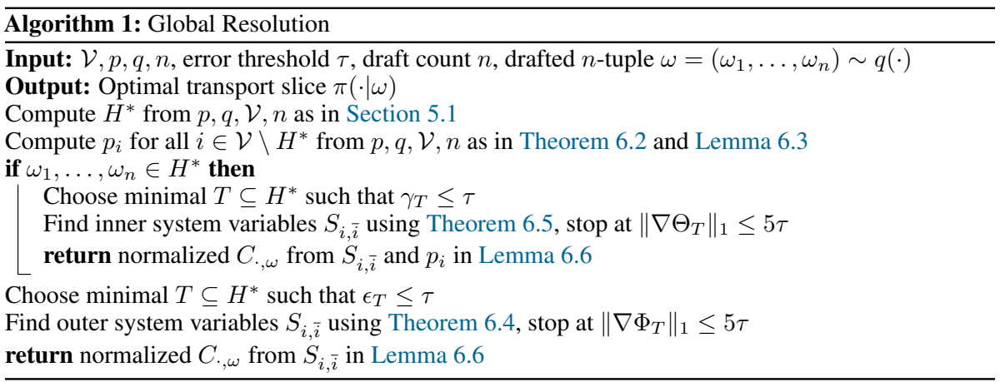

图 3-1｜原 Algorithm 1，arXiv v1，PDF 物理第 8 页，[来源 PDF](https://arxiv.org/pdf/2511.15898v1)。这是原文算法流程，原文没有独立架构/流程插画。先求 H*，再依观察到的草稿进入 inner/outer 求解；图中 outer 的 T 书写与定理 6.4 的补集限制有不一致，理解和实现应以对应子系统约束为准。它不是性能图，无实验基线。

```python
H = find_optimal_cut_by_sorted_prefixes(p, q, n)
residual = solve_residual_row_masses(p, q, H, n)
omega = iid_draft(q, n)
branch = inner if all_tokens_in(omega, H) else outer
T = choose_truncation_set(branch, q, tau)
if too_large(T, n):
    return sample(p)  # 本文采用论文多步实验的安全回退
coeff = group_draft_sets_by_inclusion_exclusion(T, q, n)
a = minimize_convex_objective(coeff, residual, max_iter=25)
if not meets_gradient_and_truncation_bounds(a):
    return sample(p)
return sample_completed_coupling_slice(omega, a, residual)
```

本文伪代码强调必需环节，不是已运行的作者实现。独立同分布草稿是假设；多种不同 q 的草稿、相关树节点的直接替换，都不能未经推导照搬单步保证。

### 实验与真实加速来源

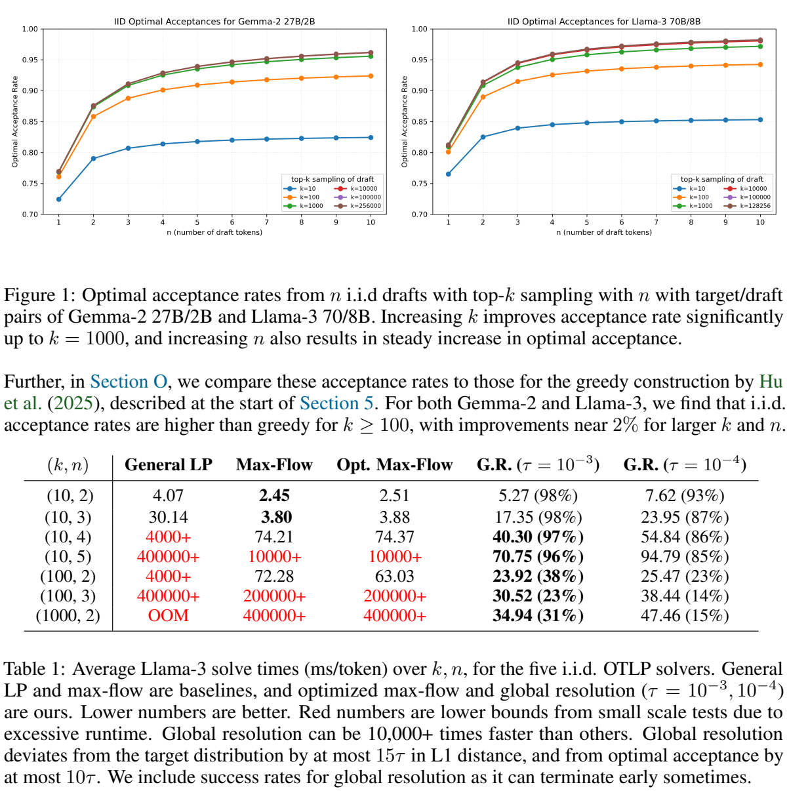

图 3-2｜原 Figure 1 与 Table 1，arXiv v1，PDF 物理第 9 页，[来源 PDF](https://arxiv.org/pdf/2511.15898v1)。图比较 Gemma-2-27B/2B、Llama-3-70B/8B，在不同 draft top-k 与 n 下的最优接受率；表比较 CPU 通用 LP、最大流、优化最大流与 GR 的求解时间。红色带“+”是耗时下界，不是精确完成时间；GR 括号内是成功率，时间不能脱离成功率读取。

原文数据：GSM8K、IFEval、PopQA、WildJailbreak 各 500 条评估 prompts，HumanEval 全 164 条。先按 token、再按数据集汇总，跨数据集宏平均；求解耗时实验每数据集抽 40 个 prompts。主设置 target/draft 温度 1，另扫 target 温度与 top-k，必须区分最优接受率和求解器可在预算内达到的接受率。

Table 1 中 Llama 的 k=10、n=5，GR 容差 1e−3 为 70.75 ms/token，成功率 96%；1e−4 为 94.79 ms、85%。通用 LP 的 400000+ ms 是小规模测试得到的下界。到 k=100、n=3，GR 虽只需约 30.52 ms，成功率却只有 23%；不能只摘时间列宣称普遍大幅加速。

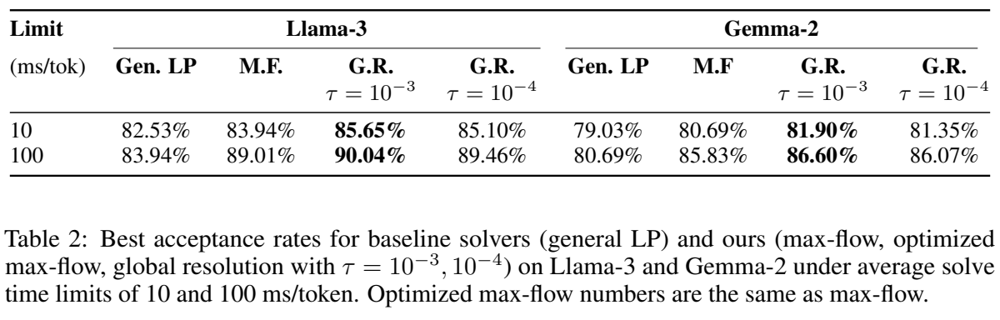

图 3-3｜原 Table 2，arXiv v1，PDF 物理第 10 页，[来源 PDF](https://arxiv.org/pdf/2511.15898v1)。固定平均 10/100 ms 每 token 求解预算，比较可行 k/n 选择后的最佳接受率；GR 失败时按论文规则回退，综合指标更接近部署权衡。粗体是该模型和预算内最佳，并非端到端 tokens/s。

100 ms 条件下，Llama GR 90.04%、最大流 89.01%、通用 LP 83.94%；Gemma 为 86.60%、85.83%、80.69%。10 ms 条件下，Llama GR 为 85.65%。差距并非所有场景都巨大，理论最优结构的价值是拓展可算范围。

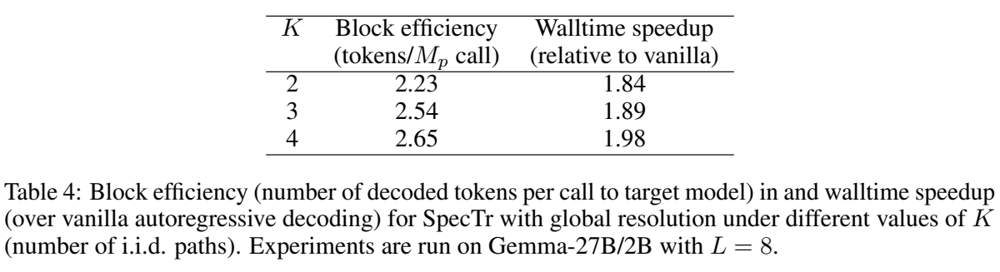

图 3-4｜原 Table 4，arXiv v1，PDF 物理第 32 页，[来源 PDF](https://arxiv.org/pdf/2511.15898v1)。Gemma-2-27B/2B，SpecTr，多步长度 L=8，独立路径数 K=2/3/4，draft top-k=100。每次目标调用解码 token 为 2.23/2.54/2.65，墙钟加速 1.84/1.89/1.98 倍，分母是普通自回归解码；没有证明相对所有现有投机解码框架快 2 倍。

### 资源、实现可用性与局限

Llama-3-70B/8B 在 4 张 A6000 与 Xeon Silver 5315Y（32 核、3.2GHz）环境；Gemma-2-27B/2B 在 1 张 A100 80GB 与 Xeon Gold 6342（12 核、2.8GHz）环境。求解器主要在 CPU，使用 NumPy、HiGHS、graph-tool 和 L-BFGS-B，最多 25 次迭代；截断 T 上限对 n=2 为 50、n=3 为 20、n=4/5 为 10。不同模型组 CPU 不同，不能把跨组时间差完全归因于模型。

本方法不训练模型，没有 RL reward 或新增训练 loss；优化的是数学耦合的凸目标。未披露/未找到完整总 GPUh、峰值 GPU/CPU 内存、所有实验墙钟和费用。高 n 的组合爆炸、失败回退、CPU/GPU 数据传输和有限容差误差是部署限制；接受率提升不能直接换算为端到端吞吐同比提升。

本次在 PDF、官方程序/OpenReview 链接与作者公开页面中未找到可核读的作者完整实现，code_url 记 null。作者机构 [Ritual 研究入口](https://www.ritual.net/)可辅助定位论文，未找到稳定可访问的独立实现或专门解读博客；不拿第三方复现冒充官方代码。建议先从上面的二 token 运输例子理解约束，再读 [Boyd 与 Vandenberghe 的凸优化教材](https://web.stanford.edu/~boyd/cvxbook/)中的对偶、log-sum-exp 和数值求解，再读论文附录证明与实现细节。

## 4. RLVR：答案正确是否真的意味着推理学会了

### 身份、材料与核心问题

原文事实：[ICLR 2026 官方 poster](https://iclr.cc/virtual/2026/poster/10007896)、[OpenReview](https://openreview.net/forum?id=jGbRWwIidy)确认主会。arXiv:2506.14245 首次公开 2025-06-17；本次读的是[正式会议 PDF](https://proceedings.iclr.cc/paper_files/paper/2026/file/517f9b9c227b9dd51dba4560f37165ed-Paper-Conference.pdf)，34 页，含新增强验证器附录，不能用较早预印本替代这些结果。[OpenAlex](https://api.openalex.org/works/W4415311663)引用 326。

小白直觉：一道选择题蒙对与正确演算得到答案，普通答案奖励都给 1。只看“多做几次总能答对”，可能把猜中答案的能力误当作可靠推理。论文提出同时要求答案与 CoT 正确的 CoT-Pass@K，并分析为什么只奖最终答案仍可能在平均意义上偏向正确推理。

### 指标推导：把偶然猜中从成功集合中去掉

```text
Pass@K = 1 - choose(N-C, K) / choose(N, K)
CoT-Pass@K = 1 - choose(N-D, K) / choose(N, K)
```

N 为一题已采样回答总数，C 为答案正确数，D 为答案和推理同时正确数，K 为抽取次数，choose 表示组合数。先算随机不放回抽 K 份全失败的比例，再取补集；当 N−C<K 时失败项为 0。逐题计算再平均，不能把不同题目的样本先混成一个大池。D≤C，因此相同样本上 CoT-Pass@K 不会高于 Pass@K。

本文推演：N=4、C=2、D=1、K=2，答案指标为 1−1/6=5/6，而推理指标为 1−3/6=1/2。若独立无限生成中正确概率为 p，则理论形式为 1−(1−p)^K；无论用哪种形式，有限 K 看不到成功，都不能证明真实概率严格为零。论文支持有限采样预算下更强的正确推理可达性，而非严格证明新推理路径从零概率出现。

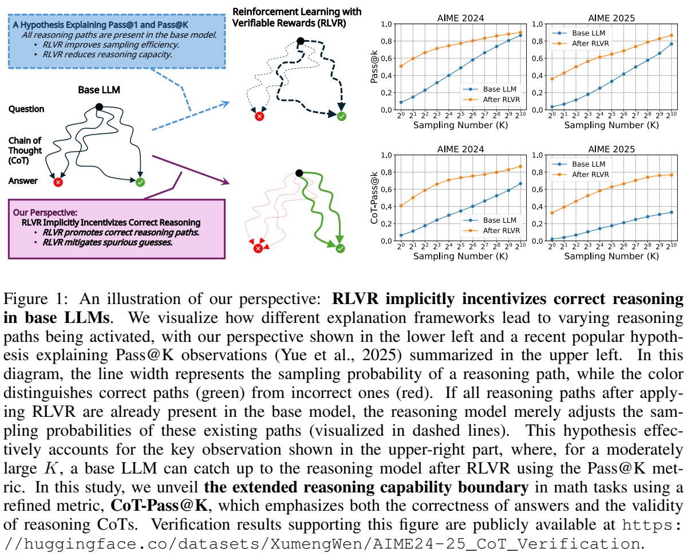

图 4-1｜原 Figure 1，ICLR 正式会议版，PDF 物理第 2 页，[来源 PDF](https://proceedings.iclr.cc/paper_files/paper/2026/file/517f9b9c227b9dd51dba4560f37165ed-Paper-Conference.pdf)。左侧为作者关于正确/错误路径的机制示意，右侧为 AIME24/25 的 Pass@K 与 CoT-Pass@K 对比；蓝为 base，橙为 RLVR。线粗表示路径概率的概念图，不能把画出的路径当成模型内部因果观测。

### 为什么答案奖励可能偏向正确 CoT

令 pc 为当前生成正确 CoT 的概率，alpha=P(答案正确｜CoT 正确)，beta=P(答案正确｜CoT 错误)。核心先验是 alpha>beta：真正正确的推理更容易答对。奖励 r 为答案正确的 0/1，均值 mu=pc×alpha+(1−pc)×beta，方差 sigma²=mu(1−mu)。大组采样且方差非零时，中心化归一优势近似 (r−mu)/sigma。

```text
E[advantage | CoT correct] = (1 - pc) × (alpha - beta) / sigma > 0
E[advantage | CoT wrong]   = -pc × (alpha - beta) / sigma < 0
grad J ≈ mean(advantage × grad log pi_theta(response | prompt))
```

推导：正确组的条件奖励期望为 alpha，减总体均值后 alpha−mu=(1−pc)(alpha−beta)；错误组同理 beta−mu=−pc(alpha−beta)。所以即使奖励不直接检查过程，正确 CoT 组也可能获得正的平均更新权重。

本文推演：pc=0.2、alpha=0.9、beta=0.1，则 mu=0.26、sigma≈0.4386；两类平均优势约 1.459 与 −0.365。它是条件期望例子，不是论文测得的参数。神经网络参数共享会造成样本间干扰，有限组、裁剪、优化步长也会改变结果；上述期望不证明每一条正确链的概率都单调增长，也不直接保证跨题泛化。

### 数据、验证器与实验流程

原文主要比较 Qwen2.5-32B base 与 DAPO-Qwen-32B，数学训练集约 17k；评估对每题采样 N=1,024，最大 K=1,024。代码任务还研究 DeepSeek-R1-Distill-Qwen-7B 及 AceReason-Nemotron-7B、Skywork-OR1 等 RL 模型。数学集包括 AIME24/25、MATH500、AMC23、Minerva。难题输出格式与校验器要一致，否则答案正确率本身就会失真。

推理验证器主要是 DeepSeek-R1-0528-Qwen3-8B，对每份 CoT 做三次判断，用 all-correct、majority-correct、any-correct 三种规则形成敏感性范围。假设误判独立、单次假阳性 f，则 all 的假阳性为 f³；any 的假阴性也有立方下降形式。但同一模型三次判断可能高度相关，不能用这个理想计算当实际误判保证。附录新增 gpt-oss-20B/120B 高推理预算、最长 64k 的验证，比较趋势稳定性。

```python
for problem in benchmark:
    responses = sample(model, problem, N=1024)
    answer_ok = verify_final_answer(responses)
    judgments = [judge_reasoning(responses) for _ in range(3)]
    for rule in [all_correct, majority_correct, any_correct]:
        both_ok = answer_ok & aggregate(judgments, rule)
        for K in sampling_budgets:
            record(pass_estimator(answer_ok, K),
                   pass_estimator(both_ok, K))
# CoT判分是分析工具；这里没有把过程判分反馈给RL训练。
```

原文训练仍用结果奖励，未加入过程奖励。自复现 DAPO 使用 VERL，32 张 AMD MI300X、超过两周，约 400 个训练 rounds，每 round 16 次梯度更新；论文“step/round”与梯度更新不能混算。自复现最终 Pass@1 约 44%，未达到原始 DAPO 的超过 50%，因此其训练轨迹分析与发布模型主比较是两套证据。

### 核心实验、SFT 代理检验与局限

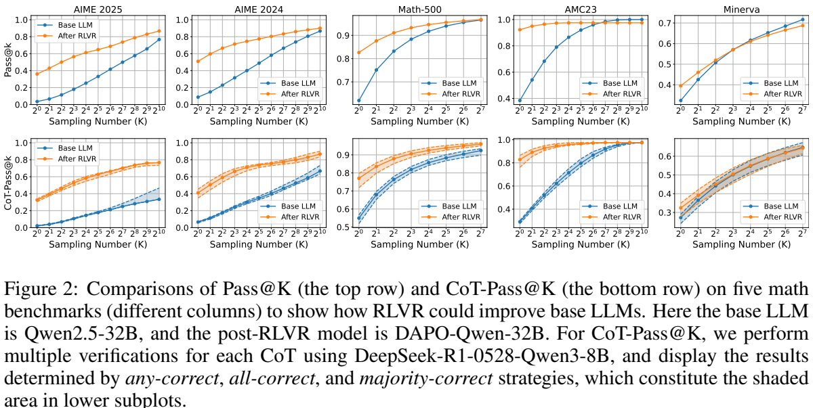

图 4-2｜原 Figure 2，ICLR 正式版，PDF 物理第 4 页，[来源 PDF](https://proceedings.iclr.cc/paper_files/paper/2026/file/517f9b9c227b9dd51dba4560f37165ed-Paper-Conference.pdf)。Qwen2.5-32B base 对 DAPO-Qwen-32B，五个数学测试集，横轴采样 K。上行为答案 Pass@K，下行为 CoT-Pass@K。阴影来自验证器投票规则差异，不是统计置信区间。AIME 上推理指标差距更明显，Minerva 并无同样收益，不能只读前两列。

原文解释 Minerva 涉及物理和答案格式差异，训练任务适配不足。本报告保留这一负结果。附录更强验证器也降低某些绝对分数，说明“正确 CoT”仍依赖可错的模型审查，而不是数学形式验证的真值。

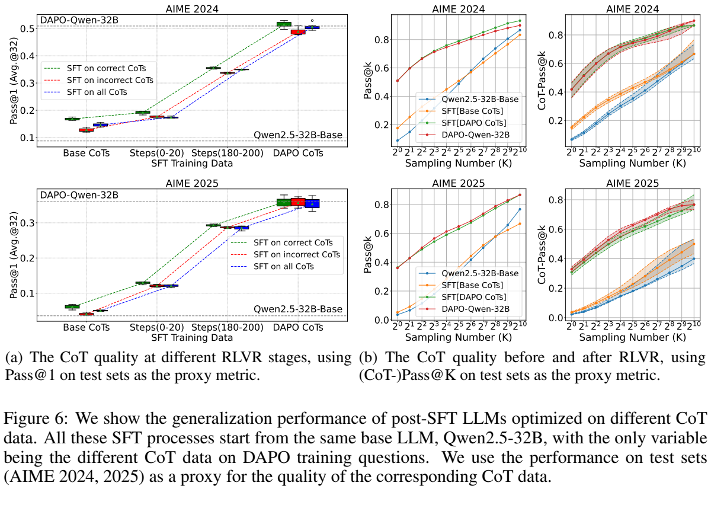

图 4-3｜原 Figure 6，ICLR 正式版，PDF 物理第 9 页，[来源 PDF](https://proceedings.iclr.cc/paper_files/paper/2026/file/517f9b9c227b9dd51dba4560f37165ed-Paper-Conference.pdf)。同一个 Qwen2.5-32B 起点，使用 base、RL 早期、中期、最终 DAPO 所产出的答案正确轨迹做 SFT；再分正确 CoT、错误 CoT、全部轨迹。左侧测试 Pass@1 是训练数据质量的代理，右侧比较采样曲线。后期 RL 轨迹更有用，不等于 SFT 无需付出产生教师数据的 RL 成本。

令人意外的是，部分被判为推理错误的后期轨迹仍能训练出更好的模型。它们可能包含有价值的中间模式，验证器也可能误判。论文 Table 1 显示 DAPO 错误/正确 CoT 的长度中位数约 3,995/2,266，而 base 为 950/862；长度是潜在混杂因素。因此不能下结论“故意加入错误推理一定更好”。SFT 教师后期样本的质量与长度、分布一起变化。

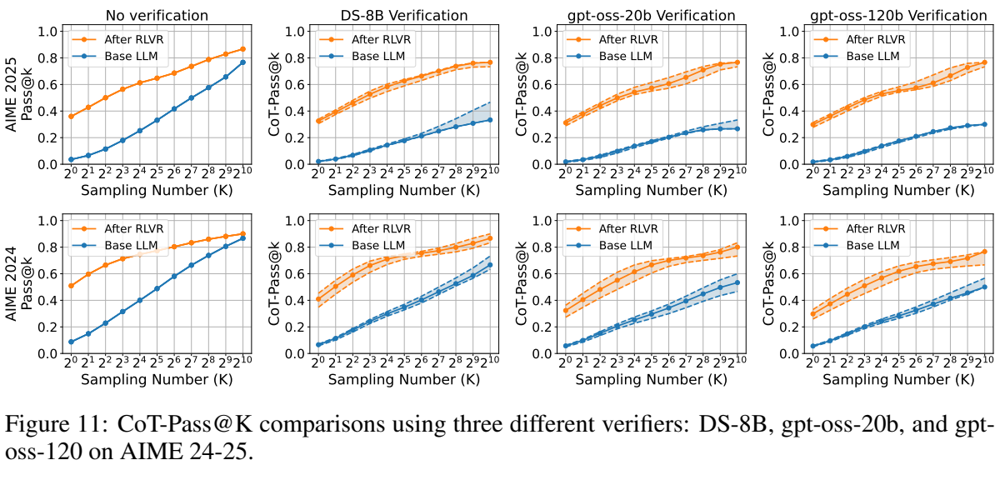

图 4-4｜原 Figure 11，ICLR 正式版，PDF 物理第 31 页，[来源 PDF](https://proceedings.iclr.cc/paper_files/paper/2026/file/517f9b9c227b9dd51dba4560f37165ed-Paper-Conference.pdf)。对 AIME24/25 使用 DS-8B、gpt-oss-20B、gpt-oss-120B 三种验证器，均比较同一 base/RL 对。总体趋势相近是稳健性检查；不同验证器绝对分数不同，不应将一致趋势写成标签完全可靠。

原文附录 Table 3 的一个具体例子：AIME2025 II 第 1 题，N=1,024，gpt-oss-120B 多数规则下 base 的答案正确 36、正确 CoT 17，RL 的答案正确 1,024、正确 CoT 1,022。它直观显示答案与推理判定的差异，但不能以单题替代平均结果。对已完全学会答案的训练题，约 400 rounds 后中位条件正确 CoT 比例仍约 0.7；全对组优势为零，错误过程可能不再受到区分。这是只用结果奖励的结构性局限。

### 资源与可复现性

32 张 MI300X 超过两周是自复现训练披露；全研究的实际 GPU-hours、峰值显存、逐模型推理总时长及费用未完整披露。本文推演：若持续满占 14 天，32×14×24=10,752 GPUh，只是条件换算，不是报告的实际总消耗。SFT 的完整学习率/步数与预算也未找到足以复现所有设置的披露，不能借用其他论文配置填空。

[作者数据集](https://huggingface.co/datasets/XumengWen/AIME24-25_CoT_Verification)可访问，包含 rollouts、答案判断与验证结果，适合复核度量；它不是完整训练代码。[微软研究院作者出版页](https://www.microsoft.com/en-us/research/publication/reinforcement-learning-with-verifiable-rewards-implicitly-incentivizes-correct-reasoning-in-base-llms/)为辅助定位。未找到该论文自有的完整端到端实现或独立解读博客；上游 VERL/DAPO 不冒充本文作者代码，manifest 的 code_url 为 null。

最值得复核的是相同原始回答上不同判分器的一致性、错误类型与人工审查，再考虑昂贵训练。基础可读 [D2L 概率与条件期望](https://d2l.ai/chapter_preliminaries/probability.html)，然后按本节四样本例子手算两个 Pass@K，避免先陷入“能力是否凭空产生”的二元争论。

## 5. STORM：在生成关键词时就让检索结果参与选择

### 正式身份与直觉

原文事实：[ACL Anthology 正式主会条目](https://aclanthology.org/2026.emnlp-main.2149/)为 EMNLP 2026 main，页码 48856–48871，全文 16 页。[EMNLP 官方 program](https://2026.emnlp.org/program/)链接的日程中，6802-MAIN 对应此题名，类型 Poster、In-Person，2026-10-25 11:00–12:30、Hall H、Poster Session A、展位 301，故记 poster。arXiv:2606.10621 首次公开 2026-06-09，v2 为 2026-08-26；本次阅读 [ACL 正式 PDF](https://aclanthology.org/2026.emnlp-main.2149.pdf)。[OpenAlex](https://api.openalex.org/works/W7164131871)引用 0。

小白直觉：用户说“糖尿病饮食”，检索系统只靠词匹配可能漏掉有用文档。LLM 可以改写为更有效的关键词，但先生成完再评分浪费了中途可得到的反馈。STORM 在训练时逐步扩展关键词候选，对已形成的词运行检索，用奖励淘汰差分支，再将这种偏好训练进模型。测试时输出短关键词串，仍调用现有 BM25 倒排索引，不需把整个语料重新编码成稠密向量。

### 从 token 到检索奖励

BM25 按倒排索引做词项匹配，与 LLM 子词 token 不同。论文定义映射 T，把子词序列解码为完整词项；最后未完成的词在遇到分隔符前不参与评分。这样部分前缀就能发起有效检索，但并不是每个子 token 都有可靠语义奖励。

```text
p_theta(y | x) = product_t p_theta(y_t | x,y_<t)
R(x,y) = nDCG@100(T(y)) - lambda_DF × sum_(w in T(y)) DF(w)
         + lambda_L × log p_theta(y | x)
R_tilde = sigmoid(k × (R - mu))
```

x 为查询，y 为生成关键词，DF(w) 是归一化文档频率，lambda_DF=0.005 惩罚过常见词；lambda_L=0.01 控制序列似然项，log 概率为非正数。nDCG 衡量相关文档排序质量并除以理想排序值。sigmoid 把奖励映射到正范围，代码使用 k=6、mu=0.5。这些超参数对奖励尺度敏感，不是天然跨语料通用常数。

本文推演：二元相关性下，把唯一相关文档从第 2 位移到第 1 位，归一化折扣增益从 1/log2(3)≈0.6309 变为 1。若 nDCG=0.8、词频和=0.2、log p=−5，则 R=0.8−0.005×0.2−0.05=0.749，R_tilde≈0.817。它说明各项尺度，数值不是原文实验。

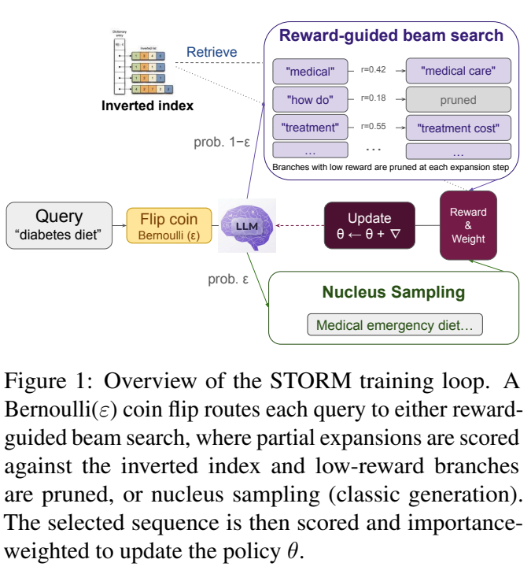

图 5-1｜原 Figure 1，ACL 正式版，PDF 物理第 3 页，[来源 PDF](https://aclanthology.org/2026.emnlp-main.2149.pdf)。以概率 1−epsilon 走奖励引导 beam，以 epsilon 走 nucleus 探索；前缀检索由倒排索引提供奖励，最终序列再计算重要性权重更新模型。图中的 medical 等词与分数是作者方法示意，不是独立实验基线。

### 目标分布、重要性加权与理论边界

```text
q_theta(y | x) ∝ p_theta(y | x) × R_tilde(x,y)
q_hat(y | x) = epsilon × p_theta(y | x)
               + (1-epsilon) × p_rgb(y | x)
w(y) = p_theta(y | x) × R_tilde(x,y) / q_hat(y | x)
loss = -sum_y normalized(stop_grad(w(y))) × log p_theta(y | x)
```

q_theta 是将高奖励回答放大的目标分布；q_hat 是实际混合采样分布；p_rgb 表示奖励引导 beam 的选择分布，论文基本描述为最佳 beam 上的点质量；epsilon 保证普通采样的探索。采样不是直接来自 q_theta，所以用重要性比值校正。推导时把本轮构造的目标和权重固定，最小化其到 p_theta 的正向 KL，就得到加权负对数似然；不能把这一步误写成对所有依赖 theta 的目标项一起求导。

本文推演：两条候选的 p 为 0.2/0.1，实际 proposal 概率为 0.4/0.2，正奖励为 0.8/0.4，则权重为 0.4/0.2，归一为 2/3、1/3。这个例子只说明加权，不要求这两条覆盖全部输出空间。理想的固定正奖励、精确更新下，反复乘权得到 p_t(y)∝p_0(y)×R_tilde(y)^t，会向最大正奖励集中；实际奖励含当前模型 log p，且 proposal/模型拟合近似，所以理想收敛结论不能直接当作整个实现的保证。

```python
for query, relevance_labels in training_data:
    if random() < epsilon:
        y = nucleus_sample(model, query)
    else:
        beams = [empty_prefix]
        while not finished(beams):
            candidates = expand_and_sample(beams)
            terms = complete_words_only(candidates)
            reward = score_bm25_retrieval(terms, relevance_labels)
            beams = select_by_reward(candidates, reward, width=5)
        y = best_beam(beams)
    reward = score_full_sequence(y)
    weight = detached_importance_weight(y, reward)
    accumulate_weighted_cross_entropy(y, weight)
optimizer_step_after_accumulation()
# 测试：多样化beam生成短关键词，拼接后只执行一次BM25检索。
```

这是依据论文的教学流程。训练数据约 80k 条 MS MARCO 查询、500 条留出，相关性监督使用 OpenSearch 的 MS MARCO hard-negative/cross-encoder 分数资源。虽然不要求额外人工逐步标注，仍使用相关性伪标签和检索监督，不能称无监督。

### 训练、测试与完整资源账

训练主干为 Qwen3 0.6B、1.7B、4B、8B；单 epoch，AdamW，学习率 1e−6，batch 32、梯度累积 8、有效 batch 256，不生成 CoT；最大生成 32 tokens，beam 5，epsilon=0.2，温度 1。本文推演：若 80k 样本每个恰好访问一次且不考虑尾 batch，约 313 个优化步；实际更新数未明确逐模型报告，不能把这个估计写成原文实测。

推理使用多样化 beam：6 beams、3 groups、diversity penalty 1，返回 3 条关键词串拼接后做一次 BM25。实验也比较最大长度 32、64、128，多语结果 128 最佳。测试时不需相关性真值去挑 beam，否则会发生标签泄漏。训练设备包括 RTX A6000、H100、H200，每模型约 2–5 天；各配置卡数、总 GPUh、峰值显存与费用未披露完整，无法由“几天”恢复成本。

### 核心实验与不能忽略的代价

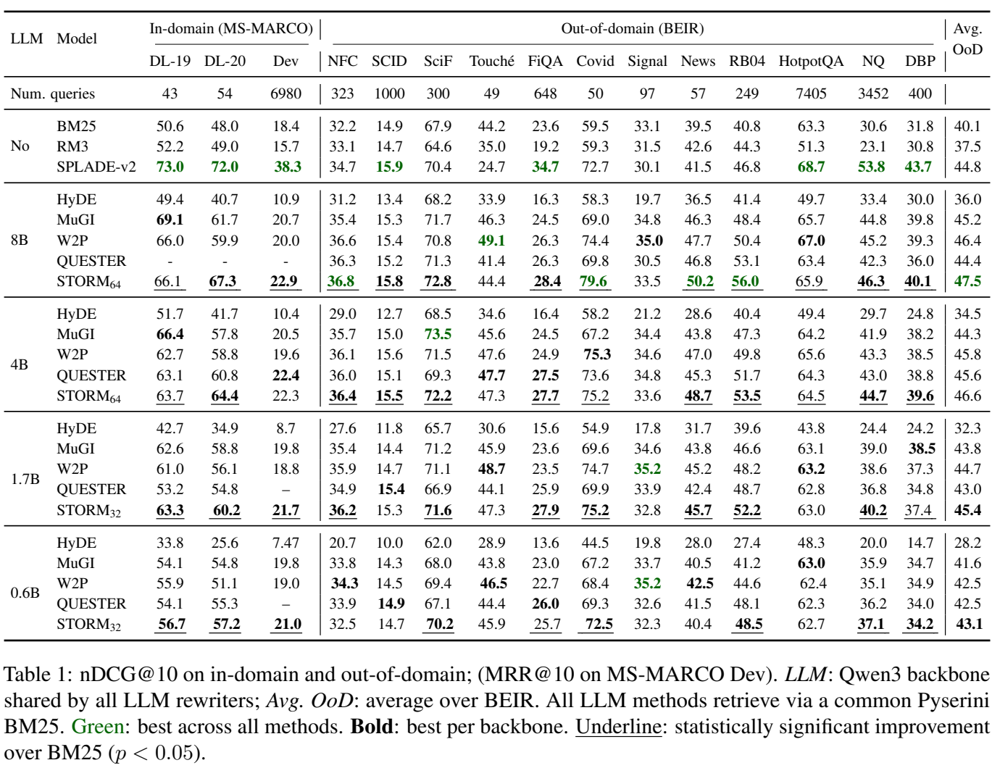

图 5-2｜原 Table 1，ACL 正式版，PDF 物理第 5 页，[来源 PDF](https://aclanthology.org/2026.emnlp-main.2149.pdf)。同一 Pyserini BM25 索引上的 LLM 改写方法 HyDE、MuGI、W2P、QUESTER、STORM，按 Qwen3 模型大小分组；MS MARCO Dev 使用 MRR@10，其余多为 nDCG@10，不能混看同列外指标。Avg OOD 是 12 个 BEIR 数据集平均；绿色最佳、粗体同主干最佳，下划线为对 BM25 显著。

原文事实：BEIR 平均从 BM25 的 40.1，提高到 STORM-0.6B 43.1、1.7B 45.4、4B 46.6、8B 47.5；W2P-8B 为 46.4、MuGI-8B 为 45.2。TREC DL20 中 STORM-8B 为 67.3、BM25 为 48.0，而 SPLADE 为 72.0，因此并非每项都超过稀疏神经检索。SPLADE 也不是与 BM25 改写完全相同的索引条件，需单列理解。

MIRACL 的 18 语言宏平均，STORM 最大 128 tokens 为 48.4，BM25 38.5，mColBERT 44.1；64 tokens 为 47.9。不能把“128 设置全部语言改善”推广到所有长度：Table 2 中 32 tokens 的孟加拉语 50.1 低于 BM25 50.8，泰卢固语 47.5 低于 49.4。论文还与 GPT-4.1 改写比较，但其参数量并未公开，本报告不沿用未经证实的参数倍数说法。

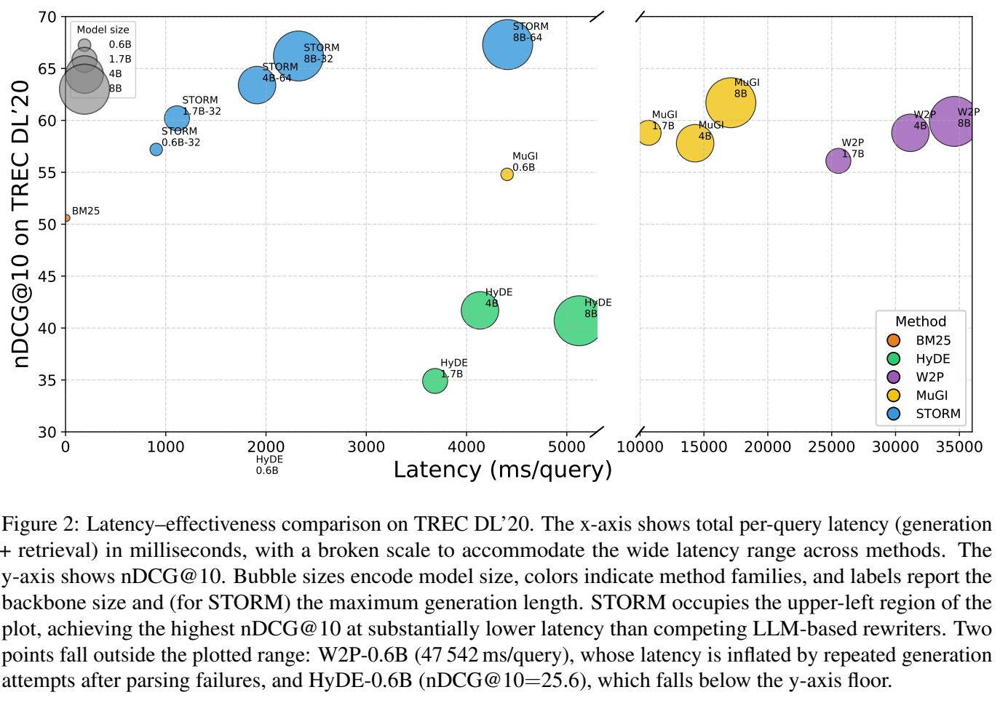

图 5-3｜原 Figure 2，ACL 正式版，PDF 物理第 12 页，[来源 PDF](https://aclanthology.org/2026.emnlp-main.2149.pdf)。TREC DL20，横轴每查询端到端时延（生成加检索，毫秒），纵轴 nDCG@10，气泡大小表示模型规模而非不确定性。横轴有断轴；W2P-0.6B 的 47,542 ms 与 HyDE-0.6B 的低分点未在图内，原图注明确披露，不能当作删掉失败后所有方法都落在展示范围。

Table 4 中 STORM-8B 生成约 4.39 秒、检索 0.01 秒，总约 4.40 秒；W2P 为 34.2+0.16 秒，MuGI 16.8+0.25 秒。STORM 显著快于这些长改写方法，但普通 BM25 本身约 0.01 秒，并没有端到端同速。小模型、较短输出、更多缓存可能形成新的权衡，论文图不能代替部署流量下的测量。

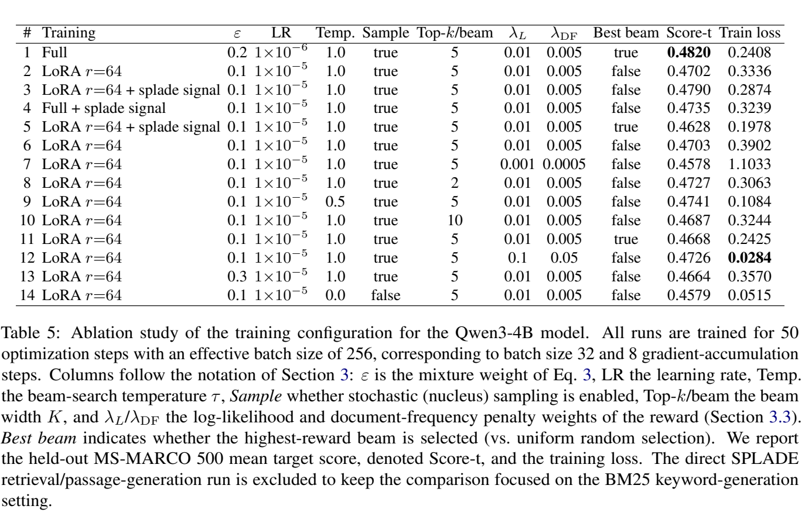

图 5-4｜原 Table 5，ACL 正式版，PDF 物理第 13 页，[来源 PDF](https://aclanthology.org/2026.emnlp-main.2149.pdf)。Qwen3-4B，各配置仅训练 50 个优化步，有效 batch 256，留出 500 查询的 score-t 与训练 loss。Full、LoRA、epsilon、学习率、温度等多项一起变化，不能把某两行差值直接解释成单一因素的因果贡献。

Full、epsilon 0.2、学习率 1e−6 的 score-t 0.4820，若干 LoRA 变体约 0.46–0.479；beam=5 是作者折中，更多 beam 不保证稳定更好。Table 6 的 Avg OOD 只计 10 个 BEIR 集，排除 HotpotQA 与 NQ，不能拿它的平均数与 Table 1 的 12 集平均直接作提升计算。

### 代码核读：论文公式与公开实现存在差异

[官方仓库](https://github.com/arthur-75/storm)固定提交 dff13214c16c30cde5352599d07b7c870ab772db；[作者模型集合](https://huggingface.co/collections/Arthur-75/storm)提供模型入口。核读 train/src/train.py、reward.py、keyword.py、data.py、配置、修改过的 Transformers generation/utils.py 与评估生成路径。没有找到独立作者解读博客，README 为作者使用说明。

静态发现一：token_loss=true 时，train.py 用平均 token log-prob 而非整段 log-prob 求 pi，随后指数化参与权重；这与公式中的序列概率不完全相同，长度归一会改变样本权重。发现二：log_qi 的混合项给所有样本加上 (1−epsilon)/K，未看到论文最佳 beam 点质量所需的成员指示；因此不能断言此公开实现精确实现论文无偏重要性估计。

发现三：普通采样路径硬编码 top-p=0.95，而 beam 配置为 0.9；配置中的生成 batch=16、累积=16 与正文 32×8 都是有效 256，但局部 batch 统计不同。奖励 sigmoid 的 k=6、mu=0.5 在代码中固定。以上是所读固定提交的事实，不证明原始实验一定使用同一个版本，也不代表已经运行验证了这些差异的性能影响。

仓库训练需替换 Transformers 的生成实现，应在隔离环境固定依赖；本次没有执行替换。检索语料、处理后的 TSV/cross-encoder 分数、语言分析器和索引版本也影响可复现性，尤其 MIRACL 应匹配语言 tokenizer/analyzer。奖励频繁检索的训练开销可能远超普通 SFT；代码可用不等于训练资源账完备。

适用范围是已有词法索引、愿意用生成时延换取检索质量的场景。奖励依赖现有相关性标签与 BM25 的表达能力，对极难需要语义推断的查询并非万能。基础先读[斯坦福信息检索教材](https://nlp.stanford.edu/IR-book/)，再理解倒排索引、BM25、nDCG 与重要性采样；教程不计入本期五篇论文。

## 横向阅读：把五篇的“更好”放回各自分母

| 论文 | 真正优化或测量的对象 | 不能直接推出的结论 | 复现首要入口 |
| --- | --- | --- | --- |
| ScaleRL | 固定设置下 GPUh 对平均成功率的曲线 | 所有任务统一 scaling law；拟合代码等于训练代码 | 公开拟合数据、外推误差 |
| p-less | 截断分布的温度稳健性、采样器开销 | 保留原分布；端到端快 22% | 采样函数、相同模型温度扫描 |
| Global Resolution | 多草稿最优耦合、预算内接受率 | 有限容差严格无损；快过所有投机框架 | 二 token 耦合与凸求解检查 |
| RLVR | 答案加过程的有限预算成功率 | 数学证明从零产生新能力；过程标签完全正确 | 公开回答与不同判分器复核 |
| STORM | 词法检索反馈下的关键词策略 | 无监督；与 BM25 原查询一样快；代码精确等于理论 | 奖励/重要性实现、固定索引 |

本文推演：五篇可以组成工程决策顺序，但本次未把它们组合运行。先确认训练测量和判分是否可靠，再决定继续 RL 的预算；推理侧分别评估改变分布的 p-less 与近似保持目标分布的 Global Resolution；检索侧 STORM 又有独立的相关性监督与时延目标。各方法的奖励、误差容差、采样预算和计时边界不同，跨论文百分比不能直接相加。

## 检索剔除、资料与交付说明

本期检索覆盖 CCF 当前目录，ICLR 2026 官方 oral/poster 逐篇入口与正式论文，EMNLP 2026 主会论文集和官方链接日程，以及作者代码、arXiv 历史与 OpenAlex。未证实正式展示信息的 Entropy Mechanism 类候选没有补成 oral；检索中的 Entropy Scheduling in RL for LLMs（2026.findings-acl.206）与 Revisiting Entropy 相关 Findings 条目未作为主会论文。EMNLP 的其他 oral/Virtual Pres 候选未入选，保留当前 B 类 poster；没有把博客、教程或 workshop 计入五篇。完整剔除日志在 manifest.json。

原图清单、图号、物理页、裁切框、源 PDF 与 PNG 哈希见 assets/figures.json 和 assets/SOURCES.md；逐篇正式证据见 assets/official-evidence.json，STORM 日程原始行见 assets/emnlp-schedule-evidence.json。代码提交、核读路径与差异见 assets/code-reading.json。原始 PDF 共 156 页已完整阅读，公开关键代码仅静态核读，未声称完成运行复现。

本 report.md 为完整正文唯一生成源，report.pdf 使用相同全文，含全部中文、公式、表格、代码与 19 张论文原图。PDF 最终页数、逐页渲染、文字覆盖、缺字、边界与图像像素一致性结果写入 assets/pdf-check.json 与 assets/QA.md。未披露资源保留为未披露，未找到代码保留 null。论文成果与版权归各原作者；教学推导及阅读判断是本报告新增说明。
