# CCF-A/B 年度论文精读 · 2026-11-21

今天的主题：偏好学习为什么会选错方向，长上下文如何构造有效训练信号，以及熵、置信度和代码执行共识如何改变强化学习。

本期实际收录 5 篇：4 篇 CCF-A、1 篇 CCF-B；3 篇 oral、2 篇 poster，spotlight 0 篇。年度按北京时间运行日所属的 2026 年会议录用计算，允许 2025 年预印本，不套用一个月窗口。阅读范围是五篇完整 PDF 及附录，共 122 页：AuxDPO 主文 11 页加独立补充材料 10 页、LoongRL 18 页、REPO 30 页、RLCR 38 页、ERPO 15 页。本文没有运行论文中的模型训练、推理 benchmark 或复现实验；代码结论来自固定提交的静态核读。

## 0. 选题、证据与共同基础

### 0.1 本期论文及官方身份

| 顺序 | 论文 | 正式录用与展示 | 首次预印本 | OpenAlex 引用快照 |
| --- | --- | --- | --- | --- |
| 1 | Why DPO is a Misspecified Estimator and How to Fix It | ICLR 2026，A，oral | 2025-10-23 | 3 |
| 2 | LoongRL: Reinforcement Learning for Advanced Reasoning over Long Contexts | ICLR 2026，A，oral | 2025-10-22 | 26 |
| 3 | Entropy-Preserving Reinforcement Learning | ICLR 2026，A，poster | 2026-03-12 | 13 |
| 4 | Beyond Binary Rewards: Training LMs to Reason About Their Uncertainty | ICLR 2026，A，poster | 2025-07-22 | 116 |
| 5 | Entropy-Regularized Rank-Masked Policy Optimization for Test-Time Reinforcement Learning in Code Generation | EMNLP 2026 主会长文，B，oral | 2026-09-08 | 0 |

CCF 等级来自 [CCF 官方当期目录发布页](https://www.ccf.org.cn/Academic_Evaluation/By_category/2026-03-31/870181.shtml) 与 [2026 最终目录 PDF](https://www.ccf.org.cn/ccf/contentcore/resource/download?ID=112CF3BF7E1140ACEB271ADAED12A67ADFABB8FF099E40C2759502A85C8A281F)：第七版于 2026-03-31 发布、2026-04-09 修订；物理第 57 页列 ICLR 为 A，第 58 页列 EMNLP 为 B。本次已对这两页进行视觉核查。

录用和展示逐篇采用会议官方页面：[AuxDPO oral](https://iclr.cc/virtual/2026/oral/10008564)、[LoongRL oral](https://iclr.cc/virtual/2026/oral/10007440)、[REPO poster](https://iclr.cc/virtual/2026/poster/10010707)、[RLCR poster](https://iclr.cc/virtual/2026/poster/10011036)。ERPO 的主会身份来自 [ACL Anthology 正式长文](https://aclanthology.org/2026.emnlp-main.2102/)，展示来自 [EMNLP 官方程序页](https://2026.emnlp.org/program/) 链接的 [日程表](https://docs.google.com/spreadsheets/d/1aXGTy_7Xeh-OXIs3iJSbDpUsZ6YhbfA76b17kBZH0Yk/edit?gid=943432490#gid=943432490)：6640-MAIN，Oral、In-Person，2026-10-26 Session 9 / Multiple Tracks 3，F4-5，16:45-18:15。oral 论文也可另有海报展示，本期按已核实的最高展示类别计一次。第三方对 REPO 的 oral 标注不采用；未声称读取了未取得的 OpenReview decision。

引用数字查询日均为 2026-11-21（Asia/Shanghai），来自 OpenAlex 的 cited_by_count，按标题、作者及 arXiv/DOI 身份核对，原始 JSON 保存在 assets/citation-records。具体记录：[AuxDPO](https://api.openalex.org/works/W4416620037)、[LoongRL](https://api.openalex.org/works/W4416246797)、[REPO](https://api.openalex.org/works/W7135182870)、[RLCR](https://api.openalex.org/works/W4414427575)、[ERPO](https://api.openalex.org/works/W7212068264)。0 是索引当时返回的值，不是“没有影响”的判断；不同索引可能漏引或合并延迟。ERPO 的索引会议 DOI 字段未在 Anthology 页面独立证实，因此不把该字段当作已核实的正式 DOI。

排序综合主题、oral 优先和公开时长：RLCR 的 116 次引用与一年多公开时间一起看，ERPO 公开约两个多月且偏代码测试时训练，不能按裸引用数直接判优劣。本次是有边界的编辑选择，不宣称找到了全球最高引用的五篇。检索范围包括 ICLR 2026 官方 oral/论文目录、对应 proceedings/OpenReview 链接、EMNLP 2026 主会论文集与官方日程、作者项目与仓库、OpenAlex；未把博客、教程、Findings 或 workshop 算作论文。读取 sources.json 和所有方向 13 份历史 manifest 后，按 arXiv 去版本 ID、DOI、规范 URL、Unicode/标点/大小写归一标题及别名检查了 65 条历史记录，本期没有重收。11 月 18 日的指定 FWS 仅作历史排除项。

### 0.2 五篇都用得到的概念

语言模型给出的不是唯一答案，而是条件分布 πθ(y|x)。x 是问题，y 是整个回答，θ 是参数。自回归分解为每个 token 条件概率的乘积；取对数后变成求和，因此训练常操作 log πθ。模型以较高概率生成一个答案，并不等价于“这个答案较大概率正确”。RLCR 正是在区分这两件事。

奖励 R 是对一次输出的评分；优势 A 是这次评分减去比较基线。最简单的策略梯度方向为 E[Agrad_θ log πθ]：正优势增加该输出的相对概率，负优势降低。GRPO 通常对同一问题采多条回答，用组均值和组标准差构造优势。奖励全相同的组几乎没有相对信号；这也解释了为什么数据难度、奖励噪声与采样多样性不能分开讨论。

```text
A_i = (R_i - mean(R_1,...,R_G)) / (std(R_1,...,R_G) + ε)
w_it = πθ(y_it | x,y_i,<t) / πold(y_it | x,y_i,<t)
J_clip = mean min(w_it A_i, clip(w_it,1-εl,1+εh) A_i)
```

G 是组大小，i 是回答编号，t 是 token 位置；πold 是产生这批数据的旧策略；w 是重要性权重；ε 是防止除零的小量，εl、εh 是下上裁剪宽度。最大化 J_clip 等价于最小化其负数。裁剪损失让部分过大更新不再获益，但不等于把整个神经网络的所有概率比严格投影到区间内。KL 惩罚约束相对参考模型的偏移；熵 H=-∑p log p 测量输出分布的分散程度。熵太低可能探索不足，太高也可能只是在生成更多错误或无效输出。

公式中的 grad_θ 表示对参数 θ 求梯度，^T 表示转置；采用这些文本记号以保证 PDF 字体完整覆盖。下文“原文事实”包含论文及明确注明的官方代码内容；“本文推演”是用于解释的代数或小例子，不是新模型实验；“未披露/未找到”不使用猜测填空。原图均从注明版本 PDF 直接裁取，未生成或重绘实验图；20 个裁切文件的源文件哈希、坐标、像素尺寸见 assets/figures.json。

## 1. Why DPO is a Misspecified Estimator and How to Fix It

### 1.1 身份、问题与小白直觉

原文：Aditya Gopalan、Sayak Ray Chowdhury、Debangshu Banerjee。[预印本](https://arxiv.org/abs/2510.20413) 首发 2025-10-23；本文采用 ICLR 2026 正式 [主文 PDF](https://proceedings.iclr.cc/paper_files/paper/2026/file/8f6c674a7edf57912f1a5830f4a66e3f-Paper-Conference.pdf) 和 [独立补充 PDF](https://proceedings.iclr.cc/paper_files/paper/2026/file/8f6c674a7edf57912f1a5830f4a66e3f-Supplemental-Conference.pdf)，分别 11 页、10 页。补充材料印刷页 12-21，对应其文件物理页 1-10。官方录用为 A 类 ICLR 2026 oral，代码为 [AuxDPO](https://github.com/Debangshu93/AuxDPO)，引用快照 3。

初学直觉：你只有一个旋钮，却想同时调节三种回答的概率。数据告诉你“甲优于丙”的次数特别多，你把旋钮往增加甲的方向转，却可能同时大幅降低真正最好的乙。更多标注只会让你更确信这个有缺陷的折中。论文把这种“模型表示不了真实偏好奖励”的问题称作错设；不是简单的样本少或优化没收敛。

DPO 把奖励隐藏在策略与参考模型的对数概率比中，用偏好对直接训练策略。经典的奖励到最优策略等价关系在能独立调整每个回答概率的表格型策略中成立；真实神经网络参数共享，隐式奖励只能落在受限集合里。论文的问题是：在这个限制下，DPO 的最优解是否仍等于先学真实奖励、再做 KL 正则化 RLHF 的最优策略？答案一般是否定的。

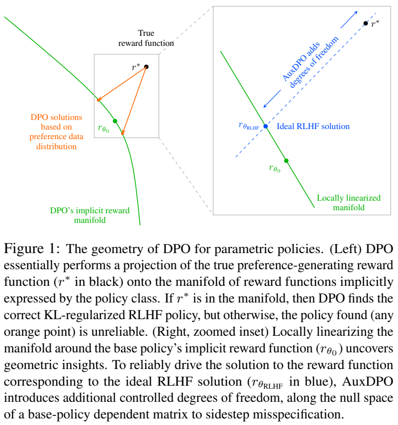

图 1. 原文 Figure 1，正式主文物理第 2 页。来源为本节主文 PDF。左侧绿色曲线是策略能表示的隐式奖励集合，黑点是真实奖励；橙色投影受偏好采样频率影响。右侧为局部线性化解释，蓝色方向表示 AuxDPO 新增的自由度。它是理论机制图，没有实验准确率或算力可比性的含义。

### 1.2 核心公式与推导

令 s 表示提示，a 表示完整回答；ρ(s) 为提示分布，r*(s,a) 为潜在真实奖励，θ0 为参考策略参数，β>0 为 KL 约束强度。πθ 是候选策略。理想 RLHF 最大化：

```text
J(θ;r*) = E_s~ρ,a~πθ [r*(s,a) - β log(πθ(a|s)/πθ0(a|s))]
rβθ(s,a) = β log(πθ(a|s)/πθ0(a|s))
P(a 优于 a' | s) = σ(r*(s,a)-r*(s,a'))
σ(z) = 1/(1+exp(-z))
```

最后一行之前的式子是 Bradley-Terry-Luce 偏好模型：奖励差越大，被选中的概率越大。DPO 用 rβθ 替代 r* 拟合偏好；其数据损失是每个 chosen/rejected 对上 -log σ(rβθ(s,aw)-rβθ(s,al)) 的平均。

原文命题 1：在无限数据的总体目标中，DPO 等价于把真实偏好概率投影到受限的隐式奖励集合 Rβ 上：

```text
min_r∈Rβ ∑_(s,a,a') n_saa' KL(Bern(p*_saa') || Bern(p_saa'(r)))
```

n 是某一比较对在数据中的频数；p* 是真实偏好概率，p(r) 是候选奖励诱导的偏好概率。推导只需将交叉熵写成真实分布熵加 KL，真实分布熵对 θ 为常数。此处明确写出 KL 的方向，避免仅使用容易混淆的 forward/reverse 名称。若真实奖励不在 Rβ 中，即使所有比较都覆盖、标注全由正确的 BTL 模型产生，频数权重仍会改变投影结果。

局部分析令 Δθ=θ-θ0，A0 的每一列为 grad_θ log πθ0(a|s)，D 的对角元素为 ρ(s)πθ0(a|s)，Aρ=A0D，F=A0DA0^T 是 Fisher 信息矩阵。主文第 5-8 页给出：

```text
rβθ ≈ β A0^T Δθ
J ≈ constant + Δθ^T Aρ r* - (β/2) Δθ^T F Δθ
∂J/∂Δθ = Aρ r* - βFΔθ = 0
Δθ* = (1/β) F† Aρ r*
```

F† 是伪逆。前两式分别用奖励的一阶展开、KL 的二阶展开；第三式令二次近似的梯度为零，得到自然梯度形式。β 足够大、更新靠近参考模型是理论适用的重要条件，不可推广成任意大步训练的全局保证。

关键观察是 Aρδ=0 的奖励扰动 δ 不改变这个局部策略更新。AuxDPO 因而使用 rβθ+δ 拟合偏好，让多余奖励自由度解释策略本身无法表示的部分。理想约束问题要求 δ 在 Aρ 的零空间中；有限数据实现用罚项近似：

```text
m_i = β[(logπθ(aw|s)-logπ0(aw|s))
       -(logπθ(al|s)-logπ0(al|s))] + δ_iw-δ_il
L = mean_i[-log σ(m_i)]
    + λ || mean_(i,a∈{aw,al}) δ_ia grad_logπ0(a|s_i) ||²
```

λ 控制零空间约束强度，δ 为每条训练回答分配的辅助变量，总共约 2n 个；n 为偏好对数量。推导意图是把真实奖励分解成“改变策略的分量”和“局部不改变策略的分量”。现实有限偏好数据并非严格从 ρπ0 独立采样，batch 近似也不等于全局零空间，所以理论与实现之间仍有距离。

### 1.3 可以手算的偏好反转

本文推演，沿用论文的三回答构造：奖励为 [1,2,0]，最优排序应为 a2、a1、a3；策略 πθ∝[exp(θ),exp(-θ),1]，参考 θ0=0，三者等概率，平均奖励为 1。大量比较 a1 与 a3，会推动 θ 为正，即增加 a1，却减少更好的 a2。

取 θ=0.4，exp(0.4)≈1.492、exp(-0.4)≈0.670，归一化总和约 3.162，概率为 [0.472,0.212,0.316]。平均奖励约 0.472+2×0.212=0.896，低于参考的 1。取 θ=-0.5，概率约 [0.186,0.506,0.307]，平均奖励约 1.199。后者也不是把全部概率放到最好回答上，而是在同一个受限参数族中的改善。

补充材料表 6 使用 n12=5、n23=5、n31=50，报告 DPO 约 0.895、AuxDPO 约 1.199；表 7 改成均衡比较后 DPO 约 1.17。附录 B.6 又展示改变参考 θ0 后，均衡频数仍可退化。因此“把偏好对采均匀”不是通用修复。

### 1.4 数据、训练流程与代码核对

原文用 RewardBench v2 约 1.87K 提示、MMLU-Pro 约 12K 十选一问题。MMLU-Pro 被改造成“正确选项为 chosen、错误选项为 rejected”的偏好数据；ID 设置对同一数据集作 80/20 划分，OOD 用清理、二值化的 UltraFeedback 训练，再到这些任务评估。UltraFeedback 是模型辅助反馈数据，不能因为附录泛称 human-preference 就当成全部真人标注。主实验是 Llama3.1-8B、Llama3.2-1B、Qwen3-0.6B 全参数训练；消融冻结部分深层 block，另比较最后一层和最后 block 上 rank=4 的 LoRA。

```text
固定参考策略 π0；给每个训练对分配两个 δ 槽位
for batch in preference_pairs:
    仅累加回答 token 的 current/reference log probability
    取出该 batch 的 δ；构造偏好 margin
    计算参考模型每条回答的梯度，得到加权梯度和
    loss = logistic preference loss + null penalty + bounded stabilizer
    更新策略参数与 δ；参考参数本身不做优化
推理：只使用训练后的语言模型，δ 不参与新问题生成
```

以上为解释性伪代码，未执行。固定代码提交 bfc84340123224347967939cbed6e43906735acf，核读 aux-dpo.ipynb、数据准备和评估入口。代码的 compute_loss 把 δ 差放在 β 括号内，而主文第 8 页将 δ 加在 β 对数比之外；补充第 6 页采用括号内约定。这可通过重新定义 δ 解释，但其幅度上限和 λ 必须一起调整，不能直接宣称同一个超参数设置完全等价。

更具体地，代码 δ=cap×tanh(raw)，cap=1，辅助学习率 5e-3，λnull=1，λamp=0.01；loss 加入小的负 δ² 项防止辅助变量塌缩。_AT_delta 临时打开参考参数梯度，逐样本 autograd.grad，再 detach 梯度但保留对 δ 的计算图。故参考模型虽然不更新，计算并非纯 forward-only；补充表 4 的 forward-only 描述不能直接代表此公开实现。代码罚项用 batch 加权梯度的和，主文式子含平均；batch 大小改变时 λ 的尺度也需复核。

### 1.5 核心实验、消融与资源

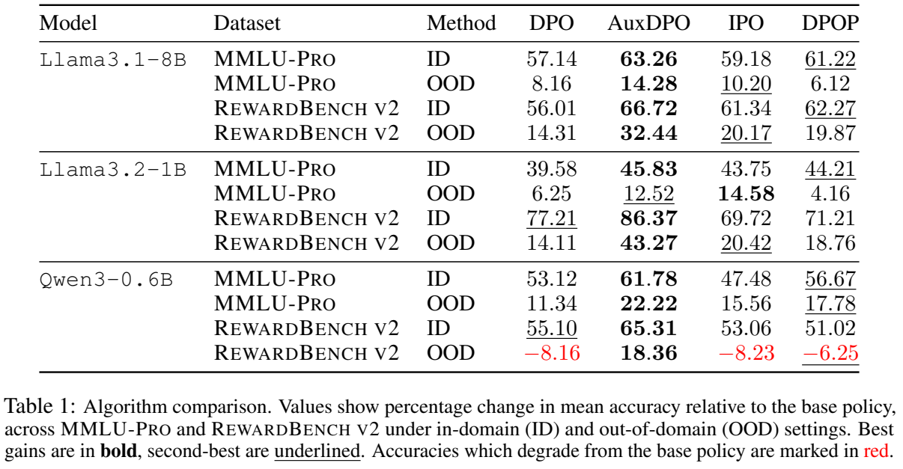

图 2. 原 Table 1，正式主文物理第 9 页。三种初始化、两种数据集、ID/OOD 的 DPO/AuxDPO/IPO/DPOP 比较。数值是相对 base 的准确率变化百分比，不是最终准确率，也不是百分点。红色为退化。应先固定同一行再比较方法，不能把不同 base 的相对百分比横向当作绝对能力。

例如 Qwen3-0.6B、RewardBench v2、OOD：DPO -8.16%、AuxDPO +18.36%、IPO -8.23%、DPOP -6.25%。但 Llama3.2-1B、MMLU-Pro、OOD 的 IPO +14.58% 高于 AuxDPO +12.52%，并非每行都赢。

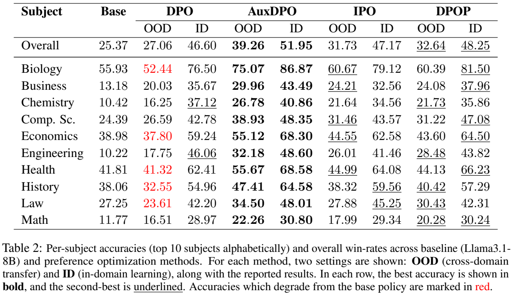

图 3. 原 Table 2，正式主文物理第 9 页。Llama3.1-8B 的 MMLU-Pro 生成答案准确率；此表与上一表的 chosen/rejected 概率比较指标不同。读 Overall 行，base 25.37%，OOD DPO 27.06%、AuxDPO 39.26%，ID DPO 46.60%、AuxDPO 51.95%。不能将 ID 与 OOD 混合排序，因为训练数据不同。

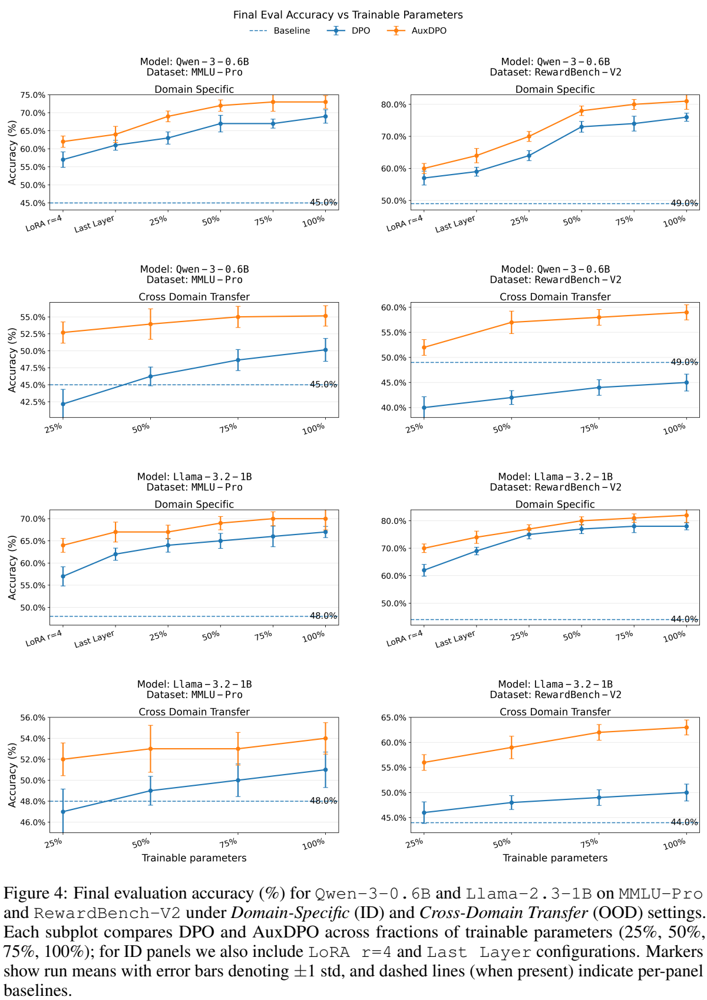

图 4. 原 Figure 4，独立 Supplemental 物理第 4 页（印刷第 15 页）。横轴是可训练层比例或受限适配方案，纵轴是最终偏好判断准确率；每点为 20 个种子均值，误差棒 ±1 标准差。固定面板比较 DPO 与 AuxDPO，才是容量相同条件的比较。附录图注对 Llama 型号有 Llama-2.3-1B 等笔误，正文型号以主表和实验说明为准，未将笔误另算一个模型。

原文 λ 网格 10、1、0.1、0.01，Llama3.2-1B / MMLU-Pro ID 的相对提升分别 44.62%、45.83%、42.21%、39.27%，λ=1 最佳。补充材料还报告 HH-RLHF 上 1B 的 ID/OOD 对比，AuxDPO +25.01%/+13.06%，DPO +17.92%/-1.19%。这些是作者结果，不是本次测量。

资源披露：补充表 4 为 8B 配置，batch/device=4、1 epoch、BF16 计算、FP32 权重与 AdamW 状态。8.03B 模型完整单副本状态理论约 119.6 GiB，不含激活；实际多卡分布不能用此数直接当峰值。8 张约 192 GiB 显存卡，作者 README 明确为 AMD MI300X。AuxDPO allocated 约 GPU1-6 各 17.4 GiB、GPU0/7 各 11.9 GiB；reserved 约 81.2 与 54-55 GiB；device-used 约 82.4 与 55-56 GiB。DPO 对应 reserved 25.94 与 20.24 GiB，device-used 29.4 与 22-23 GiB。要比较同一统计口径，不能用 allocated 掩盖 reserved/设备占用差距。完整每次训练步数、墙钟时间、GPU-hours、费用未披露，不能凭 1 epoch 补出。

### 1.6 局限与复现判断

最有价值的是“表示约束与数据比较频率会相互作用”的反例。局部 Fisher 几何没有证明任意大规模神经网络训练必然成功，增加辅助变量也可能吸收标注噪声。ID 在基准自身划分训练，与标准零样本 MMLU-Pro 不能混同；不同指标的表也不能相互代换。全局矩阵不可承受时采用 batch 罚项，效果取决于采样与尺度。公开 notebook 提供了核心实现，但环境版本、参考模型梯度计算开销和若干文稿/代码约定仍需逐项固定。

学习入口：初学者先看本期概率与策略梯度教程，再读 [DPO 原论文](https://arxiv.org/abs/2305.18290) 理解隐式奖励；本篇主文第 3-8 页及补充 A 是进阶几何部分。官方代码就是主要辅助材料，未找到独立作者解读博客，不用第三方教程替代实验依据。

## 2. LoongRL: Reinforcement Learning for Advanced Reasoning over Long Contexts

### 2.1 身份、动机与长上下文基础

ICLR 2026 A 类 oral，[官方页面](https://iclr.cc/virtual/2026/oral/10007440)；[项目](https://loongrl.github.io/)、[训练代码](https://github.com/rStar-RL/LoongRL)、[KeyChain 数据代码](https://github.com/Wangmerlyn/KeyChain)。本文完整阅读 [arXiv:2510.19363v2 PDF](https://arxiv.org/pdf/2510.19363v2)，2025-10-27，18 页；首次公开 2025-10-22。录用年度由官方会议记录确认，PDF 页眉 Preprint 不被当作“未录用”或“正式 camera-ready”的证据。OpenReview PDF 请求未取得正文，故明确使用可取得的 v2，不假称版本相同。引用快照 26。

直觉：把问题夹在长书里，不代表学会了长书推理。模型可能只找出一个答案片段，也可能凭记忆答对，训练奖励因而没有迫使它处理长距离依赖。KeyChain 先让模型沿一串随机钥匙找到真正的问题，再从不同文档收集事实并作多跳推理；干扰链通向其他看似合理的问题。答对需要定位任务本身，再完成任务。

长上下文长度是能接收多少 token；检索是找出目标信息；多跳推理是把分散事实连起来。这三者不同。一个模型支持 128K 窗口，仍可能在 128K 内答错；NIAH 单针检索满分也不保证多文档推理满分。

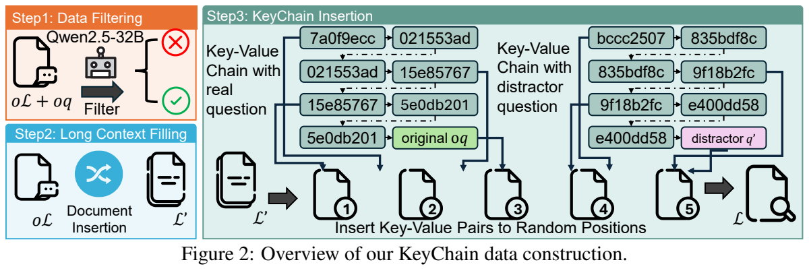

图 5. 原 Figure 2，arXiv v2 物理第 3 页，来源为本节 PDF。先过滤原始 QA，再填入干扰文档，最后插入随机 key-value 链；绿色终点是真问题，紫色终点是干扰问题。箭头代表数据构建，不是外部检索工具调用；推理时依然是在提供的上下文中生成答案。

### 2.2 数据构造与三阶段课程

原文从 HotpotQA、MuSiQue、2WikiMultiHopQA 取 277K QA。Qwen2.5-32B-Instruct 对每题生成 8 次，去掉成功率 0 或 1 的题，留下约 72K 中等难度题。再加入无关文档扩展上下文，随机散布链条，正确链末端保存原问题，标准答案保持不变。这样难度提高，但答案来源仍是真实 QA，而非让模型凭空生成答案。

表 1 最终混合 7,500 KeyChain 难题、7,500 普通长上下文多跳题、1,024 PG19/RULER 检索题、5,000 短数学题，共 21,024 条。数学部分为 2,500 DAPO 难题和 2,500 MATH 多选题；检索包含多 key 单 value 与单 key 多 value 两组，各 512。论文称约 16K 训练，但表中 KeyChain 输入范围可到 20,670 token，不应写成所有输入严格不超过 16,384。

7B 先不加 KeyChain warm-up 1 epoch，再加入 KeyChain，最后用最佳 checkpoint 每题采 8 次，把 8 次全对的样本去掉，只对剩余约 30%-40% 难题继续训练。14B 跳过 warm-up。这个设计与“只挑最难题”不同：小模型在完全做不出的题上得到全零奖励，组相对学习没有有效区分。

### 2.3 奖励、目标与手算例子

原文使用本期 0.2 的 GRPO 目标，G=8、KL β=0.001，无额外 entropy loss。最终答案要求在 boxed 标记内。论文式 3 的两向子串奖励是：

```text
R(y,a) = 1 if a is substring of y OR y is substring of a; else 0
A_i = (R_i - mean(R)) / std(R)
```

a 为标准答案，y 为提取答案；OR 是逻辑或。相比严格字符串相等，包含规则容忍“全名/简称”等差别，也会把某些不完整或错误的子串当正确，不能视为语义真值检验器。

本文推演：在长文中放入 K1→K7、K7→“甲公司的创始人出生在哪座城市”，另有“创始人是乙”和“乙出生于杭州”。追链定位问题后，须把两个事实连接，才得到杭州。如果一组 8 个输出有 2 个奖励 1、6 个奖励 0，使用总体标准差，均值 0.25、标准差 √0.1875≈0.433；正确优势约 +1.732，错误优势约 -0.577。这个数值只说明组内信号，不代表任何真实训练 batch。

再看奖励边界：标准答案“New York City”，预测“New York”，论文双向式判 1，严格 EM 判 0；标准答案“York”，预测“not York”也可能通过简单包含规则。这是本文的字符串反例，不是声称作者实验发生了该攻击。采用字符规范化、限制 boxed 数量和长度可以降低部分风险，却不解决一般语义否定。

```text
seed_QA = curate_and_filter(original_QA, teacher_samples=8)
long_QA = fill_with_distractors(seed_QA)
keychain_QA = insert_true_and_decoy_chains(long_QA)
mix = keychain_QA + ordinary_QA + retrieval + short_math
for stage in curriculum:
    sample 8 responses per prompt
    extract final answer; compute task-specific reward
    compute group advantage; optimize clipped objective and KL
    if entering final stage: discard prompts solved in all 8 samples
inference: feed full long context; generate reasoning and final answer
```

这是按论文整理的流程，不是逐行复制作者实现；没有在本次运行。模型推理无需重新生成 UUID 训练数据，但仍需目标长度支持及论文使用的 YaRN 配置。

### 2.4 核心结果与可比条件

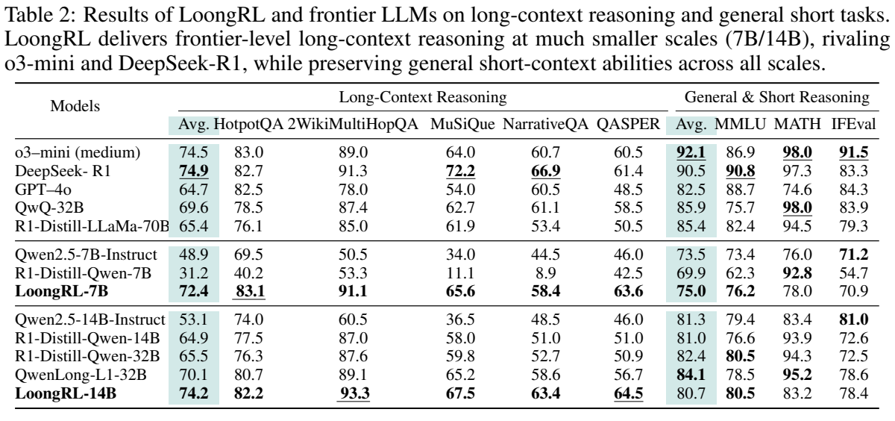

图 6. 原 Table 2，arXiv v2 物理第 7 页。左边为 LongBench v1 五个 QA 任务平均，右边是 MMLU、MATH、IFEval。以同尺寸 Qwen2.5-Instruct 为主要基线：7B 48.9→72.4，14B 53.1→74.2，分别 +23.5、+21.1 个百分点。o3-mini 74.5、DeepSeek-R1 74.9 只表示该评估上的接近，训练数据、算力、架构及可用推理预算没有等同。

推理模型温度 0.6，每题 8 次，报告平均 pass@1；非推理基线使用温度 0。最长输入 128K、输出上限 10K。这并不是“8 次中有一次正确”的 pass@8。短任务平均：7B 73.5→75.0；14B 81.3→80.7。14B IFEval 81.0→78.4、MATH 83.4→83.2，因此保留能力是总体较小退化的描述，不是无损承诺。

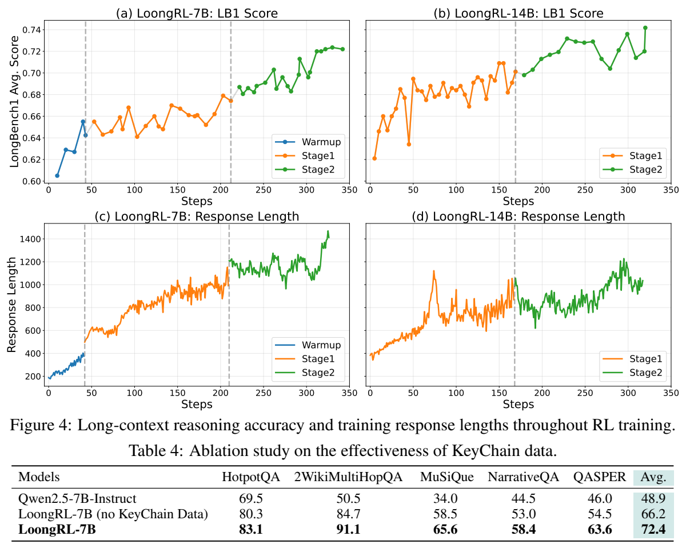

图 7. 原 Figure 4 与 Table 4，arXiv v2 物理第 9 页。上图横轴训练步，纵轴分别为 LongBench v1 分数和回答长度；颜色为课程阶段。下表将 KeyChain 换成等量普通 QA、其余 RL 设置保持相同：7B 无 KeyChain 66.2，加入后 72.4，额外 +6.2 个百分点。回答变长与准确率同步上升是观察关联，不能单独证明“更长就是原因”。

奖励消融（表 5，物理第 10 页）：7B 用 F1 为 65.1、DeepSeek-V3 judge 为 65.2、严格 EM 为 69.2、双向子串为 72.4；这是固定设置下的结果，不证明字符串规则普遍优于语义判别。未报告这些差异的多种子统计显著性。

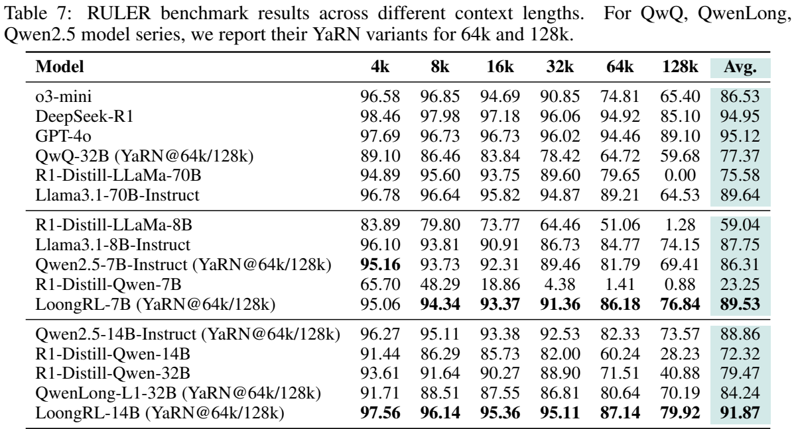

图 8. 原 Table 7，arXiv v2 物理第 18 页。按相同长度列比较 RULER，7B 的 128K 为 69.41→76.84，14B 为 73.57→79.92；64K/128K 的指定 Qwen 系列使用 YaRN。RULER 的多类检索不是 NIAH 单针压力测试。非推理模型有 completion-style 后缀，推理模型移除后缀并最多生成 8,192 token，模板与预算并非完全一致。

更困难的 LongBench v2 总分（附录表 6）：7B 31.2→36.2，14B 35.3→42.3，仍低于 QwQ-32B 51.2。v2 用 5 次生成取均值，非长 CoT 温度 0.1、长 CoT 温度 0.6；不要把 v1 的 72.4 迁移成 v2 的成绩。表 3 中 R1-Distill-Qwen-7B 的 NarrativeQA 分桶值与 base 全部相同，但主表总体分数不同，属于需要作者澄清的可疑单元，本期不据此作额外推论。

### 2.5 训练成本、代码与复现差异

原文 7B 使用 16×A100、batch 512；14B 使用 8×MI300X、batch 256。G=8，温度 0.6、top-p=0.95，最大输出 4,096；学习率 1e-6、cosine decay、梯度裁剪 1.0。7B 主文步数 42+168+118=328，附图 7 又写末阶段约 117 步；应保留这个 1 步差异。14B 为 168+150=318 步。墙钟时间、显存峰值、总 GPU-hours 和费用未披露；72K 数据过滤的 32B 教师生成成本也不能从训练卡数推得。

固定训练仓库 be1f096da289684a9cd50562f56f99b5be6ad3be；KeyChain 仓库 a958c9136011e3ebef1b9399c09b439578dde409。静态核读 reward_score/longcontext_qa.py、KeyChain UUID 生成和插入路径、训练入口说明。公开 reward 默认 pure_exact_match 调用 is_gt_in_pred，实际仅检查规范化后的 ground_truth in pred，缺少论文式 3 的反向 pred in ground_truth。其他 format 分支添加 boxed 数量、尾部和长度限制；复现时应固定分支和环境变量。

KeyChain 的当前脚本默认 UUID 为 8 位截断字符串、4-hop 链，链条数量与长度挂钩；正文描述 32 字符 UUID。脚本也存在多种模板和长度变体，不能说下载当前默认脚本就得到论文原始数据。uuid4 的来源也不由普通 random.seed 完全控制。README 中示例 clone 仍指向 rStar-RL/rStar-RL，实际本文读取的是作者给出的 LoongRL 仓库；安装命令需人工对齐版本，未在本机安装 GPU 训练环境。

### 2.6 局限与学习材料

方法的贡献偏数据和课程，不是新的注意力结构。UUID 链可能形成训练特定的检索捷径；长 QA 的答案验证具有语义漏洞；前沿模型比较不等预算；16K→128K 的外推也依赖底座已有的长窗口与位置扩展。作者给出的 plan-retrieve-reason-recheck 示例说明可观察行为，不能从少量展示轨迹得出内部机制的普遍因果结论。

入门材料是本期策略梯度教程、[D2L 语言模型章节](https://d2l.ai/chapter_recurrent-neural-networks/language-model.html)；进阶看项目页的训练课程与原始数据表，再从 KeyChain README 进入生成脚本。作者项目页就是本篇官方图文辅助资料，不另补不明出处的博客。

## 3. Entropy-Preserving Reinforcement Learning

### 3.1 身份、问题与直觉

作者 Aleksei Petrenko 等。[arXiv](https://arxiv.org/abs/2603.11682) 首发 2026-03-12；阅读版本是 [ICLR 2026 正式 PDF](https://proceedings.iclr.cc/paper_files/paper/2026/file/124dde499d62b58e97e42a45b26d7369-Paper-Conference.pdf)，30 页。官方为 A 类 ICLR 2026 poster，OpenAlex 快照 13。作者材料包括 [Apple 研究页](https://machinelearning.apple.com/research/entropy-preserving-reinforcement-learning) 和 [作者论文页](https://petrenko.sh/publications/)。未找到作者完整训练仓库；PDF 第 29 页公开了控制器与 REPO-R 参考代码，已经阅读。不能把论文中的短代码等同于完整可运行复现包。

直觉：训练可以让学生越来越会做当前题，也可以让他越来越只肯用一种解法。后者在换题时会出问题。熵衡量分布有多分散，但“末尾熵高”未必代表训练健康：训练早期已经失去的探索路径，末尾加噪声不一定补得回来。论文将训练全过程的熵变化与策略更新联系起来，提出 REPO 优势重加权和 ADAPO 自适应裁剪，并检查数值精度这个常被忽略的因素。

原文没有新的网络架构或独立端到端流程插画；下面直接引用优势变换机制图，后面引用训练曲线和原始结果表。它们不被重绘为自制实验图。

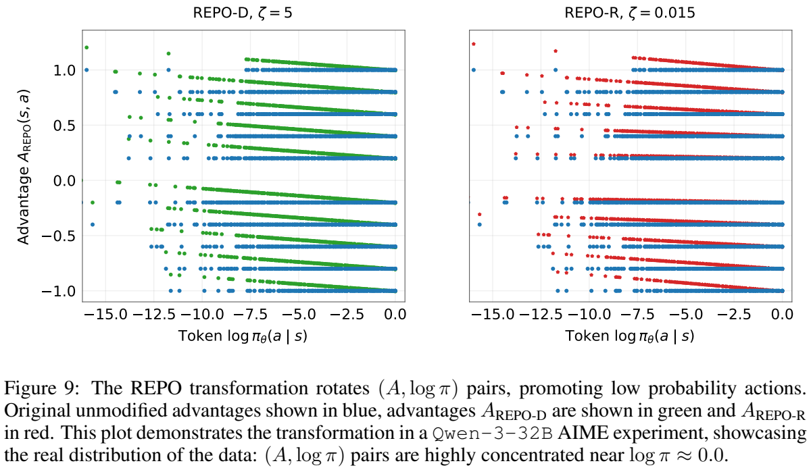

图 9. 原文 Figure 9，正式 PDF 物理第 28 页。横轴为动作 log probability，纵轴为重加权后的优势；比较原优势（蓝色）与 REPO-D（绿色，ζ=5）/ REPO-R（红色，ζ=0.015）变换。点来自 Qwen3-32B 的 AIME 实验，展示真实优势与概率分布，不是准确率曲线。读图重点是低概率动作的正优势被放大、负优势的惩罚被缓和，以及大多数数据集中在 log π 接近 0 的区域。

### 3.2 熵为什么会下降：逐符号推导

状态 s 是提示加已生成前缀，动作 a 是下一个 token。π(a|s) 是当前策略；u(a)=grad_θ log π(a|s) 是得分梯度；A(a) 是优势；L(a)=log π(a|s)−Eπ[log π] 是中心化对数概率。固定状态时定义：

```text
H = -Eπ[log π]
g = Eπ[A u]                         # 策略梯度方向
h = grad_θ H = -Eπ[L u]                 # 熵的梯度方向
ΔH ≈ α g^Th
   = -α E_(a,a')[ A(a)L(a') u(a)^Tu(a') ]
```

α 是一次小更新的学习率，a 与 a' 独立来自当前策略。第一步对 H 作一阶泰勒展开；第二步把两个期望相乘写成双重期望。由于 Eπ[u]=0，可以把 log π 换成中心化 L。可见熵变化取决于优势、概率与梯度相关性，不能仅从“用了 GRPO”推出固定结论。原文的简化式 −αE[π(a)A(a)L(a)] 还依赖表格 softmax 或相应梯度正交、范数条件，不能直接当作任意 Transformer 的精确恒等式。

REPO 的分析先考虑 A'=A−β_s L，β_s 是状态相关的系数。于是：

```text
g' = E[(A-β_s L)u] = g + β_s h
ΔH' ≈ α(g+β_s h)^Th = ΔH + αβ_s ||h||²
```

当 β_s>0 时，新增的一阶项非负。这只表示比原更新更有利于熵，不保证总 ΔH'>0，也不保证多步、大步长、离策略更新仍严格成立。REPO-D 用去相关构造，REPO-R 取 β 与 |A| 成比例；若强度为 ζ，则中心化理论式可写成 A'=A−ζ|A|L。

公开参考代码用的是 detach 后的原始 log π，并对正负分支做符号截断，不完全等于上面的中心化分析式。正优势对应 max(A(1−ζ log π),0)，负优势对应 min(A(1+ζ log π),0)。本文手算：π=0.01，log π≈−4.605，ζ=0.05；A=1 变为 1.2303，A=−1 变为 −0.7697。低概率成功被更强奖励，低概率失败被较轻惩罚。log π 必须视作权重常量；若让它参与反向传播，会多出论文这个梯度分析没有包含的项。

REPO-R 的双向控制器把第一轮熵当目标，ζ 从 1e−3 开始。熵低于目标时增强正向保熵作用，熵高时削弱它，必要时翻转符号；倍增/减半并设置上下界。REPO-R 范围约为 1e−4 至 0.05，REPO-D 为 1e−3 至 10。负 ζ 可抑制过高熵，因此“preserving”不是越高越好。

ADAPO 则固定下裁剪 εl=0.2，上裁剪 εh 从 0.28 开始；熵偏低时乘 1.05，偏高时乘 0.95，限制在 [0.2,0.32]。论文的熵上下界依赖所有动作概率比都落在指定区间；PPO 的 clipped objective 本身不是实现这一假设的硬投影。

```text
# 本文归纳的训练流程；不是可直接替代作者完整训练器的代码
初始化策略、参考配置、ζ、目标熵
循环采样任务：
    采集多条轨迹，计算任务奖励与组/留一基线优势
    记录当前熵；按目标熵更新 ζ（或 ADAPO 的上裁剪）
    REPO-R：用 detach(logp) 与优势符号生成重加权优势
    使用对应 PPO/RLOO 更新流程，保持数值精度配置一致
    在独立验证集选检查点；报告测试成绩与整条熵曲线
```

### 3.3 数据、实验与可比条件

AppWorld 是多步工具/代码交互环境：训练 90 个任务，测试分 Test Normal（TN，168）和 Test Challenge（TC，417）。训练奖励是通过测试的比例，评估任务成功要求全部测试通过，二者口径不同。训练最多 30 个交互 turn，评估最多 50 个，32K 上下文。数学训练从 NuminaMath 1.5 过滤得到 563 题，与 AIME 不重叠；AIME 2024/2025 各 30 题，使用 4K 上下文限制。

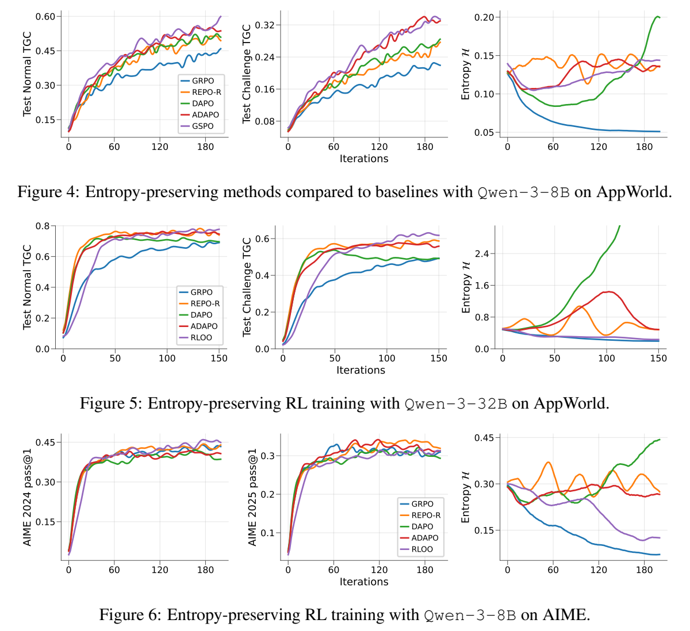

图 10. 原文 Figures 4–6，正式 PDF 物理第 8 页；Figure 4 为 Qwen3-8B / AppWorld，Figure 5 为 Qwen3-32B / AppWorld，Figure 6 为 Qwen3-8B / AIME。各子图分别比较 GRPO、RLOO、GSPO、DAPO 等适用基线，新增方法含 ADAPO/REPO。横轴是训练进程，纵轴分别为成功率或熵，须结合图例和各子图模型大小读取。保留曲线与图注，观察早期塌缩和后续恢复，不把单个末点当作独立多次实验的显著性证据。

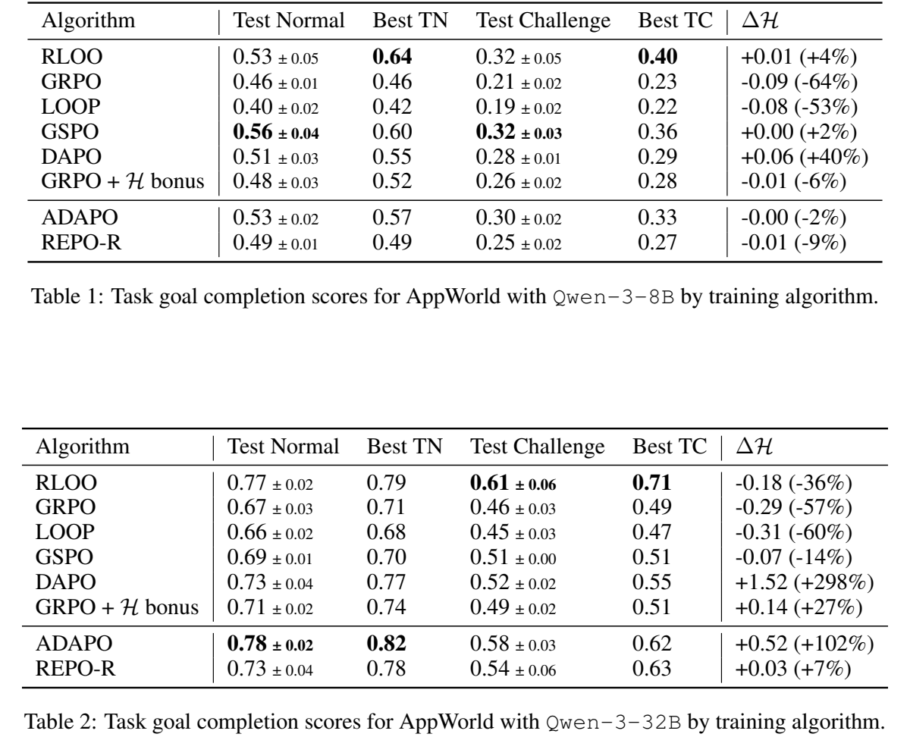

图 11. 原文 Tables 1–2，正式 PDF 物理第 26 页；分别为 Qwen3-8B、32B 的 AppWorld，报告 3 个随机种子的均值/标准差、最佳值及熵变化。TN/TC 是不同测试难度，best 不等于 mean。熵变化正负与成功率应同时看，单纯维持熵并不确保最优任务成绩。

| 模型/算法 | TN 均值 | TC 均值 | 解释 |
| --- | --- | --- | --- |
| 8B GRPO | 0.46±0.01 | 0.21±0.02 | 熵下降约 64% |
| 8B RLOO | 0.53±0.05 | 0.32±0.05 | 更简单的基线也很强 |
| 8B ADAPO | 0.53±0.02 | 0.30±0.02 | 改善 GRPO，但并非全面超过 RLOO |
| 8B REPO-R | 0.49±0.01 | 0.25±0.02 | 保熵不等于排名第一 |
| 32B GRPO | 0.67±0.03 | 0.46±0.03 | 熵下降约 57% |
| 32B RLOO | 0.77±0.02 | 0.61±0.06 | best 为 0.79/0.71 |
| 32B ADAPO | 0.78±0.02 | 0.58±0.03 | TN best 0.82 |
| 32B REPO-R | 0.73±0.04 | 0.54±0.06 | 熵约增加 7% |

表中 ± 是训练种子间标准差。论文摘要强调的 79%/71% 是 RLOO 的最佳结果，不能改写成 REPO 的均值。32B DAPO 的熵增加约 298%，TN/TC 均值为 0.73/0.52，说明过度增加熵也不是充分条件。AIME 同样没有全胜：8B REPO 为 0.45/0.34，GRPO 0.45/0.32；32B REPO 为 0.49/0.35，GRPO 0.51/0.36，RLOO 0.53/0.39。

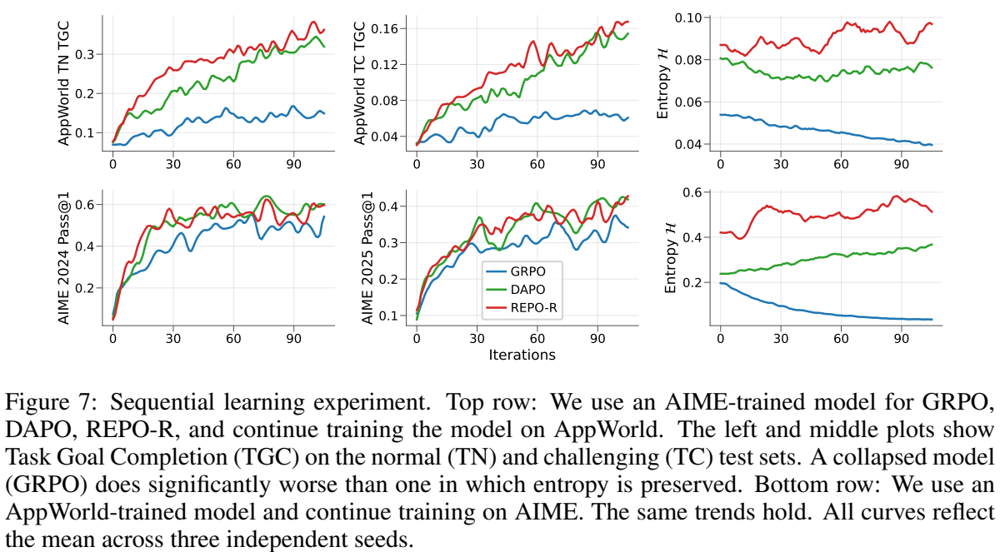

图 12. 原文 Figure 7，正式 PDF 物理第 9 页；Qwen3-8B 在 AIME→AppWorld、AppWorld→AIME 的顺序训练，展示 3 种子平均趋势。比较 REPO 与 GRPO/DAPO 在换任务后是否还能学习；横向阅读切换点后的曲线，不能据此断言所有持续学习场景的遗忘问题已解决。

一个重要评估限制：AppWorld 用开发集选检查点再测测试集；AIME 则按 AIME24/25 测试平均分选最佳检查点，没有独立验证集，可能乐观。附录换成 Qwen2.5-32B 后，LOOP 与 RLOO 的熵塌缩关系又改变，说明底座和任务是机制的重要条件。

### 3.4 精度、成本与复现边界

论文还分析 BF16 log probability 的量化误差：对数概率相减再取 exp 得重要性比，在独立、均匀、零均值的舍入误差假设下，凸性会引入向上偏差。这个期望结论不是每个 token 都偏大的保证。保留 FP32 logp、检查 FSDP2 混合精度输出转换、比较带缩放的 FP16，是具体工程干预；不能泛化成“FP16 在所有训练中比 BF16 好”。极高概率 token 的 1−p 抵消还涉及 FP32 精度，论文的定点高精度修正效果相对较小。

原文使用 Qwen3-8B/32B，LoRA rank 16、alpha 32，作用于注意力 q/k/v/o 与 MLP；AdamW，学习率 5e−5，weight decay 0.01，梯度范数裁剪 0.1。配置为 3 个节点各 8×H100：一节点 rollout（两个 4 卡张量并行实例）、一节点训练、一节点评估。训练 rollout 可在每题至少完成 4/6 条且总体达到 90% 后提前结束，实际采样量不是固定全部完成。

离策略算法每批 2 个 epoch，AppWorld minibatch 128、AIME 256；RLOO 为 1 个 epoch 的全批更新。图中约 180–200 次迭代不应被概括成所有配置统一的精确总步数。32B 全词表 entropy-bonus 对照需要 B200，硬件并非完全相同。未披露每种运行的总墙钟、显存峰值、完整 GPU-hours 或费用。REPO-R 不必额外保存全词表熵 logits 的节省不意味着整套训练“零算力开销”。

可复现入口是原文第 29 页的短代码及公式、超参数表。缺少完整作者训练仓库意味着任务封装、并行调度、检查点筛选仍需自行实现；本文只核读参考实现，没有执行。初学者先读 [Spinning Up 策略优化](https://spinningup.openai.com/en/latest/spinningup/rl_intro3.html)，再手算上述概率 0.01 的优势变化。作者研究页可作官方概览，未找到另行发布的官方教程博客。

## 4. Beyond Binary Rewards: Training LMs to Reason About Their Uncertainty

### 4.1 身份与问题：正确率之外还要知道“不确定”

本文简称 RLCR。[arXiv](https://arxiv.org/abs/2507.16806) 首发 2025-07-22；阅读 [ICLR 2026 正式 PDF](https://proceedings.iclr.cc/paper_files/paper/2026/file/615675cc6e94ddb1a783904fb178b5f6-Paper-Conference.pdf)，38 页含附录。官方 A 类 ICLR 2026 poster，引用快照 116。[官方项目](https://rl-calibration.github.io/)、[作者代码](https://github.com/damanimehul/RLCR)、[模型集合](https://huggingface.co/collections/mehuldamani/rlcr-68912f9731b0bce30e4cc8c0) 均是辅助材料。

直觉：只奖励答对，学生即使不会也会口气坚定。只奖励“预测自己是否答对”，学生可能发现故意答错、再承认必错就能完美校准。RLCR 同时奖励正确和诚实的置信度，并让模型在给出答案后分析不确定性、最后输出一个 0 到 1 的数。答案、解释、置信度是输出协议，不是另加一个新的神经网络模块。

置信度 q 应预测“当前这份答案正确”的概率，不是该 token 序列的语言模型概率。校准的含义是：在许多说 0.7 的回答中约 70% 正确；不要求每次 0.7 都能由单次结果判真伪。校准与区分能力也不同：永远报总体正确率可能校准不错，却不能挑出哪些题该交给人复核。

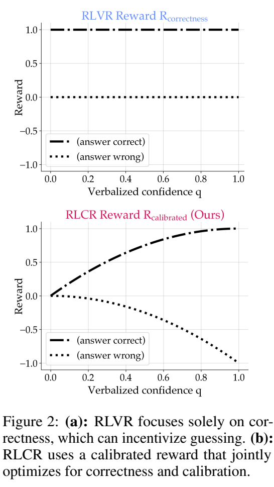

图 13. 原文 Figure 2，正式 PDF 物理第 4 页。上图是 RLVR 的正确性奖励，下图是 RLCR 的联合奖励；横轴是报告的置信度 q，纵轴是单次奖励，点划线/虚线分别对应答对/答错。RLVR 与 q 无关，RLCR 则让答错且高置信度得到更低奖励；这是奖励函数图，不是期望奖励或实验准确率曲线。论文未提供独立的新模型架构图，本节用原始奖励机制图和文字协议说明流程。

### 4.2 奖励的推导与手算

令 c∈{0,1} 表示验证器判定的正确与否，q∈[0,1] 为模型输出的置信度。核心奖励是：

```text
R(c,q) = c - (q-c)²
p = P(c=1 | 当前问题和选定答案)
E[R] = p - p(1-q)² - (1-p)q²
     = 2pq - q² = p² - (q-p)²
∂E[R]/∂q = 2p - 2q
```

平方项是 Brier loss。固定答案正确概率 p 后，期望奖励在 q=p 时唯一最大；再把 q 代回，得到 p²，随 p 在 [0,1] 单调增加，因此诚实报告与提高正确率在这个理想分析中相容。它不保证有限数据、参数共享、优化不充分的模型自动达到完美校准。

本文手算：真实 p=0.6 时，报 q=0.6 的期望奖励为 0.36，报 q=0.9 为 0.27。某次答错 c=0，q=0.9 得 −0.81，q=0.3 得 −0.09；某次答对 c=1，则对应 0.99 和 0.51。不能因为单次幸运猜中就把 0.9 视作合理；校准约束是多次期望上的。

原文推广到 λc−S(q,c)，S 为严格 proper scoring loss，还需要其不同结果间差值满足与 λ 相关的条件。严格 proper 只保证固定答案下诚实，不保证联动答案选择时仍偏好正确。以 log score 为例，p=0.2、诚实 q=0.2 时，期望值 0.2+0.2ln0.2+0.8ln0.8≈−0.3004；始终答错且报 0 的极限值为 0，反而更高。Brier 在同一比较中诚实值为 0.04，高于故意答错的 0。这个小例子解释了“加任意校准损失”为什么不够。

```text
# 本文归纳；实际项目还有格式奖励和数据封装
每个问题采样 G=32 份：答案 → 不确定性分析 → 置信度 q
验证答案得到 c，解析 q 并检查格式
计算正确奖励与 Brier 奖励
同组减均值产生优势（主配置不除以组标准差）
用 clipped policy objective 更新，按有效 token 做 BNPO 归一化
评估准确率、AUROC、Brier、10-bin ECE，分别报告域内与域外
```

### 4.3 数据怎样制造可学习的不确定性

HotpotQA-Modified 训练集 20K：每题 8 个段落，约三等分地放入 0、1、2 个相关段落，其余是干扰段。原始 distractor 数据有 2 个相关与 8 个干扰段；作者重采样成缺证据程度不同的输入，避免模型只学到“这套数据总可答”。评估 HotpotQA 为 1,000 题、每题 2 个相关加 6 个干扰段；Modified 评估为 500 题。缺证据不等同于答案绝对不可知，模型还可能凭预训练知识作答。

数学训练使用 BigMath-Digits 15K：从约 250K 池中，按 Llama-8B 的 0–70% 解题率过滤，并选数值答案、用 math-verify 核验，降低验证噪声。主模型 Qwen2.5-7B base 直接 RL，没有先做 SFT，也不加 KL。数学另有 SFT+RLCR 变体，用 500 条底座生成的答案配 DeepSeek-R1 的不确定性分析作 warmup；教师不直接生成最终置信度。

### 4.4 结果、消融与反例

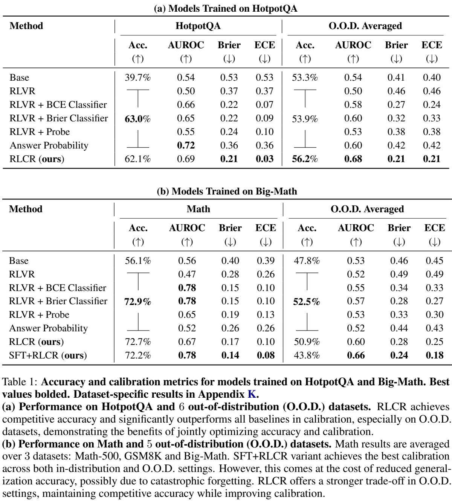

图 14. 原文 Table 1，正式 PDF 物理第 6 页。比较 base、RLVR、后置 BCE/Brier 分类器、探针、答案概率与 RLCR；分 HotpotQA 和数学训练、域内与域外。Acc/AUROC 越高越好，Brier/ECE 越低越好；此主表列点估计；附录逐数据集表中的区间是 bootstrap 95% 置信区间半宽，并非多次训练的标准差。后置分类器使用额外评分过程，与直接输出置信度的流程不同。

| 训练/评估 | 方法 | Acc % | AUROC | Brier | ECE |
| --- | --- | --- | --- | --- | --- |
| Hotpot 域内 | RLVR | 63.0 | 0.50 | 0.37 | 0.37 |
| Hotpot 域内 | RLCR | 62.1 | 0.69 | 0.21 | 0.03 |
| Hotpot 域外 | RLVR | 53.9 | 0.50 | 0.46 | 0.46 |
| Hotpot 域外 | RLCR | 56.2 | 0.68 | 0.21 | 0.21 |
| 数学域内均值 | RLVR | 72.9 | 0.47 | 0.28 | 0.26 |
| 数学域内均值 | RLCR | 72.7 | 0.67 | 0.17 | 0.10 |
| 数学域外均值 | RLVR | 52.5 | 0.52 | 0.49 | 0.49 |
| 数学域外均值 | RLCR | 50.9 | 0.60 | 0.28 | 0.25 |

AUROC 衡量正确答案能否排在错误答案前面；Brier 是预测概率的均方误差；ECE 按 10 个置信度桶加权统计置信度与准确率的差。Hotpot 域内 RLCR 62.1±3.05 与 RLVR 63.0±3.05 的区间重叠，不能把 0.9 个百分点写成明确的准确率退步结论。数学域外准确率仍有下降，说明校准改善并不是免费提升所有指标。

后置分类器也是强基线：Hotpot 域内 BCE 分类器 Brier 0.22/ECE 0.07，接近 RLCR 0.21/0.03；域外 RLCR 泛化更好，但不是每个数据集都如此。附录 CommonsenseQA：RLVR 准确率 90.8、Brier 0.09/ECE 0.09，RLCR 准确率 91.3、Brier 0.17/ECE 0.30，校准反而更差。SimpleQA 上后置 Brier 分类器也优于 RLCR 的 Brier/ECE。报告保留这些负结果。

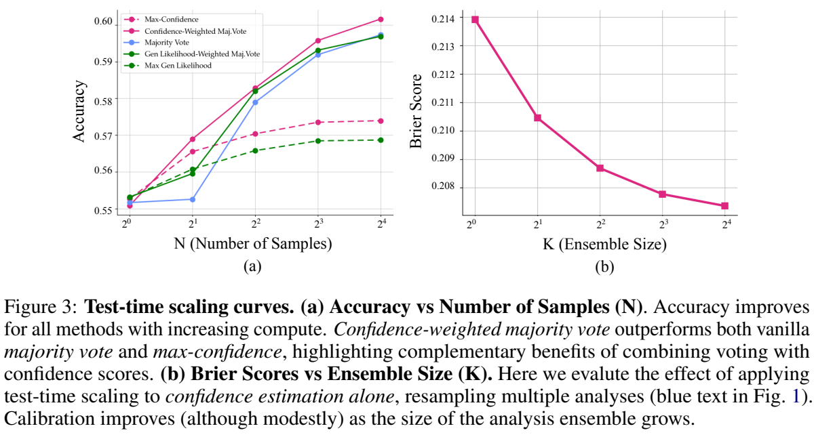

图 15. 原文 Figure 3，正式 PDF 物理第 7 页；测试时采样数 N=1…16，比较单纯多数投票、选最高置信度答案和按置信度加权投票。加权票是对同一答案累加各次 q，并非把不同答案的 q 当作已归一化类别概率。读图时同时看采样数和准确率；无需外部 reward model 不代表没有多次生成成本。

分析文字真的有用吗？主文表 2 的 Hotpot 域内，RLCR 平均 249 token、Brier 0.21/ECE 0.03；去掉分析约 113 token、0.23/0.09。RLVR 即使被要求输出分析，仍约 224 token、0.35/0.34。差异支持“训练目标与分析配合”，不能把这些提示/推理协议消融全部说成独立重新训练的因果试验。固定答案后重采不确定性分析再平均 q，也有小幅收益，但同样增加推理次数。

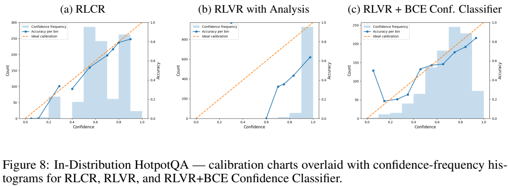

图 16. 原文 Figure 8，正式 PDF 物理第 25 页；HotpotQA 域内评估的校准曲线叠加置信度频数直方图，比较 RLCR、带分析的 RLVR 和 RLVR+BCE 分类器。横轴为置信度；准确率曲线越接近橙色对角线越校准，柱形则显示样本集中在哪些置信度区间。这不是域外结果或训练损失曲线；它能帮助区分真正校准与只输出狭窄置信度范围。

仅用校准目标而不给正确奖励的附录实验可塌缩到准确率 0、Brier 0、ECE 0，正是奖励设计警示。SFT warmup 提高部分校准，却使数学域外准确率降至 43.8；修正输出提示格式后表格回升至 49.8，说明有输出协议因素，不能简单归因为知识遗忘。该处文字/图注有约 48 与表中 49.8 的不一致，本文采用表格且标注差异。

### 4.5 资源、代码和可复现性

论文主配置为 G=32、temperature=0.7、有效 batch 2048；Hotpot 学习率 1e−6，数学 5e−6；warmup 0.1 后 constant，训练 1 epoch；输出上限 1,536/4,096。硬件描述为 A100/H100，README 启动示例为 Hotpot 4×A100、数学 6×A100。卡的具体显存容量、峰值占用、准确总步数、墙钟时间、GPU-hours、费用未披露，不能从示例直接推定原论文每项实验的资源账单。

固定代码提交 be2624b1753d738b9552df4dd6d50ac33b3668ee，核读 reward_fns.py、GRPO_Trainer.py、Hotpot/Math RLCR 配置和 README。公开实现与正文有可复现差异：Brier 项写为 1−(c−q)²，并叠加格式奖励；Hotpot 权重为 0.5 format、0.5 accuracy、0.5 Brier，以及两个 1e−6 的微小置信度项。有效格式内，主要目标可视为论文奖励的缩放加常数，但格式有效/无效混合的组与额外 q 相关项使整体不完全相同。

公开 Hotpot 配置 warmup=0.05，而论文为 0.1；数学配置是 0.5 epoch、linear scheduler、warmup=0.2。按 README 数学 6 进程、每设备 batch 6、累积 64 计算为 2,304，而非论文 2,048。BNPO 的有效 token 归一化和 scale_rewards=false 与不做组标准差归一化的说明一致。复现必须固定代码、配置及进程数，不能仅用论文一个 learning rate。

评估大多 temperature=0，若干 QA 数据用 Llama-3.1-8B-Instruct 判断答案，故仍存在 judge 误差；不同模型的格式提取与生成长度也非完全等成本。本文未训练或生成新答案。入门可先读 [D2L 概率](https://d2l.ai/chapter_preliminaries/probability.html)，然后用 p=0.6 的例子复核 Brier 推导；官方项目页是额外图文讲解，不计入本期篇数。

## 5. Entropy-Regularized Rank-Masked Policy Optimization for Test-Time Reinforcement Learning in Code Generation

### 5.1 身份、问题与流程

本文简称 ERPO。[arXiv](https://arxiv.org/abs/2609.09135) 首发 2026-09-08；采用 [EMNLP 2026 正式 PDF](https://aclanthology.org/2026.emnlp-main.2102.pdf)，15 页，论文集 47843–47857 页。CCF-B 主会长文、oral，OpenAlex 快照 0。[官方代码](https://github.com/xiaobanni/erpo) 可用，未找到单独的官方项目站或博客。

问题是测试集只有题目、没有隐藏正确答案时，能否临时训练代码模型？作者让多份候选程序对同一批输入执行，以输出共识构造奖励。但“大家都这么答”不能证明答对；训练如果过度放大错误多数，可能把模型推向同一种错误。ERPO 同时减少高分候选的正向强化，并限制输出熵过度增长。

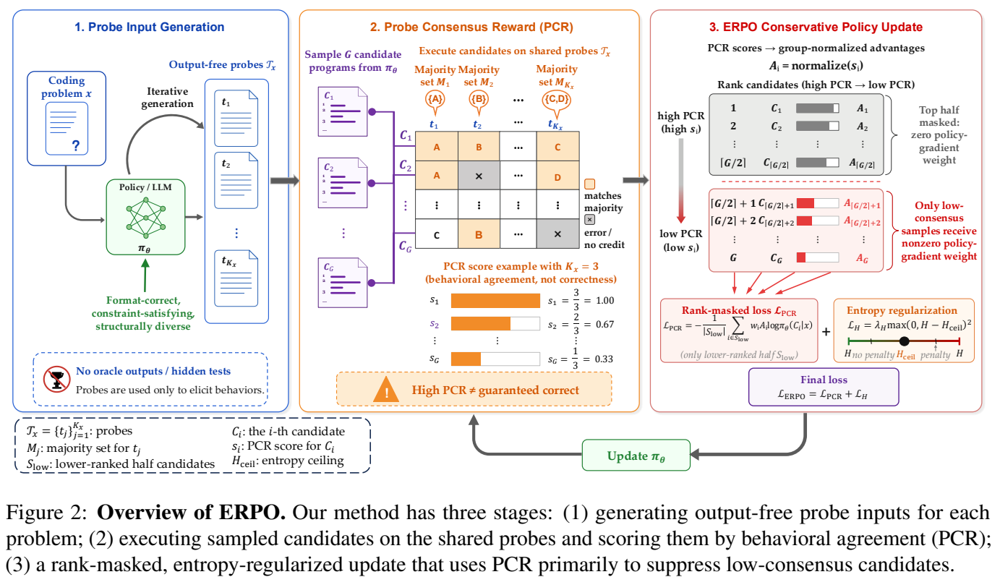

图 17. 原文 Figure 2，正式 PDF 物理第 3 页。题目产生 candidate programs 和无标签 probe inputs，经执行得到每个输入上的多数输出，汇总 PCR 分数，再做 rank masking、entropy regularization 更新。蓝色/箭头表示数据和计算流程，不是模型性能曲线。训练不使用隐藏答案作为奖励；下文单独说明代码中存在公开测试诊断与验证入口。

### 5.2 PCR、排名掩码与熵上限

对一个题目生成 G=16 份程序，另生成 10 个只含输入的 probes，与公开样例输入合并去重。探针生成会参考此前探针和题面；去重后有效数量 K 不必等于 10。第 i 份程序对第 j 个探针产生输出 z_ij。异常/超时不能作为有效一致输出获得奖励。

```text
n_j(o) = Σ_i I(程序 i 在探针 j 成功执行且输出为 o)
M_j = argmax_o n_j(o)                # 并列多数都保留
s_i = (1/K) Σ_j I(z_ij 有效且 z_ij ∈ M_j)
A_i = (s_i-mean(s)) / (std(s)+ε)
```

s 是 PCR 共识分数；I 是指示函数，K 是有效探针集大小，ε 防除零。PCR 比较执行结果，不直接比较代码文本。代码中多数并列可同时得分；只剩一个有效执行也会形成多数，因此高 PCR 并不保证正确。

本文手算：4 份程序、3 个探针；第一个探针前三份都输出 A、第四份错误；第二个探针前两份输出 B、第三份 D、第四份错误；第三个探针只有第一份成功输出 C。得到 s=[1,2/3,1/3,0]，均值 1/2，采用总体标准差时为 √5/6≈0.3727，标准化优势约 [1.342,0.447,−0.447,−1.342]。这是解释用的构造，未在本机执行这些程序。

默认 rank mask 把最高的 ceil(G/2) 个优势设为 0，保留其余优势原值。上述例子保留两个负值，类似优先抑制低共识程序。但它不严格等于“只保留负优势”：若分数为 [0,1,1,1]，底部一半中仍有一个正优势。因此论文的保守更新直觉不能被改写为数学上始终无正向强化。组内分数全相同则优势为 0。

目标在 clipped policy loss 和 β_KL=0.001 的 KL 项外，加入：

```text
L_H = λ max(0,H-H_target)²
λ = 0.5, H_target = 0.5
L = -J_clip(A_masked) + β_KL KL + L_H
```

H 为 token 分布熵，使用自然对数；它是软上限，没有对应熵下限，也不是上一节 REPO 那样围绕起始熵的双向控制。手算 H=0.8 时，L_H=0.5×0.3²=0.045，对 H 的导数为 0.3，促使熵下降；H≤0.5 时这一项没有梯度。训练时 H 仍可高于 0.5，不能把 target 描述成硬约束。

```text
# 本文按论文及公开关键路径整理，未运行生成代码
为每道无标签目标题生成并缓存探针，合并公开样例输入
循环 150 个预定训练步：
    取 16 道题，每题从当前模型采 16 份代码
    在受控执行器运行每份代码与探针，异常不计一致奖励
    汇总各探针的多数输出，计算每份代码 PCR
    标准化组内优势，屏蔽排名最高的一半
    以 clipped loss + KL + 熵超限平方惩罚更新
用隐藏测试做评估，另测无进一步适应的跨数据集迁移
```

### 5.3 结果与实验边界

模型 Qwen3-4B/8B，在 LiveCodeBench v6 的无标签题目上做测试时适应；CodeContests、Codeforces、TACO 为不再更新的迁移评估。它属于知道目标题目的 transductive 设置，不等同于对完全未见题目的普通训练。PubTest 基线使用公开输入与输出，PCR 使用输入共识，信息条件也不相同。

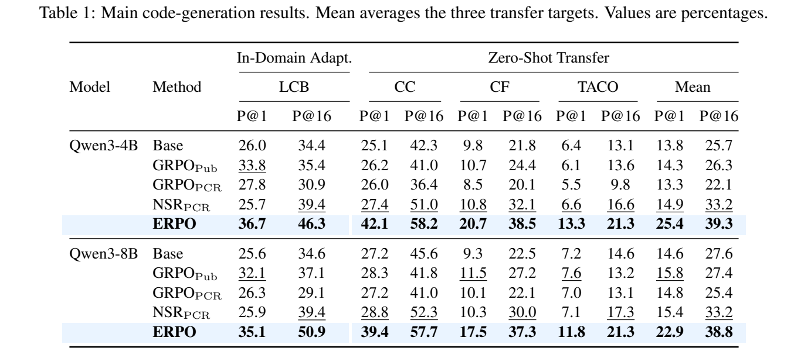

图 18. 原文 Table 1，正式 PDF 物理第 6 页。报告 LiveCodeBench 及三个迁移集的 pass@1/pass@16，比较 Base、GRPO(PubTest)、GRPO(PCR)、NSR(PCR) 与 ERPO。pass@16 表示 16 个样本中至少一个通过的估计，属于有正确性判断的覆盖率指标，不是无需验证器就能选中正确答案的部署成功率。

| 模型/算法 | LiveCodeBench pass@1 / @16 | 迁移三集平均 pass@1 / @16 |
| --- | --- | --- |
| 4B Base | 26.0 / 34.4 | 13.8 / 25.7 |
| 4B GRPO(PubTest) | 33.8 / 35.4 | 见原表各集 |
| 4B GRPO(PCR) | 27.8 / 30.9 | 见原表各集 |
| 4B NSR(PCR) | 25.7 / 39.4 | 见原表各集 |
| 4B ERPO | 36.7 / 46.3 | 25.4 / 39.3 |
| 8B Base | 25.6 / 34.6 | 14.6 / 27.6 |
| 8B ERPO | 35.1 / 50.9 | 22.9 / 38.8 |

PCR 的噪声是方法设计的出发点：表 2 中分数区分对错的 AUC 约为 0.790（4B）、0.750（8B）；低分≤0.5 的候选失败比例约 92.0%/91.3%，但满分候选仍有 44.2%/51.9% 失败。“低分通常错”比“高分通常对”更稳，不代表任何数据都满足这个不对称性。

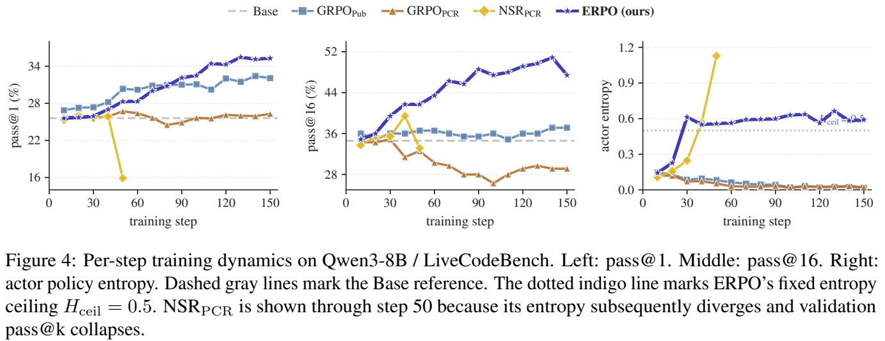

图 19. 原文 Figure 4，正式 PDF 物理第 13 页。比较各更新方法训练进程中的准确率、熵等曲线；NSR 只展示至约第 50 步，随后发生不稳定。读图时注意横轴覆盖不同，不把截短曲线补成不存在的后续结果。ERPO 的软熵约束抑制发散，不能证明在所有任务上不塌缩。

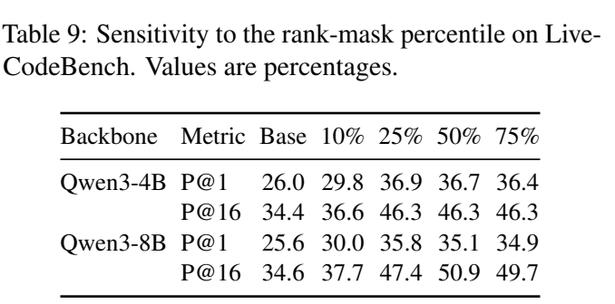

图 20. 原文 Table 9，正式 PDF 物理第 14 页。比较屏蔽最高优势的 10%、25%、50%、75%，指标为两种模型的 pass@1/pass@16；其余条件沿用测试时训练配置。不是“保留百分比”。4B 25% 的 pass@1 36.9 略高于默认 50% 的 36.7；8B 50% 的 pass@16 50.9 高于 25% 的 47.4，默认值并不对所有单项指标最优。

附录的探针数量 1/3/5/10/20 对应 AUC 约 0.706/0.754/0.774/0.790/0.799，边际收益下降；5/10/20 个探针的下游结果相对稳定。熵阈值 0.2、0.5、1.0 都有收益，0.2 较慢、1.0 后期较不稳定。表 7 的 3 次独立运行中，4B ERPO pass@1 为 36.64±0.33，pass@16 为 46.96±1.15；Base 为 26.04±0.42/34.43±0.87，± 是该重复设置下的标准差，不应与 RLCR 的 bootstrap 区间混用。

测试时扩展实验重新抽取 256 条，故表 3 的 4B ERPO pass@1 36.2 与主表 36.7 不是同一采样估计。表 3 的 ERPO pass@256 为 51.9，Base 40.1；作者也比较 CodeT / reward-model 选择器。ERPO 单样本接近或超过 Base 多样本的观察必须连同前置适应成本看，不能宣传为零额外成本的一次推理收益。

### 5.4 成本、代码核读与局限

原文每个算法约在 8×A100 80GB 上训练 12 小时，150 个 global step；每步 16 个题、每题 16 个 rollout，minibatch 4 个题、1 个内部 PPO epoch。AdamW 学习率 5e−7、warmup 20 步，最大输出 8,192 token；top-p=0.8、top-k=20、min-p=0，公开脚本 temperature=0.8。卡容量 80GB 不是实测显存峰值。

本文推算：若 8 卡全程占用 12 小时，约为 96 GPU-hours；若完整执行 150 步，则 150×16×16=38,400 条训练 rollout。这两个数不是作者逐任务计费或逐样本运行日志，不包括探针准备、额外评估及未完成运行的修正。采样扩展另报告每 100 题生成 256 样本约 3 小时，但该段没有足够独立硬件信息可再直接换算 GPU-hours。峰值显存与实际费用未披露。

固定仓库提交 2966f7634c43a73c521a97820d7af106a0d05953。静态核读 README、train.sh、fmv_pointwise.py、test_rl_reward_manager.py 的相关奖励入口、core_algos.py 的 rank mask 和 dp_actor.py 的熵项。实现确实做并列多数得分、执行失败排除和保留低排名优势；熵平方惩罚与论文一致。奖励管理器即使使用 PCR，也计算公开测试诊断；隐藏测试执行位于 validation 分支。由所读路径支持“更新用 PCR”，不声称已审计整个仓库所有数据流或在本机验证过无泄漏。

共同错误可能形成稳定共识，生成探针也可能漏掉边界条件；高分错误率已显示此风险。掩码会扔掉有用成功信号，熵上限又可能减少正确解的多样性。适应耗时、代码执行安全与环境成本、检查点选择方式都会影响部署价值。论文基线部分用塌缩前最后检查点等规则，不能把所有方法都说成统一最终步数的对照。主张可迁移到更大模型、项目级软件工程或任意无标签任务仍需新证据。

基础阅读仍是本期策略梯度与概率教程；代码生成读者可从官方仓库的 PCR 执行路径开始，再比较图 17 的箭头。本文没有运行任何候选程序或 GPU 训练，也没有将代码安装成功当作实验复现。

## 6. 放在一起看：这五篇分别修正什么

| 论文 | 直接修正的对象 | 不应过度推出的结论 |
| --- | --- | --- |
| AuxDPO | 受限策略导致的隐式奖励错设 | 任意神经网络上的全局最优保证 |
| LoongRL | 长上下文数据难度、课程与可验证奖励 | RL 自动创造任意长上下文能力 |
| REPO | 更新方向、熵轨迹与数值精度 | 熵保持越好，所有任务得分越高 |
| RLCR | 正确性与置信度的联合激励 | 所有域外数据都校准、推理成本不变 |
| ERPO | 共识噪声下的排名更新及过高熵 | 高共识必然正确、适应免费 |

REPO 与 ERPO 对熵的处理方向看似不同，实际对应不同故障：前者着重避免失去探索、保持换任务可训练性，后者的负向/保守更新容易熵过高，因此加软上限。不存在从这两篇就能导出的通用“熵越大越好”或“熵越小越好”。同样，LoongRL、RLCR、ERPO 都用自动评分，但分别依赖答案匹配、校准与答案验证、无标签执行共识；评估它们时应先检查评分信号的错误模式。

推荐学习顺序是先用 [D2L 概率基础](https://d2l.ai/chapter_preliminaries/probability.html) 复习期望和方差，再读 [Spinning Up 策略优化入门](https://spinningup.openai.com/en/latest/spinningup/rl_intro3.html)，然后按 RLCR 的二元小例子、ERPO 的组优势、REPO 的梯度、AuxDPO 的受限参数几何逐步推进。教程仅作学习支持，不计入 5 篇，也不作为这些论文实验结果的证据。

来源、检索与剔除记录在 manifest.json；原图裁切来源在 assets/SOURCES.md 与 figures.json；代码提交和核读边界在 assets/code-reading.json；全文 PDF 的逐页、字体、边界、文本覆盖和原图像素检查见 assets/QA.md 与 pdf-check.json。实际推送与远端回读在发布阶段另行验证，本文不把尚未发生的发布操作写成已完成事实。
