# CCF-A/B 论文精读 · 2026-11-22

北京时间 2026-11-22。本期主题：用记忆压缩、逐 token 奖励、提前执行、自生成课程和语义置信度，重新分配大模型计算。收录 5 篇，4 篇 CCF-A、1 篇 CCF-B；3 篇 oral、2 篇 poster，spotlight 0。五篇均为 2026 年正式主会论文，预印本均始于 2025 年；筛选依据是录用年度，不设最近一个月的预印本窗口。

等级依据为 [CCF 2026 年最终目录发布页](https://www.ccf.org.cn/Academic_Evaluation/By_category/2026-03-31/870181.shtml)及其官方 PDF：物理第 57 页 ICLR 属 A，第 58 页 EMNLP 属 B。正式 PDF、逐篇会议页面、日程、引用索引和代码提交分开核验。初始扫描全方向 18 份 manifest、90 条历史论文记录，按去版本 arXiv ID、DOI、规范 URL、Unicode/标点/大小写归一标题及别名去重。首日指定的 Finetuning with Sampling 已收录，不重复。

| 本期论文 | 正式录用 / 展示 | 原始公开日期 | OpenAlex 引用快照 |
| --- | --- | --- | --- |
| MemAgent: Reshaping Long-Context LLM with Multi-Conv RL-based Memory Agent | ICLR 2026 / A / oral | 2025-07-03 | 264 |
| Overthinking Reduction with Decoupled Rewards and Curriculum Data Scheduling | ICLR 2026 / A / oral | 2025-09-30 | 5 |
| Speculative Actions: A Lossless Framework for Faster AI Agents | ICLR 2026 / A / oral | 2025-10-05 | 29 |
| R-Zero: Self-Evolving Reasoning LLM from Zero Data | ICLR 2026 / A / poster | 2025-08-07 | 238 |
| Teaching LLMs to Abstain via Fine-Grained Semantic Confidence Reward | EMNLP 2026 / B / poster | 2025-10-28 | 9 |

引用数查询日期均为 2026-11-22（Asia/Shanghai），来源分别为 [W6947947872](https://api.openalex.org/works/W6947947872)、[W7084037469](https://api.openalex.org/works/W7084037469)、[W4414971537](https://api.openalex.org/works/W4414971537)、[W6929629322](https://api.openalex.org/works/W6929629322)、[W7102392697](https://api.openalex.org/works/W7102392697)。原始 JSON 留档，数值可能随索引更新；这是有限范围内兼顾主题、公开时长和展示类型的选择，不宣称全球引用排名。较新或较窄主题的低引用论文仍保留。

全文读取正式 PDF 共 125 页：29 + 30 + 24 + 21 + 21，包含参考文献与附录；另读 DECS 官方补充代码和五个作者代码库的关键路径。以下“原文事实”指可在这些版本找到；“本文推演”指教学计算、解释或审阅判断；“未披露/未找到”不等于不存在。只做静态代码阅读和文档制品检查，没有运行模型训练、推理基准或作者实验。22 张图表均直接裁自正式 PDF，没有重绘实验数据。

## 1. MemAgent：有限记忆怎样读完数百万 token

### 身份、版本与入门直觉

[正式 oral 页面](https://iclr.cc/virtual/2026/oral/10007826)给出 ICLR 2026 主会 oral，4 月 23 日 Amphitheater；[正式论文 PDF](https://proceedings.iclr.cc/paper_files/paper/2026/file/4264ee4376776907c0b87ed70b959585-Paper-Conference.pdf)共 29 页。[arXiv 2507.02259](https://arxiv.org/abs/2507.02259)初版 2025-07-03，页面最新为 v2、2026-07-29；本精读采用会议正式版，未把更新的 arXiv 当同一版本。作者 [项目页](https://memagent-sialab.github.io/)与[代码](https://github.com/BytedTsinghua-SIA/MemAgent)辅助解释。另一篇 arXiv:2609.32521 也叫 MemAgent，但标题和研究问题不同，不能合并引用与实验。

基础概念：token 是模型读写的单位；上下文窗口是一次调用能看见的 token 上限；自注意力需要在当前窗口内比较 token。常规长上下文方案把整篇文档放进窗口，成本随长度迅速增加。MemAgent 的直觉像“带着问题阅读，每读一段就重写一张便签”：便签长度固定，读完只用便签回答。它不是外接数据库，也不保证每句话都被完整保存。

原文事实：将文档分成约 5,000 token 的块，保留约 1,024 token 的记忆；问题最多 1,024 token，输出最多 1,024 token，加模板后限制在 8K 窗口。记忆是模型生成的文字序列，每轮整体改写；后续轮只能利用保留下来的信息。不同轮的输入窗口彼此分开，仍通过记忆在统计上依赖，不能把“独立上下文窗口”理解为随机变量完全独立。

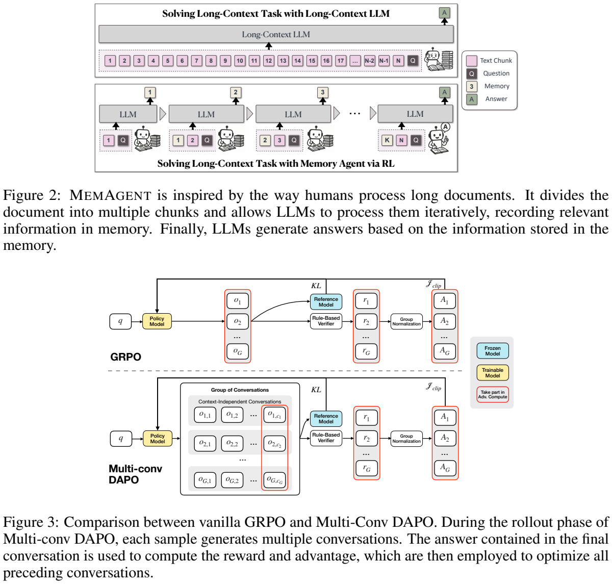

图 1：原文 Figure 2、3，正式 PDF 物理第 3 页。来源为上述会议 PDF，216 dpi 原图裁切。上图比较全窗口阅读和逐块记忆更新，下图比较普通 GRPO 与 Multi-Conv DAPO。读图时沿记忆箭头看信息如何被下一轮接收；训练图中的最终奖励会传回之前各次记忆输出，不能理解为每次摘要都有独立人工标签。

### 问题定义、公式与手算

设问题为 $`q`$，文档 $`c`$ 由 $`c_1,\ldots,c_T`$ 组成，初始记忆 $`m_0`$ 为空。$`\theta`$ 是当前语言模型的参数，$`y`$ 是最终答案。以概率模型表示：

```math
\begin{aligned}
m_t&\sim\pi_\theta(\cdot\mid q,c_t,m_{t-1}),\qquad t=1,\ldots,T,\\
y&\sim\pi_\theta(\cdot\mid q,m_T),\\
P_\theta(y\mid q,c)&=\sum_{m_{1:T}}\pi_\theta(y\mid q,m_T)
\prod_{t=1}^T\pi_\theta(m_t\mid q,c_t,m_{t-1}).
\end{aligned}
```

求和 $`\sum_{m_{1:T}}`$ 遍历所有可能的记忆轨迹，乘积 $`\prod_{t=1}^T`$ 累乘逐轮条件概率。它是引入隐记忆后的模型定义，不是原先全上下文模型的无损恒等变换。一次关键事实被记忆丢掉，后面没有自动恢复保证。

原文采用 Multi-Conv DAPO：同一输入采样 G 条完整轨迹，用最终答案得到奖励 $`R_i`$，把轨迹优势分配给该轨迹所有轮的输出。其采用均值基线而不除组内标准差：

```math
\begin{aligned}
A_i &= R_i-\frac{1}{G}\sum_{j=1}^G R_j,\\
\rho_{i,t,k}&=\frac{\pi_\theta(o_{i,t,k}\mid\mathrm{prefix})}
{\pi_{\mathrm{old}}(o_{i,t,k}\mid\mathrm{prefix})},\\
J&=\mathrm{mean}_{i,t,k}\!\left[\min\left(
\rho_{i,t,k}A_i,\;
\mathrm{clip}(\rho_{i,t,k},1-\varepsilon_{\mathrm{low}},
1+\varepsilon_{\mathrm{high}})A_i\right)\right]\\
&\quad-\beta\,\mathrm{mean}(D_{\mathrm{KL}}).
\end{aligned}
```

i 是轨迹编号，t 是记忆轮或最终回答轮，k 是该轮输出位置；o 是实际采样 token；$`\pi_{\mathrm{old}}`$ 是收集样本的旧策略；clip 限制一次更新的概率比变化，KL 约束偏离参考模型，$`\beta`$ 为系数。$`\mathrm{mean}_{i,t,k}`$ 对所有轮次生成的有效 token 求平均。轨迹的权重随其输出 token 数而变。最大化 J，等价地最小化 -J。奖励只来自终点，因此“哪次记忆改写真正有功”仍是困难的信用分配问题。

本文推演：同一问题采样四条轨迹，奖励为 [1,1,0,0]，均值 0.5，优势为 [0.5,0.5,-0.5,-0.5]。成功轨迹第三轮保存“总部在孟买”的 token 会获得正向更新，但同一成功轨迹中无用的长篇抄录也可能获得正向更新。若四条都答对，优势全零；这解释了为何训练数据要剔除模型早已会做的问题。若使用标准差归一化，非零优势会变成约 ±1；本方法这里没有这一步。

另一个手算：文档长 20,000 token，块长 5,000，则读取四轮。每轮只需当前块、约千 token 记忆和问题，最终作答仍只见约千 token 记忆；不是四轮记忆拼接成 4,096 token。固定块长 C 与记忆长 M 时，总调用代价约为 $`(N/C)f(C,M)`$，对文档长度 N 线性增长；活跃窗口固定，但墙钟时间仍要等待多轮顺序执行。

### 数据、实现与资源账

原文第一阶段使用合成 HotpotQA 长文：将有关文章与干扰文章组合，约 200 篇文章形成约 28K 文本，再构造 32K 训练输入。起始约 80K 问题，利用 7B 基座或 Instruct 模型无上下文 best-of-2 过滤简单样本，约一半被过滤，最终训练集为 32,768。第二阶段共 2,560 条、最长约 60K，加入 1.6K DocQA-RL 与第一阶段样本，迁移到更自然的长文任务。基座为 Qwen2.5-Instruct-7B/14B。

```text
构造长文问题，去掉仅凭参数记忆就能轻易回答的样本
对每个问题采样 16 条完整多轮轨迹
  memory = 空
  对每个文档块：memory = LLM(question, block, memory)
  answer = LLM(question, memory)
用最终答案规则计算奖励，形成组内均值优势
合并各轮输出 token，执行带裁剪和 KL 的策略更新
先学合成任务记忆，再用长文问答数据训练迁移
推理时不计算奖励，只依次更新 memory 后回答
```

论文超参数为 AdamW、学习率 1e-6、常数学习率与 20 步 warmup、rollout batch 256、每题 16 条轨迹，KL 系数 1e-3，无熵奖励；第一阶段曲线约 400 步，第二阶段完整实测步数未找到。训练答案要求严格 boxed 格式，评测用归一化子串匹配 sub_em（去大小写、冠词、标点等）；多部分答案还涉及部分匹配。因此不能把曲线中的训练奖励直接当最终评测准确率。

静态读取提交 ef4219b23499a069cb00e5daff4c426d4c600851 的 README、记忆代理实现和 7B 启动脚本。`recurrent/impls/memory.py`确实覆盖旧记忆，而非无限追加。`run_memory_7B.sh`采用 4 节点、每节点 8 GPU，batch 128，与论文 batch 256 不同；脚本中的 30 epochs 也不能当论文实际完成训练轮数。脚本注释写收敛约 3–4 天，未给 GPU 型号。

| 资源项目 | 可核验内容与界限 |
| --- | --- |
| 模型与硬件 | 7B / 14B；7B 脚本配置 32 张 GPU，型号及单卡容量未找到 |
| 步数 / 时间 | 第一阶段约 400 步曲线；脚本注释 3–4 天，非正式计时日志 |
| GPU-hours | 本文条件计算：若 32 卡持续占用 72–96 小时，为 2,304–3,072 GPU-hours；不能作为论文已测总账 |
| 显存 / 金额 | 活跃上下文受限，不等于已测峰值显存；峰值、云实例单价及总费用未披露/未找到 |

### 主要实验、消融与怎么读图

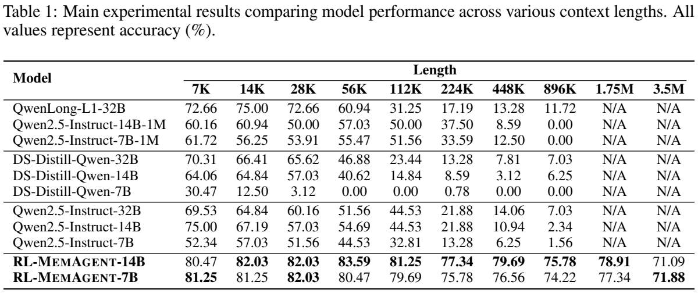

图 2：原文 Table 1，正式 PDF 物理第 5 页，来源同上。RULER-HQA 的准确率百分数，长度 7K 至 3.5M；加粗是列内最高值，N/A 是未报告，不是零。128 条评测样本使准确率增量约为 0.78 个百分点。基线能接收的上下文上限不同，超过上限时存在截断条件；这是方法能力比较，不是等 GPU 时间、等读取 token 的实验。

14B 从 7K 的 80.47 到 3.5M 的 71.09，减少 9.38 个百分点；7B 从 81.25 到 71.88，减少 9.37 个百分点。本文推演：相对降幅分别约 11.66% 和 11.53%，所以“下降不到 10%”若理解成相对百分比不准确。14B 在中间长度的峰值 83.59 到末端也下降了 12.50 个百分点。论文显示强长度外推，但不支持任意长、任意高密度文档都几乎不掉点。

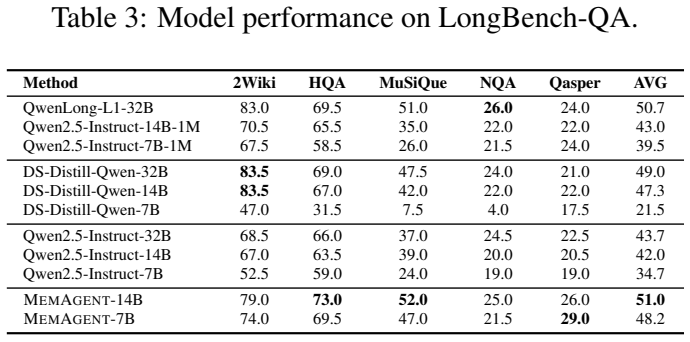

图 3：原文 Table 3，正式 PDF 物理第 6 页，LongBench-QA 五个数据集。来源同上。先横向读同一模型的五列，再比较平均；QwenLong-L1-32B 等不是同参数量的控制组。MemAgent-14B 的平均 51.0，高于其 14B 基座的 42.0，但并非每列都胜过所有长上下文模型。

7B 五任务平均 34.7→48.2，14B 42.0→51.0。14B 的 2Wiki、HotpotQA、MuSiQue、NarrativeQA、Qasper 为 79、73、52、25、26。QwenLong-L1-32B 的 2Wiki 为 83、NarrativeQA 为 26；因此不能说 MemAgent 在所有数据集上均最优。正式版 Table 2 的摘要实验用的是 ROUGE recall，不是 ROUGE-F1：14B GovReport 平均 19.04→21.80、QMSum 29.09→31.39；7B GovReport 的 ROUGE-1 反而从 30.91 降到 30.28。召回率也可能受摘要长度影响，不能直接等价为“摘要更精确”。

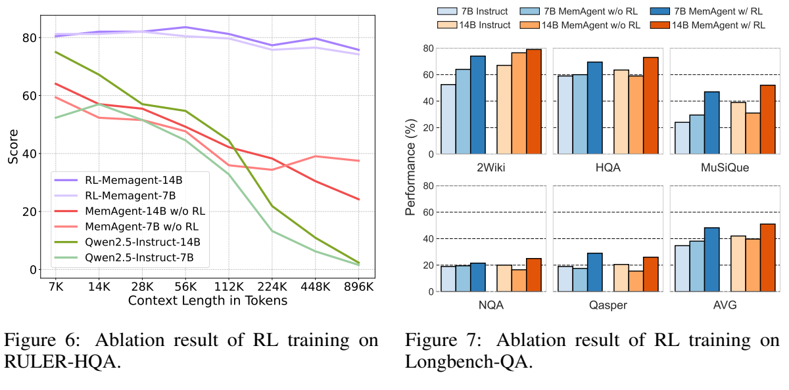

图 4：原文 Figure 6、7，正式 PDF 物理第 8 页。来源同上。左图固定长度横轴比较有/无 RL 的记忆方案；右图按 LongBench 数据集比较基础模型、无 RL 记忆代理、有 RL 代理。要验证的是训练记忆策略的贡献，而非只看是否加了摘要循环。

无 RL 的逐块摘要并不总有收益。附录 D.1 固定“块 + 记忆”为 6,024 token，14B 用 1,024 记忆 + 5,000 块得 51.0；2,048 + 3,976 得 49.1；4,096 + 1,928 得 48.5。增大记忆会挤压每次读入的信息，容量不是越大越好。NIAH 的 512K 平均很高，但 Level-2 某些结果低于 95%，不能把平均扩展到所有任务。附录 RAG 比较包含 embedding、检索条数及不同模型调用，不是统一成本下的检索和记忆决斗。

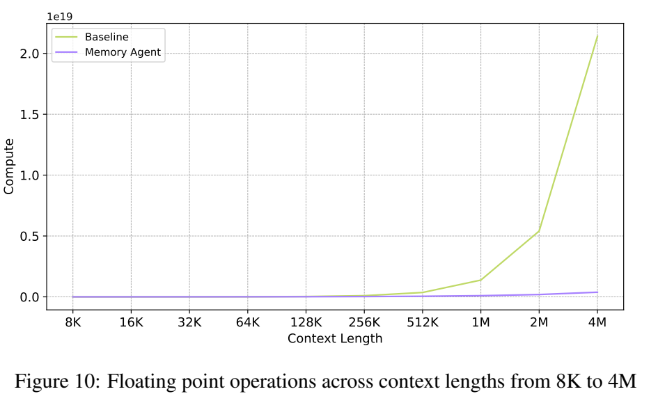

图 5：原文 Figure 10，正式 PDF 物理第 19 页。来源同上。横轴上下文长度，纵轴 FLOPs；这是基于模型计算量的估计图，不是实测秒数、峰值显存或 GPU 费用。长文本时曲线差距支持复杂度分析，无法直接读出生产环境加速比。

### 局限、复现判断与延伸阅读

最核心的风险是有损记忆。附录失败案例包括总部城市被截断、未来多跳推理所需的人名过早丢弃，以及 country/county 等细节误读。原文概率分解不能证明压缩后保留全部充分统计量。训练合成文档通常把少量相关事实混入大量干扰项，和每段都含关键约束的法律、代码或密集数学文档有区别。

复现时需锁定数据版本、窗口分配、每题采样数、训练和评测答案解析器，并记录被截断的样本。附录个别均值还值得复算，例如 Table 11 某行五列 51.5、56.5、26.5、15、23.5 的普通均值为 34.6，而表列为 28.83；本报告不把该平均用作结论。代码已公开，但上述配置差异和未披露硬件仍阻止“按默认脚本即可逐数复现”的承诺。

入门可先读 [D2L 语言模型](https://d2l.ai/chapter_recurrent-neural-networks/language-model.html)，再读 [Spinning Up 策略优化推导](https://spinningup.openai.com/en/latest/spinningup/rl_intro3.html)。作者项目页有方法介绍；这些辅助材料不计入五篇。

## 2. DECS：把必要推理与重复推理分开奖励

### 身份、问题与直觉

[ICLR 2026 oral 页面](https://iclr.cc/virtual/2026/oral/10007766)确认主会 oral，4 月 23 日；[正式 PDF](https://proceedings.iclr.cc/paper_files/paper/2026/file/bb0fea29f7aa6ede17e906ac6a225f34-Paper-Conference.pdf)共 30 页。[arXiv 2509.25827](https://arxiv.org/abs/2509.25827)初版 2025-09-30，v2 为 2026-03-16；采用会议版。作者是 Shuyang Jiang、Yusheng Liao、Ya Zhang、Yanfeng Wang、Yu Wang。代码 README 的示例 BibTeX 与正式论文作者不一致，身份以正式论文为准。[项目页](https://pixas.github.io/decs-iclr26-site/)和[代码](https://github.com/pixas/DECS)是作者辅助材料。

过度思考指模型已经找到正确答案，还继续重复验证、换方法重做。简单按总长度惩罚会误伤真正必要的长推理；更隐蔽的问题是把一个序列的同一优势分给所有 token：短答案中无用 token 也可能获奖，长答案中的关键步骤也可能被罚。

DECS 先找必要推理前缀 NRP：按语义转折将输出切块，检测从哪个位置开始已经出现正确答案。NRP 是检测器定义的前缀，不是“数学上最短且完备的证明”。检测器不完美、答案偶然碰对、先猜答案后证明，都可能影响边界。方法结合逐位置奖励和课程调度，把“保护必要部分”与“减少冗余部分”分开。

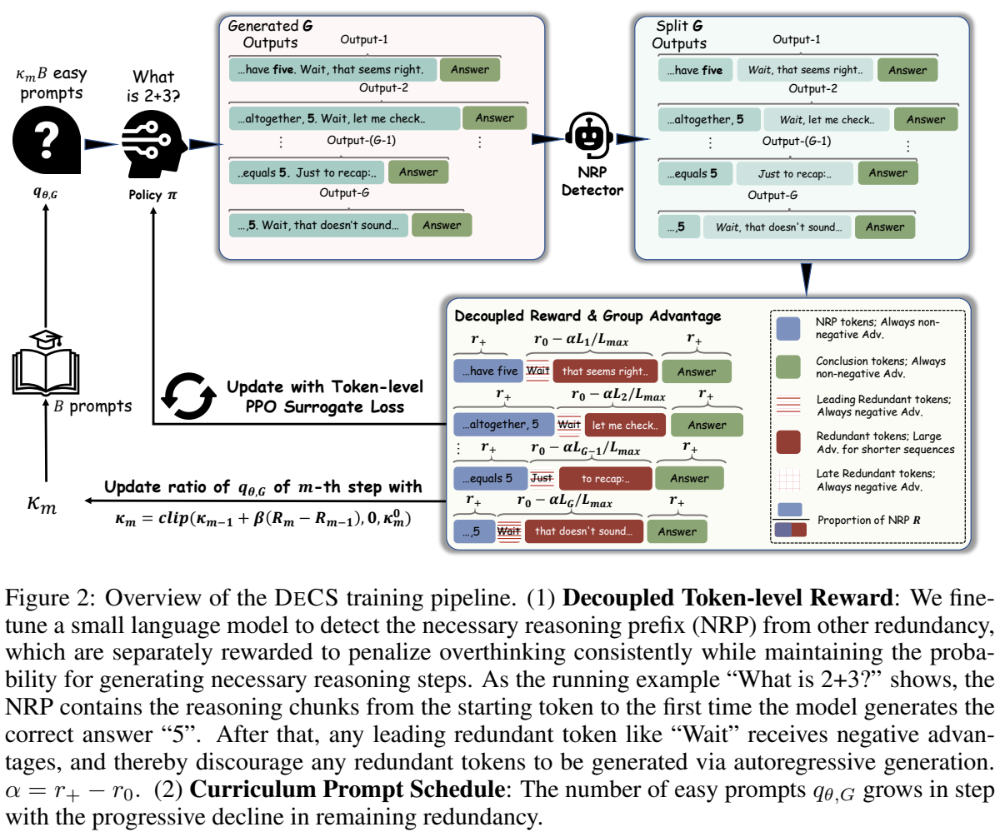

图 6：原文 Figure 2，正式 PDF 物理第 6 页。来源为上述会议 PDF。先从一题采样 G 个输出，再用 NRP detector 分段；蓝/绿区域表示必要推理与结论，红色区域表示不同位置的冗余惩罚；左下角是简单题比例调度。原图关于优势符号的简化说明需要结合组内归一化条件理解，不能当无条件定理。

### 奖励公式、损失和手算

令 $`L_i`$ 为第 $`i`$ 条回答长度，$`L_{\max}`$ 为最大输出长度。奖励常数为 $`r_+=1.1`$、$`r_0=1.0`$，两者之差为 $`\alpha=r_+-r_0=0.1`$。论文式 9 可概括为：

```math
\begin{aligned}
r_{i,j}&=\begin{cases}
1.1&\text{correct: NRP, conclusion, or padding},\\
1.0-0.1L_i/L_{\max}&\text{correct: redundant token},\\
0&\text{incorrect response},
\end{cases}\\
A_{i,j}&=\frac{r_{i,j}-\mathrm{mean}_i(r_{i,j})}
{\mathrm{std}_i(r_{i,j})+\varepsilon_{\mathrm{num}}},\\
J&=\mathrm{mean}_{i,j}\!\left[\min\left(\rho_{i,j}A_{i,j},
\mathrm{clip}(\rho_{i,j},0.8,1.2)A_{i,j}\right)\right].
\end{aligned}
```

$`j`$ 表示对齐后的 token 位置。$`\mathrm{mean}_i`$ 和 $`\mathrm{std}_i`$ 是同一题采样组的均值和标准差。$`\varepsilon_{\mathrm{num}}`$ 防止除零，PPO 裁剪半径另设为 $`0.2`$。$`\rho`$ 是新旧策略概率比。填充位置用于奖励对齐的讨论，实际训练仍须由 attention/response mask 管理有效 token；不能训练真正不存在的输出。

本文推演：同一位置，两条正确输出，一条已进入冗余且 $`L_i/L_{\max}=0.5`$，奖励 0.95；另一条仍是必要推理，奖励 1.1。均值 1.025、标准差 0.075，所以优势约 -1 与 +1；这比对整条序列统一惩罚更能保住长推理中的必要步骤。

但“每个冗余 token 的优势永远为负”需要额外条件。反例：两条都已进入冗余，长度比例分别 0.5、1，奖励 0.95、0.90，较短那条的优势反而为正。原文理论分析使用高熵分叉、前缀概率等假设，经验上还检查了有限训练点；这不能排除所有可能采样组。本文不把它提升为任意模型、任意位置的保证。

课程参数 $`\kappa_m`$ 控制第 m 步保留的简单题比例；简单题指一组采样全答对，全错的极难题另行过滤。$`R_m`$ 是必要前缀占比统计。论文式 11 为：

```math
\kappa_m=\mathrm{clip}\bigl(\kappa_{m-1}+\beta(R_m-R_{m-1}),0,\kappa_m^0\bigr),
\qquad \beta=0.2.
```

$`\kappa_m^0`$ 是该批原始简单题比例上限。例：$`\kappa`$ 原来 0.10，R 从 0.60 升至 0.75，则增加 0.2×0.15=0.03，变成 0.13（还要检查上限）。若 R 下降，$`\kappa`$ 也可能下降，所以公式本身不保证单调增长。课程的意图是先保留有学习信号的题，随后利用简单题继续压缩冗余。

### 数据构造与训练流程

NRP 检测器以 Qwen2.5-1.5B-Instruct 为底座，使用 OpenR1-Math-220K 中 5,000 个不同问题构造切块样本，由 Qwen2.5-72B 提供标签，SFT 2 epochs。作者人工查看 100 对样本未发现明显问题，并报告较高的验证准确率；附录又抽取 GPQA 和 LiveCodeBench 正确回答做人类核验，约 97%–99%。这些是特定抽样条件下的检测性能，不是所有模型、所有不完整推理的准确率。

主策略训练数据来自 DeepScaleR，核心模型为 DeepSeek-R1-Distill-Qwen-1.5B/7B，附加 Qwen3-4B 实验。学习率 2e-6，batch 128，每题 rollout 16；1.5B/7B 分别训练 2/3 epochs，响应上限分别 16,384/8,192。4 张 A100 80GB。评测温度 0.6、top-p 0.95、上限 16,384；AIME2024/2025 与 AMC23 每题采样 128 次，OlympiadBench、MATH500、GPQA 每题 16 次，LiveCodeBench 每题 10 次，因此准确率不是只跑一次的单样本结果。

```text
从训练集取题，为每题生成 G = 16 条回答
用答案判定器检查最终正确性
按语义转折分块，NRP 检测器找到首次正确边界
按 token 类型与回答总长度分配奖励
逐位置做组内均值/标准差归一化，计算 PPO 损失
统计 NRP 占比变化，更新简单题采样比例
重复训练；推理阶段仅运行训练后的策略模型
```

推理不需要另跑 NRP 检测器，训练却增加了教师标注与检测开销。附录 Table 7 选定五个训练步总耗时 3,791、3,038、2,972、2,368、2,583 秒，其中 NRP 检测 130、121、101、121、94 秒，约 3.4%–5.1%。这些是抽样训练步，不能乘一个猜测步数算成全程 GPU-hours；全训练墙钟、最终精确 optimizer steps、峰值显存和费用未找到，80GB 是单卡标称容量而非实测峰值。

### 主结果、消融与可比条件

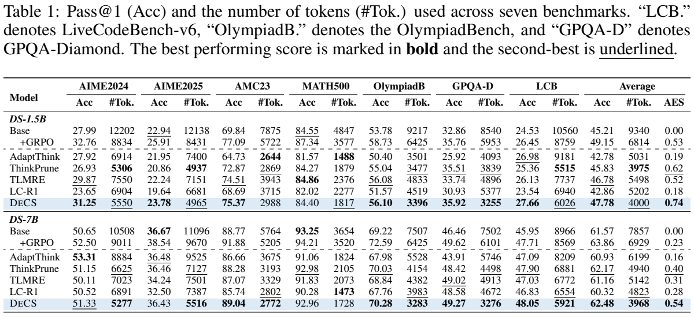

图 7：原文 Table 1，正式 PDF 物理第 8 页。来源同上。每个数据集并列准确率和 token 数，最右是七任务平均及 AES；比较同一底座内的 Base、GRPO、ThinkPrune、LC-R1 等。这里“短”不自动意味着更准，平均也不代表每个任务都改善。

| 同底座方法 | 七任务平均准确率 | 平均 token | 关键比较 |
| --- | --- | --- | --- |
| 1.5B Base | 45.21 | 9,340 | 初始参考 |
| 1.5B GRPO | 49.15 | 6,814 | 准确率高于 DECS |
| 1.5B DECS | 47.78 | 4,000 | 对 Base +2.57 个百分点，token -57.17% |
| 7B Base | 61.57 | 7,857 | 初始参考 |
| 7B GRPO | 63.86 | 6,929 | 准确率高于 DECS |
| 7B DECS | 62.48 | 3,968 | 对 Base +0.91 个百分点，token -49.50% |

上述增减由 Table 1 手算；正文叙述中的 +2.48/+0.8 与表格相减不一致，以表中数值和明确运算为准。1.5B ThinkPrune 平均 3,975 token，比 DECS 的 4,000 还短，但准确率较低；因此 DECS 的优势是特定折中，不是所有长度和精度维度同时支配。个别任务也下降，例如 7B AIME2025 的 36.67→36.43、MATH500 的 93.25→92.96。附录 Qwen3-4B 平均准确率 68.40→69.72，token 9,104→4,115。

AES 是作者定义的综合评分：节省 token 比例，再加上精度相对变化的加权项，精度提高权重 3、下降权重 5。它表达作者偏好，不等于电费、吞吐或真实用户效用。Figure 1 的所谓 frontier 是用特定模型、五个预算点拟合出的对数关系，不是算法不可能超过的理论边界。

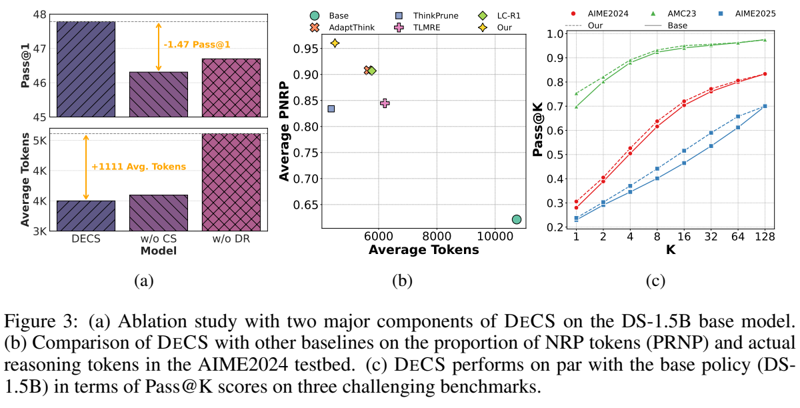

图 8：原文 Figure 3，正式 PDF 物理第 9 页。来源同上。(a) 在 DS-1.5B 上消融两部件；(b) AIME2024 的 NRP 比例与 token 成本；(c) 三个任务的 Pass@K，横轴 K 为采样次数。曲线接近说明这些设置下多次采样覆盖率接近，不足以证明任意任务的“创造力不变”。

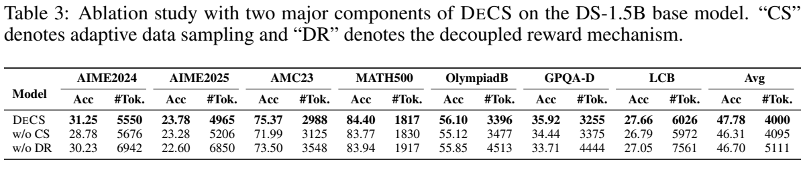

图 9：原文 Table 3，正式 PDF 物理第 17 页。来源同上。固定 DS-1.5B：完整方法 47.78 / 4,000，去课程调度为 46.31 / 4,095，去解耦奖励为 46.70 / 5,111。准确率和 token 一起读；部件贡献不能脱离此训练预算和数据设置外推。

### 代码差异、局限和复现入口

固定代码提交 710031e2d8e143d461294c8023efd480927ad810；静态读 README、`src_valid/reward_manager.py`、`src_valid/valid_ray_trainer.py` 和本地训练脚本，并核对会议补充 ZIP 的说明与相关实现。代码给冗余位置的奖励相当于 1.1−0.1×L/L_max，论文式子则是 1.0−0.1×L/L_max，多了 0.1；这影响与必要位置的间隔，不能当无关常数，因为它未加到所有类型。

课程更新代码中 clip 被注释掉，R 的统计近似使用首个正确块的比例而非严格 token 比例。默认本地脚本 batch 64、1.5B 设 3 epochs，与论文表不完全一致；数据名称默认路径、检测器目录名称也需显式覆盖。以上是固定版本的静态差异，没有运行验证其最终影响。README 的 BibTeX 作者问题已避免传播。

理论推导也需谨慎：奖励缩放在除标准差时可能相消，而原文部分推导继续保留该系数；对带正负优势的概率加权求和，不能简单逐项用概率上界替换而不检查不等号方向。经验消融支持这个训练启发式，但不等于论文每个理想化证明都适用于实现。$`\beta`$ 的调参使用 AIME2024，而主结果也包含它；是否采用独立开发划分未明确，须考虑小样本调参偏差。

附录第 26–30 页用“2+3”、数学、物理和代码案例展示冗余压缩；这些案例有助理解边界检测，不是额外独立大规模实验。基础材料可读 [D2L 概率](https://d2l.ai/chapter_preliminaries/probability.html)和 [Spinning Up PPO](https://spinningup.openai.com/en/latest/algorithms/ppo.html)，再对照作者项目中的 NRP 说明。

## 3. Speculative Actions：把等待时间变成提前计算

### 正式身份和基础概念

[ICLR 2026 oral 页面](https://iclr.cc/virtual/2026/oral/10009727)确认 4 月 24 日主会 oral，标题为 Speculative Actions: A Lossless Framework for Faster AI Agents。[正式 PDF](https://proceedings.iclr.cc/paper_files/paper/2026/file/fb279d7a134ad6fead7953ac7fd77fc4-Paper-Conference.pdf)共 24 页，其标题和 [arXiv 2510.04371](https://arxiv.org/abs/2510.04371)使用 Faster Agentic Systems；作者、编号、代码和内容对应，是同一论文的标题别名，已合并去重。初版 2025-10-05，最新 arXiv v2 为 2026-04-23，阅读版本为正式会议 PDF。[作者代码](https://github.com/naimengye/speculative-action)提供官方概览，未找到独立作者博客。

Agent 是观察环境、调用工具、更新状态的循环。瓶颈可能不是 token 生成本身，而是等待远程模型、搜索 API 或人的下一句话。这里的 speculation 是提前猜测将来的动作并发起下一步调用，与逐 token 的 speculative decoding 不同：它预测的是整个工具调用或环境动作。

小白直觉：对手还在下棋时，先猜他可能走三步中的哪一步，分别想好应对；真正落子后只保留猜中的分支。主决策者 Actor 保持权威，快速 Speculator 只负责预测。速度来自工作重叠，额外成本来自最终没用上的分支。

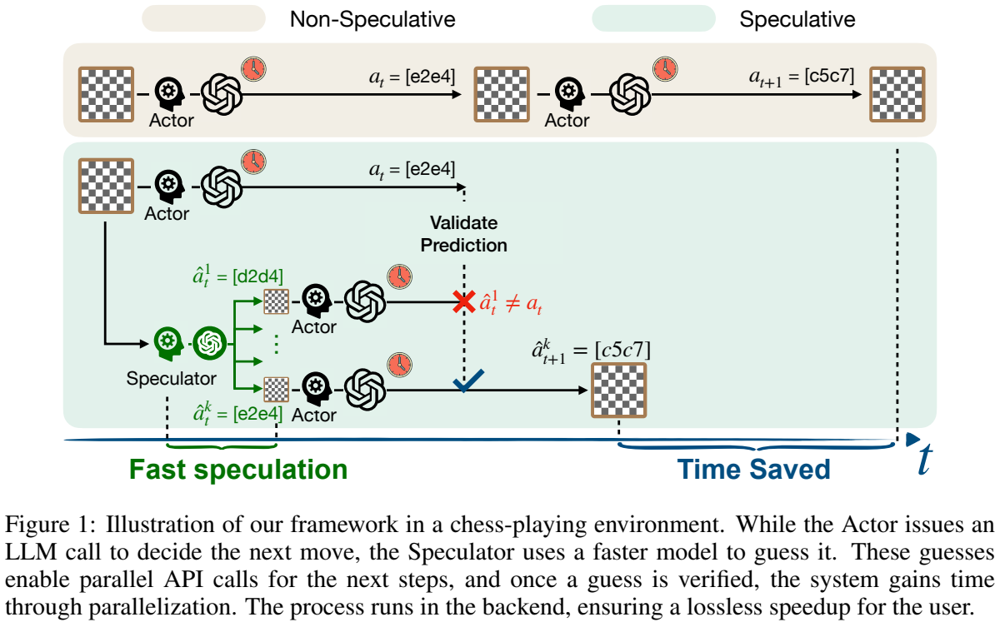

图 10：原文 Figure 1，正式 PDF 物理第 2 页。来源为上述会议 PDF。顶行为串行调用，下方在真实动作完成前并行预计算；红叉分支不匹配，蓝色分支通过核验。读图应区分“预测动作”与“采用动作”：只有真实动作返回且匹配后，缓存结果才可以生效。

### 形式化机制及无损条件

设 $`s_t`$ 是环境状态，策略 π 将状态映射为 API 名称 $`h_t`$ 及参数 $`q_t`$，真实返回值为 $`a_t=h_t(q_t)`$，状态转移函数为 f。快速模型先给预测 $`\widehat a_t`$，形成假想状态 $`\widehat s_{t+1}=f(s_t,\widehat a_t)`$，在其上提前计算下一次调用。真实 $`a_t`$ 到达后检查动作或 API+参数完全匹配，命中则使用对应缓存，否则正常调用。

```text
开始真实调用 real = async_call(h, q)
预测 k 个后续分支，对每个分支复制状态
仅在隔离状态上预计算，将结果按完整调用身份缓存
等待真实结果，推进权威状态
如果缓存键与实际下一次调用严格一致：采用匹配结果
否则：按原流程调用
清理不用的分支；重复
```

本文推演：无损依赖缓存键包含所有影响结果的状态、参数及必要的版本信息，预测分支不能提前造成不可撤销的外部副作用。随机模型还需要说明随机数或分布如何耦合；同参数的两次独立采样不会自动产生相同文本。时变 API、库存、会话状态、支付写操作，都不能仅凭字符串相等就宣称轨迹完全相同。论文的“lossless”应在状态隔离、核验和调用等价条件下理解。

这是推理系统，不训练一个新神经网络，没有新的监督标签、训练 loss 或 RL reward。其优化目标是延迟和额外计算成本的折中。后文 OS 调参变体明确允许预测先落地，是有损扩展，不能借主框架标题宣称它也无损。

### 延迟公式逐步推导与手算

原文理论考虑独立同分布的命中与指数调用时长。真实调用的时长为 $`B\sim\mathrm{Exp}(\beta)`$，均值 $`1/\beta`$。快速预测的时长为 $`A\sim\mathrm{Exp}(\alpha)`$，均值 $`1/\alpha`$，其中 $`\alpha>\beta`$。注意 $`\alpha,\beta`$ 是速率，数值越大，平均时间越短。假设每个分支独立命中概率 p，k 分支的至少一次命中概率 q 为：

```math
\begin{aligned}
q&=1-(1-p)^k,\\
S_n&=q(1+S_{n-2})+(1-q)S_{n-1},\qquad n\ge 2,\\
S_0&=0,\qquad S_1=q,\\
S_n&=\frac{qn}{1+q}+\frac{q^2}{(1+q)^2}\bigl[1-(-q)^n\bigr].
\end{aligned}
```

$`S_n`$ 是 n 个候选位置内的期望缓存命中数。命中后有一轮直接用缓存，该轮不再开启同样的预测窗口，因此不能简单写 n×q；递推中的 n−2 正是这个约束。它也解释了深度为 1 时即使命中率极高，渐近比例仍趋近一半。实际 top-k 分支通常相关，q 的独立公式只是分析模型。

每次命中能节省的重叠时间为 $`\max(B-A,0)`$。对指数分布积分得到期望 $`\alpha/[\beta(\alpha+\beta)]`$。除以正常调用的均值 $`1/\beta`$，得到 $`\alpha/(\alpha+\beta)`$。下式用 $`s`$ 表示长链的节时率，$`\mathrm{overhead}`$ 表示额外成本占原成本的比例。

```math
\begin{aligned}
s&\approx \frac{q}{1+q}\frac{\alpha}{\alpha+\beta},\\
\mathrm{speedup}&=\frac{1}{1-s},\\
\mathrm{overhead}&\le k-\left[k+\frac{\alpha}{\alpha+\beta}\right]\frac{q}{1+q}.
\end{aligned}
```

成本式依赖论文的调用成本模型、并行与取消假设，不是某云 API 的实时账单。本文手算：单分支命中 p=0.3，k=2，q=0.51；Actor 平均 10 秒、预测 2 秒，$`\beta`$=0.1、α=0.5。节时率约 $`\frac{0.51}{1.51}\cdot\frac56\approx28.15\%`$，加速约 1.392 倍；额外成本上界约 $`2-(2+5/6)\cdot\frac{0.51}{1.51}\approx1.043`$，即原成本的约 104.3% 额外开销。这个理想例子说明“延迟减少”可能用更多总计算换来，不是论文测量值。

选择性分支机制按置信度从高到低排序。若已开 m 个独立分支，加入下一分支的边际命中概率是前 m 个全失败概率乘新分支成功概率。用继续命中的价值 $`\Delta_t`$ 乘这个边际概率，再与分支成本 c 比较，才决定是否继续。论文给出有限时域反向递推；实证中用预测置信度大于 50% 的简化阈值，并未逐步求解完整动态规划。

### 实验环境与主结果

国际象棋使用 TextArena，Actor 为 GPT-5 高 reasoning effort，Speculator 为 GPT-5 低 effort；共 5 次运行、每次 30 步。不要因为同叫 GPT-5 就假定两者每次调用计算量相同。

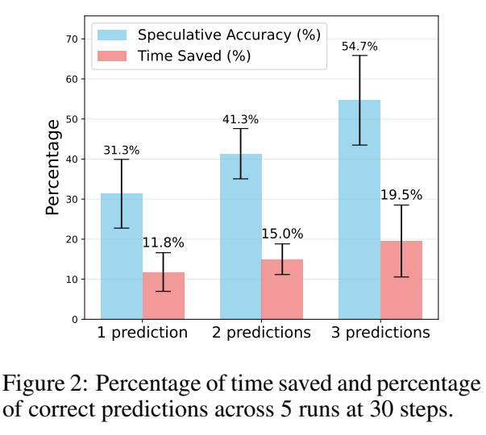

图 11：原文 Figure 2，正式 PDF 物理第 6 页。来源同上。蓝柱是至少一个预测正确的比例，红柱是实际节省时间比例，误差条来自五次运行；二者不是同一指标。1/2/3 个预测分别命中 31.3%/41.3%/54.7%，节时 11.8%/15.0%/19.5%。

3 分支的 19.5% 节时换算成速度约 1/0.805=1.242 倍；不能把 54.7% 命中写成 54.7% 加速。调用服务负载、并行额度、尾延迟都会改变这个折中，平均值和少量运行不足以表征大规模生产尾部。

电商采用 τ-bench retail 的 115 个任务、15 种 API（7 写、8 读），测试 GPT-5 nano/mini/GPT-5 与 Gemini-2.5-Flash 等预测器及不同预算，约 22%–38% 的 API 预测命中。预测约 2–3 秒；用于比较的人类输入约 30 秒来自每分钟 40 词的时间估算，不是本论文新做的用户计时实验。一次预测命中率也不等于整个用户轮次完全零等待的概率。

HotpotQA 使用 ReAct 的 Search、Lookup、Finish 调用形式，检查 API 和参数精确匹配，top-3 预测最高约 46%。这些结果主要评价“预测下一调用”，不是直接证明问答最终准确率或所有任务端到端节时同为 46%。不同任务的 Actor、Speculator、预测预算和延迟口径必须分别保留。

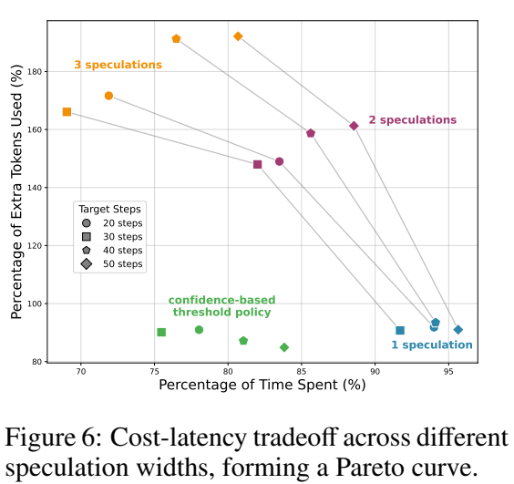

图 12：原文 Figure 6，正式 PDF 物理第 10 页。来源同上。横轴为相对花费时间百分比，越左越快；纵轴为额外 token 百分比，越低越省。比较 1/2/3 分支和置信度阈值方法，点形对应 20–50 步目标。不能把纵轴“额外 token”误读为剩余总成本，也不能将这一象棋环境曲线泛化成所有 API 的最优边界。

### OS 扩展、资源与代码复现

OS 实验调节 CFS 的 min_granularity，范围 0.05–50 ms，默认 3 ms；sysbench 16 线程竞争 2 核。环境是 CloudLab，双路 Xeon Silver 4114（每颗 10 核、2.2GHz）、192GB DDR4、1TB NVMe、Ubuntu 22.04 与 Linux 5.15。Actor 约 10–15 秒一次，Speculator 约每秒一次。它允许快速预测先修改系统，随后由 Actor 覆盖；覆盖参数不会抹去此前运行历史，属于有损场景。

原文报告扰动时 p95 从未调参的 102.97ms，到 Actor-only 的 54ms、联合方案的 37.93ms；另一个收敛比较约 200 秒对 13 秒。这些是不同统计窗口和指标，不能混写。Actor-only 部分采用重放联合运行的 Actor 轨迹，比较条件应保留，不能当两个完全独立重跑的最优控制器。最终时延与暂态平均也应分开。

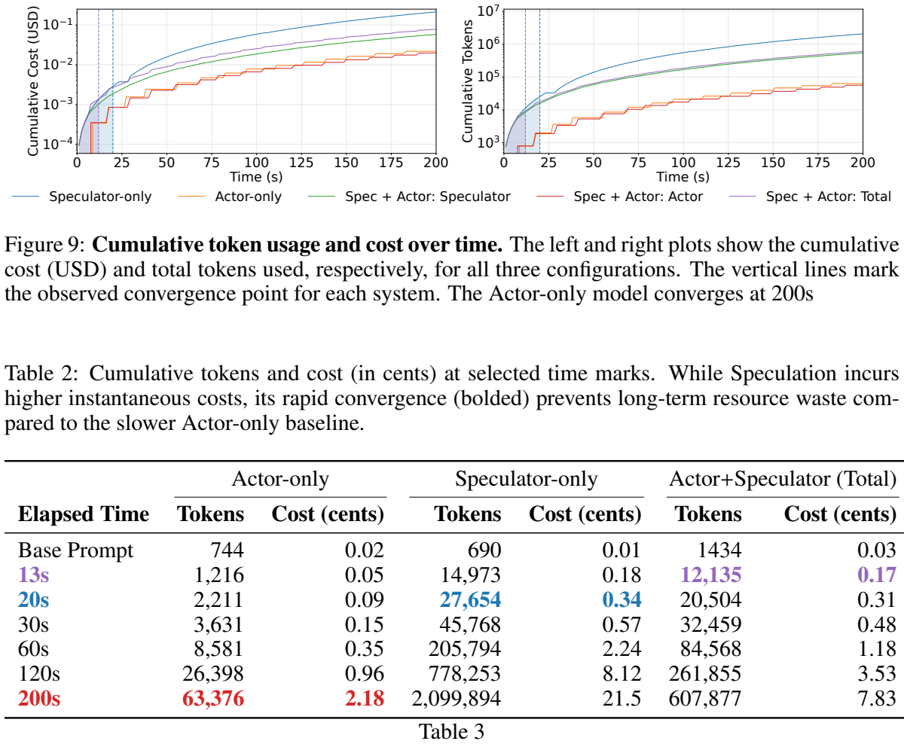

图 13：原文 Figure 9 及同页上方标为 Table 2 的费用表，正式 PDF 物理第 20 页；原表下方又印有 Table 3，保留这一编号不一致。来源同上。图的金额单位 USD，表的金额单位 cents（美分）；竖线为各方法收敛时间。必须比较相同终止条件，不能只选最便宜时间点。

联合方案在约 13 秒收敛时累计 12,135 token、0.17 美分（0.0017 美元）；Actor-only 在约 200 秒时 63,376 token、2.18 美分（0.0218 美元）。但若都持续 200 秒，联合方案为 7.83 美分，高于 2.18 美分。节省金额来自提早达到目标并停止，不能声称它每秒运行都更便宜。这些是论文条件下历史费用，未查询今日 API 价格。

代码固定提交 dc938b9ef7474caf07fe4ad16549c1fa8c7d268c。静态阅读 README 与象棋主流程：复制棋盘状态、线程池并发、预测动作匹配和轨迹统计确实存在；部分流程等待 future 列表完成后收集结果，未据此证明所有未命中远端调用都即时取消。样例轨迹与后处理分析也不自动等价于完整在线取消语义。没有执行这些 API 调用、写系统参数或重跑计时实验。

| 资源项目 | 原文可核验范围 |
| --- | --- |
| 模型大小与训练 | 使用闭源 API 型号；参数量未披露；无本方法新模型训练，训练步数不适用 |
| GPU / 显存 / GPU-hours | API 提供方内部资源未披露，不能从 token 数倒算 |
| 本地系统硬件 | OS 实验硬件如上；不能当所有 LLM 实验的推理硬件 |
| 时间与费用 | 象棋节时、OS 收敛与历史计费分别报告；没有统一跨任务训练或推理总账 |

复现应先从只读、状态可复制的调用开始，记录缓存键、真实命中、无效分支 token、取消是否生效和服务限流；涉及写操作需明确事务或延迟提交。作者代码的 README 和 [Python futures 官方说明](https://docs.python.org/3/library/concurrent.futures.html)可作为异步编程入门，辅助教程不算新增论文。

## 4. R-Zero：两个模型能否从自出题里持续学习

### 身份与“零数据”的含义

[ICLR 2026 poster 页面](https://iclr.cc/virtual/2026/poster/10011147)与正式 [OpenReview 记录](https://openreview.net/forum?id=96apU6YzSO)确认主会 poster。[正式 PDF](https://proceedings.iclr.cc/paper_files/paper/2026/file/d49b9aacebda61051166335af6fd3061-Paper-Conference.pdf)共 21 页。[arXiv 2508.05004](https://arxiv.org/abs/2508.05004)初版 2025-08-07，最新 v4 为 2026-02-13。本期依据 ICLR 2026 录用，不拿其早先 workshop 展示充当主会。作者 [项目页](https://chengsong-huang.github.io/R-Zero.github.io/)和[代码](https://github.com/Chengsong-Huang/R-Zero)提供辅助说明，后续 R-Few 不算本论文实验。

“Zero Data”指这个后训练循环不依赖外部种子题集或人工答案，不代表模型从未读过人类数据：底座已经预训练，题目模板和训练设计仍由人提供，评测仍依赖外部基准与判分器。初学者可把它理解成两个学生分工：出题者专门找“同伴有时会、有时不会”的题，解题者用自己多次作答的多数答案作为临时标签。

Challenger 负责出题，Solver 负责答题，两者从同一个底座初始化但参数独立。先固定 Solver，用它的答题不确定性更新 Challenger；再固定 Challenger，让 Solver 用筛选后的自生成题训练。困难不是简单产生更多文字，而是防止出题过易、题型重复、答案错误和循环放大偏差。

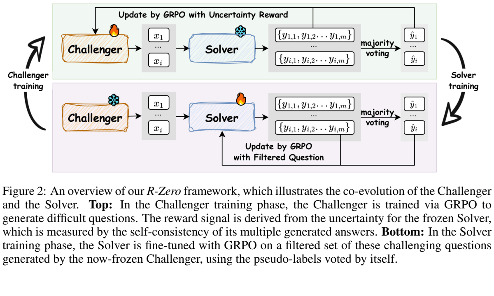

图 14：原文 Figure 2，正式 PDF 物理第 3 页。来源为上述会议 PDF。冰冻图标表示该阶段参数固定，火焰表示更新；右侧的多数投票产生伪标签，不是外部标准答案。应沿上下两个训练阶段读图，不能误认为两个角色共享同一套同时更新的权重。

### 奖励、筛题与手算

对题目 x，Solver 生成 n=10 个答案，先抽取并规范化答案，再找出现最多的答案 $`\widehat y`$。其频率为 $`\widehat p=\max_y\mathrm{count}(y)/n`$。注意 $`\widehat p`$ 是共识率，不是已知真实正确率，甚至可能只有 0.3 的相对多数。

```math
\begin{aligned}
u(x)&=1-2\lvert\widehat p-0.5\rvert,\\
d(x)&=\lambda\frac{\mathrm{clusterSize}(x)}{B},\\
r_Q(x)&=\max\bigl(0,u(x)-d(x)\bigr),\\
\delta&\le\widehat p\le1-\delta,\qquad\delta=0.25,\\
r_S(a,x)&=\mathbf{1}\bigl[\mathrm{extract}(a)=\widehat y\bigr].
\end{aligned}
```

B 是出题批大小，$`\lambda=1`$；聚类使用基于 1−BLEU 的距离、平均连接层次聚类和 0.5 阈值。$`d`$ 是重复性惩罚，$`\mathrm{clusterSize}(x)`$ 是题目 $`x`$ 所在簇的大小。$`r_Q`$ 是正文定义的出题奖励，只有共识率落在上述范围时才会保留题目。解题奖励 $`r_S`$ 比较回答 $`a`$ 的抽取结果和伪标签 $`\widehat y`$。指示函数在条件成立时取 1，其余取 0。格式不符合题目标签要求的输出也有惩罚。十次采样下实际保留的多数票数约为 3–7，避开全会与全不会的极端。

本文手算：十次答案分成 5、3、2 票，$`\widehat p=0.5`$，u=1。若出题批 B=8，其中 2 题在同一重复簇，则 d=0.25，最终 $`r_Q=0.75`$，题目可保留。若变成 9、1 票，$`\widehat p=0.9`$，u=0.2，减 0.25 再截断为 0，且不通过难度过滤。这个机制寻找边界难度，却无法识别“大家一致地错”与“大家一致地对”。

两个角色用 GRPO：同一输入采样多条输出，优势为 $`A_i=(R_i-\mathrm{mean}(R))/(\mathrm{std}(R)+\varepsilon_{\mathrm{num}})`$，再从 PPO 裁剪目标中减去 $`\beta D_{\mathrm{KL}}`$，其中 $`\beta=0.01`$。Solver 优化的是对伪标签的一致性奖励，不是直接对真实数学正确性求梯度。附录用 $`p(1-p)`$ 在 p=0.5 最大来解释中等难度课程；若 p 只是自洽率，不能直接继承真实正确率模型的理论保证。

### 数据生成、训练过程和资源

每一轮训练后的 Challenger 生成 8,000 道题，每题 Solver 采样 10 次形成伪标签。本文乘法：单轮仅这部分标签生成就需要约 80,000 次回答，尚未包括 Challenger RL 期间的评估、Solver RL rollout 和验证。称“没有外部训练集”不能等价为“没有数据生产成本”。

```text
初始化独立 Challenger 与 Solver
重复三轮：
  冻结 Solver
  Challenger 出题，Solver 多次回答
  用不确定性与去重复奖励训练 Challenger
  冻结 Challenger，生成 8,000 道题
  每题 10 个 Solver 答案，投票并按难度筛选
  Solver 用伪标签匹配奖励做 GRPO
评测独立标准基准，检查迭代退化与数据错误
```

正文设置每轮 Challenger 5 步、每题 4 个 rollout，Solver 15 步、每题 5 个 rollout，batch 128，学习率 1e-6，weight decay 0.01，BF16、FlashAttention-2，温度 1、top-p 0.99。三轮对应 15 个 Challenger 更新步和 45 个 Solver 更新步，是按轮数乘法而非完整训练日志。主要模型 Qwen3-4B/8B-Base、OctoThinker-3B/8B；迭代分析还加入 Qwen3-0.6B/1.7B。

代码 README 要求 8 GPU 服务器，论文/所读路径未明确完整运行的 GPU 型号、单卡容量、峰值显存、墙钟和总 GPU-hours，也没有实际费用。不能由步数少推断训练便宜，生成伪标签和两个角色的采样可能占据主要预算。

### 主结果与版本内部差异

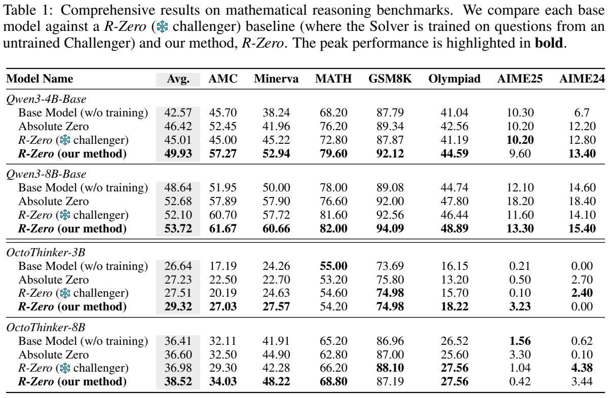

图 15：原文 Table 1，正式 PDF 物理第 5 页。来源同上。每个底座分别比较 Base、Absolute Zero、冻结未训练 Challenger 和完整方法；Avg 是七个数学任务平均。AMC/AIME 使用 mean@32 的多次采样平均正确率，不是“32 次里只要一次正确”的 pass@32；其余任务的采样和判分条件另列于正文与附录。

按此表，Qwen3-4B 平均 42.57→49.93，增加 7.36 个百分点；8B 48.64→53.72，增加 5.08。4B 未训练 Challenger 为 45.01、Absolute Zero 为 46.42；8B 分别 52.10、52.68。出题者训练有贡献，但并非没有它就完全无法改进。OctoThinker-3B 26.64→29.32，8B 36.41→38.52。局部仍会退化：Qwen3-4B AIME2025 10.30→9.60，OctoThinker-8B AIME2025 1.56→0.42。

正式版存在数值版本不一致：摘要的 4B 提升 +6.49 更接近后文曲线 42.58→49.07，不是 Table 1 的 42.57→49.93；正文某些 8B 起终点也不同。本报告逐图逐表保持对应，不选择最大增益混成一个新实验。评测中还使用 GPT-4o 判分，不能把“训练无外部标签”说成“整个研究完全未使用外部模型”。

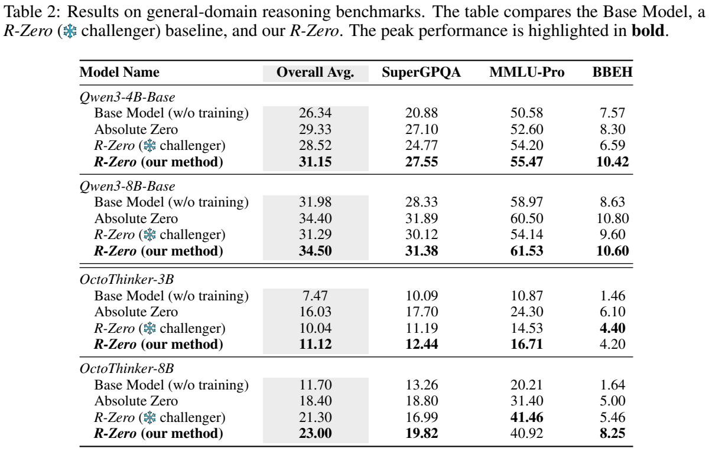

图 16：原文 Table 2，正式 PDF 物理第 6 页。来源同上。三个通用任务为 SuperGPQA、MMLU-Pro、BBEH；用各自底座行比较。Qwen3-4B 平均 26.34→31.15，8B 31.98→34.50；OctoThinker-3B 的 11.12 低于 Absolute Zero 的 16.03，不能宣称所有模型都全面领先。

通用评测使用 greedy 与 exact match。另一个重要差异是 Qwen3-4B 的 MMLU-Pro 基线：Table 2 为 50.58，附录 Table 8/README 有 37.38。未找到足够说明将两者归为同一实验条件，因此不把其中一个作为另一个结果的基线。若要复现，必须先锁定具体评测脚本、prompt 和 checkpoint。

消融 Table 3 用的完整方法数学平均是 49.07，去重复惩罚后 45.76，去任务过滤后 47.35；通用平均依次为 31.15、28.73、26.69。去过滤的通用下降为 4.46 个百分点，与正文“超过 6”不一致；也不能拿此表 49.07 和主表 49.93 任意交叉相减。共享单模型参数的附录实验比独立双模型更早退化，支持角色隔离，但尚不能证明长期稳定。

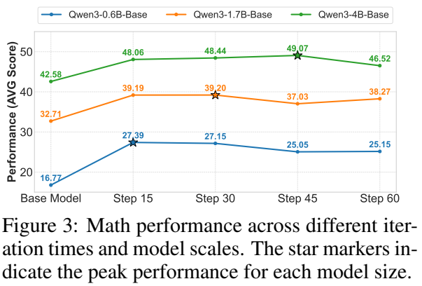

图 17：原文 Figure 3，正式 PDF 物理第 7 页。来源同上。横轴为 Solver step，星形表示各规模峰值；绿线 4B 在 step 45 达 49.07，step 60 降到 46.52；蓝线 0.6B 更早在 step 15 达峰。它展示改进后退化，不是持续增长的缩放定律。

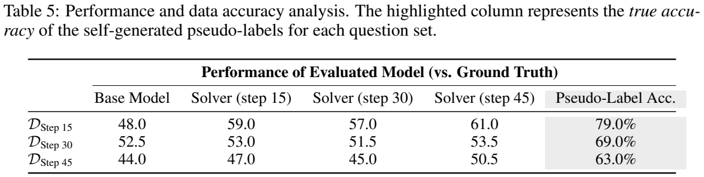

图 18：原文 Table 5，正式 PDF 物理第 8 页。来源同上。每轮抽样 200 题，用 GPT-4o 当假定无误的外部标注者；右列伪标签一致率从 79%→69%→63%。应读成对该 oracle 的一致率，不能认为人工已经证明每个答案真伪。附录另用 Gemini 与 500 题的结果是另一口径，不拼接成同一曲线。

### 代码、局限与复现判断

固定提交 5699329d018d79535b7910abdedf5a6eebf355fd。静态读取 README、Challenger 奖励、Solver 奖励、题目生成/上传与轮次脚本。`caller_penalty` 里的不确定性部分是 min(p,1−p)，没有正文的乘 2，且最终没有正文 max(0,...) 截断；无效格式还给负值。这会改变与重复性惩罚的相对权重，不是简单把总奖励乘常数。轮次脚本还出现训练 6/20 步但使用 5/15 步 checkpoint 的安排，Challenger batch 配置与论文不同；复现时不能只按 README 默认入口就声称等于正文设置。

“自己投票给自己”是最大局限。随着题变难，Solver 可能把错误规律强化成共识；出题器也可能学会利用奖励代理的漏洞。多数票不是事实校验，BLEU 去重也不能保证语义多样性。更大模型延迟了退化，未消除它。论文的人类标注后续训练段落实际使用 GRPO，虽然部分图注称 SFT；应描述为“接上人工标签的后训练”，不误解为标准交叉熵 SFT 实验。

可复现性首先取决于保存每轮题池、所有采样答案、投票规则、过滤阈值与评测 checkpoint。应分别统计伪标签一致性和人工/独立判分正确率，记录重复题与数据泄漏检查。作者项目与代码是首选入口；基础上先理解 [D2L 概率与采样](https://d2l.ai/chapter_preliminaries/probability.html)，再读前述策略优化教程。本报告未运行自生成训练。

## 5. FiSCoRe：让模型学会知道何时该拒答

### 录用、展示与基本问题

[ACL Anthology 正式条目](https://aclanthology.org/2026.emnlp-main.243/)确认 EMNLP 2026 主会长文，会议论文集页码 5546–5566；[正式 PDF](https://aclanthology.org/2026.emnlp-main.243.pdf)共 21 页。DOI 按官方条目为 10.18653/2026.emnlp-main.243，不擅自加 /v1。[官方程序页](https://2026.emnlp.org/program/)链接的[会议日程表](https://docs.google.com/spreadsheets/d/1aXGTy_7Xeh-OXIs3iJSbDpUsZ6YhbfA76b17kBZH0Yk/edit?gid=943432490#gid=943432490)中，668-MAIN 与完整标题匹配：Poster、In-Person、Hao An、Hall H、Session 4 / Poster Session B、2026-10-25 16:00–17:30、编号 238。因此本篇是 B 类主会 poster，不根据其他 OpenReview 投稿记录推断 ICLR 录用。

作者 Hao An、Yang Xu。[arXiv 2510.24020](https://arxiv.org/abs/2510.24020)于 2025-10-28 首发，当前为 v1；本期阅读正式会议版。正式 PDF 第 5 页链接[作者代码](https://github.com/Notbesidemoon/FiSCoRe)，未找到独立官方项目页或作者博客，使用仓库 README 作辅助说明。

拒答是模型在不可靠时选择不提供答案。单看“答出来的有多准”会鼓励只答最简单的题；只看“拒得是否多”又会奖励什么都不答。因此需要同时考察回答质量和拒答行为。FiSCoRe 用训练时多次采样的语义一致性，教单次输出附带 sure/unsure 标签，推理时根据标签决定是否展示答案。

关键区别：它先生成答案，再生成置信度；unsure 后可以对用户隐藏答案，却已经支付生成答案的计算。它也不是完全无标签的自信训练：准确率辅助奖励需要参考答案，置信度奖励才来自样本间语义关系。

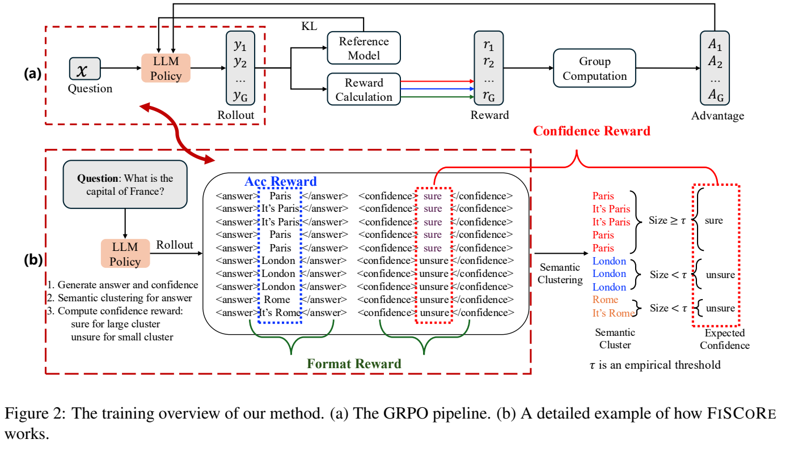

图 19：原文 Figure 2，正式 PDF 物理第 4 页。来源为上述会议 PDF。上方是 GRPO，下面把同一问题的 G 个答案按语义分簇，大簇期望 sure、小簇期望 unsure；红线是置信度奖励，蓝线是准确率奖励，绿色是格式奖励。应把答案真假与模型是否知道自己不确定分成两个维度读图。

### 语义聚类、奖励和数值例子

NLI 是自然语言蕴含判定：一句话是否能推出另一句。作者用 DeBERTa-v2-xlarge-mnli 检查“问题 + 答案”之间双向蕴含，将语义等价的不同措辞聚成簇。它是基于代表项比较的聚类过程，存在判定器误差与顺序影响，不能当逻辑定理证明器。

设同一问题采样 $`G=10`$ 个答案，$`C_i`$ 为第 $`i`$ 个答案所在簇，阈值为 $`\tau=\lceil G/2\rceil=5`$。

```math
\begin{aligned}
\mathrm{target}_i&=\begin{cases}
\text{sure}&\lvert C_i\rvert\ge \tau,\\
\text{unsure}&\lvert C_i\rvert\lt\tau,
\end{cases}\\
r_{\mathrm{conf},i}&=\mathbf{1}[s_i=\mathrm{target}_i],\\
r_{\mathrm{acc},i}&=\mathbf{1}[E_i],\\
r_i&=r_{\mathrm{conf},i}+4r_{\mathrm{acc},i}+2r_{\mathrm{format},i},\\
A_i&=\frac{r_i-\mathrm{mean}(r)}{\mathrm{std}(r)+\varepsilon_{\mathrm{num}}}.
\end{aligned}
```

$`\lceil\cdot\rceil`$ 表示向上取整，$`\lvert C_i\rvert`$ 是簇内样本数，$`s_i`$ 是模型声明的置信度。$`E_i`$ 表示回答与参考答案通过 NLI 等价检查，成立时准确率奖励为 1。格式项检查 answer/confidence 四个起止标签以及顺序，原文描述单个标签与整体格式共同给分，完整格式得 1；错误格式会影响其他奖励的有效性。最大总分为 7。再以 $`A_i`$ 进入 GRPO 的概率比裁剪目标，并加参考模型 KL 约束。这里的 reward 是可计算代理，最终“是否真的知道”没有被直接观察。

本文手算：十个答案分别为 5 次 Paris、3 次 London、2 次 Rome，假设 Paris 是参考答案，格式全部正确。Paris 声明 sure 得 1+4+2=7；London 声明 unsure 得 1+0+2=3；London 声明 sure 得 0+0+2=2。错误答案仍可能得到正的绝对奖励，但在组内相对优势中通常不如正确答案。若整个组都给相同错误答案，相同总奖励会造成零优势；“大家一致”本身不能验证事实。

### 指标推导与一个需要澄清的边界

论文先用初始模型判断题目属于 known 或 unknown，再统计训练后回答/拒答状态。令 $`N_1`$ 为原先 known 且后来答对，$`N_2`$ 为 known 后来答错，$`N_3`$ 为 known 后来拒答，$`N_4`$ 为 unknown 后来答错，$`N_5`$ 为 unknown 后来拒答。其指标写成：

```math
\begin{aligned}
F_{1,\mathrm{ans}}&=\frac{2N_1}{2N_1+2N_2+N_3+N_4},\\
F_{1,\mathrm{abs}}&=\frac{2N_5}{N_3+N_4+2N_5},\\
F_{1,\mathrm{rel}}&=\frac{2F_{1,\mathrm{ans}}F_{1,\mathrm{abs}}}
{F_{1,\mathrm{ans}}+F_{1,\mathrm{abs}}}.
\end{aligned}
```

$`F_{1,\mathrm{ans}}`$ 奖励正确回答，$`F_{1,\mathrm{abs}}`$ 奖励该拒答时拒答，$`F_{1,\mathrm{rel}}`$ 是二者调和平均。调和平均对短板敏感：只会答或只会拒，通常不会得很高。本文手算 $`N_1=40`$、$`N_2=5`$、$`N_3=15`$、$`N_4=10`$、$`N_5=30`$，总计 100：$`F_{1,\mathrm{ans}}=80/115\approx0.6957`$，$`F_{1,\mathrm{abs}}=60/85\approx0.7059`$，$`F_{1,\mathrm{rel}}\approx0.7007`$。这里数字为教学构造，不是实验复现。

指标定义留下一个需要实现澄清的格子：初始 unknown、训练后答对的题怎么归类？论文列出的五类没有清楚说明，而主表域内准确率又高于初始模型，说明不能假设新学会题目绝不存在。附录某极端推导还在 $`N_1=0`$ 时将 $`F_{1,\mathrm{rel}}`$ 按 $`F_{1,\mathrm{abs}}`$ 处理，这不是上面普通调和平均公式直接推出的结果，需要额外约定。报告保留作者指标数值，同时不把它当已经完整无歧义的可靠性评价标准。

### 数据、训练和推理流程

训练来自 ParaRel，论文描述 15K 样本并过滤语义熵低于 1 的简单题；README 对过滤前后数量的表述不完全一致，不能在没有最终数据清单时断言两者完全相同。评测包括域内 ParaRel 5,584 题，以及域外 TriviaQA 11,313、Natural Questions 3,610、SciQ 1,000。正确性奖励使用 NLI 与参考答案，模型需同时学知识回答和置信度表达。

模型为 Llama3-8B-Instruct 和 Qwen2.5-7B-Instruct。论文配置：1 epoch，学习率 3e-6，cosine 调度降至初始的 0.1，warmup ratio 0.05，BF16、gradient checkpointing；每设备 batch 10、梯度累积 4，同题采样 G=10，温度 1，最大 prompt 256、completion 64，vLLM 最大长度 4,608、显存利用系数 0.7。三随机种子 42、32、22 取平均。

```text
准备带参考答案的问答，过滤过于一致的简单问题
每个问题采样 10 个“答案 + sure/unsure”输出
对同一问题的答案做双向 NLI 聚类
大簇期望 sure，小簇期望 unsure
结合准确率、置信度和格式奖励，形成组内优势
用 GRPO 更新策略，一轮训练完成后固定模型
推理：greedy 生成答案和标签；unsure 时对外拒答
```

评测统一使用 6-shot 的大框架，但拒答模型的示例包含 3 个回答和 3 个拒答，普通 ICL 则为 6 个回答示例。这不是完全相同 prompt 的纯参数对比。需要同时报告示例差异，不能把所有提升只归因于奖励函数。

### 主结果、消融与成本

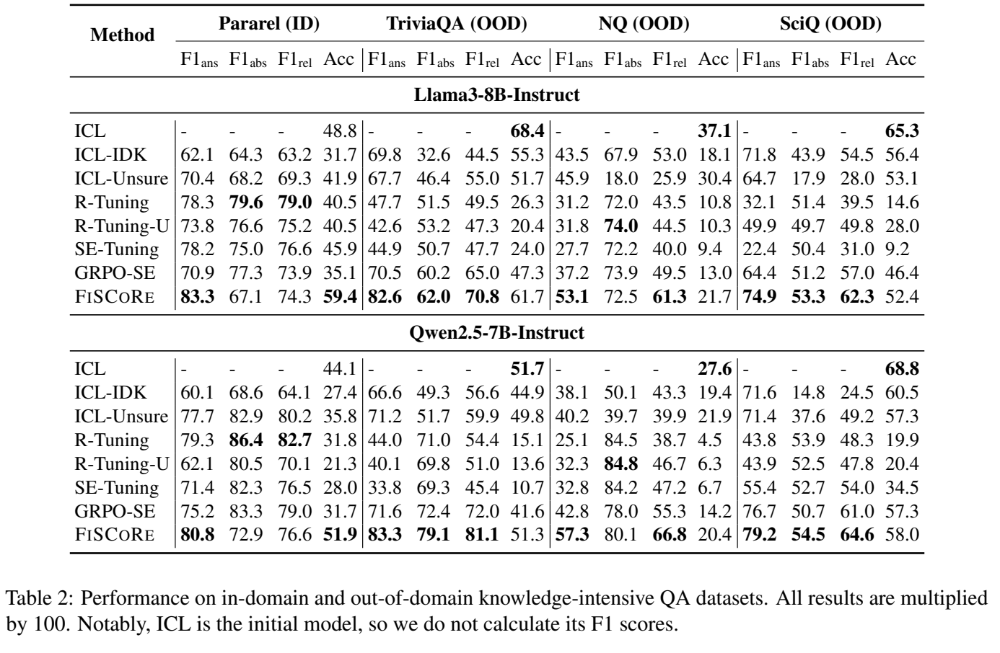

图 20：原文 Table 2，正式 PDF 物理第 6 页。来源同上。每个数据集有 $`F_{1,\mathrm{ans}}`$、$`F_{1,\mathrm{abs}}`$、$`F_{1,\mathrm{rel}}`$、Acc，数值乘 100；各底座分开比较。对域外泛化应看三个 OOD 区块，不能用一项可靠性分数代替普通准确率，也不能忽略域内 R-Tuning 的优势。

Qwen2.5-7B 的 $`F_{1,\mathrm{rel}}`$ 为域内 76.6、TriviaQA 81.1、NQ 66.8、SciQ 64.6；GRPO-SE 对应 79.0、72.0、55.3、61.0。三个 OOD 上有提升，但域内不及 GRPO-SE，更低于 R-Tuning 的 82.7。Llama3-8B 的 $`F_{1,\mathrm{rel}}`$ 为 74.3、70.8、61.3、62.3，域内 R-Tuning 为 79.0。

Qwen FiSCoRe 的普通准确率分别为 51.9、51.3、20.4、58.0，初始 ICL 为 44.1、51.7、27.6、68.8。域内准确率提高，但三个 OOD 准确率均不高于初始模型；可靠性折中改善不能写成所有知识能力都上升。NQ 的准确率下降尤其应与拒答带来的风险覆盖变化一起解释。

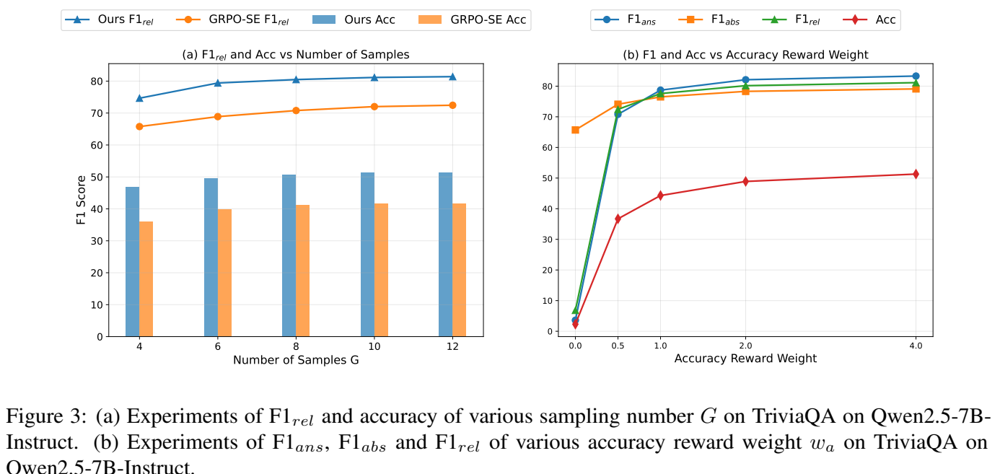

图 21：原文 Figure 3，正式 PDF 物理第 7 页。来源同上，Qwen2.5-7B-Instruct / TriviaQA。(a) 采样组大小 G 的变化，(b) 准确率奖励权重的变化；图中曲线与柱子代表不同指标。大约 G=10 后收益趋缓；没有准确率奖励时明显塌缩，说明方法依赖带答案的辅助信号。

准确率权重为 0 时 Acc 约 2.3、$`F_{1,\mathrm{rel}}`$ 约 6.8；权重 0.5/1/2/4 对应 $`F_{1,\mathrm{rel}}`$ 72.4/77.6/80.1/81.1。阈值 τ=3/4/5/6/7 对应 71.8/78.8/81.1/80.1/77.8，不是越保守越好。无格式奖励为 54.2，无置信度奖励为 4.1，即使后者 Acc 仍有 56.1；这再次表明 $`F_{1,\mathrm{rel}}`$ 衡量的是特定回答/拒答组合。连续置信度变体在该设置可达 82.9，比二元 81.1 高，但阈值选择与接口也随之改变。

NLI 模型从 xlarge 换为 large/base，报告 81.1/80.9/80.4；人工检查 40 道 ParaRel、40 道 TriviaQA，每题 10 个回答，获得约 98%/96% 的聚类一致性。该小样本评估不能证明任何领域都能正确识别同义、否定、数值单位和部分正确答案。

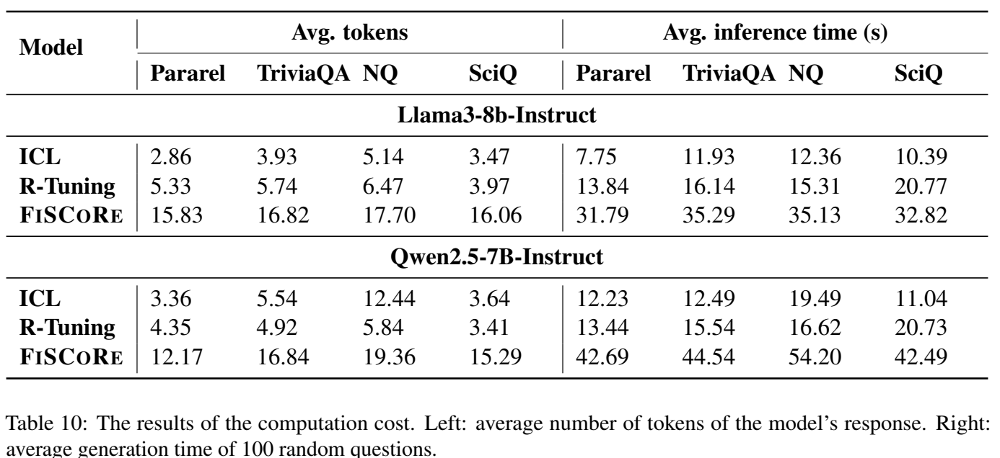

图 22：原文 Table 10，正式 PDF 物理第 21 页。来源同上。左侧是平均输出 token，右侧按原图注是 100 个随机问题的平均生成时间统计；论文未把计时聚合口径说明到足以直接当逐题在线延迟，本报告不自行除以 100。实验使用单张 L40，表内方法和数据集分别对照。

Qwen 在 TriviaQA 上 ICL 为 5.54 token / 12.49 秒，FiSCoRe 为 16.84 token / 44.54 秒；同表时间比约 3.57。Llama 同任务 11.93→35.29 秒，约 2.96 倍。虽然推理不必运行十次采样与 NLI，标签和已生成但最终隐藏的答案仍有成本，不能称为免费拒答。

| 资源项目 | 可核验内容与缺口 |
| --- | --- |
| 训练 / 推理硬件 | 论文使用 NVIDIA L40 48GB；成本表为单卡测试，训练实际卡数未明确 |
| 训练步数 / 时间 | 1 epoch；最终过滤样本数、分布式卡数与完整日志不足，不能精确重建总 optimizer steps 或墙钟 |
| 显存 | vLLM 利用系数 0.7 是配置；峰值显存未找到，不等于 48GB×0.7 的全训练峰值 |
| GPU-hours / 费用 | 未披露/未找到；不以推理抽样计时外推完整训练成本 |

### 代码审阅与使用边界

固定提交 03818779434cf9cb05c63b00a44cfafe66691b5f。静态读取 `src/rewards.py`、`src/grpo.py`、Qwen recipe、分布式配置、启动脚本和数据说明。代码确实执行双向 NLI、置信度奖励和格式/准确率奖励；recipe 的 max_prompt_length 为 128，论文为 256。完整格式的不同子奖励可对应论文的总权重，但部分格式失败时的门控必须按代码细看，不能只比较总分 7。

一个需要运行时核实的点：`confidence_reward` 对传入的 completions 列表整体聚类并按列表长度取阈值，函数内部未显式按 question 分组。只有调用方保证每次恰好传一个问题的 10 个采样，才符合论文定义；若 TRL 批次含多个问题，可能跨题污染簇和阈值。所读训练入口直接使用 GRPOTrainer，未在此处看到额外分组包装。本报告把它列为静态风险，未实际运行证明错误，也未擅称已修复。

方法适合可用短答案与 NLI 对齐的知识问答。对长论述、多部分答案、需要证据引用或开放创作的任务，语义一致和真实可信的关系更弱；不同错误答案也可能因措辞相近聚到一起。评测还缺少完整 risk-coverage 曲线和上述新增知识格子的清晰处理说明。复现必须保存同题分组、NLI 判定、阈值、prompt 示例与五类计数，而非只对比最后一个 $`F_{1,\mathrm{rel}}`$ 数字。

作者仓库提供方法及数据准备入口；基础阅读可从 [D2L 自然语言推断](https://d2l.ai/chapter_natural-language-processing-applications/natural-language-inference-and-dataset.html)理解 entailment，再读前述 PPO 教程。辅助链接不计入本期论文数。

## 跨论文比较与本期可复现结论

| 方法 | 节省或重新分配什么 | 额外代价 | 本期最需保留的边界 |
| --- | --- | --- | --- |
| MemAgent | 单次活跃上下文与长文本注意力成本 | 反复写记忆、顺序调用和 RL 训练 | 信息压缩有损；FLOPs 估计不是实测费用 |
| DECS | 推理时冗余 token | 训练时 NRP 标注、检测及课程设计 | 总奖励、逐位置优势和代码版本不能混同 |
| Speculative Actions | 等待调用时的关键路径延迟 | 未命中分支 token、并发和缓存核验 | 无损有条件；OS 扩展明确有损 |
| R-Zero | 外部人工出题与标注需求 | 双模型采样、题池与伪标签生成 | 自洽不等于正确，多轮迭代会退化 |
| FiSCoRe | 用户收到不可靠答案的概率 | 有标签训练、语义判定和更长输出 | 可靠性指标与普通准确率、延迟需一起看 |

五篇都让模型或系统把算力花在不同位置，但“token 少”“窗口小”“等待短”“无需外部题集”“更会拒答”是五个不同命题，没有共同的单一效率分数。本文的算例用于解释机制，不构成新基准实验。要作工程选型，应在同一数据、同一模型、同一硬件/服务、相同成功标准下重测端到端成本；本期没有进行这样的实验。

## 检索、剔除与制品说明

检索范围覆盖 CCF 当期官方目录、ICLR 2026 oral 列表及逐篇官方页面/论文集、EMNLP 2026 主会论文集与官方日程、arXiv 身份页、OpenAlex、作者项目与代码。达到 5 篇及目标比例，无数量不足。检索并非穷举全年全球会议；没有把未知录用的预印本、workshop、Findings、short/demo、博客或教程用来凑数。

历史排除包括首日 Finetuning with Sampling 和全方向已收录论文。身份复核将 Speculative Actions 的 AI Agents / Agentic Systems 标题合为同一记录；未将另一篇同名 MemAgent 混入。R-Zero 依据 ICLR 2026 主会而非早先 workshop；FiSCoRe 的 poster 由官方链接日程证明，未凭作者自述或旧投稿页面推断。CCF 页面一度返回防护 HTML，等级最终来自有效的 72 页官方 PDF；DECS 补充材料是 ZIP 代码而非假定存在的补充 PDF。

本目录保存全文 Markdown、由它直接生成的全文 PDF、manifest、22 张原图与图源清单。`assets/official-records` 保存官方证据快照，`assets/citation-records` 保存引用原始记录，`assets/code-reading.json` 保存固定提交及读取文件哈希，`assets/dedup-check.json` 保存跨方向查重，`assets/pdf-check.json` 与 `assets/QA.md` 记录最终全文覆盖、字体、边界、逐页渲染和原图像素核对。PDF 不使用短版替代全文；最终检查状态以这些检查文件为准。源 PDF 的 URL、版本、物理页数、哈希均记录于 manifest 和图源清单，原图版权归各论文作者。
