# CCF-A/B 年度录用论文图文精读 · 2026-11-23

北京时间 2026-11-23。主题：推理数据配方、超长写作强化学习、思考感知 KV 压缩，以及 SFT 与 RL 的衔接。本期五篇，4 篇 A、1 篇 B；3 篇 oral、2 篇 poster；spotlight 和未知均为 0。全部是 2026 年主会正式长文，预印本早于 2026 年不构成排除理由。

## 本期目录与证据口径

| 论文 | 当年录用与展示 | 首次公开记录 | OpenAlex 引用快照 |
| --- | --- | --- | --- |
| OpenThoughts: Data Recipes for Reasoning Models | ICLR 2026 · A · oral | arXiv 2506.04178，2025-06-04 | 438 |
| LongWriter-Zero: Mastering Ultra-Long Text Generation via Reinforcement Learning | ICLR 2026 · A · oral | arXiv 2506.18841，2025-06-23 | 32 |
| ThinKV: Thought-Adaptive KV Cache Compression for Efficient Reasoning Models | ICLR 2026 · A · oral | arXiv 2510.01290，2025-10-01 | 25 |
| AceReason-Nemotron 1.1: Advancing Math and Code Reasoning through SFT and RL Synergy | ICLR 2026 · A · poster | arXiv 2506.13284，2025-06-16 | 74 |
| How Much Supervised Fine-Tuning Is Enough? Dissecting the Impact of SFT Extent on Downstream Reinforcement Learning Performance | EMNLP 2026 · B · poster | ACL Anthology 标注 2026-10，未核得具体首发日 | 0 |

等级依据 [CCF 2026 正式目录及修订公告](https://www.ccf.org.cn/Academic_Evaluation/By_category/2026-03-31/870181.shtml)：有效目录 PDF 物理第 57 页列 ICLR 为 A，第 58 页列 EMNLP 为 B；两页均已视觉核验，目录保存在 assets/official-records。录用和 oral/poster 分别采用逐篇官方条目与主会论文集；EMNLP 另核对官方程序链接日程中的 340-MAIN、Poster、2026-10-25、Hall H、Session 2、Poster Session A、11:00–12:30、海报号 93。作者主页只用于项目与代码身份辅助。

引用查询日均为 2026-11-23（Asia/Shanghai）。五个 OpenAlex 原始记录及查询 URL 随文保存；数字是索引快照，不是永久值。OpenThoughts、LongWriter、AceReason 的预印本公开时间相近，可在主题相近时参考引用积累；ThinKV 晚约四个月，EMNLP 论文首发日未知，不按裸引用数排成质量榜。EMNLP 的 OpenAlex 日期 2026-01-01 与官方仅到月份的出版记录不一致，因此不采作首发日。

起始读取根目录和本方向 AUTOMATION.md、sources.json、所有方向的 18 份历史 manifest，共 90 个远端已索引条目；准备提交时整合当天 VLM/OPSD 并发更新，重新读取 20 份历史 manifest、100 个条目，并将 11 月 22 日本地已完成但未推送的 5 篇纳入去重。按去版本 arXiv、DOI、规范 URL、Unicode/标点/大小写归一标题及别名核对，没有重复。OpenThoughts 页首标志与正文标题构成完整标题，另记 Data Recipes for Reasoning Models 为别名。首期指定的 Finetuning with Sampling 已归档，今天不重收。检索是对 ICLR 2026 oral/poster、EMNLP 2026 主会长文及官方程序的有界筛选，不声称穷尽全球年度论文；延期候选与排除原因见 manifest。

阅读范围为五篇正式会议 PDF 的全部主文与附录，共 164 页：72、26、35、19、12 页。代码只做固定版本的静态阅读，未运行模型、训练、推理评测或作者服务。下文“原文事实”指论文及明确注明的官方材料；“本文推演”指解释性公式、手算与伪代码；“未披露/未找到”不等于该资源绝对不存在。20 张图表均直接裁自正式 PDF，没有生成或重绘实验图。精确裁切框、源 PDF 哈希、PNG 哈希及报告内页码见 assets/figures.json 与 assets/pdf-check.json。

## 1. OpenThoughts：用系统化数据实验找出推理 SFT 配方

[官方 oral 条目](https://iclr.cc/virtual/2026/oral/10011247) · [OpenReview](https://openreview.net/forum?id=7xjoTuaNmN) · [正式全文，72 页](https://proceedings.iclr.cc/paper_files/paper/2026/file/b010241b9f1cdfc7d4c392db899cef86-Paper-Conference.pdf) · [arXiv](https://arxiv.org/abs/2506.04178) · [项目](https://www.openthoughts.ai/) · [作者博客](https://www.open-thoughts.ai/blog/ot3) · [代码](https://github.com/open-thoughts/open-thoughts) · [引用记录：438](https://api.openalex.org/works/W4416131312)。本次读正式会议版本；arXiv 当前 v2 日期为 2025-06-05，不假定两者内容逐字相同。

### 1.1 基础概念、问题与直觉

SFT 是让学生模型预测教师答案中的下一个 token；答案可以包含长推理过程。蒸馏是借教师输出塑造学生分布，不要求学生和教师参数一样大。数据配方不仅是“收集多少条”，还包括题源、难度、教师、每题采样次数、答案过滤、领域比例和训练轮数。验证集用于选择这些配方，最终留出集用于检查配方是否只记住了验证偏好。

原文的核心问题是：固定小规模实验预算时，哪些数据选择有用；扩大数据规模后，这些经验能否训练出强 7B 推理模型？直觉像给学生挑练习册：重复同一题的不同解法能丰富路径，新增题目能扩大题型覆盖，两者不能只按“总条数”混为一谈。本研究累计超过一千个实验，常以 Qwen2.5-7B-Instruct 和 31,600 条训练样本做单因素比较，再组合成 OpenThoughts3-1.2M，训练 OpenThinker3-7B。组合选择带有贪心顺序，不能解释成所有因素的完整正交因果实验。

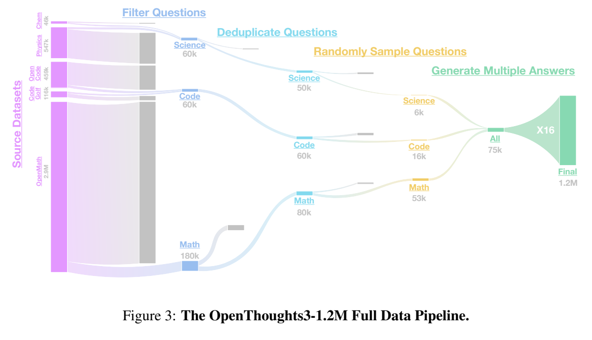

图 1.1｜原 Figure 3，正式 PDF 物理第 9 页。原始题源经过过滤、去重和抽样，约 7.5 万题各采样 16 个回答，得到约 120 万训练样本。先读分支上的题数，再读最右侧回答数；两者单位不同。该图为数据流程，不是模型架构，也没有把多次回答画成独立新题。来源为本节正式全文，正式会议版，未重绘。

### 1.2 方法、数据构造与监督目标

原文比较 27 个代码题源、21 个数学题源和 14 个科学题源；附录数学源表行数与主文口径不完全一致，不能据此再虚构精确去重后的源总数。最终数学主要来自 OpenMathInstruct-2 的 MATH 子集，代码侧偏好 CodeGolf 与 OpenCodeReasoning，科学包括 Physics StackExchange 和有机化学教材。数学/科学用 GPT-4.1-mini 的预计答案长度辅助筛题，代码用 GPT-4o-mini 的难度打分；这些评分是代理量，不是题目真实教育价值。

每个消融通常抽 31,600 条。多题源混合试验把这份预算平均分给前 N 个题源：N 为 1、2、4、8、16。例如代码前 2 个题源的平均成绩 41.3±0.4，前 16 个为 36.4±0.4；这是把较弱题源加入固定预算的结果，不能推广为“数据多样性越低越好”。难度/长度筛选表中，数学 41.9±0.3 对随机 35.2±0.5，代码 43.0±0.5 对随机 39.7±0.5。不同领域分别比较，不拿两个差值交换解释。

最终由 QwQ-32B 生成长推理：数学约 85 万、代码 25 万、科学 10 万，共约 120 万条。数学和科学做精确题目去重，代码最终配方不去重；每题 16 次回答提供随机推理路径。答案正确性过滤并非稳定增益：部分实验的未过滤池是 63,200 条，而过滤后只余 31,600 条，因此样本量和过滤同时变化，不能归因为错误回答本身有益。

本文用标准 token 交叉熵解释训练，不声称论文提出了新损失：

```math
\mathcal{L}_{\mathrm{SFT}}=-\frac{1}{Z}\sum_i\sum_r\sum_t
\log p_\theta\!\left(y_{i,r,t}\mid q_i,y_{i,r,\lt t}\right).
```

$`q_i`$ 是第 $`i`$ 道题；$`r`$ 是同题采样回答编号；$`y_{i,r,t}`$ 是其第 $`t`$ 个监督 token；$`\theta`$ 是学生参数；$`Z`$ 是所有参与监督的回答 token 总数。问题 token 通常不计入回答 loss，思考和最终答案都可提供监督。把教师分布记为 $`p_T`$，则交叉熵分解为：

```math
H(p_T,p_\theta)=H(p_T)+D_{\mathrm{KL}}(p_T\Vert p_\theta).
```

教师固定时最小化交叉熵等价于缩小这一方向的 KL。有限采样只是这个期望的近似，16 次回答不能保证覆盖教师所有解题策略。

本文手算：三个目标 token 的预测概率为 0.5、0.25、0.8，总负对数概率为 $`-\ln(0.1)=2.3026`$，平均 loss 为 0.7675。把第二个概率提高到 0.5 后，平均 loss 下降 $`\frac{\ln 2}{3}\approx0.2310`$。另一个预算例子：31,600 条回答若每题 16 次，只覆盖 1,975 道题；若每题 1 次，可覆盖 31,600 道题。比较两者时，“样本数相同”并不等于“题目覆盖相同”。本论文只有 SFT，没有在线奖励或 RL 阶段。

### 1.3 训练、推理与静态代码阅读

下面是本文整理的机制伪代码，不是作者可直接运行脚本：

```text
for domain in [math, code, science]:
    questions = load_selected_sources(domain)
    questions = apply_domain_filter(questions)
    questions = deduplicate_if_required(questions, domain)
    questions = sample_by_final_domain_budget(questions)
    for question in questions:
        responses = sample_teacher(question, count=16)
        save_question_and_reasoning_responses(responses)
remove_test_contamination_with_token_overlap_rules()
pack_training_sequences_and_mask_prompt_tokens()
train_Qwen2_5_7B_Instruct_with_cross_entropy(epochs=5)
evaluate_with_fixed_prompt_parser_and_sampling_budget()
```

原文附录第 22 页列 LlamaFactory、DeepSpeed ZeRO-3、AdamW（0.9、0.999）、weight decay 0、cosine、10% warmup；大数据档学习率 8e-5、全局 batch 512、5 epochs。公开大型配置有 cutoff 16,384、packing/neat packing 和 BF16。小数据档采用不同学习率、batch 和 epochs，不能把曲线当成严格等训练 token/等算力实验。静态核读固定提交 e86cf2dbbe69ae178aec302be33a3454a7183457 的数据 YAML、生成入口、DAG 和训练配置：DAG 负责算子依赖排序、去重与缓存身份；具体框架还依赖云资源与部分私有训练路径，README 和仓库子目录的公开程度也不同，完整环境不是下载即复现。

测试通常 temperature 0.7、top-p 1、最大 32,768 token；AIME/AMC/HMMT 重复 10 次，所述 LiveCodeBench 切片 6 次，GPQA 等部分任务 3 次，MATH500 1 次。训练数据生成温度与测试温度不同，不能直接拿生成 YAML 的参数解释评测。代码解答抽取器会影响分数，附录 Phi-4 的代码格式案例说明了这一点。

### 1.4 核心实验、消融与读图

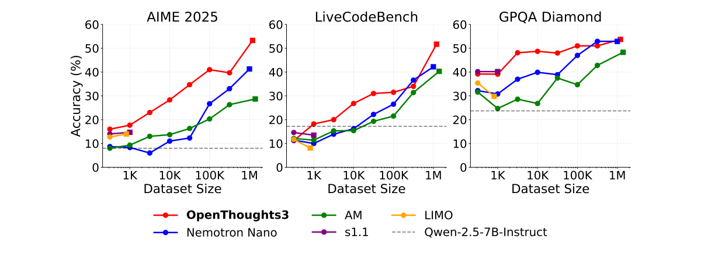

图 1.2｜原 Figure 1，物理第 1 页。同一学生框架下比较不同数据集及其规模，横轴是训练数据条数的对数刻度，纵轴为任务准确率。三个面板分别是 AIME 2025、LiveCodeBench、GPQA Diamond。先看相同规模，再看扩大后的趋势；训练配置和教师分布可能随数据实验而变，这不是相同总 GPU-hours 的排行榜。来源为正式会议版。

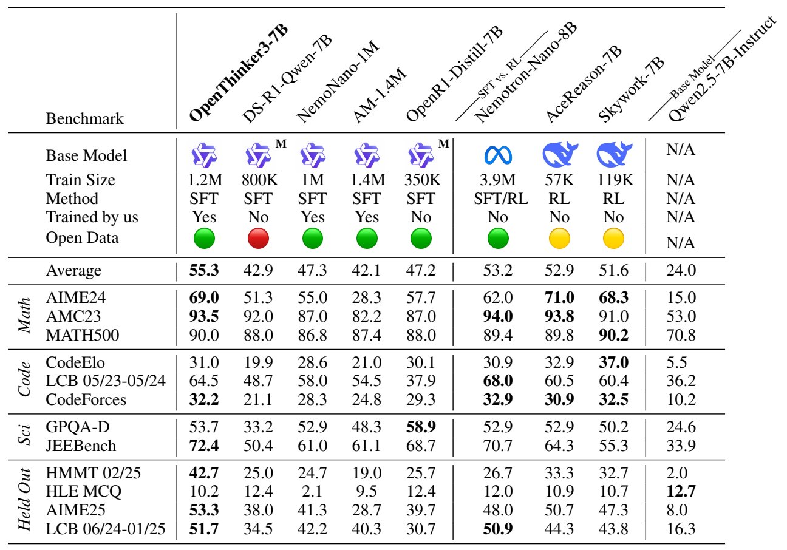

图 1.3｜原 Table 1，物理第 2 页，保留全部列名和留出测试行。OpenThinker3-7B、R1-Distill-7B、Nemotron-Nano-8B 等既有不同底座，也有 SFT/RL、数据规模差异。读 held-out 区域时不要把 AIME25 与上方 AIME24 混淆。来源为正式会议版；本图指标由作者测量或原表标示，未由本文复跑。

| 同表指标（%） | OpenThinker3-7B | R1-Distill-7B | Nemotron-Nano-8B |
| --- | --- | --- | --- |
| 表中平均 | 55.3 | 42.9 | 53.2 |
| AIME24 | 69.0 | 51.3 | 62.0 |
| AIME25 留出 | 53.3 | 38.0 | 48.0 |
| LCB 06/24–01/25 留出 | 51.7 | 34.5 | 50.9 |
| GPQA-D | 53.7 | 33.2 | 52.9 |
| HLE MCQ 留出 | 10.2 | 12.4 | 12.0 |

强平均值没有覆盖所有任务，HLE MCQ 就有退步。这里的 LCB 时间范围、温度和重复次数，与后文 AceReason 的 v5/v6 不同，不能直接把 51.7 与其 57.2 排名。

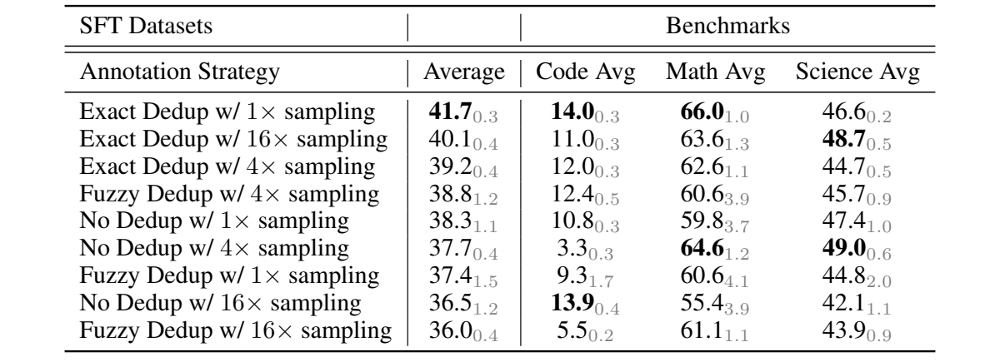

图 1.4｜原 Table 41，物理第 70 页。固定回答数下比较数学题精确/模糊去重及 1/4/16 次采样，列为综合、代码、数学、科学均值及误差。精确去重 1 次的平均 41.7，高于 16 次的 40.1 和 4 次的 39.2。主文第 7 页“4 次最好”的叙述与此表不一致，因此本文保留表值并标记冲突；最终 16 次采样是扩大规模的配方选择，不包装成每个消融上都最优。来源为正式会议版。

另一个版本内差异是教师比较：主文 Table 7 与附录 Table 46 的 DeepSeek 代码成绩分别为 42.3 和 38.0，QwQ 对应值均为 44.2。这里不拼成一个精确的统一教师增益。推理压缩消融也要看长度条件：约 12k 样本中，去掉自我反思后平均回答长度约 11,593 降到 328 token，平均成绩 51.4 降到 26.3；这同时改变内容和长度，无法单独证明某个反思短语具有因果作用。

### 1.5 污染、成本、局限与复现

去污染规则使用 token 最长公共子串/最长序列长度不低于 0.75，或共享 13-gram。人工标注样本中 3,092 个污染例漏 12 个，3,000 个非污染例误报 42 个。本文计算召回率为 99.61%，假阳性率为 1.40%；不把图中容易混淆的 true-negative 标签当成假阳性率定义。规则适合抓文本重叠，无法消除所有语义近似与教师预训练污染。

原文第 44 页报告数据生成约 22,000 H100 GPU-hours，同时把机器写为 16 个 GH200 节点；硬件命名口径存在不一致，本文不替作者统一。最终一次 SFT 约 25,000 A100 GPU-hours、512 GPU；评测约 32 GPU-hours、16 GH200。本文仅做理想并行换算：$`\frac{25{,}000}{512}\approx48.83`$ 小时，$`\frac{32}{16}=2`$ 小时，均不是作者实测墙钟时间。31,600 条规模的单次 API 实验约 300 美元是原文历史估算，不代表全部搜索预算。总搜索 GPU-hours、峰值显存、完整账单未披露。

安全泛化并非自动改善：附录报告 HarmBench 指标从底座 14.5 到 OpenThinker3 的 55.5，提示推理训练可能削弱原有安全行为；不能把数学/代码成绩视作对齐保证。题源授权也并非全部同一种开放许可。可复现优先项是固定题源快照、教师版本、去污染代码、抽样种子、训练配置和答案抽取器，再核对主文/附录冲突。现有公开数据、权重和关键代码支持较大范围复现，但成本、私有路径与部分表值不一致仍然需要说明。

## 2. LongWriter-Zero：用奖励学会写得长、写得好

[官方 oral 条目](https://iclr.cc/virtual/2026/oral/10010192) · [OpenReview](https://openreview.net/forum?id=JWx4DI2N8k) · [正式全文，26 页](https://proceedings.iclr.cc/paper_files/paper/2026/file/ea5cb7d9fd2deb0554def3552962d276-Paper-Conference.pdf) · [arXiv](https://arxiv.org/abs/2506.18841) · [官方模型与推理说明](https://huggingface.co/THU-KEG/LongWriter-Zero-32B) · [项目代码](https://github.com/THUDM/LongWriter) · [RL 数据](https://huggingface.co/datasets/THU-KEG/LongWriter-Zero-RLData) · [引用记录：32](https://api.openalex.org/works/W6891821302)。arXiv 最新 v3 为 2026-04-08，本次使用正式会议版。

### 2.1 从长上下文到长输出：问题定义

能读 32k token 的上下文，不等于能按要求持续写出结构完整的长文章。长写作至少有三个目标：符合字数区间、内容质量好、格式与重复受控。只奖励长度会鼓励灌水，只奖励一个质量模型可能偏向模板化风格。LongWriter-Zero 用这三个维度共同引导 Qwen2.5-32B，从基础模型开始做写作 RL，并在最强版本加入写作领域持续预训练（CPT）。

“Zero”的边界很重要：它指不以合成配对的长文 SFT 作为冷启动，不等于整条管线完全没有人类偏好或合成信息。WritingRM 使用人类偏好，CPT 数据里有 1% 从已有 Base-think 版本蒸馏的思考数据。最终模型是 30B token CPT 后再做 150 步 RL，不能把成绩全部归因于零额外数据的 RL。

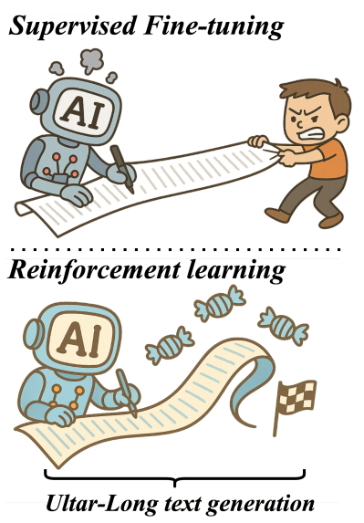

图 2.1｜原 Figure 1，物理第 1 页。作者用教师引导与奖励驱动的漫画说明 SFT/RL 的区别。这是概念示意，不是完整网络或训练数据流架构；正式论文未提供更完整的系统架构图，本文据实保留原图并用文字解释各奖励。来源为正式会议版，无重绘。

### 2.2 三种奖励与 GRPO：逐符号解释

原文从 WildChat 英文、LMSYS 中文对话筛选写作请求，用 QwQ-32B 判断写作类别并抽取合理长度范围。论文未给出可统一核算的最终训练 query 总数。长度奖励对生成词数 l 进行分段，而模型的输出上限用 token；二者不能当成同一单位：

```math
r_{\mathrm{len}}(l)=
\begin{cases}
\dfrac{l}{L_{\mathrm{low}}}, & l\lt L_{\mathrm{low}},\\[6pt]
1, & L_{\mathrm{low}}\le l\le L_{\mathrm{up}},\\[6pt]
\dfrac{L_{\max}-l}{L_{\max}-L_{\mathrm{up}}}, & l>L_{\mathrm{up}}.
\end{cases}
```

$`L_{\mathrm{low}}`$、$`L_{\mathrm{up}}`$ 为目标字词数区间，$`L_{\max}`$ 是过长惩罚使用的上界参数。上式需要 $`L_{\max}>L_{\mathrm{up}}`$；中文分词及零下界等边界实现未充分公开。本文手算：$`L_{\mathrm{low}}=900`$、$`L_{\mathrm{up}}=1100`$、$`L_{\max}=1500`$ 时，600 词得 $`\frac{2}{3}`$，1000 词得 1，1300 词得 $`\frac{1}{2}`$。奖励既惩罚太短也惩罚太长，但不能检验每一段是否有新信息。

质量模型 WritingRM 基于 Qwen2.5-72B，以成对人类偏好学习。典型 Bradley–Terry 目标为：

```math
\mathcal{L}_{\mathrm{RM}}=-\ln\sigma(s_w-s_l),
\qquad \sigma(z)=\frac{1}{1+e^{-z}}.
```

其中 $`s_w`$ 是偏好回答的分数，$`s_l`$ 是较差回答分数。这个式子把分差映射为胜率，再最大化偏好对的似然。手算分差 2 时，胜率 0.8808，loss 0.1269。偏好对总量、完整训练实现和部分优化细节未找到，因此不能独立复制同一 WritingRM。

格式奖励要求一个思考块及一个回答块，并惩罚语义/n-gram 重复；无思考消融使用相应格式约束。重复判断阈值等实现细节未充分公开。三类奖励在组内做尺度处理并得到优势，最后平均：

```math
A_i=\frac{A_{\mathrm{len},i}+A_{\mathrm{write},i}+A_{\mathrm{format},i}}{3}.
```

对任一奖励，标准组内优势可写为：

```math
A_i=\frac{r_i-\mathrm{mean}(r)}{\mathrm{std}(r)+\varepsilon}.
```

$`\varepsilon`$ 用于数值稳定；论文对先归一化到 $`[-1,1]`$、再标准化的确切边界行为没有完整实现可核对。

本文推演：正仿射缩放之后再做 z-score，若没有截断且 $`\varepsilon`$ 可忽略，会抵消缩放；它不等于自动解决所有奖励冲突。四个样本奖励 [1,1,0,0] 的均值 0.5、总体标准差 0.5，优势为 [1,1,-1,-1]。若全组同分，$`\mathrm{std}(r)=0`$，需要明确实现的零方差处理。

GRPO 使用新旧策略概率比率，并优化 clipped surrogate：

```math
\rho_i=\frac{\pi_\theta(y_i\mid x)}{\pi_{\mathrm{old}}(y_i\mid x)},
```

```math
J=\mathbb{E}\!\left[\min\!\left(
\rho_iA_i,\;\mathrm{clip}(\rho_i,1-\varepsilon_{\mathrm{clip}},1+\varepsilon_{\mathrm{clip}})A_i
\right)\right].
```

原文 $`\varepsilon_{\mathrm{clip}}=0.2`$、KL 系数 $`\beta=0`$。$`\pi_{\mathrm{old}}`$ 是采样时的旧策略，$`\pi_\theta`$ 是更新中的策略；截断限制一次更新对已采样回答的概率改变。序列式表达不能替代代码中的 token 归一化细节，本报告不臆造未发布的实现。

### 2.3 数据、训练和推理流程

```text
queries = filter_writing_queries(WildChat_EN, LMSYS_ZH)
queries = attach_target_length_interval_with_QwQ(queries)
policy = optional_continual_pretrain(Qwen2_5_32B, writing_mix)
for step in RL_steps:
    prompts = sample_queries(queries)
    answers = sample_current_policy(prompts)
    reward_parts = [length_reward, WritingRM, format_repeat_reward]
    advantages = group_normalize_then_average(reward_parts)
    update_policy_with_GRPO(answers, advantages, clip=0.2, KL=0)
at_inference: generate_think_and_answer_then_extract_answer()
```

原文 CPT 混合约为中文小说 40%、英文小说 30%、中文非虚构 15%、网页 8%、财经 5%、学术 1%、蒸馏思考 1%，全局 batch 512、打包长度 32,768。RL 使用 8 节点、每节点 8 张 H800，共 $`8\times8=64`$ 张 GPU，32 个 prompt 的 batch，temperature 0.8、top-p 1，输出最多 14,000 token。“32 条并行轨迹”的文字不足以证明每题另有 32 个 rollout，因此本文不写成 1024 个样本。CPT/RL 学习率、完整耗时、峰值显存、GPU-hours 与费用未披露或未找到。

模型 32B；仅 BF16 权重的理论下界约 $`32\times10^9\times2=64\,\mathrm{GB}`$，这是本文存储算术，不是推理显存实测。长输出 KV、激活和分布式通信会增加资源。官方模型卡的 Transformers 示例最大生成 2048 token，是演示参数；SGLang 示例则有 15,500、temperature 0.6、top-p 0.95 和回答结束标记。不能把示例配置当论文评测复现配置。

### 2.4 主实验与消融：把 CPT、思考和 RL 拆开看

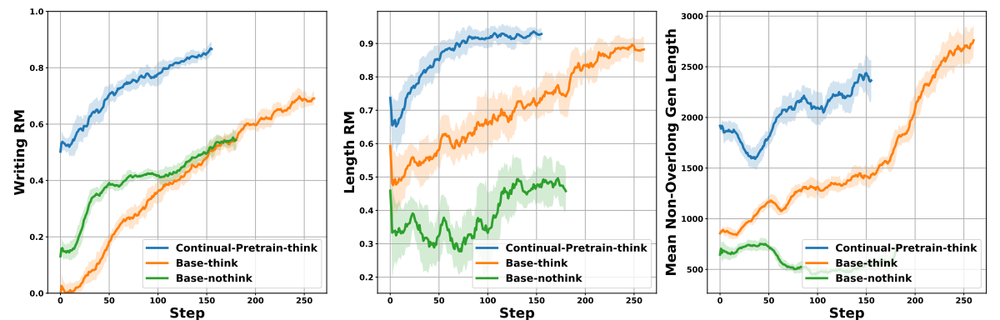

图 2.2｜原 Figure 2，物理第 4 页。三列分别是 WritingRM、长度奖励、未过长样本的平均输出长度；颜色为 CPT+think、Base-think、Base-nothink。横轴 RL 步数。奖励升高与输出变长并非同一个结论，第三列也不是所有生成样本的无条件均值。来源为正式会议版。

WritingBench 含 1,200 条请求、6 大领域和 100 个子领域，使用按请求制定的评分标准和 7B critic；其 50k 人类评分训练数据、83% 一致性属于评测基准自身的校准信息，不保证对本文长生成分布完全无偏。Arena-Write 原始集合 100 个 prompt，其中 40% 要求超过 2000 词，围绕 6 个基线构造 600 对回答，用 Qwen2.5-72B 比较；后续另增 200 个请求并用 GPT-4.1 和人工评判。

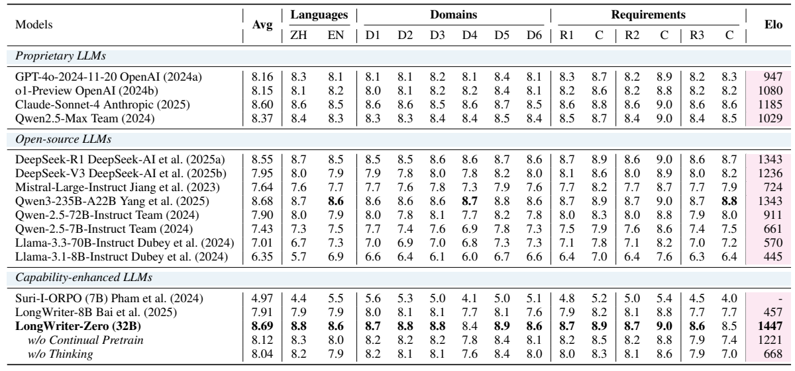

图 2.3｜原 Table 1，物理第 7 页。总体、语言、领域、要求维度和 Elo 同表展示；总体评分与 Elo 不在同一量纲。最下方为移除 CPT、再移除思考的消融。商业模型和不同参数量开源模型不构成同算力对照。来源为正式会议版。

| 条件 | WritingBench 平均 | Arena Elo |
| --- | --- | --- |
| LongWriter-Zero-32B 最终 | 8.69 | 1447 |
| 去 CPT，保留 think | 8.12 | 1221 |
| 再去 think | 8.04 | 668 |
| Qwen3-235B-A22B | 8.68 | 1343 |
| DeepSeek-R1 | 8.55 | 1343 |
| Claude-Sonnet-4 | 8.60 | 1185 |

同底座的补充比较更有解释力：Base+SFT Elo 964，Base+RL 1221；CPT+SFT 971，CPT+RL 1447。最终 RL 1447 与基础 SFT 964 的差距同时包含 CPT，不能全部算作 RL 优势。训练 token 与总计算量也未严格匹配。

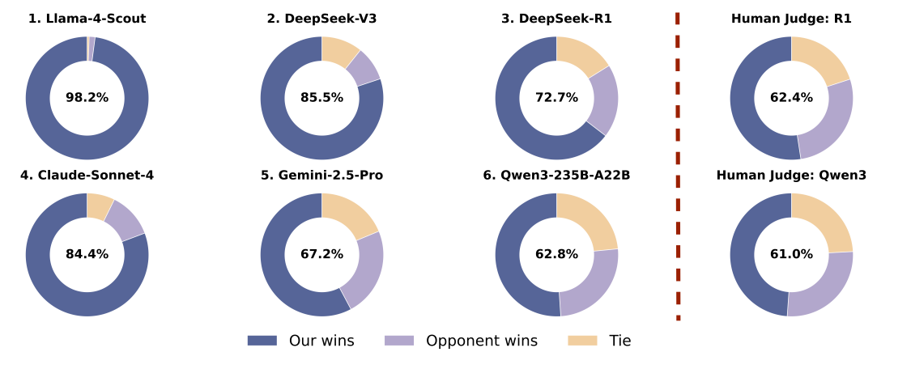

图 2.4｜原 Figure 5，物理第 9 页。补充评测中左侧六个环图是模型裁判，右侧是三名人工评判者参与的对照；颜色区分本方法胜、对手胜、平局。模型裁判对 R1 的中心值 72.7%，人工 62.4%；对 Qwen3 分别 62.8%、61.0%。最高 98.2% 对应 Llama-4-Scout，不是对全部对手的总体胜率。统计说明中平局按半胜处理，阅读中心百分比必须结合此口径。来源为正式会议版。

### 2.5 局限、代码边界与复现建议

开放式写作没有数学题那样的唯一可验证答案，WritingRM 可能学到流畅度、开场模板与偏好关键词。原文附录讨论模板开头、改写式重复和奖励投机；长文本的事实一致性、人物逻辑和安全性仍须单独评测。人工结果提供支持，但样本规模、评委背景和任务分布限制泛化。

固定 GitHub 提交 447539b356a8b09760b51eca876e19b6fc1f2dd7 中已读 README、训练与评测入口；这个仓库同时服务旧 LongWriter。公开 training 目录对应此前长文 SFT，不能冒称 LongWriter-Zero 的 RL 训练实现。Zero 权重、数据入口和模型卡推理代码可用，但本次未找到完整 Zero GRPO 管线与 WritingRM 训练/权重。复现时应分别标注“能运行权重”和“能重训方法”；前者不自动推出后者。作者项目/模型卡为辅助材料，不另计论文。

## 3. ThinKV：按照思考类型压缩推理缓存

[官方 oral 条目](https://iclr.cc/virtual/2026/oral/10009981) · [OpenReview](https://openreview.net/forum?id=M3CeHnZKNC) · [正式全文，35 页](https://proceedings.iclr.cc/paper_files/paper/2026/file/b2b502c3629beadda06311386d2c6f73-Paper-Conference.pdf) · [arXiv](https://arxiv.org/abs/2510.01290) · [作者实验室论文页](https://gt-synergy-lab.github.io/pages/publication.html?topic=llm) · [引用记录：25](https://api.openalex.org/works/W4414815213)。arXiv 最新 v2 为 2026-05-07。本次未找到可用官方实现链接；实验室条目的 Code 文本没有实际超链接，不能把它记作“代码已发布”。

### 3.1 KV cache 是什么，为什么量化还不够

自回归 Transformer 每生成一个 token，都要查询此前 token 的 Key 和 Value。KV cache 保存这些向量，避免重复计算；长推理会不断增加缓存。量化把每个数从 16 bit 压到 4/2 bit，驱逐则减少保留 token 数。两者压缩的是中间状态，不是模型权重，也不需要重新训练模型。

本文写出简化内存式：

```math
M_{\mathrm{KV}}\approx\frac{2LBH_{\mathrm{kv}}dTb}{8}\quad\text{bytes}.
```

其中 2 表示 K/V；$`L`$ 为层数；$`B`$ 为并发序列数；$`H_{\mathrm{kv}}`$ 为 KV head 数；$`d`$ 为每 head 维数；$`T`$ 为缓存长度；$`b`$ 为平均 bit 数。GQA 下应使用 $`H_{\mathrm{kv}}`$，不能误用 query head 数。实际还需要 scale、索引、未量化缓冲和内存对齐。若量化令模型反复思考、$`T`$ 膨胀，名义 bit 降幅可能被抵消；原文观察到某些纯量化配置生成长度增加至约 5.1 倍。

ThinKV 的直觉是：算出关键结论、执行具体操作、从一条思路转向另一条思路，对未来 token 的用途可能不同。它用注意力稀疏度把片段分为 Reasoning（R）、Execution（E）、Transition（T），分别控制精度与保留量。但这三个名字是统计启发式类别，不是已证明的语义真值；极少见的转折 token 也可能非常关键。

### 3.2 从注意力统计到 TBQ、TBE 和连续存储

原文离线用 s1K 中 100 个随机 prompt 校准注意力分布。近零注意力阈值按行最大注意力的 1% 定义；用核密度估计找到三峰及谷点，选择具有可区分分布的 4 层。解码时每 128 步刷新一次类别，以固定片段近似“一个思考”。论文将 T 关联最高稀疏度、R 居中、E 较低；反事实扰动实验的平均重要性支持 $`R>E>T`$，但均值不排除异常关键的 T。

TBQ（按思考类别量化）默认 R/E 用 4 bit、T 用 2 bit。4 bit 采用 NVFP4 E2M1，2 bit 用 {-1,0,1} 三值；分组 scale 使用 FP8，组大小 16；K 按通道、V 按 token 量化，并保留 16 个全精度 token 的缓冲。R 的 8 bit 是另一个可选配置，不能和默认结果混用。重要片段给较高精度，降低量化扰动。

TBE（按思考类别驱逐）在转折后逐步削减较旧片段，保留量可按 128、64、32、16、8、4 递减，而不是一次把整段清空；触及总预算后进一步处理较旧、低优先级内容。选择代表 token 时使用 post-RoPE key 的聚类信息。公开说明不足以完全确定每一步是使用质心还是对应真实 token、Value 如何绑定，属于实现复现缺口，不能自行补成作者算法。

CT 连续存储复用同类别 KV block 的空洞，减少 gather 和搬移开销；默认 block size 8。它跟踪物理块、填充数、类型、起始位置、片段 mask 与 eviction mask。逻辑“连续”不等于时间顺序丢失：位置编码在写入前已处理，mask 和索引也必须同步。

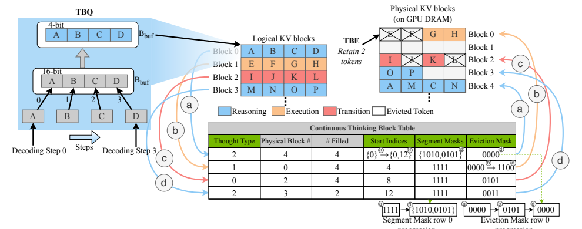

图 3.1｜原 Figure 6，物理第 5 页。为了示意，原图使用 $`\tau=g=\text{block size}=4`$、保留集合 $`\mathcal{R}=\{2\}`$，不是正文默认的 128 步/16 量化组/8 block 配置。左侧 TBQ、中间逻辑块与 TBE、右侧物理空位复用，下方是 CT 元数据。沿箭头读同一 token 从生成到写入/驱逐的路径，不能把示意参数代入性能表。来源为正式会议版。

本文推演其重排不改变注意力的必要条件：设 $`P`$ 为排列矩阵，$`Q`$ 为当前 query，$`K/V`$ 为已经处理位置信息的缓存，则：

```math
\begin{aligned}
\mathrm{softmax}\!\left(Q(PK)^\top\right)(PV)
&=\mathrm{softmax}(QK^\top)P^\top PV\\
&=\mathrm{softmax}(QK^\top)V.
\end{aligned}
```

因为 softmax 对同一行的列排列等变，且 $`P^\top P=I`$；若 mask、$`K`$、$`V`$ 没有一起排列，或位置编码重新错误计算，等式不成立。这个推导解释存储重排，不证明量化和驱逐无损。

本文手算一组 payload：原来 128 个元素各 16 bit，共 2048 bit；压缩后保留 32 个 R、32 个 E、32 个 T，使用 4/4/2 bit，共 320 bit，即 15.625%。若额外为 96 个元素每 16 个存一个 8 bit scale，还要 48 bit，总 368 bit，即约 17.97%。这只是单分量示例，不含 K/V 全部倍率、缓冲与块元数据，不能宣传为实际端到端显存降低 82%。

### 3.3 流程、预算与实现可用性

```text
offline: calibrate_attention_modes(100_prompts_from_s1K)
         select_layers_and_two_sparsity_thresholds()
online:  keep_prefill_tokens_as_reasoning_type()
for generated_token in sequence:
    append_full_precision_KV_to_small_buffer()
    every_128_steps: classify_recent_segment_by_sparsity()
    quantize_buffer_using_type_specific_precision()
    on_transition_or_budget_pressure:
        reduce_old_segment_representatives_progressively()
    reuse_compatible_physical_block_holes()
    attend_with_consistent_position_indices_and_masks()
```

这是依据论文整理的伪代码；正式 PDF 第 22–23 页 Listing 1 也提供伪代码，已阅读。ThinKV 不更新模型参数，没有训练 loss 或奖励；离线校准有计算成本，但总校准时间、GPU-hours 与费用未披露。仅有伪代码不能替代量化内核、CT 元数据实现和引擎集成的可运行代码。

实验使用一张 A100-80GB 或一张 GH200，覆盖 R1-Llama-8B/70B、GPT-OSS-20B、AceReason-14B、QwQ-32B 等。准确率一般 8 次采样，最大输出 32k；耗时/吞吐重复 3 次。AIME 设置是从 AIME2024 与 AIME2025 各取 15 题组成 30 题，而不是完整某一年的 AIME。prefill token 保留且按 R 处理，不应把生成阶段压缩率直接套到输入极长的场景。

### 3.4 准确率、吞吐、延迟与消融

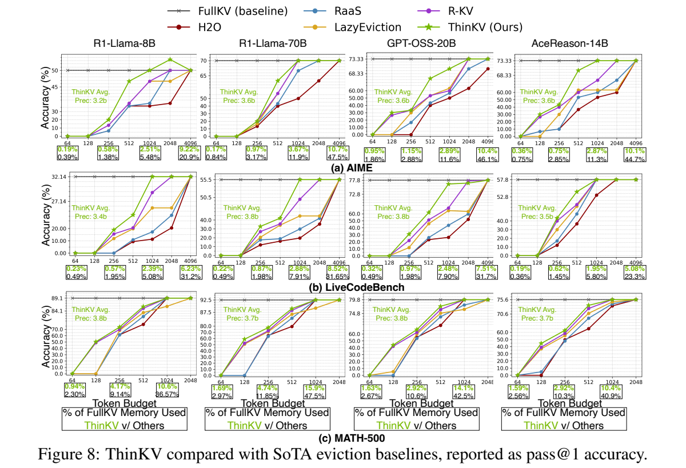

图 3.2｜原 Figure 8，物理第 7 页。三行是 AIME、LiveCodeBench、MATH-500，四列是不同模型；横轴保留 token 预算，纵轴准确率，下方注记实际 FullKV 内存比例。ThinKV 同时改变保留量和平均 bit 数，不能仅按同一个 1024 token 就宣称完全等内存比较。FullKV、R-KV、H2O、RaaS、LazyEviction 为原图基线。来源为正式会议版。

不是每个条件都损失小于 1 个百分点。原 Table 1 的 QwQ-32B 在 FullKV 下 AIME 73.33、LCB 55.45，ThinKV-1024 为 70.28、50.47，分别下降 3.05、4.98 个百分点。950M 小模型的 GSM8K 从 67.5 到 60.1 也显示模型能力会影响压缩耐受性。压缩成功的案例不能抹去这些尾部代价。

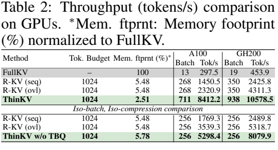

图 3.3｜原 Table 2，物理第 8 页，R1-Llama-8B 持续生成 32k。上半部分每个系统选择能承载的 batch，ThinKV 的优势同时来自更大 batch 和执行效率；下半部分固定 batch 256，并将 ThinKV 的 TBQ 关闭以接近内存条件。R-KV seq 与 ovl 分别是顺序和重叠实现，不能挑不同基线却沿用同一个加速倍数。来源为正式会议版。

| A100 上的条件 | batch | token/s | 相对 FullKV 内存 |
| --- | --- | --- | --- |
| FullKV | 13 | 297.5 | 100% |
| R-KV seq | 268 | 1450.5 | 5.48% |
| R-KV ovl | 268 | 2320.9 | 5.48% |
| ThinKV | 711 | 8412.2 | 2.51% |
| R-KV seq，固定 batch | 256 | 1769.3 | 5.48% |
| R-KV ovl，固定 batch | 256 | 3539.3 | 5.48% |
| ThinKV 无 TBQ，固定 batch | 256 | 5298.4 | 5.78% |

本文计算 $`\frac{8412.2}{1450.5}\approx5.80`$ 倍，对 ovl 则为 3.62 倍。这是高并发吞吐，不是单请求快 5.8 倍。固定 batch 下约为 2.99 倍和 1.50 倍，且 5.78% 与 5.48% 内存并不完全相等。附录实际 vLLM 集成的 A100 batch=256 为 ThinKV 6622.4、R-KV 4883.3 token/s，约 1.36 倍；应与相应引擎条件一起报告。

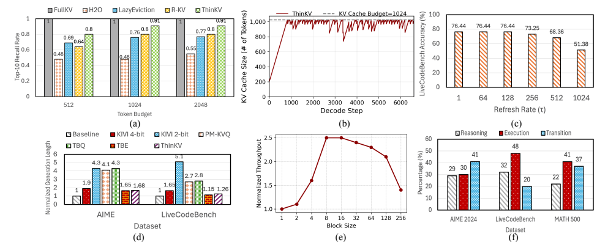

图 3.4｜原 Figure 10，物理第 9 页。六个面板分别观察 top-attention token 召回、缓存随步数变化、刷新间隔影响、不同压缩方法的生成长度、block size 吞吐，以及三类思考比例。模型/任务按面板而变：例如刷新间隔是 GPT-OSS-20B 的 LCB，长度变化为 R1-Llama-8B。不要把各面板组合成一个共同控制实验。来源为正式会议版。

原 Table 4 在 GPT-OSS-20B、LCB、batch 8 下，FullKV 准确率 77.8；仅 TBQ 77.8、吞吐 1.10 倍、延迟 0.98 倍；TBE-1024 为 76.9、1.48 倍、0.38 倍；ThinKV-1024 为 76.4、1.51 倍、0.42 倍。0.42 倍延迟意味着降低 58%，不是“降低 0.42 倍”这个含糊口径。不同负载有不同结果：附录单请求 TPR 259.6 到 243.6，本文算约降低 6.16%，不能与并发 $`B=8`$ 或 $`B=256`$ 的收益混为一谈。

### 3.5 限制与复现要点

三模态注意力分布是否适用于所有模型、长输入与非推理任务尚无普适证明；128-token 边界不是实际语义边界，少数重要转折可能被误分。聚类、量化 scale、缓冲、mask 与驱逐时序均可能影响精度或速度。峰值总显存、端到端成本和全部硬件细节并未完整给出，表中 KV 比例不能等同整模型显存比例。

目前能验证的是正式论文中的算法、图表和伪代码，不能声称公开内核已复现吞吐。若重实现，应先检验无量化无驱逐时的 KV 重排等价性，再逐项加入 TBQ、TBE、CT，并报告相同输入/输出长度、并发、精度和引擎版本下的准确率、吞吐与每请求延迟。本报告未实施这些实验。

## 4. AceReason-Nemotron 1.1：让 SFT 与分阶段 RL 配合

[官方 poster 条目](https://iclr.cc/virtual/2026/poster/10010287) · [OpenReview](https://openreview.net/forum?id=IaEqjWXd1d) · [正式全文，19 页](https://proceedings.iclr.cc/paper_files/paper/2026/file/72398f80dc0f81159f79e6ff8fd1e376-Paper-Conference.pdf) · [arXiv](https://arxiv.org/abs/2506.13284) · [官方模型](https://huggingface.co/nvidia/AceReason-Nemotron-1.1-7B) · [SFT 数据](https://huggingface.co/datasets/nvidia/AceReason-1.1-SFT) · [作者评测工具说明](https://huggingface.co/nvidia/AceReason-Nemotron-14B/blob/main/README_EVALUATION.md) · [引用记录：74](https://api.openalex.org/works/W4415108556)。arXiv 为 2025-06-16 的 v1，本次读正式会议版。其评测包放在 14B 模型库，但说明和脚本明确支持 1.1-7B，不能因仓库名而误判模型身份。

### 4.1 问题与小白直觉

SFT 让学生见过较多正确解法，RL 则用它自己生成的回答与可验证反馈继续训练。两者既可能互补，也可能冲突：SFT 太弱时 RL 不容易采到成功路径；过度确定时又可能缺少探索。AceReason 的问题是怎样扩大 SFT 数据、选择训练轮数，并安排数学/代码 RL、长度预算和采样温度，使 7B 模型持续提升。

这里的底座是 Qwen2.5-Math-7B，不是后文 SFT 程度论文的 DeepSeek-R1-Distill-Qwen。原文将 RoPE $`\theta`$ 从 10,000 调到 1,000,000 以支持长上下文；改变位置参数和声称 128k 支持，不等于已经验证任意 128k 推理任务准确。方法主要是经验配方与相互作用分析，没有提出统一保证最优的 SFT 停止定理。

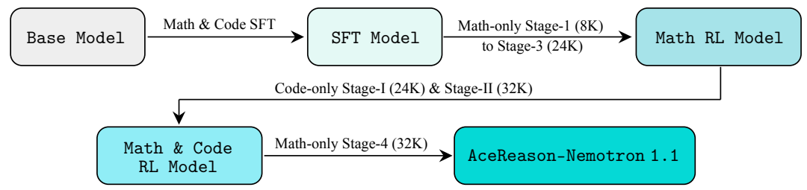

图 4.1｜原 Figure 1，物理第 3 页。先数学+代码 SFT，后数学 RL 的 8k/16k/24k 阶段，再代码 24k/32k，最后回到数学 32k。箭头是模型继续训练顺序，不能把所有模块当互相独立、预算相等的实验。来源为正式会议版。

### 4.2 数据与训练目标

数学题源包括 AceMath、Numina、OpenMathReasoning，代码来自 TACO、APPS、OpenCoder Stage 2、OpenCodeReasoning。作者进行题目去重及与评测题的 9-gram 去污染，利用 DeepSeek-R1 产生推理解答，并调整较容易、短于 2k token 的回答比例。最终约 383k 个题目，其中数学 247k、代码 136k；七组数据配方从约 36k 回答扩大到约 2.2M（数学 1.202M、代码 1.039M）。题目数与回答数必须区分。

当前官方 SFT 数据卡列数学 2,668,741、代码 1,301,591 条，约 397 万，和论文训练配方约 224 万不同。它是发布快照差异，不应把今天的整个数据集直接称为论文 v7 的完全相同训练集。确切筛选列表、版本、随机种子仍须固定。

SFT 使用标准 token 交叉熵。原文中 1–5 epochs 整体仍有收益，到 5–6 轮趋于平台；因此某些看似过拟合的 SFT 模型仍可成为好的 RL 起点。作者以 teacher forcing 与自由生成的分布差异解释此现象，这是经验支持的假说，不能推广为无限增加轮数必然有益。

RL 使用 GRPO，128 个 prompt，每题 8 或 16 个新 rollout，每轮采样后一次更新，尽量保持 on-policy；采用 token 级策略梯度，不加 KL 正则。数学根据答案验证、代码根据测试结果给可验证奖励。把组内奖励记 $`r_i`$、均值 $`\mu`$、标准差 $`\sigma`$，优势为：

```math
A_i=\frac{r_i-\mu}{\sigma+\varepsilon}.
```

正优势提高该回答 token 的概率，负优势降低；完整裁剪/学习率等参数未全部披露，因此下面只是机制表达：

```math
\mathcal{L}_{\mathrm{PG}}\propto-\sum_i\sum_t A_i\rho_{i,t},
\qquad
\rho_{i,t}=\frac{\pi_\theta(y_{i,t}\mid\mathrm{prefix})}
{\pi_{\mathrm{old}}(y_{i,t}\mid\mathrm{prefix})}.
```

$`\theta`$ 为更新参数，$`\pi_{\mathrm{old}}`$ 为采样策略，$`t`$ 遍历有效回答 token。实际优化还需按论文/实现规定裁剪和归一化，不能用上式冒充完整可运行 loss。本文手算：奖励 [1,1,0,0] 得优势 [1,1,-1,-1]；若共同 token 分母下两个正优势回答长度是 4 和 8，未经按序列等权归一化的贡献分别包含 4 和 8 项，因此长回答权重更高。这个例子解释 token 级目标的长度效应，不证明长链必然更好。

### 4.3 课程、熵与过长回答处理

```text
student = SFT(Qwen2_5_Math_7B, diversified_R1_responses)
for stage in [math8k, math16k, math24k, code24k, code32k, math32k]:
    choose_current_stage_questions()
    if stage_requires: remove_prompts_solved_in_all_8_or_16_samples()
    sample_fresh_rollouts(temperature=0.85)
    verify_math_answers_or_code_tests()
    if early_short_budget: mask_truncated_sample_loss()
    else: apply_stage_specific_overlong_policy()
    normalize_group_rewards_and_update_once()
```

数学第三阶段加强约 2,500 道困难题；代码第二阶段及数学末阶段按 epoch 过滤全组都答对的容易题。困难采样和长度预算都在变化，因此各阶段提升不等于单独长度增长的因果效应。

温度 $`\tau`$ 改变分布，熵 $`H`$ 衡量其分散程度：

```math
p_i=\frac{\exp(z_i/\tau)}{\sum_j\exp(z_j/\tau)},
\qquad H=-\sum_i p_i\ln p_i.
```

$`z_i`$ 是 token logit，$`\tau`$ 越低通常越尖锐。本文二分类手算：logits 为 $`\ln9`$ 和 0，$`\tau=1`$ 时 $`p=(0.9,0.1)`$、$`H=0.325`$；$`\tau=0.5`$ 时 $`p=\left(\frac{81}{82},\frac{1}{82}\right)`$、$`H\approx0.0659`$。词表与提示变化会改变熵的绝对尺度，不能把二分类数字直接与论文的约 0.3 阈值等同。

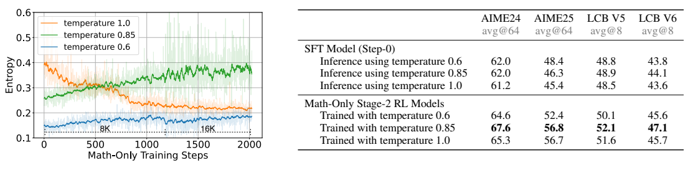

图 4.2｜原 Figure 5，物理第 8 页。左图是不同训练采样温度下的熵轨迹，右表上半为 SFT 模型在不同推理温度下的成绩，下半为不同训练温度完成数学 Stage 2 后的成绩。训练温度 0.85 与测试温度 0.6 是两个不同选择。来源为正式会议版，所有曲线均为作者实验。

数学 Stage 2 后，训练温度 0.6、0.85、1.0 的 AIME24 分别为 64.6、67.6、65.3，AIME25 为 52.4、56.8、56.7。对未经 RL 的同一 SFT 起点，推理温度从 0.6 到 0.85 到 1.0，AIME25 反而是 48.4、46.3、45.4。作者认为训练中温度调节后熵维持约 0.3 较合适，这只是这些配置上的经验区间。

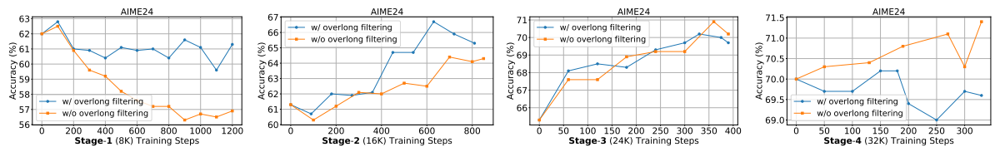

图 4.3｜原 Figure 6，物理第 9 页。四个面板分别是不同数学长度阶段，比较对超长截断样本过滤 loss 与不过滤。早期 8k 阶段约 30% 截断，过滤有利；24k 效果较弱，32k 阶段惩罚超长可能更好。各阶段从前一阶段选择的起点继续，并非四次独立完整训练。来源为正式会议版。

短预算阶段会把尚未写完、未必错误的推理截断，直接给负奖励可能误导学习；到长预算阶段还不结束，则惩罚可能抑制无效拖延。Stage 1 的 AIME25 可从 48.4 暂时降到 44.6，经过 Stage 2 后升至约 56.7；跳过 Stage 1 的后续成绩 51.8。局部退步不必然代表整条课程无用，但把 Stage 1 拉到 2,300 步后后续又降到 54.8，说明训练时长也有边界。

### 4.4 核心成绩与公平比较

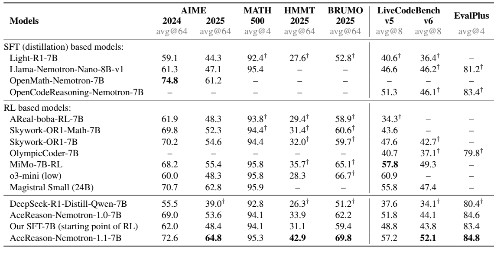

图 4.4｜原 Table 1，物理第 6 页。读最后几行的同底座 SFT 起点与最终 1.1 模型，能减少跨底座混淆；上部基线来自不同数据、预算，部分带符号的结果由作者重评。avg@n 是重复采样的平均单次正确率，不是从 n 个答案中挑一个正确答案的 pass@n。来源为正式会议版。

| 指标（%） | 本文 SFT 起点 | AceReason 1.0-7B | AceReason 1.1-7B |
| --- | --- | --- | --- |
| AIME24 avg@64 | 62.0 | 69.0 | 72.6 |
| AIME25 avg@64 | 48.4 | 53.6 | 64.8 |
| MATH500 avg@4 | 94.1 | 94.1 | 95.3 |
| HMMT2025 avg@64 | 31.1 | 33.9 | 42.9 |
| BRUMO2025 avg@64 | 59.4 | 62.2 | 69.8 |
| LCB v5 avg@8 | 48.8 | 51.8 | 57.2 |
| LCB v6 avg@8 | 43.8 | 44.1 | 52.1 |
| EvalPlus avg@4 | 83.4 | 84.6 | 84.8 |

测试 temperature 0.6、top-p 0.95、最大 32,768 token。LCB v5 对应 2024-08 至 2025-02-01，v6 对应 2025-02-01 至 2025-05-01 的切片。结论第 10 页还出现 AIME25 63.2、LCB v5 52.8 的旧数字，与主 Table 1 及官方模型卡不一致；本文采用两者一致的 64.8、57.2，并明确保留该版本内冲突。

附录 pass@K 用数学 256、代码 128 个生成回答再随机选 K，多次重复估计。数学 AIME25 的提升从 $`K=8`$ 时 8.3 个百分点缩到 $`K=128`$ 时 1.2，代码在 $`K=128`$ 仍约 5 个百分点。它说明不同任务的可采样正确解覆盖变化，不能仅据此证明模型学出了全新推理策略。附录对七种 SFT 配方做标准化 log2 数量回归，题目量系数 4.831、每题回答量 2.635、$`R^2=0.989`$；只有七点且因素相关，标准化系数也不是“题目翻倍必然加 4.831 分”的因果规律。

### 4.5 成本、公开代码与复现缺口

原文附录第 18–19 页给 SFT 约 11,000 H100 GPU-hours，RL 23,944 H100 GPU-hours，本文相加为 34,944。数学四段分别 2,773、3,312、5,084、9,458，代码两段 1,875、1,442，相加恰为 23,944。训练 GPU 数、墙钟时间、峰值显存和美元费用未披露，不能用评测的 8 张 GPU 反推训练耗时。

官方评测工具环境写 vLLM 0.7.3、PyTorch 2.5.1、Transformers 4.48.2、CUDA 12.8、8×H100-80GB。已下载并静态阅读固定 Hugging Face 提交 b244ed5578b03df25c49c7d1e7bc30fbcf8a63b5 的 evaluation.tar.gz，包括 inference.py、AIME/LCB 生成与聚合脚本。1.1 模型用 qwen 模板，1.0 用 r1；错用模板会改变生成条件。代码抽取 Python fenced block，并用测试验证，不只是判断最终一句话。

静态发现三个需先修正的复现问题：generate_aime.sh 把 DIR 设成字面量 pwd，而不是当前目录；run_aime.sh 传 --dataset，但 Python 接口是 --test_data；AIME24/25 共用输出目录和种子文件名，后一次生成可能覆盖前一次。LCB 下载说明、生成器和评估器的文件名后缀也不完全一致。它们是公开脚本中的路径/参数差异，本报告没有执行脚本证明运行时结果。应显式区分两个年份的输出目录并检查生成文件数，再核对 avg@64/avg@8；这也解释为什么“发布了评测代码”仍不能等于一键复现。

权重、SFT 数据和评测实现公开；本次未找到完整 1.1 SFT/RL 训练实现。数据快照变化、硬件时间缺失、训练超参不全限制了从头重训。官方缓存说明的部分 LCB 小数与论文主表略有差异，应分别记录来源而非把缓存数当本报告的新实测。本期没有单独找到作者技术博客；模型卡、评测说明已作为官方辅助入口提供。

## 5. How Much SFT Is Enough：在确定性增长超过准确率收益时转向 RL？

[正式主会条目](https://aclanthology.org/2026.emnlp-main.128/) · [正式全文，12 页](https://aclanthology.org/2026.emnlp-main.128.pdf) · [官方程序](https://2026.emnlp.org/program/) · [作者代码](https://github.com/Shirley-Kokane/sft2rl) · [引用记录：0](https://api.openalex.org/works/W7224340769)。DOI 按官方条目为 10.18653/2026.emnlp-main.128，没有额外的 /v1。论文集页码 2960–2971，完整主会长文；poster 由官方程序链接日程的 340-MAIN 行核验。官方只给 2026 年 10 月出版，未找到可核验 arXiv 或精确首发日；不将学术索引的 1 月 1 日当成真实首发。

### 5.1 问题定义与“刚性”的直觉

这篇论文问：SFT 做得更久、当时准确率更高，是否一定能得到更强的后续 RL 模型？作者使用 DeepSeek-R1-Distill-Qwen-1.5B 和 7B（简称 DQ-1.5B/7B），它们已经经历推理蒸馏，因此这里研究的是在已有推理模型上继续 SFT，不能直接推广为从原始预训练底座开始的普遍最优轮数。

直觉是学生既要掌握已有知识，又要保留探索替代解法的概率。如果同一前缀下几乎只认一个下文，RL 采样容易得到相似答案；但过早停止 SFT 又可能基础准确率不足。作者用 Rigidity Index 衡量局部 token 分布的尖锐程度，再比较它和准确率随训练的增长。它测的是概率集中，不直接测量抽象推理能力、知识覆盖或思想开放程度。

### 5.2 公式、推导与手算

对每个位置 $`t`$，取 logits 最高的 $`k`$ 个 token，并在这个子集上重新归一化：

```math
p_j=\frac{\exp(z_j)}{\sum_{h\in\mathrm{TopK}}\exp(z_h)}.
```

定义 top-k 熵与刚性：

```math
H_t=-\sum_j p_j\ln p_j,
\qquad R_t=1-\frac{H_t}{\ln k}.
```

最后跨有效位置/样本聚合成 $`R`$。$`z_j`$ 为候选 logit，$`k`$ 为保留候选数，$`H_t`$ 为 top-k 熵；$`\ln k`$ 是 $`k`$ 项均匀分布的最大熵。因此在 $`k>1`$ 且归一化正确时，均匀分布 $`R=0`$，单点集中趋于 $`R=1`$。

本文手算 $`k=2`$：$`p=(0.5,0.5)`$ 时 $`H=\ln2`$，$`R=0`$；$`p=(0.9,0.1)`$ 时 $`H=0.3251`$，$`R=1-\frac{0.3251}{0.6931}\approx0.5310`$。注意被丢弃的词表概率质量不参与计算：两个模型可以拥有相同的 top-2 相对比例，却有完全不同的尾部质量。因此 $`R`$ 不是完整词表熵，也不能跨 $`k`$、温度、prompt 集任意比较。

论文将准确率 $`A_e`$ 和刚性 $`R_e`$ 进行 min-max 归一化后，比较相邻 checkpoint 的增量：

```math
\begin{aligned}
g_A(e)&=A_{\mathrm{norm}}(e)-A_{\mathrm{norm}}(e-1),\\
g_R(e)&=R_{\mathrm{norm}}(e)-R_{\mathrm{norm}}(e-1).
\end{aligned}
```

用刚性增长开始超过准确率增长的交点作为转入 RL 的经验信号。这里 $`e`$ 是数据遍历轮数/检查点序号。这个“拐点”不是微积分里二阶导数变号的严格拐点；如果 min/max 来自完整训练曲线，在线早停还需要未来信息或独立校准。

本文例子：若归一化准确率从 0.70 到 0.76，刚性从 0.60 到 0.72，则两者增量 0.06、0.12，符合刚性增长更快。但改变归一化取值范围就会改变两者比例，必须固定评测集和范围，不能看到最终最好成绩后再挑有利的交点。

原文还定义数据利用/耗尽相关量：

```math
\Gamma=1-\frac{\mathbb{E}[H(\pi_\theta)]}{H_D}.
```

其中 $`\pi_\theta`$ 是模型策略，$`H_D`$ 是数据分布熵，期望对相应输入/生成分布求平均。本文代数检查：若 $`H_D=0`$，式子无定义；若模型熵大于 $`H_D`$，$`\Gamma`$ 可以为负；若模型熵恰好等于 $`H_D`$，则 $`\Gamma=0`$。故它不是无需假设就始终位于 $`[0,1]`$ 的普适“知识学完百分比”，不同分布熵的可比性也要单独论证。

SFT 的 loss 是目标回答 token 负对数似然；以 softmax logits $`z`$ 的交叉熵为例，本文推导：

```math
\frac{\partial\mathcal{L}}{\partial z_j}=p_j-\mathbf{1}[j=y].
```

正确目标的 logit 被推高，其他项被压低，这解释了反复拟合可能使分布更尖。RL 使用组内相对奖励的 GRPO，回答正确性产生反馈；同组都答对或都答错时，标准化优势通常没有有效区分信号。论文声称不加 KL/熵正则，但公开脚本存在不同配置，见下文。

### 5.3 数据设计、训练流程与资源

原文数学侧使用约 7k 训练与 2k 留出样本，来源涉及 DeepMath、OlympiadBench、MATH500；科学侧约 4k 训练与 1k 留出，涉及 OpenScience 与 GPQA Diamond。作者声明 SFT、RL 和测试不重叠，但各源到各阶段的完整划分与全部提示数量未清楚披露；不能仅凭总数推算某个测试集已被用于训练。

作者考察学习率、weight decay 与优势估计策略等组合，在准确率/刚性上选 Pareto 配置，再从多个 SFT checkpoint 运行 RL，比较后续学习曲线与最佳达到的成绩。因此结论来自一组经选择的配置，不是所有超参都表现相同。比较固定 epoch 也不等于匹配实际生成 token 或总计算成本。

```text
split_data_into_nonoverlapping_SFT_RL_validation_sets()
for sft_checkpoint in saved_training_progress:
    A = evaluate_accuracy_on_fixed_validation_prompts()
    R = measure_top_k_entropy_on_valid_unpadded_tokens()
normalize_A_and_R_with_declared_calibration_range()
candidate = first_checkpoint_where_delta_R_exceeds_delta_A()
for checkpoint in candidate_and_neighboring_controls:
    run_same_budget_GRPO_with_multiple_seeds()
    compare_post_RL_accuracy_and_diversity()
```

这是本文整理的实验逻辑；代码核验发现若要实际执行，必须先解决配置和度量差异。固定作者仓库提交 7276e4de09859d95893087805dcd5e38312e5067。SFT 启动脚本为 4 进程、全局 batch 32、最大长度 12048、5 epochs、每 50 step 保存、每 5 step 测试；通用 YAML 则默认学习率 1e-5、AdamW betas 0.9/0.95、weight decay 0.01、10% warmup、cosine，实际运行应结合命令行覆盖项，而不是只读 YAML。

GRPO 脚本为 1 节点 8 GPU、vLLM tensor parallel 2、16 个 prompt、每题 5 个 rollout、最大 prompt 2500、最大回答 10000、学习率 1e-6、minibatch 4、microbatch 1、总 epoch 1、每 100 step 保存。gpu_memory_utilization=0.7 是预留/配置比例，不是实测峰值显存。论文和所查材料没有足以核算的 GPU 型号、墙钟、GPU-hours 或美元成本，4/8 GPU 是脚本请求数，不能冒称作者实测硬件配置。

### 5.4 核心原图与结果解释

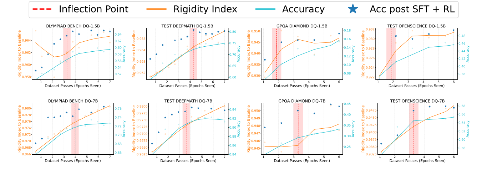

图 5.1｜原 Figure 1，物理第 5 页。两行模型、四列任务，横轴 SFT 数据遍历轮数；橙色刚性、蓝色准确率使用不同纵轴，虚线/阴影标示经验交点，星号为相应起点在 RL 后的成绩。不能从星号推断一个共同的随机种子或同一条训练轨迹。正式论文没有独立模型架构/系统流程图，本文不造图替代，使用其原始诊断图解释方法。来源为 EMNLP 正式版。

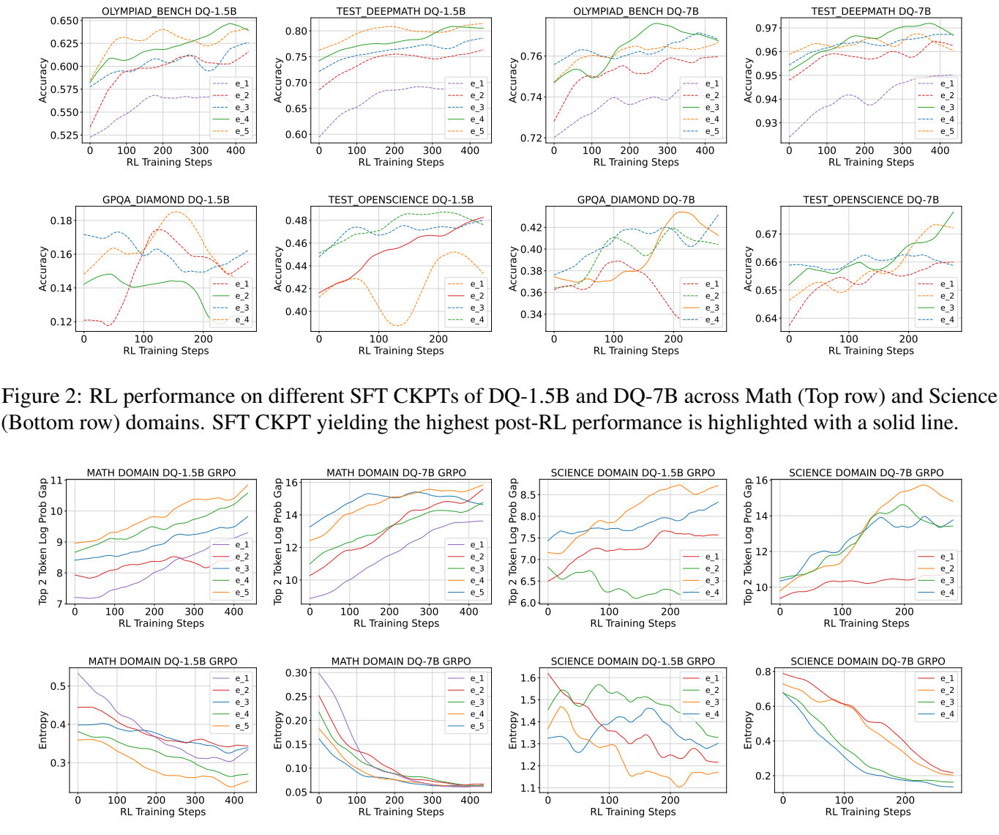

图 5.2｜原 Figures 2–3，物理第 6 页。上部不同 SFT checkpoint 的 RL 准确率曲线，下部 top-2 log 概率间隔与熵的变化。数学横轴到约 400 RL step，科学约 200；曲线颜色表示不同起点。较大概率间隔与较低熵和探索受限相容，但相关曲线不能独立证明所有准确率差异都由熵导致。保留原 Figure 2 图注，未改动实验图。来源为正式版。

| DQ-1.5B 数学，两个 RL 随机种子 | RL 后准确率均值±标准差 | RL 后熵均值±标准差 |
| --- | --- | --- |
| SFT E3 起点 | 0.714±0.011 | 0.350±0.006 |
| SFT E4 起点 | 0.758±0.010 | 0.330±0.004 |
| SFT E5 起点 | 0.800±0.002 | 0.267±0.000 |
| SFT E6 起点 | 0.795±0.011 | 0.238±0.004 |

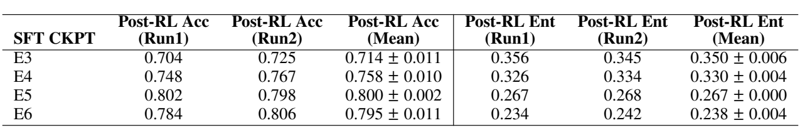

图 5.3｜原 Table 2，物理第 11 页。给出 E3–E6 的两次独立运行及均值/标准差，仅针对 DQ-1.5B 数学；0.000 为原表舍入结果，不表示真方差严格为零。正文附近的“±0.01”叙述与 E5 表值不一致，本文采用可直接核对的表格。来源为正式版。

E5 相对 E6 的均值优势只有 0.005，即 0.5 个百分点，小于 E6 报告的 1.1 个百分点标准差。两种子的小实验支持存在较好转折区间，不足以证明所有模型/任务都精确停在 E5。原 Table 1 的 KL 表展示策略变化而非准确率，例如 DQ-7B OpenScience 的 E5 从 1.88 到 2.38、DQ-1.5B DeepMath 从 0.173 到 0.209；百分比变化不是相同幅度的答题提升。

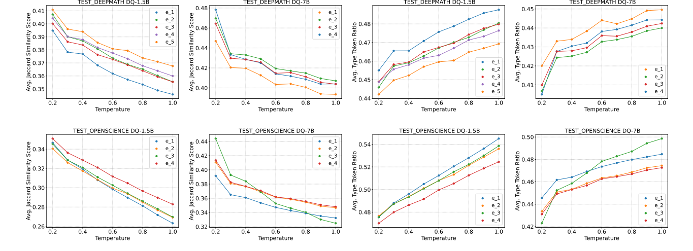

图 5.4｜原 Figure 4，物理第 8 页。在多个采样温度下比较不同起点完成 RL 后的回答相似度与 TTR，分别覆盖数学、科学及两种规模。横轴是采样温度，不是训练 step。较高温度往往降低相似度、提高词汇多样性，但不保证答案正确率提升；代码对词集合的处理还影响度量语义，见下段。来源为正式版。

### 5.5 代码中的度量和配置差异

已读 scripts/train_sft.sh、train_grpo.sh、base_utils.py、rigidity_only.py 和相关配置/GRPO 实现。论文说不使用 KL 正则，但 train_grpo.sh 设置 use_kl_loss=True、kl_loss_coef=0.001；use_kl_in_reward=False 仅表示不把 KL 加进奖励，不代表优化目标没有 KL。entropy_coeff=0 与论文不加熵奖励一致。复现必须区分“论文实验实际配置”和“当前示例脚本”，不能替作者猜哪一个正确。

刚性函数默认 $`k=5`$，独立工具另有 $`k=3`$ 的用法，数值不能直接拼接。更重要的是 base_utils.py 先把无效位置的熵乘 mask 变成 0，再计算 $`1-H/\ln k`$；这样 padding 位置会变成刚性 1，而非被剔除。函数还按序列长度平均并跨 batch 求和，上层是否再除样本数必须一起检查。本文只指出静态可见的度量偏差条件，没有运行数据证明论文图一定受影响。稳妥的实现应在有效 token 集合上对 $`R`$ 求和，再除有效 token 数，并写清楚按 token 还是按样本加权。

similarity_score_cal 在去除问题词、停用词与标点后，将每个回答变成词的 set，再交给 TTR 和部分相似度函数。因此它测到的不是原始有序回答 token 的标准 type-token ratio；某些 BLEU 操作面对无序集合也需要核查。这个差异会影响“多样性”解释，不能只凭指标名称作语义保证。

数据路径方面，示例启动器引用 sft/test_* 或 rl/test_*，而所查归档把对应测试文件放在领域根目录；README 的按 epoch 保存说法与脚本按 50 step 保存也不一致。复现实验前应先固定划分、修正路径和有效位置统计，再检查 k、temperature、KL 开关、奖励函数、随机种子和 token 预算。原文没有公开模型训练总成本与更多种子结果，本报告不把建议实验称作已完成。

### 5.6 与 AceReason 的结论如何共存

AceReason 观察更充分 SFT 有助于后续 RL，这篇观察过度确定的 SFT 起点可能妨碍 RL；两者不必互相否定。它们的底座、数据规模、每题回答多样性、训练温度、SFT 搜索范围、RL 奖励和计算预算不同。更合理的可检验命题是：在固定任务与预算下，既测起点准确率，又测可采样正确路径与分布变化，再对相邻 checkpoint 做同预算 RL 对照。仅看 SFT loss、单一熵值或一个最优 epoch，都不足以跨任务决定停止点。

## 跨论文对照与基础学习入口

| 问题 | 论文提供的主要证据 | 不应越过的解释边界 |
| --- | --- | --- |
| 如何构造强推理 SFT 数据 | OpenThoughts 多源、筛选、教师与多采样消融 | 回答数不等于题目数；组合配方不是全因素因果实验 |
| 长文章怎样兼顾长度和质量 | LongWriter 三奖励、CPT/think 消融及人工偏好 | 奖励分数不等于事实正确；公开权重不等于完整 RL 可重训 |
| 长推理怎样省 KV 资源 | ThinKV 类型感知量化、驱逐与存储内核 | 吞吐、单请求延迟、KV 比例和总显存是不同指标 |
| SFT/RL 如何衔接 | AceReason 的数据、长度、温度课程 | 经验熵区间不是普适定理；同名 LCB 也需核对时间切片 |
| SFT 什么时候转 RL | SFT 程度论文的多起点曲线和两种子表 | top-k 刚性依赖度量实现；小均值差不能写成强显著结论 |

想补基础可按以下顺序阅读，均为辅助教程，不计入五篇论文：[D2L 概率与统计](https://d2l.ai/chapter_preliminaries/probability.html) 帮助理解采样、均值和方差；[D2L 语言模型](https://d2l.ai/chapter_recurrent-neural-networks/language-model.html) 解释条件概率连乘和 token 预测；[Spinning Up PPO](https://spinningup.openai.com/en/latest/algorithms/ppo.html) 解释比率、优势和截断更新；[Transformers 官方 KV cache 文档](https://huggingface.co/docs/transformers/kv_cache) 介绍缓存策略及其速度/内存取舍。教程不会作为这些论文录用、具体成绩或计算成本的证据。

## 版本、图源与复现记录

本文的全部数值例子和伪代码均明确标为解释性推演；没有执行训练、模型推理或 benchmark。论文正式 PDF 的物理页从文件第一页起数，不是印刷页码。原图的坐标、图例、表头和方法行均保留；图表版权归作者。每张图的原论文 URL、版本、物理页、裁切框、哈希、实验条件与读图提示记录在 assets/figures.json；代码版本、核读路径及缺口记录在 assets/code-reading.json；录用和等级证据、引用原始快照、跨方向去重与检索排除日志随 manifest 保存。

report.pdf 由这份完整 report.md 生成，包含所有中文段落、排版公式、表格、代码块和 20 张原图，不另做摘要版。完成后的逐页渲染、字体字符覆盖、文本边界、全文逐项覆盖及原图像素一致性结果见 assets/QA.md 与 assets/pdf-check.json。发布状态以独立回执为准，本报告不提前宣称已经推送远端。
