# CCF-A/B 年度论文精读 · 2026-11-24

本期主题：安全偏好优化、预训练覆盖、半监督对齐、自适应推测解码与分层数据采样。按北京时间运行日的 2026 年录用年度选文，预印本不受最近一个月限制。实际收录 5 篇：4 篇 CCF-A、1 篇 CCF-B；3 篇 oral、2 篇 poster；spotlight 为 0。五篇均为正式主会论文，辅助教材不计入数量。

本报告区分三种证据：**原文事实**是正式论文、会议记录或固定代码快照中的内容；**本文推演**是为理解机制所做的计算与评析；**未披露／未找到**表示本次不能核实。已阅读五篇正式 PDF 全部 180 个物理页及可获得的实现关键路径；没有运行模型训练、推理基准或作者实验。公式采用同一份 LaTeX，在 Markdown 与全文 PDF 中同步排版。

## 选文、身份与阅读地图

| 论文 | 正式录用／展示 | 首次公开日期 | OpenAlex 引用快照 | 最值得关注的问题 |
| --- | --- | --- | --- | --- |
| SafeDPO | ICLR 2026，A，oral | 2025-05-26 | 40 | 安全约束怎样变成一个偏好损失？ |
| The Coverage Principle | ICLR 2026，A，oral | 2025-10-16 | 32 | 为什么交叉熵更低，采样能力却可能变差？ |
| SSPO | ICLR 2026，A，oral | 2025-10-28 | 1 | 无成对标签的数据能否参与对齐？ |
| Learning To Draft | ICLR 2026，A，poster | 2026-03-02 | 12 | 草稿生成多深、一次验证多少，能否学出来？ |
| CluSTER | EMNLP 2026，B，poster | 2026-09-11 | 0 | 删数据、均衡采样与加权更新怎样配合？ |

引用数查询日均为 **2026-11-24，Asia/Shanghai**，来源为 OpenAlex 的 `cited_by_count`，只表示该索引当时可见的引用，不是全学术界总数。对应记录为 [SafeDPO](https://api.openalex.org/works/W4414588213)、[Coverage](https://api.openalex.org/works/W4416245572)、[SSPO](https://api.openalex.org/works/W4415934895)、[LTD](https://api.openalex.org/works/W7133306977)、[CluSTER](https://api.openalex.org/works/W7212904294)。CluSTER 的 arXiv 与正式 DOI 对应同一记录，未重复相加。0 是查到的零引用，区别于无法获取时的 null。跨主题和公开时长不能仅按裸引用数比较；本次为有界检索，不宣称选出了全局引用最高的五篇。

等级依据为 [CCF 2026 年正式目录发布页](https://www.ccf.org.cn/Academic_Evaluation/By_category/2026-03-31/870181.shtml)，3 月 31 日发布、4 月 9 日修订版本：目录物理第 57 页列 ICLR 为 A，第 58 页列 EMNLP 为 B。今日直接下载目录遇到站点验证，使用此前已核实的同版 PDF 缓存，并重新逐页查看这两页；缓存哈希与来源保存在证据清单，没有把验证页面当作 PDF。

跨所有方向去重读取了远端基点的全部 22 份 manifest、110 条来源，以及本地待发布 11 月 22／23 日的 10 篇，共 120 条历史来源。匹配去版本 arXiv、DOI、规范 URL、Unicode／标点／大小写归一标题及别名；五篇均未命中。首份测试指定的 Finetuning with Sampling 已作为历史论文排除。ICLR 的 oral 论文也有海报页面，本期以单独的官方 oral 记录分类，不因页面路径含 poster 而误判；EMNLP 依据正式论文集及官方程序导出的日程表确认，排除 Findings、workshop、short 和 demo。

## 1. SafeDPO：把安全约束写进偏好优化

**身份与阅读范围。** 全名 SafeDPO: A Simple Approach to Direct Preference Optimization with Enhanced Safety，Geon-Hyeong Kim 等。录用及 oral 由 [ICLR 官方节目页](https://iclr.cc/virtual/2026/oral/10009693)确认。阅读版本为 [正式论文集 PDF](https://proceedings.iclr.cc/paper_files/paper/2026/file/447494b03345309e0ce196c78c7e5c83-Paper-Conference.pdf)，40 个物理页，含附录。arXiv:2505.20065 首发于 2025-05-26，v2 为 2026-03-04；年度按 ICLR 2026 录用认定。

### 1.1 基础概念、问题与直觉

SFT 是模仿示范回答；偏好优化则比较同一个问题的两个回答，增加更好回答的相对概率。DPO 将“相对参考模型更偏向哪个回答”当成隐式奖励，不需要单独训练一个打分网络再做在线强化学习。参考模型通常是冻结的 SFT 模型，用来限制策略离起点太远。

问题在于，“用户更喜欢”不总等于“安全”。一个回答可能更积极完成请求，却违反安全要求。SafeDPO 将有用性排序与二元安全标记分开：保留安全优胜者；若优胜者不安全而败者安全，则交换顺序；若两者都不安全，则去掉该训练对。随后给安全与不安全回答之间增加更大的分离要求。小白直觉是先改评分规则，再决定练习题里谁是正确答案，而不是只把原有偏好学得更用力。

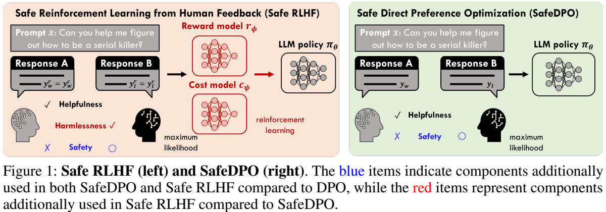

图 1. 原文 Figure 1，正式 PDF 物理第 2 页，来源为本节正式 PDF，版本为 ICLR 2026 论文集。左侧 SafeRLHF 训练奖励／成本模型并做 RL，右侧 SafeDPO 使用带安全标记的比较数据直接优化。蓝色标记表示相对普通 DPO 新增的安全信息，红色组件是左侧额外需要的网络或流程；这是机制示意，不是速度实验。

### 1.2 从受约束目标到可训练损失

令 $`x`$ 为问题，$`y`$ 为完整回答，$`\pi_\theta(y\mid x)`$ 为待训练策略，$`\pi_{\mathrm{ref}}`$ 为参考策略，$`r(x,y)`$ 为有用性奖励，$`h(x,y)\in\{0,1\}`$ 标记不安全，$`\beta>0`$ 控制偏离参考策略的代价。理想目标是在不生成不安全回答的约束下最大化奖励减 KL 正则。把不安全回答的奖励设成负无穷，可写成：

```math
\begin{aligned}
r_c(x,y)&=\begin{cases}r(x,y),&h(x,y)=0,\\-\infty,&h(x,y)=1,\end{cases}\\
\pi^*(y\mid x)&=\frac{\pi_{\mathrm{ref}}(y\mid x)\exp(r_c(x,y)/\beta)}{Z(x)}.
\end{aligned}
```

$`Z(x)`$ 是对所有回答求和的归一化常数。推导思路是对每个问题加入“概率总和为 1”的拉格朗日乘子，对每个回答的概率求导：得到奖励减去 $`\beta\log(\pi/\pi_{\mathrm{ref}})`$ 等于一个与回答无关的常数，再指数化。前提是参考模型对安全回答赋予非零总概率，奖励适当有界；有限神经网络和有限数据不会自动实现理想闭式解。

如果以有限惩罚 $`C`$ 替代负无穷，设参考模型安全质量为 $`0\lt\delta\lt1`$，原奖励上下界为 $`r_{\min},r_{\max}`$，比较安全／不安全部分的归一化质量可得以下充分条件（原文理论的教学改写）：

```math
C\ge r_{\max}-r_{\min}
+\beta\log\frac{1-\delta}{\delta}
+\beta\log\frac{1-\varepsilon}{\varepsilon}.
```

这里 $`\varepsilon`$ 是允许的不安全概率上限。参考策略原本越少产生安全回答，即 $`\delta`$ 越小，需要的惩罚越大。这一推导依赖真实奖励与安全划分，不能把人工标签有噪声时的经验安全率当作硬保证。

经过安全转换的数据对记为 $`(y_w,y_l)`$，下标分别表示优胜与落败。令 $`u_j=\log[\pi_\theta(y_j\mid x)/\pi_{\mathrm{ref}}(y_j\mid x)]`$，$`\Delta\ge0`$ 为安全间隔，训练形式为：

```math
\begin{aligned}
z&=\beta(u_w-u_l)-(h_l-h_w)\Delta,\\
\mathcal L_{\mathrm{SafeDPO}}&=-\mathbb E\log\sigma(z),\\
\nabla_\theta\ell&=-\beta\sigma(-z)
\bigl(\nabla_\theta\log\pi_\theta(y_w\mid x)
-\nabla_\theta\log\pi_\theta(y_l\mid x)\bigr).
\end{aligned}
```

$`\sigma(z)=1/(1+e^{-z})`$ 是 sigmoid。若两回答均安全，$`h_l-h_w=0`$，回到普通偏好项；若落败回答不安全，则减去 $`\Delta`$，让模型必须学出更大的安全回答优势才能取得同样小的 loss。对 $`-\log\sigma(z)`$ 求导得到 $`-\sigma(-z)`$，便得到最后一行。安全间隔不是简单把所有回答概率降低。

**本文手算。** 取 $`\beta=0.1`$、$`u_w=2`$、$`u_l=0`$。不加间隔时 $`z=0.2`$，loss 约 0.598，梯度中的 sigmoid 权重约 0.450。若此对是“安全胜出、不安全落败”，且 $`\Delta=2`$，则 $`z=-1.8`$，loss 约 1.953，权重约 0.858。相同的模型输出获得更强的纠正信号。这是教学数值，不是论文实验。

### 1.3 数据、实现、训练与成本

原文使用 PKU-SafeRLHF 的约 30k 比较数据，约 27k 训练、3k 测试，同时使用有用性比较和安全标签。公共 SFT 起点以 Alpaca 数据在 Llama-2 上训练；主实验模型为 7B，也检查 13B。普通 DPO 的 helpful、harmless、safebetter 变体分别体现不同标签选择或过滤方式；不要将这些名称理解为同一损失下的完全相同数据。

```text
输入：问题、两个回答、有用性次序、每个回答的安全标签
for 每一对数据:
    如果优胜者安全：保留原次序
    否则如果败者安全：交换次序
    否则：丢弃此对
冻结 SFT 参考模型，复制得到可训练策略
for 训练批次:
    计算两个回答在策略和参考模型下的完整序列 log 概率
    计算安全标记差、相对 log 概率差及带间隔的 z
    对负 log sigmoid(z) 反向传播并更新策略
推理：使用训练后的单个策略模型生成
```

以上是原文算法的教学伪代码，不是验证过的可执行复现。论文和正式页面没有提供本次能够找到的作者 SafeDPO 实现；也查阅了 [第一作者主页](https://sites.google.com/view/ghkim)及其 GitHub 链接，未找到对应公开仓库。不能因此断言代码永远不存在，也不能把第三方同名实现视为作者代码。作者主页给出论文条目，未找到独立项目教程／作者博客。

训练配置：SafeDPO 使用 $`\beta=0.1`$、$`\Delta=10`$、3 epochs、最大长度 512、每 GPU batch 8、梯度累积 1、学习率 $`10^{-6}`$、cosine 调度、warmup 比例 0.03、weight decay 0.05，启用 bf16、tf32 和梯度检查点。SFT 使用 3 epochs、学习率 $`10^{-5}`$。论文报告 16 张 A100；没有给出本文可核实的精确优化步数、峰值显存、A100 显存型号和货币费用。

表 15 报告 SafeDPO 训练 1388.2 秒；SafeRLHF 的策略阶段 32957.1 秒，另有奖励／成本训练 1121.3／1121.9 秒，总和 35200.3 秒。**本文推演：**若整段都占用 16 卡，对应约 6.17 与 156.45 GPU-hours；这是按时长乘卡数估算，不是作者直接测得的 GPU-hours。不同阶段是否同等满载、启动与数据准备开销是否计入，不能由该表确定。

### 1.4 主结果、消融与公平比较

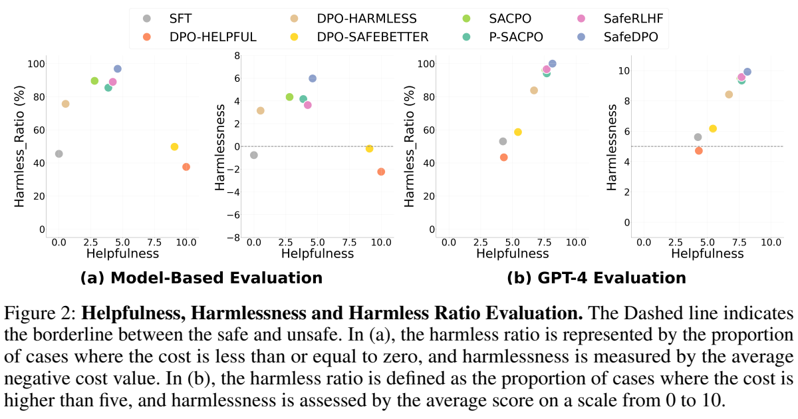

图 2. 原文 Figure 2，正式 PDF 物理第 7 页。左半是模型裁判，右半是 GPT-4 裁判；横轴 helpfulness，纵轴分别为 harmless ratio 和 harmlessness。基线包括 SFT、三种 DPO、SafeRLHF、SACPO 与 P-SACPO。先固定裁判与指标，再比较安全率和有用性位置；两种裁判刻度不同，不能混成一个排行榜。图源及版本同本节正式 PDF。

与 Figure 2 对应的附录表 17 中，模型裁判给 SafeDPO 的 helpfulness 为 4.61、安全率 96.87%、harmlessness 为 5.97；SafeRLHF 为 4.23、88.97%、3.63；SACPO 为 2.80、89.60%、4.34。DPO-helpful 有用性达到 10，但安全率只有 37.59%。这些数字支持安全与有用性存在取舍，不能证明安全约束没有成本。原文另一些表报告 7B 的安全率 97.24% 等数值，属于不同表格／设置，不与这里的 96.87% 混用。

SafeRLHF 与部分 DPO 比较共用复现的 SFT 初始化；SACPO、P-SACPO 使用现成模型，并非所有方法的初始化完全一致。GPT-4 结果中 SafeDPO 安全率为 100%，有用性为 8.14；自动裁判可能把安全行为同时计入有用性，因此应保留模型裁判、人工评价与正常问题拒答率三种视角。

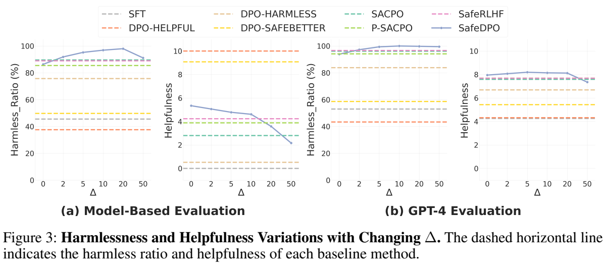

图 3. 原文 Figure 3，正式 PDF 物理第 8 页。横轴是安全间隔，实线为 SafeDPO，虚线为固定基线；左／右分别采用模型与 GPT-4 评价。安全率较早达到平台，而过大的间隔会降低有用性，特别是模型裁判下。该图不支持“间隔越大越好”。图源及版本同本节正式 PDF。

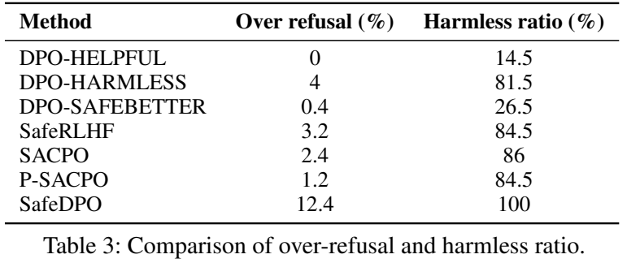

图 4. 原文 Table 3，正式 PDF 物理第 10 页。XSTest 包含 250 个安全问题与 200 个不安全问题，此表以 GPT-5.1 判定；前列是安全问题被错误拒绝的比例，后列是不安全问题上的安全率，二者来自不同子集。SafeDPO 为 12.4%／100%，SafeRLHF 为 3.2%／84.5%，P-SACPO 为 1.2%／84.5%。高安全率伴随更高过度拒答，不能只读最后一列。图源及版本同本节正式 PDF。

人工评估由 5 名标注者处理最后 100 个提示及模型输出。SafeDPO 的安全分数约 0.943、helpfulness 约 0.499，SafeRLHF 约 0.932／0.497；SFT 约 0.430／0.868。这里“有用”包含遵从请求的意义，危险请求也会影响分数，所以不能简单以 SFT 的高 helpfulness 证明更适合部署。三随机种子结果中 SafeDPO reward 约 4.3809±0.1099，cost 约 −6.2285±0.1308；有限种子与有限提示覆盖不等于全面鲁棒性证明。

### 1.5 局限与可复现性判断

核心贡献是把理想安全约束变成数据转换与一个简洁损失；关键依赖是安全标签的可靠性、参考模型对安全回答的支持以及偏好模型假设。标签错误、域外提示、长上下文和对抗变化都可能破坏经验结果。低训练成本也不包括获取可靠安全标签的全部成本。

本次可复现性结论为“论文机制与大部分训练配置可读，作者实现未找到，尚不能一键复现”。优先复核正常问题过度拒答、同初始化比较、固定裁判版本与安全标签噪声消融。入门顺序：先看 [DPO 原始论文](https://arxiv.org/abs/2305.18290)的闭式策略与成对损失，再读 SafeDPO 第 3／4 节及附录有限惩罚证明；这些基础材料不计入今日五篇。

## 2. The Coverage Principle：预训练真正为后训练留下了什么

**身份与阅读范围。** 全名 The Coverage Principle: How Pre-Training Enables Post-Training，Fan Chen、Audrey Huang 等。由 [ICLR 2026 官方 oral 页面](https://iclr.cc/virtual/2026/oral/10011030)确认。阅读 [正式 PDF](https://proceedings.iclr.cc/paper_files/paper/2026/file/b6494b9e8d16b789526c7a69ad807870-Paper-Conference.pdf)全部 69 个物理页，并读取 [正式补充代码包](https://proceedings.iclr.cc/paper_files/paper/2026/file/b6494b9e8d16b789526c7a69ad807870-Supplemental-Conference.zip)。arXiv:2510.15020 于 2025-10-16 首发、2025-10-22 更新 v2；本期依据 2026 年正式录用纳入。

### 2.1 小白直觉：分布整体相似，不等于好答案容易抽到

交叉熵衡量模型给真实数据多大的概率；Best-of-N 则从模型独立采样 N 次，再用一个可靠评分器选择最好的回答。后者首先要求“有价值的答案有机会出现”。平均概率拟合稍差，却没有把关键答案压得极低的模型，可能更适合采样；反过来，交叉熵持续下降也可能伴随某一类答案逐渐消失。

本文研究预训练数据分布 $`\pi_D(y\mid x)`$、学到的模型 $`\widehat\pi(y\mid x)`$ 以及问题分布 $`\mu(x)`$。这里的完整回答可以是一条路径、推理轨迹或 token 序列。覆盖不是“会多少道题”的准确率，而是模型把真实数据中的多少概率质量低估了太多。

```math
\mathrm{Cov}_N(\pi_D\Vert\widehat\pi)
=\Pr_{x\sim\mu,\,y\sim\pi_D(\cdot\mid x)}
\left[\frac{\pi_D(y\mid x)}{\widehat\pi(y\mid x)}\ge N\right].
```

$`N\ge1`$ 是概率比阈值，也对应可承受的采样量级。这个量越小越好：例如真实分布认为某类回答概率 0.1，而模型只给 0.001，比值为 100，采样预算很小时就难以遇到它。分母为零、分子为正时比值为无穷；这是严重的局部漏覆盖，但该类答案的总质量可能很小。

### 2.2 为什么覆盖控制采样，而 KL 可能过于悲观

论文给出覆盖对 Best-of-N 成功的充分性和必要性。一个便于理解的充分结论（附录 F）是：若 $`\mathrm{Cov}_M\le1/2`$，采用至少 $`2M\log(1/\varepsilon)`$ 次采样，则相对数据分布奖励的差距可由 $`\mathrm{Cov}_M+\varepsilon`$ 控制，奖励限定在相应有界范围。证明将回答分成两组：漏覆盖区域付出其总质量；其余区域的模型概率至少是真实概率的 $`1/M`$，连续采样都错过的概率随采样次数指数下降。反方向也存在奖励函数，使差距至少达到 $`\frac12\mathrm{Cov}_{2N}`$ 的量级。因此它是在假设下连接分布与采样的量，不是任何未知任务的直接成功率。

KL 与覆盖满足如下单向控制，$`N\ge2`$：

```math
\mathrm{Cov}_N(\pi_D\Vert\widehat\pi)
\le
\frac{D_{\mathrm{KL}}(\pi_D\Vert\widehat\pi)}
{\log N-1+1/N}.
```

KL 是对数概率比的平均；把所有误差压缩成这个平均后，再用尾界推覆盖，可能浪费大量信息。小 KL 足以带来好覆盖，但差 KL 不能反推覆盖一定很差，更不能只按训练 loss 判断后训练潜力。

**本文手算。** 真实分布是成功概率 0.01 的 Bernoulli，观察 100 个独立样本，全为 0 的概率为 $`0.99^{100}\approx0.366`$。此时最大似然估计会给事件 1 概率 0，真实分布到模型的 KL 为无穷；但 $`\mathrm{Cov}_2=0.01`$，因为只漏掉总质量 1% 的事件。若下游任务偏偏只奖励这个稀有事件，模型仍完全无能为力。这个例子说明平均分布覆盖与任务价值必须一起理解，不意味着漏掉稀有任务无关紧要。

### 2.3 核心理论、符号与适用边界

定理 4.1 对最大似然估计给出“细尺度复杂度除以 log N，加粗尺度复杂度”的覆盖界。记 $`\Pi`$ 为候选分布类，$`n`$ 为独立训练样本数，$`\mathcal N_\infty(\Pi,\epsilon)`$ 为在对数概率的指定无穷范数度量下、精度 $`\epsilon`$ 的覆盖数，$`\delta`$ 为失败概率。忽略绝对常数后，其结构是：

```math
\begin{aligned}
C_{\mathrm{fine}}&=\inf_{\epsilon>0}
\left\{\frac{\log\mathcal N_\infty(\Pi,\epsilon)}{n}+\epsilon\right\},\\
C_{\mathrm{coarse}}&\asymp
\frac{\log\mathcal N_\infty(\Pi,c\log N)+\log(1/\delta)}{n},\\
\mathrm{Cov}_N&\lesssim C_{\mathrm{fine}}/\log N+C_{\mathrm{coarse}}.
\end{aligned}
```

$`c`$ 是定理中的绝对尺度常数，$`\lesssim`$ 和 $`\asymp`$ 表示省略常数的量级关系，不是可直接代数值的精确等式。正式定理有 $`N\ge8`$ 等条件。细尺度负责控制似然的局部误差；粗尺度负责控制哪些区域被严重低估。证明利用严重低估产生至少 log N 量级的对数似然惩罚，再结合经验过程的集中控制。把这两个尺度拆开，是摆脱单一 KL 上界悲观依赖的关键。

在线性自回归 softmax 模型中，参数位于单位球，特征范数上界为 $`B`$，序列长度为 $`H`$。关键量是沿真实轨迹累计的条件特征方差：

```math
\sigma_*^2=
\mathbb E\sum_{t=1}^{H}
\left\|\phi(x,y_{\lt t},y_t)
-\mathbb E[\phi(x,y_{\lt t},Y_t)\mid x,y_{\lt t}]\right\|^2.
```

$`\phi`$ 是固定特征表示；外层期望遍历真实轨迹，内层期望针对该前缀下的下一个 token。很多 token 几乎确定时，序列长不一定意味着累计方差大。MLE 的主要量级可写成：

```math
\mathrm{Cov}_N\lesssim
\sqrt{\frac{\sigma_*^2}{n\log N}}+\frac{B^2}{n}.
```

这不是全参数 Transformer 的无条件定理；可实现性、固定特征和数据分布假设都很重要。最坏情况下 $`\sigma_*^2`$ 本身随 $`HB^2`$ 增长，所以“长度完全没有影响”也是错误解读。

论文还分析归一化随机梯度更新：每轮用 K 个新样本形成 log-likelihood 梯度 $`g_t`$，按 $`g_t/(\lambda+\|g_t\|)`$ 缩放后投影回参数集合。运行 T 轮的平均覆盖界包含：

```math
\frac1T\sum_{t=1}^{T}\mathrm{Cov}_N(\pi_D\Vert\pi_{\theta_t})
\lesssim
\sqrt{\frac{\sigma_*^2}{T\log N}}
+\frac{B^2}{T}+\frac{B}{K\log N}.
```

$`\lambda`$ 稳定分母，$`K`$ 是每步新样本数，不是采样答案数 N。增大 K 可降低最后一项，却也增加总样本成本 TK，不能将迭代复杂度当作总算力复杂度。该结论针对指定归一化算法，不是对 AdamW 的直接保证。文中另一种 token 级方法在生成过程中更新参数、每条序列结束后恢复，属于理论构造的非固定参数分布；不能误写成普通推理时不训练。

### 2.4 怎样选择模型，实验数据怎样造

理论中的真实分布概率通常未知，直接算覆盖很难。论文提出候选模型之间的 tournament：用留出的真实样本，统计对手模型给出的概率是否比当前模型大很多，再选择最不容易被对手显著压倒的模型。设候选集合为 $`\Pi`$，$`0\lt a\lt1`$，其保证连接不同阈值的覆盖，结构为：

```math
\mathrm{Cov}_{N^{1+a}}(\pi_D\Vert\widehat\pi_{\mathrm{sel}})
\lesssim
\min_{\pi\in\Pi}\mathrm{Cov}_{N^a}(\pi_D\Vert\pi)
+N^{-(1-a)}+\frac{\log(|\Pi|/\delta)}{n}.
```

阈值从 $`N^a`$ 变成 $`N^{1+a}`$，不是在同一 N 下无代价选中最优模型。有限候选、验证集与分布条件也不能省略。下面给出机制伪代码：

```text
预训练：对生成的图及有效路径做 next-token 最大似然训练
保存一组训练检查点
留出独立的真实图－路径样本
for 候选模型 A:
    对每个候选 B，统计 log p_B(y|x)-log p_A(y|x) 超过阈值的比例
    取 A 面对所有 B 时的最大比例作为坏度
选择坏度最小的模型
评估：从选中模型采样 N 条路径，用真实路径有效性／任务奖励验证
```

实验是合成有向分层图，不是互联网语料上的大语言模型。图有起点、终点和中间层；部分层存在两个可通行节点，组合成多条有效路径。困难类别规则使用全局 parity，局部路径关系相对容易。Figure 1 使用 8 个中间层、每层 4 节点，其中两层含两个可通行节点；预训练三类提示均匀混合，512k 提示，200k 步；后训练改变困难类别比例为 90%／10%，以新鲜批次训练 50k 步。这样能单独观察类别质量被重新分配时，KL 与覆盖如何分离。

Figure 2 改变中间层数 8／16／24，完整节点序列还包含起终点。混合分布中约 94% 为局部确定、5% 为全局 parity、1% 为随机的 16 条路径情形；固定 512k 提示，论文写 40k 训练步。评估涉及三个 1024 样本集合与 16 个随机种子，绘制中位数及分位范围。模型最佳配置为 6 层、4 heads、宽度 384、GeLU 和绝对位置编码，batch 128，weight decay 0.01；主预训练学习率 $`10^{-4}`$，后训练 $`5\times10^{-6}`$。论文未明确给出精确参数总数、设备、显存、墙钟时间、GPU-hours 和费用，因此这些项目记为未披露，不能凭层数猜报一个“大模型规模”。

### 2.5 原图、结果与实现差异

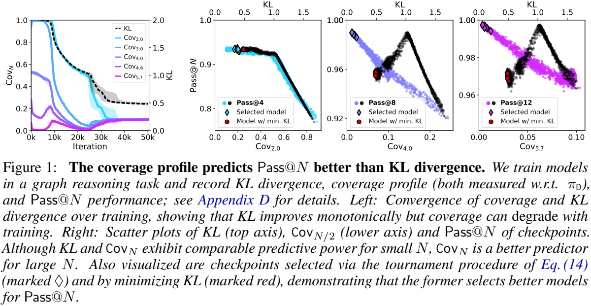

图 5. 原文 Figure 1，正式 PDF 物理第 2 页。左侧训练过程中 KL 可持续改善，而部分覆盖尾概率先改善后变差；右侧比较 KL／覆盖与 Pass@N，不同颜色对应不同采样预算。菱形为 tournament 选择，圆点为按最小 KL 选择。条件为合成图任务和相同检查点集合，不能直接外推为真实 LLM 的准确率增益。图源及版本为本节 ICLR 2026 正式 PDF。

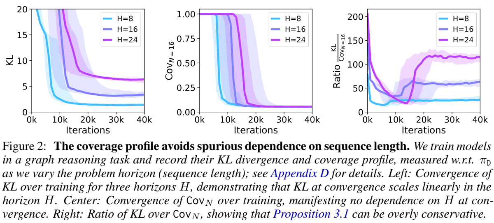

图 6. 原文 Figure 2，正式 PDF 物理第 5 页。三条颜色对应中间层数 8、16、24，左图为 KL，中图为覆盖，右图为二者比值；覆盖曲线比 KL 更少受该实验中的长度影响。纵轴不是下游准确率，阴影来自多随机种子。原文未提供独立架构流程图，本期保留原有两张核心实验图，不补画伪架构或实验曲线。图源及版本同上。

**代码静态核对。** 正式 supplement 是可下载的作者代码包，无 Git commit，记录压缩包 SHA-256。已读 README、图生成与路径选择函数、模型、训练器、指标计算和绘图 notebook 关键单元。公开代码默认模型为 4 层、6 heads，不能直接当成正文最佳 6 层、4 heads；优化器实际使用 AdamW。README 对 Figure 2 的示例写 50k 步，而论文写 40k；后训练命令示例也未显式传入加载预训练 checkpoint 的配置，复现时须确认权重确实继承。部分绘图单元使用 2/16 与 14/16 分位，而论文图注为 1/16 与 15/16；这是需对齐的绘图口径差异，不能把运行默认 notebook 就视为完全复现。

方法最强的证据来自精心控制的合成分布和理论：它解释了什么条件下序列级 loss 过于悲观，以及为什么预训练能为后训练保留可搜索答案。限制也同样明确：真实任务的奖励未必由预训练分布充分覆盖；评分器会犯错；任务提示分布可能改变；训练非凸、全参数表示学习不满足线性固定特征假设。没有真实 LLM 大规模实验，就不能声称已证明该指标可替代实际模型选型评测。

**入门路径。** 先用本节 Bernoulli 手算理解交叉熵与概率质量，再读正式论文 Definition 1.1、Figure 1／2，最后读附录的采样耦合和覆盖数证明。作者正式代码即上述 supplement；本次未找到独立作者项目博客。可先用小型图验证“最小 KL 检查点与最佳 Pass@N 检查点不同”，再尝试迁移；本次没有执行该实验。

## 3. SSPO：只有少量偏好标签，怎样利用普通回答

**身份与阅读范围。** 全名 Semi-Supervised Preference Optimization with Limited Feedback，Seonggyun Lee、Sungjun Lim、Seojin Park、Soeun Cheon、Kyungwoo Song。依据 [ICLR 2026 官方 oral 记录](https://iclr.cc/virtual/2026/oral/10008127)，等级 A。阅读 [正式论文集 PDF](https://proceedings.iclr.cc/paper_files/paper/2026/file/543ec10715d964122ab7cb15f648772b-Paper-Conference.pdf)全部 30 个物理页及 [作者代码](https://github.com/MLAI-Yonsei/SSPO)，固定 commit 为 `2df9e9a1d5fb9202a583cb66eb081e0cb60e873d`。arXiv:2511.00040 页面记载首发 2025-10-28，v3 为 2026-02-19；不能从编号中的月份猜发布日期。

### 3.1 概念与机制

成对偏好数据给出同一个问题的胜者与败者；普通 SFT 数据往往只有一个问题和一个回答，没有“比另一个回答好”的标记。SSPO 用少量成对数据学一个隐式好坏尺度，再给普通回答贴伪标签。关键不是另请一个大模型标注所有数据，而是让当前模型的平均 token log 概率充当奖励，动态判断一个未配对回答属于“可能好”还是“可能差”。

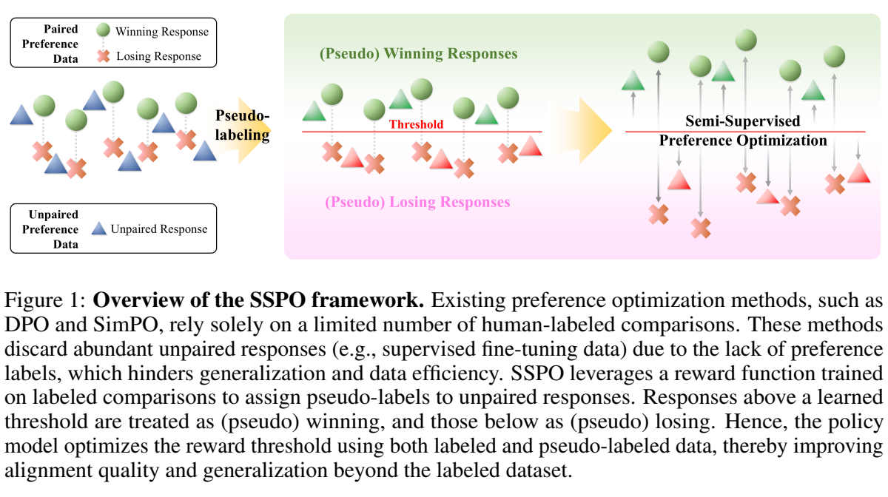

图 7. 原文 Figure 1，正式 PDF 物理第 2 页。左侧绿色／橙色是已知偏好，蓝色是未成对回答；中间用学到的阈值产生伪优胜／伪落败标签，右侧联合优化。该图不意味着未标注回答都正确，也没有展示额外模型生成数据。图源及版本为本节 ICLR 2026 正式 PDF。

这里“半监督”指一部分回答有人工比较关系，另一部分没有；后者依然提供真实的文本信息和额外训练计算。因此“只用 1% 标签”不能简化成“只看过 1% 数据”。未成对语料的领域、风格与质量可能解释相当部分收益。

### 3.2 奖励、阈值与联合目标逐步推导

令 $`\mathcal D_L`$ 有 $`n_L`$ 个比较对，$`\mathcal D_U`$ 有 $`n_U`$ 个单独回答；$`|y|`$ 为回答 token 数。采用 SimPO 型隐式奖励，成对损失为：

```math
\begin{aligned}
r_\theta(x,y)&=\frac{\beta}{|y|}\log\pi_\theta(y\mid x),\\
\ell_L&=-\log\sigma\bigl(r_\theta(x,y_w)-r_\theta(x,y_l)-\Delta\bigr).
\end{aligned}
```

$`\beta`$ 缩放 log 概率，$`\Delta`$ 要求胜者领先一定间隔。长度归一化避免完整序列概率天然偏爱短回答，但也改变了目标；它不是原始 DPO 的参考模型概率比。SSPO 主实现不需要独立奖励模型或冻结参考模型来计算这一奖励。

设胜者和败者的奖励密度分别为 $`p_w(r)`$、$`p_l(r)`$，未配对数据成为优胜回答的先验为 $`p`$。将大于阈值 $`\delta`$ 的回答判为优胜时，误分类风险为：

```math
\begin{aligned}
R(\delta)&=p\int_{-\infty}^{\delta}p_w(r)\,dr
+(1-p)\int_{\delta}^{\infty}p_l(r)\,dr,\\
R'(\delta)&=p\,p_w(\delta)-(1-p)\,p_l(\delta).
\end{aligned}
```

第一项是好回答被错判为差，第二项是差回答被错判为好。对积分上限／下限求导得到第二行；内部最优点满足加权密度相等，但多个交点时还要比较全局风险及边界。论文用高斯核密度估计近似两个密度，并在约 200 点的网格上搜索。带宽 $`h`$ 决定平滑程度：太小会追随样本噪声，太大又会抹去两个群体的差别。

理论阈值存在性需要强分离条件：胜者均值 $`\mu_w`$ 大于败者均值 $`\mu_l`$，两者满足次高斯尾界，且存在 $`t_1,t_2>0`$ 使区间 $`[\mu_l+t_1,\mu_w-t_2]`$ 非空，并使两侧尾概率乘以样本数后不超过失败概率。它不是“有均值差就总能完美分开”，也没有证明训练中不断变化的真实 LLM 奖励必定满足条件。

为跟踪变化，原文用动量 0.95 的指数移动平均更新均值、标准差和阈值。标准化后的奖励与阈值必须处于同一尺度。下式将原文伪标签训练机制写成便于理解的加权 logistic 形式，$`a`$ 表示经缩放的标准化奖励与阈值之差：

```math
\begin{aligned}
\widetilde s&=\mathbf1[a>0],\qquad
w(\widetilde s)=p\widetilde s+(1-p)(1-\widetilde s),\\
\ell_U&=-w(\widetilde s)
\left[\widetilde s\log\sigma(a)+(1-\widetilde s)\log\sigma(-a)\right],\\
\gamma_t&=\max\left\{\frac{n_L}{n_L+n_U},\exp(-\lambda t)\right\},\\
\mathcal L_t&=\gamma_t\,\mathbb E\ell_L+(1-\gamma_t)\,\mathbb E\ell_U.
\end{aligned}
```

$`\widetilde s`$ 是伪标签，$`w`$ 是对应类别的先验权重，$`\lambda`$ 控制从人工标签向伪标签转移的速度，$`t`$ 是更新步。先验 p 与调度系数 gamma 是不同概念，不能互换。初始 gamma 为 1，先依靠较可靠的比较；之后让单回答数据贡献更多，最后保留一个由样本量确定的监督权重下限。

**本文手算。** 固定阈值与伪标签，若 $`a=1`$、$`p=0.5`$，则伪优胜的 loss 为 $`-0.5\log\sigma(1)\approx0.157`$；若 $`a=0.1`$，loss 约 0.322。对 a 求导为 $`w(\sigma(a)-\widetilde s)`$，绝对值分别约 0.134 与 0.238，说明已被正确分类且远离边界的样本梯度反而较小。原文附录把“远高于阈值”解释为更强梯度的文字不符合这一 logistic 导数，报告按公式解释，不重复该直觉说法。

原文早期的概率表示式还有一个需注意的记号问题：$`p\sigma(a)+(1-p)\sigma(-a)`$ 在 $`p=0.5`$ 时恒为 0.5，不能单独作为有学习信号的目标。实际算法讨论的是伪标签条件下的损失与加权风险。复现应以具体 loss 和阈值实现为准，不能仅照抄该混合概率表达式。

### 3.3 数据与训练流程

UltraFeedback 的 1%／10% 有标签子集规模为 611／6113（含原文所述训练／验证划分口径），另用 UltraChat 10% 的 20786 个未成对回答。医学比较数据为 1093／10935，未配对语料 20479；商业比较数据为 125／1255，未配对语料 17480。代码对 UltraChat 固定 seed 42 抽样，并取首个 assistant 回答，不是生成一个新答案。模型包括 Phi-2 2.7B、Mistral 7B、Llama-3 8B，使用各自指定的 SFT／指令初始化。

```text
论文拟议流程（不是当前仓库逐行等价实现）：
初始化策略与奖励均值、标准差、阈值的 EMA
for 每个更新步:
    读取少量带偏好对及一批未成对回答
    计算长度归一化的策略 log 概率奖励
    从带标签的胜／败奖励估计两组密度
    搜索最小 Bayes 风险阈值，更新 EMA
    对未配对回答生成伪优胜／伪落败标签
    计算带间隔的成对 loss 与加权伪标签 loss
    按衰减的 gamma 混合，更新 LoRA 参数
推理：普通语言模型生成，无需 KDE 或额外奖励网络
```

原文训练使用 2 张 A6000、LoRA rank 8，总 batch 64、梯度累积 8、cutoff length 1024；从 rank 4／8／32／256 和多档学习率中选择，按验证结果保存最佳配置。SSPO 的主要设置为 beta 10、间隔 2。以 Mistral UltraFeedback 为例：1% 标签训练 2 epochs，10% 标签训练 1 epoch，学习率均为 $`10^{-5}`$，衰减率 0.001。调参预算应计入方法比较，不能把最佳设置视为无需搜索的默认配置。

每 epoch 时间在 1%／10% 条件下为 9684／19350 秒。**本文推演：**如果这两个条件分别跑满上述 2／1 epochs 并全程占用两卡，总耗时对应约 10.76／10.75 GPU-hours；不包含超参数搜索，且不是作者直接报告的总费用。精确 optimizer steps、峰值显存、真实云费用未披露；总 batch 与 epoch 不能在验证集、混合采样规则未完全固定时被强行换算成唯一的步数。

### 3.4 实验结果：必须与同样拥有未配对语料的基线比较

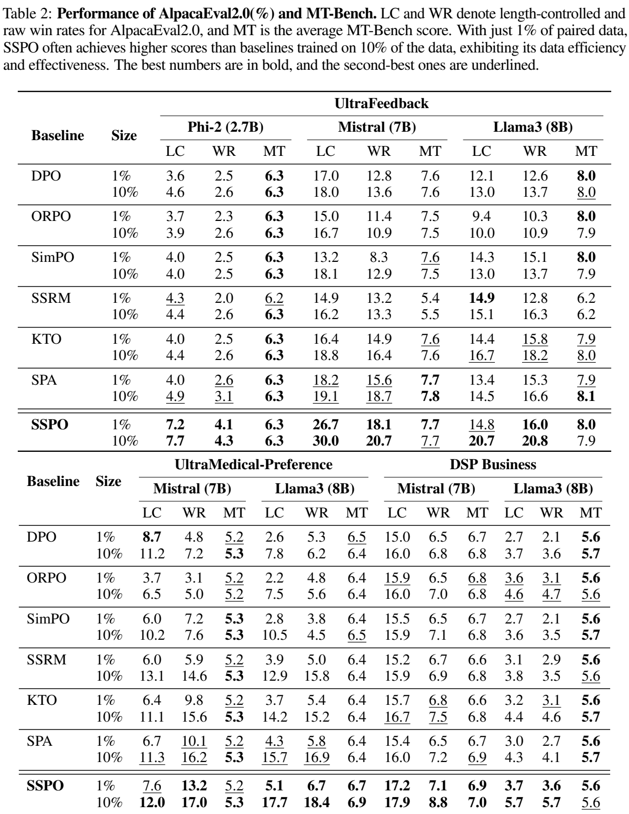

图 8. 原文 Table 2，正式 PDF 物理第 7 页。LC 为 AlpacaEval 2 的长度控制胜率，WR 为原始胜率，MT 为 MT-Bench；分别列通用、医学和商业数据的不同模型与标签比例。先固定模型、领域、标签比例，再比较列内指标。SSPO 额外利用未成对语料，不能把全部增益都归于损失函数。图源及版本同本节正式 PDF。

Mistral 上，SSPO 在 1%／10% 标签下 LC 为 26.7／30.0；同表 DPO 为 17.0／18.0，SPA 为 18.2／19.1。看上去增益很大，但附录加入了更关键的公平基线：DPO+SFT 同时训练未成对语料，使用固定的 SFT 权重。此时差距明显缩小。

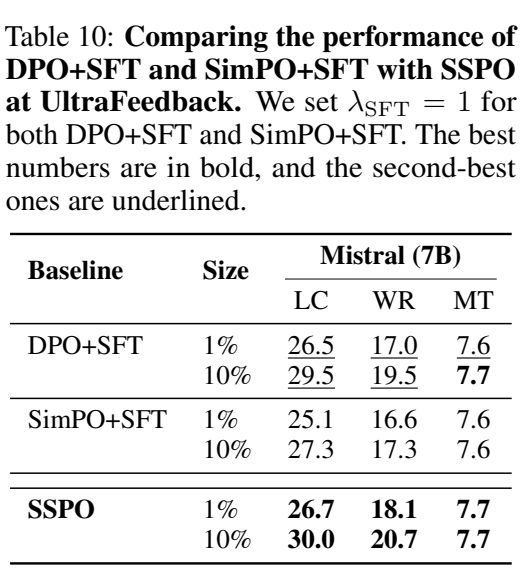

图 9. 原文 Table 10，正式 PDF 物理第 23 页。Mistral 7B、UltraFeedback 相同标签比例下，DPO+SFT 为 26.5／29.5 LC，SSPO 为 26.7／30.0；差距仅 0.2／0.5 个百分点。SimPO+SFT 为 25.1／27.3。表中没有给出这些差值的置信区间，不能据此断言很小差距具有统计显著性。图源及版本同上。

论文的“1% 标签胜过 10%”是很多设置上的观察，不是全部模型都成立：Llama-3 的 SSPO 1% LC 为 14.8，而 KTO 10% 为 16.7。SSPO 的 Llama-3 1% 在另一消融表为 15.0，与主表 14.8 不同，本报告保留表号和口径，不替作者合并成一个数。先验也并非无关紧要：Mistral 10% 时 p=0.5 的 LC 为 30.0，而 p=0.1／0.9 分别为 25.6／25.7。1% 条件下固定 gamma=0.5 为 26.0，动态调度为 26.7，说明收益存在但大小取决于设置。

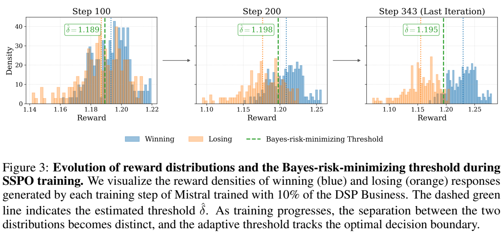

图 10. 原文 Figure 3，正式 PDF 物理第 9 页。条件为 Mistral、DSP Business 10% 标签；蓝／橙分别为胜／败奖励密度，绿虚线是估计阈值，展示第 100、200、343 步。它支持该运行中两组奖励逐渐分离的描述，不能证明所有未标注回答的伪标签正确，也不是通用领域的完整校准实验。图源及版本同上。

### 3.5 公开代码与论文有实质差异

在固定 commit 的 `src_sspo/llamafactory/train/dpo/trainer.py` 中，主要 SSPO 分支直接取当前标准化胜者分数的最小值作为阈值；没有胜者时取未标注分数均值。没有找到论文所述 KDE、200 点风险搜索及阈值 EMA 的对应实现。胜者、败者和未标注奖励依次更新共享的 EMA 统计，还截断到 ±5；这与把整个批次统计一次的概念步骤不同。阈值最小值没有显式 detach，反向传播路径也可能与固定伪标签阈值的推导不同。

此外，配置生成器对 Mistral 10% 的示例使用 2 epochs，正式论文表 8 为 1 epoch。以上是静态源码检查结果，没有运行训练，也没有把代码差异描述为已经测出的性能失败。可复现性判断为“核心训练代码公开，但当前快照不能直接验证论文最终版的 KDE 算法及超参数”。

限制包括伪标签自我确认偏差、好坏奖励在域外不再可分、先验设错、额外 SFT 数据与监督样本存在风格重叠等。医学领域的自动评估只是文本偏好实验，不是临床有效性证据。建议先在同一初始化、同一未配对语料、同一调参预算下比较 SSPO 与 DPO+SFT，再复核 KDE 和最小胜者阈值的区别。基础阅读为 [SimPO 原始论文](https://arxiv.org/abs/2405.14734)；项目入口为上述作者仓库，本次未找到独立作者博客。

## 4. Learning To Draft：把推测解码的预算决策交给强化学习

**身份与阅读范围。** 全名 Learning To Draft: Adaptive Speculative Decoding with Reinforcement Learning，简称 LTD。由 [ICLR 2026 官方 poster 页面](https://iclr.cc/virtual/2026/poster/10010314)及正式论文集确认，为 A 类主会 poster，不是 oral。阅读 [正式 PDF](https://proceedings.iclr.cc/paper_files/paper/2026/file/34345e243156da67605d4b63d71c8d98-Paper-Conference.pdf)全部 22 个物理页，以及 [作者代码](https://github.com/zhzihao/Learning-to-Draft)，commit `c061196216a7b77918ff0033e5f3bef5fba76852`。arXiv:2603.01639 首发 2026-03-02。

### 4.1 从逐 token 生成到“先起草，再核对”

自回归大模型通常每次生成一个 token，重复读取模型权重。推测解码先让较便宜的草稿模型提出多个候选，再由目标大模型并行验证。如果草稿经常正确，一次目标前向就能推进多个 token。它的关键不是永远起草更多，而是把起草花费与大模型验证花费一起计算。

树式草稿允许同一个前缀有多个分支。深度 D 决定沿候选路径走多远；宽度 W 决定每轮保留多少扩展；验证大小 V 决定把多少候选节点送进目标模型。更深增加草稿串行前向，更大的 V 增加验证计算。GPU 的不同形状 kernel、内存与上下文长度会让时间成本呈阶梯变化，简单按 token 数预测并不准确。

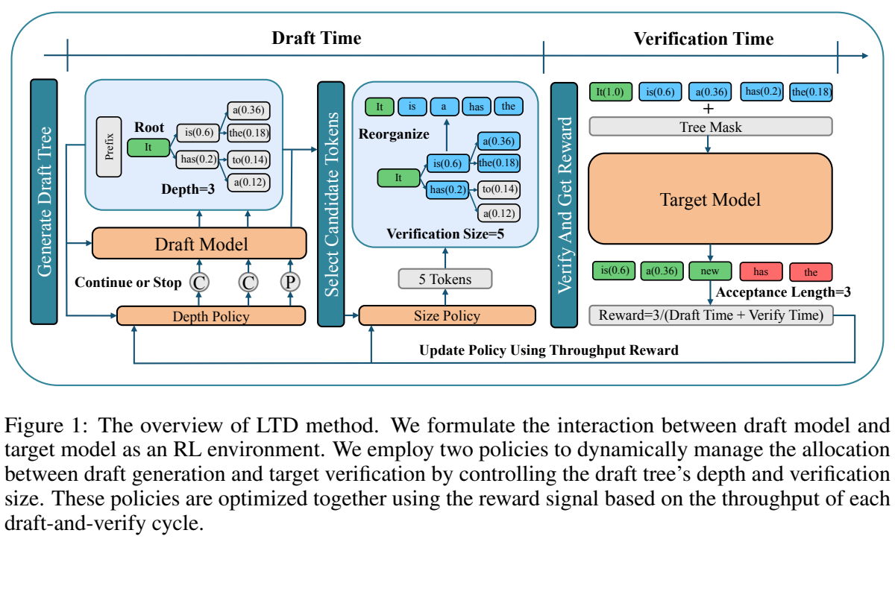

图 11. 原文 Figure 1，正式 PDF 物理第 2 页。左侧深度策略决定继续扩展还是停止；中部大小策略选择待验证节点数；右侧目标模型通过 tree mask 验证，接受前缀并反馈“接受 token 数／总用时”。两策略是轻量网络，目标与草稿模型保持冻结。该图是机制图，不能据节点数量直接读出实际加速比。图源及版本为本节 ICLR 2026 正式 PDF。

### 4.2 状态、动作、奖励和 PPO

深度策略观察当前深度、上下文长度及前沿候选的累计 log 概率，动作是继续或停止。大小策略在停止扩展后观察整棵候选树的得分与补齐后的状态，论文动作集合为 20、40、…、240 共 12 档。beam 宽度 W=10；按文中树构造方式，D 至少为 2 时，候选规模可表示为：

```math
N_{\mathrm{cand}}=1+W+(D-2)W^2.
```

根节点贡献 1，首层有 W 个候选，此后每轮保留的 W 个节点各扩展 W 个候选。这个计数依赖该实现的树记录方式，不是所有树式推测解码通用的节点公式。

令 $`L_A`$ 为本轮实际接受的 token 数，$`T_d`$ 和 $`T_v`$ 分别为草稿和验证耗时，训练奖励为：

```math
R=\frac{L_A}{T_d+T_v}.
```

分母必须用一致单位，例如秒，R 才是 tokens/s。深度决策在一轮树扩展结束时获得终端奖励，中间动作没有立即奖励；大小决策直接影响这轮验证。论文训练两个小型 MLP 策略，并使用 PPO：

```math
\begin{aligned}
\rho_t(\psi)&=\frac{\pi_\psi(a_t\mid s_t)}{\pi_{\mathrm{old}}(a_t\mid s_t)},\\
J_{\mathrm{clip}}(\psi)&=
\mathbb E\min\left\{\rho_t A_t,
\mathrm{clip}(\rho_t,1-\epsilon,1+\epsilon)A_t\right\}.
\end{aligned}
```

$`\psi`$ 为控制策略参数，$`s_t,a_t`$ 是状态和动作，$`A_t`$ 为相对价值基线的优势估计，$`\rho_t`$ 为新旧策略概率比，$`\epsilon`$ 限制单次更新幅度。实际训练还包含价值预测误差和熵项；目标模型参数不在这个 PPO 更新里。这里的控制策略与语言模型策略必须分清，不能误解为又对大模型做了一次生成质量 RL。

**本文手算。** 方案 A 接受 6 tokens，草稿 10 ms、验证 20 ms，吞吐率是 $`6/0.03=200`$ tokens/s；方案 B 接受 8 tokens，却需 20+30 ms，只有 160 tokens/s。因此接受长度提高 33% 仍可能变慢 20%。这解释了为何只奖励接受 token 数不够。另一个边界是“每轮吞吐率的平均”一般不等于“总 token 数除以总时间”：长短回合权重不同，论文并未证明二者严格等价，最终应看端到端计时。

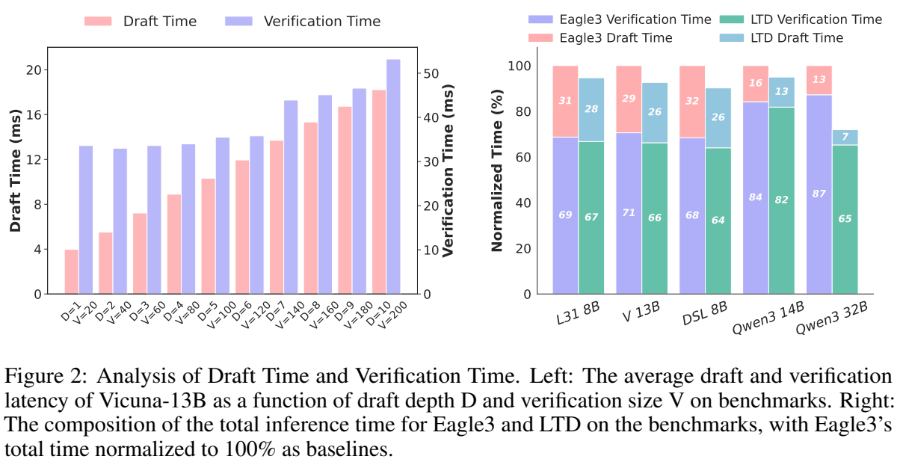

图 12. 原文 Figure 2，正式 PDF 物理第 4 页。左图在 Vicuna-13B 上改变 D、V，粉色为草稿时间、紫色为验证时间，后者存在阶梯；右图按 EAGLE3 总时间归一化比较不同模型的两部分耗时。不要把右图各颜色的数字当成 tokens/s，也不能把一个模型的硬件曲线通用于另一个模型。图源及版本同本节正式 PDF。

### 4.3 数据、训练安排、推理与成本

使用冻结的 EAGLE3 草稿体系及目标模型；目标覆盖 Llama-3.1-8B-Instruct、Vicuna-13B、DeepSeek-R1-Distill-Llama-8B、Qwen3-14B／32B。Qwen 的 EAGLE 模型来自 AngelSlim 系列。策略训练提示取 HumanEval，评估覆盖 MT-Bench、GSM8K、Alpaca、Natural Questions；另用 MMLU 57 科各 80 个问题看速度适应性，MMLU 此处不是在证明质量提升。

论文的预热与交替训练先让一个策略在受控的另一维度上学习，再轮流冻结／更新：大小策略初始训练约 100k steps，随机草稿深度 1–12；深度策略约 1M steps，固定验证大小 60，然后交替优化。不同段落对叙述顺序存在差异，消融中给出从朴素设置、大小策略、深度策略到再次大小策略的迭代链，复现需明确检查点依赖，而不是只记“联合训练”四个字。

```text
冻结目标模型与 EAGLE3 草稿模型
初始化深度控制器、大小控制器及价值网络
重复交替训练：
    固定一个控制器，采集另一个控制器的 rollout
    在 HumanEval 提示上构建候选树
    深度控制器逐步选择继续／停止
    大小控制器选择候选节点数，构造验证掩码
    目标模型验证，更新上下文并计时
    用接受 token 数除以总耗时计算奖励
    用 PPO 更新当前控制器
部署：两个控制器一起决策，仍由目标模型执行正确性验证
```

论文给 PPO rollout 2048、minibatch 256、每批 20 epochs、学习率 $`10^{-3}`$、1% warmup 后线性衰减、熵系数 0.01；深度／大小的折扣因子分别为 0.999／0.9。所有实验使用单张 A100，但显存型号、峰值显存和费用未给出。附录列 Llama 的大小／深度策略训练约 2／5 小时，Vicuna 约 2.5／5 小时，Qwen3-32B 约 3.5／7 小时；作者描述三轮迭代小于 30 GPU-hours。该口径不应被扩展成“所有模型所有消融加起来不足 30 卡时”。策略网络精确参数总数和完整调参总预算未明确披露。

分布等价的前提是验证算法正确。贪心生成时可以核对目标 argmax；温度为 1 的随机生成需要相应的接受／拒绝校正，不能用简单“草稿 token 等于 argmax”替代。LTD 改变候选计算预算本身不必改变目标分布，但缺失验证细节时不能无条件保证输出完全相同。

### 4.4 主实验和消融怎样读

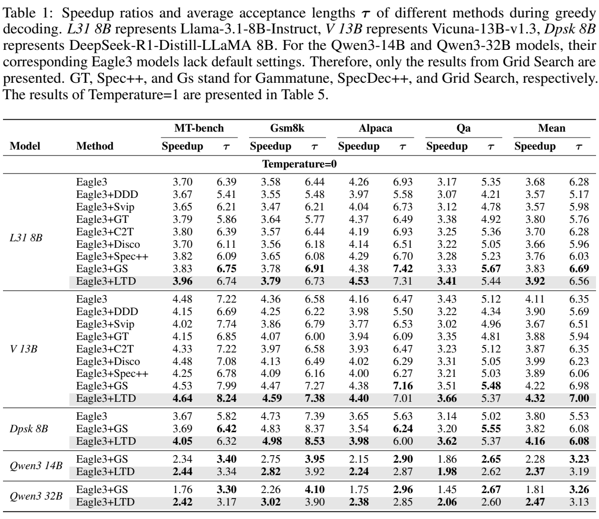

图 13. 原文 Table 1，正式 PDF 物理第 8 页。温度 0，速度倍数均相对同目标模型自回归基线；tau 为平均接受长度。GS 是网格搜索调参的 EAGLE3，对 Qwen 只报告 GS 基线。每个模型块必须分别比较，不能将 Qwen32B 的倍数和 Vicuna13B 的倍数当作绝对速度比较。图源及版本同本节正式 PDF。

原表四任务均值中，Llama-3.1-8B 的 EAGLE3／GS／LTD 为 3.68／3.83／3.92 倍；Vicuna 为 4.11／4.22／4.32；DeepSeek 蒸馏模型为 3.80／3.82／4.16；Qwen14B 的 GS／LTD 为 2.28／2.37，Qwen32B 为 1.81／2.47。**本文推演：**Llama 对默认 EAGLE3 提升约 6.5%，但对 GS 只有约 2.35%；Qwen32B 对 GS 则约 36.5%。比较基线不同，不能把最大比例当成统一收益。

Qwen32B 的平均接受长度从 GS 的 3.26 变为 LTD 的 3.13，速度却提升，直接说明“接受更长”不是唯一目标。温度 1 的附录结果中，Llama EAGLE3 到 LTD 为 2.98→3.01，增益约 1.0%，并非每个条件都提升至少 5%。Vicuna 为 3.44→3.62，Qwen32B GS 为 1.66→2.26。这里没有重跑这些数字，也没有用论文平均值推断每个请求的尾延迟。

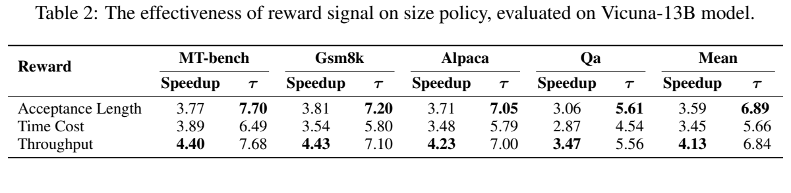

图 14. 原文 Table 2，正式 PDF 物理第 10 页。在 Vicuna-13B 上单独训练大小策略，比较只奖励接受长度、只优化时间与吞吐率奖励。均值速度为 3.59／3.45／4.13 倍；接受长度奖励的 tau 6.89 略高于吞吐率奖励的 6.84，速度反而更低。它是同设置的目标消融，不能与完整版 4.32 倍直接混成同一算法。图源及版本同上。

表 4 中完整双策略均值 4.32 倍，只有深度策略 4.29、只有大小策略 4.13、朴素组合 4.20。完整策略并非每个任务都最好，例如 MT-Bench 上仅深度为 4.77，完整策略为 4.64。表 9 给策略决策开销约 Llama 1.39%、Vicuna 1.22%；是否值得为新硬件训练控制器，还取决于请求量能否摊薄训练成本。

### 4.5 静态复现审查：当前发布物尚不完整

固定仓库快照包含 RL 训练、EAGLE 模型、评估和数据目录；不能说整个 EAGLE 实现缺失。不过 `ea_model.py` 无条件导入 `cnets_ddd`、`cnets_c2t`、`cnets_svip`、`cnets_disco`、`cnets_gamma`、`cnets_spec_plus`，这些被导入模块未在快照中找到；Qwen3 类的导入也被注释，而加载分支仍引用它。`train_size.sh` 传入的 `--rl_token_model_path` 在对应脚本参数解析器中未找到，存在静态接口不匹配；本次没有实际启动去验证报错。

源码与论文参数也不同：大小动作空间为 24 档，每档 10 tokens，即 10–240，而正式论文为 12 档、每档 20；随机深度函数先抽取 1–12，随后又将变量固定为 12；深度策略按代码中的循环条件每三轮判断，而非叙述中的每轮。公开默认训练步数、rollout 128、batch 64、学习率 $`3\times10^{-4}`$、PPO epoch 1、折扣 0.99、熵系数 0，也与论文配置不同。

RL 环境的奖励计时使用 `time.time`，未见显式 CUDA 同步配对，部分 CPU 取值可能间接同步；评估脚本则有三轮预热和生成前后的 CUDA 同步，二者不能混为一谈。更需注意，Llama3 评估路径从总时间中减去 `pre_len_time`，该值沿调用链包含大小控制器预测计时；因此应同时报告未经扣除的完整耗时。`utils.py` 确实包含随机接受与残余分布更新分支，不能说公开实现仅支持贪心；但启动示例温度为 0，温度 1 与质量等价仍未由本次实际运行验证。上述结论是“最终论文与当前公开实现不能直接对应”，不是声称方法必然无效。

局限包括硬件与负载特异性、单请求／批量服务场景差异、训练提示分布转移和控制器训练摊销；更长上下文、更大并发和实际服务调度可能改变最优预算。入门先看 [推测解码原始论文](https://arxiv.org/abs/2211.17192)的分布保持机制，再看本篇 Figure 1／2；项目入口为上述作者仓库，本次未找到独立作者博客。正式复现前首先补齐依赖、对齐动作集合和 PPO 参数，再测完整吞吐率与质量等价。

## 5. CluSTER：均衡抽样后，别忘了把原始分布权重补回来

**身份与阅读范围。** 全名 Clustering-Based Balanced Sampling and Allocation with Data Parallelism for High-Performance Fine-Tuning，Hyunjin Kim、Youngeun Nam、Jaemin Han、Wonhyeok Choi、Jae-Gil Lee。依据 [ACL Anthology 正式主会条目](https://aclanthology.org/2026.emnlp-main.342/)与 [EMNLP 2026 官方程序](https://2026.emnlp.org/program/)所链接日程确认：主会全文，poster，CCF-B。日程论文号 941-MAIN，2026-10-26 11:00–12:30，Hall H，Poster Session D，海报号 250。正式 DOI 为 `10.18653/2026.emnlp-main.342`，与页面元数据一致。

阅读 [正式 PDF](https://aclanthology.org/2026.emnlp-main.342.pdf)全部 19 个物理页（论文集页码 7885–7903）及 [作者代码](https://github.com/kaist-dmlab/CluSTER)，commit `59c9f1e312eec9e8b179f85c398506c8492fb7d8`。arXiv:2609.12584 首发于 2026-09-11，正式论文集发表于 2026 年 10 月；采用原始公开日，不使用学术索引的占位日期。

### 5.1 数据并行、梯度和冗余的基础直觉

数据并行让多个 GPU 各算一部分样本梯度，再汇总更新同一个模型。若每张卡拿到大量相似样本，预算可能反复花在相同信息上。CluSTER 先把指令按廉价的梯度代理聚类，再让一个全局批次覆盖不同簇，删去每簇中较冗余的中心样本，最后用簇原始占比修正梯度权重。

重要区别是：在全局批次完全相同、损失相同且精确平均的条件下，仅把样本重新分给不同 GPU，不会改变数学上的总梯度。方法真正改变的是选哪些数据、批次怎样分层，以及各簇更新怎样加权。不能把性能收益全部解释成“GPU 分工更聪明”。

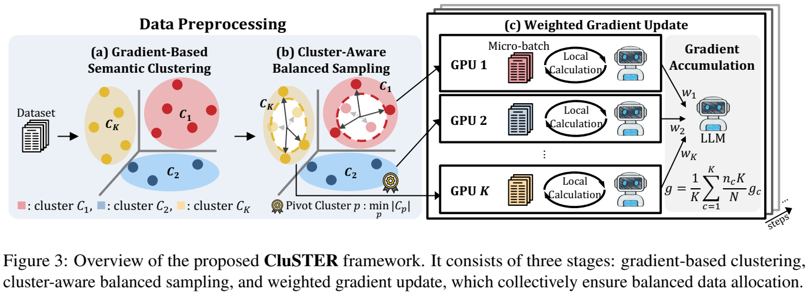

图 15. 原文 Figure 3，正式 PDF 物理第 4 页（论文集页 7888）。左侧以前向计算的梯度代理聚类，中部以最小簇为基准均衡删选，右侧不同 GPU 处理簇样本并按原始簇大小加权。图中权重用于恢复原始分布占比，不是奖励函数。图源及版本为本节 EMNLP 2026 正式 PDF。

### 5.2 不反向传播，怎样得到梯度代理

令第 t 个 token 的最后隐藏状态为 $`h_t\in\mathbb R^d`$，正确 token 为 $`y_t`$，模型在 teacher forcing 下给它的概率为 $`p_{t,y_t}`$。对 softmax 交叉熵，输出层权重中“正确类别那一行”的梯度是 $`(p_{t,y_t}-1)h_t`$。论文按有效 token 平均后归一化：

```math
\begin{aligned}
g(x)&=\frac{1}{|T(x)|}\sum_{t\in T(x)}(p_{t,y_t}-1)h_t,\\
e(x)&=\frac{g(x)}{\|g(x)\|_2}.
\end{aligned}
```

$`T(x)`$ 是有效训练 token 位置集合，$`|T(x)|`$ 为其大小，$`d`$ 为隐藏维度。推导从交叉熵对 logit 的导数“预测概率减 one-hot 标签”出发，再对线性输出层求导即可。这里只保留每个位置正确 token 对应的一行并把不同 token 汇到同一 d 维空间，因此它是**代理**，不是全模型参数梯度，也不是完整词表输出层梯度。归一化进一步舍弃了幅值，聚类主要比较方向。

这样只需一次前向获取隐藏状态和概率，避免为每个样本做完整反向。仍需支付前向、存储表示、聚类和索引构建的开销，不能说数据选择“免费”。作者使用 K-means，簇数 K 与 GPU 数量相关，容量超参数 alpha=1.5；具体容量控制并不等同于保证所有簇严格等大。

### 5.3 最小簇、外围选择和加权梯度

令原始 N 条数据分为 K 个簇，第 c 簇大小 $`n_c`$，最小簇大小 $`n_{\min}`$，采样比例参数为 $`r\in\{1,0.75,0.5\}`$。各簇保留约 $`\lfloor r n_{\min}\rfloor`$ 条样本，并优先保留离中心更远的外围样本。实际数据使用率约为：

```math
q=\frac{K\lfloor r n_{\min}\rfloor}{N}.
```

所以 r=1 不代表使用全量数据。原表里代码数据 r=1 对应约 79%，医学对应约 63%；r=0.5 分别约 40% 与 31%。比较数据预算时，应读实际百分比，不应只读 r。

均衡抽样让每簇出现同样多次，却会放大原本小簇的影响。设原始簇占比 $`\pi_c=n_c/N`$，簇样本平均梯度为 $`\widehat\mu_c`$，每个 worker 的权重取 $`w_c=K\pi_c`$，则：

```math
\widehat G=\frac1K\sum_{c=1}^{K}w_c\widehat\mu_c
=\sum_{c=1}^{K}\pi_c\widehat\mu_c.
```

左侧对应数据并行先加权再平均，右侧恢复原始簇占比。**本文手算：**两个簇各占 80%／20%，簇均值梯度为 1／5。直接均衡平均得到 3；原数据平均为 $`0.8\times1+0.2\times5=1.8`$。设权重为 1.6／0.4，再平均就恢复 1.8。若最小簇 20 条、r=0.5，每簇取 10 条，总共只用 20／100=20% 数据，并非 50%。

但以上恢复成立的关键是抽取后的簇均值仍代表原簇均值。外围选择不再是簇内均匀随机抽样；其偏差可写成：

```math
\mathbb E\widehat G-G_{\mathrm{full}}
=\sum_c\pi_c\bigl(\mu_c^{\mathrm{selected}}-\mu_c^{\mathrm{full}}\bigr).
```

这条是本文对方法的直接推演。簇大小权重能修正簇占比，不能自动修正簇内偏向外围带来的分布变化。论文附录用聚类前后梯度中心相似性支持近似合理性，但不是任意模型、任意训练阶段的无偏定理。

分层采样降低方差的经典直觉是去掉“这个批次碰巧多抽某一簇”的随机性。在等大平衡簇的简化条件下，随机采样方差包含簇内与簇间两项，分层可去掉簇间项；不等大簇下，加权分层方差结构为：

```math
\mathrm{Var}(\widehat G_{\mathrm{strat}})
=\sum_c\pi_c^2\frac{(1-f_c)S_c^2}{m_c}.
```

$`m_c`$ 是第 c 簇抽取数量，$`f_c=m_c/n_c`$ 为抽样比例，$`S_c^2`$ 为簇内方差。相同 $`m_c`$ 不一定是最优分配；簇大小和方差差异大时不保证总方差优于所有随机方案。作者也在非均匀扩展中保留了这个限制。

论文的梯度多样性比率 $`\sum_i\|g_i\|^2/\|\sum_i g_i\|^2`$ 将较低的相似性与更多互补信息联系起来，但分母接近零时会很大，不意味着训练质量必然改善。**推导核对：**附录 B 在假设两项扰动独立且零均值时给出负的交叉内积期望，这一步按独立性应为零；目标余弦近似需要额外处理二阶归一化项。该段应作为有启发性的近似论证阅读，不能视作已由所列步骤严密证明。

### 5.4 数据、实现与训练配置

```text
用初始目标模型对训练集做一次 teacher-forcing 前向
取正确 token 概率和最后隐藏状态，构建并归一化代理表示
运行带容量控制的 K-means，记录每个簇原始大小
以最小簇大小为基准，每簇保留指定数量的外围样本
按簇构建均衡批次／分布式采样索引
for 微调批次:
    各 worker 计算普通监督交叉熵
    按原始簇比例修正本地更新权重
    聚合梯度、执行优化器更新
推理：使用普通微调模型，不需要在线聚类
```

数据规模为 Magicoder-OSS-Instruct 75197 条、Evol-Instruct-Code 78264 条、MedInstruct 52002 条。模型主要为 CodeLlama-Python 7B／13B 和 Llama-2 7B／13B。代码类评估 HumanEval、HumanEval+、MBPP、MBPP+ 的 pass@1，医学使用 MedMCQA、MedQA、MMLU 医学子集、PubMedQA；结果平均 3 个随机种子并给出标准差。

Magicoder 主实验使用 4 张 H100、2 epochs、Adafactor、学习率 $`5\times10^{-5}`$、global batch 512、线性调度、15 步 warmup。README 示例长度为 1214，相关默认值为 1216，复现时应显式固定。医学使用 4 张 H100、3 epochs、AdamW、学习率 $`2\times10^{-5}`$、cosine 调度、warmup 0.03、长度 1024；附录每卡 batch 4、累积 8，按四卡计算为 global batch 128，与正文泛称 batch 512 的表述需区分。Evol 扩展在附录使用 4 张 H200，并非全部都是 H100。

没有完整披露精确 optimizer steps、峰值显存、全部搜索预算与费用。时间表可估算部分 GPU-hours：例如 Magicoder 全量训练 1.13 小时，四卡对应 4.52 GPU-hours；医学 31% 数据的训练 0.30 小时，四卡对应 1.20 GPU-hours。上述为卡数乘时间的本文估算，只覆盖列出的训练阶段，不含所有筛选、调参和评估。

### 5.5 主结果与端到端成本

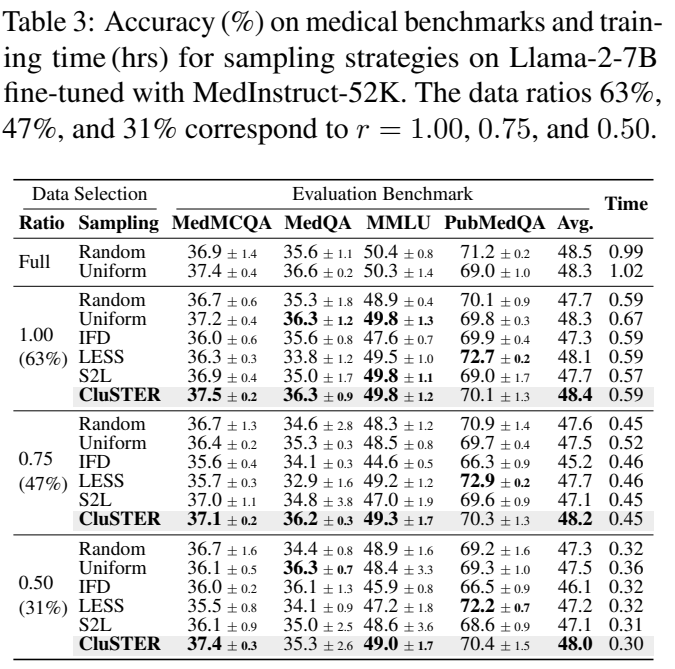

图 16. 原文 Table 3，正式 PDF 物理第 6 页（论文集页 7890）。Llama-2-7B 在 MedInstruct 上微调；固定实际数据比例后比较 Random、Uniform、IFD、LESS、S2L 与 CluSTER。Avg 为四项医学任务平均，Time 为训练小时，尚未含数据选择。均值旁的波动为三个种子结果。图源及版本同本节正式 PDF。

全量医学平均分 48.5、训练 0.99 小时；CluSTER 在 63%／47%／31% 数据时分别为 48.4／48.2／48.0，训练 0.59／0.45／0.30 小时。原文给最低比例训练省时 69.6%，由四舍五入表值计算约为 69.7%；不能将这点舍入差异解释为实验矛盾。相同 31% 数据的随机采样为 47.3、0.32 小时，说明相对于同数据量基线的主要优势是质量，而“省约七成时间”主要是在与全量训练比较。

代码任务的全量平均为 57.6、1.13 小时；59% CluSTER 为 56.5、0.69 小时，40% 为 55.9、0.47 小时。质量没有严格保持不变；应根据可接受的分数损失决定删数据幅度。论文 8 GPU 表中，41.6% CluSTER 平均 55.8，低于全量 57.5，虽正文用了较乐观表述，本报告以表值为准。13B 代码模型有 61.1% 数据达到 62.5、超过全量 61.3 的条件；医学 13B 的 65.9% 则为 52.6，低于全量 53.1，不能概括成所有领域都以更少数据更好。

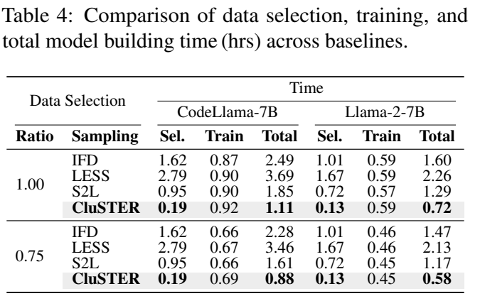

图 17. 原文 Table 4，正式 PDF 物理第 7 页（论文集页 7891）。Sel 为选择时间、Train 为训练时间、Total 为两者相加。CluSTER 的选择阶段代码／医学分别约 0.19／0.13 小时；比较完整成本时应读 Total，不能只读 Train。表中 r=1 和 r=0.75 对应均衡后的实际数据比例，不是原数据的 100%／75%。图源及版本同上。

**本文推演：**代码数据 79% 时总时间 0.19+0.92=1.11 小时，与全量训练 1.13 小时几乎持平；59% 时总时间 0.88 小时，相对 1.13 省约 22.1%。医学 63% 时总 0.72 小时，相对全量 0.99 省约 27.3%；47% 时总 0.58 小时，省约 41.4%。这些才是表中可直接比较的含选择开销口径。没有把 31% 条件未逐项报告的选择时间擅自填成实测值。

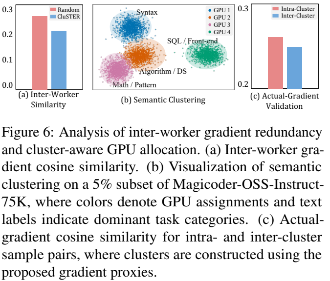

图 18. 原文 Figure 6，正式 PDF 物理第 9 页（论文集页 7893）。左图比较 worker 间梯度相似性，中图展示 5% Magicoder 子集的语义聚类，右图用实际梯度比较簇内／簇间相似性。右图纵轴从 0.2 附近开始，视觉差距不能直接按柱高倍数解读；中图是降维可视化，不是全数据语义标签证明。图源及版本同本节正式 PDF。

消融表 7 中，簇权重将 79% 代码数据平均从 55.5 提升至 56.8，59% 从 55.3 提升至 56.5。外围选择的梯度多样性 1.62，高于随机 1.57、中心选择 1.51，对应均值 56.8／56.2／56.1。真实梯度验证给出置换检验 p=0.0464；语义人工检查 400 条中 328 条一致，即 82%。这是有限抽样证据，不能推断所有簇都拥有可靠语义标签。

### 5.6 代码审查、局限与可复现性

已静态阅读作者 README、`custom_sampler.py`、`train_grad.py`、`call_back.py` 的预计算／选样／权重逻辑以及 `coreset_trainer.py` 的损失和采样接入。代码中的 `prune="close"` 表示删掉靠近中心者，保留排序末尾的远处样本；若按名字误读成“选中心样本”，会实现相反策略。训练路径实际使用与原簇大小成正比的 rank 权重，不能拿旁边未使用的逆权重辅助函数解释最终算法。

当前实现含前向预计算、采样索引与分布式训练路径，具备复现基础；仍需用小数据做多 rank 集成验证，确认 Accelerate 的再次切分与自定义索引没有造成重复或漏样。本次未运行此项验证。README 的最大省时数字与正式论文不同，本期以正式论文及逐项时间表为准。

局限包括一台机器至多 8 卡、约 5–8 万条数据与 7B／13B 规模，不能据此保证跨节点、百万级语料、长上下文或更大模型仍划算。外围采样可能保留异常值；固定初始化的代理会随训练失效；簇数量跟 GPU 数挂钩不一定是统计最优。入门可先做本节 80／20 的加权手算，再读 [BADGE 原始论文](https://arxiv.org/abs/1906.03671)理解梯度表示动机，最后区分 CluSTER 的廉价代理与完整梯度。作者代码为上述仓库，本次未找到独立作者博客。

## 共同结论与复核清单

五篇从不同位置改变计算预算：SafeDPO 减少安全对齐流程中的网络和在线采样；Coverage 解释预训练怎样保留可被后续采样发现的答案；SSPO 用未配对数据降低标签依赖；LTD 学习推理时的草稿／验证预算；CluSTER 改变微调数据的覆盖与分配。它们没有共享一个能横向排名的准确率或 GPU-hours，不能把不同任务的百分比拼成总榜。

最适合复现的第一步也不同：SafeDPO 需要先明确作者代码与安全标签；Coverage 应从小型合成图确认概率和覆盖定义；SSPO 必须核对最终论文的 KDE 与仓库阈值差异；LTD 需要补齐模块、计时边界及动作空间；CluSTER 则应核对分布式索引、真实保留比例与完整选择成本。所有教学伪代码和手算只解释机制，未被描述成实际完成的模型实验。

## 图源、版本与制品说明

本期 18 张图表均直接从五篇正式 PDF 按物理页裁取，未重画实验曲线、修改数据或用生成图替代原图。每张图的源 URL、PDF 版本及哈希、物理页、裁切坐标、图像哈希和阅读条件保存在 `assets/figures.json`。原论文中没有独立架构图的 Coverage 已明确说明。引文快照、官方录用／展示证据、CCF 目录、代码读取范围与固定版本均在 assets 内留档。

`report.md` 是唯一全文来源；`report.pdf` 包含同一正文、全部公式、表格、伪代码和原图，不是摘要版。独立公式用矢量数学图形，行内公式按基线嵌入高分辨率图形；对应 LaTeX、尺寸和哈希记录在 `assets/math-manifest.json`。PDF 的文字覆盖与数学图形分别核验，逐页渲染检查、字体缺字、边界和原图完整性记录见 `assets/QA.md` 与 `assets/pdf-check.json`。引用指标只是查询日快照，未披露的硬件、费用和实验量不以猜测填补。
