# CCF A/B 论文精读 | 2026-11-25

## 快速导读

### 1. T³：训练会主动提问的模型

猜数字或查故障时，模型有时问着问着就忘了已经排除哪些答案。训练只看最后猜对没有，这些无效追问还可能拖累前面好问题的得分。T³ 为每类任务设一个进展信号，例如候选范围有没有缩小。训练时一路检查，连续几轮没有进展就停止这次互动，把留下的记录交给原有强化学习算法。部署时再让训练好的模型完整作答。[查看精读](#paper-t3)

### 2. HSD：大模型怎样一次核验多个草稿词

小模型先写草稿，大模型批量检查，能省下逐词调用的成本。接受更长的片段时，难点是怎样让最终抽样仍遵循大模型的概率。HSD 从最长草稿往回找可接受的前缀，按各条分支的概率缺口补抽一个词，再进入下一轮。作者后来更正了实现，会议版一部分速度结果来自旧代码。[查看精读](#paper-hier)

### 3. Prophet：答案稳定后，扩散模型提前收尾

扩散语言模型会来回补写空格。作者发现，最后几轮之前，答案位置有时已经出现稳定的首选词。Prophet 先用提示把回答放到可识别的区域，再每轮比较那里最有把握和第二有把握的词。前期要求差距很大，后期逐步放宽，一旦达标就把剩余空格一次填完。[查看精读](#paper-prophet)

### 4. RMT：让模型只在需要时为下一个词多想几步

资料里每个位置都有正确的下一个词，可对所有位置都先写推理，训练会很慢。RMT 先按模型的犹豫程度给词分难度，训练从容易的位置逐渐转向难的。选中的位置让模型试着推理多次，按猜对与篇幅给分，推理预算也随训练逐步缩短。其他位置仍用常规的下一个词预测练习。[查看精读](#paper-rmt)

### 5. Order-Token Search：扩散生成时同时试落笔顺序和填什么

扩散模型可以先写答案或先写中间步骤。每轮只走最有把握的一条路，有时会太早放弃更好的写法。作者在每个块展开多条路线，让它们试不同的位置和词，再遮住各路线刚写的词，请同一个模型重猜。反复留下更容易被上下文支持的路线，最后只交出得分最高的一份。[查看精读](#paper-order)

## 篇目与选题口径

| 论文 | 2026 年主会 | CCF | 展示 | 首次公开 | OpenAlex |
| --- | --- | --- | --- | --- | --- |
| T³ | ICLR | A | Oral | 2025-10-14 | 3 |
| HSD | ICLR | A | Oral | 2026-01-09 | 8 |
| Prophet | ICLR | A | Oral | 2025-08-27 | 91 |
| RMT | ICLR | A | Poster | 2025-09-29 | 23 |
| Order-Token Search | EMNLP | B | Poster | 2026-01-28 | 13 |

北京时间 2026-11-25。实收 **5 篇，4 A + 1 B，3 Oral + 2 Poster**。录用年度按主会论文集核对，首发日期取 arXiv v1 的 UTC 日期。CCF 第七版正式目录物理页 57、58 分别列 ICLR 为 A、EMNLP 为 B。Oral 取 ICLR 官方会程，EMNLP 展示取官方日程 MAIN 项。OpenAlex 计数在当天查询，部分记录合并会议版和预印本，引用优先用于主题与公开时长相近时的排序。此前收录的 p-less、LoongRL 等剔除。逐篇证据见 [来源与证据](https://github.com/daihuangyu/papers-daily/blob/main/CCF_Papers/2026-11-25/assets/SOURCES.md)。

本文使用官方会议全文及附录，核查可访问的作者代码。「手算」和「本文推演」用于解释。实验数字均来自标明版本的原文或作者更正。我没有运行训练或推理基准。图和表为原 PDF 裁图，物理页从第一页起算。

<a name="paper-t3"></a>

## 1. T³ | Reducing Belief Deviation in Reinforcement Learning for Active Reasoning of LLM Agents

### 从主动提问到信念陷阱

普通问答一开始给齐线索。主动推理允许模型向环境索取线索。猜数字时，提问本身就是动作，环境反馈跟真实数字和猜法有关。系统在**部分可观测马尔可夫决策过程**里操作，只能看自己的对话史。理想求解器能精确更新对所有可能答案的概率，语言模型通常把这套判断隐含在上下文和激活中。作者关心长期跑偏如何影响终局奖励下的训练。

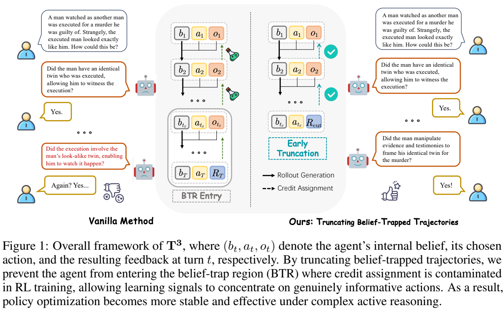

图 原文 Figure 1，ICLR 2026 论文集 PDF 物理页 2。左侧是普通训练中逐步陷入无效追问的轨迹，右侧是在训练采样时终止该轨迹。对话旁的候选框表示信念在演化，图为机制示意。

### 概率更新、进展与归因

设 $`s^\star`$ 为每局固定但对模型不可见的真实状态，$`s`$ 是任一候选，$`t`$ 是互动轮次，$`a_t`$ 是动作，$`o_t`$ 是观察，$`O`$ 是环境观察的条件概率。$`b_t^\star`$ 是理想信念，$`b_t`$ 是作者用于分析模型的信念。给观察前的信念乘以各状态发出这条观察的概率，再除以总证据质量，得到贝叶斯式。$`\Psi`$ 对正确状态的概率取负对数，越低代表越接近真相（§2.1，Eq. 1–2）。

```math
b_{t+1}^{\star}(s)
 = \frac{O(o_t\mid s,a_t)b_t^\star(s)}
 {\sum_{s'} O(o_t\mid s',a_t)b_t^\star(s')},
 \qquad \Psi(b)=-\log b(s^\star).
```

理想更新器和模型从同一个当前信念出发。如果随真状态信心下降，模型的平均更新误差增速足以压过环境带来的进展，就会进入文中定义的陷阱区域。该结论依赖 Appendix B 的观测、策略平滑性、误差增长和区域条件。假设候选均匀且真解还在集合里，给真解的质量为 $`1/|H_t|`$，代入得 $`\Psi=\log|H_t|`$，解释为什么缩小候选集可作为监测。

终局奖励经优势估计传回前序动作。$`r_t`$ 是该步奖励，$`V_t`$ 是 critic 的价值估计，$`\gamma`$ 折扣未来回报，$`\lambda`$ 控制误差延续多久，$`T`$ 是终点，$`j`$ 是偏移。每项 TD 误差 $`\delta`$ 是观察到的回报加下一步估值，再减当前估值。沿轨迹加权求和便是 GAE（§2.1）。作者分析了价值与真状态概率单调且陷阱内存在足够负漂移时，长尾如何使前缀优势翻负。

```math
\delta_t=r_t+\gamma V_{t+1}-V_t,\qquad
\widehat A_t=\sum_{j=0}^{T-t-1}(\gamma\lambda)^j\delta_{t+j}.
```

**手算。** 8 个等概率候选经有效问题剩 2 个，势能下降 $`\log 8-\log 2=\log 4\approx1.386`$。之后猜已排除的数字，候选数不变。若前缀累计 TD 贡献正 0.3，尾巴两步各负 0.2，在折扣积为 1 时合计负 0.1。只保留前缀时是正 0.3。此例固定 TD 项以说明归因方向，真实截断还要按终止标记重算价值目标。

### 采样时怎样发现停滞

$`H_t`$ 是假设集合的表示，$`d`$ 是代理收缩量，$`k`$ 是连续窗口长度，$`\Delta_{\min}`$ 是进展阈值。窗口内所有更新都未越过阈值，就提前结束训练 rollout。§2.2 的误截断上界依赖独立高斯代理噪声、偏差上界和陷阱外正进展余量。

```math
\forall j\in\{t-k,\ldots,t-1\}:\quad
d(H_j,H_{j+1})\le\Delta_{\min}.
```

- **数据与信号（原文）。** GN 猜数字，1526/382 条训练/测试，猜法违背已有约束便截断。CD 布尔电路辨识，1000/300，连续三轮候选数不降即停。SP 情景推理，400/100，14B 模型扮演裁判，五次连续答「未知」就停。PE 偏好估计和 MR 看电影属性选片，分别 700/300，使用连续两轮偏好改进不足的代理。PE 主实验使用已知训练目标向量，附录探索无目标向量和在线阈值。
- **奖励与更新（原文）。** 稀疏任务奖励送到轨迹末端。GN、CD、MR 使用正确性，SP 使用文本 F1，PE 用阈值化余弦相似度。T³ 包在采样端，PPO、GRPO、GSPO 保留各自更新规则。测试使用任务允许的完整交互。
- **资源（原文）。** 主模型 Qwen2.5-7B-Instruct。GN/SP 用单机 8 张 H100，CD/PE/MR 用单机 8 张 B200。FSDP、BF16、vLLM TP=1，200 步，actor 学习率 1e-6，GRPO 每提示 5 条。GPU 容量、峰值显存、训练总时长、GPU-hours 和费用未找到。

```text
for each training request:
    reset environment and progress history
    while the interaction budget remains:
        sample question, observe reply, update proxy
        if stop condition holds: close the rollout
        if agent has finished: close the rollout
    compute terminal reward and advantages on kept data
update policy with the selected RL optimizer
```

### 原实验与复现

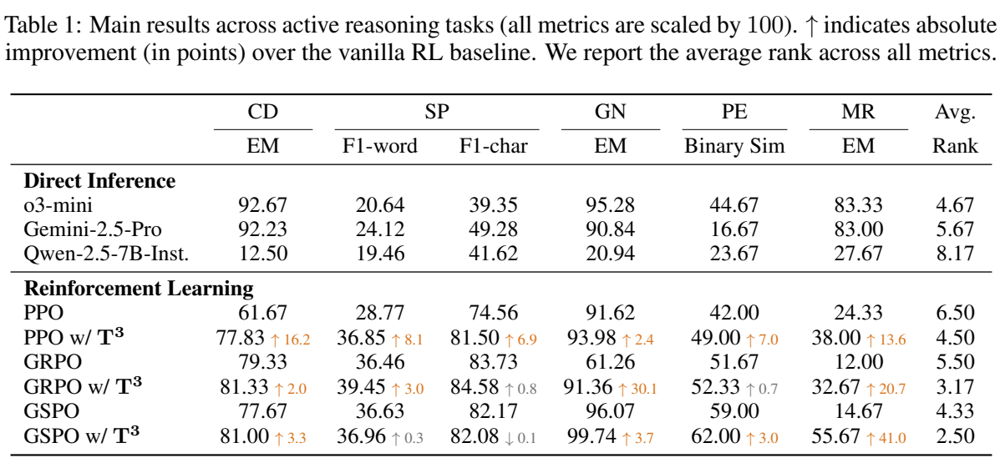

图 原文 Table 1，物理页 6。按同一优化器比较两行。同样的 7B 起点下，GN 的 GRPO 精确匹配 61.26→91.36，CD 的 PPO 61.67→77.83，MR 的 GSPO 14.67→55.67。SP 的 GSPO 字符 F1 82.17→82.08。闭源直接推理行的训练与推理预算各异。

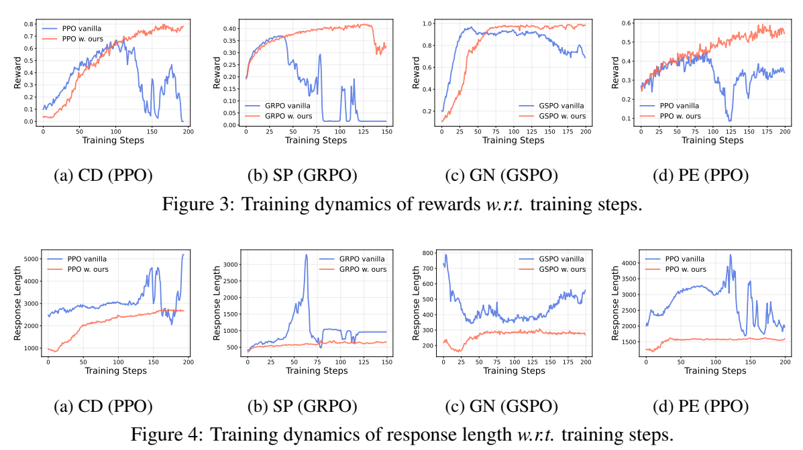

图 原文 Figures 3–4，物理页 7。相同任务和优化器内读蓝色基线与红色 T³。横轴训练步，纵轴分别为奖励、应答长度。某些任务前段涨得更慢，后段奖励更稳、回答更短。Table 3 中 CD 的 PPO 窗口 2/3/4 得 69.17/77.83/79.33，随机每步以 0.5 截断得 13.17。

**本文推演。** 代理可能错把铺垫当绕圈。变更窗口时同时记录正确率、误杀率和每局工具调用数，更容易辨别省下的是无用追问还是必要探索。

**代码核查。** 固定提交读了作者的 T3 数据处理、训练包装和主训练入口。仓库同时承载另一篇 AREW，后续 Tau2Bench 命令的步数与本文五任务的 200 步口径不同。[作者代码](https://github.com/unimpor/T3/tree/492f31fa05d2065c750a72d5e798385af282fa5d) · [作者数据](https://huggingface.co/datasets/WorkingOut/T3_data) · [PPO 入门](https://spinningup.openai.com/en/latest/algorithms/ppo.html)

<a name="paper-hier"></a>

## 2. HSD | Overcoming Joint Intractability with Lossless Hierarchical Speculative Decoding

### 先看为什么要核验草稿

大模型逐 token 采样，每个词都要等一次串行前向。投机解码让小模型先采样一串，大模型一次前向取得沿草稿路径的条件分布。「无损」指最终采样分布与目标模型按相同温度逐词采样一致。逐位置核验遇到第一次拒绝就改写该词，余下草稿随之丢弃。HSD 优先尝试长前缀，显式处理不同前缀下的剩余概率。

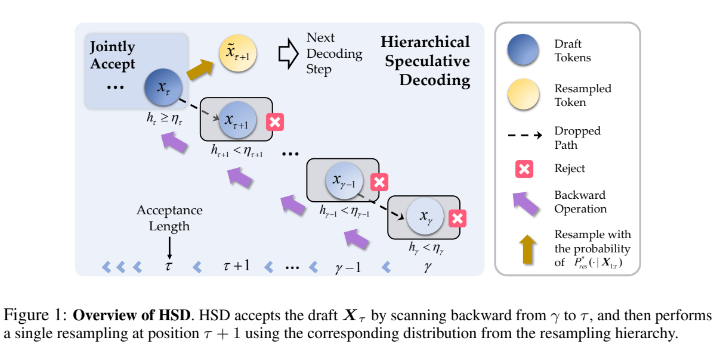

图 原文 Figure 1，ICLR 2026 论文集 PDF 物理页 2。从最长草稿向左找接受长度。若停在中间，沿接受前缀的分支抽一个补偿词。图为机制示意。

### 分支的缺口如何合并

$`p`$ 是目标分布，$`q`$ 是草稿分布，$`\omega`$ 是结果，$`\Omega'`$ 是可计算的一组结果，$`[x]_+=\max(x,0)`$。Eq. 4 的 $`D_{\Omega'}(p,q)`$ 度量草稿在该集合内少放的概率，交换 $`p,q`$ 得草稿多余量。两项逐元素相减，用 $`[z]_+-[-z]_+=z`$ 得净缺口。

```math
D_{\Omega'}(p,q)=\sum_{\omega\in\Omega'}[p(\omega)-q(\omega)]_+,
\qquad
D_{\Omega'}(p,q)-D_{\Omega'}(q,p)=\sum_{\omega\in\Omega'}(p(\omega)-q(\omega)).
```

分支 $`B(u)=\{uv:v\in\mathcal V\}`$ 包含固定前缀 $`u`$ 接任意词 $`v`$，$`\mathcal V`$ 为词表。按 $`p(uv)=p(u)p(v\mid u)`$ 分解，沿分支总和就是 $`p(u)`$，净缺口则是 $`p(u)-q(u)`$（Eq. 8）。全空间两边各有质量 1，缺口和盈余相等。父分支收集子分支的净缺口和盈余，可以在可访问层重抽。

**手算。** 草稿 A/B 各 0.5，目标 A/B 为 0.7/0.3。A 总是接受。B 被提议后以 0.6 接受，贡献 0.3。拒绝的 0.2 全补到 A，最终 0.7/0.3。两词时若前缀 A 在目标中质量 0.7、草稿中 0.5，则 A 的子分支净缺 0.2，需要从更上层补齐。

### 反向扫描与截帽重抽样

令 $`r_i=p(x_{1:i})/q(x_{1:i})`$，$`r_0=1`$，$`x_{1:i}`$ 为草稿长度 $`i`$ 的前缀。第 $`t`$ 位先取左侧前缀质量比的最大值，最低按 1 计。Eq. 16 的截帽比 $`r_t^\ast`$ 将该峰值削到 1，再乘后缀条件概率比，等价于用该最大值作分母。

```math
r_t^\ast=\frac{r_t}{\max(1,r_1,\ldots,r_{t-1})}.
```

截帽分支量 $`D^\ast`$ 把 $`p(uv)-q(uv)`$ 换成 $`q(uv)(r^\ast(uv)-1)`$ 后分别对正、负部分求和。$`\gamma`$ 是草稿长度，$`h_\gamma`$ 是整段接受率，$`h_t`$ 是退回长度 $`t`$ 的前缀接受率，$`P^\ast_{\rm res}`$ 在最后接受的前缀 $`u`$ 上归一化正缺口。以下为 Eq. 19–20 中分母正的可达路径。

```math
\begin{aligned}
h_\gamma &=\min(1,r_\gamma^\ast),\\
h_t &=\frac{D_{B(x_{1:t})}^{\ast}(p,q)}{D_{B(x_{1:t})}^{\ast}(q,p)},\quad t\lt\gamma,\\
P_{\mathrm{res}}^\ast(v\mid u)&=
\frac{[q(uv)(r^\ast(uv)-1)]_+}{D_{B(u)}^\ast(p,q)}.
\end{aligned}
```

**手算。** 两步联合概率比分别 1.4 和 0.98，第二步条件比为 0.7。截帽后整段接受率为 0.7。使用未截帽的 0.98 会让该分支多获得概率。

```text
draft = sample q for gamma positions
p_rows = score the draft path with one target forward
compute capped ratios and accessible branch residuals
scan longest to shortest with the matching acceptance rules
if the full draft is accepted: append a target bonus token
else: append the accepted prefix and one residual token
continue the next speculative step from the new prefix
```

### 更正后的结果口径

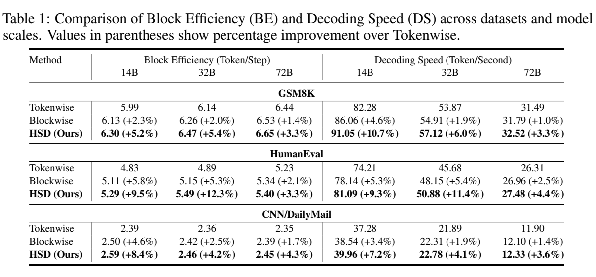

图 原文 Table 1，物理页 9，**历史结果**。横读目标模型大小，在三行看每次目标调用的生成词数（BE）及词/秒（DS）。稿件用 Qwen2.5-0.5B 草稿配 14B/32B/72B 目标，8-bit GPTQ，温度 1，单张 96 GB H20。GSM8K 32B 的逐词/分块/旧 HSD 为 53.87/54.91/57.12 token/s。HumanEval、GSM8K、CNN/DailyMail 分别评估代码、数学和摘要。

**作者更正。** 固定提交说明，会议版单草稿 HSD 跑分来自未截帽整段检查，属于 fast mode。正确 lossless 规则下，单草稿的前缀接受概率和残差与 block verification 相同，期望接受长度也相同。作者说明原多草稿实验未使用修正代码重跑，原 EAGLE-3H 数字已从项目说明移除。后来报告的 sampled-tree 结果采用新草稿构造和比较口径。作者将更正称作 arXiv v3，本次 arXiv 页面返回 v1/v2，v3 PDF 请求返回 404，更正内容据作者提交核验。[作者更正](https://github.com/ZhouYuxuanYX/Hierarchical-Speculative-Decoding/tree/8f8e88bb77a155e022b29df7ad6586b6515866a7)

**消融与资源。** 旧 Table 3 比较温度 0.6/0.8/1 和草稿长度 5/10/15，Table 4 比较 Llama 与 EAGLE-3。须用上述更正解读。论文报告单卡和部分 8 卡 H20，附录另组核验开销用 H200。HSD 只改推理，无新增监督训练、奖励或损失。峰值显存、整套耗时、GPU-hours 和费用未找到。无损推导依赖草稿按所用提议分布采样，剪枝、重复草稿和数值精度会影响实现条件。

**代码核查。** 固定提交检查 tree-hsd/verify_hsd_exact.py、tree-hsd/verify_alg3_exact.py 和 GSM8K 评测入口。README 的 lossless 默认规则与历史 fast mode 使用不同整段接受判据。小分布精确核验是作者的结果，本次静态阅读。[作者代码](https://github.com/ZhouYuxuanYX/Hierarchical-Speculative-Decoding/tree/8f8e88bb77a155e022b29df7ad6586b6515866a7) · [投机解码入门](https://huggingface.co/blog/assisted-generation)

<a name="paper-prophet"></a>

## 3. Prophet | Diffusion Language Model Knows the Answer Before It Decodes

### 把答案何时稳定和答案何时写出来分开

掩码扩散语言模型从一组待填位置开始，用双向上下文预测各位置的 token，多轮逐步揭开。一个位置尚未解除掩码时，模型已经有候选分布。作者把当前 top-1 还原成文本，回看第一次能抽取正确答案的轮次。回答后缀使答案槽更固定，统计时能较一致地找到目标位置。

### 局部置信与分段提前提交

设 $`L_t`$ 为剩余步标为 $`t`$ 时的 logits，$`A`$ 是答案位置集合，$`|A|`$ 为其大小，$`\ell_{t,i}^{(1)}`$ 和 $`\ell_{t,i}^{(2)}`$ 是位置 $`i`$ 最大和次大的 logit。每个位置的差就是对应两个 softmax 概率的对数比，因为归一化分母在比值中消掉。$`\bar g_t`$ 平均这些局部差距。$`T_{\max}`$ 是完整推理步预算，$`u`$ 是已用进度，$`\tau`$ 决定提前提交。

```math
\begin{aligned}
g_{t,i}&=\ell_{t,i}^{(1)}-\ell_{t,i}^{(2)},\\
\bar g_t&=\frac{1}{|A|}\sum_{i\in A}g_{t,i},\quad
u=\frac{T_{\max}-t}{T_{\max}},\\
\tau(u)&=\begin{cases}
\tau_{\mathrm{high}} & u\lt 0.33,\\
\tau_{\mathrm{mid}} & 0.33\le u\lt 0.67,\\
\tau_{\mathrm{low}} & u\ge 0.67 .
\end{cases}
\end{aligned}
```

如果 $`\bar g_t\ge\tau(u)`$，以当前 logits 的最大项填满剩余掩码，省略后续前向。否则按原有重掩策略继续。阈值随进度下降，早期噪声大时更谨慎。置信差衡量两个候选的相对偏好，无法衡量候选在外部核验下是否正确。

**手算。** 两个答案位置的最高/次高 logits 分别为 (5,1) 与 (6,3)，平均差 (4+3)/2=3.5。采用 7.5/5/2.5 的阈值时，进度 40% 会继续，进度 75% 则提交。两位置都偏向同一选项也仍有可能一起猜错。

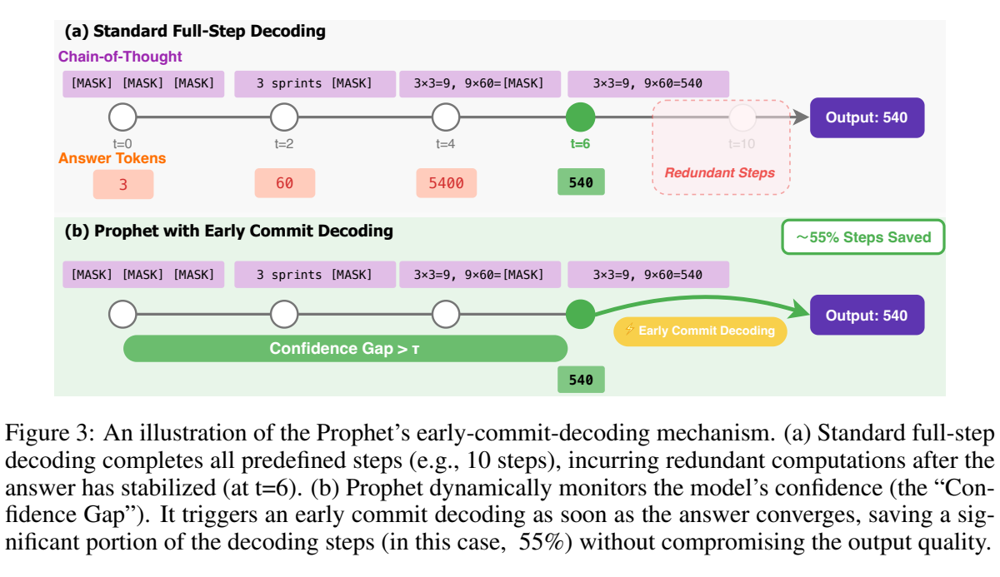

图 原文 Figure 3，物理页 6。上方跑完固定轮数，下方在差距过阈值后填满剩余位置。图中算术和省步比例用于讲解操作，实测看 Table 1。

```text
insert prompt and a recognizable answer suffix
repeat until the full budget is used:
    logits = model(current masked sequence)
    gap = mean top-1 minus top-2 logits in the answer slot
    if gap meets the threshold for this progress:
        fill all remaining masks with current predictions
        return
    unmask the positions selected by the base decoder
return the completed sequence
```

### 实验条件、速度与代码

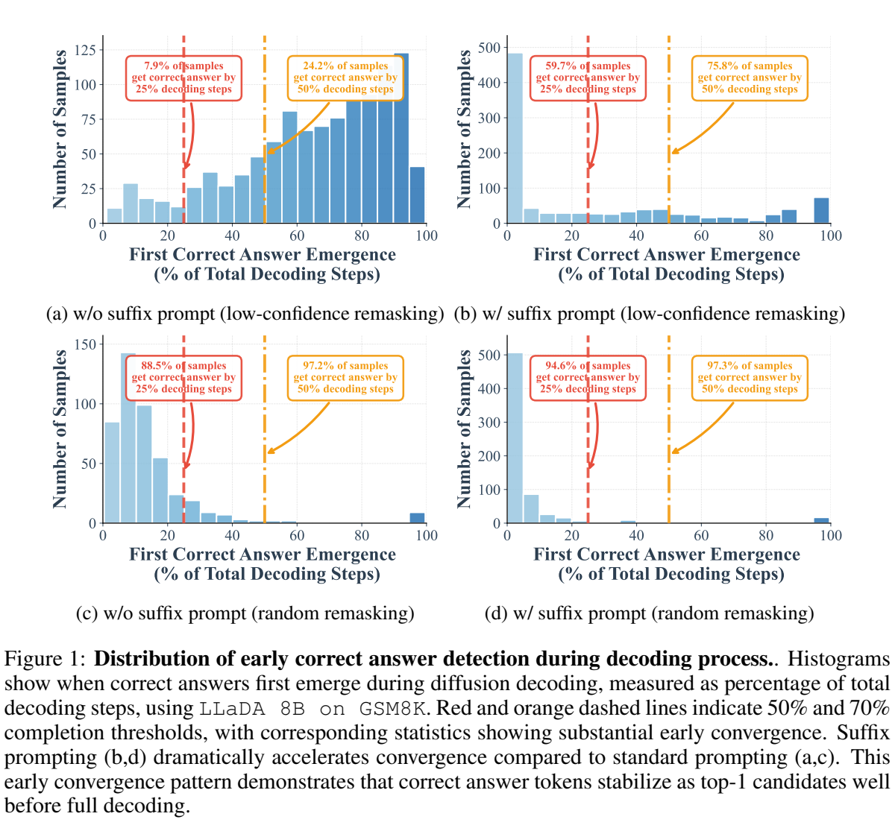

图 原文 Figure 1，ICLR 2026 论文集物理页 5。LLaDA-8B 在 GSM8K 上，四格分别是低置信度重掩或随机重掩，以及有无答案后缀。柱状为首次出现正确答案的进度分布，红橙标记给不同进度阈值，读图时留意它们并非同一停止条件。这里用已知答案做事后诊断，部署早退时没有答案标签。

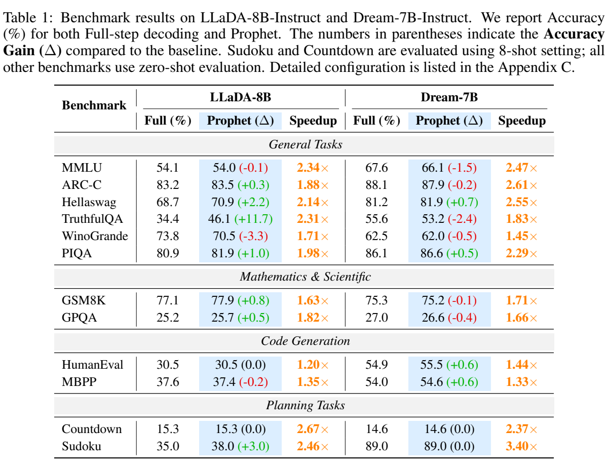

图 原文 Table 1，物理页 8。固定 LLaDA-8B-Instruct 或 Dream-7B-Instruct，比较 full-step 及早退的准确率和步数比。LLaDA 的 GSM8K 是 77.1→77.9，1.63 倍步数比。Dream 的 Sudoku 为 89.0→89.0，3.40 倍。Dream 的 MMLU 67.6→66.1，LLaDA 的 WinoGrande 73.8→70.5。读表时应保留损失案例。1.20 倍的 LLaDA HumanEval 表明任务形态显著影响收益。

- **数据与实现。** 12 个公开任务覆盖一般推理、数学科学、代码和规划。Sudoku、Countdown 用 8-shot，其他 zero-shot。选择题实际生成并抽取答案。Appendix C Table 6 的预算按任务设定，如 GSM8K 生成长 256、步数 256、块长 32，阈值 8.0/5.0/3.5；HumanEval 的前两项为 512/512。正文给出通用 7.5/5.0/2.5，复现宜按任务配置。没有新训练集、训练更新、奖励或损失。
- **基线与消融。** Table 2 比较固定预算、置信加速等条件下的步骤/质量。Table 3 比较步预算与重掩方法，Table 4 比较块长度。Appendix C 的 GSM8K 分段阈值 77.9%、160 步，线性阈值 77.4%、154 步，说明收益在该任务上也可由连续阈值取得。表内倍数衡量前向轮数节约。硬件型号、峰值显存、整套运行时长、GPU-hours 和费用未找到。
- **局限与本文推演。** 依赖能定位的答案槽。代码与长文本的质量还依赖答案槽之外的大量位置；只监测几个 token 可能在其他部分尚未稳定时停机。双向注意力和批内不同样本的停机时刻也会影响实际吞吐。若按相同吞吐预算对比，需要逐项记录前向、解码耗时和准确率。

**代码核查。** 阅读固定提交的 generate_earlyexit.py、eval_llada.py 和会议补充包中的评测入口。LLaDA 入口把答案槽作为指定起始位置后的最多五个位置，在生成循环里对样本 logits 做 top-2；部署批量用法须核对批中每项是否单独判断。补充包中的代码和主文算法均已静态查看。[作者代码](https://github.com/pixeli99/Prophet/tree/460afe41c7063a29a9893675aca07b985997bb83) · [扩散语言模型背景](https://arxiv.org/abs/2502.09992)

<a name="paper-rmt"></a>

## 4. RMT | Reinforcement Mid-Training

### 把下一词预测变成带过程的训练任务

常规预训练对每个位置直接最大化真实下一个 token 的概率。Next-token reasoning 则让模型先写推理，再输出 token。原始文本天然提供下一词的可核验答案，省去了人工写解题标签的成本。但许多位置是高频固定接续，如果每个位置都采样思路就会很贵。作者用 token 熵来筛选需要 rollout 的位置，保持其他位置的直接监督。

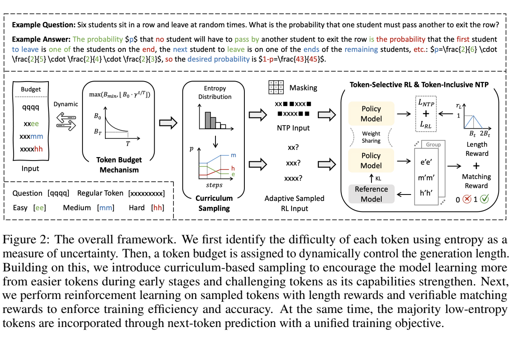

图 原文 Figure 2，ICLR 2026 论文集物理页 4。左半部是长度调度和按难度抽词，右半部上分支为生成多个推理回答并算强化奖励，下分支在未选位置算下一词损失。该图是训练流程。

### 熵分层、长度预算与奖励

$`p_\theta(v\mid x_{\lt j})`$ 表示模型看见前缀后对词 $`v`$ 的概率，$`j`$ 是 token 位置，$`\theta`$ 是模型参数。信息量为负对数概率，按模型分布取平均得熵。作者将位置分成易、中、难三档。训练先按当前课程分布抽一档，再在该档内均匀抽候选。中段线性插值两端的档位概率，较晚更多照顾高熵位置。

```math
H_j=-\sum_v p_\theta(v\mid x_{\lt j})\log p_\theta(v\mid x_{\lt j}),
\qquad
B_t=\max\{B_{\min},\lfloor B_0\gamma^{t/T}\rfloor\}.
```

$`B_t`$ 是第 $`t`$ 步推理预算，$`T`$ 为总步数，$`B_0`$ 是初始预算，$`B_{\min}`$ 为下限，$`\gamma`$ 是总衰减因子。指数插值先保留较长推理再逐步压缩。在提示里要求用约定长度的思考段，长度奖励在目标点达到峰值。$`\ell`$ 是实际思路 token 数，$`r_{\max}`$ 是峰值，$`r_{\mathrm{len}}`$ 是长度奖励，乘子中的绝对值把短于和长于目标的两边合起来（Eq. 2）。

```math
r_{\mathrm{len}}(\ell;B_t)=r_{\max}\max\{0,1-|\ell/B_t-1|\}.
```

对选中的位置，采 $`G`$ 次。第 $`i`$ 次预测为 $`y_i`$，真实下一词 $`v^\star`$ 来自文档，指示函数在相等时为 1。长度与匹配通过 $`w`$ 混合。$`\bar r`$、$`\sigma_r`$ 为组均值、标准差，$`\epsilon`$ 避免除零，$`A_i`$ 是相对组优势。推理输出的 log 概率按优势加权，参考策略 KL 限制策略漂移。最大化奖励目标与最小化监督交叉熵时，用统一的代码符号要先把前者写成负损失。

```math
r_i=(1-w)\mathbf 1[y_i=v^\star]+w\,r_{\mathrm{len}}(\ell_i;B_t),
\qquad
A_i=\frac{r_i-\bar r}{\sigma_r+\epsilon}.
```

$`C`$ 为抽到的 RL 位置集合，$`j\notin C`$ 的位置仍直接估计真实 $`v_j`$ 的概率。$`\lambda`$ 调整 NTP 权重，$`L_{\mathrm{RL}}^{\mathrm{min}}`$ 代表以最小化为约定写出的 RL 损失。原文 Eq. 7 用优势加权 log 概率与 KL 叙述 RL 目标，合并时要跟具体 trainer 的符号口径核对。

```math
L_{\mathrm{NTP}}
=-\sum_{j\notin C}\log p_\theta(v_j\mid x_{\lt j}),\qquad
L=L_{\mathrm{RL}}^{\mathrm{min}}+\lambda L_{\mathrm{NTP}}.
```

**手算。** 候选概率 (0.9,0.1) 的熵约 0.325 nats，(0.5,0.5) 约 0.693，后者档位更难。取 $`B_t=100`$、$`r_{\max}=1`$、$`w=0.2`$，80 词猜对得 0.96，100 词猜错得 0.20；两样本标准化后，猜对样本的权重为正。$`B_0=800`$、$`\gamma=0.2`$ 时，半程预算向下取整约 357，结束时 160。

```text
bucket token positions by entropy
for each step:
    select positions from curriculum difficulty groups
    compute the step-specific thinking budget
    sample several explanations and guesses at selected positions
    reward token match and closeness to the budget
    build group-relative policy update
    compute next-token cross-entropy on remaining positions
    combine the objectives and update the model
```

### 实验、资源与能复现到什么程度

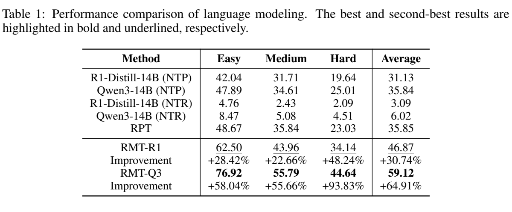

图 原文 Table 1，物理页 7。列为易、中、难 token 及平均准确率。OmniMATH 按 RPT 设置加工，论文报告 4051 训练和 200 评测数据。RPT 35.85%，RMT-R1 46.87%，RMT-Q3 59.12%。Q3 使用 Qwen3-14B，R1 使用 DeepSeek-R1-Distill-Qwen-14B。Qwen3 的 NTP 为 35.84%，直接要求它做 NTR 为 6.02%。跨底座的结果包含起点影响。

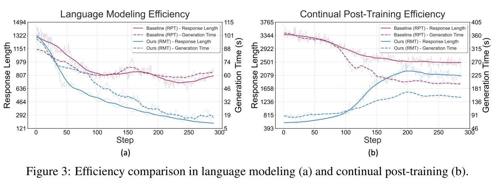

图 原文 Figure 3，物理页 8。横轴训练步，分别看语言建模和后续训练中的长度、批生成时间，注意两条纵轴。原 Table 3 给 RMT-Q3 平均 186 token、RPT 872。Table 4 的 Q3 消融为 59.12% 降到移除动态预算后的 48.68%、移除课程后的 47.83%、移除 NTP 后的 42.40%。

- **继续后训练。** Skywork 难度 1 到 13 分层抽 4096 训练和 600 测试，沿用 GRPO。Table 2 的 RMT-Q3 25.17→64.33，Qwen3-14B 12.84→54.17。直接下一词和数学题准确率有不同的评估条件。
- **资源。** 16 张 80 GB H100，batch 128，10 epoch，学习率 1e-6，每位置 8 条 rollout，语言建模最大应答 2048，后训练 4096，课程转点为总步的 30% 与 70%，NTP 权重 0.1。原图给训练步上的批生成时间变化。完整运行步数、总墙钟、峰值显存、GPU-hours 和费用未找到。
- **代码核查。** 固定提交的 runs/rmt.sh 把 800 初始预算和 0.1 NTP 因子传入训练器。读取 rmt_dataset.py、rmt_trainer.py 及 ntp_reward.py。公开打分调用 prefix_match_reward，先抽取答案再用 tokenizer 比较前缀，与主文用单个 token 精确匹配的简写有实现口径区别。数据与代码随仓库发布。验证时应固定 tokenizer 与选中位置、区分准确率目标和长度奖励。

**本文推演。** 熵衡量模型不确定性，也会给存在多种自然接续的位置打高分。单一参考词的奖励可能促使模型更好预测数据里的写法。当前迁移证据以数学为主，普通网页语料和更大底座需要另外验证。[作者实现和数据](https://github.com/Mid-Training/RMT/tree/ce4fa9cc9857b365d7eb02f04fbb6911cc8da707) · [GRPO 背景](https://arxiv.org/abs/2402.03300)

<a name="paper-order"></a>

## 5. Order-Token Search | Improving Diffusion Language Model Decoding through Joint Search in Generation Order and Token Space

### 扩散生成的两种分岔

自回归 beam search 按固定从左到右的顺序选择 token。掩码扩散模型还有第二个自由度，可先确认哪个位置。局部置信解码往往能做出一条不错的路径，但早期定下的词会影响所有后续候选；随机揭掩码能发现更多路径，单次命中率往往更低。作者先用 pass@k 诊断多路径覆盖，再设计一条输出的搜索算法。

### 分支、复遮盖、重评分

对提示 $`c`$ 拼接 $`L`$ 个掩码。$`x_t`$ 是较多掩码的状态，$`x_s`$ 较少掩码，$`s\lt t`$。$`\Delta(s,t)`$ 是这个区间新增的已填写位置，$`x_0`$ 是模型在当前状态预测的一份完整候选，$`\tilde x_0`$ 复遮盖这些新增位置并保留其他预测作为上下文。$`p_\theta`$ 为冻结模型，$`x_0^\Delta`$ 为新增位置对应词。对复遮盖部分取重建对数似然，论文 Eq. 3 写成对预测候选的期望。单路径按链式条件概率相乘，转到对数后求和，便于叠加区间分数并防止小概率下溢。

```math
\begin{aligned}
\Delta(s,t)&=\{i:x_{t,i}=\mathrm{MASK},\ x_{s,i}\ne\mathrm{MASK}\},\\
\tilde x_0&=\mathrm{mask}(x_0,\Delta(s,t)),\\
a(s,t)&=\mathbb E_{x_0}\!\left[\log p_\theta(x_0^{\Delta(s,t)}\mid\tilde x_0)\right],\\
S&=\sum_{(s,t)\in\mathcal I}a(s,t).
\end{aligned}
```

$`a`$ 为该次动作评分，$`\mathcal I`$ 是沿同一候选经历的分支区间，$`S`$ 为累计分。$`i`$ 是位置索引。整条序列尚有许多掩码时若要求一次说明全部词，分数噪声很大。作者改为只评本次新增的块，利用模型预测出的上下文重新检查本块。按块分支代替每一轮都展开，$`K`$ 是保留的束宽。

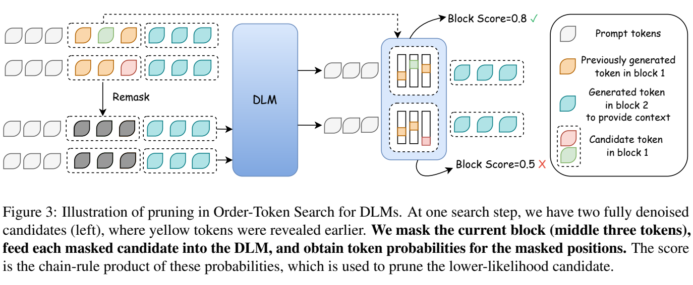

图 原文 Figure 3，EMNLP 2026 论文集物理页 5，论文印刷页 517。左右两条候选遮住当块，用同一个扩散模型重新打分，图示 0.8 与 0.5 指向保留和淘汰。读图时分清黄/蓝两色所代表的已写词和提供上下文的词。这些是流程示例数。

**手算。** 两条同起点候选的块内条件概率分别 (0.8,0.25) 与 (0.6,0.5)。乘积 0.20 与 0.30，累计前缀分相同时保留后者。第一个位置的单项置信更高，整块却较难连贯重建。方法在评估中仍可能系统性高估模型熟悉的错误答案。

```text
beams = K copies of prompt plus masks
for block in left-to-right block order:
    candidates = []
    for beam in beams:
        expand within the block using sampled order and values
        mask each candidate's new positions for rescoring
        add its local log likelihood to its accumulated score
        append candidate to candidates
    beams = keep the top K candidates by accumulated score
return the single highest-scoring sequence
```

### 基线、成本与适用条件

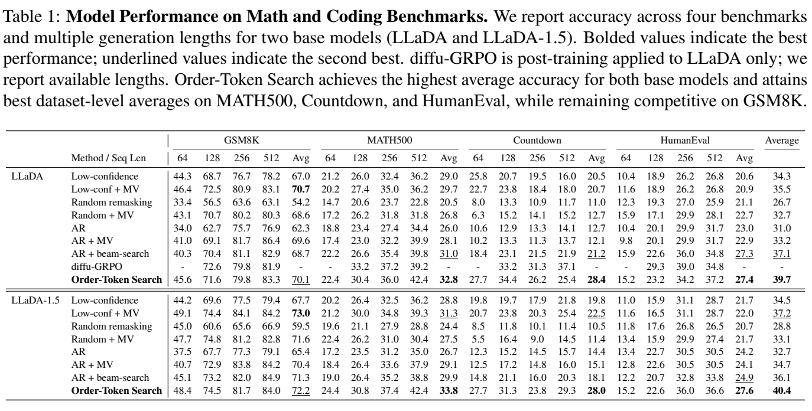

图 原文 Table 1，物理页 6，印刷页 518。每组固定基础模型与长度 64/128/256/512，再比较低置信度重掩、随机、两者的投票、自回归顺序解码、AR beam 及 OTS。LLaDA-8B-Instruct 上平均 39.7%，最佳基线 AR beam 37.1%；LLaDA-1.5 的结果是 40.4%，最佳基线 37.2%。GSM8K 有长度条件下投票或 AR beam 更强。另列 diffu-GRPO 是后训练对照，表中长度不齐，不能用空格补均值。

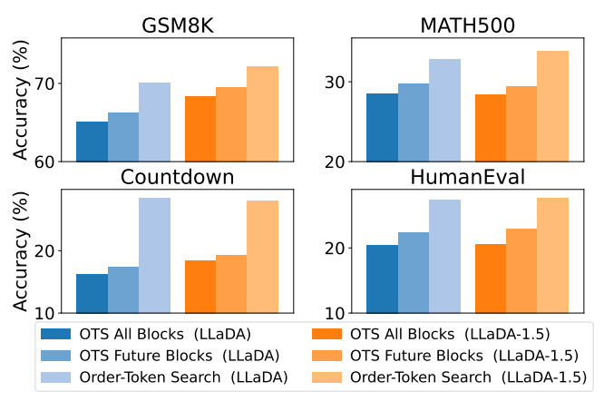

图 原文 Figure 4，物理页 7，印刷页 519。固定展开过程，比当块重评分、全部已见块评分及遮住未来块的评分。蓝/橙对应两个底座，按同一种颜色看柱高。Table S6 给逐长度读数；LLaDA 的当块 OTS 平均 39.7%，全块 32.6%，遮未来 33.9%。对比分数器时保持同一搜索框架。

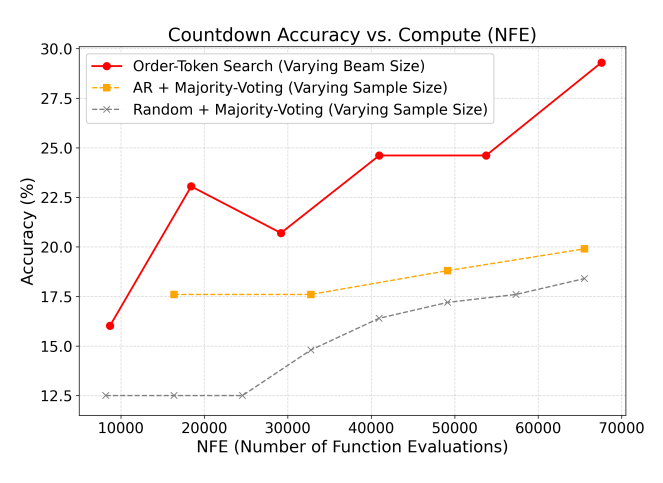

图 原文 Figure 5，物理页 8，印刷页 520。Countdown 横轴为前向次数 NFE，读相近预算处的红色 OTS、黄色 AR 投票、灰色随机投票。论文在束宽 6 处报 29.3%，匹配预算的 AR 投票与随机投票分别 19.9%、18.4%。附录 Table S1 给实际时间，长度 256、束宽 4 时单路径 6.60 秒、OTS 16.64 秒、五样本投票 32.99 秒，均为该评测设置下的每题平均。束宽 4 的计时和束宽 6 的准确率来自不同设置。

- **数据和模型。** GSM8K 标准测试约 1.32k 题，MATH500 为 500 题，Countdown 为给数字拼算式，HumanEval 为 164 道代码题。主评 LLaDA-8B-Instruct 与 LLaDA-1.5，附录验证 Dream-7B。pass@k 诊断探索潜力，最终评一条输出。OTS 只改变推理，无新训练数据、奖励或损失。
- **资源和复现。** Appendix A 给出块长度、生成长度、采样温度、束宽与 NFE 对照的设置，计时不能直接折算成跨机器速度。GPU 型号、峰值显存、GPU-hours 和费用在所读材料中未找到。会议页、预印本与作者代码定向检索未找到可核验的公开实现，算法按原文 Appendix A.1 阅读，状态为缺官方代码复核。
- **局限与本文推演。** 需要额外前向、候选存储和重评分。高似然只说明模型倾向重建，任务级正确性仍须外部测评。可用同一模型、相同单题 NFE 与墙钟分别比较不同束宽，进一步查明收益究竟来自更好的顺序、填词还是剪枝。

[会议全文及附录](https://aclanthology.org/2026.emnlp-main.24/) · [掩码扩散基础](https://arxiv.org/abs/2406.07524) · [多样候选投票背景](https://arxiv.org/abs/2203.11171)

[来源、选题和代码核验](https://github.com/daihuangyu/papers-daily/blob/main/CCF_Papers/2026-11-25/assets/SOURCES.md) · [PDF 检查记录](https://github.com/daihuangyu/papers-daily/blob/main/CCF_Papers/2026-11-25/assets/QA.md)
