# CCF A/B 论文精读 | 2026-11-26

## 快速导读

### 1. WSM：先按同一速度训练，要交付时再合并

训练到哪一步合适，有时得看中途结果才能决定。常用做法是事先挑一个终点，再逐渐调小每步更新。如果还想继续，已经调小的学习率会让延长训练更麻烦。WSM 在热身后保持学习率，定期存下模型。需要取出一版时，按选定的权重合并最近几个版本，让早一些的更新保留得更多。原训练接着走，新版本仍可随时合并。[查看精读](#paper-wsm)

### 2. CMA：把好数据放在后面，也给它足够的更新幅度

把难得的高质量材料留到后段，听起来像复习时最后做精品题。但许多训练方案此时已经把学习率降得很低，精品题对模型的影响也变小。作者先按质量分数排序，再让训练后段保持较大的更新幅度，或者只缓慢降到一个较高的下限。最后合并几个检查点，平滑末段训练的波动。分阶段训练时，也可各自排序。[查看精读](#paper-decay)

### 3. Lost in Conversation：把同一道题分开说，还能答好吗

真实用户经常边聊边补充要求。模型可能先猜了一个答案，之后即使知道新条件，也仍沿着最初的猜法走。作者先把一道完整的题拆成经过核对的小段，再让模拟用户分轮透露。每题还做两组一次给齐的对照。对同一模型反复跑，用较好的成绩衡量它能做到什么，用高低成绩的差距衡量它有多容易失手。[查看精读](#paper-lost)

### 4. ICRL：把过去的尝试和分数放回下一轮提示

同一任务可以尝试很多次，只把各次答案独立生成，模型就用不上上轮失败的经验。作者让模型答一轮，给过程或结果打分，再把对话片段和分数记进提示。下一轮安排它试新办法或借鉴高分尝试，也可以让它自行选择。这样每轮看到的经验在变，模型权重保持固定。[查看精读](#paper-reward)

### 5. Survival-Guided：开写前先估计需要留多少空格

扩散语言模型通常先分配一长排空格，再反复填词。短答案也用长画布的话，每轮都会算不少多余位置。作者先用原模型扫一遍长画布，读各位置出现结束标记的可能性。然后估计答案能一路延续到各位置的机会，汇总成预期长度。用这个长度重建画布，再走原有解码流程。[查看精读](#paper-survival)

## 篇目与选题口径

| 论文简称 | 2026 主会 | CCF | 展示 | 首发日期 | OpenAlex |
| --- | --- | --- | --- | --- | --- |
| WSM | ICLR | A | Oral | 2025-07-23 | 29 |
| CMA | ICLR | A | Oral | 2025-11-24 | 16 |
| Lost in Conversation | ICLR | A | Oral | 2025-05-09 | 694 |
| ICRL Prompting | ICLR | A | Poster | 2025-05-21 | 41 |
| Survival-Guided | EMNLP | B | Poster | 2026-08-26 | 1 |

实收 **5 篇，4 A + 1 B，3 Oral + 2 Poster**。录用以 2026 正式论文集为准，展示取官方会程。CCF 第七版正式目录物理页 57 为 ICLR A，58 为 EMNLP B。北京时间 2026-11-26 查 OpenAlex，首发日期取 arXiv v1 页面 UTC 日期，其中 ICRL 使用官方记录的提交日。全方向历史清单按论文标识和标题核对。引用数只在题材、公开时间相近时辅助排序。见 [原文、日程和证据](https://github.com/daihuangyu/papers-daily/blob/main/CCF_Papers/2026-11-26/assets/SOURCES.md)。

数据来自论文或作者材料。「手算」「本文推演」是讲解。本期静态阅读代码和材料，未运行论文训练、模拟对话或推理基准。图表保留原图，物理页从 PDF 首页起算。

<a name="paper-wsm"></a>

## 1. WSM | WSM: Decay-Free Learning Rate Schedule via Checkpoint Merging for LLM Pre-training

### 什么是延期也能继续的学习率调度

学习率是一次更新的缩放幅度。余弦衰减需要提前决定训练终点。Warmup-Stable-Decay（WSD）把训练分成热身、固定、衰减，能从固定期分叉试不同结尾，但每条衰减支线要占训练资源。WSM 在固定学习率轨迹上取几个检查点，事后选择合并权重，借相邻检查点的差来模拟逐段降权。用于继续训练的是原始轨迹的检查点。

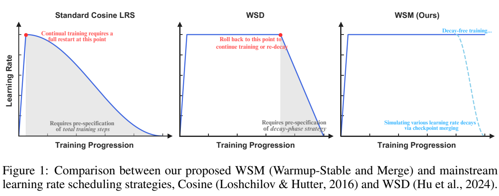

图 原文 Figure 1，ICLR 2026 会议 PDF 物理页 1。对照余弦、WSD 和 WSM 三条学习率轨迹。前两种实际改学习率，右图的合并作用在保存的参数。横轴是训练进度，图是流程示意。

### 为什么均匀合并会给更新施加衰减

设 $`\theta_0`$ 为合并窗口最早的参数，$`g_i`$ 是从检查点 $`i-1`$ 到 $`i`$ 的累计参数更新量，已含学习率。$`\theta_j=\theta_0-\sum_{i=1}^j g_i`$，$`k`$ 是窗口末尾的位置，$`c_j`$ 是非负合并权重且总和为 1。更新 $`g_i`$ 出现在所有 $`j\ge i`$ 的检查点里，交换两个求和的顺序即得有效系数 $`w_i`$。

```math
\begin{aligned}
\widehat\theta &=\sum_{j=0}^{k}c_j\theta_j
 = \theta_0-\sum_{i=1}^{k}w_i g_i, \qquad
 w_i=\sum_{j=i}^{k}c_j,\\
c_0&=1-w_1,\qquad c_j=w_j-w_{j+1}\ (1\le j\lt k),
\qquad c_k=w_k .
\end{aligned}
```

后式来自相邻两个尾和相减。若目标 $`w_i`$ 在 0 到 1 间单调不增，算得所有 $`c_j`$ 非负，望远镜相加恰好为 1。均匀合并时，更新每靠近窗口末尾一次，就少出现在一个检查点中，因此得到分段线性衰减。原文 Figure 2 还给余弦、EMA 和平方根形状的权重。这个等式是在**同一条实走轨迹**上成立。显式改学习率后，梯度会在不同参数位置计算，动量历史也不同。

**手算。** 三个标量检查点为 10、8、5，权重 0.2、0.3、0.5。合并是 6.9；第一段更新 2 的权重为 0.8，第二段更新 3 的权重为 0.5，从 10 减去 1.6 和 1.5 同样得 6.9。

```text
warm up to the peak learning rate
continue training the original weights at constant rate
at the data switch, use the selected annealing corpus
periodically save checkpoints and optimizer states
when evaluating, choose a window and a synthetic decay
convert decay values to weights and average model parameters
resume training from the original trajectory if needed
```

### 原实验、代价和复现边界

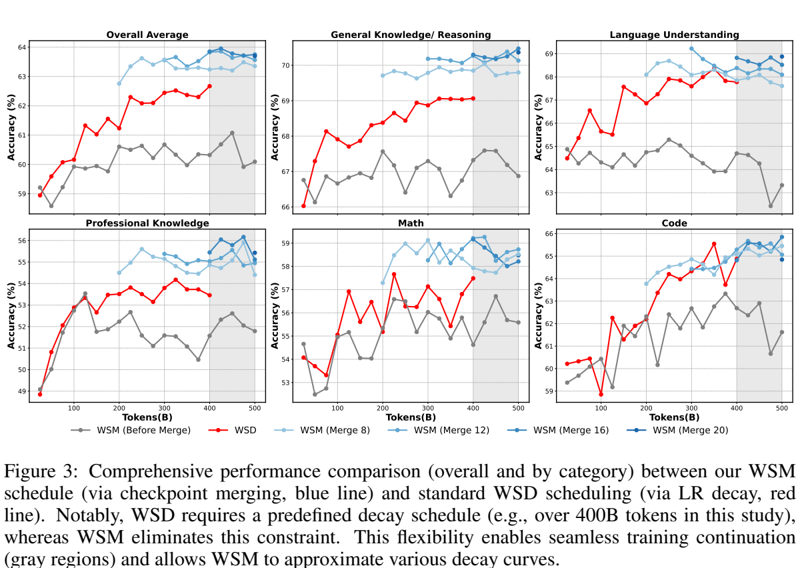

图 原文 Figure 3，物理页 6。对照 WSD、未合并的 WSM 和不同窗口合并。横轴是阶段的 token 进度，分别看总均值与五类能力。超过既定衰减终点的曲线不能解读成相同 token 预算比较。

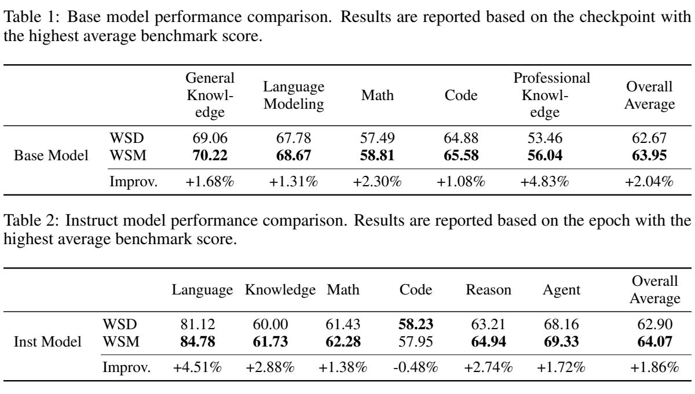

图 原文 Tables 1–2，物理页 6。基础模型为 62.67→63.95，SFT 后 62.90→64.07，分别取平均最高的检查点与 epoch。SFT 的代码项 58.23→57.95，保留这项退化。Table 3 的 Mean/EMA/1-sqrt 合并在原设置总均值为 63.95/63.01/64.06。固定 80B 窗口时，Table 4 的 5B 间隔略弱于 10B 间隔，细粒度也有存储与 I/O 代价。

- **数据与损失。** 主实验从已有的 10.2T token 检查点起步，比较 400B 高质量退火数据上的 WSD 和 WSM。Appendix A 描述英语、中文为主，含网页、数学、代码和文献的混合语料。优化目标沿用下一 token 交叉熵，合并阶段只读权重，无额外 reward。下游两个分支用同设置做 5 个 epoch 的监督微调。
- **模型与资源。** 16.3B MoE，总参数与每 token 约 1.43B 激活参数分别计。20 层、256 个路由专家、每次选 8 个，加 1 个共享专家。AdamW，batch 2048，最大长度 8K，默认每 25B token 保存。正文 §4.1 的峰值为 4.78e-4，Appendix A 的最大值为 3.74e-4，文中没有解释二者对应关系。硬件类型、精确更新步数、实测墙钟、峰值显存、GPU-hours 和费用未找到。
- **复现。** 除训练损失，还需要固定数据切换点、检查点粒度、合并窗口和用于选最佳的验证协议。作者完整训练与合并代码未找到，按正文 Algorithm 1 静态读核。本文推演，保存的 16.3B 权重若按每参数两字节，单份约 32.6 GB，实际还受存储格式、优化器状态和副本数影响。[参数平均入门](https://pytorch.org/blog/pytorch-1.6-now-includes-stochastic-weight-averaging/)

<a name="paper-decay"></a>

## 2. CMA | How Learning Rate Decay Wastes Your Best Data in Curriculum-Based LLM Pretraining

### 数据什么时候出现，决定它能产生多大的更新

这篇研究数据顺序和学习率的配对。升序课程让低分文本先出现，高分文本集中在后期。在常数学习率下高分文本能显著改参数。把它们集中在学习率已经掉得很低的窗口，训练可能就来不及适应。作者把学习率终值和衰减长度都作为变量，然后在较温和的衰减与末端检查点平均之间折中。

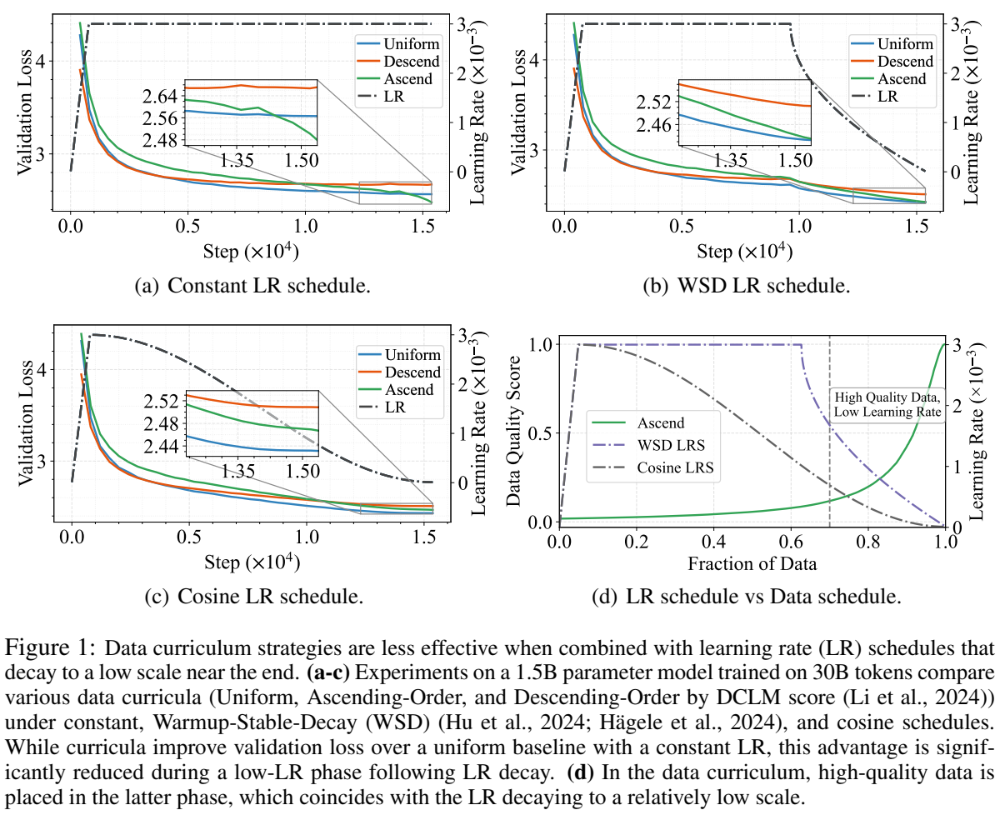

图 原文 Figure 1，ICLR 2026 会议 PDF 物理页 2。用同一 1.5B 架构比较随机、质量升序和降序。分别看常数、余弦、WSD 下的高质量验证集损失，交互效果比只看某条线的终点重要。横轴是更新步，学习率轴和损失轴分开读。

### 更新量和模型平均的两种作用

最简一维推演用 $`w_t`$ 表参数，第 $`t`$ 步学习率为 $`\eta_t`$，$`g_t`$ 为该步梯度。原文理论示例把梯度方向拆成信号与噪声。为给读者一个可手算形式，令 $`g_t=m_t+\varepsilon_t`$，$`m_t`$ 是期望信号，$`\varepsilon_t`$ 是零均值扰动。固定该段梯度方向，直接累加即可看出质量排序和调度如何共同影响总移动。

```math
w_T=w_0-\sum_{t=1}^{T}\eta_t(m_t+\varepsilon_t),
\qquad
\mathbb E[w_T]=w_0-\sum_{t=1}^{T}\eta_t m_t.
```

$`T`$ 为累计步数。如果后段噪声和不同检查点误差没有完全同向，参数平均可以抵消部分波动。CMA 的 Algorithm 1 取 $`\theta_{T-is}`$ 为距终点 $`is`$ 步的检查点，$`i=0`$ 是最新，$`s`$ 是保存间隔，$`K`$ 是合并数量。$`\alpha`$ 是每往回一个检查点的相对折减。各模型权重相加要为 1，所以用几何和归一化。默认最后六个检查点，$`\alpha=0.2`$。以伪代码的参数定义为准。

```math
\bar\theta=\frac{\sum_{i=0}^{K-1}\alpha^i\theta_{T-is}}{\sum_{i=0}^{K-1}\alpha^i}.
```

**手算。** 两步信号梯度分别为 1 和 4，假设更新期间梯度值固定。学习率都为 0.1 时总移动 0.50，尾段改为 0.01 时只有 0.14。后一跳中高质量例子贡献从 0.40 降到 0.04。若连续检查点为 9.5、10.5、10，简单平均为 10；这只演示消波动，实际相关误差不会独立消失。

```text
score documents with the quality ranker
sort ascending globally or inside each training phase
warm up, then train on the sorted stream
use a constant rate for CMA
for CDMA, add moderate decay with a nontrivial final rate
save late checkpoints
average their parameters and evaluate the merged model
```

### 数据、对照与局限

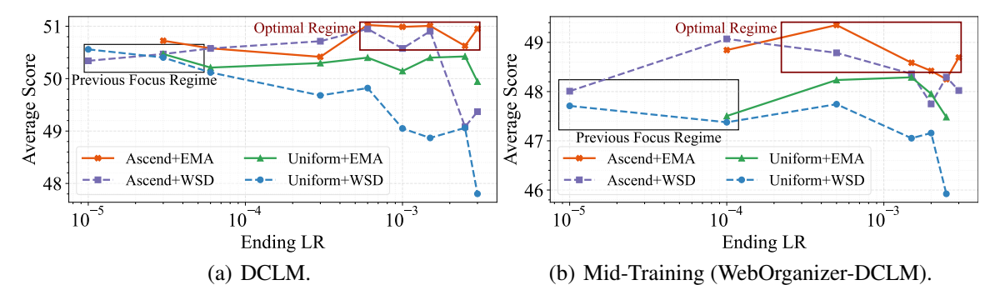

图 原文 Figure 5，物理页 9。横向比较 WSD 终值过低、温和和接近峰值时的结果。左为预训练，右为 mid-training，阅读时在同一设定内比较升序、均匀以及加平均的线。验证集选的是高分文本，曲线包含分布匹配因素。

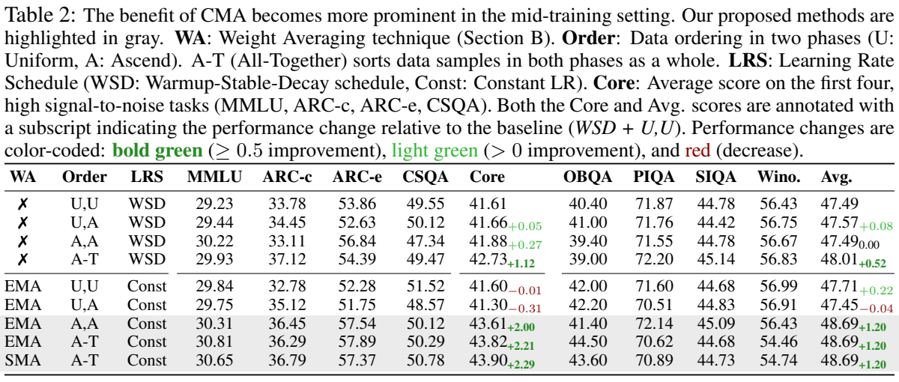

图 原文 Table 2，物理页 8。对比中段训练两期内均匀 U、升序 A、跨两期合并排序 A-T。WSD+U,U 的 Core 40.40、Avg 47.49。常数+EMA+A,A 43.61、48.69，常数+EMA+A-T 43.82、48.69。全局排序成本高时，分期排序保留了大部分增益。Table 1 从头训练中 WSD+Uniform 的 Avg 50.56，SMA+Ascend+Const 为 50.94，SMA+Uniform+Const 为 50.10，支持数据排序和平均要联看。
- **训练细节。** 30B DCLM-Baseline 子集，文档按 fastText 评分排序。高质量验证集从不相交的分区取前 100,000 篇。Qwen2.5-1.5B 架构，序列 4096、batch 512、AdamW、峰值 3e-3，常规衰减终值 1e-5。下一 token 交叉熵，无奖励；CMA 使用末端参数平均。本文按序列和 batch 算满载上限约 2.10M token/步，30B 对应约 14.3k 步，实际受 packing 与分片影响。硬件、峰值显存、总墙钟、GPU-hours 和费用未找到。
- **额外实验和负面结果。** 有余弦衰减时，三段各自排序比全局升序好，但弱于均匀；常数学习率下全局升序更好。PreSelect 排序在 DCLM 高分验证上并未普遍改善。3.2B 多领域继续预训练，CDMA 将 Core Avg 52.70 提到 53.79，MBPP 38.91→38.13。该设置同时调了课程与终值，不能据此单独归因某个组件。
- **复现。** 原文公开质量评分、模型配置、训练次序和 Algorithm 1。未找到可核验的作者实现。若照此做对照，匹配文档集合、步预算和验证集，再改排序与学习率这两个因素。本文推演，质量评分过度偏向某种体裁时，强课程也可能带来遗忘或指标偏向。[作者论文说明](https://kairong.me/publication/how-learning-rate-decay-wastes-your-best-data) · [DCLM 数据与训练背景](https://arxiv.org/abs/2406.11794)

<a name="paper-lost"></a>

## 3. Lost in Conversation | LLMs Get Lost In Multi-Turn Conversation

### 用同一道题测三种说法

任务原先有一份把目标、约束和背景都写齐的指令。研究者把它拆成首轮意图及后续澄清，检验多轮交谈是否额外增加难度。FULL 直接给原指令。CONCAT 将拆后的片段拼成一次输入，控制改写影响。SHARDED 用模拟用户每轮揭露片段，让助手响应进入下一轮历史。在任一多轮答复中，一旦出现可评分的尝试，系统抽取答案并调用任务的评估器。整场对话取出现过的最高得分。

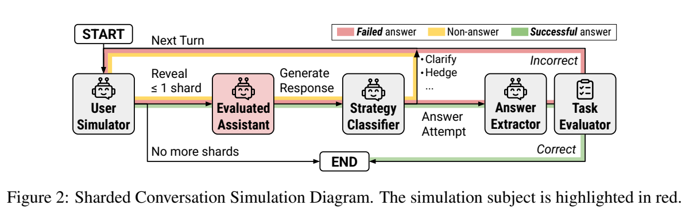

图 原文 Figure 2，ICLR 2026 会议 PDF 物理页 3。追踪模拟用户、待测助手和系统角色的分工。用户知道待揭露片段，助手只看已公开对话，系统判断回复属于澄清、作答等哪一类并抽取可评分的答案。该图展示流程。

### 数据构造与指标推导

先用模型切分，再改写各段以去掉依赖原文相邻段落的指代。要求首段能表达任务意图、片段联合时不丢约束、后续段落可换序。用 CONCAT 和 SHUFFLE-CONCAT 各运行十次，筛掉平均得分低于原题 80% 的候选，再由两名作者审核每条入选指令。六任务为代码、数据库查询、动作选择、表格转文本、数学、摘要。每项约 100 个实例，抽自常见单轮基准。程序题和数据库题用任务判分，而非把助手发言顺畅度作为正确性。

设 $`s_{ij}`$ 是第 $`i`$ 次对话的第 $`j`$ 次有效作答分数，$`S_i`$ 是这一回合模拟的最终分数，$`N`$ 是针对同题、同模型和同展示方式的重复次数。$`\mathcal S`$ 收这些 $`S_i`$；$`Q_p`$ 为其第 $`p`$ 分位。$`P`$ 是平均表现，$`A`$ 是潜力代理，$`U`$ 看好坏运行分差，$`R`$ 是将 $`U`$ 反向变换后的可靠性。

```math
\begin{aligned}
S_i &=\max_j s_{ij},\qquad P=\frac1N\sum_{i=1}^N S_i,\\
A&=Q_{0.90}(\mathcal S),\qquad
U=Q_{0.90}(\mathcal S)-Q_{0.10}(\mathcal S),\qquad R=100-U .
\end{aligned}
```

这样可以把平均表现的下降与反复运行的波动联系起来。同一轮最高得分的选择来自离线评估。服务实际只交最后一轮答案时，未必得到同一结果。$`N=10`$ 的分位数对实现取法与随机种子敏感。

**手算。** 两个系统各十次：甲每次 60；乙三次 0、七次约 85.7。两者均值都约 60。甲的高低分位均为 60，乙约分别为 85.7 与 0。乙有更好的成功潜力，也有更不稳定的结果。

```text
split the original instruction, rephrase, verify, inspect
for each model and instruction:
    repeat each simulation condition ten times
    for a sharded simulation:
        reveal one compatible shard per user turn
        get the assistant reply from the conversation history
        classify reply and score any extracted answer
    store the best scored answer per simulated conversation
aggregate means and within-instruction quantile spreads
```

### 原结果和可复现细节

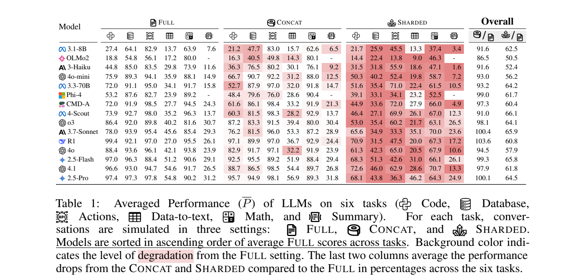

图 原文 Table 1，物理页 7。每个模型按三个条件比较六任务。红色是相对 FULL 的下降。总体报告多轮下降约 39%，是相对变化。以 GPT-4.1 数据库列为例，FULL 93.0、CONCAT 86.5、SHARDED 46.0。不同模型的摘要长度限制导致空格，保留原表缺项。

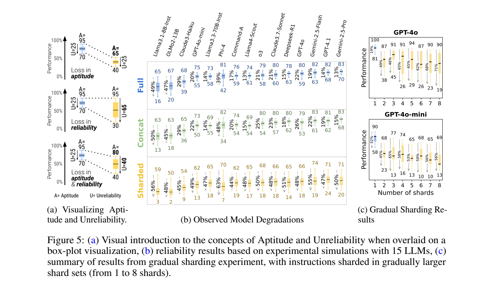

图 原文 Figure 5，物理页 7。左侧示意高分位与分差，中间比较各模型，右侧用逐步拆分对照多轮程度。结论重点是多轮的可靠性损失。o3、R1 也出现退化；这个观察来自指定评测，不能推导所有额外推理预算都无效。

- **消融与资源。** GPT-4o 在附录 Table 5 的 SHARDED 59.1，末尾重复用户约束的 RECAP 为 76.6，逐轮重复的 SNOWBALL 为 65.3。采用 15 个开放和闭源模型，约 8B 到 300B+，默认温度 1，每配置十次，超过 20 万次对话。原文估算 API 仿真总费用约 5,000 美元，硬件、峰值显存、总墙钟与 GPU-hours 未找到。实验是评测，无新训练、reward 优化和损失更新。
- **代码核查。** 固定提交的 run_simulations.py 在 FULL、CONCAT、SHARDED 等路径间分发；simulator_sharded.py 联结模拟角色和任务判分；user_agent.py 按片段生成用户回复；system_agent.py 分类和抽取。代码记录请求成本。重做时固定数据、模型 API 版本、模拟角色和温度，单独报告末轮与全程最好得分。模拟中片段已经确定，真实用户可能改变需求，也可能给出不一致约束。[项目与交互示例](https://lost-in-conversation.github.io/) · [作者代码](https://github.com/microsoft/lost_in_conversation/tree/c865793fe34a929d316119b0451d01bd9183bcfd) · [评测框架背景](https://arxiv.org/abs/2405.14782)

<a name="paper-reward"></a>

## 4. ICRL | Reward Is Enough: LLMs Are In-Context Reinforcement Learners

### 让下一次作答看到前几次的反馈

重复采样可以搜到好答案，前几次尝试也能直接改变后续采样。作者构建了经验缓冲区，把同题过去回答和分数拼到新提示。没有更新模型参数，变化发生在上下文。控制提示可交替请求「和历史不同的尝试」以及「利用已有高分经验」，也可以让模型选。奖励可以来自环境或同一模型的另一个评分调用。

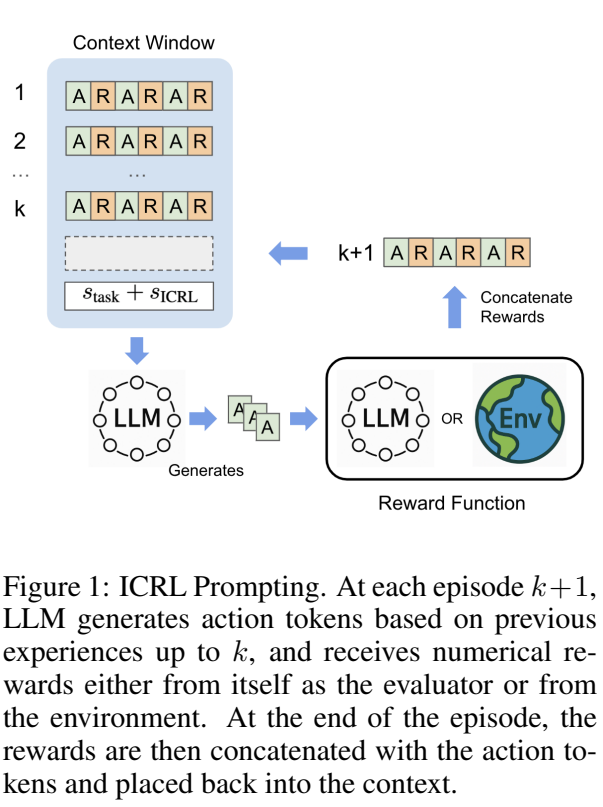

图 原文 Figure 1，ICLR 2026 会议 PDF 物理页 4。看从上轮生成到环境反馈、经验拼接和下一轮的箭头。模型输出与标量反馈进入缓存，奖励可按步骤或在回合末给出。该图为方法示意。

### 状态、策略、奖励和缓存

$`p_\theta`$ 为固定参数 $`\theta`$ 的语言模型。$`k`$ 是第几轮尝试，$`t`$ 是本轮生成步，$`B_k`$ 保存此前轨迹，$`x`$ 是题目，$`m_k`$ 是给定的探索或利用提示。$`\Vert`$ 表示拼接。$`a_t`$ 是采出的词，在 ScienceWorld 是从生成文本中得到的动作；$`s_t`$ 是此时上下文，$`o_{t+1}`$ 是交互环境产生的观察，静态任务可省略。$`r_{t+1}`$ 是奖励，$`r`$ 给出环境或评分器规则，$`\tau_k`$ 为收下来的动作、观察和奖励序列。

```math
\begin{aligned}
s_0^{(k)}&=B_k\Vert x\Vert m_k,\qquad a_t\sim p_\theta(\cdot\mid s_t),\\
s_{t+1}&=s_t\Vert a_t\Vert o_{t+1},\qquad r_{t+1}=r(s_{t+1}),\\
B_{k+1}&=\mathrm{fit}(B_k\Vert \tau_k).
\end{aligned}
```

$`\mathrm{fit}`$ 是本文对装入上下文窗口的简写。原文 Algorithm 1 记逐步采样和最后统一入缓存。对同题的策略变动来自 $`s_0^{(k)}`$ 改变。稀疏回报只把最后一项给到生成结果，密集反馈把数值对应到中间动作。加总回报是任务目标，方法没有反传损失。不要把用 oracle 做离线判分与在线可获得的评分混用。

**手算。** 过去两次分别得到 0.1 与 0.8；利用提示将后者提供为可借鉴记录，探索提示要求避开重复路线。若两次独立尝试的真实成功率各 0.2，至少成功一次是 $`1-0.8^2=0.36`$；若反馈令第二轮在首轮失败时的条件成功率变为 0.5，则为 $`0.2+0.8\cdot0.5=0.60`$。这是解释反馈改变条件概率的示例。

```text
history = empty
for each episode on the same task:
    prompt = fit history, task and exploration/exploitation instruction
    sample the next attempt with fixed model parameters
    score the outcome or score relevant steps
    add action text and its numeric feedback to history
evaluate externally under the specified reporting criterion
```

### 同样的尝试次数和同样的算力是两种对照

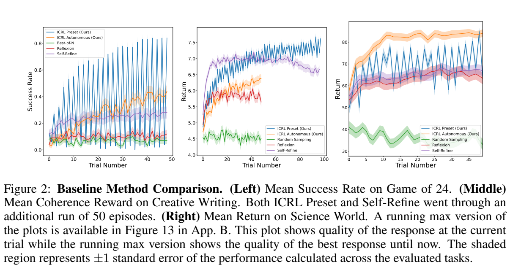

图 原文 Figure 2，物理页 6。从左到右是 24 点某轮的成功率、创作的连贯性评分、ScienceWorld 环境回报。横轴是尝试次数，阴影是跨任务的一个标准误。逐轮表现会受「探索」和「利用」交替影响。Table 1 的 90% 和 84% 是 50 次以内的 running max 跨题均值，分别为预设和自主策略。Best-of-N 为 49%，Self-Refine 47%，Reflexion 44%。最后一轮成功率与「曾成功」是不同指标。

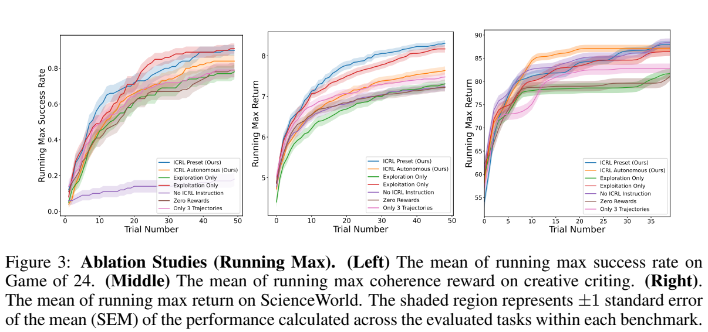

图 原文 Figure 3，物理页 9。各任务比较 running max。短缓存只存最近 3 次，零奖励、去指令、只探索和只利用用来观察机制。只利用保留奖励时也有优势，说明交替策略并非每个任务唯一选择。Table 4 的 Qwen3-32B thinking 在 AIME，ICRL 80.00 低于 Self-Refine 83.33。

- **数据、评分与基线。** 24 点 100 题，GPT-4.1 每题配五个示例；同模型给各思考步骤 0–3 分，SymPy 作为独立正确性评估。Best-of-N 在此可用真实评估做选优。创作 100 个四句任务，在线给一致性标量，外部用 AlpacaEval 2 的长度控制胜率。ScienceWorld 有 30 个交互任务，用 GPT-4.1 mini，环境给阶段回报，完成可积到 100。
- **资源。** 接口闭源模型参数、机器和显存均未披露。扩展包括 Phi-4、Llama 4 Maverick、Qwen3-32B 和 thinking 版，Table 3 分别比较 8k/16k/32k 上下文。附录按测试计算美元金额比较部分任务的趋势。未找到可直接按整套设置复算的实际总账、GPU-hours 或总墙钟。没有训练步数。
- **局限与复现。** 大缓存会增加输入成本；不同方法用的调用数、反馈信息、候选选择规则有差异。经验也会把评分器偏好带入后续尝试。本文推演，比较提示学习和独立搜索时，分别匹配题目、评分调用、token 与预算，并用未在提示里出现的评估器复核。未找到可核验的作者代码，附录给提示模板与算法。[推理搜索背景](https://arxiv.org/abs/2305.10601) · [ScienceWorld 基准](https://arxiv.org/abs/2203.07540)

<a name="paper-survival"></a>

## 5. Survival-Guided | Survival-Guided Length Control for Efficient Diffusion Language Models

### 长度选择在开始时就会影响每一轮开销

掩码扩散解码先分配位置，再多轮预测。全局生成上限留得很大，短答、选择或程序补全都可能反复在不需要的位置做计算。作者把答案在第几个位置结束看作事件发生时间。开局使用一轮长画布前向，取结束标记的软概率来估计每个位置的停止风险。之后只在估出的短画布上运行原解码器。

### 概率链、截断期望与一处边界条件

令 $`P`$ 是提示长度，$`T`$ 是最大候选长，$`z^{(0)}_{P+k}`$ 是初次前向在第 $`k`$ 个生成位置的 logits。$`h_k`$ 是此前还没结束时恰在该位置停止的条件概率。论文用结束标记的 softmax 概率近似 $`h_k`$。$`S(k)`$ 是到位置 $`k`$ 后仍未结束的概率，$`\pi_k`$ 是恰在 $`k`$ 结束的概率。用条件概率乘法，每延续一步，乘上该位置继续的概率。

```math
\begin{aligned}
h_k&\approx\mathrm{softmax}(z^{(0)}_{P+k})_{\mathrm{EOS}},\\
S(0)&=1,\qquad S(k)=S(k-1)(1-h_k),\qquad
\pi_k=h_k S(k-1).
\end{aligned}
```

把 $`L`$ 作为潜在终止时间，$`T`$ 是硬上限。对于整数长度，$`\min(L,T)`$ 等于「长度至少达到第 1、2、…、$`T`$ 个位置」的指示量之和。逐项取期望得到算法的尾和。把它写成终止分布加权时，还需要把没有及时结束的概率质量记到上限。

```math
\mathbb E[\min(L,T)]
 =\sum_{k=1}^{T}S(k-1)
 =\sum_{k=1}^{T}k\pi_k+T S(T).
```

这是本文对 Eq. 5 的边界条件说明。只求有限首止和时，漏掉 $`T S(T)`$；如果强制最后一位结束，也可直接把该剩余质量并到 $`\pi_T`$。论文的 Appendix B Algorithm 1 实际使用尾和，夹在 1 和上限之间再取最近整数。独立近似用于从模型位置概率估计 hazard；给定真正条件 hazard 时，递推本身来自概率链式法则。

**手算。** 上限 3，风险为 0.2、0.5、0.5。生存为 1、0.8、0.4、0.2，尾和 2.2，按算法取 2。首止概率为 0.2、0.4、0.2，加权得 1.6；再加上未止部分 $`3\cdot 0.2=0.6`$，也是 2.2。

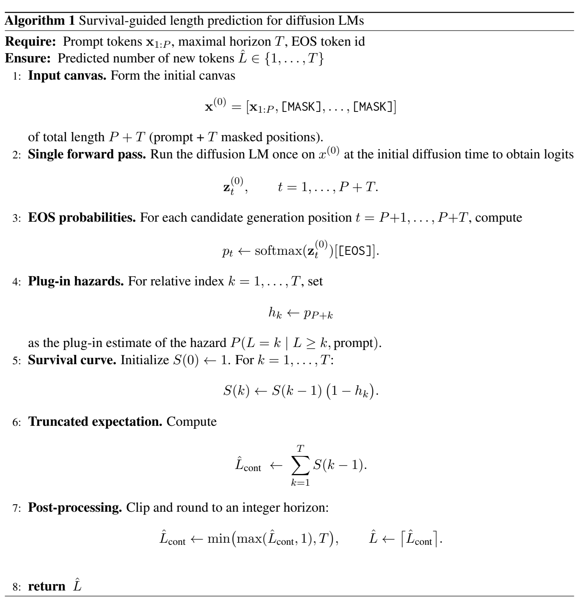

图 原文 Algorithm 1，EMNLP 2026 PDF 物理页 8，印刷页 398。论文没有单独绘制架构或实验曲线，保留原算法框与实测表。按顺序读长画布前向、结束标记概率、风险、尾和与长度后处理。

```text
propose a full masked canvas, run one forward pass
survival = 1
expected_length = 0
for each position:
    expected_length += survival
    survival *= 1 - predicted EOS probability
round and clip expected_length
run ordinary decoding on the new shorter canvas
```

- **数据与硬件。** LLaDA-8B-Base、Dream-v0-Base-7B，沿用 PyTorch、Transformers 和各模型评测器。BBH 3-shot、GSM8K 5-shot 严格匹配、MATH 4-shot、HumanEval zero-shot pass@1、MBPP 3-shot pass@1。batch 1，论文只称使用一张现代计算加速器，具体型号、峰值显存、总 GPU-hours 和账单未披露。算法不需要构造训练集，无训练步数、奖励和新损失。

### 看实际时间和回答质量

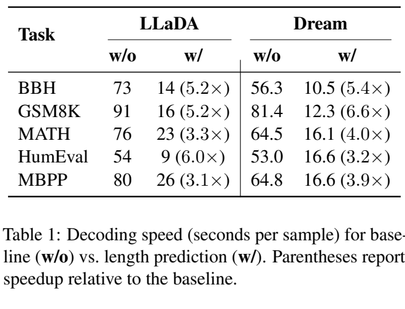

图 原文 Table 1，物理页 3，印刷页 393。对每个底座和任务按 w/o、w/ 看秒/样本。Dream Base 的 GSM8K 81.4→12.3 秒，6.6 倍；LLaDA Base 的 HumanEval 54→9 秒。LLaDA Base 的 MBPP 80→26 秒，表列 3.1 倍。正文概括的 3.2–6.6 倍与这个单元略有出入，以表中分项为准。

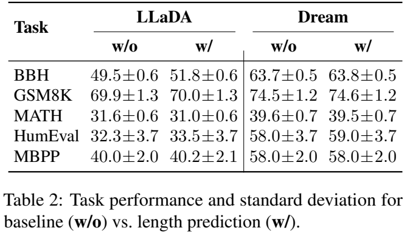

图 原文 Table 2，物理页 3。同底座、同任务比较任务分数和作者标示的标准差。LLaDA 的 MATH 31.6→31.0，BBH 49.5→51.8。报告给离散度，但不能只凭误差棒重叠就断言所有差异都无统计意义。

- **消融。** 固定每任务均长，LLaDA 的 GSM8K 比逐样本预测低 2.8 点，MBPP 差为 0.0。Appendix C 的指令模型对照中，Dream GSM8K 固定长、DAEDAL、本方法分别 80、22、11 秒。不同解码器的规格要分开读。作者也重算后续几步的长度信号，报告多数变化在少量 token 的量级。
- **边界与复现。** 首轮标记校准差时，预测过短可能截断推理或程序。本文推演，部署需检查长尾预算命中率和截断率，另外计入估长那次完整前向；大 batch 的填充也可能掩盖单题收益。原文给完整算法，公开代码链接指底座的评测实现，未查到该插件的作者公开实现。[Dream 底座代码](https://github.com/DreamLM/Dream) · [掩码扩散基础](https://arxiv.org/abs/2406.07524)

[来源与代码核查](https://github.com/daihuangyu/papers-daily/blob/main/CCF_Papers/2026-11-26/assets/SOURCES.md) · [全文 PDF 检查](https://github.com/daihuangyu/papers-daily/blob/main/CCF_Papers/2026-11-26/assets/QA.md)
