# CCF A/B 论文精读 | 2026-11-27

## 快速导读

### 1. CRV：从模型内部找出推理哪一步可能错了

只看一句推理写得是否顺畅，容易漏掉看似合理的错误。作者先用较容易分析的稀疏模块替代模型内部的计算模块，再从这一步的输出往回找最有影响的路径。把路径的节点、强弱和连通情况整理成数字，让一个小分类器学习判断这一步是否可疑。它是一种检查方法，仍会错报。[查看精读](#paper-crv)

### 2. RAIN-Merging：把听指令的能力合进推理模型

会解题的模型可能漏掉「用指定格式回答」这样的要求，直接把另一个模型的能力加进去，又可能改变原来的思考格式。作者先取指令模型相对共同底座的变化量，再用推理样例删掉最容易干扰格式的部分。接着用另一批指令样例看哪些注意力头确实响应要求，给各部分分配不同合并比例，最后把改好的变化量加回推理模型。[查看精读](#paper-rain)

### 3. MoE 稀疏度：每次用几个专家，比专家总数更值得看

混合专家模型有很多可选模块，每个词只调用其中几个。更多专家可改善一般文本预测，不过算术未必一起进步。作者用相同语料训练多组模型，分别改变模型宽度、总专家数和每次点开的数量。接着比较阅读、常识与数学，还看多次采样投票和后续强化学习能否改变结果。[查看精读](#paper-moe)

### 4. ExGRPO：让模型复习自己答对过的题

难题很难偶然答对，成功一次后却可能在下一批训练里被丢掉。ExGRPO 保存成功过程，把还没完全掌握的题按成功率分组，让中等难度优先。训练时选一条当前模型比较容易理解的旧解法，再写几条新解法一起比较。旧答案按它来自的旧模型做权重修正，热身后才开始回放。[查看精读](#paper-exgrpo)

### 5. ECHO：用浅层快速筛草稿，留给深层最后确认

投机解码本来想用便宜的草稿帮大模型加速，但每轮都请整套模型核验也很贵。ECHO 一边查找最近出现过的词串，一边把模型刚给出的候选词加进草稿树。先用浅层快速筛几轮，存下中间结果。攒够后继续跑深层，确认可交付的前缀，再从深层给出的新词开始下一轮。[查看精读](#paper-echo)

## 篇目与核验

| 论文 | 2026 年主会 | CCF | 展示 | 首发 UTC | OpenAlex |
| --- | --- | --- | --- | --- | --- |
| CRV | ICLR | A | Oral | 2025-10-10 | 34 |
| RAIN-Merging | ICLR | A | Oral | 2026-02-26 | 10 |
| Optimal Sparsity | ICLR | A | Oral | 2025-08-26 | 5 |
| ExGRPO | ICLR | A | Poster | 2025-10-02 | 73 |
| ECHO | EMNLP | B | Poster | 2026-09-15 | 0 |

实收 5 篇，**4 A + 1 B，3 Oral + 2 Poster**。录用年度以正式主会论文集为准，首发日期取 arXiv v1。CCF 第七版正式目录物理页 57、58 分别列 ICLR A、EMNLP B。OpenAlex 于北京时间 2026-11-27 查询，0 为已匹配学术记录的计数。按全仓历史清单核对去版本 arXiv、DOI、URL 和标题。全文数字来自论文及作者材料，手算与推演另标。本文静态阅读，未运行训练、推理或复现实验。[论文、代码与图源证据](https://github.com/daihuangyu/papers-daily/blob/main/CCF_Papers/2026-11-27/assets/SOURCES.md)

<a name="paper-crv"></a>

## 1. CRV | Verifying Chain-of-Thought Reasoning via Its Computational Graph

### 白盒错步分类怎么做

CRV 要判断某个思考步骤是否出错。最大词概率或文本判断只能看到答案；白盒方法可以看参与产生答案的内部计算。作者用逐层 transcoder 替换目标模型 Llama 3.1 8B Instruct 的 MLP。原 MLP 接收残差流中的表示，输出该层的更新。Transcoder 先把输入投影到过完备特征，留下少量活跃维度，再解码拟合原 MLP 的输出。它学的是模块映射。

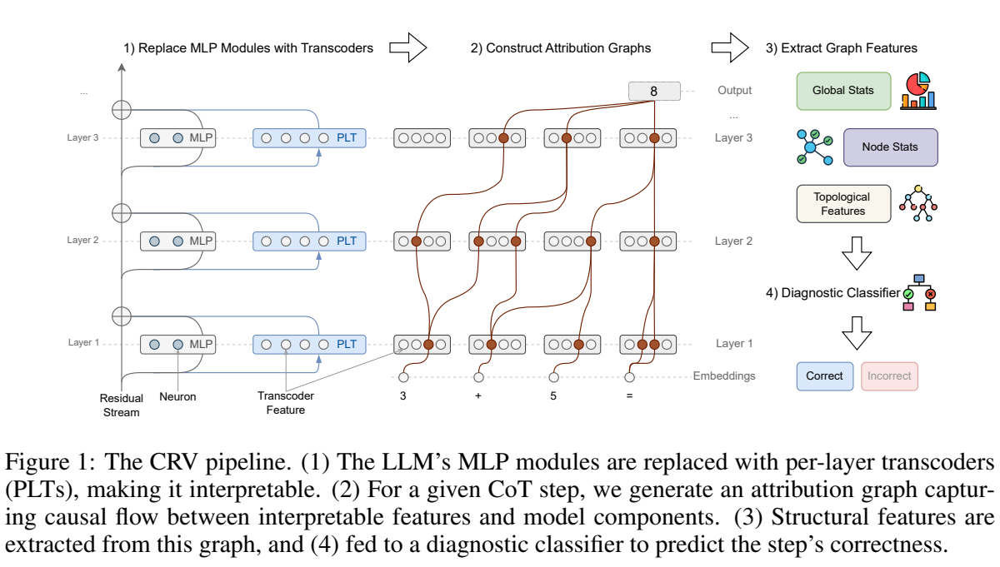

图 原文 Figure 1，ICLR 2026 论文集 PDF 物理页 3。自左向右是模型替换、从输出 logit 向前追溯高影响路径、提取结构特征、用梯度提升分类器预测。归因边是近似追踪量，图为方法示意。

### 稀疏重建目标与图指标

用 $`x`$ 表示原模块处理前的向量，$`f_{\mathrm{MLP}}(x)`$ 表示对应监督目标，$`W_e,W_d`$ 分别是编码和解码矩阵，$`b_e,b_d`$ 是偏置。$`\mathrm{TopK}`$ 保留 ReLU 后最大的 $`k`$ 个元素，其余归零。下式是将 Appendix B 的主重建损失写为一个样本期望。实现另外以 1/32 加权的辅助损失恢复长期不激活的特征。

```math
\begin{aligned}
z&=\mathrm{TopK}_k\!\left(\mathrm{ReLU}(W_e x+b_e)\right),\\
\widehat y&=W_d z+b_d,\qquad
L_{\mathrm{rec}}=\mathbb E_x\!\left[\|\widehat y-f_{\mathrm{MLP}}(x)\|_2^2\right].
\end{aligned}
```

$`z`$ 是稀疏激活，$`\widehat y`$ 是模型估计的 MLP 输出。由于仅有 $`k`$ 个活跃维度，输出可以展开为至多 $`k`$ 个解码列的加权和，方便检查其中一列怎样传到后续层。由选定步骤的 logit 回溯归因图，节点是输入 token、稀疏特征、输出 logit。按影响剪枝，如保留累计占 80% 的成分。特征包括节点数量、激活均值、logit 置信、网络连通性和度数分布。以无自环的有向图为例，$`n`$ 个节点最多 $`n(n-1)`$ 条有向边，$`m`$ 为实际边数，密度就是 $`m/[n(n-1)]`$；密度与节点数应同时看。

**手算。** 一步的三条候选贡献绝对值为 0.5、0.3、0.2，达到 80% 时保留前两项。若最终图有四点五条边，密度约 0.417；保留同样四点但剩三条边时是 0.25。单个密度无法判断正误，分类器需要多种图特征与标签共同训练。

```text
fit per-layer sparse transcoders to reference activations
replace MLPs and replay model-specific reasoning steps
trace influential edges backward from selected output logits
prune the graph and compute summary statistics
fit a gradient-boosted classifier on annotated steps
score each held-out step and evaluate error detection
```

### 证据、开销和适用范围

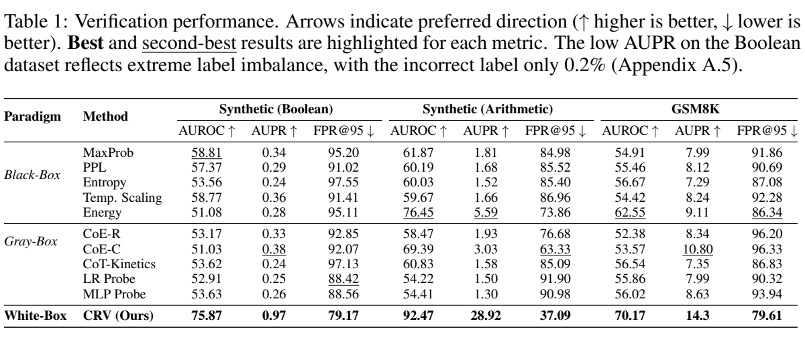

图 原文 Table 1，物理页 6。按同一数据集比较概率、能量、激活探针和 CRV。合成算术的 AUROC 为 92.47，Energy 为 76.45；GSM8K 是 70.17 与 62.55。布尔错步仅 0.2%，CRV 虽有 75.87 AUROC，AUPR 只有 0.97（按表中百分刻度）。FPR@95 是在 95% 召回下的误报率，GSM8K 仍有 79.61。

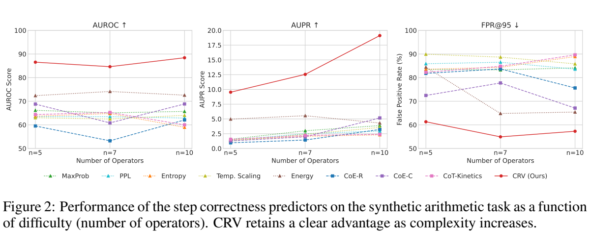

图 原文 Figure 2，物理页 7。横轴是合成算术操作数，纵轴为 AUROC、AUPR 和 FPR@95，后者越低越好。对比难度变化下的探针、输出分数和 CRV。不同列不可当作同一指标。

- **数据与训练。** 布尔、算术、GSM8K 共 126,624、155,434、8,737 步，错步分别 0.2%、1.2%、6.6%。前两种可用程序校验，后者用 Llama 3.3 70B Instruct 辅助标注并抽查。分类器用步骤标签做监督，无强化奖励。Transcoder 训练使用 RedPajama-V2 的 10B token 子集，去除 BOS 激活。输入 4096，字典宽 131,072，top-k=128。
- **硬件与敏感性。** 4 节点，每节点 8 张 H200。AdamW、学习率 7e-5、batch 4096、4 epoch，约 4000 步损失趋稳（非总步数）。分开记录分类器域内和跨域结果。算术迁移到布尔 AUROC 61.58，GSM8K 迁移为 45.77。追加指令数据后，算术从 92.47 降到 91.39。峰值显存、整套时长、GPU-hours 与价格未找到。
- **复现边界。** 作者代码核查覆盖归因入口、图特征函数和步骤处理模块。要固定替换层、输出目标、剪枝和评估错步的正类方向，核对替换前后基础模型行为。一次干预成功还不能证明每条边都构成因果解释。大图追踪和标签开销限制在线使用。[作者代码](https://github.com/facebookresearch/CRV/tree/805a0f7bb6132702f82f2213cce0c63ea7f9d5e9) · [归因图基础](https://transformer-circuits.pub/2025/attribution-graphs/methods.html)

<a name="paper-rain"></a>

## 2. RAIN-Merging | A Gradient-Free Method to Enhance Instruction Following in Large Reasoning Models with Preserved Thinking Format

### 拿指令能力的变化量来合并

同族模型可用共同基座对齐参数。设指令版是 $`\theta_I`$、基座是 $`\theta_0`$、推理锚点是 $`\theta_R`$，则任务向量 $`\Delta_I=\theta_I-\theta_0`$。直接叠加代表所有参数变化都按同样方向生效。论文改成先约束思考标记对应的局部输出，再调整各子模块的影响量。

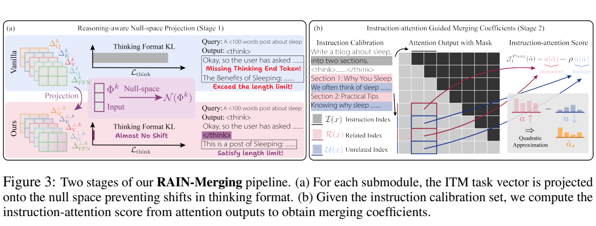

图 原文 Figure 3，ICLR 2026 论文集 PDF 物理页 5。左为投影，在思考标记的输入方向上压掉改变量。右为从指令校准样本的相关与无关位置收集注意力，再给不同头分配合并权重。示意图中的箭头是步骤顺序。

### 零空间投影和分头权重

以单子模块为例，$`\Phi`$ 把收集到的该模块输入写成线性作用算子。它作用于展平的任务向量 $`\delta`$ 后，得到这些位置的第一阶输出变化。$`I`$ 是恒等矩阵，$`+`$ 是 Moore-Penrose 伪逆。$`\Phi^\top(\Phi\Phi^\top)^+\Phi`$ 是到行空间的正交投影，因此取补投影就进入零空间。

```math
P_\perp=I-\Phi^\top(\Phi\Phi^\top)^+\Phi,\qquad
\delta_\perp=P_\perp\delta,\qquad \Phi\delta_\perp=0.
```

这里的等式是**校准位置和线性算子**下成立。实际合并跨层，后续层输入也会跟着变；论文用小扰动下的 logit 差及 KL 近似阐释保护作用。思考开始或结束的少量位置相近，也不足以推出推理内容全相同。

每个注意力头 $`h`$ 在指令中找出约束 token，对受约束输出位置读平均注意力 $`a_h`$，对无关位置读泄漏量 $`u_h`$。令 $`\rho`$ 为泄漏惩罚，$`g_h=a_h-\rho u_h`$ 为代理方向，$`d_h`$ 是正对角惩罚（论文用包含泄漏的近似）。在合并系数 $`\alpha_h`$ 的允许区间内最大化 $`g_h\alpha_h-d_h\alpha_h^2/2`$。求导置零再投影到边界，就得到论文 Eq. 15 的逐维表达。

```math
\alpha_h^\star=\mathrm{clip}(g_h/d_h,\alpha_{\min},\alpha_{\max}),
\qquad
\theta_{\mathrm{merge}}=\theta_R+\sum_h\alpha_h^\star\delta_{\perp,h}.
```

指标在真实模型里来自多头、多层统计，FFN 等共享模块取层内系数平均。代码的优化器还包含先验、可选正则和 Q/K 耦合选项。

**手算。** 若校准向量方向为 (1,0)，任务方向为 (3,2)，兼容变化变为 (0,2)。某头若 $`a=0.30`$、$`u=0.10`$、$`\rho=1`$、$`d=1.1`$，无约束系数约 0.182；用区间 [0.2,1] 会裁成 0.2，玩具合并的增量为 (0,0.4)。

```text
subtract the common base from the instruction model
record reasoning anchor inputs at special thinking tokens
project the selected module deltas off those input directions
measure instruction attention and leakage on calibration data
solve for bounded coefficients, and average for shared modules
add weighted projected deltas to the reasoning checkpoint
```

### 实验、真实成本和复现条件

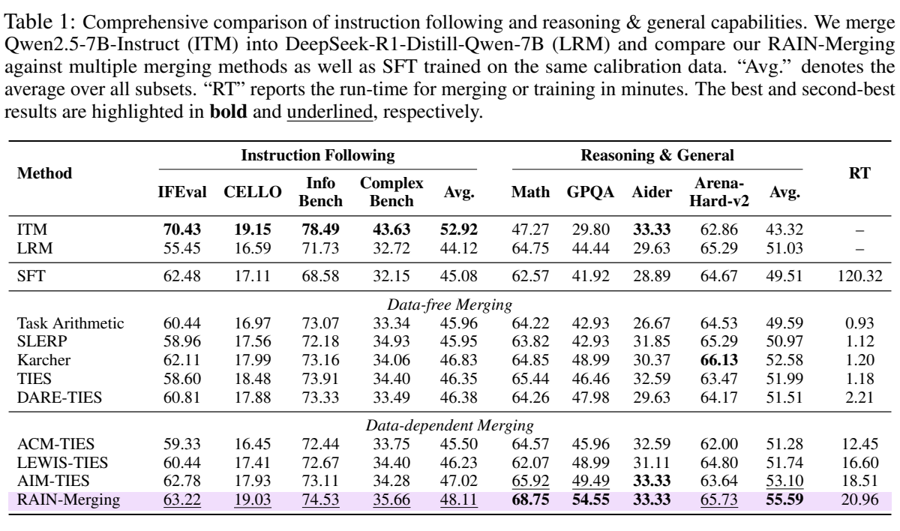

图 原文 Table 1，物理页 7。以 DeepSeek-R1-Distill-Qwen-7B 为锚点，合并 7B Qwen2.5-Instruct 的变化。比较原模型、SFT、任务算术、SLERP、TIES、AIM-TIES 和 RAIN。对比 AIM-TIES 的指令均值 47.02 与 RAIN 48.11，推理与通用均值 53.10→55.59，运行 18.51→20.96 分钟。原指令模型的指令均值 52.92 更高，RAIN 主要保留两类能力。

- **校准与消融。** 第一阶段从 Mixture-of-Thoughts 取 150 个推理样例。第二阶段从 IFEval 任务蒸馏，再评审筛到 365 条；解释泛化时要考虑校准题和 IFEval 测量口径相近。只合并 Q/K/V/O 与 FFN。移除第一阶段后指令/推理均值 47.62/52.44，移除第二阶段为 46.58/54.92。
- **资源与目标。** 合并不用梯度反传、RL 或新模型训练步数。Table 1 的 SFT 是独立基线，120.32 分钟；Figure 4 报 RAIN 22.1 GB、SFT 112.6 GB。硬件型号、卡数、GPU-hours 与费用未找到。数字限于作者环境和并行口径。
- **代码与局限。** 固定提交核查了 pipeline、投影计算、前向 QP 与落盘合并。代码中的 QP 支持 L2 先验和可选 L1，正文对角近似是解释入口。复现需匹配架构、共享基座、标记分词与校准集，保留各评测项的得失。本文推演，两个模型的专家或子模块排列未对齐时，逐参数合并的意义可能改变。[作者代码](https://github.com/K1nght/RAIN-Merging/tree/05003cc1afd594d4a00026222ce79fbe1c08c5f1) · [任务向量基础](https://arxiv.org/abs/2212.04089)

<a name="paper-moe"></a>

## 3. MoE | Optimal Sparsity of Mixture-of-Experts Language Models for Reasoning Tasks

### 计算时只开部分专家，怎样比较规模

MoE 将一层前馈模块复制成多个专家，路由器按当前 token 选最合适的几个。存储量和每 token 前向量可以分开调。作者在相同语料下改变宽度、专家总数与 top-k。看通用预训练 loss 下去后，各类任务表现是否同步改善。本文的研究对象是这组模型及数据内的条件性趋势。

**术语与推演。** 记每层专家总数 $`E`$，每 token 激活 $`k`$ 个，路由密度是 $`d_{\mathrm{moe}}=k/E`$，稀疏度为其补数。令 $`P_s`$ 是共享参数量，$`P_e`$ 是所有层合并后每个专家编号对应的参数量。忽略路由器随专家数变化的少量参数，得到结构估算：

```math
P_{\mathrm{total}}\approx P_s+E P_e,\qquad
P_{\mathrm{active}}\approx P_s+k P_e,\qquad
s_{\mathrm{moe}}=1-k/E .
```

固定宽度和 $`k`$ 后增加 $`E`$，总量上升，激活量大体相同。通信、负载均衡、路由和显存流量仍会变化。对比固定激活参数组只能近似控制 FLOPs，不能当作墙钟恒等。

**手算。** 共享 100M、每个专家编号 20M。$`k=4,E=16`$ 时约 420M 总、180M 激活，稀疏度 75%。把专家加到 32，变成 740M 总、180M 激活和 87.5% 稀疏度。给每个专家的平均 token 数通常下降，数学相关 token 是否被有效分配要看路由实测。

### 数据、损失和实验流程

16 层，宽度 512/1024/2048，$`E`$ 为 8 至 256 的幂次网格，$`k`$ 为 2/4/8/16（需可路由），宽 2048 的专家数上限 128。前馈宽为模型宽度两倍。125B token 混合，高质量网页 43B、数学 32B、STEM 49B、代码 1B，训练/验证 99:1。下一 token loss 加负载均衡和路由 z-loss，系数分别 0.01、0.001。负载项让专家避免只接少数热点；z-loss 抑制路由 logits 的归一化常数过大。后续用独立计算来对照自洽投票及 GRPO。

```text
for each legal width, expert count and top-k setting:
    train on the same pretraining data budget
    log pretraining losses and benchmark checkpoints
    group comparisons by active parameter count
    evaluate knowledge, commonsense and math tasks
    evaluate math again with voting and with GRPO post-training
compare the location of the downstream optima
```

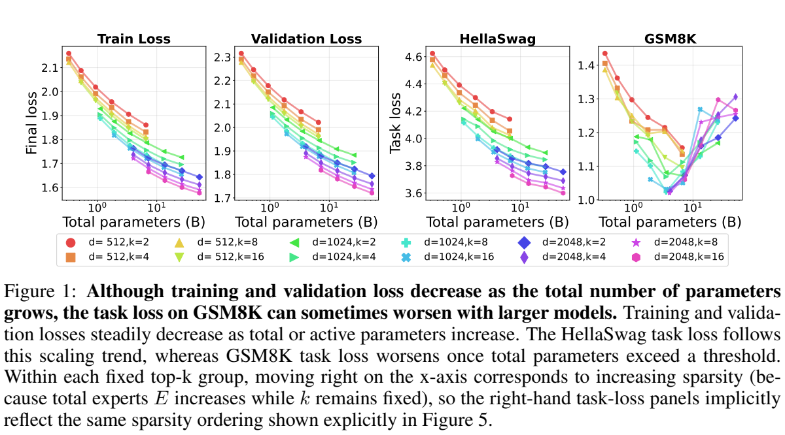

图 原文 Figure 1，ICLR 2026 PDF 物理页 5。横轴总参数量。一条线固定宽度和 top-k，向右只是加专家。通用验证 loss 和 HellaSwag 多数下降，GSM8K 的任务 loss 在部分线右侧回升。论文没单绘架构图，保留这里的实验原图。

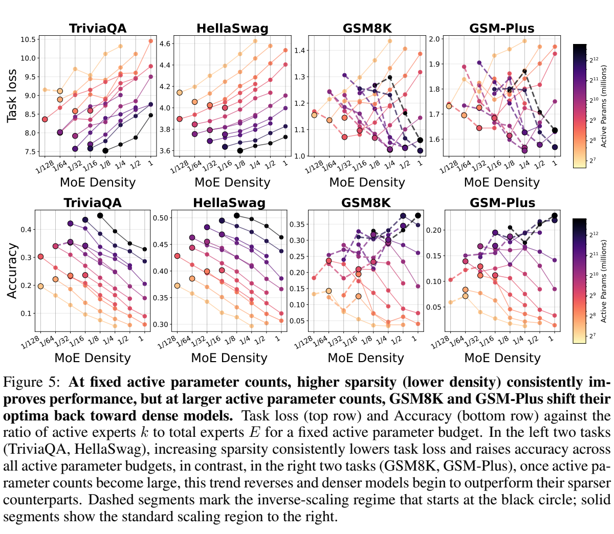

图 原文 Figure 5，物理页 7。横轴密度，左侧更稀疏，上排是任务 loss，下排是准确率。先选同一颜色的固定激活参数组再比较不同密度。TriviaQA 和 HellaSwag 在所试范围多受益于更稀疏；两套算术题的最优点随激活量上升向更稠移动。虚线是超过该组最优范围后出现的反向趋势。

- **实验条件。** GSM8K 4-shot、GSM-Plus 5-shot CoT，TriviaQA 和 HellaSwag 4-shot。Table 3 给各任务评估口径。Figure 6 的多样本投票与 GRPO 都可提高某些分数，反向趋势并未随之消失。后训练用程序任务核验，5 条采样、batch 1024、105 步、温度 1、actor LR 5e-6，KL 权重 0.001。
- **资源。** TSUBAME 4.0，H100 SXM5 94 GB，每节点 4 张，InfiniBand。主预训练 AdamW、峰值 4e-4、2000 步热身、余弦衰减、weight decay 0.1。附录另有 2048 宽度的学习率扫参，不能将该图的 5e-6 当作通用预训练峰值。峰值显存、每配置卡时、总账未找到。
- **实现与局限。** 核查作者 pretrain_gpt.py 和训练/后训练说明，前者连接 Megatron 专家设置与掩码 loss。保持词表、总 token、可比激活预算和数据类别时，才能比较本结果。作者另测去掉 GSM8K 及相关合成数据的版本。数学趋势不能泛化到未试规模与领域。[作者代码与检查点](https://github.com/rioyokotalab/optimal-sparsity/tree/a39f45056e1e5be20fb407d9e4076a8b4bcded43) · [稀疏专家入门](https://arxiv.org/abs/2101.03961)

<a name="paper-exgrpo"></a>

## 4. ExGRPO | Learning to Reason from Experience

### 复用同一道题先前的成功解法

在线 RLVR 让模型采样并用规则验最后答案。难题的整组采样可能全错，组内没有相对优势。ExGRPO 留存旧模型答对的过程，给同题的新采样一个组内参照。只要某题已全对，就从回放候选移出。回放库按近期正确率分桶，抽偏中等难度的题，再按当前策略算旧轨迹的平均 token 熵，取较低的一条。在线采样仍保留，避免全部训练变成重读旧答案。

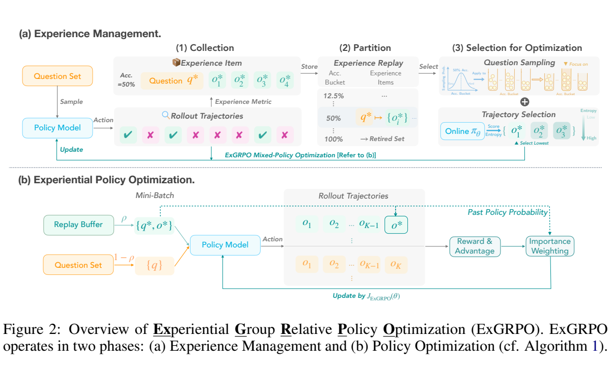

图 原文 Figure 2，ICLR 2026 PDF 物理页 5。上半部从保存成功样本到分桶、退休、挑一条；下半部把旧样本与同题新样本拼成一组，经奖励、优势和重要性加权后更新。

### 组内优势与行为概率

$`K`$ 为同题组大小，$`k`$ 为答对的次数，$`r_i`$ 是第 $`i`$ 条轨迹的可验证奖励。以 $`\bar r,\sigma_r`$ 表示组均值和标准差，$`\epsilon`$ 为防除零项。对成功率 $`a=k/K`$ 加中间高两端低的高斯分桶权重，再用当前模型的熵挑回放。论文用比例写中心 0.5；公开分桶实现直接用成功条数为横轴，中心为采样数的一半、标准差为 1 条。

```math
A_i=\frac{r_i-\bar r}{\sigma_r+\epsilon},\qquad
w_t=\frac{\pi_\theta(o_t\mid q,o_{\lt t})}
           {\pi_b(o_t\mid q,o_{\lt t})},\qquad
f(w)=\frac{w}{w+\beta}.
```

$`q`$ 为题目，$`o_t`$ 是该解答当前位置的词，$`\pi_\theta`$ 是正在优化的策略，$`\pi_b`$ 是实际产生该 token 的行为策略。回放用过去策略概率，新轨迹用本轮 rollout 的参考概率。$`\beta`$ 为 0.1。混合目标对纯在线组和回放组分别求均值，回放比例 $`\rho`$ 为 0.5。回放组是一条旧解加 $`K-1`$ 条新解。正文用通用的比值裁剪目标描述，回放的 shaping 则乘 $`f(w)A_i`$。其边际斜率是 $`\beta/(w+\beta)^2`$，因此高比值不再线性放大。本文推演，按正确性与低熵挑样、截断或变换权重都会改变估计，不能据单 token 比值就宣称整体更新无偏。

**手算。** 旧轨迹答对，新采三个答案全错，奖励为 (1,0,0,0)。均值 0.25，取总体标准差约 0.433，旧轨迹优势约 1.73，每条错误新轨迹约 -0.58。一个旧 token 的旧概率 0.2、当前 0.1，重要性比 0.5，整形后 0.833。若比值为 2，整形为 0.952，显示饱和限制。

```text
roll out online responses and check answers with a verifier
store correct solutions and their behavior probabilities
partition questions by most recent success count
retire all-correct questions from replay
after the threshold, reserve part of the batch for replay
for each replay question, take one low-entropy old solution
sample the other group members from the rollout policy
compute group advantages and update with mixed-policy weights
```

### 同起点成绩、消融与时间口径

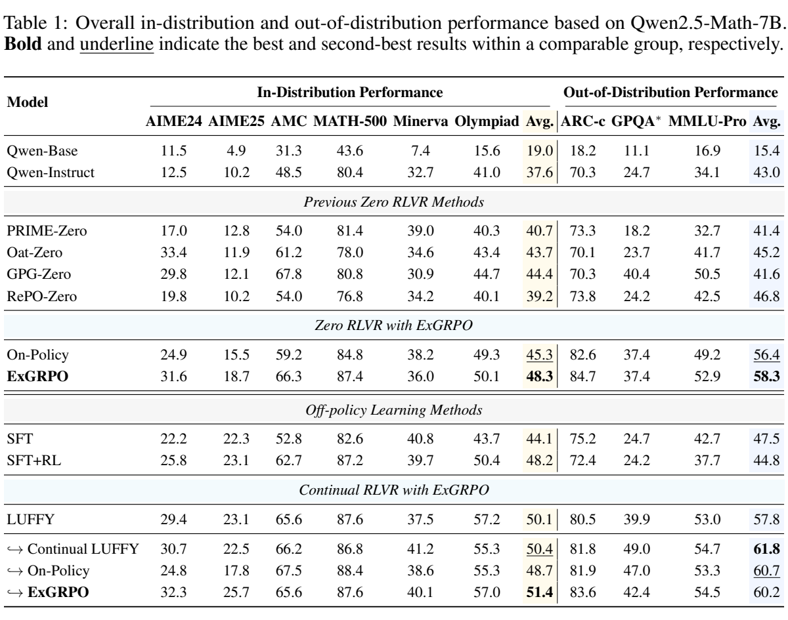

图 原文 Table 1，物理页 7。看同一训练分组。Qwen2.5-Math-7B 的 zero RLVR 对照，在线数学均值 45.3→48.3，跨域 56.4→58.3，Minerva 38.2→36.0。LUFFY 继续训练组里，ExGRPO 数学均值 51.4，但跨域 60.2 低于继续 LUFFY 的 61.8。AIME 和 AMC 用 Avg@32，其他任务用 Pass@1。

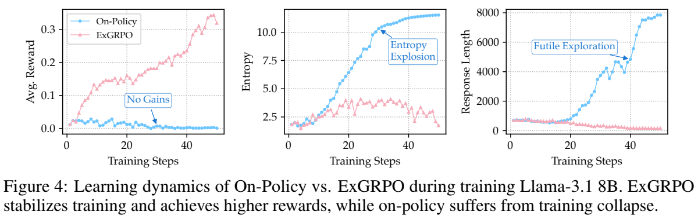

图 原文 Figure 4，物理页 9。背景是 Llama-3.1 8B 训练中的平均奖励、策略熵与回答长度，横轴是训练步。保持底座和任务对照，曲线是指定配置的演变。Llama 例外没有用 batch 的 35% 启动阈值。原文消融显示直接回放低熵旧解可能压低探索，去掉 shaping 时这一风险更显著。

- **数据与资源。** OpenR1-Math 45k 子集，Math-Verify 奖励，veRL 框架，8 张 H100。主底座 Qwen2.5-Math-7B，另测 1.5B、Qwen2.5 7B Instruct、Llama-3.1 8B。128 rollout、64 update，新问题 8 条采样，回放问题 7 新加 1 旧，提示 1024、回答 8192，actor LR 1e-6，主配置 700 步、其他 500 步。
- **成本和可比性。** Appendix E 的 7B 回放缓存 202,011 条约占 1.77 GB 主机内存，平均步时 155.38→184.92 秒，增 19.0%。这是同类步耗时，不能等同于峰值显存。未找到完整 GPU-hours、实付费用与全流程总时长。本文推演，如果只用 700 步乘均值，7B 约 36 小时训练步时间，未计入初始化、评测、保存和不同运行配置。
- **代码核查。** 训练脚本的步数上限为 701，主文表记 700，需核对计数端点。脚本设置 loss_remove_clip=True，使用 off_policy_reshape 的比例变换选项，详见固定提交的 mix_core_alg.py 与经验训练入口。对照时记录 rollout 时的行为概率、退役条件和熵的聚合范围。仅凭正确答案的稀疏奖励仍可能保留错误中间步骤。[作者实现](https://github.com/ElliottYan/LUFFY/tree/01f4ae066249e6965ce0d5512ccdf99a12895c74/ExGRPO) · [GRPO 背景](https://arxiv.org/abs/2402.03300)

<a name="paper-echo"></a>

## 5. ECHO | Early-layer Collaborative Hierarchical Orchestration with Bonus Logits in Speculative Decoding

### 把一个深模型拆成两段去核验

投机解码先提议多个 token，再并行核验，争取在一次重计算里交付一段。ECHO 用同一目标模型的浅层作为第一关，深层作最终拍板。草稿候选有两路：自动机按 n-gram 找重复过的续写，早层或末层的 bonus logits 提供额外候选。浅层用树注意力看每条分支，接受的临时 token 先更新自动机，也存下浅层 hidden 和 KV。缓冲达到阈值，深层沿临时接受链补算，按完整模型的输出决定能正式提交的前缀，必要时把未确认的临时内容回退。

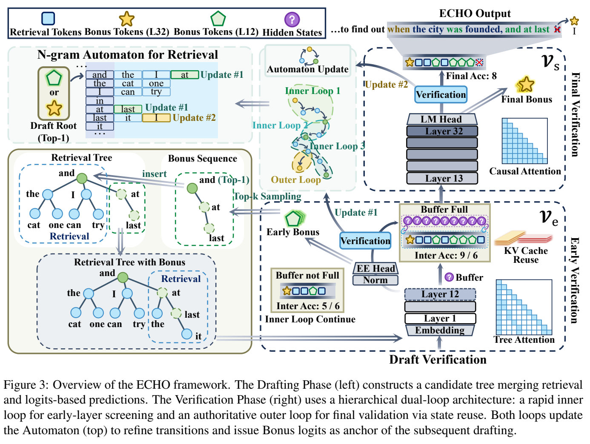

图 原文 Figure 3，EMNLP 2026 论文集 PDF 物理页 6，印刷页 4052。左侧自动机检索与额外候选合流。右侧循着 Tree Attention、浅层缓存、满缓冲外循环、深层核验的箭头读。绿色五边形与黄色星形分别表示浅层和深层给出的额外候选，最终接受数取深层。

### 候选、掩码与无损条件

$`\mathcal R`$ 是检索自动机，$`q`$ 是当前词串，$`\ell`$ 为可复用的 logits，$`k`$ 是额外备选数量。使用并集去掉同位置重复候选，可把草稿共享前缀组织成树。$`i,j`$ 为树中节点，$`M_{ij}`$ 加到注意力 logits；仅节点自己及祖先可见。$`\mathcal A_i`$ 表示该集合，$`-\infty`$ 经 softmax 变零。因位置编码按深度取值，同一路径上的计算等价于单独跑该前缀，这是深层复用浅层状态的前提。

```math
\mathcal T=\mathrm{Match}(\mathcal R,q)\cup\mathrm{TopK}_k(\ell),
\qquad
M_{ij}=\begin{cases}
0 & j\in\mathcal A_i,\\
-\infty & j\notin\mathcal A_i.
\end{cases}
```

原文附录分别分析贪心和带校正的抽样。记 $`p(v)`$ 为完整模型在同一前缀的条件分布、$`d(v)`$ 为提议分布、$`v`$ 为词。在可知提议概率时，标准拒绝校正让草稿被接受的质量为 $`\min(p(v),d(v))`$。拒绝时按 $`[p(v)-d(v)]_+`$ 的归一化残差重抽。由于两分布的总质量相同，拒绝总质量等于所有正缺口之和，乘回后得到：

```math
p_{\mathrm{out}}(v)=\min(p(v),d(v))+[p(v)-d(v)]_+=p(v).
```

$`[x]_+`$ 为正部，$`p_{\mathrm{out}}`$ 是实际交付的抽样分布。该推导要求正确的完整前缀、提议分布及拒绝修正。固定提交检查的评测路径默认温度为 0，深层使用 argmax 匹配，也有从已确定 bonus 接续首 token 的分支。不能只凭抽样证明就认为该评测路径实现了任意温度下的分布等价。

**手算。** 假设暂存草稿 A、B、C，深层对应的贪心首选依次是 A、B、D，则提交 A、B 并从 D 继续，C 丢弃。如果 32 层的模型把浅层设成 12，示意做 3 次浅部筛选加 1 次后 20 层核验，共 56 层次；做 3 次完整前向会是 96 层次。实际批次的 token 数、KV 传输、树宽不同，层次数比不等于延迟比。

```text
initialize prompt state and get final-depth bonus logits
while generation is incomplete:
    repeat early verification until the buffer is ready:
        draft a tree from retrieved and bonus candidates
        run the early layers with path-consistent attention
        store temporary prefix states, update local proposals
    run the remaining layers on the buffered chain
    commit only target-verified tokens and synchronize KV
    resume from the final bonus and validated state
```

### 评测、消融与工程代价

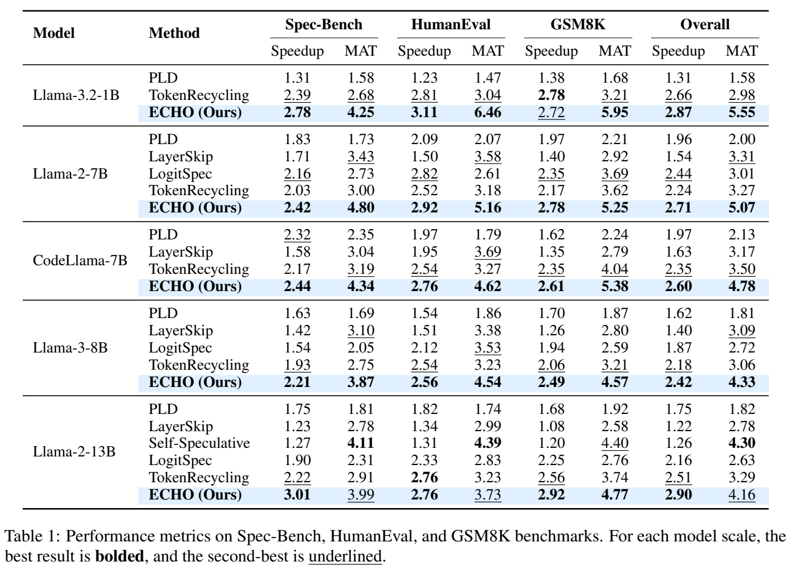

图 原文 Table 1，物理页 7，印刷页 4053。同一底座比较 PLD、LayerSkip、Self-Speculative、LogitSpec、TokenRecycling 和 ECHO，相对标准自回归报告 speedup，MAT 是平均接受 token 数。Llama-2-7B 总体 2.71 倍、MAT 5.07，TokenRecycling 2.24 倍、3.27。正文另称 2.75 倍，以原表分项为准。13B 的 3.01 倍是 Spec-Bench 单项，总体为 2.90 倍。

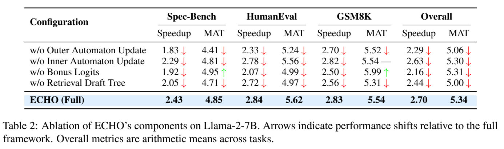

图 原文 Table 2，物理页 8，印刷页 4054。固定 7B 设定，去掉浅层自动机更新、最终自动机更新、bonus 候选或检索树。完整总体 2.70 倍，移除 bonus 为 2.16 倍；GSM8K 的 MAT 却从 5.54 增到 5.99，接受量和延迟不能相互替代。

- **数据与资源。** 推理评测用 Spec-Bench、HumanEval、GSM8K。主表从 1B 到 13B，8B 及以下单张 RTX 3090，13B 单张 A40。作者使用兼容早退的 LayerSkip 模型设置，主设置报告早层 10、缓冲 5、bonus 深度 8、检索深度 6。512 token 的 7B 案例另用 12 层和 20 层的切分，不能和主默认混读。ECHO 无额外参数训练、训练步、奖励或损失。峰值显存、GPU-hours 和总费用未找到。
- **实现与局限。** 阅读固定提交的评测路径、两段核验与瓶颈计时。实际复现应同时记录序列等价、硬件、批量、生成长度和端到端延迟；附录的 34B、70B 是额外配置。代码维护检索游标，且能跨样本保留状态，因此样本顺序和暖机条件也值得固定。论文主要面向本地推理，批量吞吐和跨设备收益需另行测量。[作者代码](https://github.com/whucs21Mzy/ECHO/tree/5d5640fe1517334fa82da4c9f58a5055fe4d8cb0) · [投机采样基础](https://arxiv.org/abs/2211.17192)

[图源与代码核查](https://github.com/daihuangyu/papers-daily/blob/main/CCF_Papers/2026-11-27/assets/SOURCES.md) · [全文 PDF 检查](https://github.com/daihuangyu/papers-daily/blob/main/CCF_Papers/2026-11-27/assets/QA.md)
