# CCF A/B 论文精读 | 2026-11-28

## 快速导读

### 1. LoRA-Pre：把优化器的记忆压小

训练模型时，优化器要记住过去梯度的方向和大小，这些记录常随模型一同膨胀。作者先把「用历史平滑当前梯度」重新写成一个不断接收新样本的小拟合任务，再用两张瘦矩阵近似原来的大记录。每一步只更新这两张表，算出需要的动量，再用它更新完整模型。[查看精读](#paper-mom)

### 2. ERC：让路由器挑中的专家也擅长这类输入

混合专家模型会为一个词挑几个模块，但路由器认为某个专家合适，并不直接说明专家对这类输入反应最强。作者给每个专家从路由器取一个代表向量，在附近做小扰动，再送进所有专家的第一层。训练时同时奖励两件事：一个代表向量应最能激活自己的专家，一个专家也应最偏爱自己的代表向量。推理沿用原来的路由方式。[查看精读](#paper-erc)

### 3. 扩展 logits 矩阵：跨多个生成位置测量低维结构

模型面对两条不同的提示，接下来的词分布往往有共同变化。作者把许多历史提示排成行，让每行接上同一批续写片段，再把下一词分数并排摆成表。随后逐渐减少可以用来解释这张表的方向，观察保留多少方向才能近似已知分布，并比较随机初始化与预训练后的模型。[查看精读](#paper-rank)

### 4. TFPI：先练直接作答，再接长推理强化学习

给一个习惯长篇思考的模型强行缩短输出上限，可能恰好截在最关键的推理中间。作者在输入末尾预先闭合思考段，让模型练习直接进入作答。每一轮让它试答几次，用可核对的正确性评分，把短输出上限分阶段放长。得到初始化模型以后，可以独立使用，也可以恢复常规的长推理训练。[查看精读](#paper-tfpi)

### 5. EES：每一步按当前分布决定保留多少候选词

固定取多少词，或者固定保留多少总概率，在模型很确定和很犹豫时可能给出同样的截断规则。EES 把词按可能性排列，从前往后检查两件事：当前词表已经覆盖多少概率，以及这张短名单内部还剩多少不确定性。一旦覆盖程度首次超过不确定性，就回退到上一个名单，再从其中随机选词。这省去了单独调截断阈值的环节，温度仍可设置。[查看精读](#paper-ees)

## 篇目与核验

| 论文 | 2026 年主会 | CCF | 展示 | 已核验 arXiv v1 UTC | OpenAlex |
| --- | --- | --- | --- | --- | --- |
| LoRA-Pre | ICLR | A | Oral | 2026-02-27 | 10 |
| ERC | ICLR | A | Oral | 2025-12-29 | 12 |
| Sequences of Logits | ICLR | A | Oral | 2025-10-28 | 10 |
| TFPI | ICLR | A | Poster | 2025-09-30 | 6 |
| EES | EMNLP | B | Poster | 2025-11-30 | 0 |

实收 5 篇，**4 A + 1 B，3 Oral + 2 Poster**。录用与年度按正式主会论文集，展示由 ICLR 会议页和 EMNLP 官方排期核验。首发使用可核验的 arXiv v1 日期。CCF 第七版正式目录物理页 57、58 分别列 ICLR A、EMNLP B。引用于北京时间 2026-11-28 查询，EES 的预印本与会议 DOI 在 OpenAlex 分为两条记录，两条均为 0，未相加。正文区分作者实验、本文手算和未披露信息。本次只静态检查资料与可取得的作者代码。[原文、代码与图源](https://github.com/daihuangyu/papers-daily/blob/main/CCF_Papers/2026-11-28/assets/SOURCES.md)

<a name="paper-mom"></a>

## 1. LoRA-Pre | Taming Momentum: Rethinking Optimizer States Through Low-Rank Approximation

### 动量为什么能被压缩

Adam 用梯度的平滑方向做分子，用平方梯度的平滑尺度做分母。完整的动量矩阵与权重一样大。若当前梯度 $`G_t`$ 是新观测、$`M_t`$ 是第一动量、$`\beta`$ 是保留旧状态的系数，平滑更新等于对一个单样本平方误差走一步。$`\|\cdot\|_F`$ 是逐项平方和开根号，损失对 $`M`$ 的梯度就是 $`M-G_t`$。

```math
\begin{aligned}
L_t(M)&=\tfrac12\lVert M-G_t\rVert_F^2,\\
M_{t+1}&=M_t-(1-\beta)\nabla_M L_t(M_t)
=\beta M_t+(1-\beta)G_t .
\end{aligned}
```

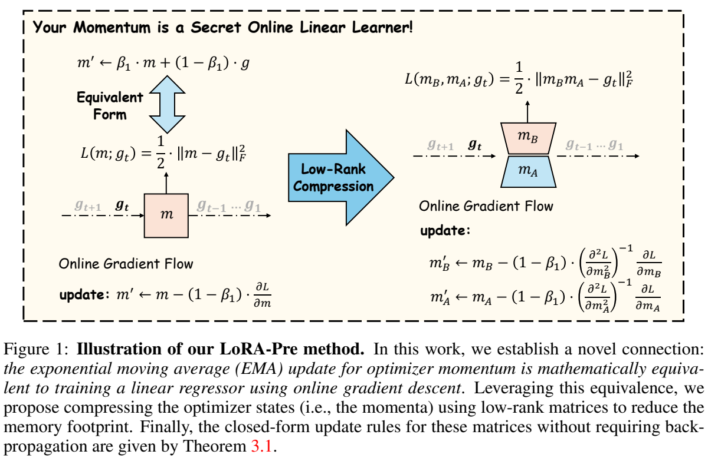

图 原文 Figure 1，ICLR 2026 论文集 PDF 物理页 4。左侧把 EMA 写成线上平方拟合，右侧换成两个低秩因子并更新。示意图处理优化器状态，训练权重仍可保持稠密。

### 固定一个因子，求另一个的最小二乘解

令 $`M=BA`$，$`G_t\in\mathbb R^{p\times q}`$，$`B\in\mathbb R^{p\times r}`$，$`A\in\mathbb R^{r\times q}`$，$`r`$ 是秩上限。固定 $`A`$ 时，法方程是 $`BAA^\top=G_tA^\top`$。当 $`AA^\top`$ 可逆，乘其逆得到最小二乘解。反过来固定 $`B`$，法方程为 $`B^\top BA=B^\top G_t`$。作者把部分 Newton 更新写成向条件最优点移动，$`\gamma_1`$ 为移动比例。

```math
\begin{aligned}
B&\leftarrow (1-\gamma_1)B+\gamma_1 G_t A^\top(AA^\top)^{-1},\\
A&\leftarrow (1-\gamma_1)A+\gamma_1 (B^\top B)^{-1}B^\top G_t .
\end{aligned}
```

Adam 的第二状态改用 $`V=(B_vA_v)^{\circ2}`$，逐元素平方保证非负。两个因子拟合 $`|G_t|`$ 并各用 $`\gamma_2`$ 做缓动，实际开方是 $`|B_vA_v|`$。这个近似和直接对 $`G_t^{\circ2}`$ 做 EMA 通常会得到不同结果。附录 Algorithm 1/2 给出 Adam 与 Muon 分支，包括状态初始化、参数更新和阻尼。Muon 对矩阵方向还要做正交化近似。

**手算。** 先用标量想象。旧动量 2，当前梯度 6，保留比例 0.75，更新为 3。若一个矩阵为 1024×1024，秩 16 的两个因子共 32,768 个数，完整状态有 1,048,576 个数，相差 32 倍。这个比例只对应一个矩阵的持久状态，每步重建、全量梯度、激活与通信仍要算。

```text
read gradients for this minibatch
for each selected weight matrix:
    update first-moment factors with small damped Gram solves
    for Adam, fit second-moment factors to absolute gradients
    reconstruct the input required by the base optimizer
    apply the update to the full weight
use the ordinary optimizer for other parameters
```

### 验证、消融和复现边界

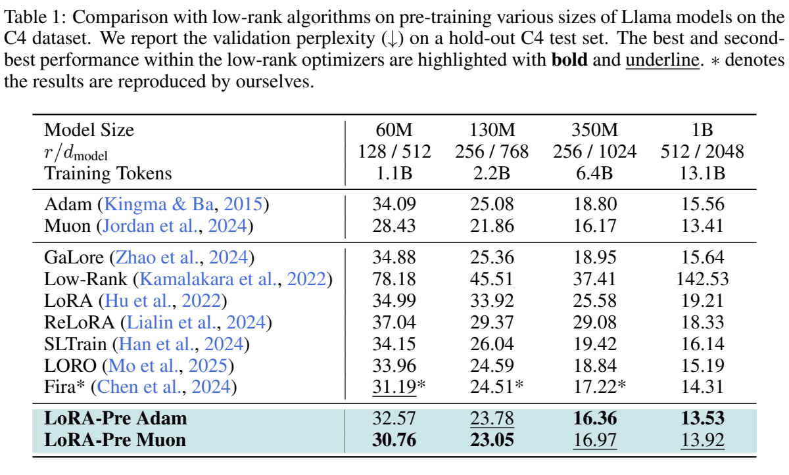

图 原文 Table 1，物理页 7。每列是独立 Llama 规模及相同 C4 token 预算，比较验证困惑度，越低越好。1B 列 LoRA-Pre Adam 13.53、GaLore 15.64、完整 Adam 15.56、完整 Muon 13.41。350M 完整 Muon 16.17 也优于 LoRA-Pre Adam 16.36。星号标作者重跑项目。

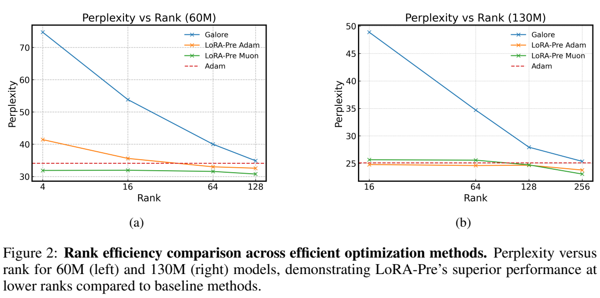

图 原文 Figure 2，物理页 8。两面板分别为 60M 和 130M，横轴为秩，纵轴为困惑度。60M 中作者比较 LoRA-Pre Adam 秩 16 与 GaLore 秩 128 的相近结果。「八分之一」描述此配置的秩比，图未测端到端显存。

- **数据与规模。** Llama 从头训 60M、130M、350M、1B，C4 分别 1.1B、2.2B、6.4B、13.1B token。注意力和 MLP 矩阵使用压缩，其他交给 Adam。默认秩 128/256/256/512，预训练学习率按验证困惑度选，缩放 0.25。7B/8B 微调用 MetaMathQA 抽样 100k 条，默认秩 8、学习率 2e-5，以预测损失训练。无 RL 奖励。
- **微调与资源。** Table 2 的 8B Adam 分支，GSM8K/MATH-500 平均 47.05，DoRA 44.46，但单看 MATH-500 时 GaLore 的 18.65 胜过 LoRA-Pre Adam 的 17.66。新方法与只更新适配器的基线可训练参数口径不同。硬件、峰值显存、实际总步数、墙钟、GPU-hours 与费用未找到。
- **复现限制。** 作者论文称发布代码，固定提交仅有 README 和许可证，README 写实现待发布。可按本文与附录两个算法核对阻尼、初始低秩空间与 bias correction，再测同一批大小及精度下的总显存和吞吐。低秩拟合误差在梯度方向快速变化时可能上升，附录收敛结论有梯度、光滑性和误差假设。[作者项目仓库](https://github.com/mrflogs/LoRA-Pre/tree/29c53c675811e4fd1411f86fd22c86bd3ca911a9) · [Adam 基础](https://arxiv.org/abs/1412.6980) · [GaLore 对照](https://arxiv.org/abs/2403.03507)

<a name="paper-erc"></a>

## 2. ERC | Coupling Experts and Routers in Mixture-of-Experts via an Auxiliary Loss

### 让专家和路由器彼此辨认

稀疏 MoE 只计算路由器选中的 $`K`$ 个专家。标准语言模型损失通过真实 token 反传，负载项约束每个专家接多少工作。ERC 加了训练时的直接配对监督。令 $`R_i`$ 为专家 $`i`$ 对应的路由向量，$`\delta_i`$ 是逐维乘性噪声，$`\widetilde R_i=R_i\odot\delta_i`$ 是代表输入。$`W_g^j`$ 是专家 $`j`$ 的门控投影，$`M_{ij}=\|\widetilde R_iW_g^j\|_2`$ 是它对代表输入的激活范数。$`n`$ 是专家数，$`[x]_+=\max(x,0)`$，$`\alpha`$ 控制对角匹配需要多强。

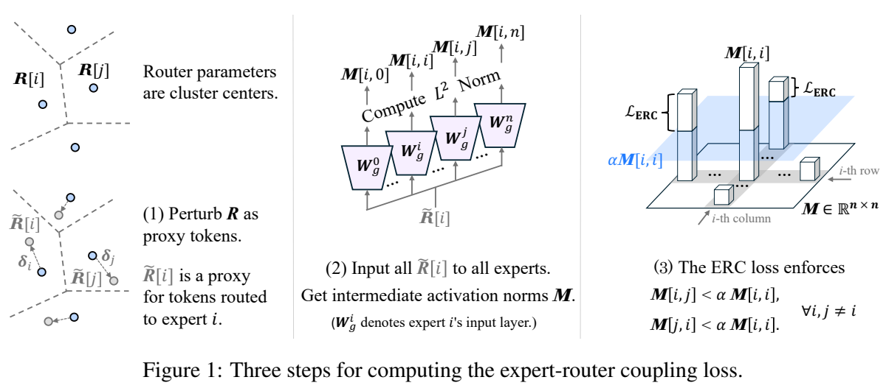

图 原文 Figure 1，ICLR 2026 论文集 PDF 物理页 2。左侧为路由向量加噪，中央为用同一批代表向量扫描专家门控投影，右侧是对角匹配。两种箭头对应固定行和固定列的比较。

```math
\begin{aligned}
L_{\mathrm{ERC}}&=\frac{1}{n^2}\sum_{i=1}^{n}\sum_{j\ne i}
\bigl([M_{ij}-\alpha M_{ii}]_+ + [M_{ji}-\alpha M_{ii}]_+\bigr),\\
L_{\mathrm{train}}&=L_{\mathrm{LM}}+0.01 L_{\mathrm{balance}}+L_{\mathrm{ERC}} .
\end{aligned}
```

一条约束让代表输入 $`i`$ 在本专家的反应大于串到别的专家。另一条让本专家偏爱自己的代表输入。若非对角值低于 $`\alpha M_{ii}`$，对应惩罚为零，减小 $`\alpha`$ 会抬高所需的匹配差距。设 $`d_i`$ 为 $`R_i`$ 到最近另一路由向量的欧氏距离，随机噪声的分量取 $`[1-\epsilon_i,1+\epsilon_i]`$，$`\epsilon_i\le d_i/(2\|R_i\|_2)`$。因为位移长度至多 $`\epsilon_i\|R_i\|_2`$，留在半径为最近中心间距一半的球内，在欧氏近邻意义下不更靠近别的中心。路由实际比较内积，论文的中心类比依赖范数可比等条件。

**手算。** 取两位专家，激活表两行为 (2,1.8) 和 (0.4,1)，$`\alpha=0.8`$。对专家 1 的行超额 0.2、列超额 0，对专家 2 的行超额 0、列超额 1.0。相加除以 4 得 0.30。第一行对应的代表输入同时被两个专家强烈响应，把列项漏掉会掩盖第二个配对问题。

```text
route real tokens on the clean router and compute language loss
make one perturbed router proxy per expert
batch the proxy-by-expert gate outputs and measure their norms
compute row and column hinge penalties against the diagonal
backpropagate language, load-balancing and coupling losses
at inference, route and apply the selected experts as usual
```

### 训练效率与适用条件

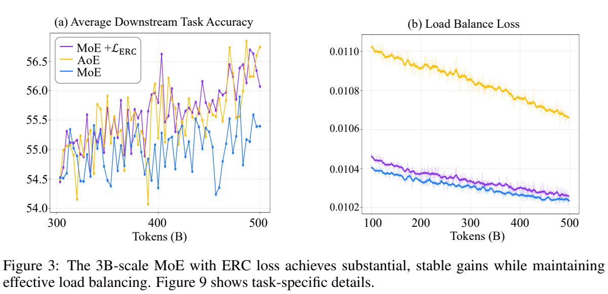

图 原文 Figure 3，物理页 6。左边在 3B 的 300B 至 500B token 区段比较原 MoE、AoE、ERC 的十任务均值，右边比较负载均衡损失。ERC 与原 MoE 的负载损失相差约十万分之一，同时任务均值大多优于原 MoE。

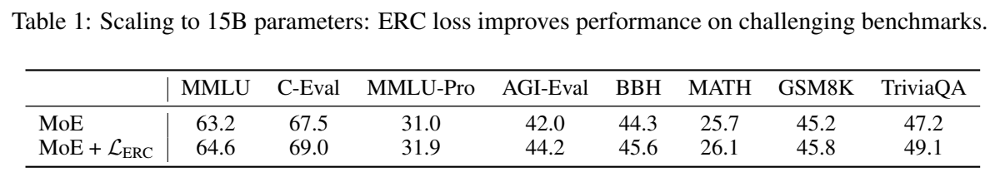

图 原文 Table 1，物理页 6。15B、约 700M 激活时对照同架构原 MoE。MMLU 63.2→64.6、GSM8K 45.2→45.8、TriviaQA 47.2→49.1。15B 的 AoE 受资源限制未训练成功，跨尺度不能视为同一组比较。

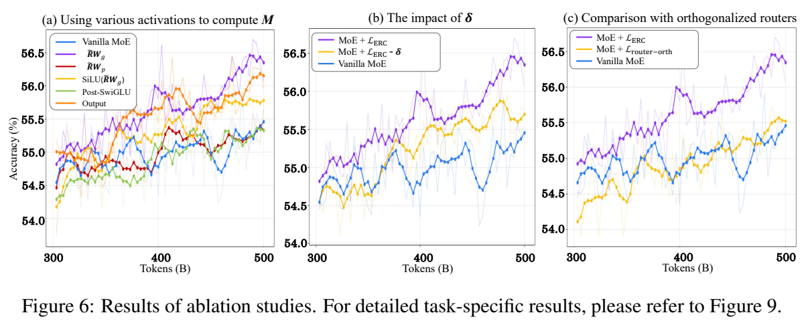

图 原文 Figure 6，物理页 9。横轴是已训练 token。左对照门控前、门控后及完整 FFN 激活作为代理，中央去掉噪声，右侧只对路由向量加正交损失。去噪后增益显著缩小，只正交化的收益也有限。

- **训练设置。** 3B 总参数、500M 激活，12 层、64 专家、每 token 选 8，OLMoE 实现，500B dolmap-v1.5-sample token，batch 3M token。AdamW、峰值 4e-4 余弦衰减到 4e-5，默认 $`\alpha=1`$。15B 把深度加倍、专家加到 256。由 500B/3M 推算约 16.7 万批，以每批一次更新且排程无丢弃为前提。
- **算量与成本。** 每层门控探针随专家数平方而增长，真实 token 的 MoE 计算还随 token 数和 top-k 增长。附录 15B、DP64/EP8 的吞吐 62.03→61.52B token/天（约下降 0.82%），3B 估算额外前向开销 0.18%。作者报告 3B AoE 的总训练时长与内存相对为 1.6、1.3 倍。绝对卡型、峰值显存、实际 GPU-hours 与账单未找到。训练辅助项在推理关闭。
- **实现与局限。** 可按正式 PDF Figure 8 的 PyTorch 伪代码检查 $`n\times n`$ 的行列方向、扰动及 stop 条件。未找到作者独立实现仓库。附录同时讨论专家范数变化和选择偏差，代理激活变强只能提供对齐证据，无法证明真实 token 都被分到最有用的专家。复现需并列监测负载、组内任务正确率和算力。[论文集与代码附录](https://proceedings.iclr.cc/paper_files/paper/2026/hash/79ff18412c1a5816f071a796375abc3d-Abstract-Conference.html) · [稀疏专家基础](https://arxiv.org/abs/2101.03961)


<a name="paper-rank"></a>

## 3. Sequences of Logits Reveal the Low Rank Structure of Language Models

### 从单步输出到序列级结构

通常一个词的输出分数来自词表投影。多走几步后，原来的低维空间是否还够用，是一个独立问题。固定开源模型 $`M`$，词表 $`\Sigma`$，历史集合 $`H`$ 和未来片段集合 $`F`$。令 $`h\circ f`$ 为拼接的上下文，$`z`$ 为下一个词。每行是一个历史，每块列是同一个未来短语下的全部下一词分数。正式定义使用去均值的对数概率。

```math
L_M(h,(f,z))=\log p_M(z\mid h\circ f)
-\frac{1}{|\Sigma|}\sum_{u\in\Sigma}\log p_M(u\mid h\circ f).
```

$`u`$ 遍历词表，$`|\Sigma|`$ 是词表大小。减掉的常数对同一块列相同，所以再取 softmax 恢复原分布。设 $`A_r`$ 为 $`L_M`$ 的截断奇异值分解，保留前 $`r`$ 个方向。若 $`\sigma_i\approx C i^{-\alpha}`$，并且这一规律在考虑的尾部有统一上界，则两个相连的结论是：

```math
\begin{aligned}
\|L_M-A_r\|_F^2
&=\sum_{i>r}\sigma_i^2
\le C^2\sum_{i>r}i^{-2\alpha}
\le \frac{C^2 r^{1-2\alpha}}{2\alpha-1},\quad \alpha>1/2,\\
D_{\mathrm{avg}}(L_M,A_r)
&\le \frac{\|L_M-A_r\|_F^2}{|H||F|}.
\end{aligned}
```

第一步来自最优的秩 $`r`$ Frobenius 范数近似，最后一步把递减尾和上界成积分。$`D_{\mathrm{avg}}`$ 是每个上下文的原分布到低秩重建分布的 KL 均值。第二个式子来自 softmax 的 log-partition 平滑性，$`|H||F|`$ 是上下文对数。有限样本拟合出的幂律不能直接保证所有文本都服从同一个常数。

**手算。** 一个仅两词的例子，某个未来块的三行分数为 (1,-1)、(2,-2)、(3,-3)。第二、第三行分别是第一行的 2、3 倍，因此矩阵秩为 1，保留一个方向无重建误差。第一行对第一个词的 softmax 约 0.881，第二行约 0.982。低秩允许不同上下文有完全不同的置信度。

### 原结果、状态空间解释与复现

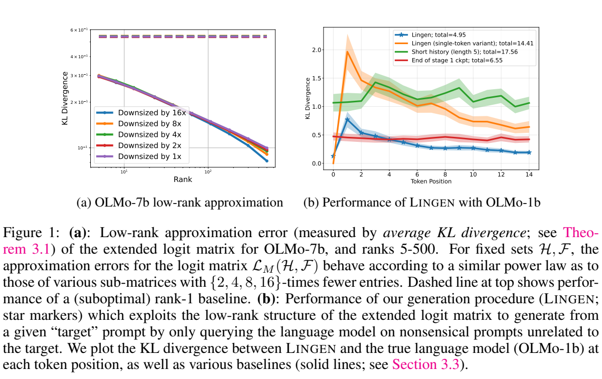

图 原文 Figure 1，ICLR 2026 论文集 PDF 物理页 2。左图横轴为秩、纵轴为近似 KL，按 OLMo-7B 的历史与未来子矩阵规模分线。右图是 OLMo-1B 对目标续写的逐位置 KL，对比只拟合首个 token、截短历史和更早检查点。它衡量分布的接近程度，不能当作人类质量评分或运行加速。

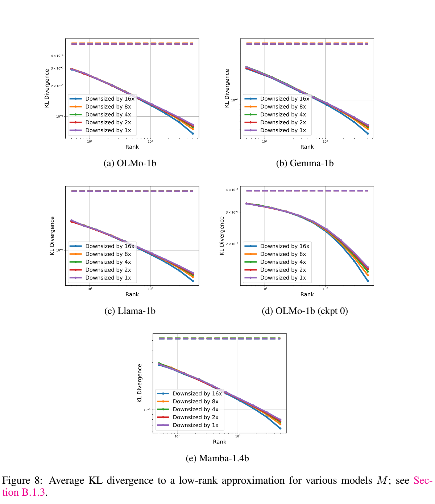

图 原文 Figure 8，物理页 19。各小图在 $`k=50`$ 的子矩阵上看不同开源底座的 KL 随秩变化。固定模型和缩小倍数再比较。未训练的 OLMo-1B 面板对矩阵大小更敏感，说明低秩性随训练出现，不能从输出维度直接推出多步结果。

- **数据、对照与成本。** 正文从 olmo-mix-1124 的 wiki split 抽取序列，随机子串分别进入历史、未来，每集合最多约 10,000。每段未来只保留由未来本身选出的 50 个高概率列，附录加到 200 或抽随机词验证。覆盖 OLMo-1B/7B、Gemma-1B、Llama-1B、Mamba-1.4B 等；比较不同语料、模型和 OLMo 训练检查点。这里的平方误差和 KL 用于矩阵分析，无新语言模型训练目标或奖励，实验设备、峰值显存、墙钟、卡时和费用未找到。
- **理论条件。** 单时刻若以 $`x_t`$ 表示压缩状态，观测分数可写为 $`B_t x_{t-1}`$，生成词 $`z_t`$ 后用与词和时刻相关的 $`A_{z_t,t}`$ 更新状态。给定未来片段，这些线性映射可相乘，故每个后续 logit 对历史状态仍是线性的。定理 4.3 把所有切分上的精确秩约束与有限长度的时变 ISAN 联系起来。实验是近似且有限的子矩阵，定理并不等价于所有模型的全局低秩已验证。
- **复现边界。** 作者在结论写计划公开代码，正式论文与标题检索未找到可验证的作者独立仓库。下列伪代码只复核本地开放权重上的矩阵统计。应固定模型、分词器、种子、列选择、KL 方向及首末检查点；若要外推，还需在不同语种、较长未来片段和新模型上测量。[正式论文与附录](https://proceedings.iclr.cc/paper_files/paper/2026/hash/2af179e30c16f3a6d44311adbb5ec63f-Abstract-Conference.html) · [截断 SVD 基础](https://numpy.org/doc/stable/reference/generated/numpy.linalg.svd.html) · [Softmax 瓶颈](https://arxiv.org/abs/1711.03953)

```text
sample history and future blocks from distinct source sequences
score each concatenation using a local open-weight checkpoint
group centered next-token log probabilities by future block
select identical candidate columns across histories for each block
sweep truncated SVD rank and compare blockwise KL
repeat with different sizes, column choices and checkpoints
```

<a name="paper-tfpi"></a>

## 4. TFPI | Thinking-Free Policy Initialization Makes Distilled Reasoning Models More Effective and Efficient Reasoners

### 给强化学习换一个起跑方式

蒸馏过的模型可能习惯先在专门的思考段写几千词。普通 RLVR 即使让上限变短，也可能让很多同组尝试都被截断且答错。TFPI 在助手提示中预先闭合空思考段，把 $`x`$ 变成直接作答提示 $`x'=T(x)`$，同一题的标准答案仍然有效。它把这种输入用在初始化阶段的所有 rollout。在该阶段后，可以恢复普通模板继续长推理 RL，也可直接分别评估思考和免思考模式。

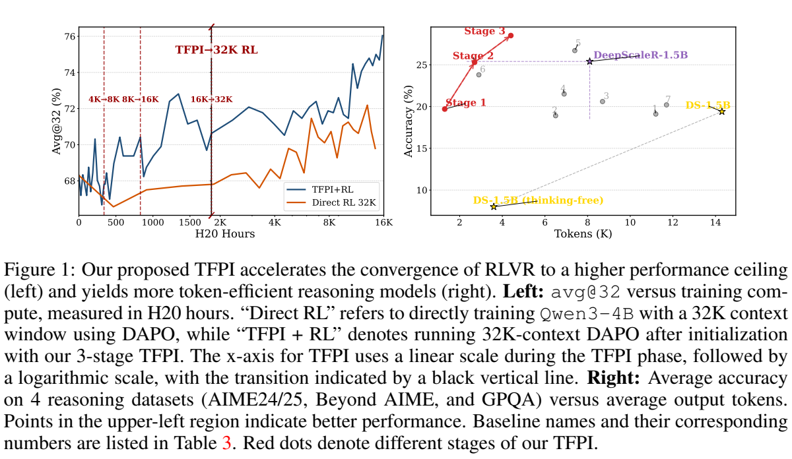

图 原文 Figure 1，ICLR 2026 论文集 PDF 物理页 2。左图比较 Qwen3-4B，横轴为训练 H20 小时且拼接了不同的区段刻度，读数时不能把整图横距当等比例。右图看四任务平均准确率和每题输出词数，左上代表词数较少且准确度较高，红点表示阶段。

### DAPO 的可验证反馈

令 $`G`$ 为每题采样数，$`y_i`$ 为旧策略以 $`x'`$ 生成的回答、$`y_{i,t}`$ 为其第 $`t`$ 个词，$`r_i`$ 是规则核验的 0/1 结果。$`\bar r`$、$`s_r`$ 是同题均值、标准差，$`A_i`$ 在一条回答的所有词间共享。$`\pi_\theta`$ 是新策略，$`\pi_{\mathrm{old}}`$ 是生成时的策略，$`w_{i,t}`$ 补偿每个词的概率变化。$`\widetilde w_{i,t}`$ 把这个比率限制在论文的上下界。

```math
\begin{aligned}
A_i&=\frac{r_i-\bar r}{s_r},\qquad
w_{i,t}=\frac{\pi_\theta(y_{i,t}\mid x',y_{i,\lt t})}
{\pi_{\mathrm{old}}(y_{i,t}\mid x',y_{i,\lt t})},\\
\widetilde w_{i,t}&=\mathrm{clip}(w_{i,t},1-0.2,1+0.28),\\
J(x')&=\frac{\sum_i\sum_t\min(w_{i,t}A_i,\widetilde w_{i,t}A_i)}
{\sum_i |y_i|}.
\end{aligned}
```

训练最大化有效题组的平均目标，分母按有效输出词汇总。全对、全错时 $`s_r=0`$，按动态采样过滤；KL 和熵项在论文主设置关闭。正优势时，概率升得很高也不会让代理目标继续增大。负优势时，取较小值会限制另一侧的过度变化。TFPI 改的是条件提示与输出预算，奖励仍取原题答案正确性。

**手算。** 四条结果 (1,0,1,0)，用总体标准差 0.5 演示，优势各为 +1 或 -1。一个正确 token 的旧概率 0.20、新概率 0.28，比率 1.4 超过 1.28，目标项取 1.28。若四条都为 0，整题对这轮组内比较无可用分类差异。

```text
load the distilled model and math prompts with verified answers
append an empty closed thinking segment to each training prompt
for each response budget in the stage schedule:
    sample multiple responses per prompt and grade the final answer
    discard groups with identical rewards and resample batches
    compute group advantages and the clipped token-level update
    advance when validation plateaus and truncation resurges
optionally resume ordinary long-context RL using the thinking template
```

### 训练预算、模型差异和失败条件

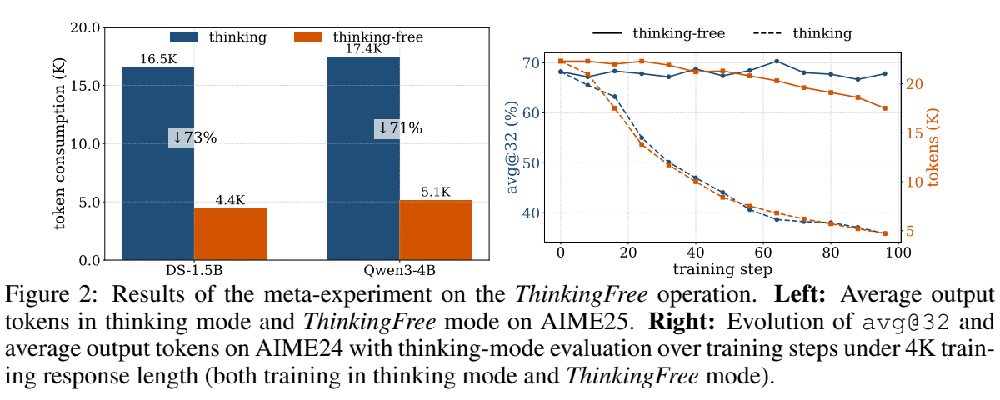

图 原文 Figure 2，物理页 4。左侧 AIME25 的推理词数从 16.5K→4.4K 和 17.4K→5.1K。右侧图注标 AIME24，邻近正文写 AIME25，二者口径有冲突，按图注读右图。右侧比较同为 4K 的训练输出上限，测试仍走思考模板，附录 Table 13 另验证统一采样参数的左图压缩现象。

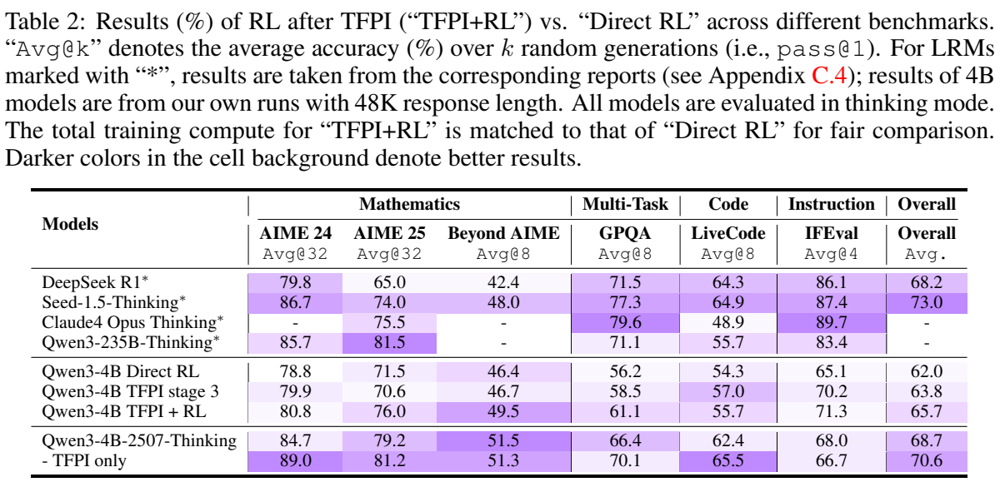

图 原文 Table 2，物理页 6。同底座 Qwen3-4B，Direct RL 六项均值 62.0，TFPI+RL 65.7；另一个起点 Qwen3-4B-2507-Thinking 的 TFPI-only AIME24 89.0、LiveCodeBench 65.5，IFEval 68.0→66.7。带星号行引用其他论文，不能混成严格复算。

- **数据与训练。** 主设置整个 Polaris-53K 数学题集，DAPO/VeRL，batch 和 mini-batch 256、每题 8 条、学习率 1e-6、无热身，训练温度 1、top-p 1。DS-1.5B 与 DS-7B 走 2K/4K/8K，Qwen3-4B 走 4K/8K/16K。1.5B/7B 直接 RL 的训练上限 16K，4B 对照 32K。增大上限以恢复有效组比例，附录另比多阶段 Direct RL 和训练温度。
- **资源与可比性。** 附录 Table 6 记录 32 张 H20。主 Qwen3-4B 的三阶段分别 100、56、64 步，合计 1.79K H20-hours，同预算附近 Direct RL 为 20 步、1.9K H20-hours。若 32 卡全程占用，1.79K/32 对应约 55.9 小时，属本文估算。主表再接长训练的比较为 15.4K vs 15.7K H20-hours，不能把仅初始化的卡时当完整训练。另有不同起点的 4B 成绩与 H800 对照，硬件不同不直接折算。峰值显存和实际费用未找到。
- **代码与局限。** 作者提交的 Qwen3-4B 脚本含 4096 rollout、空思考前缀、8 条采样、分组过滤与两侧裁剪，数据处理脚本和 DAPO reward manager 也已阅读。脚本提供首阶段样例，后续长度与模型初始化需照论文或检查点配置设置。直接闭合模板未训练时，短答准确率会显著下降。策略应在同模板、相近 token 与卡时预算下比较，数学可验证奖励的结果也不直接适用于开放写作。[作者代码](https://github.com/Tencent-Hunyuan/Thinking-Free_Policy_Initialization/tree/d9c8462a5269272a82d448dd125cba961b327716) · [作者模型合集](https://huggingface.co/collections/xx18/tfpi) · [DAPO 基础](https://arxiv.org/abs/2503.14476)

<a name="paper-ees"></a>

## 5. EES | Entropy Equilibrium Sampling: Tuning-Free Truncation for Language Model Decoding

### 用词表自己的分布定截断点

温度 $`\tau`$ 调整 logits 的平缓程度。若 $`\ell_i`$ 为模型分数，$`p_i`$ 为将 $`\ell_i/\tau`$ 做 softmax 后按降序排好的概率，$`k`$ 表示已考察的候选数，$`P_k`$ 是它们在原分布的累计质量。列表内部归一化以后用 $`q_{i,k}=p_i/P_k`$ 表示概率。$`H_k`$ 是内部熵，$`\log k`$ 是均匀时的最大值，所以 $`\overline H_k`$ 可和同在 0 到 1 间的 $`P_k`$ 比较。$`n`$ 为候选词数，$`\kappa`$ 是首次交叉位置。

```math
\begin{aligned}
P_k&=\sum_{i=1}^k p_i,\qquad
H_k=-\sum_{i=1}^k q_{i,k}\log q_{i,k},\qquad
\overline H_k=\frac{H_k}{\log k}\quad(k\ge2),\\
\kappa&=\min\bigl(\{k\in\{2,\ldots,n\}:\overline H_k\lt P_k\}\cup\{n+1\}\bigr),\\
k^\star&=\min(\kappa-1,n).
\end{aligned}
```

严格小于时触发，保留交叉之前的名单，避免 $`k=1`$ 时分母为 0。没有触发保留全部。可提前累计 $`S_k=\sum_{i\le k}p_i\log p_i`$。代入 $`\log(p_i/P_k)=\log p_i-\log P_k`$，得到 $`H_k=\log P_k-S_k/P_k`$。所以每次扩展只需更新两个累积量，与附录的原熵递推等价。温度仍会改变输入概率。附录以 $`\theta P_k`$ 代替 $`P_k`$ 做敏感性测试，主结果固定 $`\theta=1`$。

**手算。** 概率 (0.70,0.20,0.10) 时，前两词质量为 0.90，内部归一化熵约 0.76，立即触发并只保留第一个词。概率 (0.45,0.35,0.20) 时，前两词熵约 0.989，高于累计 0.80。加第三词后归一化熵约 0.954，小于 1，故保留前两词，按 0.5625 与 0.4375 抽取。

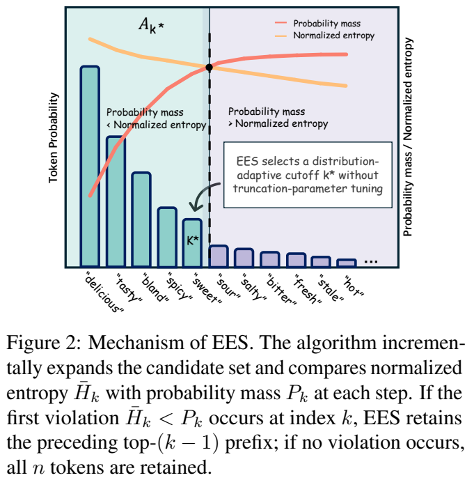

图 原文 Figure 2，EMNLP 2026 PDF 物理页 3，印刷页 54512。柱为单词概率，折线为累计质量与候选内归一化熵，首次触发后要回退一位。图是规则示意。

```text
apply temperature and sort candidate probabilities
keep cumulative mass and cumulative probability-log-probability
at each prefix of size at least two:
    compare normalized prefix entropy with cumulative mass
    on the first crossing, keep the preceding prefix and stop
if no crossing occurs, keep the entire vocabulary
normalize survivors and sample the next token
```

- **数据与比较。** CommonsenseQA、StrategyQA、GSM8K 与 WikiText-103 开放生成；QA 用 Qwen2.5-7B/32B 和 Llama3.1-8B，用训练数据随机抽 20% 为验证并抽示例作上下文。每个设置三次选对照超参数，再用五次独立运行测测试集。开放写作取 32 词前缀、输出上限 256，按人工与模型评委成对比。8 种随机解码和两种确定性对照覆盖 top-p/k、Min-p、Typical、对比搜索等。EES 的截断规则跨温度固定。附录显著性检验并不支持所有配置都胜。

### 性能、消融与公开实现

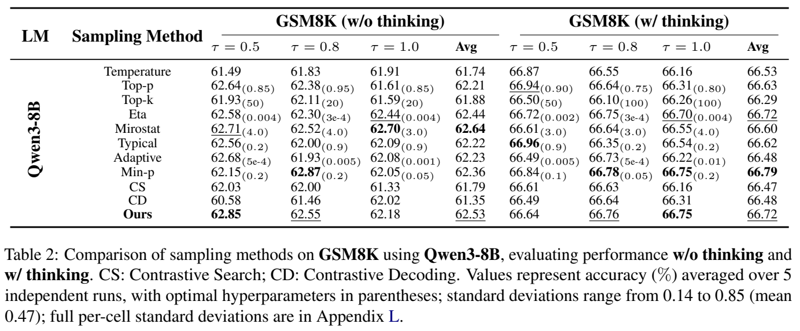

图 原文 Table 2，物理页 6，印刷页 54515。用同一 Qwen3-8B 与 GSM8K，分是否开启思考，两侧各测三种温度。免思考 EES 平均 62.53、Mirostat 62.64，思考 EES 66.72、Min-p 66.79。每格五次均值，标准差区间 0.14 至 0.85 个百分点，小差距需结合误差读。

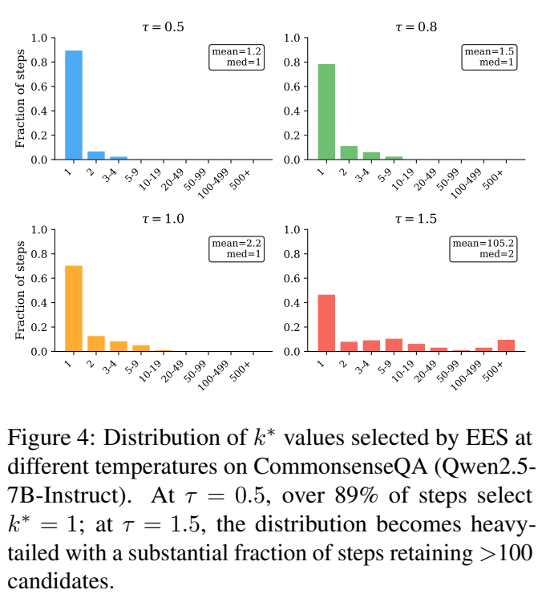

图 原文 Figure 4，物理页 7，印刷页 54516。看 Qwen2.5-7B-Instruct 在 CommonsenseQA 的实际保留数分布，温度 0.5 时 89% 以上步骤保留一个词，升到 1.5 后分布出现长尾。它解释候选行为，不直接表明输出更正确。

- **成本。** 冻结模型的解码策略，无新训练、梯度损失或奖励。附录 A 旁列的 Qwen3-8B 延迟表给温度基线 69.65 ms/step、EES 90.59，约 1.30 倍。全词表排序是实际成本，增量熵只省重复计算。未找到该表硬件型号、峰值显存、总卡时与费用的完整口径。
- **代码与局限。** 会议版链接的固定提交从 $`\tau`$ 缩放进入 EESWarper；在所读入口中，后续用到的累计概率和移除掩码初始化仍被注释。按源码存在未定义变量风险，这里未实际执行。复现优先核对附录 Algorithm 1，用单词、平局、数值归零、无交叉等边界对照，再确认实际推理内核、批量和随机种子。不同任务对多样性需要不同，较高温度下扩大词表仍可能降准确率。[会议版作者实现](https://github.com/shuanncai/Entropy-Equilibrium-Sampling/tree/03eccde61c92dafce9bc67572f1ff276206f9a39) · [Nucleus sampling 基础](https://arxiv.org/abs/1904.09751)

[图源与代码核查](https://github.com/daihuangyu/papers-daily/blob/main/CCF_Papers/2026-11-28/assets/SOURCES.md) · [全文 PDF 检查](https://github.com/daihuangyu/papers-daily/blob/main/CCF_Papers/2026-11-28/assets/QA.md)
