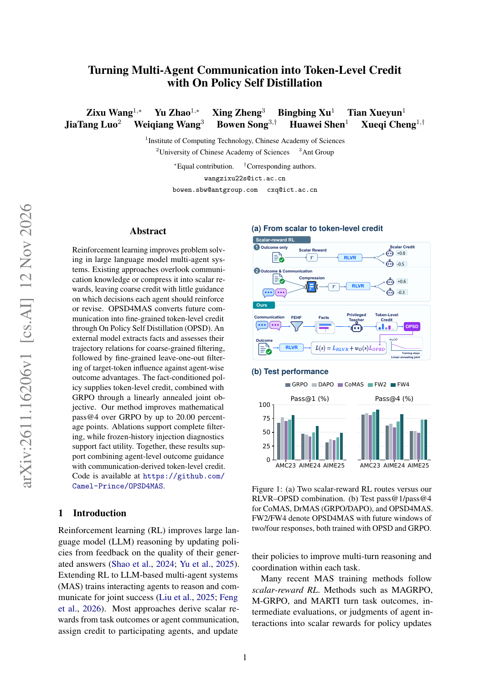
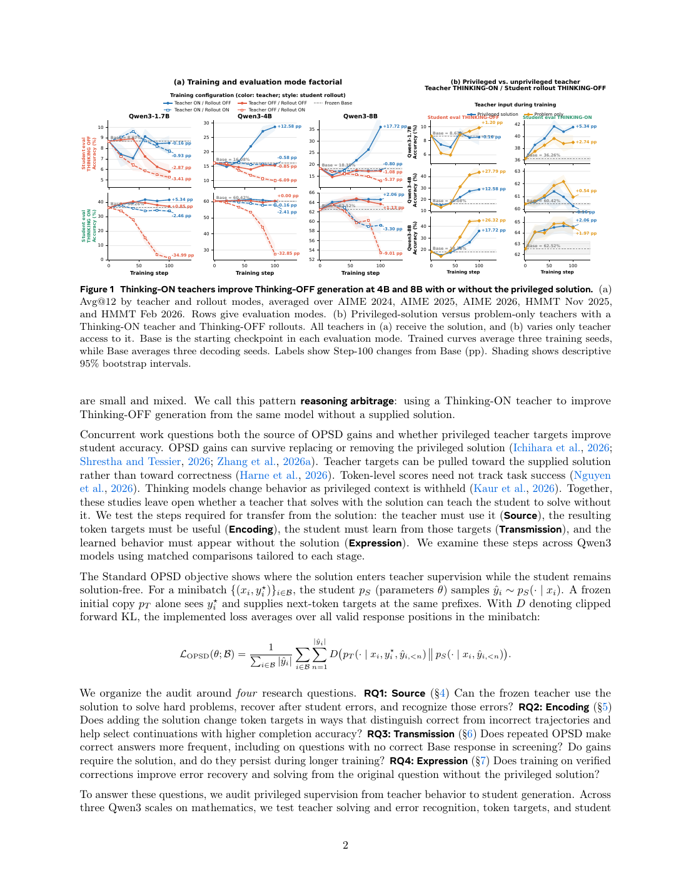
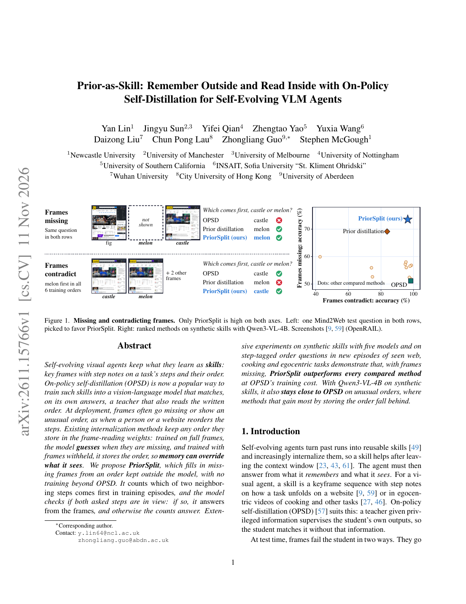
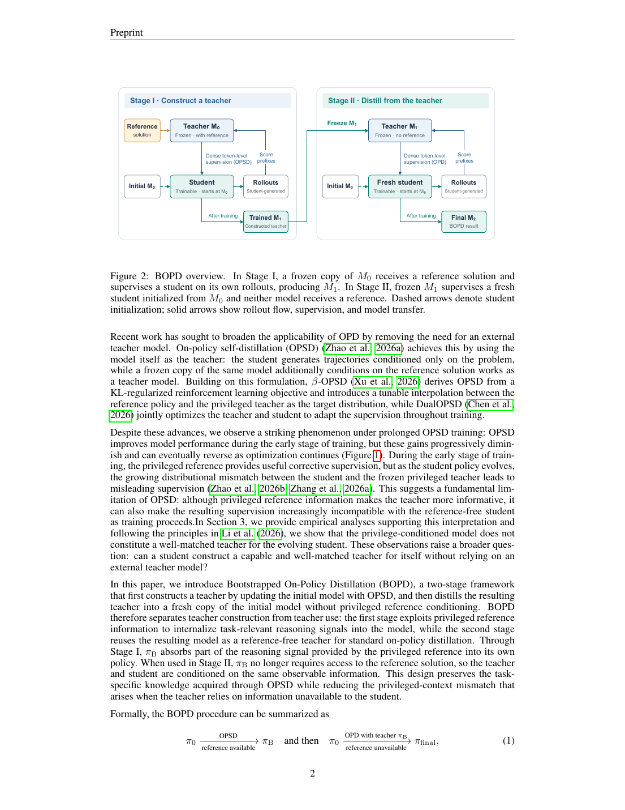
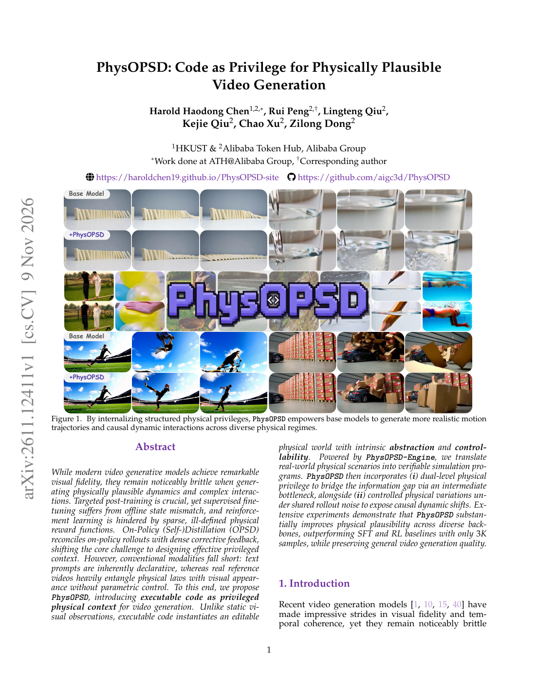

# OPSD / OPD 精读日报：特权信息、token级 credit 与应用扩展

日期：2026-11-16（北京时间）  
检索窗：2026-10-17 至 2026-11-16；收录 5/5 篇论文。按 arXiv 去版本 ID、规范 URL、标题、\`sources.json\` 和全部 \`manifest.json\` 去重；本次 5 篇均为首次 v1，且没有与历史 VLM 报告重合的论文条目。

## 先给结论

OPD 的基本动作是：学生先按自己会犯错的状态采样，再由教师在同一个前缀上给 soft token 分布；OPSD 则把教师做成“同一底座模型 + 训练时才有的特权信息”。今天 5 篇把这个范式推到五个边界：多智能体把未来对话变成 token credit；审计论文提醒“有解答”不等于“教对了”；VLM agent 将顺序记忆拆到权重外；BOPD 用两阶段防止教师和学生越训越错位；PhysOPSD 则把可执行物理代码变成特权上下文。

## 统一记号与读法（本文推演）

给问题 x，学生策略为 pS(y_t | x, y_<t; θ)，学生采样轨迹 y_hat ~ pS。教师 pT(y_t | x, y_star, y_hat_<t; θ_bar) 额外看见特权信息 y_star（参考解、未来通信、代码或技能）。典型前向 KL 为：

L_OPSD = E[y_hat ~ pS] Σ_t Σ_v pT(v | x, y_star, y_hat_<t) · log(pT(v | …) / pS(v | x, y_hat_<t))。

t 是 token 位置，v 是词表 token，θ 是可训练学生参数，θ_bar 常为冻结教师参数。前半项对学生不求导，所以最小化等价于以教师 soft label 做交叉熵。直觉：不是只说“这题错了”，而是对学生实际走到的每一步说“下一词分布应该往哪里推”。数值例：教师对 token A/B 给 [0.8, 0.2]，学生给 [0.5, 0.5]，该步交叉熵为 −0.8·log(0.5)−0.2·log(0.5)=0.693；提高 A 的概率就会降损失。它不保证特权知识可在推理时复现：这正是第 2 篇的核心警告。

## 1. OPSD4MAS：把未来多智能体通信变成 token 级 credit

原文：[arXiv 2611.16206](https://arxiv.org/abs/2611.16206) · [PDF](https://arxiv.org/pdf/2611.16206) · 代码：[Camel-Prince/OPSD4MAS](https://github.com/Camel-Prince/OPSD4MAS) · 发布：2026-11-11。

图 1，来源：Wang et al., 2026, Figure 1。图左比较 scalar-reward RL 的两条路径，右侧是方法对 token 的细粒度纠错。读图时先看“未来通信”并非被压成一个总分，而是被过滤后成为教师的条件；因此它回答的是“哪一句通信导致后续协作变好”，不是只报告最终任务成败。

**原文事实——问题与机制。** 多智能体 RL 常把协作信息压缩成 outcome reward，丢掉了“哪一个 token 该改”。OPSD4MAS 先让外部模型从未来通信抽取事实、按轨迹关系做粗过滤，再以 leave-one-out 评估候选事实对目标 token 的影响，得到 token 级特权教师；同时保留 agent-wise GRPO 的轨迹级优势。

**公式与推导。** 设第 r 个角色的 GRPO 损失为 L_GRPO(r)，token 蒸馏为上节 L_OPSD(r)，联合目标为 Σ_r[L_GRPO(r)+λ·L_OPSD(r)]。λ 是蒸馏权重：λ=0 退化为只由最终 reward 学；较大 λ 会让未来通信的局部偏好更强。本文推演：若某事实让正确修复 token 的教师概率从 0.5 变 0.8，则它比“多一段无关文字”更可能留下梯度，因为 leave-one-out 直接比较去掉它前后的目标影响。

**实现骨架（本文概括）。**
**伪代码如下。**
roll out multi-agent group; compute group-relative advantages
extract future-communication facts with external model
filter facts by trajectory relation, then leave-one-out token influence
teacher sees retained facts; student sees only current context
update all participating agents with GRPO + annealed OPSD loss

**实验、成本与局限。** 原文在 6 个 benchmark 上报告，相对 GRPO 的数学 pass@4 最多 +20.00 个百分点；Table 2 将 raw communication、抽取与两层过滤作消融。使用 Qwen3 系列与 6 个数据集；公开摘要/正文没有给出可用于复刻的总 GPU-hour，不能臆填。局限是外部事实抽取器及筛选阈值引入额外系统依赖，未来信息在真实在线部署时不能泄漏给学生。复现应锁定代码版本、外部模型、过滤率、\(\lambda\) 日程及每 agent 的 reward 归一化。

## 2. 审计：特权信息不保证特权指导

原文：[arXiv 2611.16064](https://arxiv.org/abs/2611.16064) · [PDF](https://arxiv.org/pdf/2611.16064) · 发布：2026-11-11。代码：原文未提供公开仓库（截至本次核对）。

图 1，来源：Qiu & Agarwal, 2026, Figure 1（本页含其完整曲线）。条件是 Qwen3 1.7B/4B/8B、thinking mode 的 teacher/student/eval 交叉设置，三 seed 均值。不要把曲线的准确率上升直接读成“参考解被迁移”：作者的审计正是检验这个跳跃是否成立。

**原文事实——问题与机制。** 论文将“特权解是否真的帮助”拆成四关：Source（教师会不会用解）、Encoding（token target 是否有用）、Transmission（学生是否学到）、Expression（无解时是否表现出来）。对 Qwen3 的数学实验发现，教师即使借解能解难题/纠错，target 也不稳定偏向正确轨迹；重要收益常随 teacher 的 thinking mode，而非随解答本身变化，作者称为 reasoning arbitrage。

**损失与小例。** 标准 FKL 仍是 Σ_v pT(v)·log[pT(v)/pS(v)]。但它只最小化“模仿教师分布”，不含“该 token 会令最终答案正确”的项。小例：教师已看解，所以在学生错误前缀后高置信地输出正确数字；学生可学到该数字的局部概率，却未学到如何从无解上下文产生前提。本文推演：这像看答案订正，能记住订正笔迹却未必形成解题策略。

**训练事实与可复现性。** 主设置每次处理 3,200 个 OpenThoughts 样本一次、100 updates、global batch 32；仅训练 LoRA（rank 64、alpha 128，q/k/v/o/gate 投影），AdamW 常数 LR \(5\times10^{-6}\)，H100。基线包含 Base、problem-only teacher、privileged-solution teacher 与 purified OPSD；Figure 6/8 进一步测持续训练、全参训练和纯化变体。作者报告 full-parameter 也能出现标准 OPSD 的后期下降，因此不是 LoRA 专属。没有公开代码是主要复现缺口；报告的 GPU-hour 也未披露。

## 3. Prior-as-Skill：把顺序先验放在模型外

原文：[arXiv 2611.15766](https://arxiv.org/abs/2611.15766) · [PDF](https://arxiv.org/pdf/2611.15766) · 发布：2026-11-11。代码：原文未提供公开仓库（截至本次核对）。

图 1，来源：Lin et al., 2026, Figure 1。横/纵两类条件分别让帧缺失或与既有顺序冲突；读图关键不是单一平均分，而是“缺帧时用先验、帧齐时听视觉”的双目标。该图支持作者提出的外置 prior，而不表示全部真实环境都已验证。

**原文事实——问题与机制。** 自演化 VLM agent 会把“步骤顺序”内化进视觉权重：帧缺失时这像记忆，帧反常时却会盖过视觉。PriorSplit 统计训练 episode 内相邻步骤谁先出现；推理时 checker 判断被问的两个步骤是否都在帧中：若在，reader 从帧答；若缺，外部计数 prior 答。它在合成 skills 和带 step-tag 的 Mind2Web、烹饪、egocentric 真实帧上比较。

**可写成的门控（本文推演）。** \(a=\mathbf1[\text{两目标均可见}]\)，\(p(y)=a p_{\rm reader}(y\mid I)+(1-a)p_{\rm prior}(y)\)。\(I\) 是帧，\(a\) 是 checker 门，prior 可由相邻顺序频率归一化：\(p_{\rm prior}(i\prec j)=c_{ij}/(c_{ij}+c_{ji})\)。例：训练 90 次 A 在 B 前、10 次相反；而当前帧缺 B，则 prior 给 A≺B 0.9；若两者都看见，即使频率偏向 A≺B，也应让视觉 reader 决定。

**训练与证据。** 原文使用 Qwen3-VL-4B 于合成任务，比较 OPSD、不同记忆/reader 方案，Table 2/3 和 Figure 6/7 给出 short context、缺帧、冲突帧表现；Figure 4/5 是“顺序存在哪里”的消融。原文披露 development learning rate \(5\times10^{-5}\)，但本次正文核对未见完整 batch、总 tokens 或 GPU-hour，均标为未披露。它的局限是 checker 误判会直接把回答切错分支，且 count prior 在训练分布变化时可能陈旧。

## 4. BOPD：先内化，再重新从初始模型蒸馏

原文：[arXiv 2611.13680](https://arxiv.org/abs/2611.13680) · [PDF](https://arxiv.org/pdf/2611.13680) · 代码：[YueWu0301/BOPD](https://github.com/YueWu0301/BOPD) · 发布：2026-11-10。

图 2，来源：Wu et al., 2026, Figure 2。图从左到右是 Stage I 标准 OPSD：\(M_0\) 的特权教师指导学生至 \(M_2\)；Stage II 冻结 \(M_2\) 作参考自由教师，却让一个新的 \(M_0\) 学习。读图要注意“重新初始化学生”是方法核心，非普通续训。

**原文事实——问题与机制。** 作者观测持续 OPSD 会在早期改善、后期反转：冻结特权教师与不断变化的学生分布越来越错位。BOPD Stage I 用参考解条件教师得到中间模型 \(M_2\)，Stage II 不继续从 \(M_2\) 训，而是令 \(M_2\) 对无参考上下文输出的分布蒸馏到一份新的初始 \(M_0\)，避免把 reference-conditioned shortcut 一直灌进同一学生。

**目标与直觉。** Stage I：\(\mathcal L_1=\mathrm{FKL}[p_T(\cdot\mid x,y^\star,\hat y_{<t})\|p_{M_1}(\cdot\mid x,\hat y_{<t})]\)。Stage II：\(\mathcal L_2=\mathrm{CE}[p_{M_2}(\cdot\mid x,\hat y_{<t}),p_{M_0'}(\cdot\mid x,\hat y_{<t})]\)。\(\hat y\) 均是 on-policy 学生前缀。小例：第一阶段像允许老师拿标准答案把知识讲清；第二阶段让已经会做的同学在不看答案时讲给新同学，强制筛掉“必须看答案才说得出的提示”。

**实现与实验。** 原文 Algorithm 1 为“训练 Stage I 100 steps → 冻结 \(M_2\) → 从 \(M_0\) 训练 Stage II 100 steps”。4B 与 8B 使用 LoRA rank 64/alpha 128，effective batch 32、LR \(5\times10^{-6}\)、clip 0.1、\(\beta=0,\lambda=1\)；4B 配置为 4 GPU、batch 4、accumulation 2，8B 为 2 GPU、batch 2、accumulation 8。Table 1 中 4B 数学 mean 从 18.06% 到 23.98%，Figure 3/5 显示持续 OPSD 的退化及对齐指标，Table 8 做方法消融。总 GPU-hour 未披露；复现需运行公开代码并保持数据、rollout budget、非 thinking 解码及教师冻结点一致。局限是训练预算近似双阶段翻倍，且“重新从 \(M_0\)”会丢弃第一阶段非目标能力，需用 Figure 4/Table 7 的保留指标监控。

## 5. PhysOPSD：可执行代码作为物理特权信息

原文：[arXiv 2611.12411](https://arxiv.org/abs/2611.12411) · [PDF](https://arxiv.org/pdf/2611.12411) · 项目页：[PhysOPSD](https://haroldchen19.github.io/PhysOPSD-site/) · 发布：2026-11-09。代码：原文项目页/论文未给出可核验公开仓库链接（截至本次核对）。

图 1，来源：Chen et al., 2026, Figure 1。它展示 base model 与 PhysOPSD 在物理可行运动上的对照；阅读时应看接触、轨迹和扰动后的行为是否一致，而不是仅比较“画面更好看”。该图为定性例，定量结论需回到 Table 1 的 PhyGround、VideoPhy-2 和通用质量指标。

**原文事实——问题与机制。** 视频模型的 SFT 有 offline-state mismatch，而物理 RL 的奖励常稀疏且难写。作者把场景写成可执行代码 \(P\)，执行得到物体状态、动力学参数 \(\phi\) 和相机配置 \(C\)；同一模型的教师读取代码与多抽象渲染草图，学生只见普通条件，在学生 rollout 上做蒸馏。代码还可系统扰动 \(\phi\)，因此教师不会只背单一视频。

**目标、数据和小例。** 论文的 flow/diffusion 训练以网络速度预测器 \(v_\theta\) 为底，OPSD loss 在学生轨迹 \(\tau_S\) 上对齐冻结教师 \(\bar\theta\) 的预测分布/目标（具体符号定义见原文 Eq. 1–5）；此处不把抽取失败的排版公式伪造为逐字转写。直觉例：球的质量或重力是代码参数；把重力从 \(g\) 调到 \(2g\)，渲染草图应显示更快下落，教师再教学生让视频的加速度与该变化一致。原文称使用约 3K 样本即可超过 SFT 与 RL baselines；数据如何完整授权、代码生成器的模型/人工比例及总训练成本未完全披露。

**训练、基线和局限。** 原文在两个视频 backbone 上训练 student LoRA，AdamW 常数 LR \(10^{-5}\)、weight decay 0.01、gradient clipping 1.0、BF16、NVIDIA H20；Table 1 比较 base、SFT、RL 与 PhysOPSD 于 PhyGround、VideoPhy-2、通用质量评估，Figure 6 评估 code privilege 的消融。局限是代码执行正确性、仿真器覆盖面和视觉到代码的对齐都可能成为瓶颈；项目若未开源，端到端复现仍受限。

## 横向实现清单（本文推演，不是任一论文的统一配方）

**伪代码如下。**
for batch in dataset:
    y_hat = sample(student, x)                 # 必须是学生实际会到达的前缀
    privilege = build_privilege(reference, future_facts, code_or_skill)
    q = teacher_distribution(frozen_teacher, x, y_hat, privilege)
    L_distill = cross_entropy(q, student_distribution(x, y_hat))
    L = L_distill + alpha * group_rl_loss_if_available
    update(student, L)
    log: reward, KL, entropy, pass@k, retention, privilege ablations

上线前至少做：去掉特权信息的 student-only eval；problem-only teacher 对照；同预算 SFT/RL 对照；不同 seed；持续训练曲线；以及是否发生“看似涨分、实则只会复现教师模式”的 Source/Encoding/Transmission/Expression 审计。

## 辅助资料（不计入 5 篇）

- 原始 OPSD 论文：[Self-Distilled Reasoner](https://arxiv.org/abs/2601.18734) · [官方代码](https://github.com/siyan-zhao/OPSD)
- 入门综述：[A Brief Overview: On-Policy Self-Distillation in Large Language Models](https://arxiv.org/abs/2605.18141)
- 概念比较：[OPSD4MAS 引言中的 GRPO / OPD / OPSD 相关工作](https://arxiv.org/abs/2611.16206)

## 信息边界

“原文事实”来自五篇当日下载的论文原文及其 arXiv 页面；“本文推演”是为解释公式和工程取舍而给出的推导/伪代码；凡论文未给出公开代码、总 GPU-hour、完整数据构造或完整超参，均明确标为“未披露”，而非估算值。图片为论文 PDF 的原始整页截取，版权归原作者。
