# OPD & OPSD 精读日报：怎样选择、校准和加速教师监督

2026-11-17，北京时间。检索窗：2026-10-17 至 2026-11-17（一个日历月）。本期收录 5 篇未入库论文；博客、文档和基础教程不计入篇数。C-OPSD 阅读 v2，其余阅读 v1；首次发布日期全部在窗口内。本文没有执行训练，所有实验数字均为论文作者报告。

## 本期导航与选题证据

| 论文 | 首次公开 | 本次阅读版本 | 主要问题 |
| --- | --- | --- | --- |
| ECOS | 2026-11-09 | 2611.12232v1 | 教师偏好是否真的对应环境收益？ |
| TOPSD / Knowing When to Teach | 2026-11-05 | 2611.08179v1 | 多语言错误前缀上，教师何时失去纠错能力？ |
| Shuffled OPSD | 2026-11-03 | 2611.04958v1 | 共享题目和教师专属参考，语义结构作用是否相同？ |
| AsyncOPSD | 2026-10-19 | 2610.25880v1 | 怎样重叠生成与学习，并控制陈旧轨迹？ |
| C-OPSD | 2026-10-19 | 2610.25842v2（11-03 更新） | 哪些轨迹值得花教师前向和学生反向的成本？ |

已检查 sources.json 和全仓历史 manifest，包含今天较早生成的 VLM 报告。昨日 OPSD 的 5 篇，以及 VLM 今日的 BlinkOPD、Erase the Injected Region 等均不重复收录。本期属于 OPD/OPSD 方法专题；多语言数学和语言 agent 是方法的实验场景。

标记约定：“论文事实”表示来自正文、附录、原图或表格；“本文推导/算例”表示解释性演算，并非作者实验；“未找到/未披露”表示在本次核验材料中的信息缺口，不能据此断言永久不存在。

## 先读懂共同底座：前缀、软标签与梯度

OPD 的 on-policy 指监督发生在学生自己生成的前缀上。设 x 是题目，r 是训练时可见的参考解，y=(y1,…,yT) 是学生采样回答，y_<t 是第 t 个 token 之前的前缀。学生分布 p_t(v)=πθ(v | x,y_<t)，特权教师分布 q_t(v)=πθ0(v | x,r,y_<t)。v 遍历词表，θ 是可训练学生参数，θ0 是教师参数。OPSD 让两者来自同一个底座，教师的优势主要来自额外上下文；教师可冻结、停梯度或随迭代刷新，必须逐篇辨别。

本文推导：普通前向 KL 是 FKL(q||p)=Σ_v q(v)·ln[q(v)/p(v)]。把它展开为 Σ q ln q − Σ q ln p，教师冻结后第一项对学生是常数，因此等价于软标签交叉熵。若 p=softmax(z)，则对学生 logit z_j 的梯度为 p_j−q_j。教师给 A/B 概率 [0.8,0.2]，学生给 [0.5,0.5]，梯度为 [−0.3,+0.3]，梯度下降提高 A。FKL=0.8·ln1.6+0.2·ln0.4≈0.193 nats；交叉熵约 0.693，两者相差教师熵约 0.500。

反向 KL 是 RKL(p||q)=Σ_v p(v)·ln[p(v)/q(v)]。这里权重 p 也依赖 θ，不能直接照搬 p−q。本文推导：对 z_j 的梯度为 p_j·(ln[p_j/q_j]−RKL)。以上两分布的 RKL≈0.223，梯度约 [−0.347,+0.347]。原文 TOPSD 使用 RKL；Shuffled 与 Async 的实现还对每个词表项的带符号 KL 贡献做上界截断；ECOS 用带教师权重的策略梯度。这些都不能统一写成“普通 KL 蒸馏”。

soft token 监督的对象是“下一词的分布”，不是把整段错误学生回答作为正确答案做最大似然。训练通常把离散采样过程视为固定，只对重放前缀后的学生预测求导。后文的筛选和 mask 决定在哪些状态计算这个梯度。

## 1. ECOS：用环境收益校准指导，也训练产生指导的模型

论文：[ECOS: Environment-Calibrated On-Policy Self-Distillation for Language Agents](https://arxiv.org/abs/2611.12232)。[原文 PDF v1](https://arxiv.org/pdf/2611.12232v1)，首次提交 2026-11-09。原文与本次定向检索未找到作者专属公开代码或博客；不要把第三方解读当作官方实现。

### 问题、角色与数据如何闭环

论文事实：agent 事后写出的 reflection 和 skill 不一定正确。一个技能提示让某命令的 log probability 上升，只说明提示改变了模型偏好，并不说明命令对任务有益。ECOS 同时学习 Actor（执行任务）与 Analyzer（总结反思/技能）；两者共享参数。每轮固定一个更新前快照，Actor 对每题采样 K=8 条轨迹，Analyzer 为每条轨迹写反思 u，再把八条反思合成一个技能 z。快照模型额外读 z 构成教师，对 Actor 已采样 token 评分。

先离线初始化：每个任务环境使用 200 个任务、每题 8 次尝试，得到 1,600 条轨迹，外部标注器写 1,600 个 reflection 和 200 个 skill。附录 B.1 指定标注器为 GPT-6.1 sol、maximum reasoning effort。九个监督样本组成一组，八条反思合计权重 0.5、技能权重 0.5；三轮全参数 SFT，共 600 updates。ALFWorld 从对应 Qwen2.5 Instruct 出发；WebShop 的轨迹采集借助 RL40 policy，7B 的 SFT 初始化也使用 GRPO40，不能把所有分支当作完全相同初始点。

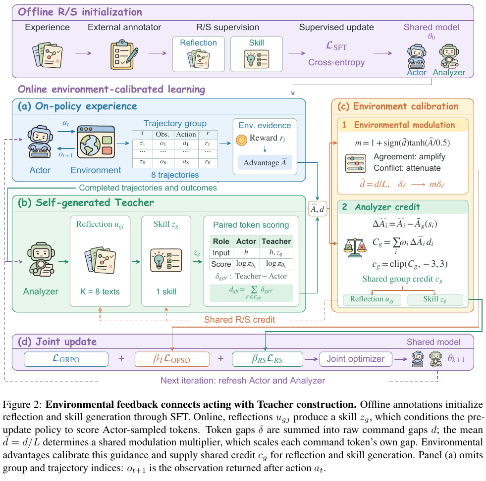

图 1：论文 Figure 2，第 4 页，来源为上述 v1 PDF。紫色上栏是离线 SFT；蓝色是环境交互；绿色生成 reflection→skill→教师评分；橙色利用环境优势调制指导、给 Analyzer 反馈；底部三项 loss 更新共享模型。箭头表示数据和 credit 的流向，图中小机器人不是独立的大教师模型。推理时只保留 Actor 的普通历史，不检索训练时技能。

### 关键公式：教师的意见由什么来校准

论文 Eq.6：δ_tℓ = ln πT(y_tℓ | h_t,y_t,<ℓ) − ln πold(y_tℓ | h_t,y_t,<ℓ)。h_t 是交互历史，ℓ 是响应内 token 位置，πold 是本轮采样快照，πT 额外读技能 z。δ>0 表示教师更支持该 token，δ<0 表示更反对。两边必须对同一前缀和同一 token 评分。

环境动作优势分三步。先用冻结 reference embedding 把 observation 聚类，仅允许 admissible-action 集合相同的访问合并，cosine distance 阈值 0.1。以记录的状态转移组成经验图，并做 Bellman backup：V_new(s)=mean_i[r_i+γ·V(s_i_next)]，γ=0.95，最多 20 次或最大变化小于 10^−6。然后 b_t=r_t+γV(s_next)−V(s)；GAE 递推 B_t=b_t+γ·λGAE·B_(t+1)，λGAE=0.8。组内标准化后得到 Ahat_t。r_t 是环境转移奖励，V 是经验状态值，b 是 TD 残差，B 是带后续 credit 的动作估计。无效动作 penalty 为 0.1；低方差组按附录规则归零。

C_t 是可执行命令内容的 token 集合（不含标签），L_t=|C_t|，d_t=Σ_(ℓ∈C_t)δ_tℓ，dbar_t=d_t/L_t。Eq.13 使用：

m_t = 1 + αm·sign(dbar_t)·tanh(Ahat_t/κm)，w_tℓ = q_g·1[ℓ∈C_t]·m_t·δ_tℓ。

αm=1，κm=0.5，因 tanh 位于 [−1,1]，所以 m∈[0,2]。本文推导：dbar 与 Ahat 同号，m>1；异号，m<1。m 非负，因此只放大或减弱原 token 指导，不把一个 token 的正指导变成负指导。q_g 在 ALFWorld 恒为 1，在 WebShop 八条全成功的组置 0。这里直接蒸馏只作用于命令内容，主 GRPO 仍作用于完整响应。

Analyzer 的 credit 也有独立定义：ω_i=1/(N_g·L_gj)，使每条轨迹总权重相同；同状态中心化 ΔAhat_i=Ahat_i−mean_weighted(Ahat | s_i)；C_g=Σ_i ω_i·ΔAhat_i·d_i，c_g=clip(C_g,−3,3)。N_g 为组内有效轨迹数，L_gj 为某轨迹有效命令数。本文推导：同状态内中心化项和为零，故减去 d 的状态均值不会改变 C_g，它等价于状态内优势与教师偏好的加权协方差；不会仅因访问了容易状态就奖励技能。组内八个反思与一个技能共享 c_g，分别占 Analyzer loss 的一半。

策略比率 ρ=πθ(token)/πold(token)。定义 Jclip(ρ,w)=−min[ρ·sg(w),clip(ρ,0.8,1.2)·sg(w)]；sg 是停梯度。Actor 以 w 计算 L_OPSD，Analyzer 以 c_g 计算 L_RS。总 loss 为 L_GRPO+0.01·L_OPSD+0.1·L_RS；主 GRPO 另含 reference KL 系数 0.01 和 entropy bonus 系数 0.001。不要把后两个系数和教师 loss 系数混为一项。

### 可手算直觉与实现

本文算例：某命令教师整体支持 dbar>0，环境优势 Ahat=+0.5，则 m=1+tanh(1)≈1.762；若同样的支持给了低收益命令 Ahat=−0.5，m≈0.238。同样 δ=0.2，校准后权重分别为 0.352 和 0.048。这不是“看答案觉得好”，而是把教师建议与实际执行后的效果对上。两个同状态命令 Ahat=[1,−1]、d=[0.4,0.1]、权重均为 0.5，则 C_g=0.5×1×0.4+0.5×(−1)×0.1=0.15，鼓励产生该技能。

```text
initialize shared Actor/Analyzer with grouped reflection/skill SFT
for each online update:
    freeze old snapshot; collect 8 trajectories per task
    generate 8 reflections and 1 consolidated skill
    cluster observations; solve empirical V; compute command advantages
    score same tokens with and without skill; parse command spans
    compute stopped weights w and state-centered skill credit c
    accumulate GRPO, command OPSD and Analyzer PPO losses
    update shared parameters; regenerate experience next round
```

关键实现：解析命令的 mask 必须排除 delimiter；旧 log probabilities、δ、优势、调制权重和 c 在一次优化期间均固定。若状态簇只有一种命令，无法提供局部对比 credit；应记录有效命令对数量，不能强造替代动作。

### 实验、消融与训练成本

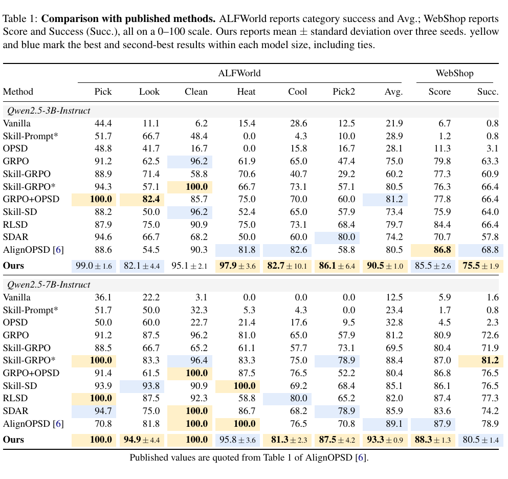

图 2：论文 Table 1，第 8 页。每个模型块内比较 vanilla、skill prompting、GRPO、GRPO+OPSD、AlignOPSD 等；WebShop 的 Score 与 Success 是不同指标，不能只拿最高列混报。Ours 为三 seed 均值±标准差；其他 published values 从 AlignOPSD 表 1 引用，ALFWorld Avg 保留原来源的聚合口径，因此不是全部同机重跑的严格 apples-to-apples 试验。

论文事实：3B/7B seen ALFWorld 分别 90.5±1.0 / 93.3±0.9，WebShop success 75.5±1.9 / 80.5±1.4。7B Skill-GRPO* 的 WebShop success 81.2 高于 ECOS 80.5；星号方法推理时带技能，因此结论需同时写出上下文成本差异。Table 2 的 134 个 unseen ALFWorld 任务用相同协议比较 GRPO，macro 从 74.8→85.8（3B）、78.9→86.6（7B），但部分 Pick/Clean 类别仍下降。

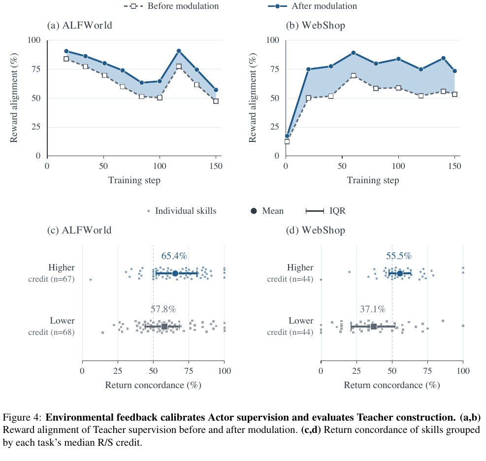

图 3：论文 Figure 4，第 9 页。上方 a/b 横轴训练迭代、纵轴 reward alignment，比较 raw 与 modulated 指导；下方 c/d 按技能 credit 高低看 return concordance。它支持“校准后权重更对齐已观测收益”，不是对所有未执行反事实命令的因果保证。Table 3 消融用 3B 的单个分支：WebShop full method 75.00，整段响应蒸馏 52.34，去掉 modulation 和 R/S loss 后 72.65；去 SFT 后 69.53。75.00 是消融分支值，不应替换主表三 seed 的 75.5。

在线部分：16 task groups/update、8 rollouts/group、150 updates，AdamW LR 10^−6、weight decay 0.01、clip 1.0、PPO epoch 1、BF16 forward；8×A800。3B matched-batch profiling 比 GRPO 训练约慢 30%。全训练总 GPU-hours、峰值显存、标注 API 费用未披露，不能由这个相对 overhead 推出绝对金额。

本文评估：状态聚类误差可能同时污染 Actor 校准与 Analyzer 奖励；环境稀疏、只有一种命令或 observation 表示不可靠时会失效。复现优先对齐任务划分、RL40/SFT600 初始化、reward 定义、action mask、聚类距离和 macro 算法。论文给出完整 prompts 和超参，但本次未找到公开作者代码，端到端可复现性仍有限。基础延伸可读 [TRL GRPO 文档](https://huggingface.co/docs/trl/grpo_trainer) 和 [ALFWorld 官方仓库](https://github.com/alfworld/alfworld)。

## 2. TOPSD：先找还能教的前缀，再验证教师能否救回来

论文：[Knowing When to Teach: Learning from Teachable Prefixes in Multilingual Reasoning Distillation](https://arxiv.org/abs/2611.08179)。[原文 PDF v1](https://arxiv.org/pdf/2611.08179v1)，首次提交 2026-11-05。本次原文与定向检索未找到公开作者代码/博客链接。

### 问题与方法

论文事实：非英语学生的错误推理越写越长，拿着英语参考解的教师也会顺着错误前缀走，称为 Teacher Drift。低资源语言中这种现象更早发生。COPSD 用英语题目和英语参考解增强教师；TOPSD 在此基础上同时判断 where（保留哪段前缀）和 whether（这段是否值得教师监督）。它不把教师补写的正确后缀当训练目标，补写只用于验证，训练仍在原学生轨迹上。

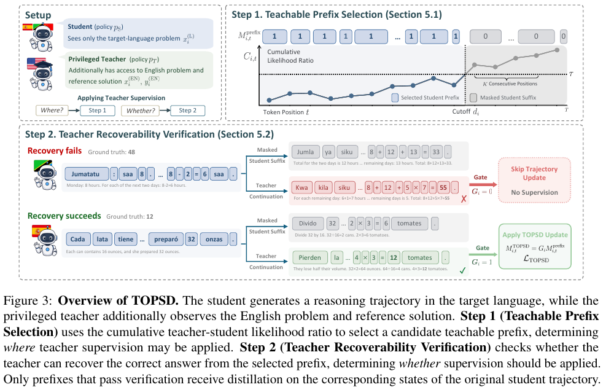

图 4：论文 Figure 3，第 5 页。上半部分 student/teacher 在同一学生 token 上评分，累计 likelihood ratio 用于确定 cutoff；下半部分从 cutoff 前缀让教师 greedy 续写，并由 verifier 判答。绿色分支才进入蒸馏。图里的英语译文辅助读者，学生实际输入是目标语言题目。

### 原文公式、逐符号解释与关键推导

Eq.4 令 N_i,t=ln[q_i,t(y_i,t)/p_i,t(y_i,t)]，C_i,t=exp[(1/(t−1))·Σ_(s<t) N_i,s]。i 表示样本，t 是位置，p 是学生，q 是看英语题解的冻结教师。C 是已生成 token 上教师/学生似然比的几何平均；C→1 表示平均 log gap→0。它不等于全词表 KL 为零，也不是直接测“推理正确率”。

本文推导：exp(mean ln ratio)=Π ratio^(1/(t−1))，因此单个极小/极大概率不以算术平均方式统治累计值。若前四步 q/p=[0.6,0.8,0.9,1.0]，C≈(0.432)^(1/4)=0.811。后续教师渐渐接受学生前缀，累计 C 可能靠近 1；需要后续 verification 才能判定这是否真的代表教师丧失纠错能力。

Eq.7 选 d_i=min{j: C_i,j+k>τ 对 k=0,…,K−1 均成立}，τ=0.9、K=4。d_i 为最早连续四步超过阈值的位置，M_prefix(i,t)=1[t<d_i]；若未检测到，则 d_i=T_i+1。连续越界抑制瞬时噪声，但阈值是经验参数，不是漂移定理。

Eq.8 用教师从 y_<d 续写 z_≥d，G_i=V(y_<d⊕z_≥d,a_i)∈{0,1}。V 是最终答案 verifier，a_i 是标准答案，⊕ 是拼接。最终监督 mask M_i,t=G_i·M_prefix(i,t)。若教师从该点仍答错，这个样本整段不蒸馏。

Eq.10 的层级平均：先按有效 token 数 n_i=Σ_t M_i,t 平均每条轨迹的 Σ_t M_i,t·RKL(p_i,t||sg(q_i,t))；再在同语言有效样本间平均，最后在至少有一个有效样本的语言间等权平均。这样长英语轨迹不能仅靠 token 多占据全部梯度。无有效 token 的样本/语言不进入分母；空 batch 的实际优化应跳过并记录，不能除零。

论文附录 B 明确实验用反向 KL：Σ_v p(v)·ln[p(v)/sg(q(v))]，OPSD、COPSD、TOPSD 比较方向一致。本文推导在共同底座已给出它的 logit 梯度；其 mode-seeking 倾向与 FKL 不同，不能用“同样都是 KL”省略此处。奖励只有 verifier 的门控通过与否，没有另加 GRPO outcome reward。

### 初学者算例与训练流程

本文算例：两条 100-token 轨迹，一条 cutoff=11、验证通过，保留 10 token；另一条 cutoff=21、教师验证失败，全部丢弃。第一条每 token RKL=[0.1×10]，轨迹 loss=0.1；第二条不能因为前缀较长得到更大权重。若另一语言仅一条通过，其轨迹均值仍与第一语言等权。这是把“教得会的课堂”分开平均，而不是把英语大班的总作业份数直接和低资源小班相加。

```text
sample one student rollout in each target language
teacher scores same prefixes with English question and solution
compute cumulative geometric likelihood ratios
find first K consecutive crossings of tau
teacher greedily completes from selected student prefix
if answer verifier passes:
    compute reverse KL on original tokens before cutoff
average by tokens, then trajectories, then active languages
update student LoRA; keep privileged teacher frozen
```

### 数据、算力、实验与消融

论文事实：COPSD 发布的多语言 OpenThoughts 中每语言抽 500 条，共 5,000 条；seed 42。十种语言为 BN、EN、ES、JA、KO、RU、SW、TE、TH、ZH。高资源组 RU/EN/ZH/ES，中资源 JA/KO/TH，低资源 BN/TE/SW。资源分组同时参考已有分类与 base 表现，不能解读为所有语种的普遍排名。

学生和教师均 Qwen3 1.7B/4B/8B 底座，教师禁用 LoRA。LoRA r=64、alpha=128，覆盖 q/k/v/o、gate/up/down；160 steps、effective batch 32、AdamW LR 10^−6、clip 0.1、BF16。学生每题一次、温度 1.1、最长 2,048 token；teacher verification greedy，上限 8,192（1.7B/4B）或 12,288（8B）。四张 RTX A6000 或 H200；默认 1.7B 在 4×A6000 完整训练约 9 小时。本文换算：该特定配置约 36 GPU-hours；这不是 8B 的成本，也不含开发试验/全评测，更不能直接报货币费用。峰值显存、全项目总成本未披露。

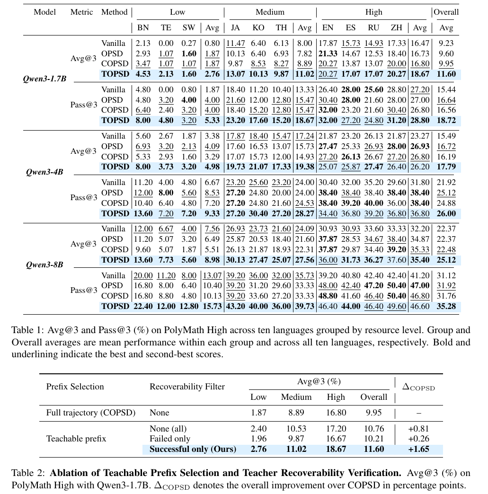

图 5：论文 Table 1/2，第 7 页。Table 1 左列模型/方法，中间十语言按资源分组，右侧 Overall；指标为 PolyMath High 的 Avg@3 与 Pass@3，二者不可互换。Table 2 固定 1.7B，分别保留全部候选前缀、仅恢复失败前缀和仅恢复成功前缀，检查 verification 的增量作用。

论文事实：1.7B/4B/8B Overall Avg@3 为 11.60/17.79/25.12，比各自最强 baseline 高 1.65/1.07/2.64 个百分点；Pass@3 为 18.72/26.00/35.28。1.7B COPSD 9.95→只有 prefix selection 10.76→完整 TOPSD 11.60。固定前 10% token 加同样 verifier 的对照弱于自适应 cutoff，排除了“只是更短前缀”的部分解释。K=1/2/4/8 的均分为 10.45/10.94/11.60/10.27，说明 K 需要选择，较长 persistence 并非总是更好。

本文评估：额外验证最长可生成上万 token，节省监督 token 不代表节省端到端时间；只会判最终答案的 verifier 可能放过错误中间步骤。C 接近 1 只是经验漂移线索，英语参考优势也可能依赖翻译质量。复现应固定翻译集、答案解析、teacher/student mode、RKL 方向和分层归一化；同时报告各语言通过率，防止所有低资源样本被 gate 掉。可先读 [LoRA 官方文档](https://huggingface.co/docs/peft/developer_guides/lora) 与 [Math-Verify 官方仓库](https://github.com/huggingface/Math-Verify)，但论文的 rule-based verifier 不应被未经验证地替换成任意 checker。

## 3. Shuffled OPSD：训练题目打乱词序，教师参考保持完整

论文：[Shuffled OPSD: When Semantic Consistency Hurts On-Policy Self-Distillation?](https://arxiv.org/abs/2611.04958)。[原文 PDF v1](https://arxiv.org/pdf/2611.04958v1)，首次提交 2026-11-03。PDF 中 GitHub 指向 [Pear3on/S_OPSD](https://github.com/Pear3on/S_OPSD)，本次访问返回 404；正文称代码与 checkpoints 将在接收后发布，故不能标为“代码已开源”。未找到独立作者博客。

### 问题和干预到底作用在哪

论文事实：共享题目既决定学生采什么前缀，也决定教师在这些前缀上怎样评分；教师专属参考仅直接影响评分。这两种输入并非都必须保持语义完整。主方法先把关联参考替换成别题的完整 worked example（UnrelatedRef），再只打乱共享题目的 whitespace words（Shuffle-1）。学生和教师都读相同打乱题目，教师额外读未打乱的无关例题。评测恢复完整题目、不给参考。

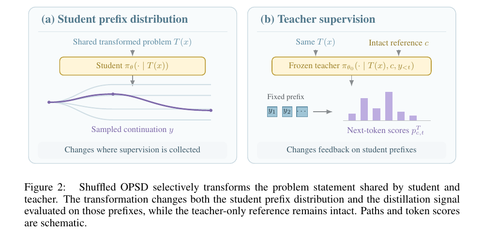

图 6：论文 Figure 2，第 3 页。左边是学生在 T(x) 条件下生成的前缀分布，右边是相同前缀上的教师监督；图内曲线/token score 是作者方法示意，不是实测结果图。它提示输入干预同时改变两条路径，不能把收益只归因于教师质量变化。

### 公式、loss 与一个可手算例子

将题目词序列分成长度 k 的块 b1,…,bM，抽置换 σ，T_k(x)=b_σ(1)||…||b_σ(M)。|| 表示用空白连接。k=1 即逐词乱序，数字/符号字符串若本身没有空白则保留为一个词。每条训练记录的置换固定；不是每步再随机打乱学生已生成的推理。

参考固定为 c_U(i)=(x_ref,a_ref)，ref=(i+111) mod N，N=29,434。循环偏移保证不自配对，但“无关”仍来自数学语料，不等于任意噪声。学生 p_t=πθ(·|T(x),y_<t;non-thinking)，教师 q_t=πθ0(·|T(x),c_U,y_<t;thinking)。教师冻结，学生只训 LoRA。

论文 Eq.8 实际 loss：L_c=(1/B)·Σ_i(1/T_i)·Σ_t Σ_v min{q_it(v)·ln[q_it(v)/p_it(v)], c}，c=0.05。B 为 batch 样本数，T_i 为有效响应长度；先每条响应 token 平均，再样本平均。prompt/padding 不算，正常生成 EOS 算，截断末尾不人为加 EOS。softmax 温度 1.1，未额外乘温度平方。

本文推导：截断是每个带符号词表贡献的上界，并不是把非负 KL 总值截到 0.05。以 q=[0.8,0.2]、p=[0.5,0.5] 为例，贡献约 [0.376,−0.183]；上截断后总和 0.05−0.183=−0.133，可为负，因此它不再保有普通 KL 的非负性。截断区间内贡献梯度可能为零，不能继续使用普通 p−q 解释全部实现。

本文直觉例：“Alice has 3 red balls and 2 blue balls” 变为词的固定置换，词袋保留 Alice、3、2、balls，但正常语法消失。老师仍能从完整无关例题读到解题风格。收益可能来自轨迹分布和教师 mode 的联合作用；论文实验说明干预有效，但不能据此证明模型已学会从乱序词中恢复题意。

```text
pair record i with worked example (i+111) mod N
fix a word permutation for each shared problem
for each update:
    sample non-thinking student from shuffled shared problem
    score identical prefixes with frozen thinking teacher + intact reference
    apply signed per-vocabulary cap; average tokens then responses
    update student adapter
evaluate final checkpoint on original intact problems without reference
```

没有显式 reward/GRPO；参考数据和 on-policy 蒸馏是全部训练信号。复现时要同时保留 UnrelatedRef 完整题目对照，才能隔离题目乱序的贡献。

### 数据、设置和对照结果

论文事实：完整 OpenThoughts math pool 29,434 对，训练 seed 42、50 updates、global/generation batch 16，从同样 seeded 顺序抽取，不是固定 800 条子集。Qwen3 1.7B/4B/8B，LoRA r64/alpha128、dropout0、attention+MLP projections；AdamW LR 5×10^−6、warmup0、weight decay0、clip0.1；rollout non-thinking，温度1.1、top-p0.95、top-k20，prompt≤4096、response≤1024。最终 step50 checkpoint 评测，避免逐 benchmark 选最好点。

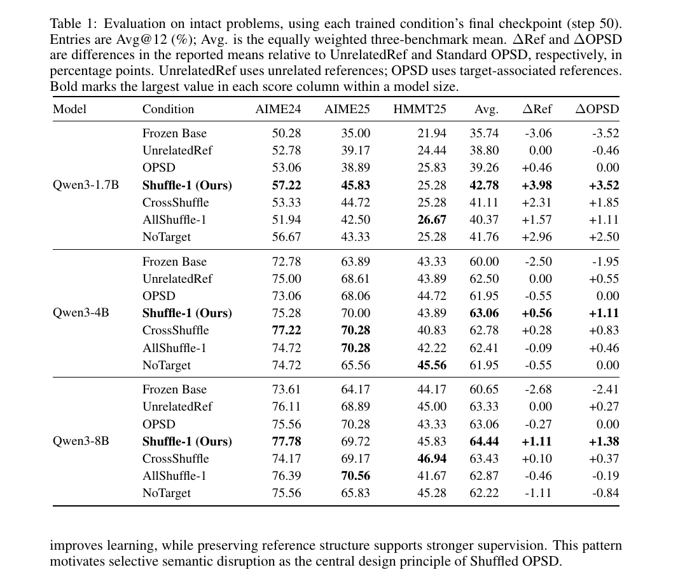

图 7：论文 Table 1，第 7 页。AIME24、AIME25、HMMT February25 各 30 题，thinking mode 每题 12 次，温度1、top-p0.95、最长38,912 token；Avg 是三任务等权平均。ΔRef 对比同参考配对的 UnrelatedRef，ΔOPSD 对比关联参考的标准 OPSD；两列表示不同因果比较，不可任选较大值。

1.7B：UnrelatedRef 38.80、OPSD 39.26、Shuffle-1 42.78；4B：62.50/61.95/63.06；8B：63.33/63.06/64.44。相对标准 OPSD 增益分别 3.52/1.11/1.38 点。AllShuffle-1 连教师参考也打乱，三尺度降到 40.37/62.41/62.87，支持“扰动位置”比“扰动越多越好”重要。

CrossShuffle 把不同题词汇混池再重分配，整体均分低于 Shuffle-1；NoTarget 删掉题目仍在 1.7B 达 41.76，但在 4B/8B 不及 Shuffle-1。1.7B NoTarget 再删参考降至37.78，再关教师 thinking 降至38.98；提示参考和 mode 都仍有作用。1.7B Shuffle-1 的 Avg@12 上升而 Pass@12 未增加，收益主要体现重复采样准确率，不能夸成解锁大量新题。

训练硬件型号、总时长、GPU-hours、峰值显存和货币成本未披露。论文做 10,000 次 problem-cluster bootstrap 评估配对区间，但主训练 seed 仅42；这不是跨训练种子的稳定性保证。本文评估：英语 whitespace 词序扰动不能自然外推到中文等无空格书写语言；主方法同时改参考与题目，仅与 UnrelatedRef 比才能隔离词序。复现需公开置换与配对、mode chat template、带符号 cap，以及完整最终 checkpoint；当前 404 和未公开 checkpoints 是实质障碍。基础材料：[GKD 官方教程](https://huggingface.co/docs/trl/gkd_trainer)、[原始 OPSD 代码](https://github.com/siyan-zhao/OPSD)；它们不是本方法已验证实现。

## 4. AsyncOPSD：把采样和学习流水化，并处理样本陈旧性

论文：[Asynchronous On-Policy Self-Distillation](https://arxiv.org/abs/2610.25880)。[原文 PDF v1](https://arxiv.org/pdf/2610.25880v1)，首次提交 2026-10-19。本次未找到作者公开实现/博客，不与其他名为 AsyncOPD 的不同论文混同。

### 系统瓶颈与教师版本

论文事实：同步训练等待学生生成，再做教师/学生前向和反向，GPU 常交替空闲。AsyncOPSD 在总8张GPU内划分4张learner与4张rollout actor。actor 用单卡 vLLM 生成，把轨迹和生成时 policy version 推入队列；learner 处理旧队列的同时继续更新，并周期性导出 LoRA。

分析部分讨论“当前参数构造两种上下文”的 moving teacher；实证比较为匹配原始 OPSD，教师固定在初始底座。两者都在 learner 端重算同一旧前缀上的分布，没有额外缓存教师版本漂移，但仍有“旧前缀不来自当前学生”的分布差异。

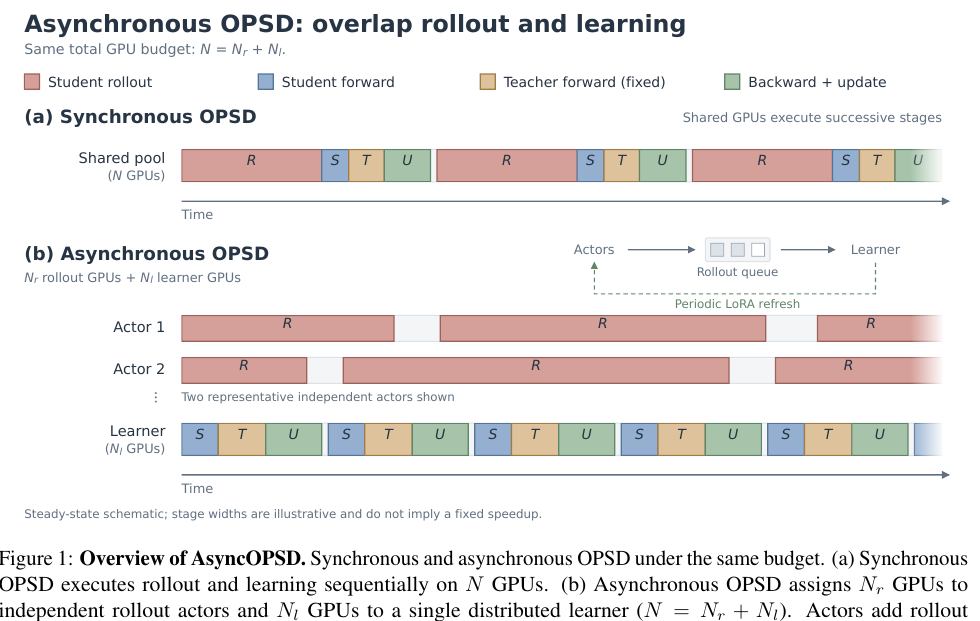

图 8：论文 Figure 1，第 2 页。横轴是时间而非训练 step；同步上栏生成/学习串行，下栏 actor 和 learner 重叠；同色小块区分 forward/backward/export。总GPU预算相同，但 generation batch 和 refresh 方式也变化，因此总加速不是纯粹只换调度器的消融。

### 原文控制、理论边界与推导

令 k 为当前 learner update、r_i 为第i条轨迹生成策略版本，s_i=max(0,k−r_i)，g_K=1[s_i≤K]，K=6。sync_step=2 表示每两次 learner 更新导出一次参数。s 是版本年龄代理，不能保证不同前缀的真实 probability drift 相同。

原文 Eq.2 用 μ_k/μ_r 定义真正的前缀似然比 ρ_k,r(s)=Π_(u<h) p_k(y_u|s_u)/p_r(y_u|s_u)，d_k,r=|1−ρ|；h为前缀位置。教师熵 H=−Σ_v q(v)lnq(v)。在有限 horizon、支持和特权 logit contrast 有界等假设下，Eq.4 给出目标期望差 Δ≤C_B·E_(μr)[d·(1−exp(−H))]≤C_B·E[dH]，C_B=B(exp(B)−1)/2，B 是假设中的 logit contrast bound，不是 batch size。

本文推导：Δ=|E_(μr)[(1−ρ)F]|≤E_(μr)[|1−ρ|F]，代入原文对 F 的上界，得到陈旧性和熵相乘的形式。它约束的是总体未截断 FKL 目标的差，不是精度保证，也不是说单独把熵压小就必定安全。冻结教师还需其自身 contrast bound；旧策略年龄有界不自动保证离初始教师的 drift 有界。

实现权重：u_i,h=exp(−βH·H_i,h)，βH=0.1；w_i,h=u_i,h / mean_A(u)，A 为 learner 本地 microbatch 内接受的有效 token。停梯度，平均约为1，降低高熵 token 相对权重；βH=0 则均匀。逐词表带符号贡献上截断 ℓ_c(q,p)=Σ_v min[q(v)ln(q(v)/p(v)),c]，c=0.05（1.7B/4B）或0.06（8B）。总 loss = Σ_i g_K(i)Σ_h sg(w_i,h)ℓ_c / Σ_i g_K(i)T_i。没有接受token时等待新数据。此处不是精确 importance correction，版本过滤与熵权重都是分析启发的启发式。

本文算例：k=20，r=12 的样本年龄8被拒，r=16年龄4可用。两个教师位置 H=[0.2,2.0]，u≈[0.980,0.819]，归一化 w≈[1.090,0.910]。比较低熵位置多约20%的相对权重，目标分布 q 本身未改变。若固定预算中生成10秒、学习6秒，同步16秒，理想重叠至少10秒，最多约1.6倍；论文更高总倍数还受 batching/export 改善影响，这个算例不是复现性能。

```text
actors: load exported adapter/version; sample; enqueue tokens + version
learner:
    fetch queued rollouts; drop age > K
    recompute fixed privileged teacher and current student on stored prefixes
    calculate entropy weights and clipped token divergence
    update student; every sync_step export adapter
record consumed samples, queue delay, discarded samples and GPU split
```

### 训练、吞吐、消融与成本口径

论文事实：OpenThoughts math、Qwen3 1.7B/4B/8B，100 steps、effective batch32、LoRA64/alpha128（attention和MLP）、BF16、gradient checkpointing、FlashAttention-2、AdamW LR5×10^−6；每题1条、最长1024、温度1.1。8×A100，actor/learner=4/4。评测 AIME24/25、HMMT25 Avg@12、thinking、温度1、top-p0.95、最长38,912。吞吐重复3次给标准差；不能由此断言准确率也跨3个训练seed统计。

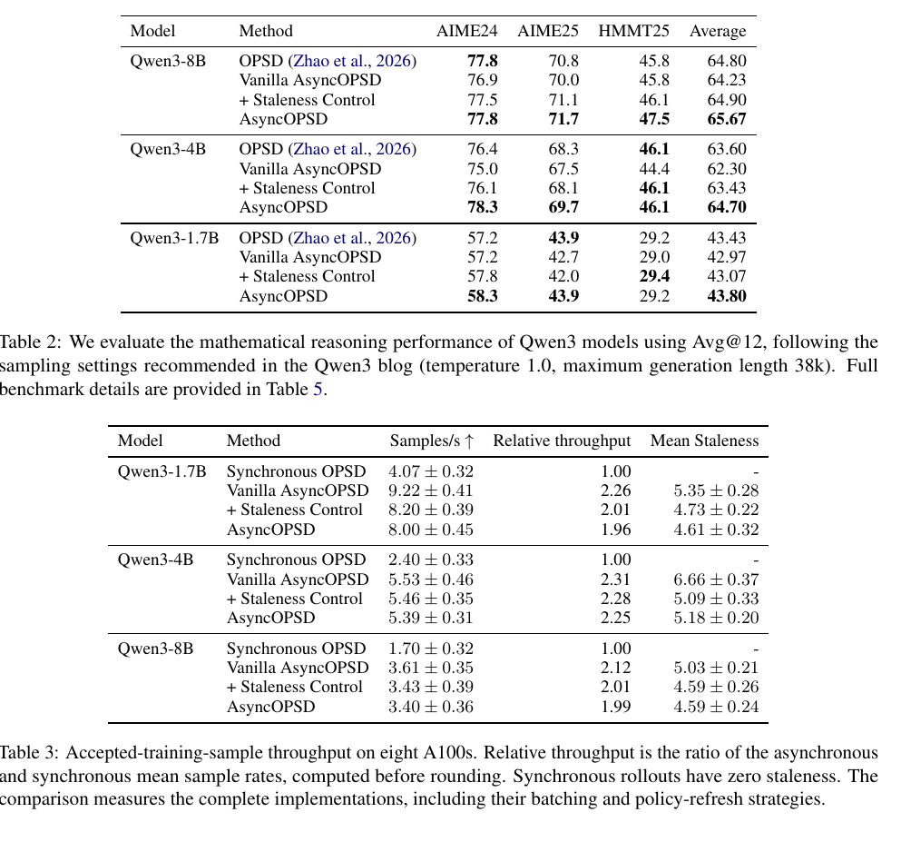

图 9：论文 Table 2/3，第 7 页。上表准确率按模型分块，依次同步、vanilla async、+staleness、完整Async；下表是被优化器实际消费的 sequences/s，不是 tokens/s，也不包含最终留队列未用的全部产出。所有吞吐8×A100；模型大小间不能只比绝对序列速率。

同步→完整Async：1.7B 4.07→8.00 samples/s（1.96倍）、4B 2.40→5.39（2.25倍）、8B 1.70→3.40（1.99倍）。对应均分43.43→43.80、63.60→64.70、64.80→65.67。vanilla async 的4B均分62.30，加入过滤63.43，完整64.70，体现吞吐/精度取舍。sync_step 从2到4带来吞吐很小变化、平均年龄明显增加；K4会拒约33.9%，K6约10.7%，K8/10该次sweep不拒。附录K6的9.22 samples/s来自独立实验，不能替代主表过滤版8.20。

4/4 split 在已测2/6至6/2的消融中最好。实现中actor每次生成32 completions，对比同步每GPU4；同步每步合并LoRA，异步只导出adapter且可少刷新。因此“总实现快约2倍”有证据，“仅异步重叠带来2倍”没有被隔离验证。原文未给完整总训练时长/GPU-hour/峰值显存，不以100steps×samples/s粗算成实测账单。

本文评估：分支探索 token 也可能高熵，降权可能牺牲多样性；版本年龄无法替代真实 drift，扩到跨机通信时队列成本可能不同。复现先固定8卡预算、相同accepted-sample口径、generation batch、refresh成本，再测accuracy和丢弃率，最后验证theory所需logit支持假设是否适用。基础可读 [TRL GKD](https://huggingface.co/docs/trl/gkd_trainer)；通用框架文档不是本篇作者代码。

## 5. C-OPSD：先验答案对错，再真正移除不需要蒸馏的行

论文：[Not Every Rollout Needs Distillation: Correctness-Filtered On-Policy Self-Distillation](https://arxiv.org/abs/2610.25842)。[原文 PDF v2](https://arxiv.org/pdf/2610.25842v2)，首次2026-10-19、v2更新2026-11-03。首次日期也在窗口内；本篇此前未入库，v2不另算第二篇。本次未找到公开作者代码或博客。

### 问题与梯度证据

论文事实：答对的轨迹也能产生非零蒸馏梯度，不能先验说它完全无用。但Qwen3-1.7B初始点的梯度测量显示，错误轨迹的共同方向更清楚，正确轨迹方向更分散。个体gradient norm近似不代表平均梯度的signal相同。两类平均方向大幅重合，删一部分正确轨迹未必失去全新方向。

论文用 g=μ+ε 分解个体梯度：Eε=0，E||ε||²=σ²。m条独立梯度之和 G_m 的 E||G_m||²=m²||μ||²+mσ²。本文推导：展开双重求和，i≠j的噪声交叉项期望为零，留下m项噪声与m²项共有方向。组间cosine近似 c_m≈||μ||²/(||μ||²+σ²/m)，前提包括组norm足够集中。coherent share q=||μ||²/(||μ||²+σ²)≈c_m/[m−(m−1)c_m]，不是准确率或最终reward。

Table2在group size4拟合：正确q=6.0%、错误18.6%；错误/正确约3.1倍。单轨迹SNR=||μ||/σ，错误约1.89倍，在独立固定分布假设下正确需约1.89²≈3.6倍样本才有同样均值估计SNR。本文评估：这是特定模型/分布的几何测量，不是“任何答对样本都多余”的普遍定理；训练中群体也在变化。

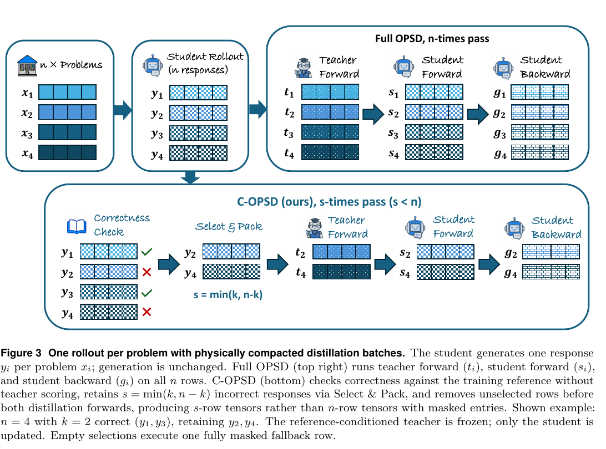

图 10：论文 Figure 3，第 10 页。所有题仍先rollout；上支全量teacher/student forwards与backward，下支correctness→Select&Pack→更小tensor。灰色/蓝色节点展示算子减少，不是把loss乘0后假装少算。空选择保留一行全mask fallback是内核兼容细节，仍产生实际计算成本。

### 保留规则、loss、数值推导

一microbatch含n个不同题、各一条学生回答；最终答案checker给 c_i∈{0,1}。正确集合C、错误集合W，k=|C|，保留s=min(k,n−k)条错误，按既有batch顺序取W的前s条。既不生成多条估计每题难度，也不对正确样本加替代MLE或RL loss。

原文保留了底层带截断token divergence算子D_tau(pθ,sg(qθ0))，该干预只研究选哪些行；clip参数0.05（1.7B/4B）和0.06（8B）。本报告沿用原文抽象算子，不把未在该篇明确展开的实现细节补成未经核验公式。保留目标：L=Σ_(i∈S,t) m_it·D_tau(p_it,sg(q_it)) / max(1,Σ_(i∈S,t)m_it)。m_it指有效回答token，S为选中错误行；教师只前向不反向；按保留token总数平均，长轨迹权重可更大。正确性仅用来分配计算，soft分布才是学习目标，不是让错误答案概率变大。

本文算例：n=4、两对两错，s=2，移除正确两行。若四条全错，k=0→s=0，这次没有训练信号，尽管错误很多！若n=1永远s=0，因此microbatch而非effective batch决定算法行为。空选保留一行但所有labels mask，loss=0；不能用这一行为宣传零forward。

论文在独立同分布、成功率p的简化模型中推导 r4(p)=E[min(K,4−K)]/4=p(1−p)(1+p−p²)。本文展开：K∼Binomial(4,p)，只K=1,2,3贡献，r4=[P(K=1)+2P(K=2)+P(K=3)]/4。p=0.33时loss保留约0.270；加上空选fallback的[p⁴+(1−p)⁴]/4，实际执行约0.323，即平均1.29/4行。论文观察26–29%监督保留和约68%执行行减少，正是两种口径，不可互换。

论文建议此预算主要适合p约[0.25,0.75]；p接近0或1时可能几乎不学，应考虑固定保留比例。按batch顺序拿前s条还可能受数据排列影响，复现必须保留这一点或明确报告变体。

```text
generate 32 distinct-problem rollouts per optimizer update
for each original microbatch of 4:
    verify training final answers; k = number correct
    keep first min(k, 4-k) incorrect rows
    select all row-aligned student/teacher input tensors before forwards
    if empty: keep one row with every label masked
    score selected prefixes; normalize by retained valid tokens
pack retained rows for efficient execution with equivalent normalization
backprop student only; retain baseline rollout and checkpoint protocol
```

### 数据构造、比较、算力与局限

论文事实：训练split为 siyanzhao/Openthoughts_math_30k_opsd，offline difficulty probe覆盖29,427题；不要与Shuffled的29,434记录混报为同一清洗版本。每optimizer step32不同题、单条rollout、microbatch4/accumulation8/1rank；non-thinking、最长1024、温度1.1、top-p0.95、top-k20。Qwen3 1.7B/4B/8B，LoRA64/alpha128覆盖attention+MLP；教师禁用adapter，LR5×10^−6。保留行的选择发生在学生/教师forward前。

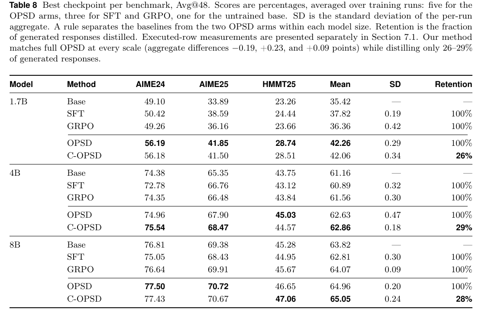

图 11：论文 Table 8，第 13 页。AIME24/25/HMMT25各30题，thinking最长38,912，温度1/top-p0.95，Avg@48；两OPSD arm各5个training runs，SFT/GRPO各3个。重要条件：每benchmark从25/50/75/100 steps选最好checkpoint，表中mean由不同benchmark各自最好点合成；不是单个可部署checkpoint的mean。Retention是监督轨迹比例。

全OPSD vs C：1.7B mean42.26 vs42.06（正文按未四舍五入值记差−0.19）；4B62.63 vs62.86；8B64.96 vs65.05。差的95%区间分别[−0.67,0.28]/[−0.35,0.82]/[−0.24,0.42]，支持“表现相当”，不支持稳定胜过全量。固定step100的差为+0.41/+1.02/+0.10。1.7B分配消融：正确only40.35、同计数random41.58、C42.06、all-incorrect42.17；正确性和题目难度同时变化（保留题offline pass rate0.83/0.42/0.09），因此因果解释要保留混杂条件。

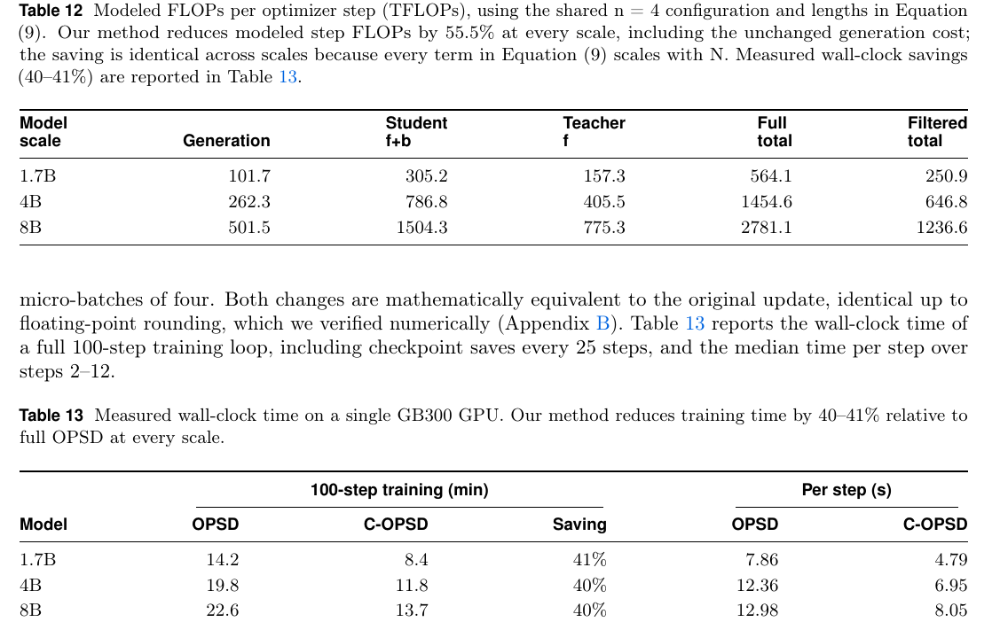

图 12：论文 Table 12/13，第 16 页。上表是估算TFLOPs，包含未减少的rollout生成；下表是单GB300实测100steps总训练分钟及steps2–12的median每步时间，二者不能混称同一种测量。1.7B全量14.2→8.4分钟，4B19.8→11.8，8B22.6→13.7；节约40–41%。为实现加速，保留行pack进完整microbatch，归一化保持等价（浮点误差除外）。这个特定GB300结果不能外推成A100同样分钟数。

原文dense matrix工作量模型：Fgen≈32(P+C)·2N，Fstudent≈R(P+C)·6N，Fteacher≈R(P+Lref+C)·2N。N为非embedding参数量，P为学生prompt长度，C为completion长度，Lref为额外教师参考长度，R是实际蒸馏行。设P≈150、C=978、Lref=616，R32→10.32，模型总FLOPs约减少55.5%。6N来自作者假设的frozen-base LoRA、activation gradient与一次checkpoint recompute，不是所有硬件kernel的准确计费。

本文成本换算：单卡8.4/11.8/13.7分钟约0.140/0.197/0.228 GPU-hours，只对应这100steps profiling；不含五seed、梯度探针和高采样评测。峰值显存、全研究总开销及货币价格未披露。本文评估：依赖可验证训练答案、batch成功率和行packing；rollout生成仍全量，生成占比很高时实际收益会变小。复现应同时核对模型输出/梯度等价、zero-mask fallback、原始分组再pack的顺序、token分母，以及final vs best-checkpoint两种报告。基础延伸：[原始OPSD实现](https://github.com/siyan-zhao/OPSD)、[Math-Verify](https://github.com/huggingface/Math-Verify)，均非作者已发布C-OPSD代码。

## 横向比较：相似的“少教一点”其实切在不同位置

| 方法 | 选择/修正的对象 | 教师是否固定 | 额外信号与代价 | 原文证据的边界 |
| --- | --- | --- | --- | --- |
| ECOS | 命令token权重和技能生成credit | 每轮pre-update快照，跨轮更新 | 环境优势、聚类图、reflection/skill生成 | 8×A800；约比GRPO慢30%，非省算力法 |
| TOPSD | 可教前缀及教师可恢复样本 | 固定初始底座 | 英语题解+greedy verification | 多语言数学；未证明端到端省时 |
| Shuffled | 共享输入的词序，教师参考内容结构 | 固定初始底座 | 固定无关例题与置换 | 仅3尺度数学、单主训练seed |
| AsyncOPSD | 队列轨迹年龄、token熵权重 | 实验固定，理论还讨论moving teacher | 队列、adapter export、entropy | 总实现吞吐约2倍，包含batching改变 |
| C-OPSD | 完整轨迹行，在forward前选取 | 固定底座禁用adapter | 训练答案checker、物理packing | GB300约省40%；microbatch和成功率敏感 |

本文工程推演：C-OPSD和AsyncOPSD理论上可以组合，前者减learner工作量，后者重叠生成。但learner变快后最佳GPU split和queue age分布会改变；TOPSD再增加teacher generation可能反而使教师阶段成为瓶颈。原文没有测这三个组合，不能把40%省时与2倍吞吐简单相乘。ECOS的环境优势也不能直接替代数学answer checker，两者监督粒度和状态可比性不同。

## 分级基础阅读与本次核验边界

入门：[Hugging Face GKD 教程](https://huggingface.co/docs/trl/gkd_trainer) 理解学生rollout与软标签；[PEFT LoRA 文档](https://huggingface.co/docs/peft/developer_guides/lora) 理解底座冻结与adapter；[TRL GRPO 文档](https://huggingface.co/docs/trl/grpo_trainer) 理解group advantage、clip和reward。基础论文：[On-Policy Distillation of Language Models](https://arxiv.org/abs/2306.13649)、[Self-Distilled Reasoner / OPSD](https://arxiv.org/abs/2601.18734)，均早于窗口，只作基础。

作者材料：五篇论文PDF及附录是主要技术来源；Shuffled的作者GitHub地址已记录但返回404；其他四篇未定位可核验的专属公开代码/作者博客。没有用第三方自动摘要补足缺失超参，没有声称复现模型。官方基础仓库只用于解释通用组件，不充当五篇论文的现成实现。

本报告从同一Markdown全文生成PDF，12幅原图/原表均为已下载论文的实际裁图，保留来源、图号与页码。图源清单见 assets/SOURCES.md，PDF/文字/图像检查见 assets/QA.md；manifest记录全文版本、时间窗、跨方向去重、来源URL和检查结果。
