# OPD & OPSD 精读日报 · 2026-11-18

今天的主题是“教师该怎样给监督”：让教师随训练进化、逐 token 选择教师、对参考视图求平均、用双向偏好训练教学能力，以及直接调整教师激活。共收录 5 篇论文；它们的首次公开日期均在 2026-10-18 至 2026-11-18 的一个日历月窗口内。博客、代码与教程不占论文名额。

## 阅读约定与检索结果

OPD 指 On-Policy Distillation：学生自己生成轨迹，教师在学生实际到达的前缀上提供监督。OPSD 指 On-Policy Self-Distillation：教师和学生通常来自同一初始模型，教师通过额外参考信息获得条件优势；“同源”不意味着教师必须与学生同步更新，也不意味着一定没有冻结副本。本文只讨论这个方向。

**标注约定：**“原文事实”是论文、附录或作者公开代码中的信息；“本文推演”是为教学而展开的代数、手算例子、伪代码和复现建议，未运行原论文训练；“未披露/未找到”表示本次核验的信息缺口，不等于断言它永远不存在。所有百分数差值都按百分点解释。

| 论文 | 首次公开 / 阅读版 | 主要改动 | 代码核验 |
| --- | --- | --- | --- |
| [TESD](https://arxiv.org/abs/2610.38637) | 2026-10-28 / v1 | 环境奖励训练教师，按教学质量加权学生 | 本次未找到作者实现 |
| [MTA-OPSD](https://arxiv.org/abs/2610.40574) | 2026-10-29 / v1 | 多数方向投票，再逐 token 选最远教师 | 作者仓库可访问；固定提交核对配置 |
| [MCPD](https://arxiv.org/abs/2610.30880) | 2026-10-22 / v1 | 多个随机遮挡参考视图的概率平均 | 本次未找到作者实现 |
| [TeachBack](https://arxiv.org/abs/2610.29167) | 2026-10-21 / v1 | 学生学教师，教师反向偏好学生轨迹 | 本次未找到作者实现 |
| [ST-OPSD](https://arxiv.org/abs/2610.34005) | 2026-10-25 / v1 | 只干预教师激活，保留学生自主思考 | 本次未找到专用作者实现 |

本次通过 OPD/OPSD 全称、方法名、arXiv ID、论文标题加 code/GitHub 检索，读取 arXiv 首版历史、原始 PDF 的方法/主表/附录及其链接，核对可获得的作者代码。以去版本 arXiv ID、DOI、规范 URL、归一化标题与 sources.json 和全部历史 manifest 交叉去重；已入库的 OPSD 方法和其他方向中出现过的同篇论文均不再计数。没有用普通版本更新刷新旧论文日期。详细证据、PDF 哈希和图源见 manifest.json 与 assets/SOURCES.md。

共同记号：x 是题目；r 或 c 是仅训练时教师可见的参考；y 是学生生成序列；y<t 是第 t 个 token 之前的学生前缀；v 是词表中一个候选 token；p 是学生下一 token 分布，q 是教师分布；sg 表示停止梯度。KL(a||b)=Σv a(v) ln[a(v)/b(v)]，自然对数单位为 nat。KL 的两个方向不等价；把教师放在不同一侧，会改变低概率事件如何受罚。本文的式子采用可直接阅读的 Unicode 和线性公式，Markdown 与 PDF 保留同一全文。

## 1. TESD：既教学生，也训练教师的教学能力

论文全名：On-Policy Self-Distillation with Teacher Evolution。原文事实依据：[arXiv 页面](https://arxiv.org/abs/2610.38637)、[v1 原文](https://arxiv.org/pdf/2610.38637v1)，重点为 §3、§4 和附录 A。作者包括 Shufan Shen、Zhongni Hou 等。首次公开 2026-10-28。

### 问题、直觉与机制

**原文事实：**论文关注只有任务验证器、没有额外人工推理标注的情形。学生先生成多个解答，成功学生轨迹可作为教师的特权上下文。常见 SDPO 只让学生模仿教师，却没有直接保证教师能在不同学生前缀上给出可靠指导。论文诊断发现，教师信心容易与“像不像给定上下文”相关，而不总与正确性相关；教学质量随训练也可能退化。

TESD 把一部分采样预算从学生转给教师。每题采样 8 条学生轨迹和 8 条教师轨迹，总计 16 条；SDPO/GRPO 基线每题 16 条学生轨迹。教师在成功学生轨迹构成的上下文下自行解题，环境验证其正确性，同时鼓励与参考文本有所区别。再用教师平均奖励衡量这个题目的监督可靠性，给学生蒸馏损失加权。教师不是一份永远固定的参考答案。

**小白直觉：**一个辅导老师看过标准解答，但遇到学生的另一路思路时可能只会把学生拽回标准解法。TESD 让老师也参加测验：既要做对，又要展示不只是照抄。老师在某类题上表现差，就暂时降低这类指导对学生的影响。编辑差异只是启发式信号，不能把“写得不同”自动等同于“推理更好”。

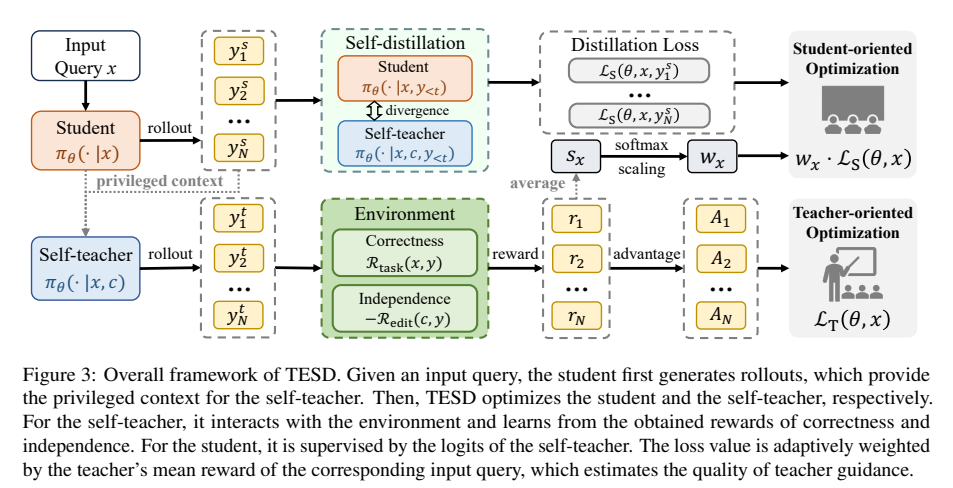

图 1｜来源：TESD v1，PDF 第 4 页 Figure 3，原图裁取。左上是学生 rollout，左下是带特权上下文的 self-teacher；上路为分布蒸馏，下路为任务正确性与独立性奖励驱动的教师策略优化；中间平均教师奖励生成权重。读箭头时要区分“教师 logits 是学生监督”与“教师自身 rollout 接受环境奖励”，二者不是同一个 loss。

### 公式逐符号解释与推导

**原文事实：**原文式 (1) 的单轨迹蒸馏可写为 ℓS(x,y)=Σt D(pθ(·|x,y<t)||sg q(·|x,c,y<t))/|y|。θ 为可训练参数，|y| 为有效响应长度，D 是分布距离；教师在学生前缀上打分，不要求学生照着教师生成的整段轨迹走。实现采用 α=0.5 的广义 Jensen-Shannon 距离，以 top-100 logits 加显式尾部桶近似全分布；蒸馏重要性比率截断为 2。

JSD 的对称形式是 m=(p+q)/2，DJS(p,q)=[KL(p||m)+KL(q||m)]/2。sg q 使这一步学生蒸馏不经教师目标反传。尾部桶应汇总未保留 token 的总概率，不能随手把 top-100 重新归一化后宣称仍是同一个全分布目标。

原文主文式 (2)：ri=Rtask(x,yiT)+λedit Redit(c,yiT)。yiT 是第 i 条教师响应，Rtask∈{0,1} 是验证器奖励，Redit∈[0,1] 是归一化文本差异，λedit=1 是主实验设定。附录 A.1.4 具体使用去特殊符号、转小写后按空白切分的序列，以及 Python difflib.SequenceMatcher。若匹配元素数为 M、两序列长度为 n 和 m，则相似度 S=2M/(n+m)，差异 Redit=1−S。它不是词表 token 上的标准 Levenshtein 编辑距离。

**必须保留的原文歧义：**主文式 (2) 是加号，且解释为鼓励与上下文不同；但附录 A.1.1 第 12 页用文字写成“任务正确性减去独立性奖励”。两者方向相反。本日报按主文公式解释机制，同时将实现符号列为待作者代码确认项，不能以自己的猜测消掉这个冲突。

教师 GRPO 使用 Ai=(ri−meanj rj)/stdj rj，ρi=πθ(yiT|x,c)/πold(yiT|x,c)，Jteacher=(1/N)Σi min[ρiAi,clip(ρi,1−ε,1+ε)Ai]。N 为教师组大小，old 是更新前策略，ε 控制更新范围。原文式 (3) 把这个通常最大化的量记作 LT，式 (7) 又与学生损失相加；最大化/最小化符号约定需要实现核对。

**本文推演：**若统一使用最小化优化器，应写 Lmin=LS−Jteacher，而不是把正的策略收益当作待最小化惩罚。对组内奖励作中心化，正优势提高该轨迹概率，负优势降低；当所有奖励相同，应处理 std=0，具体稳定项不能凭空指定为作者设置。实际附录还采用非对称 PPO clip 0.2/0.28、dual clip 3 和 token 级重要性修正。

原文式 (4)–(6)：sx=(1/N)Σi ri，wx=|B| exp(sx)/Σx′∈B exp(sx′)，LS(x)=wx·(1/Ns)Σi ℓS(x,yiS)。B 是题目 batch，Ns 是学生轨迹数。softmax 温度为 1，权重随后截到 [0.05,5]。截断前 Σx wx=|B|，故 batch 平均权重恰为 1；截断后这个等式通常不再严格成立。

**本文数值推演：**两道题教师平均奖励分别为 1.5 和 0.5，则权重为 2e^1.5/(e^1.5+e^0.5)=1.462 和 0.538。若两题原始学生损失都是 0.2，平均加权损失仍为 0.2，但可靠题承担更多梯度。再看编辑奖励：两段各 10 个词，有 6 个匹配元素，S=0.6，Redit=0.4；答对时主文奖励是 1.4。答错却极不相似的响应仍可能得到接近 1 的奖励，这说明 λ 需要验证，不能把复合奖励直接解释成正确率。

### 实现、数据与训练成本

**原文事实：**教师使用 EMA 维护，TESD 更新率 0.01，SDPO 为 0.05；原文的教师定向策略优化与学生蒸馏共同改变模型，不能把 EMA 当作教师独立于训练的证明。以下是按论文组织的概念流程，具体参数共享/梯度路由仍需作者实现核实。

```text
for batch x:
    student_paths = sample(student, x, n=8)
    c = choose_successful_student_demonstrations(student_paths)
    teacher_paths = sample(teacher_context_policy, x+c, n=8)
    r = verify(teacher_paths) + lambda_edit * text_distance(c, teacher_paths)
    teacher_objective = clipped_group_policy_objective(teacher_paths, r)
    q = stop_gradient(score_teacher_on_student_prefixes(x+c, student_paths))
    w = clip(batch_size * softmax(mean_teacher_rewards), 0.05, 5)
    student_loss = weighted_mean(JSD(student_logits, q), w)
    optimize_student_and_teacher_objectives_with_correct_signs()
    update_EMA_teacher(rate=0.01)
```

上段奖励加号遵循主文，不是声称已验证代码。成功演示去掉 thinking traces，并排除自成功演示的相关设置沿用 SDPO；失败样本如何获得可用上下文应按其实现处理，不能为缺失参考补造答案。

科学、工具、编程分别独立训练。科学 L3 四领域的 train/test 为生物 450/50、物理 720/80、化学 1890/210、材料 841/94；ToolAlpaca 4046/68；LiveCodeBench v6 131/131。主模型 Qwen3-4B/8B、OLMo3-7B-Instruct，编程还包括 Qwen3-1.7B。科学与工具结果不能当作同一个混合数据模型成绩。

硬件单节点 8×H20，veRL/FSDP，AdamW，β1=0.9、β2=0.999、weight decay 0.01、gradient clip 1，常数学习率在 1e-5/1e-6 中按验证选择，warmup 10，每轮 1 PPO epoch，batch 32 题。Qwen thinking 关闭；采样温度 1、top-p 1、top-k −1；题目/响应上限 2048/8192。科学 30 epochs，工具 15 epochs，编程 40 steps，每 10 steps 评估。总墙钟时间、峰值显存、GPU-hours 和货币费用未给出可直接复用的完整数值；论文有编程时间曲线，不能凭图外推全部任务成本。

### 主结果、消融与可复现性

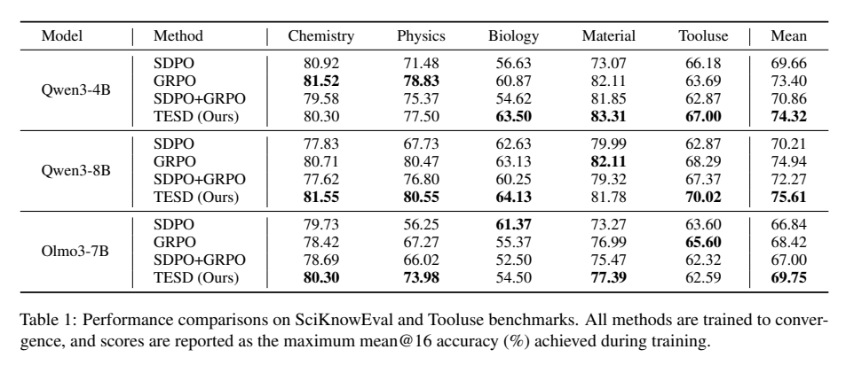

图 2｜来源：TESD v1 第 6 页 Table 1。五列任务是化学、物理、生物、材料、工具，Mean 为均值；条件是训练到收敛后取训练过程中最大 mean@16，不是统一最后一步。Qwen3-4B 的 SDPO/GRPO/简单叠加/TESD 为 69.66/73.40/70.86/74.32；8B 为 70.21/74.94/72.27/75.61；OLMo 为 66.84/68.42/67.00/69.75。看均值后还应看领域列：例如 4B 化学 TESD 80.30 低于 GRPO 81.52，不能称所有任务都胜出。

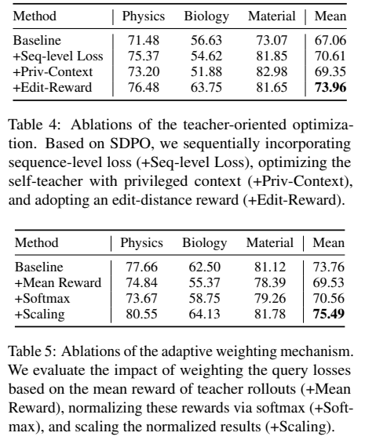

图 3｜来源：TESD v1 第 7 页 Tables 4、5。Table 4 的 Qwen3-4B 教师优化链为 67.06→70.61→69.35→73.96，依次增加序列级 loss、特权上下文、编辑奖励，说明仅给教师上下文并不保证单调改进。Table 5 为 Qwen3-8B 查询权重消融：基线 73.76，原始平均奖励 69.53，softmax 70.56，再加 batch scaling 75.49。两表模型不同，不能纵向相减当成同一组实验。

编程 Table 2：Qwen3-1.7B 的 TESD 45.98 低于 SDPO+GRPO 的 46.38，4B TESD 60.07，8B 63.31。保持能力实验中 8B 物理训练的 holdout 均值从基座 81.41 到 TESD 81.77，只能支持该设定下的保留结果，不能证明没有灾难性遗忘。

**局限与复现建议：**先核清奖励正负号和策略目标符号，再复现 4B 的单领域消融；固定同样的成功演示选择、验证器与采样预算。教师得分包含文本差异，不是纯正确率；EMA、奖励、权重三者同时变化，消融需要控制其他设置。小测试集、择优 checkpoint 和多次采样会影响误差估计。未找到公开作者仓库、作者博客、完整运行日志与方差报告，复现成熟度有限。

辅助资料：[Python difflib 官方文档](https://docs.python.org/3/library/difflib.html) 帮助核实文本差异含义；[TRL GRPO 官方教程](https://huggingface.co/docs/trl/grpo_trainer) 解释组内优势和 clipping。二者只是背景，不代表其默认实现就是 TESD。

## 2. MTA-OPSD：每个 token 选择自己的教师

论文全名：Every Token Needs Its Own Teacher: Multi-teacher Adaptive On-policy Self-distillation。事实依据：[论文页面](https://arxiv.org/abs/2610.40574)、[v1 PDF](https://arxiv.org/pdf/2610.40574v1)，重点 §3–6、附录 B/C。作者 Yifu Luo 等。首次公开 2026-10-29。[作者代码](https://github.com/xingzhejun/MTA-OPSD) 可访问；本次固定读取提交 9567be28a9882f6fa3c3f610f358beb07bb29be8。

### 问题与教师池

**原文事实：**给整条学生响应固定同一个参考暴露比例，忽略了不同位置的需要：推导中的某个连接词可能需要弱提示，错误计算之后可能需要强纠正。论文构造七个教师条件：完整参考；前 50%/75%；后 50%/75%；随机连续片段 50%/75%。它们来自同一个模型的不同参考条件，不是七个不同训练出来的大模型。最终答案在各条件下保留，因此“只给半份参考”不等于“不给答案”。

诊断先在 64 道 DeepMath 中高难题上排除学生四次全对的题，比较不同参考视图对中间前缀续写的作用。采样组合包含不同位置、熵/距离、续写长度 64/128/256，以及教师接力和学生接力，共 75,264 次生成。优选教师集合重合约 50%，多数方向集合更常覆盖优选教师；这是受控的 pilot 诊断，训练时不使用那个昂贵的真实续写 oracle。

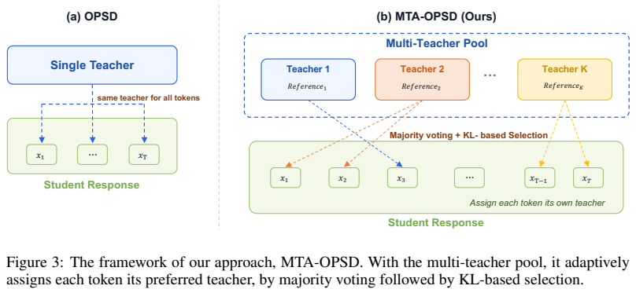

图 4｜来源：MTA-OPSD v1 第 7 页 Figure 3。左为整条响应共享完整参考教师的 OPSD；右为不同参考条件的教师池，在每个学生 token 处通过多数投票和 KL 选择连接到一名教师。虚线表示选择关系，不是把所有教师 token 拼成新参考，也不是对七份最终答案作投票。

### 关键公式与数值算例

**原文事实：**对学生已采到的 yi、上下文 ci=(x,y<i)，第 k 个教师给出 qk。其方向信号 ak(yi|ci)=ln qk(yi|ci)−ln pθ(yi|ci)。正值表示相对学生提高该 token 概率，负值表示降低。各教师按符号投票，V=sign(Σk sign ak)，保留与 V 同号的教师集合 Mmaj。若正负票相同，再按两侧优势绝对总量判定。七教师通常不会出现纯正负平票，但恰为零的边界仍应按代码核对。

再选择 k*=argmaxk∈Mmaj KL(pθ||qk)，最后 L=E学生轨迹 Σi KL(pθ(·|ci)||sg qk*(·|ci))。k* 随 token 改变；比较的是整个词表分布距离，方向投票只看当前采样 token。离散选择不应反向求导，选择出的教师目标要停止梯度。最大 KL 不代表教师独立地更正确，必须先限定在多数方向内。

**本文推演：**把 RKL 写成 Σv p(v)ln p(v)−Σv p(v)ln q(v)，可见它同时涉及学生熵与教师对学生支持集的评分。单个教师在另一个低概率 token 上变化很大，也会影响 KL；所以“当前 token 概率差最大”与“KL 最远”不能混用。多数同意后的距离是作者的经验选择准则，不是关于最优教学的普适定理。

**本文手算例子：**词表只有 A/B，学生 p=(0.6,0.4)，实际采样为 A。三个教师为 q1=(0.8,0.2)、q2=(0.7,0.3)、q3=(0.4,0.6)。优势分别为 ln(0.8/0.6)=0.288、ln(0.7/0.6)=0.154、ln(0.4/0.6)=−0.405。多数要提高 A，所以只留下 q1/q2。它们的 RKL 约 0.1046/0.0226，选择 q1。若只找所有教师中最远者就会混入与共识相反的信号；实际结果取决于全分布，不是仅凭这一维比值。

论文主目标是 reverse KL；不能因为基线 OPSD 用 forward KL，就将两者写成相同的损失。它也没有额外的“答案多数正确”奖励：训练信号来自教师 logits，不是验证器给当前 token 打标签。

### 代码、训练与数据构造

**原文事实与代码证据分开：**论文主实验是全参数训练、无 LoRA，Qwen3-1.7B/4B/8B，4×H200，veRL 的 PPO/FSDP2 与 vLLM rollout，学习率 1e-6、全局 batch 32、300 steps、每 50 steps 评估；训练 thinking 开启，响应上限 4096，验证上限 38912，取测试集上最优 Avg@12 checkpoint。测试集择优不能与一次独立保留测试的最终模型等同。

作者公开的 [1.7B 配置](https://github.com/xingzhejun/MTA-OPSD/blob/9567be28a9882f6fa3c3f610f358beb07bb29be8/configs/math_deepmath/qwen3_1_7b_mta-opsd.yaml) 明列 teacher_mode=fixed、use_lora=false、七教师规格、majority 路由、top_k_distill=100、distill_add_tail=true、entropy_router_high_ratio=0。因而这份配置的教师为冻结模式；不能笼统说教师随学生一起更新。随机参考模式以题目为单位使用固定 seed；公开配置的片段比例按参考字符控制，不能擅自改成 token 比例而认为输入相同。配置还记录 AdamW 相关权重衰减 0.01、梯度 clip 0.1、采样 top-p 0.95/top-k 20、温度 1。

**代码与论文的差异：**沿启动脚本到 [veRL 的 core_algos.py](https://github.com/xingzhejun/MTA-OPSD/blob/9567be28a9882f6fa3c3f610f358beb07bb29be8/third_party/verl/verl/trainer/ppo/core_algos.py) 核对，公开 1.7B 配置 beta=0.0；_sd_generalized_jsd 在该值时调用 KL(teacher||student)，即 FKL。teacher_selection_beta 未配置时继承 beta，所以默认选择距离也是 FKL；loss 的每个词表项还按 0.05 上限裁剪，而选择距离不裁剪。这个静态默认配置与论文式 (15)/(16) 的 RKL 记法不一致。启动脚本允许用户额外覆盖参数，但本次没有获得原实验运行时的覆盖参数或日志，不能断言公开默认命令已复现论文的 RKL 结果。

实际多教师分支为每个教师准备 top-100 支持集并加尾部桶，先计算所有教师损失和未裁剪距离，再按多数方向筛选并 gather 所选教师的 loss；teacher-only 投票用学生采样 token 的原始 log-prob 差。票数相等时比正负优势绝对总量，若仍相等偏正，空候选回退到可用教师。另一个 [src/losses.py](https://github.com/xingzhejun/MTA-OPSD/blob/9567be28a9882f6fa3c3f610f358beb07bb29be8/src/losses.py) 含多个不同分支，不能只读它推断 veRL 训练入口。以上是固定提交的静态调用检查，未实际运行训练。

```text
freeze initial teacher; initialize student from same model
for x, reference_solution, final_answer:
    views = seven_reference_views(reference_solution, keep_final_answer=True)
    y = sample(student(x))
    p = student_logits(x, y_prefixes)
    q[1..7] = frozen_teacher_logits(x + each_view, y_prefixes)
    for each valid response token i:
        direction[k] = sign(log q[k,i,y_i] - log p[i,y_i])
        candidates = majority_sign_teachers(direction)
        k_star[i] = argmax_KL_student_to_teacher(candidates)
    loss = reverse_KL(p, stop_gradient(gather(q, k_star)))
    update(student, loss)
```

上段是按论文 RKL 写出的机制伪代码；公开默认代码的 FKL、词表项裁剪与参数覆盖差异见前段，不能把伪代码当作已核验的默认运行。它也未包含 veRL 的 padding、分布式通信和重要性修正。要确保教师输入多出的参考不使学生响应 token 的位置错位；按响应位置而不是绝对输入下标配对。缓存七组完整 logits 很耗内存，实际需 top-k、微批或分块，不能从七教师直接得出“总成本恰好七倍”。

数据为 DeepMath-103K，按模型分难度筛选：1.7B 使用等级 5–7，4B 使用 6–8，8B 使用 7–10。作者提供 [RLCSD 数据集](https://huggingface.co/datasets/Leyiii/RLCSD) 及 download_data.py。先复用已处理 parquet 并核对字段、参考与最终答案，才有机会复现原输入。不同模型并非相同训练子集。

README 给出下载、训练和验证脚本，但其环境说明包括 H200/B300，与论文主实验“四张 H200”要分别记录。论文未给出完整总时长、峰值显存、GPU-hours 和总费用，本次没有运行模型或安装其训练环境。

### 实验、消融与局限

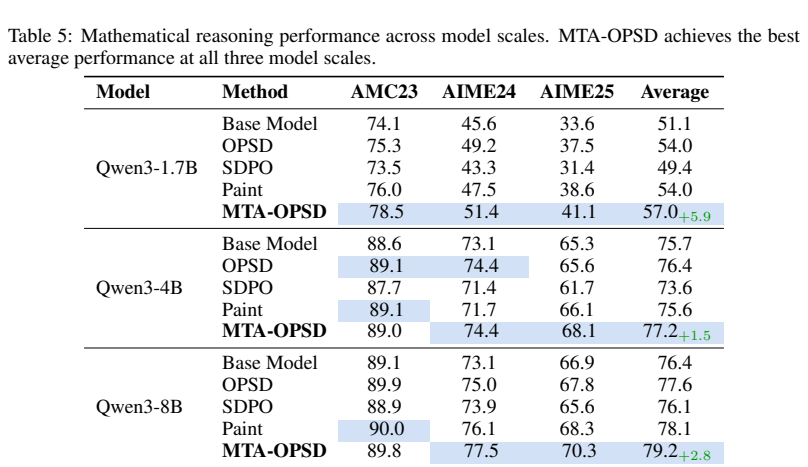

图 5｜来源：MTA-OPSD v1 第 9 页 Table 5。AMC23/AIME24/AIME25 取 Avg@12，并选择训练中最佳 checkpoint。三模型基座/OPSD/MTA 的均值分别为 51.1/54.0/57.0、75.7/76.4/77.2、76.4/77.6/79.2。摘要最高 +5.9 是相对 1.7B 基座，不是相对 OPSD；相对 OPSD 分别为 +3.0/+0.8/+1.6。8B Paint 78.1 也是需要比较的自适应参考基线。

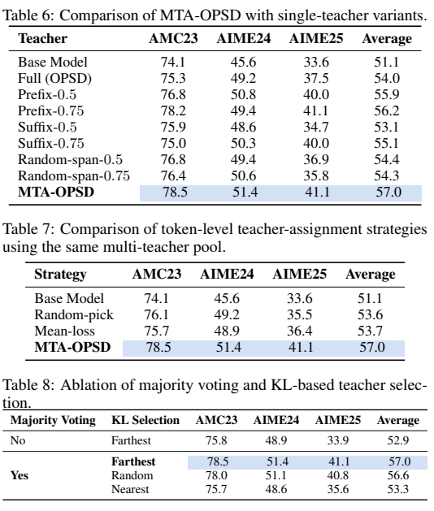

图 6｜来源：MTA-OPSD v1 第 9 页 Tables 6–8，均以 Qwen3-1.7B 为主、沿用同一训练设置。Table 6 最强固定教师 prefix-0.75 为 56.2，MTA 为 57.0；Table 7 随机选教师 53.6、平均 loss 53.7；Table 8 不投票直接最远 52.9，多数内随机 56.6、最近 53.3、最远 57.0。应先看投票是否有用，再看最远是否优于随机；不能只对比最弱完整参考教师来夸大逐 token 选择收益。

**复现与局限：**先核对原实验 beta 与 teacher_selection_beta 的运行覆盖，并在日志写出实际两种 KL 方向，再运行 1.7B 配置，保存逐 token 选中教师、投票分歧率、KL 尾部概率，复核完整参考/固定 prefix-0.75/多数随机/多数最远四组。全部教师共享模型、参考和答案，错误高度相关；多数不能保证真理。数学三个小基准、测试集上挑 checkpoint、缺少整体费用及独立复现，都限制结论。教师池增大后如何控制内存与计算、开放回答中无明确最终答案时如何构造特权上下文，尚需验证。本次未找到单独作者博客。

辅助入门：[TRL GKD 文档](https://huggingface.co/docs/trl/gkd_trainer) 理解学生轨迹上的分布监督；进阶可直接读固定提交的配置与 loss 文件。文档的默认 KL 方向和教师更新方式不能直接套到 MTA。

## 3. MCPD：对参考视图边缘化，减少“换一种解法就换一种老师”

论文全名：One Teacher, Many Views: Reducing Reference Sensitivity in On-Policy Self-Distillation。作者 Khouloud Saadi、Di Wang。首次公开 2026-10-22；依据 [论文页面](https://arxiv.org/abs/2610.30880) 与 [v1 PDF](https://arxiv.org/pdf/2610.30880v1)，重点方法、Proposition 1、Tables 1–5、附录算法。MCPD 为 Monte Carlo Privileged Distillation。

### 问题与机制

**原文事实：**同一道题有两种都正确的参考解法，完整参考教师在同一个学生前缀上可能给出不同监督。教师对“参考怎样写”敏感，学生可能学到参考的表面形式。MCPD 在单份参考中独立随机遮挡 token，保留可见 token 的原顺序，遮挡处换为模型 tokenizer 的 mask 表示；对 K 个视图的教师概率分布求平均，再蒸馏学生。

同一份冻结初始模型充当教师，学生继续更新；主实验 K=4，每批重采样视图。Qwen 数学遮挡 30%，DeepSeek 数学 40%，科学 10%。这是部分信息边缘化，不是随机打乱词序，也不是从多个老师的推理轨迹里挑一条最短答案。

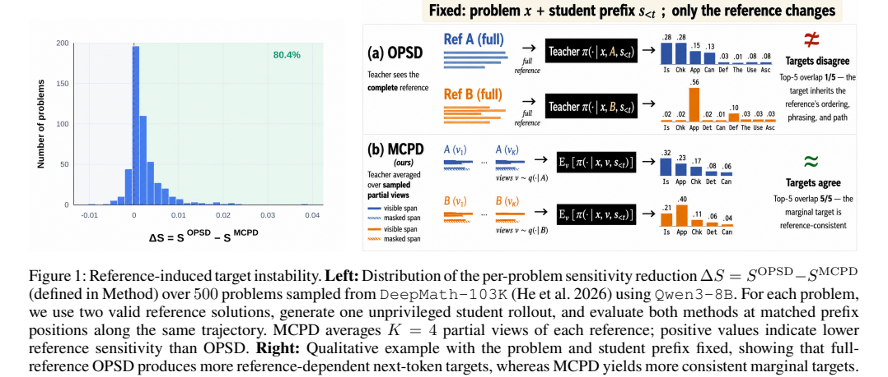

图 7｜来源：MCPD v1 第 2 页 Figure 1。右侧固定题目、学生前缀和参数，只换参考 A/B；完整参考会产生不同 token 目标，MCPD 对各自多个遮挡视图求边缘平均。左侧直方图为 500 道题中 ΔS=SOPSD−SMCPD，80.4% 为正，即多数题的参考敏感度降低。横轴是敏感度差而不是答题准确率，不能把 80.4% 当作数学成绩。

### 公式、理论与算例

**原文事实：**M~μρ(·|r) 为对参考 r 遮挡比例 ρ 的随机操作；qM,t(v) 为该视图下教师在学生第 t 个前缀上对 v 的概率。目标边缘分布 q*t(v)=EM qM,t(v)。Monte Carlo 估计 qhat_t=(1/K)Σk qMk,t；学生最小化 L=E学生轨迹 (1/|y|)Σt KL(sg qhat_t||pθ,t)。这是 forward KL 和概率空间平均，不能把多个 logits 先平均再 softmax。

Proposition 1：EM KL(qM||p)=EM KL(qM||q*)+KL(q*||p)。第一项是视图间变化、对学生 p 为常数；所以用 q* 作为教师等价于最小化所有视图期望的 FKL，避免把某个随机视图偶然的尖锐程度当作唯一目标。

**本文逐步推导：**从 EM Σv qM(v)ln[qM(v)/p(v)] 出发，在对数中乘除 q*(v)，拆成 EM Σv qM ln(qM/q*) 和 Σv EM qM ln(q*/p)。因为 EM qM=q*，第二项变成 KL(q*||p)。最小值在 p=q* 取得。若 K 个视图独立，对固定参考有 E qhat=q*，Cov(qhat)=Cov(qM)/K；方差降低不证明“不同参考的 q* 必然相等”，也不保证每道题准确率提高。

FKL 对学生 logits z 的导数为 p(v)−qhat(v)：由于 −Σv qhat(v)ln softmax(z)v 的梯度是 p−qhat，目标分布给出密集而平滑的监督；没有额外 RL outcome reward。教师停止梯度，学生采样轨迹视为固定，不经离散采样反传。

**本文手算例子：**两个视图 q1=(0.9,0.1)、q2=(0.5,0.5)，平均 qhat=(0.7,0.3)。若学生 p=(0.6,0.4)，FKL=0.7ln(0.7/0.6)+0.3ln(0.3/0.4)≈0.0216，A 的 logit 梯度为 −0.1。若先平均 logits，相当于归一化几何平均，结果为 (0.75,0.25)，不是 (0.7,0.3)。同样是“平均教师”，两个实现会教出不同分布。

论文敏感度指标为同一状态下两参考教师的 JS(qa,qb)。MCPD 比较各参考的边缘估计后再计算 JS。诊断控制学生轨迹、前缀、参数不变，使用 500 题、两份经验证参考、每题 20 个对齐位置、5 组 mask bank。若连学生轨迹也换了，测到的就不只是参考敏感度。

### 训练、数据、算法与成本

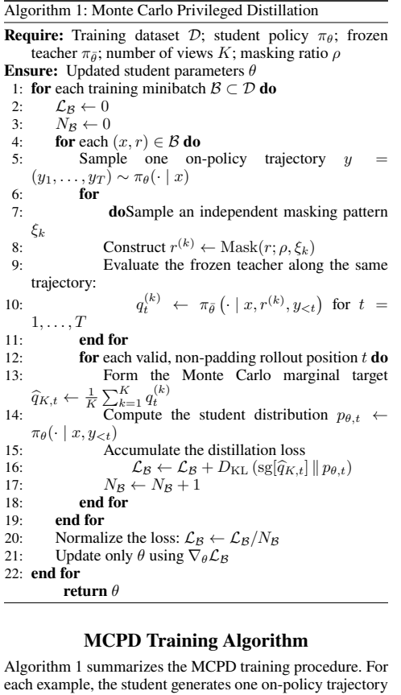

图 8｜来源：MCPD v1 第 12 页 Algorithm 1，原始算法裁图。先生成学生轨迹，再为每题采 K 个 mask，所有教师视图在同一学生前缀上评分，最后形成平均教师目标。初始化教师冻结这一点在算法输入处可直接核对；图不是本文重画的架构。论文未提供独立的标准架构总图，因此用 Figure 1 机制图与原算法共同说明流程。

```text
teacher = freeze(initial_model)
student = attach_LoRA(initial_model)
for x, reference in training_data:
    y = sample(student, x)
    teacher_prob_sum = 0
    for k in 1..K:
        view = mask_reference(reference, rate=rho, independent=True)
        teacher_prob_sum += softmax(teacher(x+view, y_prefixes))
    qhat = stop_gradient(teacher_prob_sum / K)
    loss = mean_valid_response_tokens(KL(qhat || student(x,y_prefixes)))
    update_LoRA(loss)
```

**原文事实：**数学使用约 17K OpenThoughts 训练样本；模型 Qwen3-4B/8B/14B-Instruct 与 DeepSeek-R1-Distill-Qwen-7B。LoRA rank 64、alpha 128，作用于 q/k/v/o/gate/up/down 投影；AdamW 学习率 5e-6、batch 32、梯度 clip 0.1，100 steps，每 25 steps 检查点。训练学生非 thinking，教师 thinking；采样温度 1.1、top-p 0.95/top-k 20，学生响应 1024，提示上下文 20000。数学评估 thinking 开启，AIME24/AIME25/HMMT25 Avg@12，最大生成 38912。训练与评估的 thinking 条件不同，不能忽略。

科学 SciKnowEval L3 训练 3868、测试 429，四领域训练数为生物 450、化学 1890、物理 687、材料 841。它与 TESD 的物理 720 条并不相同，不能把两篇表直接横向排名。科学 Qwen3-8B、响应上限 2048、mask 10%，评估 Avg@16、温度 0.6、上限 8192。训练集过滤、mask 实现和教师提示都需要恢复原设定；完整可执行数据管线本次未找到。

**原文成本事实：**DeepSeek 7B 在 4×A100 80GB 上，100 steps 的 OPSD 1h26m、MCPD 1h36m、AV-MCPD 1h40m；GRPO 列为 12h30m，但它运行 500 steps、每题 8 rollout，预算不相同。**本文换算：**MCPD 对 OPSD 增加约 11.6% 墙钟时间，按四卡全程占用估计 6.4 GPU-hours，对照约 5.73 GPU-hours；这只是由已报时长折算，不是实测计费。不能将 12.5/1.6 当作相同训练预算下的算法加速比。峰值显存、完整费用和各模型全量时长未披露。

### 实验、消融与局限

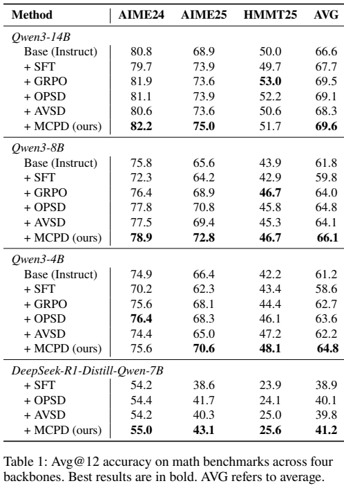

图 9｜来源：MCPD v1 第 5 页 Table 1。均为数学 Avg@12：14B OPSD 69.1→MCPD 69.6；8B 64.8→66.1；4B 63.6→64.8；DeepSeek 7B 40.1→41.2。表中同时含 SFT、GRPO、AVSD 等基线，要按同一模型块内比较。14B GRPO 69.5 与 MCPD 69.6 很接近；论文没有足够独立随机种子置信区间支持“显著优势”结论。

科学 Table 2：OPSD 49.7、AV-MCPD 50.3、MCPD 50.9；数学训练后科学迁移为 47.7→49.0。K 消融中 DeepSeek K=1 为 40.3，K=4/7 为 41.2，K=9 为 41.4，收益递减且单一基准未必单调。原 Table 4 sampled-token 实验的 Qwen3-4B AIME/HMMT 数字 86.7/66.7 是 Pass@8，不能与主表 Avg@12 的 70.6/48.1 混写。

**复现与局限：**先测 mask bank 估计的稳定性和概率和是否为 1，再与单完整参考、单随机视图、四视图平均在同一 FKL 下对照。遮挡可能删除关键推理，也可能改变文本分布；tokenizer 的 mask 表示并不保证模型真正理解缺失信息。方法只对选定 mask 分布进行边缘化，不能消除所有参考偏差，K 倍教师评分也不是零成本。未找到公开作者代码、模型权重、专门博客及足以逐项重放全部训练的日志，正文的可实现性不能代替实际复现证据。

辅助资料：[原始 OPSD 项目](https://github.com/siyan-zhao/OPSD) 了解冻结教师与特权提示背景；[PEFT LoRA 文档](https://huggingface.co/docs/peft/developer_guides/lora) 入门低秩训练。它们不构成 MCPD 官方实现。

## 4. TeachBack：让教师也从学生轨迹中学习

论文全名：TeachBack: Learning to Teach via Bidirectional Preference Optimization for On-Policy Self-Distillation。作者 Linfei Ji 等，首次公开 2026-10-21。依据 [论文页面](https://arxiv.org/abs/2610.29167)、[v1 PDF](https://arxiv.org/pdf/2610.29167v1)，重点 §3/§4 与训练细节、教师权重消融附录。

### 问题与机制

**原文事实：**通常只让学生接近一个带参考的教师，会让教师保留的捷径、措辞和过于确定的分布传递给学生。TeachBack 用同一个共享策略扮演两种条件：学生只见题目 cS；教师见题目和参考后半段作为可选 working notes 的 cT。参考是数据集推理的最后 50%，不是教师直接续写一个学生坏前缀。提示允许老师检查、修正或忽略 notes。

两种条件分别采样，然后把两类响应都放回两种条件评分。学生条件偏好教师来源响应，教师条件反过来偏好学生来源响应。反向偏好是源身份构造的教学目标，不表示学生响应真的更正确。验证器用于诊断，没有把“学生答对”作为反向偏好准入条件，也没有按奖励重加权 preference。

**小白直觉：**辅导老师不能只背 notes，还要适应不带 notes 时自然产生的思路。TeachBack 给同一模型两张练习表：没 notes 时学会更好的解法；有 notes 时也别丢掉学生的自主探索模式。这只是对优化方向的解释，不能当作已证明教师会理解学生心理。

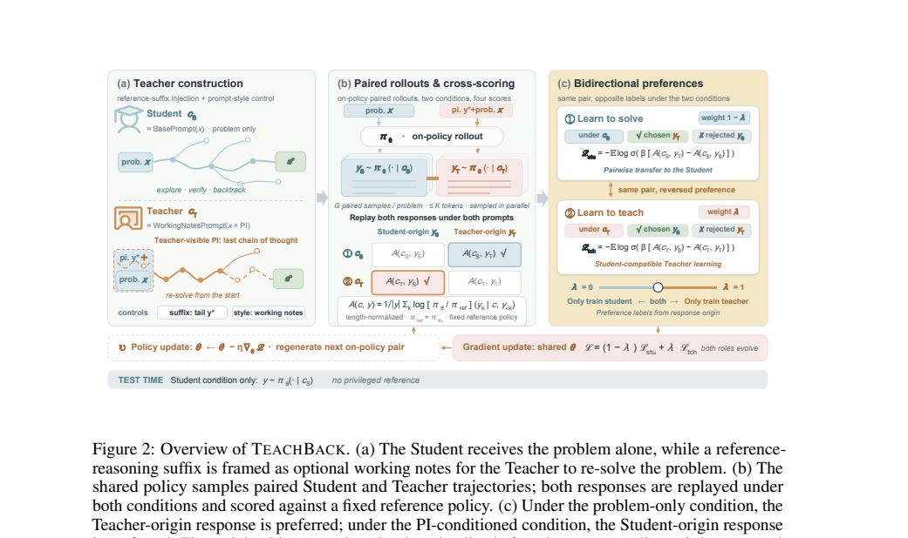

图 10｜来源：TeachBack v1 第 4 页 Figure 2。左列构造学生/教师两种提示；中列同题配对采样并在两种条件下交叉评分，包含当前共享策略与冻结初始参考策略；右列分别是学生学教师、教师学学生的两项偏好损失。冻结的是 DPO 参考策略，参与两种条件训练的共享策略仍在更新，不能与前两篇冻结教师混为一谈。

### 公式、梯度与手算

**原文事实：**定义条件 c 下的长度归一化 log-ratio 分数 Aθc(y)=(1/|y|)Σt ln[πθ(yt|c,y<t)/πref(yt|c,y<t)]。πref 为冻结初始策略，不是人工标准答案；|y| 是有效 token 数。每题采得 yT、yS 后，学生损失 Lstu=−E ln σ{β[AθcS(yT)−AθcS(yS)]}，教师损失 Ltch=−E ln σ{β[AθcT(yS)−AθcT(yT)]}。σ(z)=1/(1+exp(−z))，β=0.1 控制偏好 margin 的缩放。

总损失 L=(1−λ)Lstu+λLtch，数学 λ=0.75，Knight-and-Knaves 逻辑任务 λ=0.25。两项共享 θ，因而教师条件的更新也会改变学生条件策略。源轨迹采样和 πref 都停止梯度；交叉打分时，对当前策略两种条件下的分数都可反传，不能误写成用两个完全独立的学生/教师参数各训各的。

**本文推导：**令 m=A(y+)−A(y−)，ℓ(m)=ln(1+exp(−βm))，则 dℓ/dm=−βσ(−βm)。当 margin 已很大时梯度变小；当偏好顺序未实现时，损失推动 m 增大。展开 m 可得当前策略对 preferred/rejected 的归一化对数概率差，减去参考策略同样的差；这避免仅靠原本就高概率的轨迹获得虚假的改进。长度归一化改变了偏好目标，不能将它悄悄换成序列 log-prob 总和。

**本文算例：**β=0.1，学生条件下教师/学生来源相对参考的平均 log-ratio 为 0.3/−0.1，m=0.4，损失 −lnσ(0.04)≈0.67335，margin 梯度约 −0.049。教师条件下若学生/教师来源分数为 0.2/0.4，反向 margin=−0.2，损失约 0.70320。数学总损失约 0.25×0.67335+0.75×0.70320=0.69574。数字只是教学构造，不是论文训练观测。

与直接 KL 不同，这里奖励是隐式偏好分数。论文不要求逐 token 正确标签，不需要人工给每对轨迹评价；代价是“教师来源必优于学生来源、教师反过来又学学生来源”的源标签可能含噪声，两个条件下的偏好不是同一语境内的逻辑矛盾，也不是正确性的证据。

### 数据、训练流程与预算

```text
reference_policy = freeze(initial_policy)
shared_policy = initial_policy
for x, dataset_reasoning:
    cS = problem_only(x)
    cT = problem_with_optional_notes(x, last_50_percent(dataset_reasoning))
    yS = sample(shared_policy, cS, group_size=4)
    yT = sample(shared_policy, cT, group_size=4)
    keep_same_maximum_response_prefix(yS, yT, K=4096)
    score both yS,yT under both cS,cT, for shared and reference policies
    Lstu = preference_loss(cS, preferred=yT, rejected=yS)
    Ltch = preference_loss(cT, preferred=yS, rejected=yT)
    update(shared_policy, (1-lambda)*Lstu + lambda*Ltch)
```

该伪代码只表达配对和交叉评分；配对展开方式、分布式 batch 等仍以原实现为准。两类响应必须采用一致的保留前缀长度、掩码和归一化，不然可能主要学到截断差异。

**原文事实：**数学用 DeepMath-103K，Qwen3-1.7B/4B/8B 按难度 5–7/6–8/7–10 筛选。逻辑任务训练 4–8 个角色的 Knight-and-Knaves，测试 ID 4–8 和 OOD 9/10/11；精确训练条数未披露。主表三种 Qwen，附录含 DeepSeek 系列跨架构检查。

训练 300 steps，AdamW 1e-6，8 张 NPU，设备具体型号未披露；prompt 上限 2048、训练响应前缀 K=4096、group size 4，thinking 开启，温度 1、top-p 0.95/top-k 20、梯度 clip 0.1、warmup 10。每 50 steps 检查；数学评估 mean@12、温度 0.6、上限 38912，逻辑评估贪心 pass@1。是否全参数或 LoRA、全局 batch、峰值显存、墙钟与 NPU-hours 未完整披露，不能拿“NPU×步数”自行推算费用。

基线预算不一致：GRPO group 8、训练上限 16384；OPSD/PBSD group 1、上限 1024；SPIN group 4、上限 8192；TeachBack group 4、上限 4096。都跑 300 steps 不代表 token、采样或算力匹配。教师还需额外采样与四种条件交叉评分，不能描述为只换一个 loss、零额外开销。

### 主结果、诊断与局限

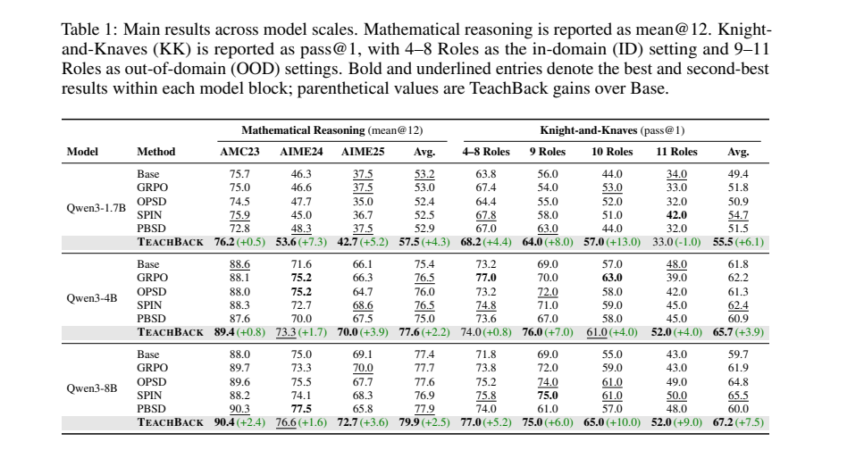

图 11｜来源：TeachBack v1 第 7 页 Table 1。左为数学 mean@12，右为逻辑 pass@1；数学三种模型基座→TeachBack 均值为 53.2→57.5、75.4→77.6、77.4→79.9，OPSD 分别为 52.4/76.0/77.6。逻辑均值为 49.4→55.5、61.8→65.7、59.7→67.2。逐列看会发现例外：1.7B 的 11 角色逻辑 33.0 低于基座 34.0，4B 的 AIME24 73.3 低于 GRPO/OPSD 的 75.2，平均提升不等于每一项提升。

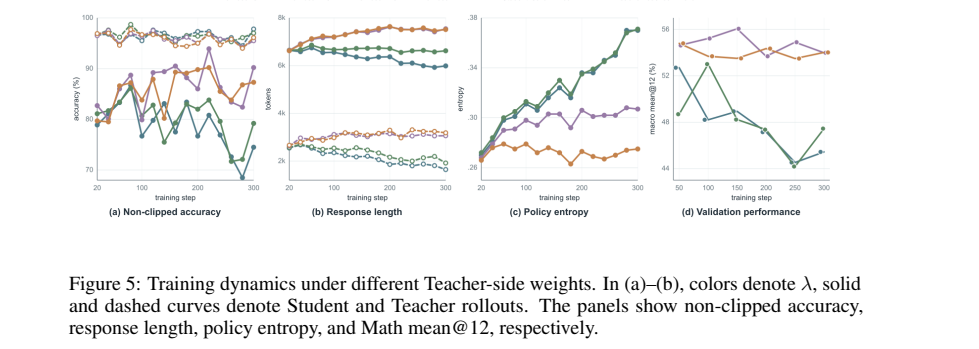

图 12｜来源：TeachBack v1 第 9 页 Figure 5。横轴训练步数，四子图依次看非截断准确率、响应长度、策略熵、验证表现；颜色区分 λ，实线/虚线区分 student/teacher rollout。应把长度、熵和准确率同时看，不能仅凭熵更大宣布探索更好。图中权重诊断使用 1.7B、响应上限 8192，和主实验 4096 不同。

权重附录给出：λ=0 的最终数学分数 45.44，λ=0.75 为 53.99，λ=1 为 54.02；0.75 的峰值和六个 checkpoint 平均较好，但它不是最终值唯一最好者。该诊断不能直接与主表 57.5 相减，因为长度预算不同。提示审计在 256 道题、Qwen3-4B、每题四采样、16K 上限下比较 notes/reference/history 等表述；25–50% 参考有效，不证明任意任务参考后半段都最优。

**局限与可复现性：**反向偏好可能放大学生错误、无效长推理或格式习惯；词汇多样性与熵是行为指标，并非学习到更强“教学能力”的因果证明。需要保留两种条件原始提示、采样配对、不同预算基线和各 checkpoint 的分数，才能评估效果。最先应做 student-only、teacher-only 和双向三组，按相同生成 token 总量重测。未找到公开作者代码、专门作者博客和完整算力日志，不能称已成功复现。

辅助教程：[TRL DPO 官方说明](https://huggingface.co/docs/trl/dpo_trainer) 可作为偏好学习入门；TeachBack 的来源配对、两种条件和长度归一化必须单独实现，不能将默认 DPO 配置视为等价训练。

## 5. ST-OPSD：只调整教师的内部激活

论文全名：Steering the Teacher: Improving On-Policy Self-Distillation for Thinking Models。作者 Tiejin Chen、Xiaoou Liu、Hanyang Chen、Hua Wei。首次公开 2026-10-25；依据 [论文页面](https://arxiv.org/abs/2610.34005)、[v1 PDF](https://arxiv.org/pdf/2610.34005v1)，重点 §3–5 与附录的向量、提示与设置。ST 为 Steering the Teacher。

### 问题、直觉与架构

**原文事实：**已经会长链思考的模型，在带参考的 OPSD 中可能更常引用参考、更少自己复核；学生虽看不到参考，也会模仿教师分布的这种捷径。把参考预先净化可缓解但增加处理成本。ST-OPSD 在冻结初始教师给学生前缀打分时，直接改变教师特定层的 hidden state：减弱引用参考方向，增强 reconsideration 方向。学生训练和推理都不接收 steering。

reconsideration 细分 verification、backtracking、hedging 三个 marker family；作者用这三组词汇行为估计校准方向，而不是声称用神经探针直接读出真实“思考能力”。论文主表报告三种模型：Qwen3-4B、Qwen3-8B、OLMo-7B Thinking；正文模型数量表述与主表不完全一致，本日报以实际三块结果为准。

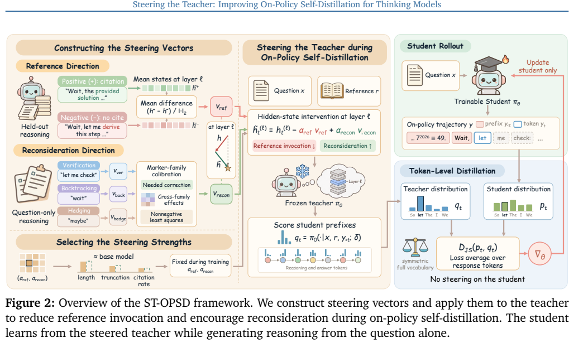

图 13｜来源：ST-OPSD v1 第 4 页 Figure 2。左侧用持出题构造引用/反思方向并选择强度；中间仅在教师 scoring 路径插入 hidden-state 干预；右侧学生照常生成，再用教师目标做 token 蒸馏。底部测试路径没有 steering。不要把“教师训练时被干预”误读成“用户推理时也要带参考和激活向量”。

### 向量、校准与损失逐项解释

**原文事实：**在层 ℓ，收集正/负示例目标位置的隐藏状态 hi+、hj−，差向量 d=mean_i hi+−mean_j hj−，方向 v=d/||d||2。引用方向正例包括重考虑后明确引用参考的行为，负例不含该类匹配；reconsideration 各族方向与匹配的负例相对构造。所有模型选用第 22 层。向量构造题从训练中排除，64 道题，每题 2 次生成；强度选择另用持出数据，完整规模未披露。

教师每个响应位置的干预为 htildeℓ,t=hℓ,t−αref vref+αrecon vrecon。h 是原层输出；αref/αrecon 为非负强度；减号抑制引用，正号增加反思；参考方向和反思方向都已归一化。单位方向不保证跨模型强度可直接比较，也不保证两个方向正交。

**本文把原文校准描述写成代数：**对三个 family f 先各构造单位方向 uf；令 Δj 为不带参考基座与普通教师在第 j 类 marker 概率上的差，Ajf 为小幅沿 uf 干预带来的第 j 类 marker 响应变化。求 w*=argminw≥0 ||Aw−Δ||2²，然后 vrecon=(Σf wf uf)/||Σf wf uf||2。这个紧凑矩阵式是对文中非负最小二乘机制的说明，不是声称论文有同编号公式。若合成向量为零，需要实现防护；公开专用实现本次未找到，不能捏造作者 epsilon。

强度按输出长度、截断率、引用等行为与基座的接近程度在持出集选择，再在训练中固定。Qwen3-4B 的 αref/αrecon 为 2.29/9.50，8B 为 4.25/12.8，OLMo 为 0.8/3.5。这是作者特定模型与层上的值，不应跨 tokenizer/层号照抄。

学生损失使用对称 JS。pθ,t 是未 steering 的学生分布，qδ,t 是施加上述干预的冻结教师分布，mt=(pθ,t+qδ,t)/2，L=[Σ样本i Σt JSD(pθ,i,t,qδ,i,t)]/[Σi Ti]。分母是 batch 全部有效响应 token 数，不是先让每条长短响应等权平均。教师 q 停止梯度，学生 p 仍有梯度；mixture m 含学生 p，不能把整个 mixture 也错误地全部 detach。

**本文推导：**JSD(p,q)=H((p+q)/2)−[H(p)+H(q)]/2，其中 H(a)=−Σv a(v)ln a(v)。由 KL 两项展开，混合分布的系数相加恰为 m，得到这个熵差。因此 JS 对称、有界于 0 和 ln2，能够避免某一侧极小概率造成无界的 KL 惩罚，但有界不等于无梯度饱和或一定更优。

**本文手算：**二元 p=(0.5,0.5)、q=(0.8,0.2)，m=(0.65,0.35)。KL(p||m)≈0.04716、KL(q||m)≈0.05419，JS≈0.05067 nat；同一对分布 FKL(q||p)≈0.19274，数值和优化目标均不同。激活层另举二维例子：h=(1,2)、vref=(1,0)、vrecon=(0,1)，强度 0.2/0.3 时 htilde=(0.8,2.3)；这是理解加减方向的教学模型，不是实际 hidden state 的观测。

### 数据、训练和推理流程

```text
split training questions, vector-construction holdout, strength-selection holdout
build normalized reference and reconsideration directions at layer 22
fit nonnegative family weights; choose fixed steering strengths on holdout
teacher = freeze(initial_thinking_model)
student = LoRA(initial_thinking_model)
for x, reference:
    y = sample(unsteered_student, x)
    q = score_teacher(x+reference, y_prefixes, hook=steering_at_layer22)
    p = score_unsteered_student(x, y_prefixes)
    loss = token_weighted_JS(p, stop_gradient(q))
    update_LoRA(loss)
deploy student without teacher, reference, or steering hook
```

**原文事实：**训练使用过滤后的 OpenThoughts 数学数据，精确最终条数未披露；另用 Omni-Math 做数据泛化和教师 new-idea 数据选择消融。主训练 LoRA rank 64、学习率 2e-5、batch 32、200 steps，单张 H100；LoRA alpha、峰值显存、完整花费未披露。rollout 温度 1、top-p 1、响应上限 8192；评估 AIME24/25、HMMT25，Avg@4、温度 0.6/top-p 0.95、最大响应 81920，使用 Math-Verify。这个 81920 上限明显长于训练，不能误写为 8192。

推理端只是训练好的学生，不增加 teacher forward；训练仍要教师评分、持出集采样与向量校准。不能把“不需推理干预”说成训练完全没有额外成本。奖励未加入单独的答案正确性 RL loss，核心是 steered teacher 的 token-level JS 监督。

### 核心结果、消融与成本

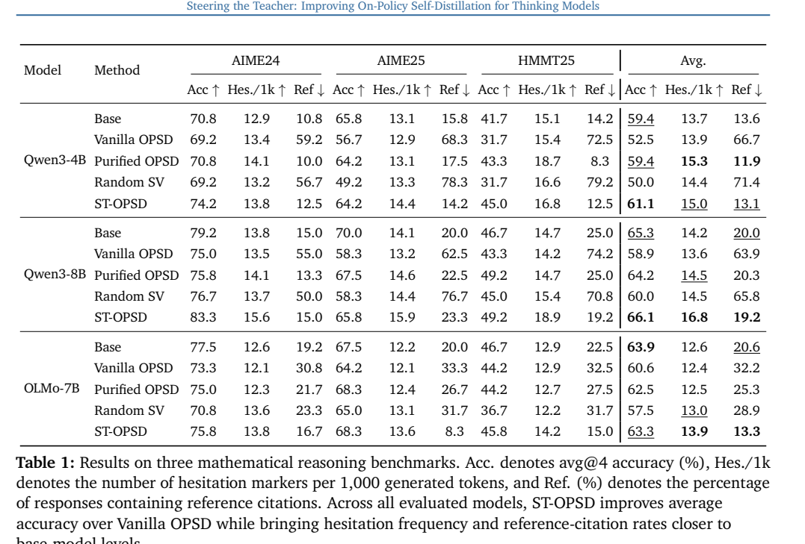

图 14｜来源：ST-OPSD v1 第 7 页 Table 1。每个数据集含 Acc、Hes/1k、Ref 三列：Acc 为 Avg@4 正确率，Hes/1k 为每千生成 token 的 hesitation marker 数，Ref 为包含参考引用的响应比例。平均块中 Qwen3-4B 的 base/vanilla/purified/ST 是 59.4/52.5/59.4/61.1，8B 是 65.3/58.9/64.2/66.1，OLMo 是 63.9/60.6/62.5/63.3。ST 改善蒸馏退化，但 OLMo 仍低于基座 63.9，不能说三种模型都超越基座。

4B 的引用比例从 vanilla 66.7% 降到 ST 13.1%，接近 base 13.6%；Hes/1k 从 base 13.7 到 ST 15.0。引用频率改善与准确率改善相关，但 marker 可以被措辞操纵，不能当作内部推理恢复的直接测量。

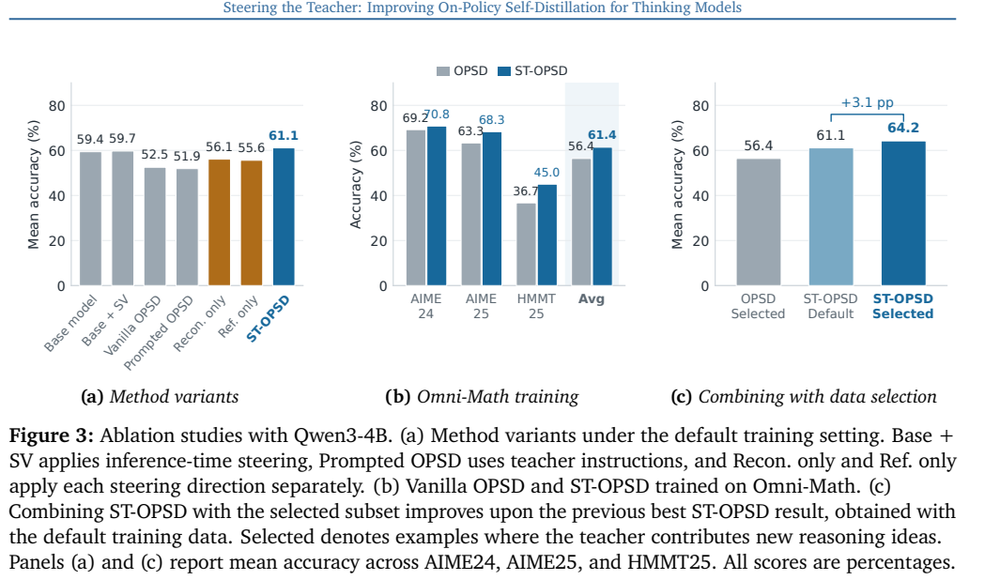

图 15｜来源：ST-OPSD v1 第 9 页 Figure 3，Qwen3-4B 消融。(a) 为默认数据下方法变体：base 59.4、base+SV 59.7、vanilla 52.5、prompt-only 51.9、只加 reconsideration 56.1、只减 reference 55.6、ST 61.1；随机方向在主表为 50.0。(b) 切换 Omni-Math，(c) 联合数据选择，显示提升依赖教师和数据条件。读 (a) 才能判断两个方向组合的作用，不能将 (c) 的额外数据选择收益全归于 steering。

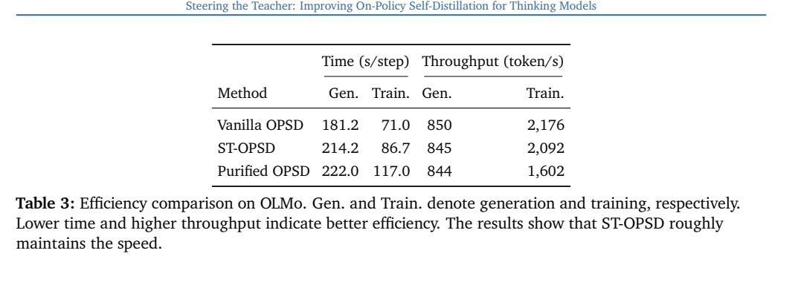

图 16｜来源：ST-OPSD v1 第 10 页 Table 3，条件为 OLMo、OpenThoughts、单 H100 的生成/训练步骤统计。vanilla Gen/Train 为 181.2/71.0 秒，ST 为 214.2/86.7 秒，purified 为 222.0/117.0 秒；训练吞吐分别为 2176/2092/1602 token/s。表头明确秒每步与 token/s，不能把两列同向理解。

**本文成本换算：**ST 相对 purified 的训练吞吐提高 (2092−1602)/1602≈30.6%；但相对 vanilla，总生成加训练时间从 252.2 到 300.9 秒，增加约 19.3%。生成吞吐 850→845 很接近，不意味着总墙钟一样：响应长度等因素也改变步骤时间。表中局部统计不能覆盖额外向量构造和所有任务总费用，更不能把这些秒数当成整个 200-step 项目的完成时间。

**复现与局限：**先验证 held-out 与训练题隔离、层 hook 插入点、token 位置、正负例构造和 teacher-only 干预，再跑只减引用、只加反思、随机方向与双方向。用长度、截断、正确率和 marker 四类指标联合监测，防止只优化词汇表面。方向可能对模型层、语言、任务及参考模板敏感；长达 81920 的评估预算和小基准也限制泛化结论。本次未找到专用作者代码、独立作者博客、向量文件及完整运行日志，故只是原文精读和实现分析，不是已复现实验。

辅助资料：[Math-Verify 官方项目](https://github.com/huggingface/Math-Verify) 了解数学答案验证；[PEFT LoRA 官方文档](https://huggingface.co/docs/peft/developer_guides/lora) 解释低秩参数。验证器通过不保证推理过程正确，LoRA 配置也不能代替 steering 实现。

## 跨论文比较：目标分布比方法名字更重要

| 方法 | 教师变化位置 | 学生主要目标 | 额外代价与关键缺口 |
| --- | --- | --- | --- |
| TESD | 教师环境奖励优化及 EMA，查询权重 | 加权 JS 蒸馏 + 教师策略目标 | 教师 rollout；原文奖励与优化符号存在歧义 |
| MTA-OPSD | 同一冻结模型的七种参考条件，逐 token 选择 | 论文为 RKL；公开默认配置为 FKL | 七视图评分；KL 方向与运行覆盖待确认 |
| MCPD | 冻结教师的多个随机 mask 视图 | 概率算术平均目标的 FKL | K 次评分；小规模时长可核，代码未找到 |
| TeachBack | 共享策略的学生/教师两种条件都训练 | 双向、长度归一化偏好损失 | 双采样、交叉评分；8 NPU 型号和时长缺失 |
| ST-OPSD | 冻结教师的第 22 层激活 | steered teacher 与学生的 JS | 持出校准、教师 scoring；方向文件未找到 |

**本文推演：为什么不能把 MTA 和 MCPD 都叫“多教师平均”？**MCPD 最小化 E_k KL(qk||p)，其最优 p 是概率算术平均。若最小化 E_k KL(p||qk)，展开可得 p*(v)∝exp(E_k ln qk(v))，是归一化几何平均；MTA 则不平均，而是每 token 离散挑一名教师。三个目标对“某位教师给接近零概率”的态度不同，代码改动看似一行，统计含义可能完全不同。

**本文建议：**第一次复现可从 MTA 作者的 1.7B 配置入手，因为本次能固定代码提交和数据入口；先完成短程 loss/掩码/概率支持集检查，再考虑完整训练。研究上可比较“降低参考敏感度”和“保留多样探索”之间的权衡，但目前五篇的模型、数据、thinking 模式、KL 方向、训练步数和评估采样不同，不能汇总成一个总榜，也不能把各篇最高分拼成可比提升。

## 基础阅读与交付说明

入门顺序：先理解 [GKD 训练器官方说明](https://huggingface.co/docs/trl/gkd_trainer) 中学生生成轨迹上的监督；再读 [GRPO 文档](https://huggingface.co/docs/trl/grpo_trainer) 与 [DPO 文档](https://huggingface.co/docs/trl/dpo_trainer) 区分结果奖励和偏好目标；最后看 [LoRA 配置](https://huggingface.co/docs/peft/developer_guides/lora)、[Math-Verify](https://github.com/huggingface/Math-Verify) 和各论文附录。官方文档随版本变化，应按项目锁定依赖；它们都不计入今日五篇。

本次没有找到五篇对应的独立作者博客，因此没有用第三方概述冒充作者说明。MTA 的作者 README/配置作为辅助代码证据，其余方法以原论文为准。所有教学例子、推导和伪代码均为本日报展开，未生成任何实验图、未宣称训练或复现实测。

本目录保留同一全文的 report.md/report.pdf、结构化 manifest.json、16 张原始图表/算法裁图及图源表。PDF 的全部文字、公式、代码和图片从这份 Markdown 生成；逐页渲染、文字覆盖、字体与边界检查记录见 QA.md。窗口外的基础材料只作辅助，既有其他方向内容保持独立。
