# OPD & OPSD 精读 · 2026-11-19

今天收录 5 篇新论文，主题是长轨迹蒸馏、历史能力回收、交互模式迁移与优化动力学。检索窗口为北京时间 2026-10-19 至 2026-11-19；5 篇首次公开日期均在窗口内，且未出现在本仓库已有 sources.json 或任一历史 manifest 中。今日均为 OPD 论文；没有为了平衡标签而另凑 OPSD 论文。博客、框架文档和基础教程不占名额。

| 论文 | 首次公开 / 阅读版本 | 本次关注 |
| --- | --- | --- |
| SWE-OPD | 11-16 / v1 | 可执行仓库中的长轨迹；top-K 梯度；离线成本 |
| Agentic-OPD | 11-09 / v2，11-13 更新 | 从同一次 RL 的历史 checkpoint 回收互补能力 |
| ReAct Patterns | 11-14 / v1 | OPD 会迁移交互习惯；源域收益与跨域损伤 |
| Streaming OPD | 11-17 / v1 | 把响应完成、监督交付和参数更新拆成三个时钟 |
| Learning Dynamics | 11-05 / v1 | 教师信号如何转成更新，更新如何改写后续数据 |

本文的标记含义：**原文事实**指论文报告或其附录；**代码核查**指静态阅读公开实现，未运行训练；**本文推导/算例**用于教学，不是新实验；**未披露/未核验**表示没有找到足够的一手证据。下文所有实验图片均由原 PDF 裁取，没有绘制替代实验曲线。源文件版本、页码、裁切坐标与哈希见 manifest.json 和 assets/SOURCES.md。

## 阅读前的共同基础：先分清“在哪儿学”和“学什么”

设 x 为问题，y 为学生生成的序列，h_t=(x,y_<t) 为第 t 个位置的完整历史。工具任务中的 h_t 还包含工具返回的观察。学生分布 pθ(v|h_t) 与冻结教师 q(v|h_t) 在同一个历史上比较。on-policy 指历史来自当前或近期学生策略；不是“答案必须正确”，也不是“loss 一定是强化学习奖励”。

前向 KL 为 D_F(q||p)=Σ_v q(v) ln[q(v)/p(v)]；反向 KL 为 D_R(p||q)=Σ_v p(v) ln[p(v)/q(v)]。v 遍历词表，ln 为自然对数。前向 KL 用教师概率加权，要求覆盖教师会做的事；反向 KL 用学生概率加权，重点纠正学生已经会采到的行为。这是直觉，不保证任何方向在实际任务上总更好。完整分布的 KL 非负，但截断、不同归一化与裁剪会改变性质。

若 L=E_{y~pθ}[Σ_t ℓθ(h_t)]，完整求导还包含“参数改变采样分布”的 score-function 项。常见 OPD 实现把采样轨迹当作固定数据，仅对当前前缀上的 ℓθ 反传，称半梯度。下面几篇谈“精确梯度”时，必须问清是固定前缀的 token loss，还是包括轨迹分布的完整目标。

反向 KL 的数值教学：学生 p=(0.8,0.2)，教师 q=(0.5,0.5)，则 D_R=0.8 ln1.6+0.2 ln0.4≈0.193 nat。若采样到第一类，ln q−ln p≈−0.470；采样到第二类，约 +0.916。把这当作冻结的 token 优势，会压低第一类、抬高第二类；一次采样的方向有噪声，不能把单个 token 的优势当作整个答案的正确率。

工具返回的文本常只作上下文，模型生成的思考、动作和答案才进入 loss。报告中 m_t 表示监督掩码，1 为计入、0 为不计入。padding、用户问题、历史工具返回和旧片段是否被 mask，直接决定你实际优化了什么。公式中 grad 表示梯度算子，^T 表示矩阵转置。本文使用可直接阅读的 Unicode 数学式与代码块，Markdown 与 PDF 保留同一套公式及解释。

## 1. SWE-OPD：把教师带到学生真的走过的仓库状态

**一手入口：**[论文与日期](https://arxiv.org/abs/2611.21020)、[原文 v1](https://arxiv.org/pdf/2611.21020v1)、[官方代码](https://github.com/ernie-research/SWE-OPD)。首次公开 2026-11-16；不是按检索站 11-18 的收录日期计时。作者 Yuhang He 等。以下结果取 v1，核心方法见第 4 节，离线变体见第 5 节，失稳分析见第 6 节和附录。

### 问题、机制与原架构图

**原文事实。** 软件修复不是单次问答。任务 x=(I,R)，I 是 issue，R 是仓库；学生读取文件、编辑补丁、执行 bash、观察失败，再决定下一步。仅模仿教师自己的成功轨迹，会漏掉学生实际进入的错误状态。SWE-OPD 让学生与可执行仓库交互，教师在学生访问的同一前缀上提供分布监督。教师并没有额外获得正确补丁或未来测试答案。

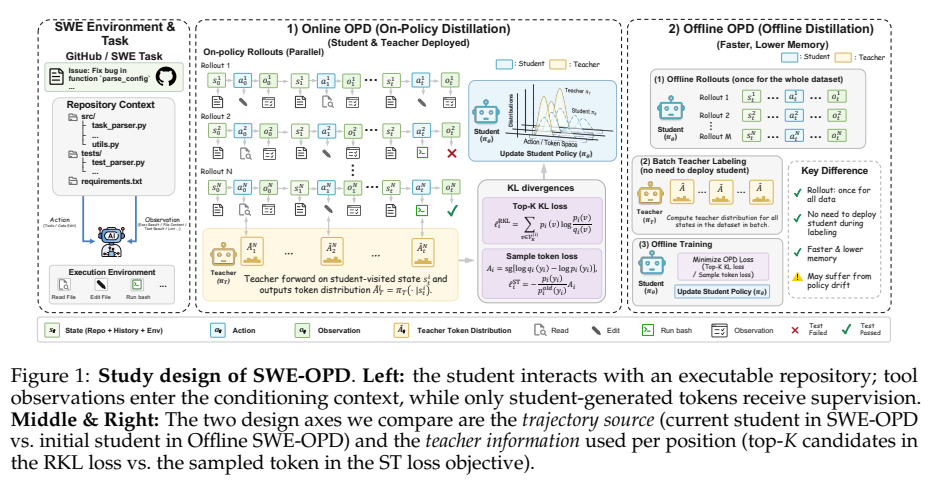

图 1-1｜原论文 Figure 1，PDF 第 5 页。[来源](https://arxiv.org/pdf/2611.21020v1)。左侧是 issue、仓库与执行环境；中间的在线流程边生成边取得教师分数；右侧离线流程先收集学生轨迹，再批量打分和训练。蓝/黄框对应学生/教师，工具观察回到上下文。它是流程图，不是时间、吞吐或显存的测量图。

完整轨迹交错包含 assistant 与工具 observation。论文只对学生生成位置计算损失，工具返回保留在因果上下文中。所有合法 rollout 均可训练，包括失败、未完成或预算截断的轨迹；没有混入环境任务奖励来做额外 RL，也没有先过滤出成功答案才蒸馏。因此“从失败中学”在这里是密集分布监督，不是把失败答案作为正样本做普通 SFT。

### 关键公式：截断反向 KL 为什么可能下降却失稳

记固定前缀处 p(v)=πθ(v|h)，q(v)=πT(v|h)。S 是当前学生概率最高的 K 个 token，论文默认 K=128；选集合的离散操作不求导。sg 表示 stop-gradient，即前向取值不变、反向视为常数。论文 Eq.4 写为：

```text
Z = Σ_{v∈S} sg[p(v)]
p̄(v) = p(v) / Z
ℓ_topK = Σ_{v∈S} p̄(v) ln[p(v)/q(v)]
L = (Σ_t m_t ℓ_topK(h_t)) / (Σ_t m_t)
```

Z 是学生在保留集合上的概率质量；p̄ 是前向归一化权重。关键是 log 比值仍用完整词表的原始概率，教师没有在 S 上重新归一化。这不是 D_R(p̄||q̄)，不应直接套用 KL 非负性。

**本文按论文公式推导。** 暂固定 S，令 g=Σ_S p̄ ln(p/q)gradθ ln p，h=Σ_S p̄gradθ ln p=gradθ ln Z_live，其中 Z_live=Σ_S p 不截断梯度。对乘积求导，权重项给出 g，log 项给出 h，故 gradθℓ_topK=g+h。即使 S 内 p=q、g=0，h 仍可能非零；全词表时 Z_live=1，h=0，这一额外项才消失。前向“除以一个归一化数”与反向“它是否参与求导”是两件事。

**小白算例，本文推演。** 二分类 p=q=(0.8,0.2)，只保留第一类。前向 loss=0，但对两类 logits z 的梯度为 (0.2,−0.2)，梯度下降反而把质量从第一类移向被省略的第二类。完整反向 KL 在 p=q 时梯度应为 0。这个小例子说明某种截断目标的梯度性质，不证明所有训练崩溃都由它引起。

论文的 sampled-token（ST）目标改用 rollout 中实际采到的 token y。令 p_old 为采样时的冻结学生，r=pθ(y|h)/p_old(y|h)，A=sg[ln q(y|h)−ln pθ(y|h)]：

```text
y ~ p_old(·|h)
ℓ_ST = −r A
E_{p_old}[gradℓ_ST] = E_{pθ}[ln(pθ/q) gradln pθ]
                    = gradD_R(pθ||q)  （固定前缀、完整支持、未裁剪）
```

第二个等号使用 Σ_v pθ(v)gradln pθ(v)=gradΣ_v pθ(v)=0。优势必须 detach；否则多出别的导数。实践中对 importance ratio 用 [0.8,1.2] 裁剪后，不再具有上式完全无偏的结论；它也没有校正“旧学生生成了哪些前缀”的分布变化。ST 是采样 token 的策略梯度估计，不是把 top-K 设置成 K=1。

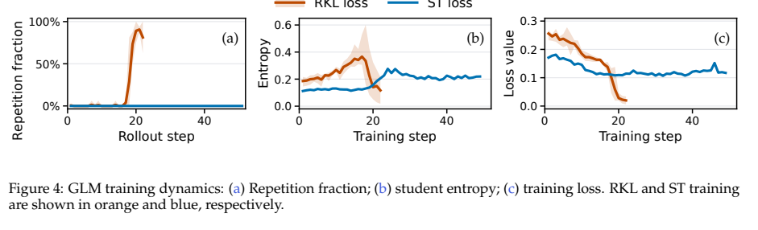

图 1-2｜原 Figure 4，PDF 第 10 页。[来源](https://arxiv.org/pdf/2611.21020v1)。同一 GLM 学生设置中，橙色为 top-K RKL，蓝色为 ST；从左至右看重复比例、学生熵和训练 loss。橙色 loss 继续下降时重复暴增、熵塌缩，因此只看 loss 会误判。横轴分别是 rollout/training step，不能把三幅图当作逐点严格同步的因果实验。

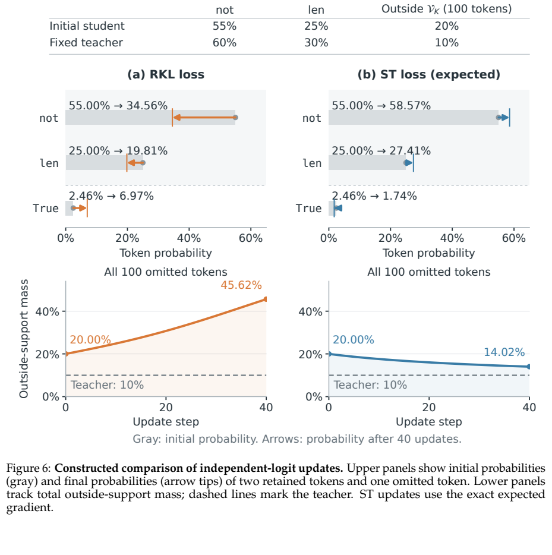

图 1-3｜原 Figure 6，附录 PDF 第 24 页。[来源](https://arxiv.org/pdf/2611.21020v1)。这是作者构造的独立 logits、102 类词表实验，并非真实 SWE 测试。上排灰条为初始概率、箭头为 40 次更新后概率；下排为省略集合总质量，虚线是教师的 10%。按论文目标，RKL 省略质量由 20% 升至 45.62%，ST 精确期望梯度则降至 14.02%；前者截断 loss 变小，完整 KL 反而由 0.0537 增至 0.4297。其作用是验证可能机制，不能据此断言真实网络一定遵从同一轨迹。

### 代码核查：公开版本与论文公式有差别

**代码核查。** 本次固定官方仓库提交 0884a04f4c9e2b4baaa47261b2016d425ac3f63e，检查根 readme.md、离线公式说明、loss.py 与教师打分逻辑，未运行训练。入口可见[固定版本代码](https://github.com/ernie-research/SWE-OPD/tree/0884a04f4c9e2b4baaa47261b2016d425ac3f63e)。

在 [loss.py](https://github.com/ernie-research/SWE-OPD/blob/0884a04f4c9e2b4baaa47261b2016d425ac3f63e/offline_opd/slime/slime/backends/megatron_utils/loss.py) 的 _opd_topk_kl_loss 中，权重通过 log_weight−logsumexp(log_weight) 得到，分母没有 detach；动态离线分支也使用可微的 logsumexp。因此，固定 S 后这个实现的梯度是 g+(1−ℓ_topK)h，而非上面的 g+h。推导是 gradp̄=p̄(gradln p−h)，再展开 Σ p̄ ln(p/q)。在 p=q、ℓ=0 时两者都残留 h，但离开该点后数值动力学可能不同。不能声称公开分支逐行复现了论文 Eq.4 的导数或附录曲线。

另一处需要指定配置：[官方公式说明](https://github.com/ernie-research/SWE-OPD/blob/0884a04f4c9e2b4baaa47261b2016d425ac3f63e/offline_opd/slime/examples/coding_agent_opd/scripts/offline_opd/OFFLINE_OPD_FORMULAS.md) 第 8 节说明，名为 token_reverse_kl 的简单分支直接返回 log p−log q；固定教师项对参数的直接梯度为零，它不是论文 ST 的 detached advantage × ratio 形式。仓库另有 cached_teacher_sampled_token_pg_with_student_anchor 等 PG 分支，包含优势和 ratio/PPO 处理，不能把整个仓库概括成“没有 ST”。要复现原实验，必须保存 loss selector、reference 为 rollout/current、reduction 与裁剪配置；原实验与当前所有分支的对应关系未完整核验。

### 离线缓存、数据与可实现流程

**原文事实。** 离线变体只用初始学生收集一次轨迹，冻结这些前缀；每个位置缓存教师 top-1024 分数，训练时仍重新选当前学生 top-128。若当前学生候选不在缓存内，用缓存第 1024 名的 log probability 回填。它是未知 token 概率的上界式近似，不是精确教师概率，也不是重新构造的正规化教师分布。ST 的行为概率锚定初始学生，优势随当前学生变化。

跨 tokenizer 只在离线场景实现。论文使用 GOLD 风格的字符跨度匹配，对未对齐 token 合并并取平均 log probability；它不是两个词表之间的精确概率边缘化。复现要保留原始文本、字符偏移与分词版本，检查空格和特殊 token。

```text
输入：问题集合 X，学生 θ0，冻结教师 T，工具环境 E
在线：每批取 64 个问题，各用当前学生跑 1 条交互轨迹
      保留工具观察作为上下文，仅标记 assistant 位置
      教师对这些同一前缀打分
      选择 top-K RKL 或明确的 ST-PG 目标，反传更新
离线：用 θ0 对全部问题收集一次轨迹并保存行为概率
      批量缓存教师 top-1024；跨分词器时先做跨度对齐
      重放固定轨迹，每步重算当前学生分布与支持集合
      对缓存未命中作显式回填并记录命中率，训练 1 epoch
两者：监测重复、熵、完整评估表现及 top-K overlap
```

公开训练源 ScaleSWE 的 20K 查询随机取 5K；另一训练源为约 4K 内部问题。学生/教师包括 Qwen3.5-9B / Qwen3.6-27B，以及 GLM-4.5-Air（论文称 106B）/ GLM-5.2；跨分词器教师为 DeepSeek-V4-Flash-0731。后两种教师的参数总量不能从命名自行补出。AdamW，恒定学习率 1e−6，64 prompts/batch、每 prompt 1 rollout、128K context、1 epoch。以一个 epoch 内师生 top-K overlap 选 checkpoint，多数为末尾，GLM 在线约半程；不是从 SWE 测试集选最高分。

工具 scaffold 使用 ScaleSWE edit_fn_calling、R2E-Gym，工具包含 editor、bash、finish。SWE-bench Verified/Pro/Multilingual 分别 500/731/300 个任务，turn 上限 100/150/150，temperature=1、top-p=0.95、repetition penalty=1。表中的 Avg@4 是 4 次独立评估运行平均，不是 pass@4，也不是 4 个独立训练种子。

### 实验、消融、成本与局限

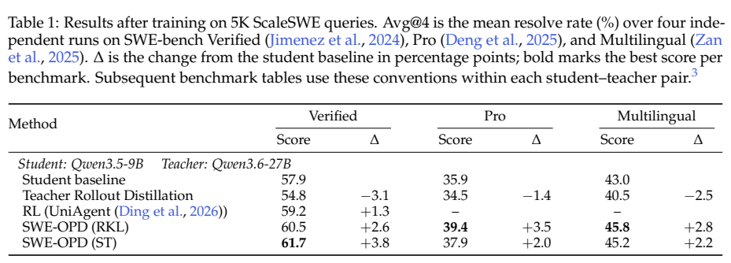

图 1-4｜原 Table 1，PDF 第 6 页。[来源](https://arxiv.org/pdf/2611.21020v1)。固定 5K ScaleSWE 查询、Qwen3.5-9B 学生与 Qwen3.6-27B 教师；列依次是 Verified、Pro、Multilingual 的 resolve rate。Δ 是相对学生的百分点。教师轨迹蒸馏不作成功过滤，不能把这张表解读为优于一切 rejection-SFT 或所有 RL 方法。

| 同一 ScaleSWE 设置 | Verified | Pro | Multilingual |
| --- | --- | --- | --- |
| 学生初始化 | 57.9 | 35.9 | 43.0 |
| 教师轨迹蒸馏 | 54.8 | 34.5 | 40.5 |
| 在线 RKL | 60.5 | 39.4 | 45.8 |
| 在线 ST | 61.7 | 37.9 | 45.2 |

**原文事实。** 不同目标各有优胜列。内部数据上 Qwen 的在线 RKL 为 61.6/38.4/44.3，在线 ST 为 61.3/38.7/43.1；离线 ST 为 63.7/36.5/46.0，即 Pro 比在线 ST 低 2.2 点，不能概括成“离线全面更好”。GLM 的内部数据在线 RKL 崩溃，ST 稳定；跨分词器离线 ST 达 62.5/39.7/46.2。GLM 初始化 Multilingual 在表 2 为 41.6，摘要写 41.8，存在内部不一致；本文比较使用表中 41.6，因此改善为 4.6 点。

top-K 的覆盖率消融中，教师概率落入学生 top-4/top-64/top-128 的质量为 98.4%/99.95%/99.97%，而集合 overlap 可只有 62.1%。概率质量覆盖与 token 集合交集不是同一指标。K 从 128 增至 256/512/1024 不保证更好，不能把“大 K”当作充分稳定条件。

成本取原 Table 4 的内部数据整段流水线：Qwen 在线 1024 → 离线 416 GPU-hours，GLM 2808 → 768，分别下降 59.4% 与 72.6%；峰值 GPU allocation 从 64 降到 32，通过分阶段复用同一资源池。离线 Qwen 的 rollout/教师打分/训练为 176/48/192 GPU-hours，GLM 为 368/160/240。该表同硬件口径并包含失败重试。GPU 型号、峰值显存、完整墙钟和金钱费用未披露，不能用“峰值卡数×某个时长”倒推。README 中的 8-GPU 启动例子不是论文成本实测配置。

**复现边界。** 官方仓库确有在线、离线参考代码，但 sandbox 依赖内部 Baidu RLE 平台，需要替换环境后端；内部数据也不开放。本次仅核查源码和公式，没有运行仓库修复训练。建议先在少量公开任务验证 mask、teacher prefix 完全一致、缓存命中、tokenizer 对齐、loss selector 和梯度，再扩大。SWE 结果不能自动推广到其他工具任务，top-K 梯度是潜在机制，不是唯一已证实病因。

**辅助阅读。** 入门：[GKD 原论文](https://arxiv.org/abs/2306.13649)解释为何使用学生轨迹；实现：[SWE-OPD README](https://github.com/ernie-research/SWE-OPD/blob/0884a04f4c9e2b4baaa47261b2016d425ac3f63e/readme.md)与上述公式说明；评测：[SWE-bench 官方项目](https://www.swebench.com/)。本次未找到可核验的独立作者博客，不把第三方摘要称作作者解读。

## 2. Agentic-OPD：同一次 RL 的旧 checkpoint 也是互补教师

**一手入口：**[论文与版本历史](https://arxiv.org/abs/2611.12799)、[原文 v2](https://arxiv.org/pdf/2611.12799v2)。首次公开 2026-11-09，阅读 11-13 的 v2；这是本仓库首次收录，同一论文两版只计 1 篇。作者 Tingcheng Bian 等。没有核验到作者发布的独立代码库或博客。

### 问题、框架与小白直觉

**原文事实。** RL 并不保证每一步都保留前面学会的技能。只保存验证集最高的 checkpoint，会丢掉“整体分数略低但会做某类题”的模型。论文的前期分析对 HotpotQA 的 500 步训练每 5 步存一次：最终模型解 2808 题，而至少被 3 个 checkpoint 解过的并集为 4553 题。并集比最终多约 62%，但不是说一个单模型一定能无代价达到整个并集。

Agentic-OPD 用最佳验证 checkpoint 初始化学生，其余历史状态冻结为教师池。HCN（Highest Coverage Next）决定下一个向谁学，LAD（Locality-Aware Distillation）决定在哪里学：只在教师胜过学生的问题上，蒸馏学生失败轨迹。它不是权重平均，也不是从旧 checkpoint 继续 RL。

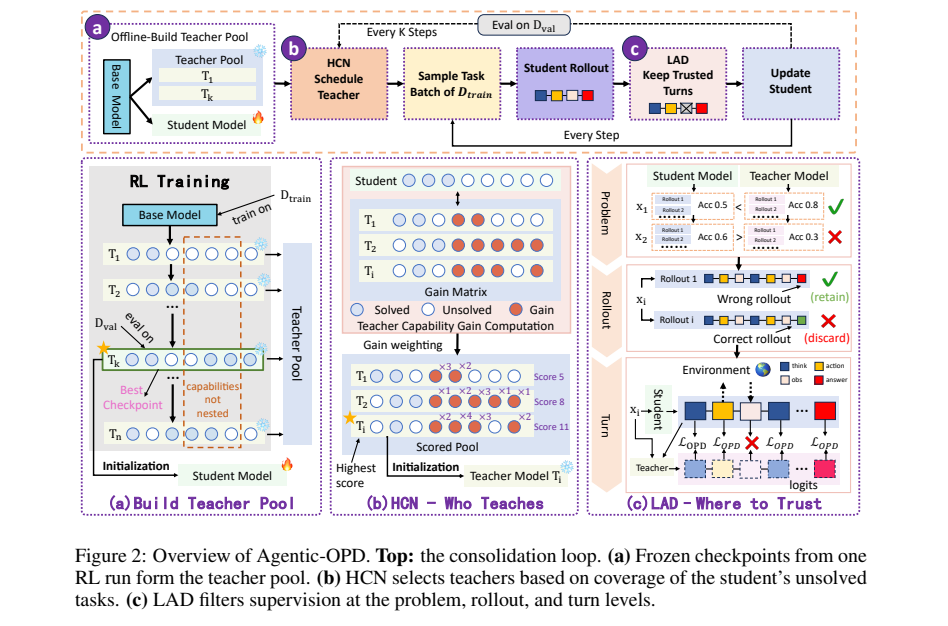

图 2-1｜原 Figure 2，PDF 第 4 页。[来源](https://arxiv.org/pdf/2611.12799v2)。左下从同一 RL 历程建教师池；中间 HCN 根据验证集未解题更新覆盖得分；右下 LAD 按问题、rollout、token 三层过滤。上方每 K 步重新验证的闭环表示教师会随学生能力变化而切换；不是把每个教师仅使用一次。

直觉是一个学生复习错题：先找最能补当前短板的旧笔记；某题教师自己也不会，就不照抄；学生已经会的那条解题路径，也不必强行改成老师的写法。成功判据来自环境终止结果或答案正确性，不能凭教师语言流畅程度定义“更会”。

### HCN 的公式、权重更新与手算

令 Cπ(x)∈{0,1} 表示策略 π 是否解决验证题 x。Q_i={x:C_{T_i}(x)=1} 是冻结教师 T_i 的成功集合；P_t 是当前学生成功集合；Δ_{i,t}=Q_i\P_t 是教师能补的缺口。每题权重 w_0(x)=1，得分与选择为：

```text
g_{i,t} = Σ_{x∈Δ_{i,t}} w_t(x)
i_t = argmax_i g_{i,t}，同分优先较早的 checkpoint
若最大得分不为正：停止；否则使用该教师训练 K 步
再评估学生，并更新每题权重：
学生已解决 → 0
学生未解决、刚用的教师能解决 → 1
学生未解决、刚用的教师也不能解决 → min(w_t(x)+η, w_max)
```

η 是逐次增加量，w_max 是上限，K 是换教师前训练的步数。给一直无人覆盖的题加权，是防止总被容易覆盖的题支配；给刚教过仍失败的题重置为 1，可减小对该教师反复执着。它依赖验证覆盖的经验测量，不等于真正掌握概率的精确排序。

**本文手算。** 三道当前错题 x2、x4、x5 的权重为 1、2、1；教师 A 覆盖 x2、x4，B 覆盖 x4、x5，两者得分都为 3，同分选较早 A。训练后学生只新解出 x2，则 x2 权重清零，x4 重置为 1，未覆盖的 x5 在 η=1、未触上限时升到 2。下一轮 A 得 1、B 得 3，转向 B。这是教学参数，不是论文公开的 η 配置。

### LAD：奖励只负责筛选，训练信号仍是分布距离

对训练题 x，学生和选中教师各采 G 条轨迹，以任务 0/1 reward 的样本平均得到 ŝ(x)、q̂(x)。只保留 q̂(x)>ŝ(x) 的题；其中只保留学生失败的 rollout。在 G=4、学生 1 次成功、教师 3 次成功的教学例子里，题目通过 gate，只用学生 3 条失败轨迹。两者均 0 则整题丢弃。少量样本估计会有噪声，论文不是用显著性置信区间进行 gating。

固定保留位置，S 是学生 top-k；本篇与 SWE-OPD 的重要差异是学生、教师都在同一 S 上重新归一化：

```text
p̃(v)=p(v)/Σ_{u∈S}p(u)，q̃(v)=q(v)/Σ_{u∈S}q(u)
ℓ_LAD(h)=Σ_{v∈S}p̃(v) ln[p̃(v)/q̃(v)]
L_LAD=Σ_{保留轨迹,t}m_t ℓ_LAD(h_t) / Σ_{保留轨迹,t}m_t
```

p、q 分别是当前学生和选中教师，m_t 仅选生成的 assistant 思考/动作/答案，不选工具 observation。这个目标是受限集合上的正规 KL，固定 S 时 p̃=q̃ 为零梯度点；它不约束 S 外总质量，但没有 SWE 公式中“raw log 比值配受限权重”的同一种额外项。以 p=(0.6,0.3,0.1)、q=(0.3,0.6,0.1)、S={前两类} 为教学例，p̃=(2/3,1/3)、q̃=(1/3,2/3)，loss=(1/3)ln2≈0.231 nat；第三类不参与此处匹配。

为填满有效训练批次，算法反复采问题和 rollout，直到积攒 B_eff=B×G 条保留轨迹，或达到过采样上限 L，超额部分丢弃。这里 B 是目标问题批量，L 是采样循环上限，不能与训练 loss 混用。奖励负责题目和轨迹筛选，没有另加环境奖励项做联合 RL。

```text
缓存各教师在验证集上的成功集合 Q_i
学生 ← 同次 RL 的最佳验证 checkpoint；w ← 1
while 某教师仍有正覆盖：
    选 weighted uncovered coverage 最高的教师 T
    repeat K 次更新：
        重复采训练题；学生、T 各跑 G 条，直到有效批量或上限
        只留教师经验成功率更高的题，且只留失败学生轨迹
        teacher 在这些学生前缀上打分；按 assistant mask 算受限 RKL
        反传更新学生
    重评学生验证集，更新缺口及 w；允许以后重用同一教师
```

### 数据、规模、训练成本与评估条件

**原文事实。** DeepSearch 使用 NQ 与 HotpotQA 的训练数据作 90%/10% 训练/验证分割；教师通常每 10 个 RL step 保存一次，不能与前期每 5 步的 100-checkpoint 分析混为同一设置。Qwen2.5-3B、7B 与 Qwen3-4B 是主要学生；其他 agent 域主要用 3B。所有训练用一台 8×A800 80GB 节点。论文没有完整给出可直接复制的数值 k、G、B、K、η、w_max、采样上限 L、优化器学习率与总 GPU-hours/墙钟/峰值显存，不能拿 Search-R1 的默认值冒充本实验配置。

DeepSearch 在 7 个 benchmark 上用相同 retriever、4-turn 限制和 exact match。Tool-use 最多 16 turn，temperature=1、top-p=0.7，32 次评估重复用于估计 pass@1，不能写成 pass@32。WebShop/SciWorld/ALFWorld 上限分别 20/15/50 turn，temperature=0.7、top-p=0.8、top-k=20，平均 3 个随机种子。不同域的分数口径不能直接互比。

**成本解释，本文推演。** “教师池无需额外 RL 训练”只说明旧权重本来已产生，不表示蒸馏免费。还需要 checkpoint 存储、教师验证缓存、周期性学生验证、额外教师 rollout 和教师逐 token 打分。若保留率约 ρ，要得到 B×G 条有效轨迹，理想粗算需约 B/ρ 个问题、2BG/ρ 条双边 rollout，尚未算截断与失败；过采样上限还可能使批次不足。这是解释性成本模型，不是作者实测。

### 原实验、消融与复现边界

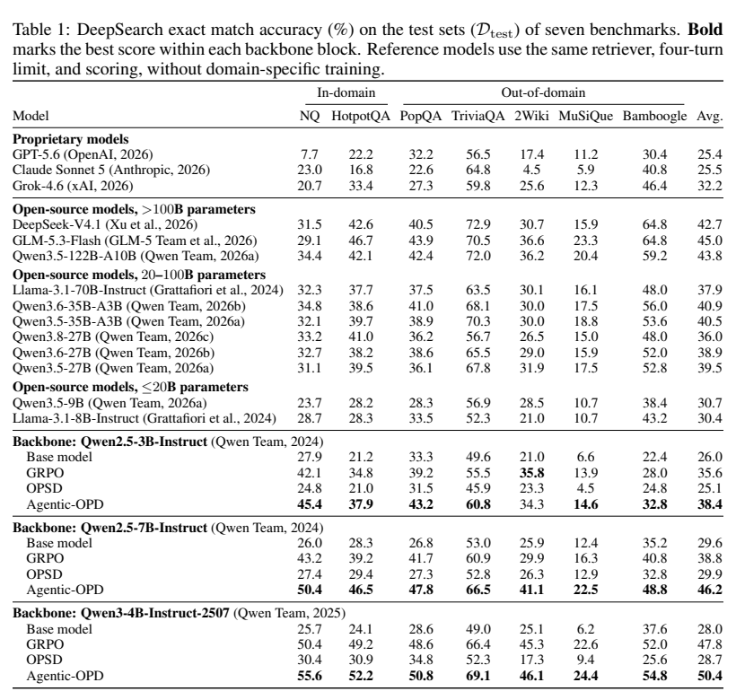

图 2-2｜原 Table 1，PDF 第 6 页。[来源](https://arxiv.org/pdf/2611.12799v2)。先读最下方每个 backbone 内 Base→GRPO→Agentic-OPD，再看各列和均值。上方大模型只是在同一 4-turn/retriever/EM 评测下的参照；训练来源、算力、适用任务并未统一，因此不能把某个 4B 均分较高写成“普遍超过前沿模型”。

DeepSearch 均值，Qwen2.5-3B 为 26.0→35.6→38.4，7B 为 29.6→38.8→46.2，Qwen3-4B 为 28.0→47.8→50.4。7B 相对 GRPO 的 +7.4 是百分点。3B 的 2Wiki 列从 35.8 降至 34.3，所以方法不是每个子任务都提升。跨其他域，Tool-use 均值 26.1→32.1、SciWorld 14.4→18.0；WebShop 平均 71.8→75.0；ALFWorld 总体 88.5→91.0，但 Heat 96→92，有局部遗忘。

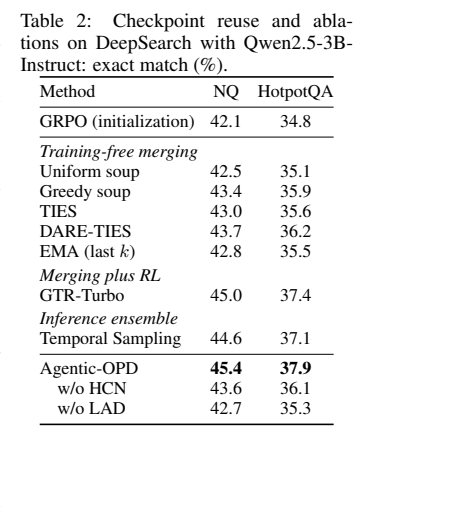

图 2-3｜原 Table 2，PDF 第 8 页右栏。[来源](https://arxiv.org/pdf/2611.12799v2)。同一 Qwen2.5-3B DeepSearch 初始化，列为 NQ、HotpotQA EM。训练免费合并、额外 RL 合并和推理集成的成本不同；表展示可比任务表现，不表示等算力预算。最后两行删除 HCN/LAD，可判断各机制贡献。

原表中初始化 42.1/34.8，uniform soup 42.5/35.1，greedy soup 43.4/35.9，TIES 43.0/35.6，DARE 43.7/36.2，GTR-Turbo 45.0/37.4，temporal sampling 44.6/37.1，完整方法 45.4/37.9。删除 HCN 变 43.6/36.1，删除 LAD 变 42.7/35.3，说明仅有旧教师池不足以复制完整收益。

Qwen3-4B 的 2000 题路由分析中，20 次更新后回收 60 题、遗忘 45 题，净增 15 题，即 +0.75 点；学生验证表现 55.25→56.0。最强单教师分数 54.9，却只补 57 题；分数较低的互补教师 52.75 能补 78 题。这里教师选择和诊断使用同一验证集合，不应把它当作独立测试集泛化证据。

**局限/缺失。** 每道题的成功集合受采样、环境与判分影响；LAD 的严格 gate 会丢掉教师偶尔正确但估计不足的题。只纠正失败 rollout 也不保证成功路径不会间接受损。论文没有给出完整训练脚本与超参数闭环；第三方页面声称“有代码”未获得作者一手链接佐证。复现至少需要原始 RL checkpoint 序列、固定检索器、验证切分、教师成功矩阵与过滤保留率日志，单下载最终学生无法验证能力回收机制。

**辅助阅读。** 入门读上面的 [GKD](https://arxiv.org/abs/2306.13649) 区分学生轨迹与教师轨迹；环境基础可读 [ALFWorld 官方项目与示例](https://alfworld.github.io/)。作者专门博客与官方方法代码：截至本次核查未找到，不用其他论文仓库替代。

## 3. ReAct Patterns：学会一个领域，也可能学坏“何时行动”

**一手入口：**[论文与日期](https://arxiv.org/abs/2611.19244)、[原文 v1](https://arxiv.org/pdf/2611.19244v1)。完整标题 Agentic On-Policy Distillation Implicitly Reshapes LLMs' ReAct Patterns，作者 Deyang Kong 等，首次公开 2026-11-14。论文第 3—5 节与附录给出跨域测量、选择性 OPD 和训练配方；未核验到独立作者代码/博客。

### 问题与原架构：迁移的不只有答案，还有交互节奏

ReAct 把 reasoning、action、observation 交替组织成 agent 轨迹。例如客服遇到缺少用户 ID，应先 Ask→等待用户回复→Call；家务环境通常鼓励马上调用动作。两类任务的有效语法相似，前置依赖却不同。**原文事实。** 在 ALFWorld 上蒸馏后，学生容易同一轮写“请提供 ID”又立即调用工具，没有等 ID；这是跨任务迁移的程序性习惯，而不只是知识答错。

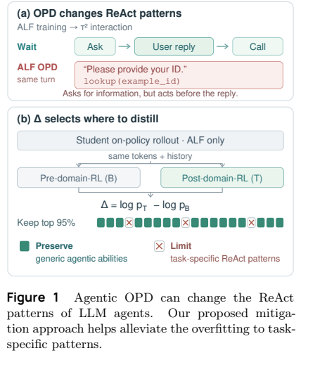

图 3-1｜原 Figure 1，PDF 第 2 页右栏。[来源](https://arxiv.org/pdf/2611.19244v1)。上框比较需要等待用户与 ALF-OPD 立即行动；下框把同一学生前缀交给领域 RL 前后的教师，按两教师偏好变化选择位置。图中的 Keep top 95% 是一个选位规则，不是“精确定位了全部有害 token”的证明。

学生统一为 Qwen3-4B-Instruct-2507。CI（code interpreter）教师为该 4B 的域内 RL 版本；ALF 与 τ² 教师为 Qwen3-30B-A3B 的域内 RL 版本，即 30B 总参数、约 3B active。主实验 GR（general reasoning）使用已发布通用 30B-A3B 教师；后文 GR 的选择性扩展使用专门的 RL 前后教师，不能把两组 GR 设置混用。

### OPD loss、实际裁剪与选位公式

基本目标是采样 token 的反向 KL 策略梯度。学生在历史 H_t 生成 y_t，教师 T 在同一历史打分；A_t=sg[lnπT(y_t|H_t)−lnπS(y_t|H_t)]。概念式 L=−mean_t A_t lnπS(y_t|H_t)，只对 assistant 位置求平均，任务 reward 仅监控 OPD 表现，不直接加入该 loss。

**原文实现条件。** 附录的实际配方用 rollout 时的 π_old 算冻结优势并 clamp 到 [−10,10]；r=exp(clip(lnπθ−lnπ_old,−20,20))。常规 PPO 项为 b=max(−rA,−clip(r,0.8,1.28)A)；当 A<0 时再用 min(b,−10A) 作 dual clip，A≥0 则用 b。这里 max 是对负号 loss 取保守的较大值。先对每条 rollout 保留位置求均值，再对 batch 求均值；零保留序列以 1e−8 稳定分母，贡献 0。OPD 系数 1，熵系数 0，额外显式 KL penalty 关闭。因此不能把概念上的 −A logπ 与所有实际分支逐字等同。

选择性 OPD 引入同一教师的域 RL 前后两个版本 B、T。对完全相同的 H_t、y_t 定义有符号偏好变化：

```text
Δ_t = lnπ_T(y_t|H_t) − lnπ_B(y_t|H_t)
N = 一条 rollout 内全部可监督位置数
K = ceil(ρN)
M = Δ_t 最大的 K 个位置，跨该 rollout 的所有轮次排序
L_select = 每条轨迹中 M 内普通 OPD loss 的均值，再取 batch 均值
```

ρ 是保留比例；同分按原顺序优先。Δ 比较“教师 RL 前后”，A 比较“教师与学生”，两者不是同一个量。ρ=95% 丢掉 signed Δ 最负的 5%，既不是按 |Δ| 保留，也不是仅保留正优势；被保留位置的普通 OPD 优势仍可能正或负。

**小白数值例，本文推演。** N=20、ρ=0.95，保留 19 个位置。某 token 的教师概率 RL 前 0.10、后 0.01，则 Δ=ln0.1≈−2.303，可能落在最底部而被丢弃。若学生对此 token 概率为 0.001，普通 OPD 优势却是 ln(0.01/0.001)=+2.303，仍想提高它。选择规则正是在拒绝“领域训练强烈压制、但对这个学生仍有吸引力”的某些位置；这提供一个可检验机制，不保证其语义必然有害。

```text
学生在 ALFWorld 等源域采样完整 ReAct 轨迹
冻结 T 对同一历史给出 token logprob，构造普通 OPD 优势
若开启选择：冻结 B 也对同一历史打分
    在每条轨迹所有 assistant 位置算 signed Δ
    取 top ceil(ρN)，不按轮次单独凑比例
对 mask 内的裁剪 PG 项按轨迹归一化，然后优化学生
用独立目标域评估交互模式、正确率和依赖违例
```

复现时需确认 prefix、special tokens 与 tokenizer 完全一致；不能把两个教师各自产生的不同轨迹相减。按保留 token 数归一化后，ρ 改变的不只是梯度大小，而是被监督内容；随机保留 95% 是必要控制之一。

### 数据、奖励、训练与评估预算

**原文事实。** CI/GR 训练源 17,917 条，ALFWorld 3553 条，τ² 2160 条（airline 1178、retail 637、telecom 345）；混合实验各源约 3000，τ² 保留 2160；选择性 ALF 实验用 3000 条子集。没有使用目标域 τ² 数据的选择实验与加入 τ² 监督的混合实验必须分开解释。

CI 教师先在英文 DAPO 的 13,616 条数据上做两阶段 GRPO，选第二阶段 update 106；ALF 教师选 step 60、二元任务成功奖励；τ² 教师选 160、用任务 checks 判分。CI 第一阶段奖励为：

```text
R1 = r_ans − 0.3 I_repeat + 0.05 min(n_clean,3)
     − 0.10 I_fail + 0.05 I_pre + 0.05 I_early
R2 = r_ans − 0.3 I_repeat
```

r_ans 是答案正确奖励，I_repeat 是重复指示：长输出中最后 512 字符是否重复更早内容，检测适用长度至少 1024；n_clean 是干净成功工具执行次数；I_fail 指调用了工具但没有任何干净成功执行；I_pre 指首次工具前至少 500 字符；I_early 指 boxed answer 前已有干净工具执行。系数用于教师 RL，不是学生 OPD 又叠加了这组 reward。第二阶段删除工具 shaping，只保留答案和重复项。

学生 OPD 使用 Megatron、Adam，恒定学习率 1e−5，无 warmup；教师 RL 为 1e−6；weight decay 0.01、grad clip 1、bf16、单 GPU microbatch 1，β=(0.9,0.999)。未给出的 epsilon、GPU 型号/卡数、总 GPU-hours/墙钟/峰值显存和金钱费用不补猜。ALF/CI 用 128 prompts×4 rollouts，prompt/response 上限 1024/31740；GR 用 32×4、8192/32768；τ² 用 32×8、8192/32768；选择性实验 32×4、8192/32768。主实验代表 checkpoint 约 50—60 次更新；选择比较固定 20 次更新，不是主实验同一 endpoint。

数学评估是 AIME 2026 的 30 题×16 加 Beyond 的 100 题×5，共 980 条；ALF 的 140 ID+134 OOD 题各 4 次，共 1096；τ² 的 100 任务各 8 次，共 800（airline/retail/telecom 为 160/320/320）。学生采样 temperature=1、top-p=1，τ² 用户模拟为 DeepSeek-V4-Flash、temperature=0.7，断言判定使用 GPT-5.5、temperature=1。这些是作者实验设置，不是本文对当下最强模型的推荐。

### 原实验图：源域胜利与跨域代价同时存在

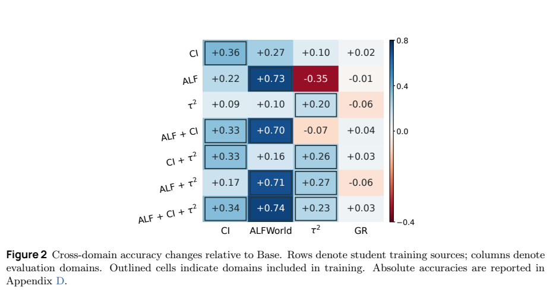

图 3-2｜原 Figure 2，PDF 第 4 页。[来源](https://arxiv.org/pdf/2611.19244v1)。行是蒸馏的数据域组合，列是评估域；蓝色/红色代表相对 Base 的改善/下降，数值是 0—1 精度差，如 −0.35 约 −35 点；深色格表示训练中包含该域。先逐行看域内与域外，再看列，不能只摘对角线。

原文中 GR 监督使数学工具尝试率 70.4%→14.4%，正确率 16.7%→38.0%。正确且不用工具/用工具分别占全部 980 条的 30.1%/7.9%，不是条件在正确答案内的比例。CI 学生数学正确率为 52.4%、工具尝试率 73.0%，说明“工具少”不等于“能力更强”。

CI 蒸馏还能让 ALF 成功率 12.9%→40.2%，重复动作比例 4.5%→0.7%，环境变化率 90.8%→94.3%，调用数 12.97→18.94；τ² 总分 41.5%→51.0%，retail 48.1%→65.3%，query 正确率 54.5%→67.5%，但工具尝试率 95.9%→95.8%，收益不能用“多用工具”一个数字解释。

相反，ALF 蒸馏令 τ² 41.5%→6.6%。论文观察到 ALF 学生 ask-call 同轮共现率 94.3%，而 ALF+τ² 监督后为 0.24%；语义依赖违例从 Base 的 0.50% 升至 ALF 的 55.8%。共现与依赖违例是两个指标，0.50% 不是 ask-call 的基线。

scaffold 有重要细节：只写文本、没有工具调用时，文本才发给用户；若同一轮有有效工具调用，前面的提问文本留在模型历史，却不会送给用户。因此“说了请提供 ID”并不表示用户真的收到提问；也不是任何 prose+call 都构成语义违例。部分依赖诊断用了 LLM 标注，存在判定误差。

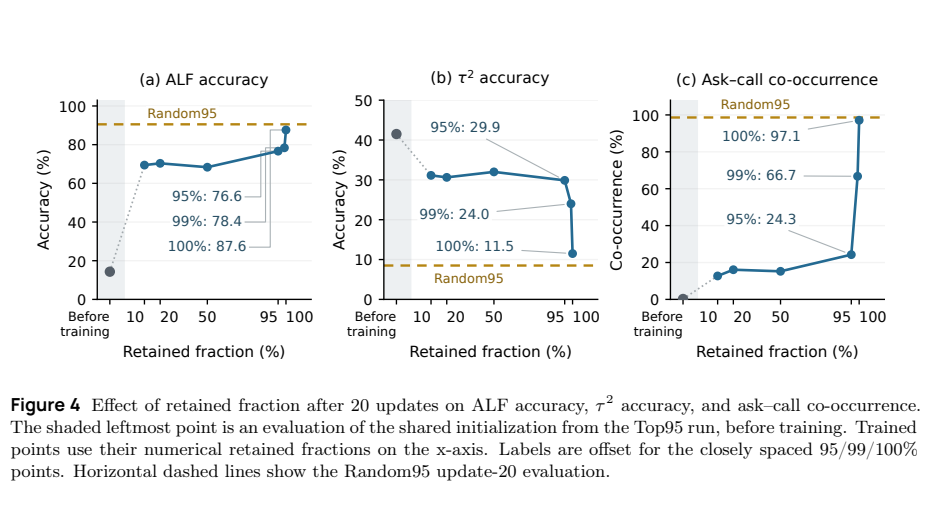

图 3-3｜原 Figure 4，PDF 第 8 页。[来源](https://arxiv.org/pdf/2611.19244v1)。固定 20 次更新，横轴为保留比例，三列依次是 ALF 成功率、τ² 正确率和 ask-call 共现率；最左 Before training 是共享起点，虚线是 Random95 对照，不是置信区间。100%→95% 时 ALF 87.6%→76.6%，τ² 11.5%→29.9%，共现 97.1%→24.3%，展示跨域保护与源域学习之间的真实取舍。11.5% 不能与主实验终点 6.6% 混为同一对照。

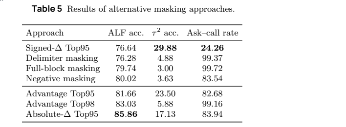

图 3-4｜原 Table 5，PDF 第 9 页。[来源](https://arxiv.org/pdf/2611.19244v1)。同一选择实验的替代 mask，列为 ALF、τ²、ask-call；delimiter/full-block/negative 规则与按优势或 |Δ| 选位都是控制。signed-Δ Top95 为 76.64/29.88/24.26；全块规则虽 ALF 79.74，却 τ² 3.00、共现 99.72，说明简单删除一类格式 token 不足以保护交互习惯。

按普通 advantage Top95 得 81.66/23.50/82.68，absolute-Δ Top95 得 85.86/17.13/83.94；signed 变化的方向确实重要，但没有一个阈值同时恢复 Base τ²=41.5 和完整源域表现。附录的 coefficient-mass 对照也不是全参数梯度严格匹配。

加入真实目标域 τ² 训练的 ALF+τ² 可达到 τ² 68.9、ALF 83.4（ALF 单域 85.5），但它使用了目标域数据，不能当作源域选择方法免费达到的结果。后续 GR 扩展固定 20 步：full 的 GR/CI/工具尝试为 46.02/37.65/10.41，Top95 为 46.33/36.53/29.49；保留工具行为并没有同时提高 CI 正确率。

**局限与复现。** 主要学生只有一个 4B 家族；τ² 只有 100 个任务，用户模拟器和 scaffold 对结论影响很大；signed Δ 是与负迁移相关的筛选信号，不是逐 token 因果识别。复现应保存两教师同前缀分数、保留位置、mask 分布、scaffold 的实际发信逻辑、语义违例标注与多域曲线。公开完整训练代码、全部数据过滤脚本和训练总成本未核验到，不能宣称一键复现。

**辅助阅读。** 环境入门：[ALFWorld 官方演示](https://alfworld.github.io/)；多轮工具与用户交互：[τ²-bench 官方代码与 README](https://github.com/sierra-research/tau2-bench)。它们是基础环境资料，不是本篇方法代码或作者博客。理解 loss 可结合第 1 篇固定前缀的 sampled-token 推导。

## 4. Streaming OPD：先交付监督片段，不必等整条回答结束

**一手入口：**[论文与日期](https://arxiv.org/abs/2611.22298)、[原文 v1](https://arxiv.org/pdf/2611.22298v1)。PDF 署名 Yun Zhu、Da Wang；arXiv 作者栏连写为一项。首次提交为 2026-11-17 06:55 UTC，PDF 首页日期 11-18 不替代首次公开日期。原文共 37 页；未找到作者发布的对应训练代码或独立博客。

### 问题、三个时钟与真实框架图

**原文事实。** 异步 OPD 常仍等整条 response 完成才入训练队列。长回答拖延监督到达，短回答先到又使训练分布偏移。本文把 completion（响应结束）、delivery（片段交付）、update（参数更新）拆开：生成仍继续，定期把新位置连同完整因果前缀、mask 与生成版本送入池，训练器从池中按协议取用。不是把长回答切成互不关联的短问题。

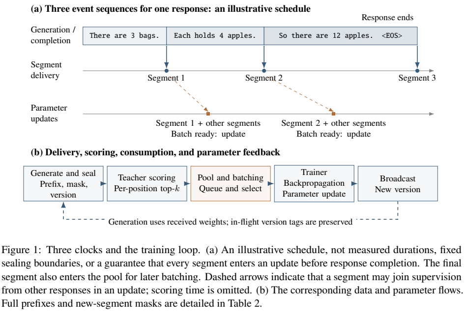

图 4-1｜原 Figure 1，PDF 第 7 页。[来源](https://arxiv.org/pdf/2611.22298v1)。上部三条时间线展示响应完成、片段交付、训练更新；虚线表示片段可与其他 response 的监督一起进入一个 update，不是每交一次片段必更新一次。下部从 seal、教师打分、候选池、trainer 到权重广播，回箭头说明后续生成可收到新权重。示意长度不表示实测耗时或固定分段大小。

第 j 段新位置为 a_j…b_j，输入仍含 1…b_j 的完整历史，loss 只作用于 a_j…b_j。seal 边界不当作 EOS，只有真实终止才有终止语义。实现中的边界与参数广播、pause/resume 有关，不是任意按句号切分。已有异步 OPD/早前缀探测方法是相关前例，本篇重点是持续交付多个片段并控制其实际消费。

### loss 与消费协议：token 数量、权重和陈旧度要分别计量

概念目标采用教师 q 到学生 p 的前向 KL：ℓ(h)=Σ_v q(v|h) ln[q(v|h)/pθ(v|h)]。教师对固定前缀给固定目标，但学生生成这些前缀的策略在改变，因此“教师固定”不代表数据完全新鲜。

**原文实现。** 教师 top-k（k=128）分数不重新归一化；用 h_c(z)=max(z,c)、c=−10 截断 log probability，下式再裁剪到 [0,C]、C=10：

```text
ℓ_impl = clip( Σ_{v∈TopK(q)} exp(h_c(ln q_v))
                         [h_c(ln q_v)−h_c(ln p_v)], 0, 10 )
```

这里 q_v、p_v 是当前前缀下相同 token 的概率，h_c 是数值下界。截断的部分和可以为负，裁到 0 后该部分梯度可能消失；裁 log p 也会使很小概率区间梯度为零。它不是完整正规 KL，更不是 sampled-token policy gradient。底层训练采用 FSDP2 直接反传。

论文把消费协议写成 C_proto=(γ_seal,B_budget,s_select,ρ_weight,σ_schedule)：γ 管何时 seal，B 管每次实际监督预算，s 选位置，ρ 给权重，σ 控制训练阶段调度。设 m_i 为新位置合法 mask，a_i 为被选中的指示，ρ_i≥0 为权重，则：

```text
w_i=m_i a_i ρ_i
L_u=Σ_i w_i ℓ_i / Σ_i w_i
N_u=Σ_i 1[w_i>0]，W_u=Σ_i w_i
lag_i = 消费时学生版本 − 该 token 实际生成时版本
```

u 是 trainer update。N 是实际被监督位置数，W 是权重总质量；只有二元权重时才相同。一个段若暂停后换权重继续，完整前缀中 token 可能来自不同版本，不能只拿最终 segment 版本代表全部生成来源。位置选择可用教师 top-k 上的学生概率质量 M=Σ_{v∈TopK(q)}p(v) 或 top-k overlap，但它们不是前缀访问概率的直接估计。

**小白算例，本文推演。** 两条回答长度为 1000 和 100，每段 100。若按“2 个条目”更新，完整回答模式可得到 1100 个监督 token，分段模式却只有 200；虽然两者都对 loss 取平均，实际优化预算与覆盖已变。若前缀 500、新段 100，教师/学生可能要处理 600 个输入位置，但 loss 只监督 100。匹配 80K 新监督位置并不等于匹配输入 FLOPs、KV 内存和墙钟。

```text
生成器：继续每条 response，保留全历史和每位置生成版本
到 seal 边界：把新段 mask、完整前缀、终止标记送池；继续生成
教师：对相同前缀打 top-128 分数
训练器：按阶段协议取候选、选位/过滤/加权
        按真正参与 loss 的 token 计预算，记录实际 N、W 和 lag
        算 masked FKL 实现目标，更新学生
广播器：按固定节奏把新权重送回生成器，保留旧 token 的版本标签
后期：若转同步 continuation，记录切换成本及 optimizer reset
```

### 数据、训练预算与关键对照

**原文事实。** Qwen3-4B 教师蒸馏 Qwen3-0.6B 学生，修改 VERL v0.8 的 fully-async 流程并使用 vLLM；混合 GSM8K 与 DAPO prompts，具体过滤和每源最终样本数没有完整披露。学习率 1e−5，temperature=1、top-p=1，每 prompt 4 responses，训练最大长度 2048；GSM8K test 1319 题、最大生成 1024、temperature=0。不能把此处 4B/0.6B 配置写成其他论文中的 Qwen3.6 或 9B。

同步与 naive streaming 的 trainer/generator/teacher GPU 分配为 4/1/1；raw-budget、reduced-lr、budget-matched 为 2/1/1。单卡型号、统一完整 GPU-hours/墙钟/峰值显存/金钱成本未给齐，所以结果不构成严格等计算量比较。权重每 4 次 trainer 更新广播，u=4g。continuation 从 u=352 的相同 checkpoint 切到同步并重置 optimizer，后续 u=352+r。切换还涉及消费/段边界配置，其具体设置未完全报告；不能把差异只归因于一个时钟开关。

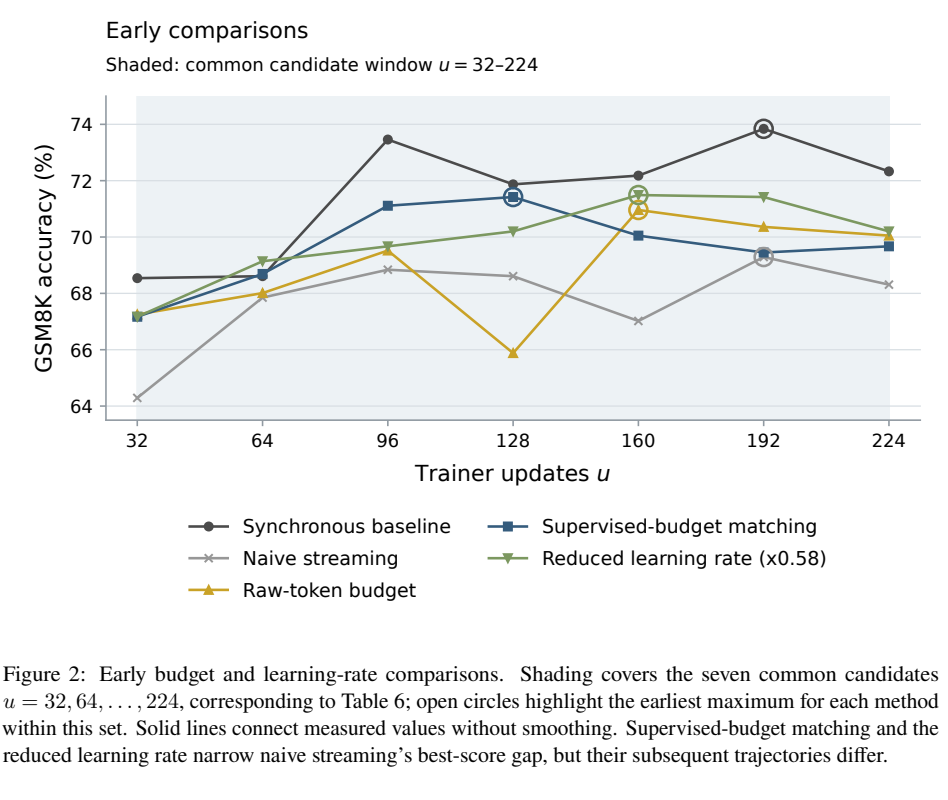

图 4-2｜原 Figure 2，PDF 第 13 页。[来源](https://arxiv.org/pdf/2611.22298v1)。横轴是 update u，纵轴是 GSM8K 测试正确率；阴影覆盖 32…224 的 7 个共同候选，空圈表示各方法在这组候选上的最早最大值。看蓝色 supervised-budget 比灰色 naive 的恢复，同时看不同后续走势；它不是独立重复训练的平均曲线，也不是先验证选 checkpoint 再测独立测试集。

早期 7 候选内的最高 test accuracy：同步 73.84、naive 69.29、raw-token-budget 70.96、supervised-budget 71.42、学习率乘 0.58 的 reduced-lr 71.49。仅改实际监督预算把差距从 4.55 缩到 2.42 点，但较小学习率也可达到类似局部峰值；不能把全部恢复解释成某个独占机制。naive 每步监督约 46—48K token、变异系数 0.43—0.65，同步约 74.8K、0.045。raw input budget 不等于监督 budget；terminal segment 占比也不是 EOS token 占比。

更长的 12 个共同候选（256…576 加 596）中同步/naive/budget-matched 最好为 74.30/71.57/72.93；不能拿这组 budget 的 72.93 去替换另一组 7 候选中的 71.95。局部三点 384/416/448 的最高值，high-KL、random、KL×overlap、freshness、mass reweight 分别为 69.45/71.80/72.55/72.78/70.74，对照 budget 71.95、同步 74.30；局部选位收益没有建立持续优势。候选名义 160K、保留 50% 的配置是 microbatch 内筛选，并非全球精确 top-80K。

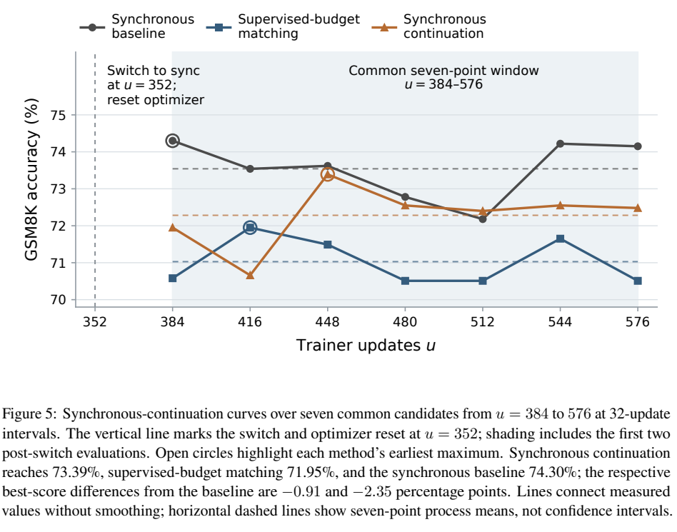

图 4-3｜原 Figure 5，PDF 第 22 页。[来源](https://arxiv.org/pdf/2611.22298v1)。竖虚线为 u=352 切同步并重置优化器，阴影是 384…576 的 7 个共同点。同步/预算匹配/continuation 最高为 74.30/71.95/73.39，七点均值为 73.54/71.03/72.28；橙线确有恢复，但仍低于同步 0.91 点。水平虚线是这些点的均值，非置信区间。另一个延长到 u=896 的未配对记录最高 76.12，不能与此处同步终点拼接宣称获胜。

### 系统成本图与可复现性

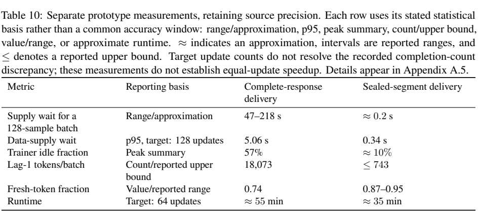

图 4-4｜原 Table 10，PDF 第 25 页。[来源](https://arxiv.org/pdf/2611.22298v1)。这是独立 prototype，非上面同一准确率曲线。第二列明确每个统计是区间、p95、峰值或计数：128 条 batch 供给等待 47—218s→约 0.2s，另一 p95 指标 5.06→0.34s，trainer idle 峰值 57%→约 10%。不同统计不能互相相除。64-update 目标墙钟约 55→35 分钟，但完成计数 63/64 对 64/64 的差异未解释，因此论文没有证明等更新 1.6 倍加速。

原型还出现 499 段 overflow 丢弃、约 2.9%；扩队列后的测量是另一个设置。短任务若完整回答池本来已充足，等待中位数约 0.3s，就不应泛化长尾任务的供给优势。**本文成本解释：**要比较达到同等质量所需时间，应计 T_total=T_async+T_switch+T_sync_continuation，并包含切换、重置与 plateau 的成本；当前没有完整等质量、等资源曲线，无法量化净加速。

**局限。** 每方法单条训练轨迹，多个 checkpoint 的均值不是多种子均值；最高测试点带有选择偏差；只有小规模 GSM8K 配置；协议与实现细节缺口妨碍精确复现。部署前应记录每 token 生成年代、实际消费量、重复前缀计算、丢段率、共同预算下的质量与端到端成本，而不是只显示 queue wait。

**辅助阅读。** 实现基础：[VERL fully-async 官方文档](https://verl.readthedocs.io/en/latest/advance/fully_async.html)。当前文档已说明 recipes 移到 verl-recipe、面向 v0.9.1，不能把现行默认配置当成论文 v0.8 的原配置。本次未核验到作者的 streaming 补丁仓库，框架仓库仅作基础资料。

## 5. Learning Dynamics：有教师信号，为什么仍学不动或越学越乱

**一手入口：**[论文与日期](https://arxiv.org/abs/2611.08016)、[原文 v1](https://arxiv.org/pdf/2611.08016v1)。作者 Guan Zhe Hong、Sumeet R. Motwani 等，首次公开 2026-11-05。正文与附录共 54 页，以下重点解释第 3 节及关键实验、附录的协议/证明；并非声称逐条复现所有附录推导与提示词。

### 问题和原框架：转换，再广播，再改变数据

**原文事实。** 教师与学生分歧大，可能参数几乎不动；当前 loss 在固定前缀上变好，可能把学生引向更糟的后续历史。论文将反馈环拆成 conversion（局部教师压力转成参数更新）、broadcast（共享参数改变别处预测）与 routing（新策略改变下次访问的前缀）。它是机制分析与干预实验，不是一个保证单调提升的新优化器。

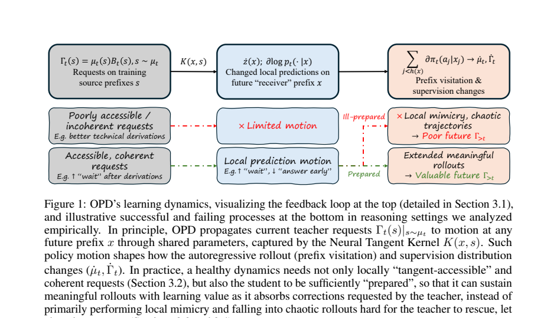

图 5-1｜原 Figure 1，PDF 第 2 页。[来源](https://arxiv.org/pdf/2611.08016v1)。从左到右，源前缀上的教师请求 Γ，经共享参数 kernel K 改写各前缀预测，再影响未来访问分布。下两行比较尚未准备好的学生与已有基础的学生：一个可能局部模仿却进入混乱长链，另一个能执行有价值的续写。红绿箭头是机制示意，不是测量出的收益百分比。

### 关键推导一：局部压力、参数几何与相互抵消

固定前缀 s，zθ(s) 为词表 logits，p=softmax(z)，q 是冻结教师。采样策略 π=G[p] 还可含温度、EOS 规则；μ 是由学生 rollout 诱导的归一化训练前缀分布。反向 KL 的局部 c(s)=Σ_a p_a ln(p_a/q_a)。令 ℓ_a=ln(p_a/q_a)、ℓ̄=Σ_a p_aℓ_a。a 为 token，θ 为参数向量：

```text
∂p_b/∂z_a = p_b(1[a=b]−p_a)
∂c/∂z_a = p_a(ℓ_a−ℓ̄)
B_a(s) = −∂c/∂z_a = p_a(ℓ̄−ℓ_a)
Φ(s)=∂zθ(s)/∂θ，g(s)=Φ(s)^T B(s)
u=E_{s~μ}g(s)，Γ(s)=μ(s)B(s)
K(x,s)=Φ(x)Φ(s)^T
```

B 是教师请求的负 logit 梯度，Σ_a B_a=0；Φ 把参数变化映射成 logit 变化，g 是单前缀在参数空间提出的更新，u 是平均更新方向；K 是两个前缀的 logit Jacobian 内积，描述共享参数如何把一处监督传播到另一处。它不是把训练前缀原封不动复制到测试前缀。

在原始梯度下降、小步长 η、固定光滑参数化下，由链式法则：δz(x)=ηΣ_s μ(s)K(x,s)B(s)+O(η²)。再用 log-softmax Jacobian A_p(x)=I−1p(x)^T：

```text
δlog p(a|x)=η [ A_p(x) Σ_s μ(s)K(x,s)B(s) ]_a + O(η²)
```

I 是单位阵，1 是全 1 列向量，O(η²) 是高阶余项。正文对预测位移的记号易与概率差混淆，此处明确写 δlog p；附录 C.2 使用的也是 gradlog p。概率差还需再乘 p_a，不能直接把右侧当 δp_a。实际 Adam、clip、momentum 会改变参数方向，若要用此等式解释实际更新，应代入真正的 δθ；原始梯度流的 u 不能自动替代所有优化器步长。

论文用 probe 分布 ν 分解 conversion：

```text
P=E_ν ||B||²，D_g=E_ν ||g||²
A=D_g/P，C=||E_ν g||²/D_g，Ξ=||u||²/P=A·C
因此 ||u||²=P·A·C （u=E_ν g，分母非零）
```

P 是 logit 请求强度，A 是经过参数几何后的平均放大，C∈[0,1] 是方向一致性（由 Jensen 不等式），Ξ 是总转换效率。P=0 或 D_g=0 时相关比值未定义，要单独处理，不能直接消去零。A 可由 self-kernel 的特征值和 B 在特征向量上的投影解释：大特征值若与请求正交也不会放大它。

**小白算例，本文推演。** 两个等权前缀分别产生 g1=(1,0)、g2=(−1,0)，D_g=1，但 u=0、C=0，单个信号都很强，平均后完全抵消；若 g2=(1,0)，则 C=1。教师分歧或 token KL 大，并不能推出能产生大而有用的共同更新。

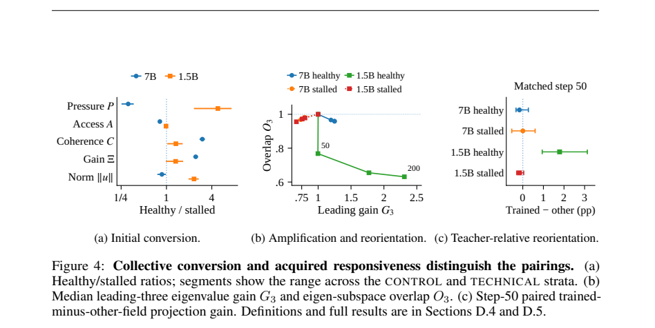

图 5-2｜原 Figure 4，PDF 第 7 页。[来源](https://arxiv.org/pdf/2611.08016v1)。左侧比较 healthy/stalled 配对的 P、A、C、Ξ 与更新范数；中间看主方向 gain 和教师请求方向 overlap 随训练改变；右侧看更新 50 步后教师偏好概率变化。须同颜色/规模内比较，横轴并非统一的精度指标。7B healthy 的 coherence 为 stalled 的 2.75—3.24 倍、Ξ 为 2.27—2.62 倍，支持“共同可用方向重要”，不是所有模型通用阈值。

### 关键推导二：loss 变化中有“换了数据”和“拟合了数据”

局部统计 Y_t(s)（如 loss 或 entropy）的平均 J_t=Σ_s ν_t(s)Y_t(s)，对时间求导：dJ/dt=Σ_s ν̇_t(s)Y_t(s)+E_{ν_t}[Ẏ_t(s)]。前项 routing 是访问分布改变，后项 drift 是固定前缀的预测变化；总 loss 上升不一定只因拟合变坏，总 loss 下降也不一定只因学得更好。

对于温度 τ 的 softmax 采样，令 v(x)=Σ_s K(x,s)Γ(s)，e_a 为 token a 的 one-hot，策略 score 速度 ζ(x,a)=∂_t lnπ(a|x)=(e_a−π(x))^Tv(x)/τ。一条前缀的 reach 速度 λ 等于其祖先各步 ζ 之和；归一化后 routing 项可写 Cov_ν(Y,λ)。相邻分布满足 μ_b(s)∝μ_a(s) exp(∫_a^b λ_t(s)dt)，比例常数用于重新归一化。这个式子强调多步细小偏移会积累为很不一样的访问分布。

实验不能直接测连续时间每一项，就用两份 checkpoint 与两份 rollout bank 做交叉打分。M_ij 表示“在 i 时刻的数据上，用 j 时刻模型评估 Y”。于是：

```text
R̂ = 0.5[(M_ba−M_aa)+(M_bb−M_ab)]
D̂ = 0.5[(M_ab−M_aa)+(M_bb−M_ba)]
R̂+D̂ = M_bb−M_aa
```

R̂ 是换数据的对称估计，D̂ 是换模型的对称估计；两者相加精确等于端点差，但各项并不是连续路径积分的精确测量。**本文算例：**M_aa=0.20、M_ab=0.10、M_ba=0.50、M_bb=0.25，则 R̂=+0.225，D̂=−0.175，总 loss +0.05。学生在固定数据上更会模仿，却开始进入更难、教师也不可靠的新历史。

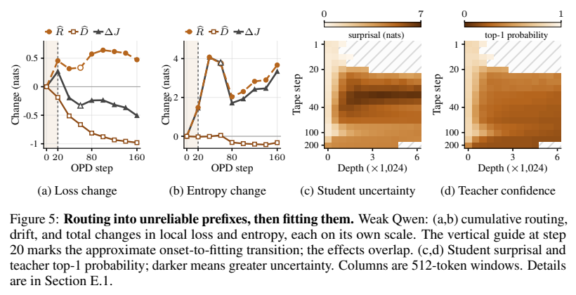

图 5-3｜原 Figure 5，PDF 第 9 页。[来源](https://arxiv.org/pdf/2611.08016v1)。前两列在各自尺度下画 loss、entropy 的 routing/drift/总变化；约 step 20 的竖线是路由变化转向拟合的近似分界，二者并不互斥。后两列按深度看学生 surprisal 与教师 top-1 概率，深色表示学生不确定或教师不自信。图是 weak Qwen 配对；不能直接与另一配对用不同尺度的曲线比较绝对大小。

原文 weak Qwen1.5B/JustRL 训练 loss 早期约 0.58→0.85，routing +0.455、drift −0.187；健康 DeepSeek 配对约 0.263→0.015，drift −0.214、routing −0.033。前者后期 loss 也会下降，却可能是在拟合已失控的前缀，不表示推理恢复。

### 关键推导三：教师喜欢“继续想”，学生却未必接得住

令终端指标 Y 是最终答案是否正确，Q^Y(x,a) 为学生选择 a 后由学生继续执行的成功概率，V^Y(x)=E_{a~π}Q^Y(x,a)。x 此处是任意决策前缀，不只初始问题；d(x) 是未归一化的前缀访问次数权重。似然比求导给出：

```text
dJ_Y/dt = Σ_x d(x) E_{a~π}[ζ(x,a)(Q^Y(x,a)−V^Y(x))]
        = (1/τ) Σ_{x,s} d(x)
          [π(x)⊙(Q^Y(x)−V^Y(x))]^T K(x,s)Γ(s)
```

⊙ 是逐元素乘法。减 V 不改期望，因为 Eπζ=0。这把教师请求与真正的学生未来价值联系起来：教师会在某个“继续想”分支成功，不代表学生也会。**本文教学例：**学生“现在作答”的成功率 0.30，“继续想”的成功率 0.08；若继续分支概率从 0.5 升到 0.8，总成功率由 0.19 降到 0.124。不是反对长推理，而是不能把教师分支价值直接赋给学生。

原文 weak 配对的作答分支概率在 step 0/20/100 为 0.74/0.19/0.07，教师约 0.30；step20 的 answer/continue 成功率约 0.30/0.29，到 step100 学生 continue 成功率约 8%，教师在同前缀自己继续则约 60%。同一前缀下的执行者不同，解释了为什么“局部更像教师”与“最终更正确”会脱钩。

### 离线准备、数据流程与训练成本

**原文事实。** 实验包括 Qwen2.5-1.5B / JustRL-1.5B、Qwen2.5-7B / AceReason-Nemotron-7B、Llama3.1-8B / Nemotron-Nano-8B。conversion 分析另比较 DeepSeek-R1-Distill-Qwen 的 1.5B/7B 学生，与同规模 RL 兄弟教师或更大 7B/14B 教师。不要把这些不同实验统一写成一个 teacher/student pair。

几何 probe 使用 11 条初始 rollout 的位置样本，AIME24 30 题在 1.5B/7B 分别采 16/4 次；语义请求标注约 36,416/38,168 个位置，使用 Opus 5。全参数 logit 梯度昂贵，实际只采样部分位置，没有声称构建全词表、全前缀 kernel 可以低成本常规训练。1.5B 到 step50 的请求子空间 overlap 约 0.77，top-3 方向投影增加 5.5 点、教师偏好概率增加 1.79 点；这是几何诊断，不是任务准确率增加 5.5 点。

离线准备阶段从 OMI2 构造每组 32,768 条教师解答，训练 512 steps×256 sequences=131,072 次呈现，约 4 遍。teacher top-16 前向 KL，AdamW lr=1e−6、β=(0.9,0.95)、无 weight decay、clip1、sequence8192。DAPO 有 17,398 个独立问题，后续使用连续的 6400 行 block，各 block 约 6235—6318 道独立题；OPD 每步 64 prompts×4 responses、temperature=1，Qwen/Llama 最长8192/14336。离线控制每题 4 条教师解答、每 block 25,600 条，匹配 optimizer 步数与序列呈现数，不是等 GPU-hours 或等教师推理成本。

```text
为每组师生准备 OMI2 教师解答和 top-16 分布
先做规定遍数的离线 FKL，保存同一 prepared 初始化
分支 A：继续离线蒸馏，固定教师轨迹
分支 B：OPD，学生生成当前轨迹，冻结教师对同前缀给监督
两分支匹配更新次数及序列呈现；分别记录 token/FLOPs/耗时
定期：固定 rollout banks 交叉评分，分解 routing 与 drift
抽样位置：计算 B、g、coherence 和局部 geometry probes
评估：记录每题 32 次成功数、pass@k、成功率分布与长度
```

1.5B/Llama 对照各 200 次后续更新，即 51,200 次序列呈现；7B 各 100 次，即 25,600。后续 OPD 的所有 optimizer/学习率细节没有完全闭环披露，不能把离线阶段超参数全抄过去。附录 A.18 披露 GH200 节点、整套单种子实验约 4000 GPU-hours；这是全套成本，不能写成每个 run 都 4000。单作业卡数、完整墙钟、峰值显存和云价未给全。

### 原实验图、指标与统计限制

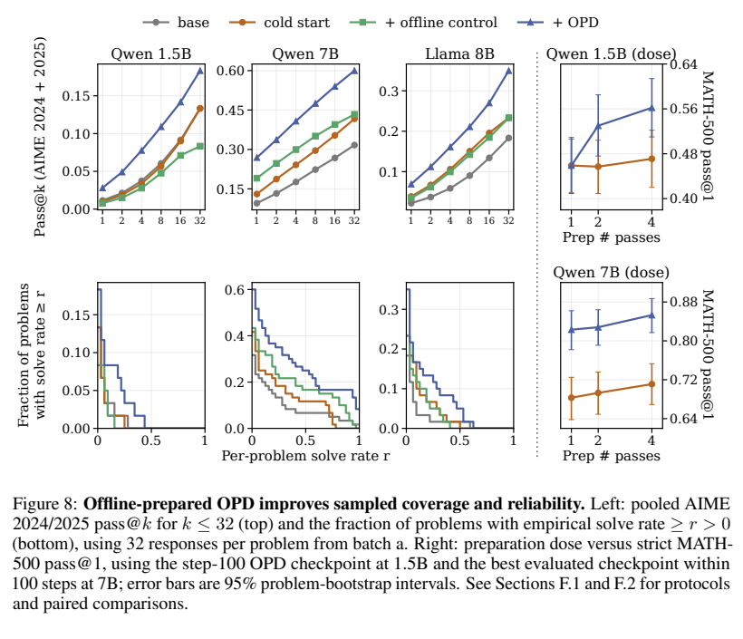

图 5-4｜原 Figure 8，PDF 第 11 页。[来源](https://arxiv.org/pdf/2611.08016v1)。左三列上排为 AIME24/25 pooled pass@k，横轴 k≤32；下排横轴是单题经验成功率阈值 r，纵轴是达到阈值的题目比例。灰/橙/绿/蓝分别为 base、cold start、额外 offline control、OPD。最右列是准备遍数对另一组严格评分 MATH-500 子集的影响；不能把其 y 轴当 AIME。误差条是问题级 bootstrap，不是独立训练种子间方差。

对 n=32 次采样，若题 i 有 c_i 次成功，pass@k 的无偏组合估计为 mean_i[1−C(32−c_i,k)/C(32,k)]，C 是组合数；不可能选到失败子集时相应项为 0。pass@32 是这 32 次里至少成功一次的经验覆盖，不能解释为模型真实支持集合已经测全。下排分母固定为 pooled 60 道 AIME 题，显示可靠性而不只覆盖率。

原 Table 12 的最终 pooled pass@1/pass@32：

| prepared 后继续训练 | 离线控制 | OPD |
| --- | --- | --- |
| Qwen1.5B | 0.0078 / 0.0833 | 0.0281 / 0.1833 |
| Qwen7B | 0.1906 / 0.4333 | 0.2693 / 0.6000 |
| Llama8B | 0.0349 / 0.2333 | 0.0693 / 0.3500 |

AIME 用 temperature=0.6、top-p=0.95、最长16384；答案提取较宽松，优先 boxed，否则查 answer is 等。不能与严格答案解析的数学数据混比。若拆到单个年度，1.5B 的 2025、Llama 的 2025 某些配对差值置信区间含 0，pooled 提升不代表每年都显著。

剂量实验用 MATH-500 的前 250 题、每题 4 次、严格评分。1.5B 准备 1/2/4 遍时 cold-start 0.459/0.457/0.471，看似差别小，OPD100 后为 0.459/0.530/0.562；7B cold 为 0.683/0.693/0.711，OPD 后为 0.823/0.828/0.853。但 7B 用 100 步内每 10 步评估后选最高（30/50/90），置信区间没有校正 checkpoint 选择。论文的要点是离线准备可改变之后学习的可行性，不是“更多离线遍数必然最优”。

**局限与复现性。** 理论的有限、光滑、固定 mask/采样规则及小步长假设要保留；真实 Adam 需要实际参数位移修正。全部训练为单种子，题目 bootstrap 不能估计训练随机性。数学题与少数模型上的分支价值，不可直接替代真实工具环境的反事实试验。作者主页列有本篇预印本，但未核验到本篇独立代码链接；同主页其他论文的 code 不能冒认为本篇代码。本次没有运行模型训练或产生新的实验曲线。

**辅助阅读。** 初学者先看本日报共同基础与第 1 篇的反向 KL 推导；机制原始资料可继续阅读本篇附录 C 的证明、附录 E 的交叉 bank 协议；[作者 Yi Ren 主页](https://joshua-ren.github.io/)用于核对论文资料入口，不作为单独作者博客或实现发布的证据。

## 横向读法：这五篇不能只用“都是 KL”来概括

| 论文 | 前缀来源 / 教师 | loss 的实际区别 | 最需要防止的误读 |
| --- | --- | --- | --- |
| SWE-OPD | 当前学生或固定初始学生 / 外部大教师 | raw 概率比的学生 top-K 目标，或 sampled-token PG | 截断 loss 下降不等于完整 KL 或任务变好；代码分母梯度有差异 |
| Agentic-OPD | 当前学生失败轨迹 / 同次 RL 历史池 | 学生/教师在同集合归一化的受限 RKL | 教师池不额外 RL，不代表 consolidation 零成本 |
| ReAct Patterns | 当前学生源域 ReAct / 域 RL 教师 | 裁剪 PG，可按教师前后 signed Δ 选位 | 源域提高不等于目标域安全；95% 对照有独立 checkpoint |
| Streaming OPD | 持续生成的新段，完整前缀 / 冻结4B | 教师 top-K、log 下界和标量裁剪的 FKL 实现 | 等条目、等输入 token、等监督 token、等算力是四种口径 |
| Learning Dynamics | 学生诱导的移动前缀 / 不同能力配对 | 反向 KL 半梯度及反馈机制分析 | 局部模仿成功不等于学生未来分支有价值 |

**本文综合判断。** 实施 OPD 至少同时记录四类量：实际 loss 定义及 detach/mask；数据来自哪个学生版本、哪些前缀；教师监督能否被当前学生执行；在同一预算与评估协议下的任务曲线。密集监督提升的是学习信号的密度，没有自动解决分布转移、参数方向抵消或工具行为负迁移。

## 检索、去重与交付说明

检索覆盖 on-policy distillation、on-policy self-distillation、OPD/OPSD 与 agent/coding/streaming/dynamics 等组合，辅以精确标题和 arXiv ID 的代码/作者资料查询。先核对一手 abs 的 submission history，再读原 PDF 与可用代码；不把搜索收录日当首次公开日。

剔除例子：ECOD（2611.18656）的二手检索日期为 11-17，但一手页面列 v1 为 10-17，早于本窗口 10-19，未纳入；vOPD（2605.07865）的首次公开为 5 月，11 月常规版本更新也没有当作新论文。历史已收录论文按去版本 arXiv、DOI、规范 URL、标题及别名跨全部方向比较，包含今日 VLM 的 5 篇；本日报 5 篇无身份冲突。SpecOPD 为未入本次的合格候选，不在 sources 主清单占位。

本日报正文、公式、伪代码、19 幅真实原图/表和图解由同一 report.md 生成 report.pdf；生成环境、字体、全文逐行比对、图片数及逐页渲染检查见 assets/QA.md 和 assets/pdf-check.json。图片只裁切与缩放，没有改动实验数据。原始论文版权归作者/发布方，图片用于注明出处的学术精读。论文源 PDF 哈希、代码固定提交、图片位置与检索剔除记录保存在 manifest.json。
