# OPD & OPSD 精读 · 2026-11-20

今日收录 5 篇此前未归档的新论文，检索窗口为北京时间 2026-10-20 至 2026-11-20。主题是：从哪里构造可信的教师上下文，以及哪些 token 信号值得传给学生。5 篇均核对了首次公开日期、指定版本原 PDF 与可用作者代码；按去版本 arXiv ID、DOI、规范 URL、标题及别名跨全部方向去重。博客和教程不计入论文名额。

| 论文 / 简称 | 首次公开 / 本次版本 | 核心问题 |
| --- | --- | --- |
| Communicative On-Policy Distillation / COPD | 11-18 / v1 | 用黑盒教师的文字交流，训练无需顾问的 agent |
| B-OPSD | 11-14 / v2，11-17 更新 | 没有参考答案，能否用自己写的问题简报做特权上下文 |
| Simplify, Agree, Distill / STONE | 11-13 / v1 | 原题投票不可靠时，转而验证简单相关题 |
| Reinforcing What the Student Has Learned / SD-OPD | 11-05 / v2，11-06 更新 | 用学生相对自身 base 的变化决定更新强度 |
| Order-Only On-Policy Distillation / O³PD | 11-01 / v1 | 只学教师候选的次序，是否比拟合其概率更合适 |

全文标签：**原文事实**来自论文和附录；**代码核查**来自固定提交的静态阅读，未运行训练；**本文推导/算例**仅为教学；**未披露/未核验**表示证据不足，不能填入猜测。全部 20 幅图表均从论文原 PDF 裁切，图中数据没有重画或改写。页码、版本、裁切范围和文件哈希见 manifest.json、assets/SOURCES.md。

## 共同基础：on-policy、特权上下文和三种截断不要混淆

设问题为 x，学生自己生成 y=(y₁,…,y_T)，h_t=(x,y_<t) 是第 t 个位置的历史。工具 agent 的历史还包括动作与环境观察。学生 pθ(v|h_t) 与教师 q(v|h_t,z) 比较同一个学生前缀；z 是仅训练时提供给教师的额外信息。学生看到的前缀来自自己，叫 on-policy；并不要求这条轨迹已正确。

OPSD 的“同一个模型”也有不同含义。B-OPSD 和 STONE 的教师是初始模型、保持冻结；COPD 的特权视图与当前学生共享参数，但打分时停止梯度。SD-OPD 的教师则是外部模型，同时另加学生的预训练 base。冻结、共享和 detach 不能互相替代。

前向 KL 为 D_F(q||p)=Σ_v q_v ln(q_v/p_v)，反向 KL 为 D_R(p||q)=Σ_v p_v ln(p_v/q_v)，其中 v 遍历词表、ln 是自然对数。前者按教师概率加权，后者按学生概率加权。完整正规分布的 KL 非负，但“逐词表项封顶”的目标未必非负。本文 grad 表示梯度，sg 表示 stop-gradient：前向值不变，反向不通过该项。

STONE 与 B-OPSD 使用的一种实际目标是 D_δ=Σ_v min(q_v ln(q_v/p_v),δ)。δ 是每个词表项的上界，没有把负贡献截到零；也不是先求完整 KL 再截。**本文算例：**q=(0.8,0.2)、p=(0.2,0.8)，完整 FKL≈0.832 nat；取 δ=0.05 后，两项为 0.05 和 −0.277，和约 −0.227。因此负 loss 不足以证明代码错了，但也不能再用“越接近零越好”的正规 KL 解释它。

**本文推导。** 对 softmax 学生 logits z_j，未截断 FKL 的导数为 p_j−q_j。若 U 是没有达到上界的词表项，暂不考虑阈值相等点，则逐项封顶后的导数为 p_jΣ_{v∈U}q_v−1[j∈U]q_j。被封顶项直接导数为零，剩余项仍通过 softmax 归一化耦合。因此 term cap 改变了优化目标，而不只是显示 loss 的数值。

另两种截断是：top-K 只保留候选集合，必须说明由谁选、集合内是否重新归一化；PPO clip 约束新旧策略概率比的收益，约束对象不是 KL 数值。后文每种方法都会写清楚，不能只在配置中笼统写“用了 clip”。

## 1. COPD：先学会请教，再把交流所得内化到独立执行

**一手入口：**[论文与日期](https://arxiv.org/abs/2611.23673)、[原文 v1](https://arxiv.org/pdf/2611.23673v1)、[作者项目讲解页](https://liruiluo.github.io/communicative-opsd/)。完整标题 Communicative On-Policy Distillation: Distilling Black-Box Teacher Capabilities through Communication for Long-Horizon Tasks，作者 Lirui Luo 等，首次公开 2026-11-18。原 PDF 共 13 页，重点见第 3—5 节；未核验到专门训练代码发布。

### 问题定义与原架构图

**原文事实。** 常规 OPD 需要教师 token logits，但黑盒 API 常只返回文本。COPD 允许学生在任务执行中自主决定何时、问什么，通过普通 bash 命令请求更强顾问；顾问只给文字、不替学生操作环境。成功且确实咨询过顾问的完整执行轨迹成为特权参考。学生随后在新工作区重做同一任务，不带顾问；参考只给学生的特权视图打分，而不提供给可部署视图。

这不是先独立完成一个“沟通训练阶段”再开始蒸馏。收集、滚动成功库、无顾问重试、任务 PPO 和 OPSD 在训练期间共同运行。咨询动作与后续执行由同一套学生参数产生，没有另外训练的 query selector，也没有预先限定必须在哪一轮问哪种模板问题。

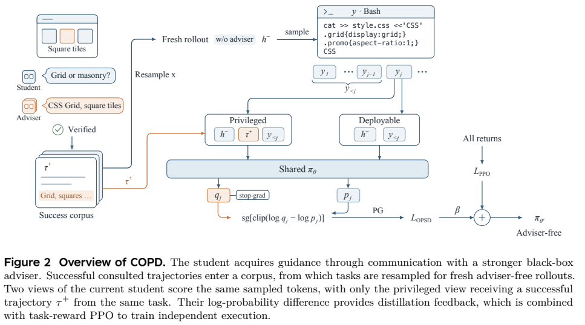

图 1-1｜原 Figure 2，PDF 第 4 页。[来源](https://arxiv.org/pdf/2611.23673v1)。左边成功咨询轨迹进入 corpus，再重采同一任务得到 fresh rollout；中间两个框共享当前 θ，只有 privileged 框看到成功参考，q 侧标注 stop-grad；右边把 OPSD 与 native-return PPO 合并。顾问的文本先进入参考，再由学生自己的特权分布变成 token 信号；不是从黑盒 API 直接取得 logits。

### 数据配对、奖励与关键公式

对环境 d、任务 x，回报 G(τ)=Σ_{t=1}^T γ^{t−1}r_t，r_t 是环境原生奖励，γ∈[0,1] 是折扣。任务目标 J(θ)=E_{(d,x)~μ,τ~pθ}[G(τ)]，μ 是五域任务混合，s(τ)∈{0,1} 是环境 success check。只有 s=1 且 consulted(τ)=真才写入滚动库 C；有顾问却失败、不用顾问却成功，都不进入这个“咨询成功”参考集合。

学生在每次允许交互时可选 a_t∈A_env∪A_comm，通信动作 Ask(u_t) 的 u_t 是学生自由生成文字。参考 τ_plus包含提问、回复、动作与观察全过程，按 (d,x) 检索。训练调度混合原日程任务和 C 中任务，保证原日程只出现一次的任务仍能产生同题配对。每次重试使用 fresh workspace，不能把成功工作目录直接给学生。

对于无顾问轨迹的 token y，c 是其真实无顾问历史与本轮 response 前缀。论文 Eq.4—8 为：

```text
p = πθ(·|c)
q = sg[πθ(·|c,τ_plus)]
A_OPD = sg[clip(ln q(y)−ln p(y), −C_gap, C_gap)]
ρ = p(y)/b(y)
ℓ_OPD = −min(ρ A_OPD, clip(ρ,1−ε,1+ε) A_OPD)
L = L_PPO + β L_OPSD
```

b(y) 是异步采样时实际行为策略保存的概率，不能用更新后的学生假装旧策略；C_gap>0 是优势上界，ε 是 ratio clip 宽度，β≥0 是蒸馏权重。A>0 鼓励该 token，A<0 抑制它。q 与 p 使用当前 θ，但 q 和 A 被 detach，所以不是对“两视图共同随 θ 变化”的完整 KL 求全导数。固定前缀和固定 q 时，未裁剪 sampled log-ratio 的期望才对应局部反向 KL 梯度；这不保证整段任务回报单调上升，也不校正旧策略进入了哪些历史。

**小白算例，本文推演。** 某 token 的 p=0.10、q=0.20、b=0.08，取教学参数 C_gap=1、ε=0.2，则 A=ln2≈0.693，ρ=1.25；未裁项 0.866、裁剪项 0.832，loss 取 −0.832，继续抬高这一 token 的局部收益受到限制。若它来自没有同题成功参考的轨迹，则 OPSD 项不适用，但任务奖励 PPO 仍可能训练它。

L_PPO 用环境回报训练有顾问和无顾问的合格行，包括失败轨迹，request tokens 也通过原生回报学习。论文还更新 critic。**本文补充基础而非作者完整实现：**标准 PPO actor 可写成 −E[min(ρÂ_env,clip(ρ)Â_env)]，critic 常拟合回报；但本篇没有完整披露 Â_env 的 GAE 参数、value loss 权重、所有 mask 与数值设置，不能把某框架默认值认定为作者配置。OPSD 使用有同题配对的无顾问响应，原文提到固定 token denominator，具体聚合细节仍需代码澄清。

```text
初始化学生、固定黑盒顾问；成功咨询库 C 为空
循环：混合采日程任务与 C 中任务
    用学生快照异步跑有/无顾问 episodes，记录实际行为概率
    仅将 verified success 且发生过咨询的轨迹保留到 C
    为无顾问 episode 检索同一任务的咨询成功参考
    每个优化 minibatch：
        所有合格行按原生奖励计算任务 PPO，并更新 critic
        有配对的无顾问 token 用当前 θ 的 p/q 两视图打分
        detach 特权分数与 log-gap，算 clipped OPSD 项
        合并 L_PPO + βL_OPSD，更新学生
输出学生：推理时关闭顾问与特权参考
```

### 数据、规模、预算与核心结果

**原文事实。** 学生是 fresh Qwen3.5-4B/9B，固定顾问 DeepSeek-V4.1-Flash；在 CAMG-II 的 Shop、Coding、AutoResearch、General、Visual 五域等比例训练。100 次 training updates、每次 64 episodes，共 6400；这是 episode 预算，不是 6400 个可确认独立题，也不是 6400 次 API 调用。全程异步，保留文件 memory。主测试每域 128 任务，共 640，关闭顾问。

**未披露。** GPU 型号与卡数、优化器/学习率、上下文与 rollout 长度上限、PPO/OPSD 的数值 β、ε、C_gap、顾问调用次数与 token 费用、训练 GPU-hours/墙钟/峰值显存、corpus 窗口大小和任务重采比例均没有完整给出。本篇没有可核验代码补齐这些缺口，不能据 6400 episodes 换算价格或 GPU-hours。“顾问不需要 logits”也不等于训练只需一个模型前向：还要 current student 的 privileged scoring、critic 和外部顾问采集成本。

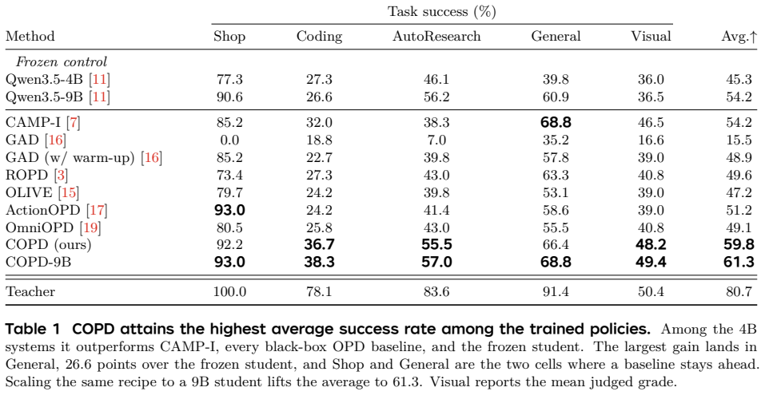

图 1-2｜原 Table 1，PDF 第 7 页。[来源](https://arxiv.org/pdf/2611.23673v1)。同一 4B 初始化与测试协议下比较 CAMP-I 和五种黑盒 OPD；Teacher 行是强模型参考，COPD-9B 是另一规模。各域用 native metric，Visual 为平均判定 grade，不宜把 Avg 当作 640 道二元题的简单成功比例。先看均值，再看单列例外：Shop 的 ActionOPD、General 的 CAMP-I 仍领先 COPD-4B。

4B 初始均值 45.3，CAMP-I 为 54.2，ActionOPD 为 51.2，COPD 为 59.8；增益比 (59.8−45.3)/(51.2−45.3)=14.5/5.9≈2.46。它是“相对初始学生的增益之比”，不是成功率变为 2.46 倍。9B 初始 54.2→61.3，提高 7.1 点（正文约写 7 点）。General 的 39.8→66.4 为 +26.6 点；有些基础方法会失稳，如无 warm-up 的 GAD 均值只有 15.5，不应忽略 warm-up 对照 48.9。

### 原消融图、反事实检查与外部迁移

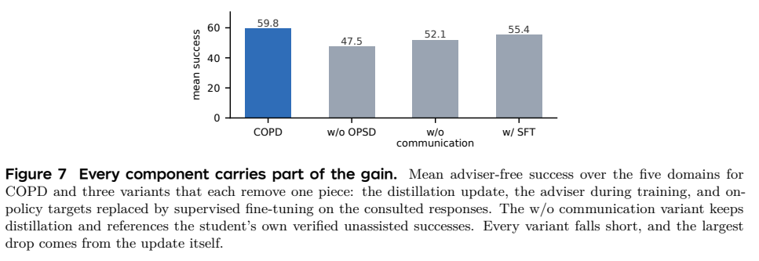

图 1-3｜原 Figure 7，PDF 第 10 页。[来源](https://arxiv.org/pdf/2611.23673v1)。固定 adviser-free 测试，COPD 59.8；保留咨询但去 OPSD 是 47.5；去咨询、改用学生自己无援助成功参考为 52.1；把 OPSD 换成对咨询成功响应做 SFT 为 55.4。这些是整段训练的组间对照，不是一次梯度贡献的可加分解。

有顾问/无顾问双条件评估中，w/o OPSD 是 62.4→47.5，COPD 是 61.4→59.8；有顾问时前者更高，撤掉顾问却差 12.3 点，说明“带辅助完成任务”与“内化能力”不同。论文的单次更新控制固定学生、fresh attempt 和更新：同题咨询成功参考给 +0.6 点、同题无援助成功 +0.2、同域其他题咨询成功 −0.1、无参考 0。变化小且未给完整不确定性，不能过度解释为严格三倍通用效率。

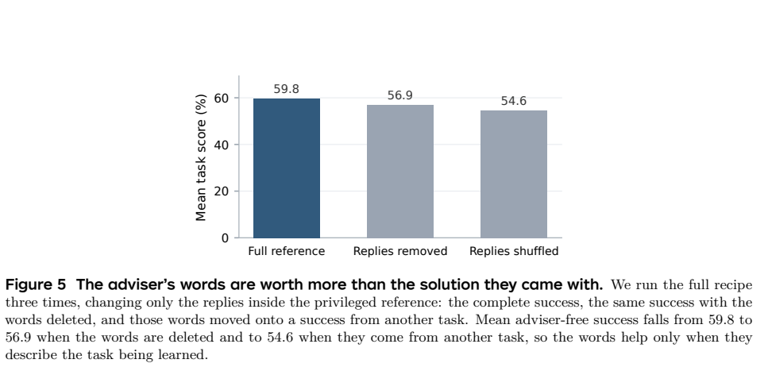

图 1-4｜原 Figure 5，PDF 第 9 页。[来源](https://arxiv.org/pdf/2611.23673v1)。三次重训只改变特权参考中的顾问回复：完整 59.8、删回复 56.9、错配其他任务回复 54.6。问题、动作和观察按作者说明保留；图支持内容与任务匹配的重要性，不能证明参考其余部分完全无用，也没有排除错配引入的不连贯因素。

训练中 ask rate 指“允许顾问的 episode 至少咨询一次”的比例：48.9%→update20 的 55.2%→update100 的 38.9%，不是每步调用率。问题质量由 gpt-6-astra 按相关性、清晰度、上下文充分性评分，51.2→85.8；这是模型 rubric，不能当作人工客观真值或费用测量。

外部迁移仅测试 network-free 子集。Terminal-Bench2.1/SWE-Bench Pro V2，4B 从 23.1/11.2→28.0/16.5，9B 从 23.1/23.1→33.0/27.5；未披露子集任务数量与完整种子重复。9B 平均 30.3 接近 35B-A3B 参考的 30.6，只适用于这两子集及协议，不能称普遍追平大模型。

**局限与复现。** 只试 4B/9B、一个固定外部顾问；未报告足够训练种子、误差条和成本，比较也没有证实等 API 调用预算。复现需保存通信内容、环境判分、同题检索键、fresh workspace、行为概率、mask、corpus 留存策略及测试子集。作者项目页是已核验的讲解入口；没有找到专门作者代码，不把 CAMP 或其他黑盒蒸馏库当作本篇实现。

**基础资料。** 入门：[GKD 原论文](https://arxiv.org/abs/2306.13649)解释学生前缀；优化：[PPO 官方入门教程](https://spinningup.openai.com/en/latest/algorithms/ppo.html)解释 ratio clip。它们是辅助，均不占 5 篇名额；项目页是作者的公开方法讲解，未核验到另一篇独立博客。

## 2. B-OPSD：给冻结教师一份自己写的“解题注意事项”

**一手入口：**[论文与历史](https://arxiv.org/abs/2611.19273)、[原文 v2](https://arxiv.org/pdf/2611.19273v2)、[官方代码](https://github.com/ZevineXu/B-OPSD)。作者 Zhi Xu 等，首次公开 2026-11-14，v2 为 11-17；只按一篇新论文计数。本节覆盖第 3—4 节、附录 A/B 与公开训练器。

### 问题、原架构与训练/推理分工

**原文事实。** OPSD 常给教师参考解答，学生不看解答，但整个训练仍需要答案资料。B-OPSD 用仅由问题生成的 brief 替代参考解答。简报四部分是：目标与结构；相关原理、公式和适用条件；建议设置与子目标；易错点和检查。提示要求不写最终答案或完整解法，建议 700 token 内；没有用正确性 verifier，也不按答案过滤简报，所以它可能错误，甚至不完全遵从格式。

学生和教师都从 instruct 模型 θ₀ 出发，教师始终冻结在 θ₀；学生 θ_k 更新。静态版由初始模型写一次简报，刷新版由最近保存的学生 checkpoint 写简报，但教师权重仍不更新。“刷新简报”不是 EMA 教师，也不是教师演化。推理只保留学生，问题输入中不附简报。

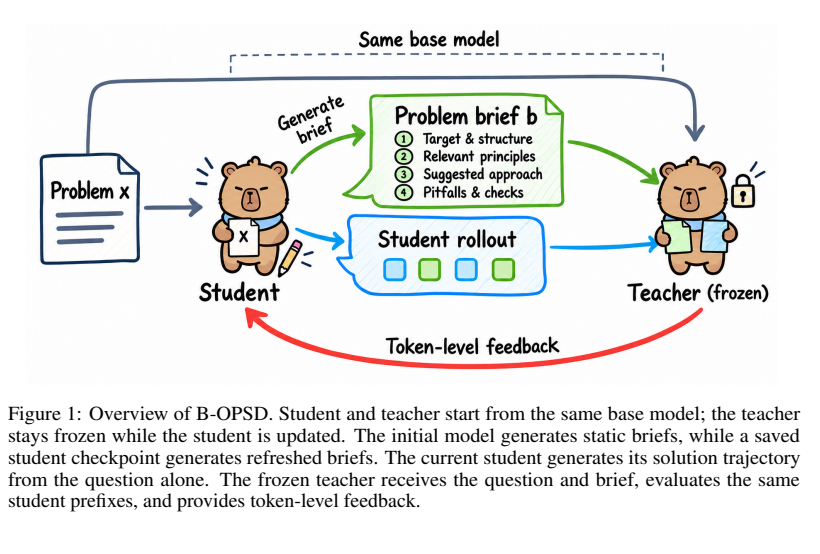

图 2-1｜原 Figure 1，PDF 第 2 页。[来源](https://arxiv.org/pdf/2611.19273v2)。绿色简报改变教师条件，蓝色 rollout 来自学生，红色 token feedback 只更新学生。上方同初始模型不意味着每次打分共享当前权重；锁图标对应冻结教师。学生与教师各自 prompt 后接的是相同完成前缀。

### 全部核心公式与计算直觉

令 D={x_i} 是仅用问题语句的训练集，P_B 是固定简报模板，φ_k 是简报生成模型参数，b~p_{φ_k}(·|P_B,x)。学生生成 ŷ~p_{θ_k}(·|x)，长度 T=|ŷ|；各位置 p^S_t=pθ(·|x,ŷ_<t)，p^T_t=pθ₀(·|x,b,ŷ_<t)。没有再从教师采样一条完整解答来当 target。

论文的候选 divergence 为：

```text
FKL = Σ_v q_v ln(q_v/p_v)
RKL = Σ_v p_v ln(p_v/q_v)
m_v = β_mix q_v + (1−β_mix)p_v
JSD_β = β_mix Σ_v q_v ln(q_v/m_v)
        + (1−β_mix) Σ_v p_v ln(p_v/m_v)
ℓ_τ(x,b,ŷ) = (1/T) Σ_t Σ_v min(d_{t,v},τ)
L_k = (1/|B_k|) Σ_{x∈B_k} ℓ_τ(x,b_k(x),ŷ_x)
```

p、q 是 student/teacher，m 是混合分布，β_mix=0.5 用于 JSD 对照；d 是相应 divergence 的词表项，τ 是逐项封顶上界。主实验 full-vocabulary FKL、τ=0.05。FKL/RKL 的词表项可以有正有负；共同基础已给出封顶后 loss 可负的算例和导数。对照 JSD 的 β_mix 与代码的端点选择要分清：代码 beta=0 代表 FKL，beta=1 代表 RKL，不是把数学 JSD 在 β=0 的退化零值当 FKL。

不封顶时，FKL 对学生 logit 的梯度 p_j−q_j，来源是交叉熵 −Σ q ln p，其余 Σ q ln q 对学生为常数。给教师一条相关原理会改变 q，从而改变学生更新；简报本身没有梯度，也不是强制学生输出的 SFT 标签。采样的轨迹在每次更新内固定，因此不对“生成了哪些前缀”额外求导。

刷新日程：C_save 包含 0 和已经完成更新后保存的步数，s(k)=max{s∈C_save:s≤k}，φ_k=θ_{s(k)}。**本文教学例：**每 25 步保存，k=38 时用 θ₂₅ 写简报，k=62 时用 θ₅₀；两次打分教师仍是 θ₀。静态版则永远 φ=θ₀，但同一道题的新 rollout 前缀不同，教师分布也可不同，所以“静态简报”不等于每次监督概率完全相同。

**小白题例，本文推演。** 对 (x+4)(x+1)=m+2x 要求唯一实根，简报可只提醒展开后二次项判别式为零、检查重根，不给 m。学生仍需自己整理为 x²+3x+4−m=0 并算 9−4(4−m)=0，得到 m=7/4。这是本文展示“提示与答案”的区别，不是作者新增测量，也不说明所有生成简报都真的避免泄露解法。

```text
冻结初始 instruct 模型 θ₀；只训练学生 LoRA
静态：为问题生成并缓存 b₀；刷新：选择最近 saved checkpoint
循环 100 次更新：
    采问题，只把问题给学生，生成最多 1024-token 完成
    教师看问题+简报，对同一学生前缀逐位置打分
    在全词表算 FKL 项，每项 min(d,0.05)，按 mask 聚合
    只更新学生；每 25 步保存，刷新版为之后区间更新简报
评估：问题单独输入学生，开启指定 thinking 配置，平均多次采样
```

### 数据、模型、训练成本与公开代码核对

**原文事实。** Qwen3-1.7B/4B/8B instruct 学生，从 OpenThoughts reasoning subset 取最多 30K 数学问题；主 B-OPSD 不读参考解答或 outcome label。NVIDIA A800、LoRA rank64、scale128，覆盖 attention q/k/v/o 与 MLP gate/up/down，AdamW、bf16、lr5e−6，有效 batch32、100 updates；每题一次 rollout、temperature1.1、最长1024。简报 temperature0，刷新每25更新。没有额外任务奖励项。

32×100=3200 是名义问题呈现预算，不是“实际使用全部30K并重复一遍”的证据。论文没给每规模卡数、端到端 GPU-hours/墙钟、峰值显存、简报 token 量与费用。代码 1.7B 示例用 2 processes×每卡4×累积4=32，不能把示例当成全部实验的实测资源。简报生成也耗时；没有独立大教师不等于无额外推理。

**代码核查。** 固定提交 8df0eae3424c9d03e82fa75346388e016a7dec05，见[固定版本](https://github.com/ZevineXu/B-OPSD/tree/8df0eae3424c9d03e82fa75346388e016a7dec05)。已读 b_opsd_train.py、b_opsd_trainer.py、opsd_train.py 与启动脚本，未运行训练。fixed_teacher 通过关闭 LoRA adapter 实现，teacher forward 在 no_grad 中；_repack_for_loss 按不同长度 prompt 分别对齐预测位置，labels=-100 的 padding 不进 loss。

三处复现差异需要单独保存。第一，论文说提示建议700 token、没有单独硬 brief 上限；当前训练器设置输出 brief 最多1024，thinking 生成总预算30720，超长或未完成时会用 non-thinking1024-token 重试，并裁切。它不是答案正确性筛选，但与原文字面配方不同。第二，训练器的 generalized_jsd_loss 以有效 token 数归一化，论文 Eq.11 则先每轨迹均值再 batch 均值；不同长度和梯度累积下两者权重可能不同。第三，B-OPSD 入口硬编码本地数据目录，而 OPSD baseline 用公开 dataset ID。官方 README 也要求核对数据版本、样本与 shuffle；应把两者统一到同一数据快照，不能只更换路径就声称严格公平复现。

示例脚本路径含 reverse 字样，但实际 --beta 0 走 FKL。判断目标应看分支与参数，不能猜文件名。代码还包含 EMA、外部生成器和 sampled-token PG 等可选模式，它们不是本文主实验；公开仓库有这些选项也不代表主方法使用了外部教师或 EMA。

### 原实验图、比较口径与消融

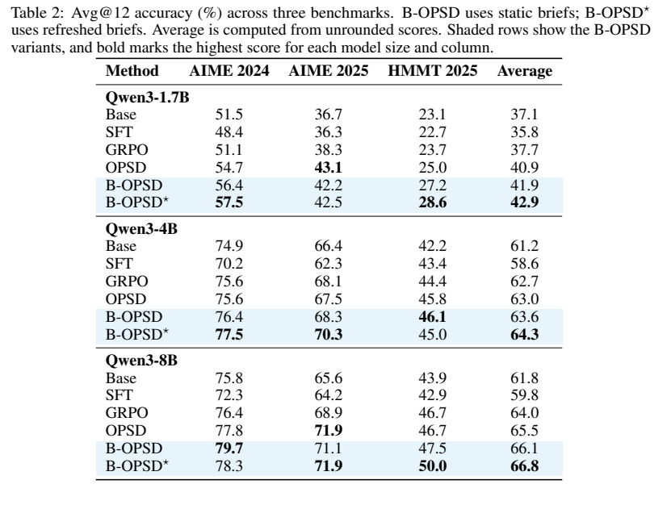

图 2-2｜原 Table 2，PDF 第 7 页。[来源](https://arxiv.org/pdf/2611.19273v2)。每题12次生成的平均正确率 Avg@12，不是 pass@12。各 benchmark 从25/50/75/100四个 checkpoint 取最高再平均，Average 不一定属于某个可部署单一 checkpoint。Base/SFT/GRPO 引自原 OPSD 研究，OPSD 由作者重跑，不能称所有行同算力重训。

1.7B 的 Base/OPSD/static/refresh 均值为37.1/40.9/41.9/42.9；4B 为61.2/63.0/63.6/64.3；8B 为61.8/65.5/66.1/66.8。静态相对OPSD为+1.0/+0.6/+0.6点，刷新为+2.0/+1.3/+1.3。刷新不是逐格获胜：4B HMMT 静态46.1高于刷新45.0，8B AIME24静态79.7高于刷新78.3。结果没有充分种子/误差条支持把小差异断言为稳定优势。

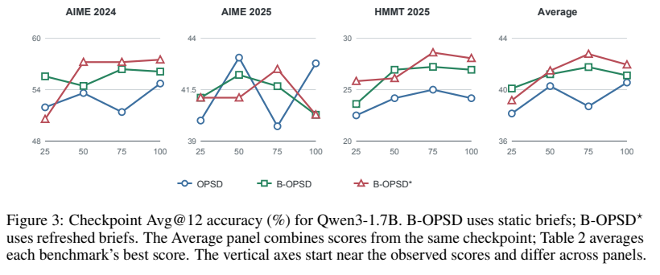

图 2-3｜原 Figure 3，PDF 第 6 页。[来源](https://arxiv.org/pdf/2611.19273v2)。横轴更新数，四列是三个 benchmark 与同一 checkpoint 的平均；y轴各不相同且截断，应读具体数值而非斜率大小。刷新版在4个 checkpoint 的3个高于其余两者的同点均值；这是单次训练路径的测量，不是多种子平均。

评估开启 thinking，temperature1、top-p0.95、最长38912；训练1024的短 non-thinking rollout 与测试长推理的分工要保留。SFT 是参考解答训练100更新、最长16000，GRPO是500更新、每题8条、temperature1.2、最长16000，来自原研究；不能因为参数规模相同就视为等计算预算。

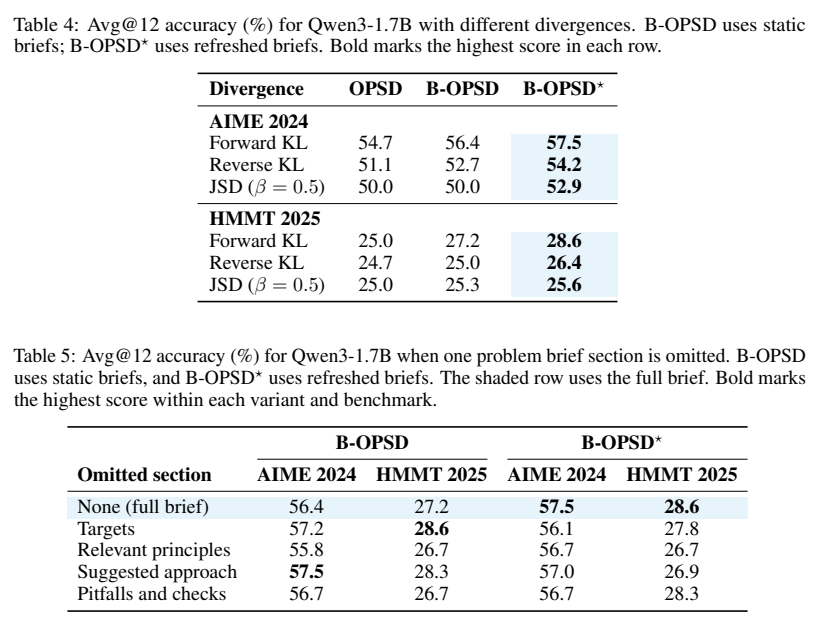

图 2-4｜原 Tables 4/5，PDF 第 9 页。[来源](https://arxiv.org/pdf/2611.19273v2)。上表在同一1.7B配置比较 divergence，刷新版 FKL 为 AIME24 57.5/HMMT28.6，RKL54.2/26.4，JSD52.9/25.6；下表删除简报组件，检查哪些上下文有用。这不是证明FKL在任何任务普遍最优。

相关原理是较一致的贡献：刷新版删掉它，57.5/28.6→56.7/26.7。但静态版并非四段全有最佳：删 targets 达57.2/28.6，删 suggested approach 达57.5/28.3，高于完整56.4/27.2。原文“完整简报最好”仅适用于刷新版这组测试。更大8B生成简报、参考解答生成简报的1.7B对照为56.4/27.8和56.4/27.5，刷新版57.5/28.6；ref 对照使用了参考答案，不能也标成 label-free。

**局限与复现。** 简报可能含错误、隐含答案或完整推导；没验证过不能称“可靠知识”。论文没有逐简报质量因果审计、长度与信息量严格匹配，也只有一个模型家族和三套数学题。复现需固定模型/数据哈希、brief cache 来源与刷新步、teacher adapter 状态、两视图 token 对齐、loss reduction 与 cap。当前代码足够作为检查入口，但上述差异使“一键精确复现论文数字”的承诺不成立。

**辅助资料。** [作者 README](https://github.com/ZevineXu/B-OPSD/blob/8df0eae3424c9d03e82fa75346388e016a7dec05/README.md)给安装与 cache/refresh 说明；[TRL GOLD 官方文档](https://huggingface.co/docs/trl/main/en/gold_trainer)帮助理解其训练器基础，属于 experimental API，当前文档不是论文固定环境；[PyTorch kl_div 文档](https://docs.pytorch.org/docs/stable/generated/torch.nn.functional.kl_div.html)解释输入与 target 顺序。未核验到另一个独立作者博客。

## 3. STONE：原题不敢信自己的答案，就先做简单相关题

**一手入口：**[论文与日期](https://arxiv.org/abs/2611.18916)、[原文 v1](https://arxiv.org/pdf/2611.18916v1)。完整标题 Simplify, Agree, Distill: Label-Free Self-Distillation with Stepping Stones，作者 Dingyang Chen 等，首次公开 2026-11-13。arXiv comment 写8页正文，实际 PDF 含附录14页；本节读取方法、结果与相关附录。未找到可核验的专门作者代码库或独立博客。

### 问题、原架构与“自洽不等于正确”

**原文事实。** 对难题直接多次采样、取多数答案，可能没有多数，也可能多数共同犯错。Qwen3-4B 在 29,434 题中选出的 9218 个不确定题上，28%连一半样本同答都没有；其余72%的多数答案只有69%正确。全训练集对应数字好得多，说明困难筛选会放大投票的弱点，而不是“所有问题投票都无效”。这里用真值判断正确性仅作事后分析，训练流程不读取标签。

STONE（Self-Taught frOm Nearby Easier problems）让模型为原题写更容易的 related problems，称 stones。先验证自己能否一致地解这些简单题，再把它们的 worked solutions 给教师。它们是相关示例，不是必须按顺序拼回原题的分解步骤。与 B-OPSD 不同，STONE 对生成上下文做 self-agreement 筛选；与直接 u-OPSD 不同，投票发生在简单题而非原题。

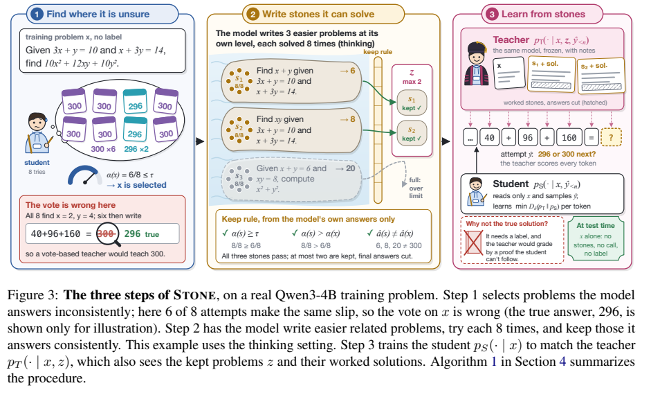

图 3-1｜原 Figure 3，PDF 第 4 页。[来源](https://arxiv.org/pdf/2611.18916v1)。左边原题8次中6次答300，但真值296，说明高一致也会错；中间写并验证3个相关简单题，最多留2个；右边教师看相关题解、学生只看原题，同前缀蒸馏。图中真值是解释例子才展示，不能推断训练筛选用了296。

### 保留规则、上下文构造和数值算例

对题 x 采 K 个答案，合并等价答案，â(x) 是众数，α(x) 是众数占 K 次的比例；没有最终答案的尝试也留在分母中，平票取先出现的答案。阈值 τ>1/2。方法用 K=8、τ=0.75，把 α(x)≤τ 的原题选到 U。为每题生成 M=3 个候选，先删除重复原题/重复候选、含 boxed answer、长度不合规的 statement。

对每个剩余简单题 s 再解8次，保留条件为：

```text
α(s) ≥ τ
α(s) > α(x)
â(s) ≠ â(x)
每个原题最多留两个合格 stone
```

最后一个条件避免把原题改写后直接把原题错误众数交给教师，不能保证 stone 的答案与真正原题答案一定不同。由于 U 允许 α(x)=τ，第二个严格大于条件并非总被第一个蕴含。选中 stone 后，取达到众数的最短 attempt，删除最终答案；thinking 设置中只展示思考轨迹之后的 written solution，不把完整私有 reasoning trace 一起给教师。

**本文手算。** 原题8次里某答案出现4次、2次无答案、其余各异，则 α(x)=4/8。一个 stone 有6次同答，α(s)=6/8=0.75；若众数与原题不同，满足三个条件。另一个只有5次同答便淘汰。若原题已有6/8同答，stone 也6/8，虽然达到0.75，却因为没有严格更一致而被淘汰。缺失答案不能从分母删掉后把5/6伪装成更高信心。

删 final answer 的实现按附录：优先在 Final Answer heading 截断，否则在最后 boxed 所在段落截断，剩余 boxed 拆包装，并加“相关题答案省略”的说明。它减少直接复制，但中间步骤仍可能隐含答案；不能声称有严格信息论保证。

### 小理论的逐符号解释与边界

论文用一个玩具模型解释为什么简单题可能更适合投票：原题由 k 个独立基本步骤组成，第 j 步正确率 p_j∈[1/2+γ,p_max]，p_max<1；最终答案是各步答案的一一函数。两次尝试最终答案相同，就必须每步都相同。

对一步，正确答案质量 p_j、所有错误质量合计1−p_j；两样本碰撞概率最多 p_j²+(1−p_j)²≤p_j≤p_max。独立 k 步给出 pair collision≤p_max^k；K次尝试的所有样本对用 union bound，Pr(存在相同答案的一对)≤C(K,2)p_max^k，实际概率当然还≤1。它界定“至少一对相同”的必要事件，不直接等于众数比例达到τ的概率。

对单个简单步骤，用 Hoeffding 处理“错误出现次数”及“正确出现次数”，得到论文 Proposition1 的界：

```text
Pr(相同错误答案至少出现τK次) ≤ exp[−2K(τ−1/2+γ)²]
若 p_j>τ：Pr(正确答案不足τK次) ≤ exp[−2K(p_j−τ)²]
```

γ 是单步正确率超过一半的保证，K 是采样数；推导使用独立 Bernoulli 尾界，并用“同一错误达到阈值”包含于“所有错误次数达到阈值”。**本文教学例：**若独立单步 p=0.8、阈值0.6、K=100，则错误达到阈值上界 exp(−32)，正确不足阈值上界 exp(−8)≈0.000335。这是特意取清晰参数的教学例，不是实际 K=8 的误差保证。系统性共同错误、步骤相关和多步答案非一一映射都违反假设；作者明确以实测而非此玩具定理作为主证据。

### loss、训练流程、模式分工与数据预算

令 z(x) 是保留 stones 与其删答案后的题解，教师冻结在初始权重。学生生成 ŷ~pS(·|x)，教师在同一前缀给 q_t=pT(·|x,z,ŷ_<t)，学生为 p_t=pS(·|x,ŷ_<t)。论文 Eq.1：L=(1/T)Σ_t D_δ(q_t||p_t)，D_δ 是共同基础中的全词表逐项封顶 FKL。学生有梯度，教师和构造 z 的生成过程无梯度；没有 outcome reward 混合到主训练 loss。

```text
Step1：每个原题用 non-thinking 采8次，找 α≤0.75 的不确定题
Step2：初始模型为每题写3个简单相关题，做 statement 基础过滤
       每个候选再解8次，按一致性/更高一致性/不同众数筛选
       最多留2个，取最短同众数解，删 final answer，存 z(x)
Step3：训练时学生只看 x，non-thinking 生成最多4096 token
       冻结初始教师看 x+z，对同一前缀全词表打分
       算 term-capped FKL，仅更新 LoRA；150步×32题
推理：不生成 stones，不调用教师，使用评估所规定的模式
```

**原文事实。** 所有设置训练学生 rollout 都是 non-thinking；“thinking 设置”是 stone 生成/解答、教师 scoring 模式和最终评估均为 thinking，“non-thinking 设置”三者都关闭。Step1 始终 non-thinking，不能误写成“thinking 实验学生也训练长思考轨迹”。

模型为 Qwen3-4B、8B 和 Gemma4 E4B-it；E4B 是论文型号，文中未完整拆分总参数/激活参数，不擅自改成精确4B总参数。基础29,434个 OpenThoughts 数学问题只用 statements。4B/8B/Gemma 的 Step1 selected 为9218/8706/15842；最终至少有一个 stone 的训练题，non-thinking 为7645/7302/14057，thinking 为7338/8136/15084。各150步×32=4800题，每题一次训练呈现、不重复；不是整份训练题都训练一遍。

LoRA rank64、alpha128、dropout0.05，覆盖 attention/MLP projections；teacher adapter off。AdamW β=(0.9,0.999)、无weight decay、恒定lr/无warmup、grad clip0.1、bf16。Qwen 非思考lr5e−6、思考3e−6，Gemma两者1e−6；cap δ 分别为非思考1e−6、思考0.05。学生采样T1.1、top-p0.95、top-k20；Step1为T0.7/p0.8/k20，最长4096；Step2非思考写题1536、解题4096，思考最多16384，T0.6/p0.95/k20。把所有阶段共用一个temperature会改变方法。

### 原实验、控制条件与真实成本

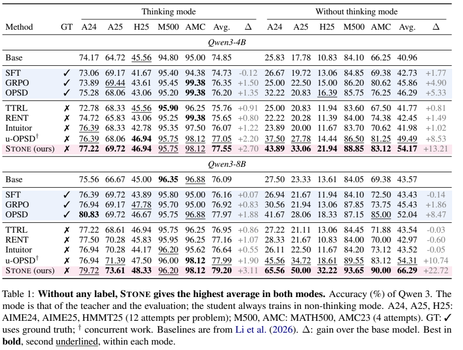

图 3-2｜原 Table 1，PDF 第 5 页。[来源](https://arxiv.org/pdf/2611.18916v1)。左右两半分 thinking/non-thinking，五列为AIME24/25、HMMT25、MATH500、AMC23；Δ 是相对Base的百分点。所有Qwen基线数值引自u-OPSD论文、各自训练recipe不同，因此主表不是只改变上下文的纯消融。各题平均采样正确率，不是多次采样至少一次成功。

Qwen4B thinking Base/OPSD/u-OPSD/STONE 为74.85/76.20/77.05/77.55；8B为76.09/77.97/77.99/79.20。非思考4B为40.96/46.29/49.49/54.17，8B为43.57/52.04/54.31/66.29。13.21/5.33≈2.48、22.72/8.47≈2.68，是相对Base的增益比，不是label-free在任何模型必然更好。Gemma 的匹配recipe中，thinking OPSD/STONE62.89/63.33，非思考50.00/50.54，改善较小。

评估 AIME/HMMT 每题12次，MATH500/AMC23每题4次；T1、最长38912，thinking top-p0.95、non-thinking0.8。每25步保存并逐 benchmark 选最高，Average 未必是同一checkpoint；这带有测试选择偏差。训练独立种子与置信区间没有充分报告，不能只看小数位判定显著。

原OPSD训练只有1024 token，45—68%的Qwen尝试在完成前截断；STONE改4096后降到4—15%。因此主表大增益不能全算到stones头上。匹配recipe控制才回答上下文问题：

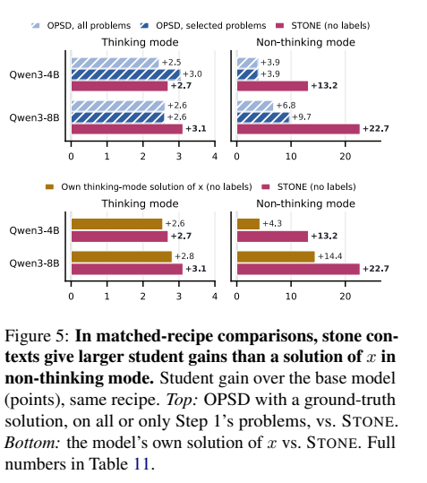

图 3-3｜原 Figure 5，PDF 第 6 页右栏。[来源](https://arxiv.org/pdf/2611.18916v1)。同一训练recipe下，上排对比原题参考解答/仅selected题的参考解答/stones，下排对比模型自己的原题解答与stones；横轴是相对Base的点数。non-thinking 的差距仍较大，thinking仅约半点以内，不能把两个模式合并夸大效果。

附录同recipe下，非思考OPSD全题/selected题/STONE：4B为44.85/44.86/54.17，8B为50.36/53.25/66.29。教师单独解题诊断用1000题抽样中所有上下文都完整输出的共同804题：无context46.1、stones47.0、自己的原题解80.2、真值解91.0。教师作为solver更正确，并没有对应学生学得最好，说明教师上下文的价值不能只用教师 solve rate 排名；这是匹配数据上的相关诊断，不是唯一机制的因果证明。

质量审计由Claude Opus5对thinking stones进行，27,563份中27,539可读。保留stone中well-posed86.8%，其中answer-correct90.2%，二者共同sound78.3%；拒绝者sound26.6%。约五分之一保留上下文仍有问题。题解有效约84%，多数更简单且相关；这不是人工验证，不能把模型审计分数当真值证书。13-word overlap 检查发现4道MATH500模板题重合度较高，其他集合亦有短语重合，不能声称彻底无污染。

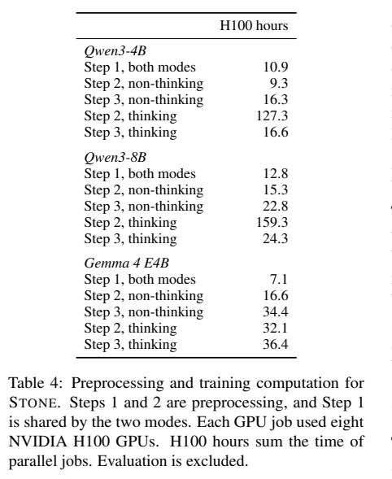

图 3-4｜原 Table 4，PDF 第 12 页左栏。[来源](https://arxiv.org/pdf/2611.18916v1)。作者口径为“H100 hours”，分Step1、Step2、Step3；Step1由两个模式共享，表注明每个GPU job用8张H100、并行作业时间相加、不含评估。不要只抄Step3便宣称完整训练成本，亦不据此另推每次作业墙钟。

4B 的Step1为10.9，非思考Step2/3为9.3/16.3，思考为127.3/16.6；8B为12.8、15.3/22.8、159.3/24.3；Gemma为7.1、16.6/34.4、32.1/36.4。**本文相加**得到两个模式单独从零准备的报告口径总量：4B36.5/154.8，8B50.9/196.4，Gemma58.1/75.6；若两模式共同做不能重复算Step1。峰值显存、金钱价格与各作业墙钟未披露，不额外乘8后冒称另一种实测口径。

**局限与复现。** 自洽会受系统性错误影响；相关题不保证覆盖原题关键难点；删答案不是无泄露证明；生成/验证的预处理可能远贵于蒸馏。只试数学和至多8B的学生，其他任务需要另定义agreement。复现需保存每题8次抽样、等价答案归并、无答案分母、statement过滤、最多2题选择顺序、最短解与截断规则、每阶段模式和预算。未核验到作者代码，不能把自实现u-OPSD或其他STONE同名仓库当方法发布。

**辅助资料。** 入门：[Self-Consistency 原论文](https://arxiv.org/abs/2203.11171)；参数高效训练：[PEFT LoRA 官方概念教程](https://huggingface.co/docs/peft/main/en/conceptual_guides/lora)。原文附录A有具体prompt、附录B有玩具定理证明，是复现所需的一手材料；作者专门项目/博客/代码本次未核验到。

## 4. SD-OPD：学生决定“改多大”，教师决定“这个方向可不可以”

**一手入口：**[论文与历史](https://arxiv.org/abs/2611.07722)、[原文 v2](https://arxiv.org/pdf/2611.07722v2)、[官方代码](https://github.com/aim-uofa/sd-opd)。完整标题 Reinforcing What the Student Has Learned: Teacher-Guided On-Policy Distillation，作者 Bozhen Fang 等，首次公开11-05、v2为11-06。重点读取第3—5节及附录A/B。

### 问题、原架构与测量依据

**原文事实。** 常用OPD把teacher/student log-prob差当token更新系数；这可能主要反映表达方式，而不是推理价值。论文在同一1024个DAPO问题、每题8条学生响应、约1130万response tokens上做规则分类，比较每响应/每问题等权的平均绝对系数，避免长输出占更大权重。style positions约60万、数学positions约470万，比较的是每token平均，不是总量。

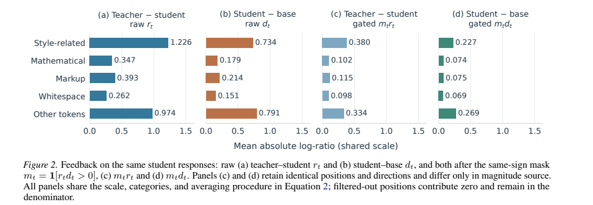

图 4-1｜原 Figure 2，PDF 第 3 页。[来源](https://arxiv.org/pdf/2611.07722v2)。四组使用相同token/分类/横轴：teacher−student原始差、student−base差、同一sign mask后的前者、同mask后的后者。style/math为1.226/0.347≈3.5；单换student−base反而约4.1；gate后teacher强度仍约3.7，gate后的student强度约3.1。它说明系数分配变化，不等于已经测到参数梯度范数或因果证明style一概有害。

SD-OPD 引入学生自己的预训练base S_B，而不是初始instruct学生 S₀。学生当前相对base的偏好变化提供强度，外部教师只检查变化方向。信号每个rollout round刷新，避免永远强化最初偏好。

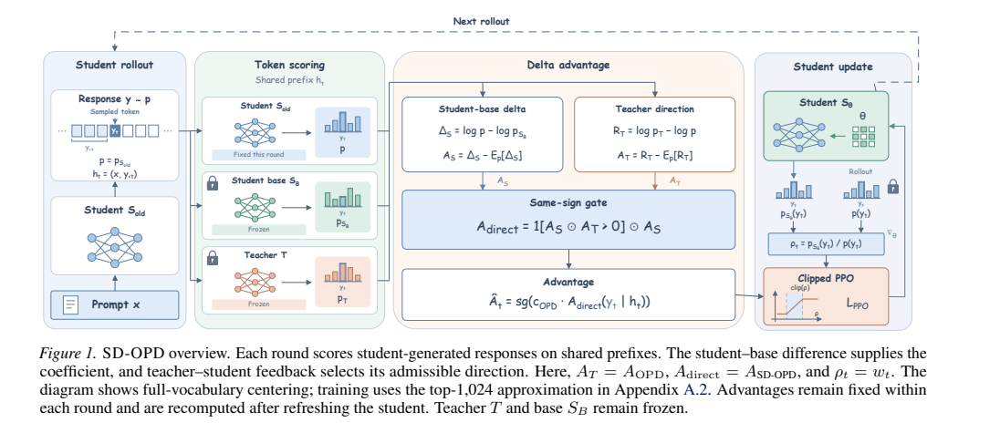

图 4-2｜原 Figure 1，PDF 第 2 页。[来源](https://arxiv.org/pdf/2611.07722v2)。同一学生生成前缀交给学生、冻结base和冻结teacher；AS与AT经same-sign gate后成为固定优势，之后做多个clipped更新，下一轮再采样/打分。图画全词表centering，实际训练是1024候选近似，不能把它当作全词表精确算法。

### 公式逐符号解释、近似与可手算例

令p是本轮rollout学生快照，q是冻结教师，b是冻结学生base，a是token。完整center算子 C_p{f}(a)=f(a)−E_{v~p}f(v)。定义：

```text
A_S(a)=C_p{ln p−ln b}(a)
A_T(a)=C_p{ln q−ln p}(a)
g(a)=1[A_S(a) A_T(a)>0]
A_SD(a)=g(a) A_S(a)
Â(a)=sg[c_OPD A_SD(a)]，c_OPD=1
```

AS>0 意味着该token相对base的偏好增长高于当前前缀平均，不等价于原始ln(p/b)>0；AT>0 意味教师相对学生的支持也高于平均。同为正则强化，同为负则抑制，异号或任一个为零就不更新。教师差值的幅度不用于给AS缩放。

完整centering中 E_p C_p[f]=0；若f是固定函数，减去与动作无关的baseline不改 E_p[f(a)grad ln p(a)]，因为 Σ p grad ln p=0。但本篇最终使用符号gate改变了目标，不能把整个方法说成“只减baseline所以等价于原OPD”。其目标是选择并强化学生方向，不是完整KL的无偏替代。

实际 Eq.13：从学生取topK=1024候选，若采到的token不在其中，用它替换最低概率候选；在同集合V_K上取各模型全词表归一化概率，**集合内不再次归一化**：

```text
C̃_{p,K}{f}(y)=f(y)−Σ_{v∈V_K(h,y)} p(v|h)f(v|h)
```

K控制centering近似，不是rollout采样top-k。省略尾部且候选集可依赖采样token，因此C̃不保证精确零均值；不能把“除以head mass”的另一实现偷偷换进来。集合、权重、AS/AT和gate在本轮更新中固定，下一轮才刷新。

**本文三类手算，用完整centering说明直觉。** p=(0.5,0.3,0.2)、b=(0.3,0.4,0.3)、q=(0.55,0.20,0.25)。ln(p/b)≈(0.511,−0.288,−0.405)，p加权均值0.088；AS≈(0.423,−0.376,−0.494)。ln(q/p)≈(0.095,−0.405,0.223)，均值−0.029；AT≈(0.125,−0.376,0.252)。于是优势约(0.423,−0.376,0)：第一类强化，第二类抑制，第三类学生想压低但教师想抬高，被gate拦下。并不是所有“学生已经偏好的token”都奖励。

### policy loss、双裁剪、奖励与退化推导

令w=πθ(y|h)/p(y|h)，p是固定本轮快照。普通PPO负号loss为 max(−wÂ,−clip(w,0.8,1.2)Â)。若Â<0，再取 min(ℓ_PPO,−3Â)，否则保留ℓ_PPO；这是dual clip，把负优势的大ratio损失封到3|Â|。loss按全部response token求均值，gate为零的位置仍留分母；不只对保留token重新平均。

本篇没有环境正确性奖励、额外reference-KL或entropy bonus，advantage normalization关闭。用“GRPO管线”不表示主算法做了组内答案奖励；官方zero-reward hooks会检查任务reward为零。Qwen教师的OPD/ExOPD基线用普通PPO clipping，SD-OPD及两个消融用dual clip3；MiMo设置三种方法全用dual clip3。这是实际比较条件差异，需要保留。

**本文重述原文局部推导。** 没有teacher gate时，用A_S作固定优势，在行为策略处且clip尚未激活，有 E_{a~p}[A_S(a)gradθ lnπθ(a)]|π=p = gradθ D_R(πθ||b)|π=p。因为baseline期望项为零，KL导数中的额外Σgradπ也为零。这是对“离base更远”做局部梯度上升，没有质量约束，不是向base做KL正则。它解释失控风险，不是对任意优化器和topK近似的全程定理。

```text
初始化instruct学生S₀；冻结其预训练base与外部teacher
每轮：学生采64题×4响应，固定rollout快照p
    在各response前缀选学生top1024并确保采样token在集合内
    teacher/base对同一候选打全词表归一化分数
    近似中心化AS、AT；同号保留AS，detach为固定优势
    用全response-token均值和dual clip做4次优化更新
    同步学生到rollout端，再采下一轮；总272轮
最终checkpoint按固定评估协议测试，不按测试最高点挑选
```

### 训练、源码与成本边界

**原文事实。** 五组师生：Qwen3-4B-Instruct-2507→1.7B，Qwen3-30B-A3B-Instruct-2507→1.7B/4B/8B，MiMo-7B-RL-0530→1.7B；各学生有对应Qwen3-Base。DAPO-Math-17K，272轮约一遍数据，每轮64 prompts×4=256条，分4次global batch64/microbatch1更新，共1088 optimizer updates、69632次序列呈现。不是把272写成总optimizer步数。

Adam lr1e−6、β=(0.9,0.98)、eps1e−8、weight decay0.1、恒定lr无warmup、clipgrad1、BF16、seed11。prompt1024、response7168、context8192；rolloutT1、top-p1、top-k禁用。评估六套数学题，每题16条non-thinking，T0.7/p0.8/k20、最长38912；Avg@16是pass@1均值，保留完整和截断响应，最终答案做归一化/符号等价检查。不能和前两篇thinking Avg@12直接排分数高低。

**代码核查。** 固定官方提交 ae19768776759d3788c4c5a65d5562f2b0929eba，见[固定版本](https://github.com/aim-uofa/sd-opd/tree/ae19768776759d3788c4c5a65d5562f2b0929eba)。utils/student_base_delta.py 的direct模式实现中心化和同号gate，distillation_scoring.py 用full logsumexp、缺样本时替换候选末位；megatron_utils/student_base_delta.py 在更新前no_grad收集并detach优势；train/run_opd.sh显式选direct、strength0、student-source current。工具函数默认还提供boost模式，默认函数参数不能冒认为论文入口用boost。

代码会核查scorer请求身份、张量维度、有限值和student old-policy分数对齐，拒绝混入额外奖励、partial rollout等配置。本次只静态阅读，没有执行外部训练脚本。复现应保留这些检查，避免异步错分数导致“看似同号”却来自不同prefix。

MiMo/Qwen输出head分别151680/151936行，论文把response限制在共同151665个ID，所有分布在同一共享词表归一化；prompt各自重分词，response IDs保持共同映射，按各自prompt长度对齐。这不是任意跨tokenizer都可直接对ID。特别要保存排除的think标签/填充行及special-token文本。

**未披露。** 论文没有完整给GPU型号/卡数、端到端GPU-hours、墙钟、峰值显存与金钱成本；多一个base scoring pass有真实开销。公开launcher支持4或8个设备并分actor/rollout/teacher资源，这是实现配置，不是已经实测的全套成本。匹配rollout和response预算不代表等教师/base FLOPs，较长响应也会改变实际token预算。

### 原结果表、消融与局限

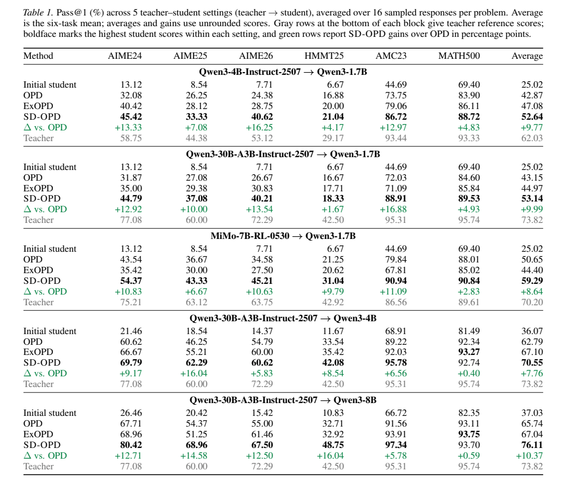

图 4-3｜原 Table 1，PDF 第 6 页。[来源](https://arxiv.org/pdf/2611.07722v2)。五块各对应一组师生，每块只在自己的OPD/ExOPD/SD-OPD中比较；灰行teacher不是相同训练预算的学生方法。六任务平均与增益取未舍入值。SD相对OPD在30个任务格全部提高，但并非每格都胜ExOPD，如4B和8B的MATH500。

五组OPD→SD均值为42.87→52.64、43.15→53.14、50.65→59.29、62.79→70.55、65.74→76.11。8B在这组non-thinking六数学任务上高于teacher73.82，不能推广为所有能力超过teacher。ExOPD固定λ1.25，使用初始instruct S₀作reference，AS用的则是预训练S_B，两者不能混为一份模型；MiMo上ExOPD44.40低于OPD50.65，说明该固定外推配置也会失败。

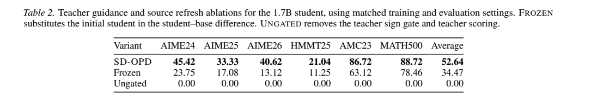

图 4-4｜原 Table 2，PDF 第 7 页。[来源](https://arxiv.org/pdf/2611.07722v2)。4B→1.7B，完整52.64；Frozen固定初始学生作为AS的分子，候选/权重/rollout等仍随当前学生，得34.47；Ungated去教师方向筛选得0。两个消融针对具体设计，不证明任意self-reinforcement都必然崩溃。

Ungated 的10560条评估响应全错，完整长度仅5—13token，平均6.05，10249条恰6token；不是因为全部输出撞上长度上限。训练先经历熵上升再坍塌，round105均长首次低于20，round180到6；最终熵约0.0004。完整方法仍长、熵低但有任务性能：30B→1.7B最后20轮平均长度约6520、熵0.128，OPD约4730/0.323。不同方法在自己访问的前缀上测熵，低熵不是普遍能力提升或退化的充分指标。

**局限。** 单训练seed11、有限模型/数学任务；规则分类不等于语义“有用/无用”的真值；gate丢掉师生方向相反但可能有价值的新偏好。需要能取得与学生匹配的预训练base，并额外打分。topK尾部近似、dual-clip差异和不同响应长度都限制“唯一收益来自某个机制”的推断。复现需记录head mass、gate覆盖、负优势ratio、每轮版本、base身份与共享词表；本文没有额外训练或产出新实验图。

**辅助资料。** [作者README](https://github.com/aim-uofa/sd-opd/blob/ae19768776759d3788c4c5a65d5562f2b0929eba/README.md)提供模型/数据/入口；[Slime官方框架](https://github.com/THUDM/slime)解释训练基础。基础数学可回看共同KL与本节centering推导；独立作者博客未核验到。

## 5. O³PD：候选排对顺序，未必需要复制教师的信心

**一手入口：**[论文与日期](https://arxiv.org/abs/2611.02112)、[原文 v1](https://arxiv.org/pdf/2611.02112v1)。标题 Order-Only On-Policy Distillation，作者 Guangzeng Han、Yu Wu、Xiaolei Huang，首次公开2026-11-01。方法第3节，实验第4—5节，附录A/B提供参数与温度扫描。没有核验到专门作者代码、项目或博客。

### 问题、原架构与监督层次

**原文事实。** 教师分布同时包含候选身份、候选次序与信心差距；小学生可能值得学习“更倾向哪一个”，却未必有能力或必要把每个概率数值拟合到教师。论文把序列KD的单一token、ordinal候选排序、完整分布三层区分开，保留on-policy学生前缀，仅把每位置目标换成教师top-K的身份与次序。

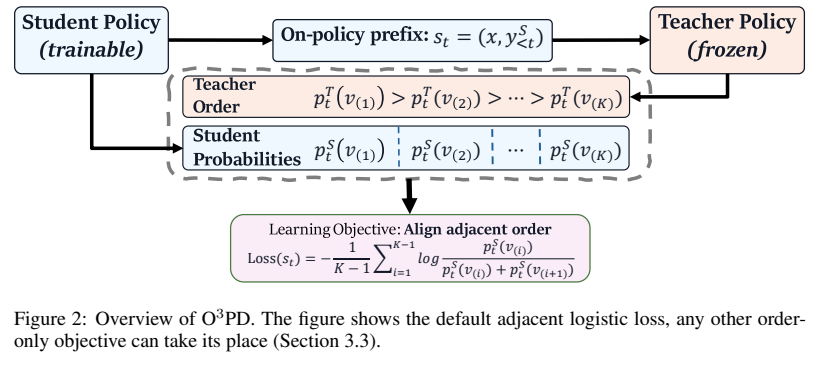

图 5-1｜原 Figure 2，PDF 第 4 页。[来源](https://arxiv.org/pdf/2611.02112v1)。学生生成的prefix同时交给冻结teacher，teacher回传排序；student probabilities用于相邻偏好比，最终优化排序loss。它没有要求教师各概率在学生上相等，但仍需要得到教师top-K顺序，不是只提供一条自然语言答案的纯文本黑盒方法。

### 相邻logistic目标的逐步推导和数值例

对学生response y^S，s_t=(x,y^S_<t)，教师top-K依次为(v₁,…,v_K)，由高到低；student logits记z_i=z^S(v_i|s_t)。对相邻i、i+1，限制到二选一时的偏好：

```text
r_i = p^S(v_i) / [p^S(v_i)+p^S(v_{i+1})]
    = exp(z_i) / [exp(z_i)+exp(z_{i+1})]
    = σ(z_i−z_{i+1})
Δ_i=z_i−z_{i+1}，σ(u)=1/(1+exp(−u))
ℓ_i=−lnσ(Δ_i)=ln[1+exp(−Δ_i)]=softplus(−Δ_i)
L=(1/|B|)Σ_x {1/[T_x(K−1)] Σ_t Σ_{i=1}^{K−1} ℓ_{t,i}}
```

softmax全词表分母在概率比中抵消，不需要拟合教师logit差。B是minibatch，T_x是该response长度；先平均每条response的全部位置与相邻pair，再平均batch。学生轨迹和教师排序在一次优化中视为固定，反传只经过学生分数。

导数 dℓ/dΔ=−σ(−Δ)，二阶导为σ(Δ)σ(−Δ)>0。对单pair，dℓ/dz_i为负、对z_{i+1}为正，梯度下降抬高teacher更偏好的候选。次序反了时梯度大，排对且margin很大时趋近零。严格地说，logistic仍鼓励margin继续变大，不是“排对以后立即零梯度”；没有指定有限目标margin，更不保证学生概率校准。

**本文手算。** 教师给A>B>C，学生logits为(0,1,−1)，则Δ_AB=−1、Δ_BC=2，loss=[ln(1+e¹)+ln(1+exp(−2))]/2≈(1.313+0.127)/2=0.720。两pair的未平均梯度为−0.731、−0.119，先着重修复A/B倒序。教师概率是(0.80,0.15,0.05)或(0.45,0.35,0.20)，此处目标都相同；普通概率匹配却会给不同信号。

K−1个相邻严格不等式 z₁>z₂>…>z_K 通过传递性推出全部K(K−1)/2个pair次序；这只是约束信息足够，不代表优化时相邻pair和全pair必定同一速度或同一泛化表现。K=8只需7个pair，对比28个all-pairs。词表外候选的绝对质量没有被排序目标直接规定，不应据此承诺完整分布一致。

教师温度T_teacher>0将logit除以常数，排序与top-K不变，因此在固定prefix、确定的tie-break下目标不变；任意严格递增score变换也一样。这不是学生采样温度不重要，也不表示换teacher checkpoint、改prefix或候选K后仍同目标。数值舍入造成并列时，实际实现还需固定tie规则。

### 其他ordinal目标、baseline与实现流程

原文比较的替代目标同样只读排序。令P={(i,j):i<j}，Δ_ij=z_i−z_j；all-pairs logistic对P平均softplus(−Δ_ij)，top-weighted版本用w_ij=1/i再除权重和。ListMLE为：

```text
L_ListMLE = −[1/(K−1)] Σ_{i=1}^{K−1}
                 ln[ exp(z_i) / Σ_{j=i}^K exp(z_j) ]
```

每次从尚未排列的候选中选择teacher当前排首的那个，最后剩一个无需loss。这几种目标都不引入teacher概率幅度，但对头部、尾部与错误pair的优化权重不同，不能认为loss数值可直接横比。

主baseline是teacher top8上的JSD。两边在同一teacher候选集合S内分别归一化：q̄_v=q_v/Σ_Sq，p̄_v=p_v/Σ_Sp，m=(q̄+p̄)/2，JSD=0.5Σ_Sq̄ln(q̄/m)+0.5Σ_Sp̄ln(p̄/m)。teacher温度固定1。它不是全词表FKL，也不是昨日SWE-OPD的学生topK raw概率比。FKL的p−q梯度公式不能不加说明套到这里的JSD。

```text
每次更新采32个问题；学生生成自己的完整/截断response
冻结teacher在每个学生prefix上取top8并排序
student对相同8个ID取logits，计算7个相邻softplus项
先按每条response的位置与pair数平均，再平均batch
直接反传学生LoRA；teacher不反传；重新采下一批on-policy轨迹
每20步评估；总100步，保存原始逐题采样结果和checkpoint选择规则
```

实现可直接用softplus保持数值稳定，避免先算很小σ再取log；候选ID gather和因果预测shift必须一致。仅相邻logit差loss对全部logits共同平移不敏感；full softmax归一化可约去，但teacher推理成本仍在。没有源码时，mask、空response、同分候选与截断处理都需要显式写出，本文不声称作者已经用了某个具体kernel。

### 数据、规模与训练成本

**原文事实。** Qwen3学生1.7B/4B/8B，各配更大的4B/8B/14B教师，形成6组；teacher冻结，OpenThoughts数学reasoning subset，具体最终条目数、筛选与数据快照未给全，不能抄其他论文的30K当本篇事实。训练LoRA r64、alpha128，lr5e−6、有效batch32、100更新、seed42。训练teacher用thinking、student用non-thinking、rollout上限1024；表中没有完整给训练采样T/top-p、优化器参数、LoRA dropout等，不擅自补默认值。

Transformers训练、vLLM评估，硬件是NVIDIA H100。没有卡数、总GPU-hours/墙钟、峰值显存与费用；100×32=3200只代表名义prompt呈现数。ordinal loss比全pairs少算pair不意味着端到端节省同倍数，因为teacher/student forward与全词表输出仍可能主导。主baseline也用top8，不能声称省去了baseline全部全词表开销。

评估HMMT25、AIME24、AIME25，T1/top-p1/top-k禁用/min-p0/presence penalty0，最大new tokens38912、model length40960。三个评估seed41/42/43各4次，共Avg@12；这是生成采样重复，不是3个独立训练seed。每20步评估，选三套测试集平均最高的同一checkpoint，包含测试选择偏差；与B-OPSD“每benchmark各挑最高再平均”的方式不同。

### 原结果表、消融与机制诊断

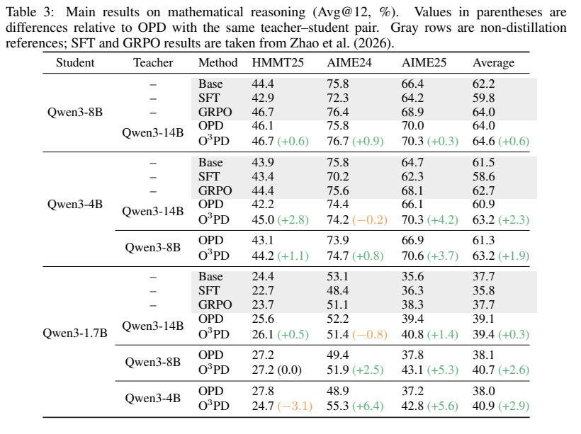

图 5-2｜原 Table 3，PDF 第 7 页。[来源](https://arxiv.org/pdf/2611.02112v1)。同一teacher/student的括号为相对OPD点差，灰行SFT/GRPO取自之前研究；不是6组完整资源重训。全6组平均提高0.3—2.9点，单列却有下降，应同时读红字与绿字。

| teacher→student | OPD平均 | O³PD平均 | 差值 |
| --- | --- | --- | --- |
| 14B→8B | 64.0 | 64.6 | +0.6 |
| 14B→4B | 60.9 | 63.2 | +2.3 |
| 8B→4B | 61.3 | 63.2 | +1.9 |
| 14B→1.7B | 39.1 | 39.4 | +0.3 |
| 8B→1.7B | 38.1 | 40.7 | +2.6 |
| 4B→1.7B | 38.0 | 40.9 | +2.9 |

18个单任务比较中14个提高；4B→1.7B的HMMT27.8→24.7，14B→1.7B的AIME24 52.2→51.4，14B→4B的AIME24 74.4→74.2，另有一格持平。AIME25则每组提高，最多+5.6。最大师生差距的14B→1.7B只多0.3，说明排序本身也可能难传；不能说排序已经消除了能力差距。

8B→1.7B曲线里OPD在step20达到38.1后下降，最终低于Base37.7；O³PD在step100达到40.7。但这一稳定性例子是一组、一个训练seed的观察，不是任意训练长短都保证稳定。

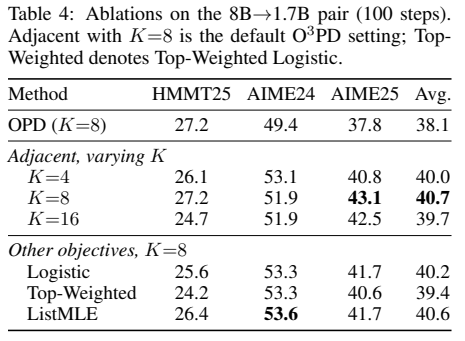

图 5-3｜原 Table 4，PDF 第 8 页左侧。[来源](https://arxiv.org/pdf/2611.02112v1)。固定8B→1.7B、100步，K4/8/16平均40.0/40.7/39.7，OPD(K8)38.1；all-pairs40.2、top-weighted39.4、ListMLE40.6。支持ordinal信息不只适用于一种loss；没有证实K8是所有任务或模型的最优候选数。

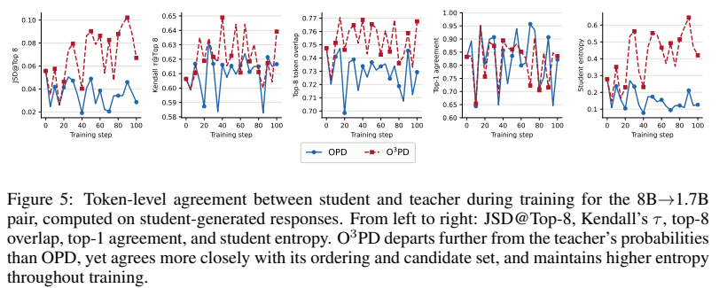

图 5-4｜原 Figure 5，PDF 第 9 页。[来源](https://arxiv.org/pdf/2611.02112v1)。8B→1.7B，横轴训练step；五面板为teacher top8内重归一化JSD、Kendall排序相关、top8 overlap、top1一致率、全词表学生熵。O³PD的JSD更大却排序相关/候选重合更好，熵也更高；指标在各模型自己生成的prefix上测，不完全是固定probe上的同状态比较。

Kendall τ衡量同一teacher候选中pair次序一致/相反程度，top8 overlap=|S_student∩S_teacher|/8只看集合，top1 agreement只看第一名；三者不能替代概率校准。更远离teacher概率却更准确，支持本设置不需要精确概率拟合，不能推出所有概率监督都无用。

温度扫描T∈{0.25,0.5,1,2,4,8}覆盖更多0.6B学生，teacher温度会显著影响OPD；但每格只训练3步、batch32。主表是T=1的100步OPD对照，没有完成全温度、全预算调参后证明最强OPD仍被击败。教师温度不敏感是目标的代数性质，较调参充分baseline的最终精度优势则需要额外实验。

**局限与复现。** 单模型家族、三套竞赛数学、单训练seed；没有充分统计不确定性、泛化文本或安全行为评测。排序丢掉置信幅度，遇到近乎并列或teacher错误高排仍会强制排序；只约束候选内部，不保证词表外质量或校准。复现需固定数据、tie-break、候选归一化baseline、loss平均方式、生成长度、三评估seed与测试选点方式。专门作者代码本次未核验到，不能以第三方“预计可复现天数”替代实现证据。

**辅助资料。** 初学者可读[PEFT LoRA教程](https://huggingface.co/docs/peft/main/en/conceptual_guides/lora)；公式实现可核对[PyTorch softplus文档](https://docs.pytorch.org/docs/stable/generated/torch.nn.functional.softplus.html)，避免数值溢出；on-policy背景见[GKD](https://arxiv.org/abs/2306.13649)。这些是基础资料，非本篇代码/作者博客。

## 横向比较：监督来自哪里，决定了需要验证什么

| 方法 | 教师/额外信息 | 训练信号 | 不能省掉的核验 |
| --- | --- | --- | --- |
| COPD | 固定外部顾问文本；当前学生的特权视图 | 原生奖励PPO + sampled-token OPSD | 同题成功、通信内容、实际行为概率、无顾问测试 |
| B-OPSD | 冻结初始模型 + 原题自生成简报 | 主用逐词表项封顶FKL | brief错误/泄露、刷新来源、代码长度限制与reduction差异 |
| STONE | 冻结初始模型 + 简单相关题解 | 同类封顶FKL，先做agreement筛选 | 无答案分母、等价答案、相关性、预处理成本、训练/评估模式 |
| SD-OPD | 外部teacher + 学生预训练base | 当前student−base强度，teacher同号选择 | base身份、近似centering、dual clip差异、负优势退化 |
| O³PD | 冻结外部teacher的topK排序 | 相邻logistic或其他纯ordinal目标 | teacher候选、tie规则、排序外质量、温度调参对照 |

**本文综合判断。** “更强的教师”不是一个足够的设计指标。COPD需要任务相关的交流，而不是任意成功轨迹；B-OPSD和STONE需要有用的上下文，而不是教师单独解题分数最高；SD-OPD限制更新强度来源，O³PD直接删除信心幅度拟合。五篇也给出不同反例：无质量约束的自我强化会坍塌，更多简报组件不一定更好，排序平均提升也会损害个别任务。

训练验证至少同时记录：同一prefix上的loss定义与mask、生成/打分参数版本、实际新监督token与资源消耗、同一checkpoint的独立测试表现。不能用Avg@12或Avg@16冒称pass@12/16，不能用多次评估采样冒称多训练种子，不能用等episodes冒称等API费用或等GPU-hours。

## 检索、去重与交付记录

本次检索围绕on-policy distillation、on-policy self-distillation、problem briefs、stepping stones、black-box communication、student delta和order-only，优先一手arXiv submission history、原PDF及作者链接。没有把工程文章、普通RL/SFT、作者教程凑入5篇，也没有借用VLM/vLLM主题或目录。既有VLM/CCF内容保留。

本次5篇首次公开均在10-20至11-20内；B-OPSD、SD-OPD读最新v2但仍按原v1日期筛选，各只计一次。重复候选如昨天已收录SWE-OPD、Agentic-OPD、Streaming OPD及历史ECOS等排除；Proxy OPD首次公开为7月13日、11月16日修订到v3，本次没有核验足以单独新增收录的实质变化，故不把版本号变化本身算作新论文。身份检查覆盖sources.json及所有方向全部manifest，并人工复核标题与版本变化。

report.pdf由同一份report.md完整生成，保留全部正文、公式、伪代码、表格、20幅原图与图解；机器逐行内容比对与字体/图像检查、逐页渲染记录见assets/QA.md及assets/pdf-check.json。原图仅裁切/缩放，版权归作者和发布方。manifest保存原PDF哈希、作者代码固定提交、图号/页码/裁切及索引去重记录；本次未运行任何论文GPU训练。
