# OPD / OPSD 专项精读 · 2026-11-21

今日主题：监督应该分配到哪些位置、哪些事件，以及哪些学生历史？

检索窗口：2026-10-21—2026-11-21（北京时间日期，首次投稿以 arXiv submission history 的 UTC 日期为证）。目标 5 篇，实际收录 5 篇，均为窗口内首次发布且历史未收录的论文。本期内容全部属于 on-policy distillation 及其持续学习、决策排序和草稿模型训练应用；没有为了覆盖 OPSD 而加入无关自蒸馏论文。作者博客、项目介绍与基础教程不计入篇数。

全文使用三种标记：【原文事实】来自指定版本原论文；【本文推演】是为教学所作推导、算例或实现建议，不是作者实验；【未披露/未核实】表示本次核查没有得到足够证据。代码核查是固定提交的静态阅读，没有运行大模型训练。原图直接从 PDF 渲染裁切，保留原图表及图注；没有重绘实验数据。源文件、页码、裁切坐标和哈希见 [图文来源](https://github.com/daihuangyu/papers-daily/blob/main/OPSD/2026-11-21/assets/SOURCES.md) 与 [manifest](https://github.com/daihuangyu/papers-daily/blob/main/OPSD/2026-11-21/manifest.json)。

| 论文 | 首次发布 / 阅读版本 | 直接关联 | 官方实现核查 |
| --- | --- | --- | --- |
| [SH-OPD：从密集监督到随机视野](https://arxiv.org/abs/2611.20687) | 11-16 / v1 | 随机缩短 OPD 轨迹、监督重加权偏置 | 有公开代码，核对采样器与入口 |
| [Bernoulli OPD：别忽视高置信 token](https://arxiv.org/abs/2611.02093) | 11-01 / v1 | 改变单个采样事件的蒸馏损失 | 有公开代码，核对核心 loss 与配置 |
| [Replay for LLM Continual Learning with MOPD](https://arxiv.org/abs/2611.02746) | 11-02 / v2，11-03 更新 | 用上一阶段学生回放旧能力 | 关联 Zenodo 记录仅有论文 PDF |
| [DecisionRank](https://arxiv.org/abs/2610.42128) | 10-30 / v1 | 将生成式教师反馈映射到文档 item 空间 | 未核实专门官方训练仓库 |
| [SpecOPD](https://arxiv.org/abs/2611.02846) | 11-02 / v1 | 分支内 on-policy 草稿蒸馏 | 官方仓库明确尚无训练代码/评测脚本/权重 |

本次对照根 sources.json 和全部方向的历史 manifest，以去版本 arXiv ID、规范 DOI、规范 URL 和规范标题交叉去重；具体清单数量与别名检查记录在 manifest。论文通常版本更新不作为重新收录的理由。DecisionRank 的 arXiv 首投为 10-30，PDF 首页自署 Date 为 11-02；本期采用前者作为首次发布日期，并保留这项差异。

## 先建立共同语言：OPD 学的是学生走过的路

【基础概念】给定问题 x，学生 πθ 逐 token 生成 y。第 i 步状态 s_i=(x,y_<i)，表示问题和已经生成的前缀。教师 πT 在同一个 s_i 上给出下一个 token 的分布。训练学生自己遇到的前缀，能够覆盖“学生已经犯了小错以后怎么办”的状态；只模仿教师的完整标准答案通常覆盖不到这些状态。

令 p_i=πθ(y_i|s_i)、q_i=πT(y_i|s_i)。常见采样 OPD 使用优势 A_i=stopgrad(ln q_i−ln p_i)，并最小化 L=−mean_i A_i ln πθ(y_i|s_i)。stopgrad 表示这次更新把优势当常量，梯度只经过后面的学生对数概率。A_i>0 会提高这个采样 token 的概率，A_i<0 会降低它。教师可以给密集信号，不必每次都等到整道题判对错。

【本文推演】这不是说任意“固定样本上 reverse KL 的写法”都能直接求导成同一算法。采样分布依赖学生、状态分布也依赖学生；工程中的 detached surrogate 往往只在固定 rollout 上反传。本文每次讨论梯度时都会写明固定了什么。也不能把 token 监督数直接等同于独立有效信息数：多个 token 可能推动近似相同的参数方向。

KL 的方向也重要：D_KL(p||q)=Σ_v p(v)ln[p(v)/q(v)]；p、q 是同一支持集上的分布，v 是候选符号。KL≥0，但采样对数比可以为负。reverse KL 是相对教师而言以学生作第一项；Bernoulli 事件交叉熵、top-k 加权 surrogate 和接受率目标均不能不加说明地叫作同一个 KL。

## 1. SH-OPD：随机视野如何省计算，又引入什么偏置？

论文全名：[Rethinking Supervision Scaling in On-Policy Distillation: From Dense Supervision to Stochastic Horizons](https://arxiv.org/abs/2611.20687)。阅读 [v1 原文](https://arxiv.org/pdf/2611.20687v1)，重点为 §2—5、附录 A.1—A.4 和理论假设。作者 Xinhao Yao、Zhenxing Dou、Yong Liu；首投 2026-11-16。

### 问题、原图与方法直觉

【原文事实】长轨迹有更多监督 token，但收益不按 token 数线性增长。作者先固定同一批生成轨迹，仅改变监督前缀长度；再对等长的四段各自训练，发现训练某一段也能降低其他段的师生差异。四段自身差异降低 91.7%—92.7%，非对角迁移降低 46.5%—70.4%。这里的差异是固定状态、固定采样 token 上的绝对 log-prob gap，不能解释成完整词表 KL 降低同样百分比。

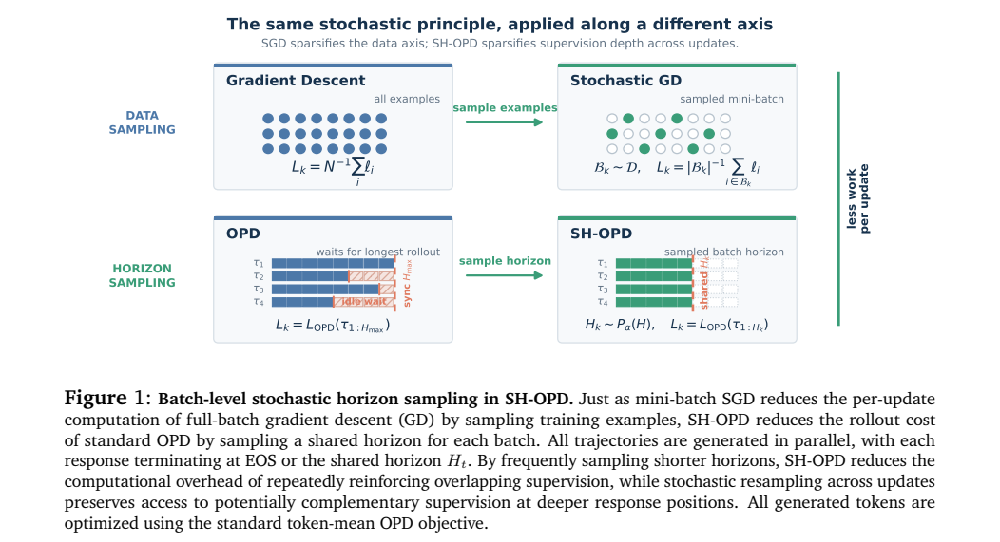
图 1-1｜原文 Figure 1，PDF 第 1 页，[来源](https://arxiv.org/pdf/2611.20687v1)。上半部把全量梯度下降和 minibatch SGD 类比，下半部把全长度 OPD 和 batch 共享随机终止上限类比。每轮所有 worker 使用同一个 H_t，轨迹在 EOS 或 H_t 停止；已经生成的 token 都训练。它是作者的方法示意图，不是性能实验。读图重点是“生成前设上限”，否则先生成整段再裁短无法省掉生成成本。

【原文事实】SH-OPD 不挑选梯度残差，也不为深层 token 显式乘逆采样概率。它只在每个 batch 采一个共同视野，保持标准 token-mean OPD。短轨迹经常强化共享更新方向，偶尔长轨迹保留深层状态的访问机会。低残差一致性并不证明深层监督无用。

### 关键公式：从生存函数到实际监督权重

【原文事实，式 1—3】每 token 损失 ℓ_i=−A_i ln πθ(y_i|s_i)。单轨迹写为 L_OPD=E[(1/N)Σ_i ℓ_i]，N 是响应长度。算法 1 的实际 batch 聚合为 L_batch=Σ_b Σ_i ℓ_bi / Σ_b N_b，即有效响应 token 平均；当各轨迹长度不同，它与先逐条平均再 batch 平均不同。复现时以实际训练聚合为准。

【原文事实，Definition 1】令基础长度 H0、最长长度 Hmax、块数 K=Hmax/H0，要求 K 为正整数；α≥0 控制短视野偏好。定义 P(H≥kH0)=k^(−α)，k=1,…,K。由相邻生存概率之差得到：k<K 时 pα(k)=k^(−α)−(k+1)^(−α)；最后 pα(K)=K^(−α)。α=0 时所有质量在 Hmax，精确退化为全视野基线。

【本文推演】离散非负整数的尾和恒等式给出 E[H]=H0 Σ_k P(H≥kH0)=H0 Σ_k k^(−α)。每次采 k 个等长块时，每块在 token-mean 中权重是 1/k，因此第 j 块的期望权重 wα,j=Σ_(k=j)^K pα(k)/k，而不是只有生存概率 j^(−α)。Σ_j wα,j=Σ_k pα(k)Σ_(j=1)^k 1/k=1。这个归一化解释了为什么短视野偏向前部监督，而不仅是少训练几次尾部。

【本文推演，手算】取 H0=100、K=3、α=1。三个视野 100、200、300 的概率为 1/2、1/6、1/3；E[H]=100(1+1/2+1/3)=183.33，名义上是全长的 61.11%。但三个块的期望监督权重为 25/36、7/36、4/36，约 0.6944、0.1944、0.1111；全长基线则各 1/3。它显然有偏。原文示例 H0=1024、Hmax=7168、α=0.5 的 E[H]≈4114，名义生成预算减少 42.6%；自然 EOS、prompt 成本和实际并行效率都会让真实时间比偏离这个数。

【原文事实，式 5—6】设 μ_k(θ) 是当前学生下第 k 块的期望 detached-surrogate 梯度；h0=(1/K)Σ_k μ_k 是全视野期望更新；δ_k=μ_k−h0；Δw_k=wα,k−1/K。随机更新可分解为 g_hat=h0+bα+ξ，其中 ξ 的条件期望为 0，bα=Σ_k Δw_k δ_k。定义稳定残差 Gram 矩阵 G_ij=〈δ_i,δ_j〉，于是 ||bα||²=Δw^T G Δw≤λmax(G)||Δw||²。^T 是转置，λmax 是最大特征值，〈·,·〉为向量内积，||·|| 为欧氏范数。

【本文推演】把 μ_k=h0+δ_k 代入 Σ_k Δw_k μ_k，利用 Σ_k Δw_k=0，共享项抵消，便得到偏置只由稳定残差决定。再展开平方范数得到 Gram 二次型，最后用对称半正定矩阵的 Rayleigh 上界。注意：中心化是减去均值，并没有把梯度投影到与均值正交的空间。

【原文事实，式 7—8】额外假设存在下界 F_inf、L-smooth 势函数 F，且 grad F=h0，噪声条件方差≤σα²，步长 η≤1/L。则 (1/T)Σ_t E||grad F(θ_t)||²≤2ΔF/(ηT)+Lησα²+Bα,T²，其中 ΔF=F(θ1)−F_inf，Bα,T² 是沿训练轨迹的平均重加权偏置平方。固定名义 token 总预算 C、batch 大小 B，Tα=floor(C/(B E[H]))；选择相应步长可得误差量级约 sqrt(κ σα² E[H]/C)+Bα,Tα²，κ=16LΔF B。原文的不等式含常数/步长条件，不是实际准确率预测器。

【本文推演】平滑性给 F(θ−ηg)≤F(θ)−η〈grad F,g〉+(Lη²/2)||g||²；代入 g=grad F+b+ξ，对历史条件取期望使噪声交叉项消失，以内积不等式控制偏置项，再跨 T 步望远镜求和得到三项界。势函数存在、方差有界等是理论条件，论文没有证明所有真实 OPD 训练自动满足这些条件。便宜更新增加 T 的好处，必须与新增 B² 一起看。

### 梯度证据、训练流程和数值结果

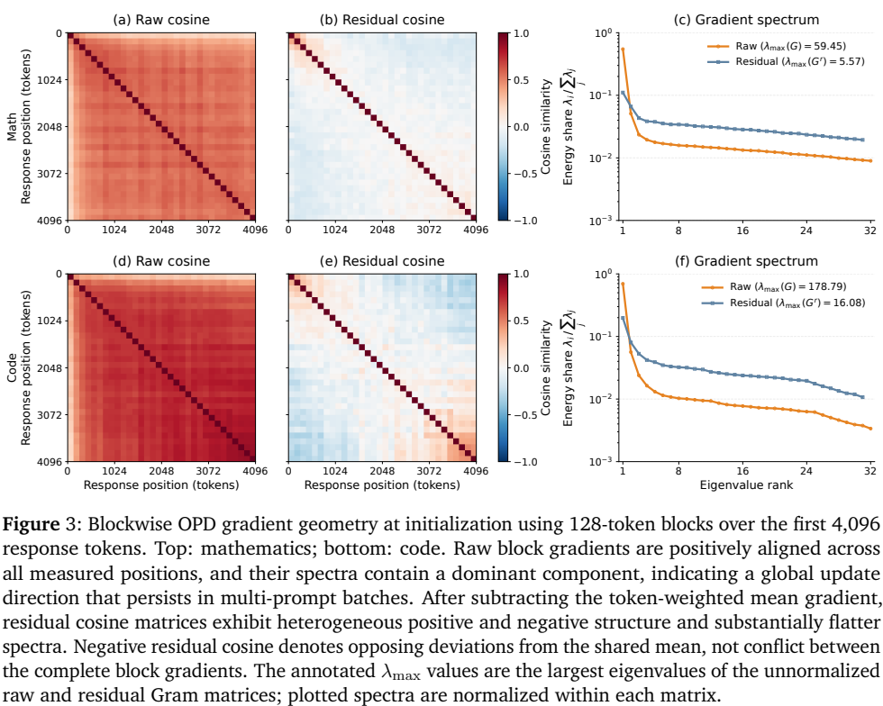
图 1-2｜原文 Figure 3，PDF 第 8 页，[来源](https://arxiv.org/pdf/2611.20687v1)。初始化时，把前 4096 响应 token 切成 32 个 128-token 块；上排数学，下排代码。左边是原梯度余弦，中间是减均值后的残差余弦，右边是各自归一化谱。数学/代码原梯度平均余弦为 0.526/0.680，说明存在共享方向；残差的负余弦是“相对均值的偏移相反”，不能说完整梯度相互冲突。这里是初始化诊断，不是整段训练中稳定残差矩阵的直接测量。

【原文事实】数学学生 DeepSeek-R1-Distill-Qwen-1.5B，教师 JustRL-DeepSeek-1.5B；数据 DAPO-Math-17K，评测 AMC23/AIME25 avg@4。代码教师 DeepCoder-1.5B-Preview，训练 TACO，评测 LiveCodeBench v6 avg@4 execution accuracy。学生、教师都为 1.5B 量级，教师更强来自后训练能力，不一定来自更大参数量。没有额外 outcome reward；教师 log-ratio 就是 token 信号。

【原文事实】rollout batch 和 minibatch 均为 64；数学/代码 prompt 上限 1024/4096，响应上限 7168；H0=1024；扫描 α∈{0,0.5,1,1.5,5}。AdamW 学习率 1e−6、weight decay 0.01、梯度裁剪 1.0、采样温度/top-p=1；4 张 NVIDIA H20。token-compute 是 pipeline 处理 token 数的代理，不等于 FLOPs；wall time 包含生成、师生评分和更新，排除验证。

```text
每轮取 64 个 prompt
在 driver 用独立 RNG 采一个 k，广播 H=k*1024
并行生成，EOS 或 H 停止；不先生成完整长答案
冻结教师评分学生前缀，固定 A=logp_teacher-logp_student
loss = 有效响应 token 上 mean(-A * current_logp_student)
反传、裁剪、AdamW 更新；保存 RNG 状态供续训
```

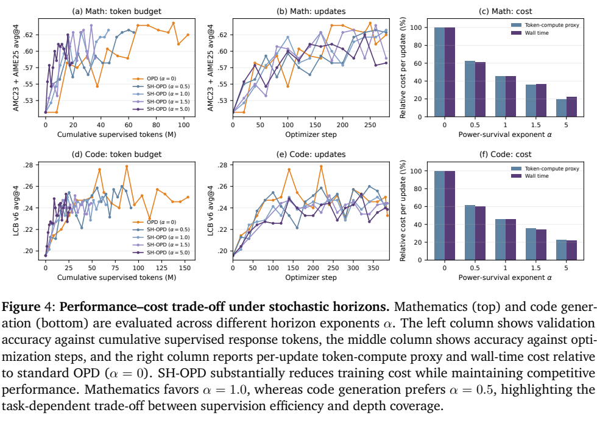
图 1-3｜原文 Figure 4，PDF 第 14 页，[来源](https://arxiv.org/pdf/2611.20687v1)。同一域内仅改变 α，α=0 为标准 OPD。左列横轴是累计有效监督 token，中列是优化步，右列是相对单步成本；上排数学，下排代码。不要把左列等 token 的比较和中列等步的比较混为一谈。数学 α=1 最终 63.21%，基线 62.50%；相近约 4500 万监督 token 时基线为 60.36%。其单步 token 代理/时间为基线 45.1%/45.5%。代码偏好 α=0.5，单步两项为 61.8%/60.0%，峰值 26.00%，最后五次评测均值 25.26%；α=1 对应 25.00%/24.49%。

【原文事实】数学 α=1.5/5 虽更便宜，最终降为 58.93%/58.21%，说明“越短越好”不成立。全长 OPD 是核心基线；前缀、等预算位置和梯度诊断支持机制。原文没有在主结果中给出完整多训练种子置信区间，也未给可直接换算美元的总训练账单。

### 官方实现与可复现边界

【代码核查】[官方仓库](https://github.com/chen123CtrlS/SH-OPD)，固定提交 `98467d23930e2197dd0b240af9e37cc7c5c3f505`。[random_horizon.py](https://github.com/chen123CtrlS/SH-OPD/blob/98467d23930e2197dd0b240af9e37cc7c5c3f505/verl/verl/utils/random_horizon.py) 使用 FP64 生存概率之差、CPU 独立 RNG，默认 seed 为 rollout_seed+1000003，支持保存/恢复 RNG。α=0 的 max_tokens override 返回 None，保留原基线路径。默认 sweep 入口的 ALPHAS 目前是 5，复现正文必须显式指定完整扫描列表，不能直接照默认命令解释为主实验。

【局限与复现建议】短视野状态分布、EOS 长度与 token-mean 联合影响真实权重；理论等长且都达上限的分析不应套用到所有真实 batch。几何诊断有固定池与初始化限制。建议锁定数据版本、两种长度预算、RNG 状态和原始 step time，分别报告等步、等监督 token、等端到端时间结果。作者 README 的环境列表和依赖版本应以固定提交为准，本文未安装或验证 GPU 可运行性。辅助资料：[作者 README](https://github.com/chen123CtrlS/SH-OPD)、[veRL 官方文档](https://verl.readthedocs.io/en/latest/)、[OPD 入门讲解](https://thinkingmachines.ai/blog/on-policy-distillation/)；没有核实独立作者博客，不能把通用入门博客当成本论文结果来源。

## 2. Bernoulli OPD：为什么学生越自信，原损失可能越推不动？

全名：[Bernoulli On-Policy Distillation: Don't Ignore High-Confidence Student Tokens](https://arxiv.org/abs/2611.02093)。阅读 [v1 原文](https://arxiv.org/pdf/2611.02093v1) §3—5、附录 A—D；作者 Mingyu Cao、Yaokai Jin、Shiwei Liu、Lu Yin，首投 2026-11-01。

### 从原始诊断图理解问题

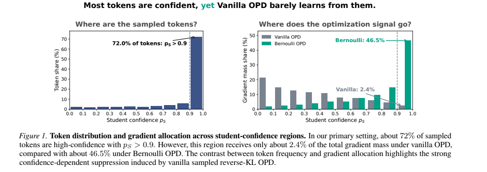
图 2-1｜原文 Figure 1，PDF 第 2 页，[来源](https://arxiv.org/pdf/2611.02093v1)。主设置的固定学生 rollout 中，约 72% token 的学生概率 pS>0.9；它们只占 vanilla 的约 2.4% 梯度代理质量，Bernoulli 下约 46.5%。左图是 token 数量分布，右图是固定样本上的梯度代理分配。作者没有提供一个新网络架构图，本文引用其真实目标函数诊断图，不能用自制架构冒充原图。

【原文事实】高置信 token 可能仍然错得很坚定，或教师仍有纠偏信息。vanilla 的小更新既由师生差异决定，也由 softmax 几何决定。原文只训练高置信区域的实验仍能提高能力，反驳“这些 token 必然不值得学”的简单解释。诊断的 token-logit 梯度代理不等于完整参数梯度范数，也不是信息价值的直接测量。

### 关键公式与逐步推导

固定状态 c、采样 token y，pS=πθ(y|c)、pT=πT(y|c)，z_y 为学生该 token 的 softmax logit，A=ln pT−ln pS 且求梯度时 detach。vanilla 损失 L_v=−stopgrad(A)ln pS；因为 ∂ln pS/∂z_y=1−pS，故 ∂L_v/∂z_y=−A(1−pS)。其他 token j 的导数为 A p_j，完整词表 logit 梯度 L1 范数为 2|A|(1−pS)。这里 p_j=πθ(j|c)，L1 是绝对值之和。

【原文事实】诊断变体 GC-OPD 改为 L_GC=−stopgrad(A)ln[pS/(1−pS)]。由于 ∂pS/∂z_y=pS(1−pS)，链式法则给 ∂ln[pS/(1−pS)]/∂z_y=1，因此采样 logit 梯度变为 −A。它去掉额外 (1−pS)，但保留无界 log-ratio，作者将它作为机制对照。

【原文事实，式 9—11】把整个词表粗粒化成“恰好为 y”和“其余所有 token”两种事件：B=1[Y=y]，学生/教师 Bernoulli 参数分别为 pS/pT。教师冻结，最小化软标签二元交叉熵 L_B=−pT ln pS−(1−pT)ln(1−pS)。这与 D_KL(Ber(pT)||Ber(pS)) 只差教师熵常数，却不是完整分类词表的 forward KL。

【本文推演】∂L_B/∂pS=−pT/pS+(1−pT)/(1−pS)=(pS−pT)/[pS(1−pS)]。乘 softmax 对 z_y 的导数，得到 ∂L_B/∂z_y=pS−pT，取值在 [−1,1]。其他 j≠y 的导数为 −(pS−pT)p_j/(1−pS)，所以完整 logit 梯度 L1 为 2|pS−pT|。这些等式假定 pS 严格在 (0,1) 且没有进入数值 clamp 区；不是所有参数梯度分量都受到同样有界约束。

【本文推演，手算】学生对某 token 给 pS=0.99，教师给 pT=0.80。A=ln(0.8/0.99)≈−0.21309。vanilla 对 z_y 的梯度≈+0.002131，GC≈+0.21309，Bernoulli=+0.19。梯度下降会降低 z_y；Bernoulli 的这一个 logit 修正约是 vanilla 的 89.2 倍。这不是“最终训练效果扩大 89 倍”。若 pS=pT，三者相应信号归零；若 pT>pS，梯度符号相反。

【原文事实，式 12—15】Balanced 诊断把 token 按 pS 分 B=10 桶，M_b=Σ_(t∈b)|pS(t)−pT(t)|；用各有效桶平均 M_bar 构造临时权重 (M_bar/(M_b+ε))^β，β=0.5，token 归一化并限幅到 [1/5,5]，权重 detach。L_bal,t=w_b L_B,t，故采样梯度 w_b(pS−pT)。它试图让置信区域质量更均匀，并非主方法必需步骤。

### 原图读法、训练与实现

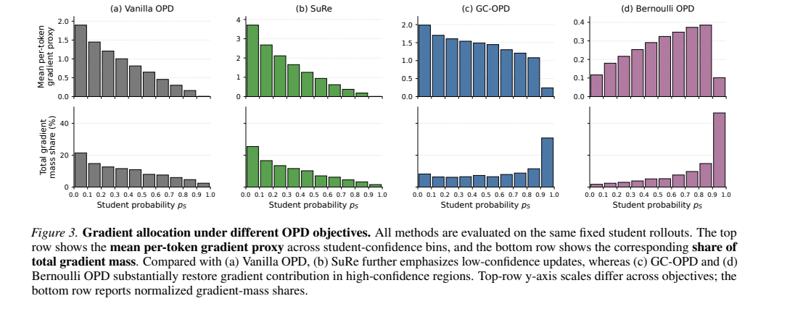
图 2-2｜原文 Figure 3，PDF 第 4 页，[来源](https://arxiv.org/pdf/2611.02093v1)。所有目标在同一批 rollout 上比较；四列 vanilla、SuRe、GC、Bernoulli，上排是每 token 梯度代理均值，下排是区域的总质量占比。高置信区域恢复信号不等于低置信区域没用；SuRe/PowerOPD 的变换也不能自动消除 softmax 的 (1−pS) 因子。各列纵轴量级不同，不能只比较柱子高度。

【原文事实】主设置 Qwen3-1.7B 学生 ← Qwen3-4B-Instruct-2507 教师；另外 Qwen3-8B-DAPO-RL 教师，以及 DeepSeek-R1-Distill-Qwen-1.5B 学生分别学 DeepSeek-R1-Distill-Qwen-7B、Skywork-OR1-Math-7B。Qwen 用 non-thinking，DeepSeek 保留原生 thinking。数据为 DAPO-Math-17K 的 prompt，答案由各自当前学生生成，没有加入新的人工标签奖励。教师概率是软监督，不能把 pT 当成真实正确率。

【原文事实】统一配方 200 次 optimizer update，global batch 64，每 prompt 1 条响应，温度/top-p=1、top-k 不截断，最大响应 12000；Adam lr=1e−6、betas=(0.9,0.98)、weight decay 0.1，无 warmup。4×GH200，其中 2 张 actor，另外 2 张 rollout/teacher。每 20 步用 AIME24 Avg@8 选最佳 checkpoint；最终前四项数学集 Avg@32、MATH500 Avg@4，温度 0.7、top-p 0.8、top-k20；通常最长 32768，8B-RL 教师设置为 38912。代码 README 的主设置 FINAL_MAX_RESPONSE_LEN=32168 与论文附录 32768 有差异，复现要明确采用哪个值。

```text
学生生成响应并记录 valid response mask
教师在同一前缀算 sampled-token logp，detach
actor 用当前参数重算 logp，转 FP32
pS_clip = clamp(exp(logpS), eps, 1-eps)
pT_clip = clamp(exp(detached_logpT), eps, 1-eps)
loss_token = -pT_clip*logpS -(1-pT_clip)*log1p(-pS_clip)
按共同有效 token 规则聚合，反传更新学生
```

【代码核查】[官方仓库](https://github.com/duterscmy/Bernoulli-OPD)，提交 `21afbbbb93d46da9b1de5593e6fcdbe8baeee973`。[opd.py](https://github.com/duterscmy/Bernoulli-OPD/blob/21afbbbb93d46da9b1de5593e6fcdbe8baeee973/slime/backends/megatron_utils/opd.py) 的直接 Bernoulli 分支与上面稳定公式一致：ε=1e−6，第一项仍用未 clamp 的 current_lp，第二项用 log1p。配置 [bernoulli.env](https://github.com/duterscmy/Bernoulli-OPD/blob/21afbbbb93d46da9b1de5593e6fcdbe8baeee973/configs/methods/bernoulli.env) 的可选 Bernoulli gradient clip 为 0，不能把另一个限幅变体当成论文主损失。仓库另有名为 bopd.py 的低置信 token 选择基线，与本文 Bernoulli 分支不是一回事。

### 核心实验、消融和限制

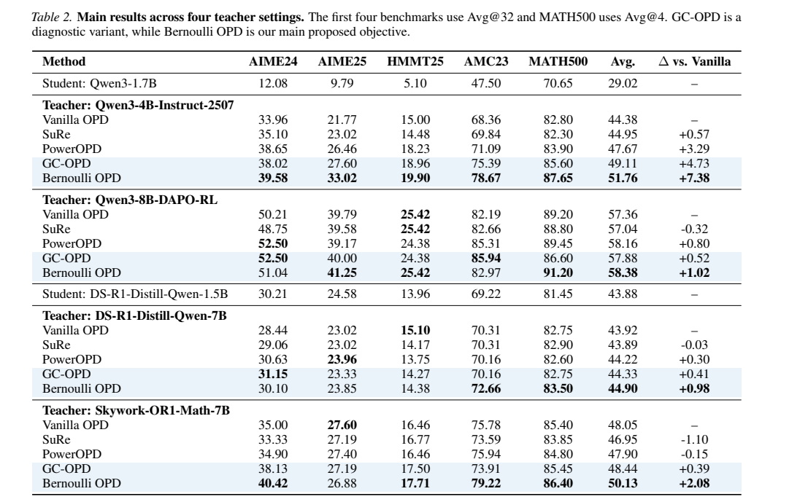
图 2-3｜原文 Table 2，PDF 第 6 页，[来源](https://arxiv.org/pdf/2611.02093v1)。固定各师生设置比较五个目标；Avg 是五个 benchmark 的等权均值，前四项与最后一项的采样次数不同。Bernoulli 对 vanilla 的 Avg 提升依次为 44.38→51.76（+7.38）、57.36→58.38（+1.02）、43.92→44.90（+0.98）、48.05→50.13（+2.08）点，不能说每个单项都最好。PowerOPD 主表对每个设置取统一配方和官方参考配方中较好的结果；后者为 1500 更新、较短 rollout 等，不是严格同一训练成本。

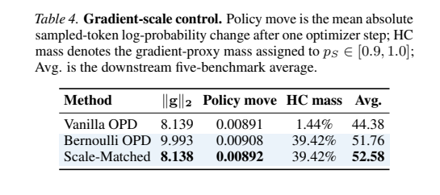
图 2-4｜原文 Table 4，PDF 第 8 页，[来源](https://arxiv.org/pdf/2611.02093v1)。在初始化固定 batch 将 Bernoulli 整体缩放以匹配 vanilla 全参数梯度范数：8.139 对 8.138，单步 policy move 0.00891 对 0.00892，但其 Avg 为 52.58，vanilla 为 44.38。它支持“收益不只来自更大整体步幅”，没有排除所有优化器/方向差异；HC mass 是这批校准样本的代理比例，与 Figure 1 的不同样本比例不要混用。

【原文事实】Balanced 相对 Bernoulli 的四个 Avg 差为 +0.11/+0.27/+0.06/−0.92，没有稳定附加收益。主设置三训练种子，vanilla Avg 44.44±0.16，Bernoulli 51.62±0.18；其余设置不应据此声称都有多种子稳定性。主设置在 AIME24 选 checkpoint 又在 AIME24 报最终分数，存在选择重用，不能将其视为独立验证集。总训练小时、峰值显存和完整 GPU-hour 账单未披露。

【局限】改进大小明显依赖教师，恢复信号强度不保证信号正确。只对“y vs 其余”匹配，会丢失其余类别内部关系。clamp 区内理论梯度恒等式改变；接近 1 时必须 FP32 稳定实现。校准实验使用 8 次生成的多数答案频率和 10 桶 ECE，这种 confidence 是自洽频率，不是模型给正确答案的精确概率。数学小模型上的结果不自动外推长文、工具或多模态任务。

辅助资料：[官方复现说明](https://github.com/duterscmy/Bernoulli-OPD)、[Slime 框架](https://github.com/THUDM/slime)、[PyTorch log_softmax](https://docs.pytorch.org/docs/stable/generated/torch.nn.functional.log_softmax.html)、[自动微分基础教程](https://docs.pytorch.org/tutorials/beginner/basics/autogradqs_tutorial.html)。未核实单独作者博客；这些基础资料不计入今日五篇。

## 3. Continual MOPD：只留上一阶段学生，如何少忘旧能力？

全名：[Replay for LLM Continual Learning with Multi-Teacher On-Policy Distillation](https://arxiv.org/abs/2611.02746)，作者 Yiqiao Qiu。首投 2026-11-02，阅读 11-03 的 [v2](https://arxiv.org/pdf/2611.02746v2)，重点 §3—6、训练/评测与对齐附录。这里“snapshot-free”指不保留所有早期阶段快照；训练仍需冻结的上一阶段模型，不是零快照或零教师存储。

### 问题定义与原图

【原文事实】联合 MOPD 要同时持有所有领域专家。现实中新领域陆续到来，早期专家可能已不可用；依次蒸馏易遗忘。论文比较三种资源约束：S1 只有当前专家、上一阶段学生和旧 prompt；S2 保存所有阶段学生，允许最后做多教师 recovery；S3 是分段发布，段内 S2、段间 S1。不能把 S2 的性能无条件当成 S1 可实现的结果。

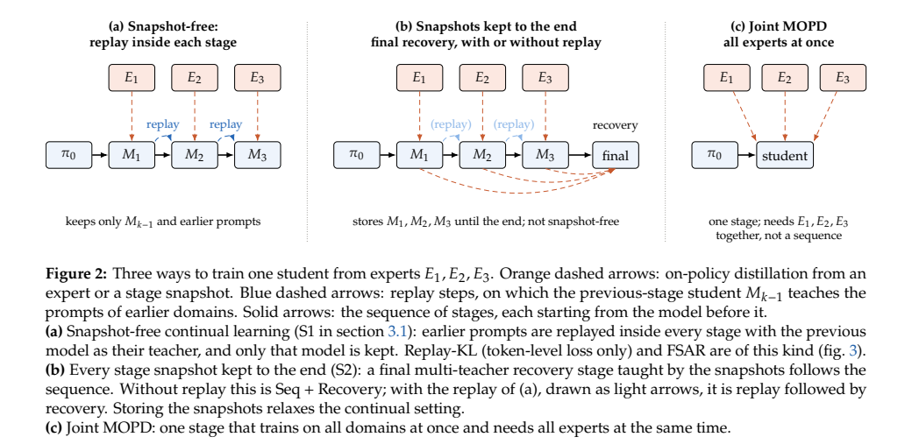
图 3-1｜原文 Figure 2，PDF 第 3 页，[来源](https://arxiv.org/pdf/2611.02746v2)。蓝色回放箭头由上一阶段学生提供，橙色箭头是专家或阶段快照的 OPD；(a) 旧 prompt 回放，(b) 末尾 recovery，(c) 联合训练。读图先数每一时刻必须保留哪些模型，再看是否有末尾补课。回放只存 prompt，响应由当前学生重新生成，避免把它误读成固定答案的 SFT replay。

令领域依次为 d1,…,dK，专家 E_k、数据 D_k；学生 M0→M1→…→MK。阶段 k 从 M_(k−1) 初始化学生。新领域步由 E_k 教，回放步由冻结的 M_(k−1) 教旧领域，不能再次调用 E_j（j<k）。因此旧教师若已经忘掉某项技能，后续回放也不能凭空恢复该技能。

### 关键损失、对齐项和梯度合成

【原文事实，式 4—5】每个响应位置 t 选学生概率最高的 κ=16 个 token 组成 V_t；p_v/q_v 是师生在完整词表上的概率，w_t,v=p_v/Σ_(u∈V_t)p_u。奖励 r_t,v=−w_t,v(ln p_v−ln q_v)，在同一领域 batch 内除以奖励标准差 σ_d，不减均值，A_t,v=r_t,v/σ_d。固定优势后，L_tok=−(1/N)Σ_t Σ_(v∈V_t) A_t,v ln πθ(v|x,y_<t)。N 是 microbatch 有效响应位置数，跨 microbatch 仍需按其响应 token 数加权。

【本文推演】代入 A，可见固定采样、固定 top-κ 支持和标准差时，梯度近似 (1/(Nσ_d))Σ_t Σ_v w_t,v ln(p_v/q_v) grad ln p_v。它使用每个候选的优势，不只是实际采样 y_t 的一个优势。教师 q_v 没有在 V_t 内重归一化；因此不能直接替换成“学生/教师 top-16 各归一化后的普通 KL”。原文解释其与支持集上的 generalized KL 梯度对应，且额外除以学生支持质量。一次 rollout 只更新一次，旧/新策略重要性比在该步为 1，论文说 PPO clipping 不起作用；没有额外 KL 正则或熵奖励。

【本文推演，top-k 手算】仅示意一位置，选中两个 token，学生完整词表概率 (0.6,0.3)，剩余质量 0.1；教师对应 (0.3,0.3)，剩余质量 0.4。选中权重为 (2/3,1/3)。r1=−(2/3)ln2≈−0.4621，r2=0。把教师归一化成 (0.5,0.5) 会丢掉它对“其余类别”保留了 0.4 质量的信息，得到不同目标。本例没有足够 batch 来估计 σ_d，仅解释未标准化奖励，不冒充论文训练结果。

【原文事实，式 6】在最后 W=2000 个响应位置上匹配归一化隐藏态。对层集合 L_h、隐藏维数 D、总窗口位置 N_W，L_hid=(1/(|L_h|N_W D))Σ_l,t ||hS_l,t/||hS_l,t||−hT_l,t/||hT_l,t||||²。教师 detach，无投影器，要求同架构/对应层。归一化剔除长度差，留下方向差；除 D 使 raw gradient 很小，作者需要单独梯度平衡。

【原文事实，式 7—8】把响应按空行或 thinking 结束划成 reasoning step R。在层 l、query head h 上，a_l,h,R=(1/|R|)Σ_(t∈R) softmax(q_l,h,t K_l,h^T/sqrt(d_head))，每行只看因果可见 key；RoPE 后的 q/K 参与计算，GQA 的 key 重复到 query head。L_SATS 对师生 a 的平方距离，按 response、step、head 平均，并对选中层求和。|R| 是区域 query 数；K 保留完整因果 key 分辨率，并不是也把 key 压成几个段。

【原文事实】value relation 用 softmax(V V^T/sqrt(d_head)) 的因果行替代注意力行，再作同样的 query-region pooling 和平方差，记 L_VR。V 是 value 表征，使用 KV heads；这与 MiniLM 的关系蒸馏有关，但本文选择 MSE 而非该基础方法的 KL。小白直觉：hidden state 对齐“每个位置想到什么”，attention 对齐“这一段平均看哪里”，VR 对齐“上下文 value 之间如何关联”。

【本文推演】若某一步只有两行 attention，学生为 (0.8,0.2)、(0.4,0.6)，池化为 (0.6,0.4)；教师两行均为 (0.6,0.4)，池化误差为零，逐行误差却非零。这说明池化有意放松 token 级约束，也会丢掉段内差异。真实实现有因果零填充和不同可见长度，这只是同维示意。

【原文事实，式 9—10】先分别反传得到 g_tok、g_hid、g_SATS、g_VR。帽号 g_hat=g/||g||。FSAR 先令 u=(g_hat_SATS+g_hat_VR)/||g_hat_SATS+g_hat_VR||，再 g_aux=u+ρ g_hat_hid，ρ=2。r≥1 时 g=g_tok+[||g_tok||/(r||g_aux||)]g_aux；r<1 时 g=r g_tok+[||g_tok||/||g_aux||]g_aux。r 是 token/auxiliary 梯度范数的目标比，主实验 r=1，随后裁剪/优化。工程实现还需处理零范数；本文未核实其具体保护实现。

【本文推演】r=1 时，令两梯度夹角为 φ，则 ||g||=||g_tok|| sqrt(2+2cosφ)。所以匹配两个分量范数不等于最终更新范数不变，也没有像 PCGrad 那样删除冲突分量。若 token 梯度范数 10，aux 为 0.01，则先放大 aux 1000 倍以匹配 10；这解释为什么常数 loss 权重不能自动替代分开 backward 的逐步平衡。

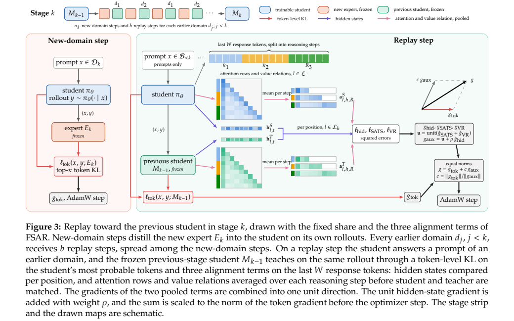
图 3-2｜原文 Figure 3，PDF 第 9 页，[来源](https://arxiv.org/pdf/2611.02746v2)。左支新任务只做 token 蒸馏；右支回放旧 prompt，由上一阶段学生提供 top-κ、hidden、SATS、VR。彩色块表示 query 按 reasoning step 池化；右侧向量表示梯度合成。它是训练示意而非真实注意力热图的实验测量，不能从色块推出注意力强度。

### 回放预算、数据与成本

【原文事实】shared budget 每 m 个新任务步插一个 replay 步，阶段 k 旧任务各约 n_k/[m(k−1)] 步；任务越多，每个旧任务越少。fixed share 每个旧任务每阶段 b 步，总 replay 为 Σ_(k=2)^K (k−1)b=bK(K−1)/2，随 K 二次增长。存储模型数较少不代表训练更便宜。

【本文推演，预算手算】五任务、新任务共 104 步；shared m=3 给四个后续阶段各 7 replay，共 28，合计 132 步。fixed b=7 给 7+14+21+28=70，合计 174 步。最后一次 recovery 每域 7，共 35，Seq+Recovery 为 139 步。把 recovery 扩成 70 步才与 fixed share 的 174 步一致；而 FSAR 每 replay 步多次 backward，等步依旧不等时间。

【原文事实】学生和五专家均为 DeepSeek-R1-Distill-Qwen-1.5B 同源模型；领域顺序 logic→math→code→safety→instruction following。logic 专家 Nemotron-Research-Reasoning-Qwen-1.5B v2，math 为 JustRL，code 为 Archer2.0-Code-1.5B-Preview，safety 为 STAR1-R1-Distill-1.5B，IF 为 UltraData-IF-1.5B。前三域取 Reasoning Gym、DAPO-Math-17K、OpenCodeReasoning，拆成 20/21/21 个 32-prompt block；安全 336 有害+336 良性，IF 672 个 prompt，剔除与评测重复的 4 个条目。旧 buffer 只有 prompt，无标签和固定响应。

【原文事实】每步 32 prompt×4 responses，温度 1，最多 16384 响应 token；恒定 lr=1e−5，veRL/vLLM，4×A100 80GB。FSAR 全部 28 层参与对齐，最后 2000 响应 token，教师目标舍入 bf16；SATS 单项用四分段末层 6/13/20/27、12 query heads。通过 query chunks 和 checkpointing 避免保存整张注意力矩阵。真实执行还需完整数据构造和 prompt/parser 版本，不能只靠伪代码重现。

```text
for k in 1..K:
    old_teacher = freeze(M[k-1]); student = copy(M[k-1])
    schedule = 新领域步 + 均匀插入的旧领域 replay 步
    for domain in schedule:
        x = 当前领域 prompt block
        y = 当前 student 每题生成 4 条响应
        teacher = E[k] if 新领域 else old_teacher
        计算 top-16 token 优势，固定后反传 token loss
        if replay 且启用对齐:
            同一序列提取 hidden / pooled attention / value relations
            分别 backward，按论文范数规则合成梯度
        裁剪并更新；stage 末得到 M[k]
    丢弃更早教师；若属于 S2 才保存阶段快照供 recovery
```

【原文事实】五阶段记录 step time 总和：Seq 3.4h、Replay-KL shared 4.1h、FSAR shared 5.5h、Replay-KL fixed 5.8h、FSAR fixed 9.7h；Seq+Recovery 4.5h、Recovery-70 5.6h、joint2 6.8h。这是四卡作业的累计 step elapsed time，不是已经乘以四的 GPU-hour。后三阶段 token-only replay 中位 122—131s，三对齐项为 289—326s。美元、全管线准备成本未披露。

### 核心结果、消融与“遗忘”的评测陷阱

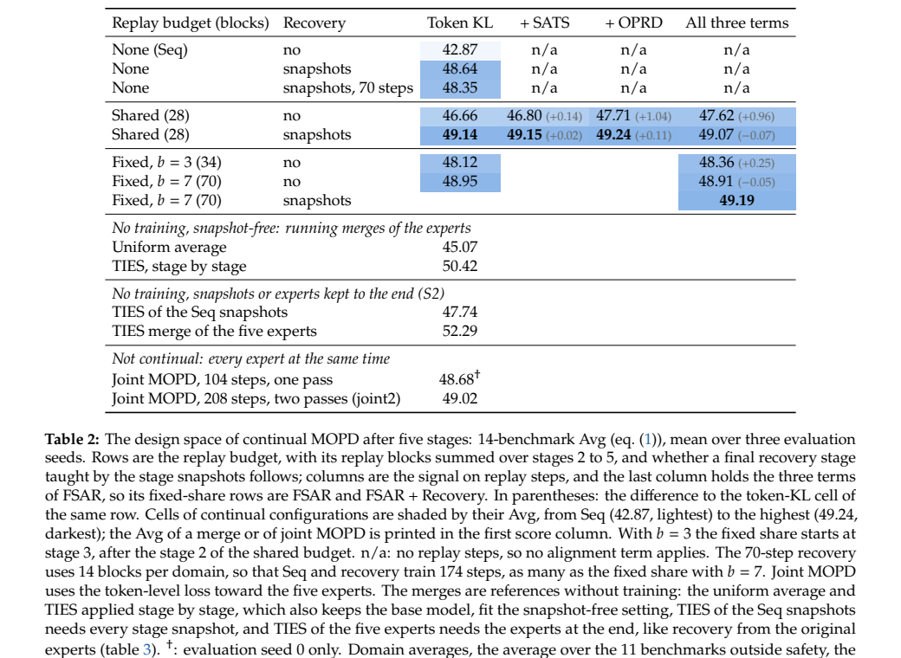
图 3-3｜原文 Table 2，PDF 第 16 页，[来源](https://arxiv.org/pdf/2611.02746v2)。14 benchmark Avg，通常为三个评测种子均值；†行只评测 seed0。先固定是否有 recovery 和 replay budget，再横向比较辅助项。Seq 42.87，shared Replay-KL 46.66，fixed Replay-KL 48.95；Seq+Recovery 48.64，Recovery-70 48.35，joint2 49.02。fixed FSAR 48.91，未超过 fixed token-only；不能宣称三对齐项总是最好。保存所有原专家的 TIES 为 52.29，也不能隐去这项强基线。

【原文事实】shared 下加 hidden +1.04、全三项 +0.96；fixed b=7 加三项 −0.05。小于约 0.46 点的差异在作者评测噪声判据内，三评测种子不等于三训练种子。另有两个训练 run 的预算/恢复比较：fixed token replay、Recovery、Recovery-70 相对 Seq 的均值增益为 5.77/5.90/5.89，接近持平，不应只挑单 run 的小差作结论。

【评测关键限制】14 项包含 MBPP 和同一 378 题的 MBPP+，简单 Avg 会重复计算这组题。MuSR 只读最后含 answer: 的行；数学训练让模型偏好 boxed 格式，可能把格式改变算成遗忘。若从 box 读，Seq 的三阶段 MuSR 从 −7.41 变为 +1.95 点；SATS 相对 token replay 的 MuSR 优势从 3.31 缩为 0.99。安全 Avg 对拒绝和良性服从的权重不均，改成平衡安全指标会改变 shared replay 与 recovery 排名。更强“安全分数”有时伴随过度拒绝，不能只报一个平均数。

【局限】仅一模型规模、同源专家、固定领域顺序、短阶段；旧 prompt 的存储可用性是额外前提。fixed share 的二次训练开销限制长任务流；上一学生本身遗忘会累积。多种加权指标、parser 和训练步预算都必须一起复现。

【资源核查】arXiv 关联 [Zenodo 记录](https://zenodo.org/records/23906641)，API 核查 title 与论文一致，但 files 只列 main.pdf，未见训练脚本/数据包；这是相关资源 DOI `10.5281/zenodo.23906641`，不能冒称已验证代码仓库。论文说实现基于 LastOPD，不等于已公开本方法实现。未核实独立作者博客。基础阅读：[OPD 作者教程](https://thinkingmachines.ai/blog/on-policy-distillation/)、[veRL 文档](https://verl.readthedocs.io/en/latest/)、[PyTorch autograd](https://docs.pytorch.org/tutorials/beginner/basics/autogradqs_tutorial.html)；引用基础方法 [MiniLM](https://arxiv.org/abs/2002.10957) 可帮助理解 value relations，不占当日名额。

## 4. DecisionRank：只输出一次分数，也能接受顺序教师纠偏

全名：[DecisionRank: On-Policy Distillation for Decision-Model Rerankers](https://arxiv.org/abs/2610.42128)。阅读 [v1](https://arxiv.org/pdf/2610.42128v1) §2—3、附录 A 和 C；首投 2026-10-30。生成式教师逐个输出文档 ID；学生只在第一输出位置读取所有文档 ID 的 logit，然后排序。问题是如何把后续条件反馈直接作用到推理时真正使用的第一位置分数。

### 机制与原架构图

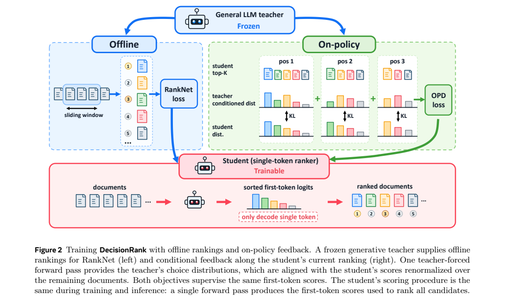
图 4-1｜原文 Figure 2，PDF 第 2 页，[来源](https://arxiv.org/pdf/2610.42128v1)。蓝支是离线完整排序的 RankNet；绿支是学生当前 top-K 排序前缀上的教师条件反馈；两者都更新下方同一组 first-token logits。教师一次 teacher-forced forward 能并行算不同位置的条件分布，学生推理则只有一次前向。图中“only decode single token”不代表只对一个文档评分。

【原文事实】每题输入 q 和 N≤100 个候选文档 d_i，学生给每文档指定一个单 token ID v_i，读取第一位置 logit s_i，π=argsort_desc(s_i)。教师用数值文档 ID，可能有不同分词，先将教师分数映射回相同文档 item 再比较；无需两模型词表相同。每步当前 top-K 和排序固定，不对 argsort 本身求导，下轮重新计算。

### 关键公式和数值算例

【原文事实，式 2—5】取学生 top-K 集合 S，按当前排序前缀 h_t=(π1,…,π_(t−1))，剩余 R_t=S\{已选项}。学生选择分布 pθ,t(i)=exp(s_i)/Σ_(j∈R_t)exp(s_j)，所有步重用同一 s，只变分母。教师条件分数 aT,t(i)>0 按文档映射、归一化 pT,t(i)=aT,t(i)/Σ_(j∈R_t)aT,t(j)。每步 ℓ_t=Σ_i pθ,t(i)ln[pθ,t(i)/pT,t(i)]，L_on 为指定步集合的均值。

【原文事实】joint 训练 K=20，使用 t=2,…,19；第 1 步交给离线全局监督补充，最后只剩一个候选 KL 恒为零。教师 prompt 的候选仍按第一阶段检索顺序呈现，teacher-forced 答案是学生排序。它的 on-policy 是确定性当前排序访问的状态，不是从自回归学生随机采样整段答案。

【本文推演】固定 R_t 和教师 q_i，令 p_i=softmax(s)_i、ℓ=Σ_i p_i ln(p_i/q_i)。由 ∂p_i/∂s_j=p_i(1[i=j]−p_j)，得到 ∂ℓ/∂s_j=p_j(ln(p_j/q_j)−ℓ)。常数 +1 项因 Σ_i ∂p_i/∂s_j=0 抵消。这个梯度能直接更新第一位置 logits；教师是条件分布，而学生只是从静态 logits 删除已选文档，正是结构匹配的关键。

【本文推演，手算】三个文档 logits=(ln4,ln2,0)，学生排序 A>B>C。选完 A 后，对剩余 B/C 学生分布 (2/3,1/3)，教师却给 (0.2,0.8)。此步 KL=(2/3)ln(10/3)+(1/3)ln(5/12)≈0.5108。B 的 logit 梯度≈(2/3)(1.2040−0.5108)=+0.4621，C 为 −0.4621，下降更新会把 C 提到 B 前。第 3 步只剩 C，KL=0。本例用 K=3 对应 joint 仅监督第 2 步，不代表实际实验只用三个文档。

【原文事实，式 6—7】离线教师排序产生有序文档对 P={(i,j):d_i优于d_j}。L_RN=Σ_(i,j) w_ij log(1+exp(s_j−s_i))/Σ_(i,j)w_ij，其中 w_ij=u(rTi)−u(rTj)、u(r)=1/log2(1+r)，rTi 是教师给文档 i 的名次。总 L=L_RN+λL_on，λ=0.1。靠前名次效用更大，强调关键前部错序，没有单独强化学习 outcome reward。

【本文推演】单对 s_i=1、s_j=2，却应 i 更优时，softplus(s_j−s_i)=ln(1+e)≈1.3133，对 s_i 的梯度为 −sigmoid(1)≈−0.7311，对 s_j 相反；它会修正倒序。RankNet 约束全候选全局偏好，item-space OPD 补充“已选过哪些文档之后还该选谁”的条件纠偏，不能用相同 teacher 首 token 的离线 KL 替代。

【指标，原式 8—9】nDCG@10=(Σ_(r=1)^10 g_q(d_πr)/log2(r+1))/IDCG@10。g 是 benchmark qrels 指定的相关性 gain，IDCG 是理想排序同一折扣和；不能把训练教师名次当评测真值。pairwise ECE=Σ_b |B_b|/M · |acc(B_b)−conf(B_b)|，M 是有效偏好文档对总数；它度量偏好概率校准，不等于检索准确率。Listwise GRPO 对照从 Plackett–Luce 排序策略 P(π)=Π_t exp(s_πt)/Σ_剩余 exp(s_j) 采 G=8 个排序，以教师排名构造 nDCG 奖励并组内标准化；这是对照方法的 reward，不能归到 DecisionRank 主损失。

### 数据、训练和推理流程

【原文事实】学生 Qwen3-1.7B/4B/8B，主教师 Qwen3.8-27B；跨教师测试 Gemma-4-31B、ReasonRank-32B。数据 10000 个 MS MARCO / Rank-DistiLLM queries + ReasonEmbed 12 类各 500 个合成 query，共 16000。离线教师滑窗 size20、stride10 产生排序；不在训练中用 gold positive 替换学生 top-K，以保持实际学生选择。

【原文事实】batch32，1.7B lr=2e−5，4B/8B lr=6e−6。joint K20、λ0.1；OPD-only 为权重1并监督步骤1—19。教师离线排序通常关闭 thinking；Qwen/Gemma on-policy 关闭，ReasonRank on-policy 开启。学生推理每 passage 截断：TREC128、BEIR/BRIGHT/R2MED384 token。训练 GPU 数、总 epoch/step、优化器完整设置、总小时、峰值显存未在所核查训练说明给足，不能用推理 B200 设备填成训练硬件。

```text
预处理：每 query 的候选交给冻结教师滑窗，保存完整排序
每轮：学生前向一次，取所有文档 ID 的 first-token logits
由当前 logits 选 top20，固定排序和选择集合
将同一批文档及学生排序送教师 teacher-forcing，一次取所有条件评分
按 item ID 对齐；在剩余集合上归一化；算第2..19步 reverse KL
加全候选加权 RankNet，反传学生；下一轮重算排序
推理：一次前向取全部 ID 分数，排序输出，无教师、无逐项文本生成
```

### 核心实验、消融和读图条件

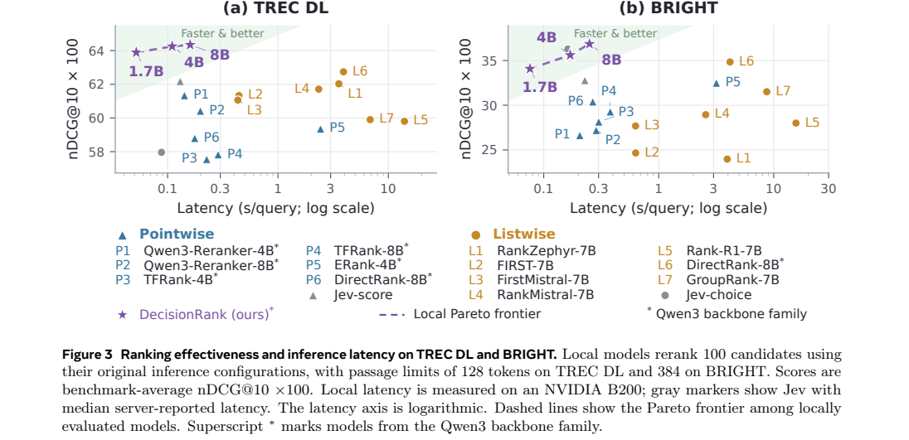
图 4-2｜原文 Figure 3，PDF 第 7 页，[来源](https://arxiv.org/pdf/2610.42128v1)。TREC BM25、BRIGHT ReasonIR-8B 各 top100；横轴单 query 延迟是对数刻度，越左越快，纵轴 nDCG@10×100 越上越好。局部模型在 B200，BF 推理配置和 passage128/384；API Jev 使用 server-reported latency，不能当成完全同设备测试。星号学生与 baseline 骨干族有标注。8B 比 listwise DirectRank 在这两任务分别快 24.5×/16.7×，不等于所有部署负载都有同样倍率。

【原文事实】计时预热后单 query 顺序处理，每卡一个 vLLM worker，取 worker 中位数再跨 8 worker 取中位数；学生时间包含前向、不含排序。BRIGHT 的候选来自 ReasonIR-8B 与发布的 GPT-4 reasoning queries，reranker 仍只见原 query；不能认为所有方法都在相同 BM25 候选上测得此 BRIGHT 数值。

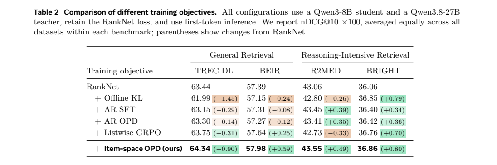
图 4-3｜原文 Table 2，PDF 第 10 页，[来源](https://arxiv.org/pdf/2610.42128v1)。Qwen3-8B ← Qwen3.8-27B，所有行保留 RankNet，推理同为 first-token。列顺序 TREC/BEIR/R2MED/BRIGHT；主方法 64.34/57.98/43.55/36.86，相比 RankNet 的 63.44/57.39/43.06/36.06 全部提高。Offline KL、AR SFT、AR OPD、Listwise GRPO 并未在四列同时提高。浅绿色表示相对基线的正变化，不是显著性置信区间。

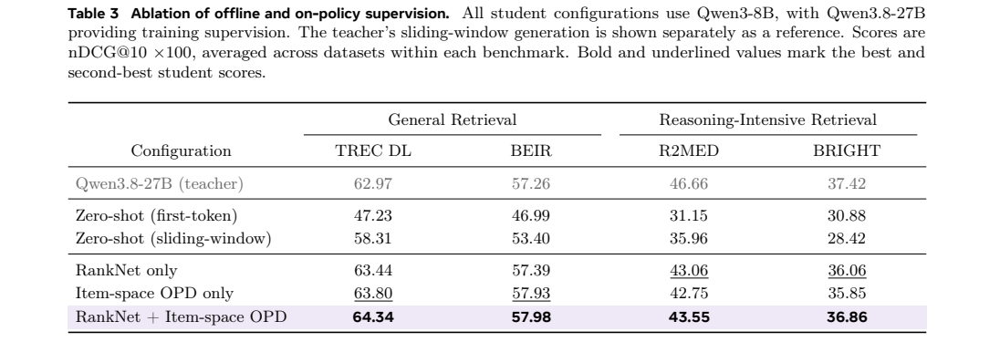
图 4-4｜原文 Table 3，PDF 第 10 页，[来源](https://arxiv.org/pdf/2610.42128v1)。同一 8B 学生与 27B 教师；joint 四项均优于两个单组件。OPD-only TREC 为63.80、BEIR57.93，说明动态监督本身有效；joint 的 R2MED43.55 仍低于表中教师46.66，不能用 TREC 超师概括所有领域。表中教师 TREC62.97 与首页 Figure1 标注62.91 不一致，本文逐图保留原值，不自行改动源图。

【原文事实】seed42/43/44 的 8B TREC：RankNet63.40±0.06、joint64.21±0.14；BRIGHT36.08±0.11、36.85±0.08。主表单次64.34不能和多种子64.21混用。跨教师结果支持 item-space 可跨词表，但未证明任意教师/任意任务均可迁移。模型上下文仍需容纳所有文档，一次前向不等于零长上下文成本；学生 top-K 外文档无法获得当步 on-policy 条件反馈，需依赖全局离线项。确定性排序边界、文档 ID 分配和教师多 token ID 的评分规则都是复现敏感点。

【可复现性】论文原文链接、注释和精确标题检索中，未核实专门官方训练仓库/权重或作者独立博客；这表示本次证据不足，不能断言永远没有。主方法伪代码只表达已披露流程，不伪造完整可运行实现。基础阅读：[RankNet 原始论文（Microsoft Research）](https://www.microsoft.com/en-us/research/publication/learning-to-rank-using-gradient-descent/)、[PyTorch softplus](https://docs.pytorch.org/docs/stable/generated/torch.nn.functional.softplus.html)、[softmax 官方 API](https://docs.pytorch.org/docs/stable/generated/torch.nn.functional.softmax.html)。

## 5. SpecOPD：把草稿蒸馏的顺序等待改成分支并行

全名：[SpecOPD: Branch-Parallel On-Policy Distillation for Speculative Decoding](https://arxiv.org/abs/2611.02846)。首投 2026-11-02，阅读 [v1 原文](https://arxiv.org/pdf/2611.02846v1) §2—3 和附录 A.6、B、C、D。这里学生是较小的 draft model，教师是冻结 target；文中的 8B/27B/125B 是 target 规模，不是三个学生的参数量。

### 问题、基础概念和原架构图

【基础概念】推测解码先用便宜 drafter 提议一段 token，再由 target 并行验证。每轮接受越多，越少调用昂贵 target；但草稿成本、验证开销和并发负载也决定实际加速。正确的拒绝采样机制保持 target 输出分布，训练 drafter 的目标是更容易被接受，而不是替换最终模型的回答质量标准。

【原文事实】传统 draft-and-verify OPD 必须等一轮接受结果才能确定下一轮前缀。SpecOPD 从预先收集的参考响应多个 anchor 出发，以当前 drafter 采新分支，教师并行评估每条分支。它在分支内部是 on-policy，外部 reference prefix 并非不受限的当前学生全响应分布；这一区别是方法适用范围的一部分。

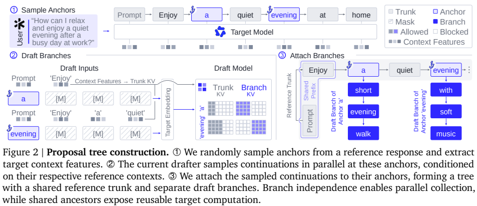
图 5-1｜原文 Figure 2，PDF 第 3 页，[来源](https://arxiv.org/pdf/2611.02846v1)。灰色参考 trunk 共享，蓝色 branch 是当前 drafter 新采样。先采 anchor，再并行起草，最后组成树。读右侧树：某分支发生偏离后只能看到自己的新历史和 anchor 之前 trunk，不能看到后续参考答案或兄弟分支。图中的词只是机制例子，不是语义正确性实验。

### 全部核心机制公式：历史、隔离和接受率 surrogate

【原文事实，式 1—4】参考序列 x_1:L 包含 prompt+预收集响应；B 个 anchor a_b，每分支 W 个提议 token。h_b,i=(x_≤a_b,y_b,<i)，y_b,i 从当前 qθ(·|h_b,i) 采样。给定 x 与 anchors，分支联合分布 Qθ(Y|x,A)=Π_b Π_i qθ(y_b,i|h_b,i)；分支独立不等于分支内 token 必然独立。parent(y_b,1)=x_a_b，parent(y_b,i)=y_b,i−1；语义位置 pos(y_b,i)=a_b+i，不使用打包后的物理 offset 代替 RoPE 位置。

【原文事实】令 H_u 是 target 处理节点 u 后的隐藏态、g_p 是冻结输出头，则 p_b,i=softmax(g_p(H_parent(y_b,i)))。第一个草稿 token 从 anchor 行读出，后续从前一个 token 行读出；不是读 token 自己的行，否则答案泄漏。W 个预测只需新增 W−1 个 target predecessor query 行，末 token 没有下一步要预测，不必再执行它。

【原文事实，式 5】全注意力 tree mask：节点 u 能读自身和严格祖先时 M_u,v=0，否则为 −∞。通常 causal packed mask 只按存储顺序遮挡，可能泄漏未来 trunk 或 sibling；tree mask 配合语义位置，才与逐分支独立评分一致。target 节点可见自身并不泄漏被评分 token，因为读出来自 predecessor。

【原文事实，式 6】稀疏 QSA 用四 token 压缩 indexer group。若 group 结束位置 4g≤a_b，复用 trunk group key；否则用该分支的 raw indexer keys κ_b,4g−3:4g 经 C_g 压缩，C_g 是平均池化、RMSNorm 和相应旋转变换。只选择因果可见的完整组，不足四个的 causal tail 单独保留。跨 anchor 的半组不能直接拿未来参考 token 补齐，必须用该分支 token 重建。

【原文事实，式 7】线性 GDN 的历史压进递归状态，单靠 mask 无法还原 anchor。缓存 trunk 检查点 c_b≤a_b，S_b,0=Replay(S_c_b;z_c_b+1:a_b)，然后 S_b,j=F(S_b,j−1,z_b,j)，j=1,…,W−1。S 是递归状态，F 是一 token 状态更新，z 是对应的 k/v/g/β 更新特征；每条分支从独立恢复状态继续，检查点不可变，因果卷积也需遵循 parent 路径。

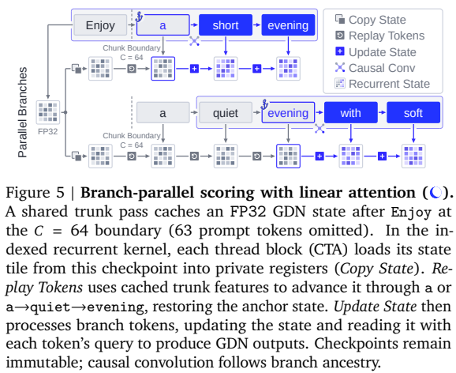
图 5-2｜原文 Figure 5，PDF 第 5 页，[来源](https://arxiv.org/pdf/2611.02846v1)。C=64 的共享 FP32 GDN 检查点，分别 replay 到 a 和 evening，随后私有推进 branch。灰色是复用前缀，蓝色是新分支；Copy State 箭头必须复制到私有状态，不能让两条分支相互覆盖。它说明实现机制，不是缓存节省比例的实测图。

【原文事实，式 8—9】对固定历史，提议 y~q 的精确拒绝采样接受概率 r(y)=min(1,p(y)/q(y))。取期望 α=Σ_v q(v)min(1,p(v)/q(v))=Σ_v min(q(v),p(v))=1−TV(q,p)，TV=(1/2)Σ_v |q(v)−p(v)|。α_b,i 是某分支某位置的分布重叠；p 为 target、q 为 drafter，不要与 SH-OPD 的视野指数 α 混淆。

【原文事实】采用 E2E-TV：L=1−(1/(BW))Σ_b Σ_(j=1)^W Π_(i=1)^j α_b,i。早期一次低重叠会降低后面所有 prefix product。token ID 和 target 分布固定，重叠及其乘积仍反传；不把乘积 detach 成权重。该目标直接面向接受长度 surrogate，没有额外按最终题目对错计算的 outcome reward。DSpark 配方另有 confidence head 的辅助 BCE，目标是 detached token-overlap 概率。

【本文推演】设 d_i=TV_i、α_i=1−d_i，一分支有 ∂L/∂d_k=(1/W)Σ_(j=k)^W Π_(i≤j,i≠k)(1−d_i)。由积的导数得到：第 k 位参与所有 j≥k 的项。W=2 时，重叠 (0.8,0.9) 与 (0.9,0.8) 的 token 平均 TV 都为0.15，但 L 分别为 1−(0.8+0.72)/2=0.24 与 1−(0.9+0.72)/2=0.19。后者更好，因为早期更可靠。前一序列 d1/d2 的偏导为0.95/0.4；它解释这个例子中前位影响更大，不构成普遍梯度排序定理。

【原文事实，附录 C.2】若 drafter 仅在支持 S_i 上有非零概率，TV=(1/2)[Σ_(v∈S_i)|q(v)−p(v)|+1−Σ_(v∈S_i)p(v)]。必须保留教师支持外质量，不能把教师截取后重新归一化。论文原例 q=(0.5,0.5,0)、p=(0.4,0.4,0.2)，真重叠0.8；若仅看前两类并归一化教师，会伪造完美匹配。比较概率与归约用 FP32，即使 hidden/weights 是 BF16。

【理论边界，原文明确】单位置重叠等于接受概率，不表示条件草稿下的 Π_i α_i 是真实多位置联合接受概率的无偏估计。真实 Pr(A1∩…∩Aj)=Π_i Pr(Ai|前面均接受)，其历史分布受接受事件影响；训练固定 sampled histories 并省略采样分布的 score-function 项。论文给反例：q1=(0.9,0.1)、p1=(0.1,0.9)，第一类后第二位 overlap1，第二类后 overlap0；真实两位联合接受0.1，而采样历史 product 的期望0.18。因此报告称 surrogate，不把它误写成精确 serving acceptance objective。

### 数据、模型、流程与训练成本

【原文事实】target 覆盖 Qwen3-8B（GQA）、Qwen3.8-27B（GQA/GDN）、Qwen3.8-Flash-Next-125B（QSA/GDN）；draft 为 DFlash、DSpark、DFlash V2。训练 reference 来自 Open-PerfectBlend，参考可以预先由 target 生成或来自原始数据，分支每轮重新采样。论文训练说明未对所有 drafter 给出统一参数总数，不能把 target 参数表当作学生大小表。

【原文事实】27B 单独配方：公共 DFlash V2 初始化、fresh optimizer，训练 backbone+conditional selector，最多512 scored anchors；proposal/score温度1/1，selector top-k16；AdamW 峰值/最小 lr=1e−5/1e−6，betas(0.9,0.95)，weight decay0.1、clip1；global batch48 reference，microbatch1、accum8、6 draft ranks；1227197 条过滤后参考，预先 T1/top-p0.95/top-k20 再生成，warmup7669步。selector 支持和参考生成 top-k 不是同一概念。

【原文事实】125B 从内部预训练 DFlash V2 step196000 继续，batch64、micro1、accum4，两个八卡节点，训练/冻结 target 进程共享设备，2 epochs /34432 updates；8B 用公共 DFlash/DSpark，DFlash block size16。27B 正文训练配方、等步离线消融和八卡吞吐测试是不同配置，不能拼成一个统一训练成本。GPU 在论文多处只写 high-performance GPUs，本文不擅自填成 H100/B200。没有完整离线生成+训练+评测总 GPU-hour/美元费用。

```text
取 reference batch；冻结 target trunk prefill 并保存 KV / GDN 检查点
从响应部分随机取 anchors
当前 drafter 在各 anchor 新采样 branch；固定采样 token ID
编译 parent、语义位置、prediction-row 映射
target 用 tree mask / branch-specific indexer / 私有 state replay 并行评分
从 predecessor hidden rows 重建 target 分布，detach
重算或保留 drafter 可微分概率；FP32 求 TV 与所有前缀乘积
按实际 scored positions 合并 loss，反传、更新 drafter
刷新学生再采新 branch；serving 用正确验证算法，另测实际 AL 与吞吐
```

### 原始实验图、主结果与消融

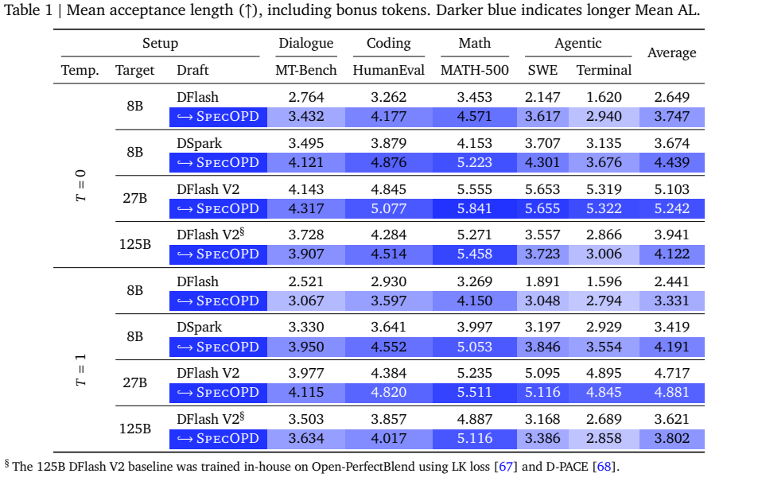
图 5-3｜原文 Table 1，PDF 第 6 页，[来源](https://arxiv.org/pdf/2611.02846v1)。T=0/T=1，各设置七个 draft token，AL 含 bonus token；MT-Bench、HumanEval、MATH500、SWE、Terminal 等权平均。T0 的 8B DFlash 2.649→3.747，约+41.45%；27B 5.103→5.242，改善小得多；T1 27B 的 Terminal 4.895→4.845，存在下降。125B baseline 是内部预训而非与所有公开 checkpoint 同来源。这里测草稿接受长度，不能读成数学正确率或 agent 成功率。

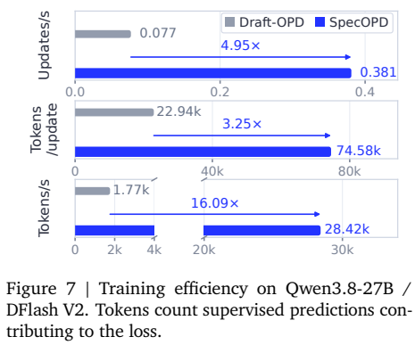
图 5-4｜原文 Figure 7，PDF 第 8 页，[来源](https://arxiv.org/pdf/2611.02846v1)。27B/DFlash V2，八张高性能 GPU，灰色 Draft-OPD、蓝色 SpecOPD。三行单位依次 update/s、监督 token/update、监督 token/s：约0.077→0.381、22.94k→74.58k、1.77k→28.42k。4.95×更新速度与3.25×每步监督量共同产生16.09×吞吐；不等于达到同样 AL 只需1/16训练时间。排除离线参考准备，使用各自 native 配置；两次运行 updates17—32 的 unprofiled timings 汇总，显示比率来自未舍入数值。

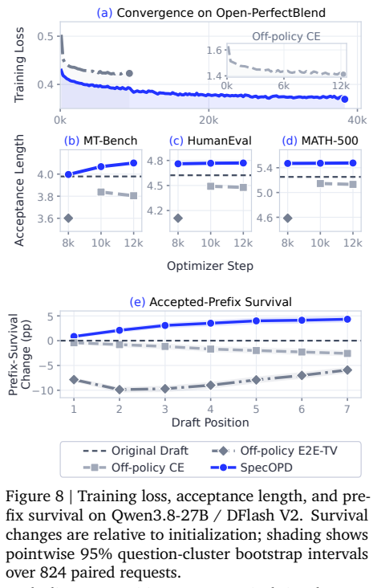
图 5-5｜原文 Figure 8，PDF 第 8 页，[来源](https://arxiv.org/pdf/2611.02846v1)。27B/DFlash V2，同初始化；灰方块 off-policy CE，灰菱形 off-policy E2E-TV，蓝圆点 SpecOPD。先读(a)训练 loss，再读(b—d)实际 AL，最后读(e)相对初始化的 prefix survival 点变化；下降的训练 loss 不保证 AL 改善。第七位置蓝线+4.33个百分点，CE −2.57；阴影为824个配对请求、按问题聚类 bootstrap 的逐点95%区间，不是训练种子区间。

【原文事实】等 optimizer step、等 reference batch 的消融中，SpecOPD mean AL 最高相对 off-policy E2E-TV +15.71%、CE +6.96%；但其计算配置/梯度路径不同，附录 A.6 的 off-policy 用16卡、SpecOPD用32卡，不能描述成等算力公平对照。应把此结果解释为所测训练配方更有效，而非已隔离一切计算差异的因果结论。

【原文事实】27B BF16/TP1/FA3/CUDA Graphs serving 相对 AR 峰值3.56×；五 workload 几何均值在并发1/8/32为2.97×/2.23×/1.35×。相对原 DFlash V2 的几何均值最高仅+2.83%，SWE并发32反而较慢。SWE/Terminal 是记录交互历史上的 continuation efficiency，不能据此声称改善完整在线 agent 任务完成率。AL、训练吞吐、serving吞吐的倍率是三个不同指标。

### 可复现性和辅助阅读

【代码核查】[官方仓库](https://github.com/QwenApp/SpecOPD)，固定提交 `7fe9f9f35b027691633ec424821df5985fe34576`，README Release Status 明确：初始版本只有 project overview，训练代码、评测脚本和权重不在发布内。树中有 docs、图像、网页、论文 PDF；不能因为地址叫 GitHub 就写“代码已开源可直接训练”。[作者项目/中文博客](https://qwenapp.github.io/SpecOPD/) 的网页工具访问失败，但同仓库 docs/index.html 和 docs/en.html 可作为作者说明源；正文性能仍以论文原文为准。

【局限与复现路线】固定参考 anchor 可能与真实 serving 状态分布不同；超出首次拒绝的 counterfactual 历史是否有额外收益，尚缺完整 accepted-only 对照。tree mask、读出行和 RoPE 需要逐分支数值一致性验证；线性/稀疏混合 target 的 executor 实现是主要复现门槛，目前未公开。bootstrap 仅反映给定请求样本的不确定性，不能替代多训练 run。成本比较应加入 reference 生成时间和达到同一接受阈值的时间。

基础资料：[推测解码原始 ICML 论文](https://proceedings.mlr.press/v202/leviathan23a.html)、[DFlash 官方仓库](https://github.com/z-lab/dflash)、[DFlash 2 作者博客](https://inco.ai/blog/dflash2/)、[SGLang 官方文档](https://docs.sglang.ai/)。后两项帮助理解底层 drafter 与 serving；它们不是 SpecOPD 已公开训练代码的证据，也不计入五篇。

## 横向理解：五种方法到底改变了什么？

| 方法 | 改动对象 | 监督/奖励来源 | 不应混淆的结论 |
| --- | --- | --- | --- |
| SH-OPD | 每个 batch 生成到多深 | 同一 frozen teacher 的 token log-ratio | 便宜更新有重加权偏置，不是全长梯度无偏估计 |
| Bernoulli OPD | sampled event vs complement 的损失 | 同一前缀的教师概率 | 采样 logit 梯度有界，不代表参数梯度全部有界 |
| Continual MOPD replay | 何时回放、旧教师和辅助内态 | 当前专家 / 上一阶段学生 | 不存全部快照仍需旧模型，固定配额训练量二次增长 |
| DecisionRank | 反馈空间和推理分数结构 | 教师离线排序+当前排序条件概率 | 确定性 item 轨迹也可做反馈，非自回归整段 rollout |
| SpecOPD | branch 收集/评分执行和接受率目标 | target 在 draft 新历史上的分布 | 分支内 on-policy；16.09×是监督吞吐，不是最终推理倍率 |

【本文推演】它们可以帮助定位不同瓶颈，但本期没有论文直接验证“五种组合一定更好”。SH-OPD/Bernoulli 的 token 目标和 SpecOPD 的 E2E-TV 不能直接叠加而不重定义优化量；continual replay 的 top-k 教师质量与 SpecOPD 支持外质量处理也各有数学语义。若做新实验，应先固定状态、支持集、teacher版本、归一化与预算，再谈组合收益。

本期保存的是同一份完整 Markdown 及其全文 PDF。公式采用可搜索的 Unicode/线性数学记法，逐符号解释与推导均进入 PDF；图像、伪代码、表格、限制和资源链接也全部保留。渲染完整性、字体、图像及逐行文本核查结果见 [QA](https://github.com/daihuangyu/papers-daily/blob/main/OPSD/2026-11-21/assets/QA.md)。
