# OPD / OPSD 专项精读 · 2026-11-22

今日主题：选什么教师、怎样分配预算，以及如何把监督对准实际决策。

检索窗口为 2026-10-22—2026-11-22。目标 5 篇，实际收录 5 篇，均为窗口内首次发布、跨方向历史未收录的论文。日期采用 arXiv submission history，阅读指定版本；P²-MOPD 读 v2，但只计作同一篇新论文，不把版本更新另算一次。没有扩大窗口，没有用博客填名额。

证据标记：【原文事实】来自下列指定版本论文；【代码核查】是固定公开提交的静态阅读；【本文推演】为教学推导、手算与建议，不是作者实验；【未披露/未核实】不补造具体数字。20 张图表均由原论文 PDF 渲染裁切，保留原图、坐标轴及图注，版权归原作者/发布者。公式使用可搜索的 Unicode 与线性数学记法，正文、公式、代码和图表全部进入同一全文 PDF。

| 论文 | 首次发布 / 阅读版本 | 核心问题 | 官方资源状态 |
| --- | --- | --- | --- |
| [RDS-MOPD](https://arxiv.org/abs/2611.12012) | 2026-11-09 / v1 | 噪声下怎样保护真正退步的领域 | 未核实专门官方训练代码 |
| [Distilling the Shape of Uncertainty](https://arxiv.org/abs/2610.39020) | 2026-10-28 / v1 | 教师的“何处分叉”能否预测蒸馏收益 | 有作者代码，核对探针及温度求解器 |
| [P²-MOPD](https://arxiv.org/abs/2611.03953) | 2026-11-02 / v2，11-05 更新 | 专家参数方向怎样加速能力恢复 | 当前官方仓库只有说明和图片 |
| [RPSD](https://arxiv.org/abs/2610.37281) | 2026-10-27 / v1 | 用检索特权信息细化推荐信用分配 | 未核实专门官方训练代码 |
| [SA-OPSD](https://arxiv.org/abs/2611.01568) | 2026-11-01 / v1 | 怎样教会 beam search 保留关键分支 | 未核实专门官方训练代码 |

对根 sources.json 与全部历史 manifest 按去版本 arXiv ID、规范 DOI、规范 URL、Unicode/大小写/标点归一化标题及改题别名交叉查重。原文、日期证据哈希、固定代码提交、图号、页码和裁切坐标见 [manifest](https://github.com/daihuangyu/papers-daily/blob/main/OPSD/2026-11-22/manifest.json) 与 [图文来源](https://github.com/daihuangyu/papers-daily/blob/main/OPSD/2026-11-22/assets/SOURCES.md)。本期只研究 OPD/OPSD，本仓库其他方向原有内容保留。

## 共同基础：on-policy、特权信息与预算各指什么？

【基础概念】给学生问题 x，让当前策略 πθ 生成 y；第 t 个前缀 s_t=(x,y_<t) 是学生真正走过的状态。OPD 在这些前缀询问教师的分布；OPSD 则让同源模型在多看训练期信息的条件下充当教师。关键不只是“老师更强”，而是它在学生遇到的状态上能给什么信号。教师能看答案并不意味着它给出的所有非答案 token 概率都可靠。

令 p(v|s) 是学生、q(v|s) 是教师的下一 token 概率。reverse KL 为 D_KL(p||q)=Σ_v p(v)ln[p(v)/q(v)]；forward KL 为 D_KL(q||p)。采样 OPD 常把 A=stopgrad(ln q(y)−ln p(y)) 当固定优势，最小化 −A ln πθ(y|s)。stopgrad 表示这次更新不通过优势回传。固定 rollout 的 surrogate 梯度与对整个随 θ 改变的采样过程求全导数不是一回事。

【基础概念】预算也有不同单位：prompt 数、有效响应 token、teacher-query 状态数、更新步、GPU-hour 和达到相同质量所需时间。每步更贵但更快达标，可以节省达标成本；少询问教师不等于端到端时间按同比例减少。正文逐篇注明分母。

## 1. RDS-MOPD：不让一次 KL 尖峰劫持多教师预算

原文：[Robust Domain-Mixture Scheduling for Multi-Teacher On-Policy Distillation](https://arxiv.org/abs/2611.12012)，作者 Yankai Chen 等；[v1 PDF](https://arxiv.org/pdf/2611.12012v1)，首投 2026-11-09。重点阅读 §2—4、附录 D/E 和理论证明 H。PDF 自署 11-10 是排版日期，本期以首投历史为准。

### 问题定义与原始架构

【原文事实】数学、代码、指令遵循共享有限训练预算。若用绝对 KL 最大的领域代表“最差领域”，会混淆三件事：教师本身概率尺度不同、领域天然难，以及它相对自己已经退步。若又把每步 noisy KL 指数累积进权重，单次异常会长期影响预算。论文把 distributionally robust optimization（DRO）用于调度，并改造噪声尺度、名义分布和最坏情况定义。

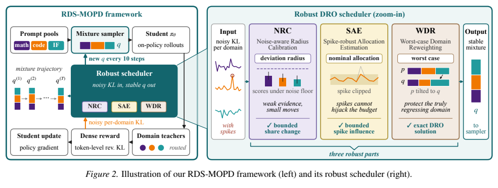
图 1-1｜原文 Figure 2，PDF 第 3 页，[来源](https://arxiv.org/pdf/2611.12012v1)。左侧 q 只控制三类 prompt 的采样比例，学生 rollout 由对应领域教师评分；右侧 NRC、SAE、WDR 依次处理噪声、尖峰和相对退步。每 10 步更新混合比例，不是每 token 再调用一个额外教师。图中示意曲线不当作测量数据。

### 关键公式与推导

【原文事实，式 1】领域 d 的每步观测 m_d=(1/|B_d|)Σ_(y∈B_d)(1/|y|)Σ_j D_j，D_j 是学生 top-16 支持上的师生 reverse-KL 信号。这里先按响应平均再按领域平均，避免把观测直接写成长响应 token 总和。学生训练仍用已有 dense reward −D_j；调度不增加新的任务奖励。领域混合 q∈Δ^K，Δ^K 为非负且和为 1 的 K 维概率单纯形。

【原文事实，式 2—4】DRO 决策 q=argmax_(q∈U){〈q,h〉−KL(q||p)/η}。p 是名义预算、h 是要保护的损失、η>0 决定倾斜强度、U 是可行集合。无 floor 时解为 q_d∝p_d exp(ηh_d)。朴素版本每步拿上一 q 作 p，h=m_d/I_d，I_d 是早期 KL 均值；展开 log(q_d/q_e) 后，每次异常项都会累加，因此偶发 spike 不会自动消失。

【本文推演】给目标加约束 Σq=1 的乘子，内点导数 h_d−(ln(q_d/p_d)+1)/η−λ=0，移项得 q_d=p_d exp(ηh_d)×共同归一化常数。这解释了指数权重何以放大离群值；它不是一条自动识别“真正退步”的规则。

【原文事实，式 9：SAE】对每步 raw KL 取前 H 步原始观测中位数 μ_d，令 m_clip=clip(m_d,e^(−c)μ_d,e^c μ_d)。之后 EMA、速度等均由 clipped 序列计算；每次重新估计 p，而非在旧 p 上一直累乘。H=5、c=0.5。单个异常影响有界，持续真实变化在中位数跟上后仍会通过；这不是把一切坏消息都抹掉。

【本文推演，手算】若最近中位 KL=0.01，新观测突然变成0.30，上界是0.01e^0.5≈0.01649；本次统计最多看到约1.65倍，而不是30倍。若很多连续观测都升高，中位数会迁移，算法最终承认趋势，不能把“抗尖峰”理解为“不会响应真实退化”。

【原文事实，式 7—8：NRC】用 clipped KL 的 EMA ℓ_d、初始尺度 I_d、近期相对下降速度 v_d≥0，形成 r_d=v_dℓ_d/I_d。名义预算 p_d=f+(1−Kf)softmax(r/τ)_d；f 是每域 floor。温度 τ=T_base max(r_max,ε σ_hat)，σ_hat 是领先 progress score 的标准误估计。信号接近噪声时，温度不随 r_max 一起塌到零，避免把随机领先归一化成决定性优势。

【原文事实，附录式 12】噪声估计 σ_d=(1.4826/sqrt(2)) median|ln m_clip(s)−ln m_clip(s−1)|。设 ω 为一窗口 EMA 权重、J 为可用窗口相对变化数、ratioEMA_d,j=ℓ_d^[j]/ℓ_d^[j+1]，则 SE(v_d)=sqrt(2)σ_d||ω||_2 sqrt(Σ_j ratioEMA_d,j²)/J；SE(r_d)=sqrt((v_d σ_d||ω||_2 g_d)²+(g_d SE(v_d))²)，g_d=ℓ_d/I_d。σ_hat 取领先域的 SE(r_d)。默认噪声窗口40、EMA窗口10、最多3段相对下降、ε=4、T_base=0.5、f=0.1。

【本文推演】这是 delta-method 型近似，把 log-KL 波动传播到进度分数不确定性；有限窗口、相关观测和速度截断使它不等于精确置信区间。论文证明：在相邻两轮所有分数均处于指定噪声带 r_d≤ζ σ_hat、ζ≤ε 等条件下，每域名义份额变化≤(1−Kf)ζ/(2εT_base)。它是带条件的稳定性上界，不是下游准确率保证。

【原文事实，式 10—11：WDR】维护截至当前的最佳 EMA ℓ*_d，定义 h_d=min(ln(ℓ_d/ℓ*_d),ln κ)，κ≥1。最坏情况由“相对自身最好水平退步多少”确定。约束 λ_d=min(p_d,λ_lo)，最终 q_d=max(λ_d,ν p_d exp(ηh_d))，ν 使 Σq=1。通过把低于 floor 的坐标固定、重分配剩余质量，至多 K 轮求解。

【本文推演，手算】p=(1/3,1/3,1/3)，只有数学 KL 比自己最好水平高一倍，h=(ln2,0,0)，η=1、κ=2、λ_lo=0.2。无约束倾斜为(2,1,1)归一化，即(0.5,0.25,0.25)，均高于0.2，因此无需再 clamp。若三域 h 相等则 q=p，算法不会仅因所有领域同程度变差就偏爱其中一个。

【原文事实】唯一解也可解释为某个 KL 球内的最坏分布；球半径是最终 KL(q||p)，不能说论文提前指定了独立固定半径。并有 κ^(−η)≤q_d/p_d≤κ^η、q_d≥min(f,λ_lo)。证明先把目标改写成常数−KL(q||normalized(p exp(ηh)))/η，再用凸集合上的 KL 投影与 KKT 求 floor 解。这个界控制预算变化，不证明 noisy KL 与真实能力始终一致。

### 数据、训练、实现流程与成本

【原文事实】学生 SmolLM3-3B，从 Open-MOPD 的 MixSFT checkpoint 开始；RL-Math、RL-Code、RL-IF 三教师来自其公开资源。prompt 总86931：math17917，code23667，IF45347；来源为 DAPO、PrimeIntellect/TACO、Nemotron-IF-RL。每题按领域路由教师，未改变学生网络结构。

【原文事实】150步、每步1024 prompts、minibatch256、lr1.5e−6、最长响应16k。初始混合(0.4,0.4,0.2)，充分热身后每10步调度；采样比例额外乘 Uniform[0.7,1.3] jitter，再按 largest remainder 取整数样本数。κ=2、η=1、λ_lo=0.2。主实验16×A800 80GB；消融8卡，噪声压力测试4卡，不能把所有实验一律写成16卡。

```text
初始化三域统计与 q=(0.4,0.4,0.2)
每步：按 jittered q 采 prompt，学生生成，领域教师评分并更新学生
读取现成每域 KL 观测；用历史 raw 中位数作 log-domain clipping
每10步且统计足够时：计算 EMA、下降速度、score 标准误
以噪声温度计算新 nominal p；计算各域相对自身最好水平的 h
解带 coverage floor 的指数倾斜 q，供后续采样
```

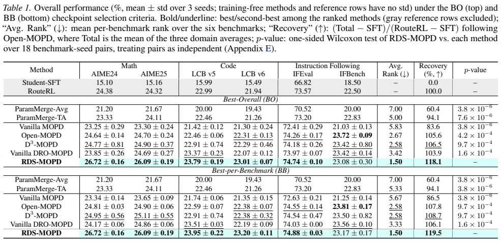
图 1-2｜原文 Table 1，PDF 第 7 页，[来源](https://arxiv.org/pdf/2611.12012v1)。BO 取每 run 一个最佳整体 checkpoint；BB 每 benchmark 分别取最好，不能视作同一个可部署模型。三训练种子均值±std；RouteRL 是 oracle 路由多教师参考，非单模型。BO 的 RDS 为 AIME24/25 26.72/26.09、LCBv5/v6 23.79/23.01、IFEval/IFBench74.74/23.08；D³ 对应24.77/24.90、22.91/22.29、74.18/23.42。RDS 五项第一，IFBench 并非第一。Recovery118.1% 是相对师生差距归一化，绝非118.1%的绝对准确率。

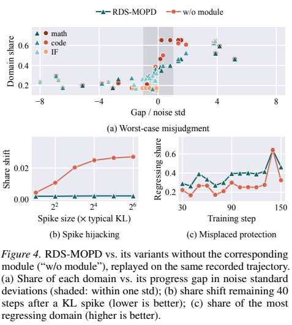
图 1-3｜原文 Figure 4，PDF 第 8 页，[来源](https://arxiv.org/pdf/2611.12012v1)。在同一记录轨迹上重放调度决策：左上横轴为 progress gap/噪声std，阴影是一std内；左下是单步 spike 大小对40步后残余份额偏移；右下是最退步领域份额。它隔离调度反应，不是重新训练后的准确率曲线。Table2 的独立训练消融仅 seed0；去模块多数下降但有反例，如去 WDR 的 IFEval 更高，不能说每个组件每个任务都改善。

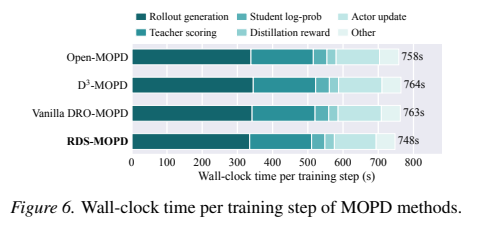
图 1-4｜原文 Figure 6，PDF 第 9 页，[来源](https://arxiv.org/pdf/2611.12012v1)。16张A800，同硬件分解每步时间；RDS约748s、Open约758s、D³约764s，调度自身平均0.039ms。数字约750s是训练步，而非调度时间。全150步 RDS比D³单步快5.6%，伴随响应7130vs8127 tokens；收益包含学生行为改变，不能全部归因于调度器CPU计算更快。

【限制与复现】每域教师尺度、重尾噪声模型、标准误近似和调度参数决定适用范围。仅3B、三域；18个 benchmark-seed pair 的 Wilcoxon 把配对当独立，六项测试与同一训练run有相关性，p值应谨慎解读。评测在90/100/120/150步选点，BO/BB仍有测试集选择效应。完整训练美元、总GPU-hour和峰值显存未给出；本文不拿局部计时直接补造成完整账单。未核实专门官方代码/独立作者博客；Open-MOPD依赖不等于本方法公开实现。基础入口：[Group DRO 原作者代码](https://github.com/kohpangwei/group_DRO)、[veRL文档](https://verl.readthedocs.io/en/latest/)、[OPD 入门](https://thinkingmachines.ai/blog/on-policy-distillation/)，均不占五篇名额。

## 2. 熵形状：好的教师不只决定“分叉选谁”，也决定“何时分叉”

原文：[Distilling the Shape of Uncertainty: What On-Policy Distillation Learns and How to Predict It](https://arxiv.org/abs/2610.39020)，Shiping Yang 等；首投2026-10-28，阅读 [v1](https://arxiv.org/pdf/2610.39020v1) §3—5与附录A—E。

### 问题与原始机制图

【原文事实】更大、解题更强的教师未必更适合蒸馏。作者区分 how to branch（考虑哪些候选token）和 where to branch（在哪些位置保留多种推理可能）。top-k overlap只覆盖前者，逐位置 entropy 序列刻画后者。本文研究 sampled-token OPD，不能不经验证外推到所有 top-k/full-vocabulary 目标。

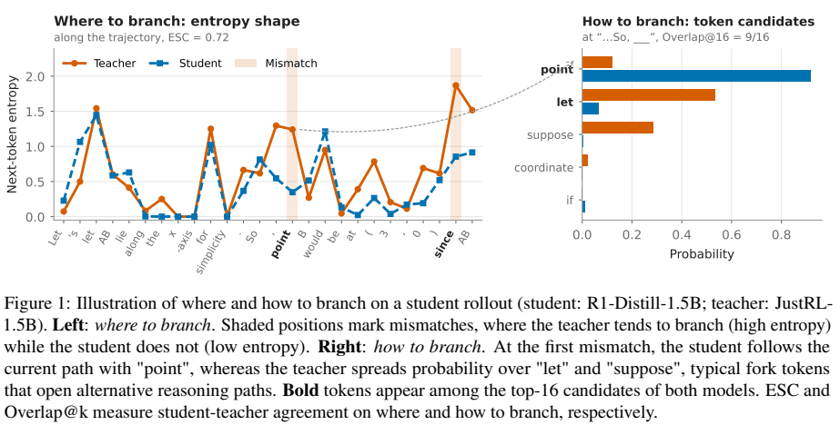
图 2-1｜原文 Figure 1，PDF 第 2 页，[来源](https://arxiv.org/pdf/2610.39020v1)。同一学生rollout，DeepSeek-R1-Distill-Qwen-1.5B 与 JustRL-1.5B；左图横轴生成位置，纵轴下一token熵，阴影是分叉位置不匹配；右图展示一处候选概率。它是实际轨迹的机制可视化，不是新网络架构图。概率熵反映分布不确定性，不必然是经过人类验证的“真正推理节点”。

### 公式、温度移植与手算

【原文事实，式 1—4】每步 log-ratio Δ_t=ln q_t(y_t)−ln p_t(y_t)，在固定前缀下 E_(y~p)Δ_t=−D_KL(p_t||q_t)。作者将 detached Δ作为优势，最大化 PPO式 min(r_t a_t,clip(r_t,1−ε,1+ε)a_t)，r_t=πθ(y_t|s_t)/πold(y_t|s_t)，ε=0.2，无额外任务reward。不要把“单token估计无偏”扩大成“固定rollout反传等于所有状态分布全导数”。

【原文事实，式 5—7】Overlap@k=(1/T)Σ_t |TopK(p_t)∩TopK(q_t)|/k，k=16。熵 H(p_t)=−Σ_v p_t(v)ln p_t(v)；entropy gap ΔH=|mean_t H(p_t)−mean_t H(q_t)|。ESC=Pearson({H(p_t)},{H(q_t)})，展开为 Σ_t(a_t−a_bar)(b_t−b_bar)/sqrt(Σ(a_t−a_bar)²Σ(b_t−b_bar)²)，a_t/b_t 是两条熵序列，a_bar/b_bar 是各自均值。这里 a_t 与前段 PPO优势同字母但含义不同。

【本文推演，手算】学生熵序列a=(0.2,0.8,0.2,0.8)，教师b=(0.3,0.9,0.3,0.9)，ESC=1、均值差0.1；把教师顺序换成b'=(0.9,0.3,0.9,0.3)，均值差仍0.1，ESC却为−1。总体熵相近不代表不确定的位置相同。Pearson对平移/正缩放不变；若整条序列常数，分母为0，不能硬填ESC=0。

【原文事实，式 8】为干预 where 而保留候选排序，在每位置求正温度 T_t，使 H(softmax(z_A,t/T_t))=H_B,t；记反事实教师 A←B。z_A 是教师A logits，B供目标熵；正数温度保持argmax/top-k集合，但会改变概率比和梯度幅度。求解用 logT 上 Newton并加bracket保护。

【本文推演】令 u=lnT。H=ln Z−E[z]/T，可推 dH/du=Var_(softmax(z/T))(z)/T²≥0；Newton更新 u_new=u+(H_target−H(u))/(dH/du)。导数太小或步超出 bracket时应退回二分。两类logits z=(ln4,0)，T=1给(0.8,0.2)、H≈0.5004nats；T=2给(2/3,1/3)、H≈0.6365。候选第一名没变，但概率更平。目标熵若超出有限温度区间可达范围，就只能近似匹配并报告误差。

【原文事实，式 9及评测定义】训练前以1000 probe rollouts计算指标，每学生五位教师。选教师可用 score=−ESC，再 argmax score；低 pre-OPD ESC 在这十组实验中预测更多可学的形状差异。Spearman衡量预测排序与真实收益排序；regret=max_T Δ(S,T)−Δ(S,T_selected)。训练成功时ESC上升与“训练前低ESC可学空间更大”并不矛盾，前者是学习进度，后者是候选比较。不能总结成任何低相似度教师都好。

### 数据、流程与公开实现

【原文事实】学生 R1-Distill-1.5B 和 Qwen3-1.7B non-thinking；教师最多8B。DeepMath-103K 构造 both-correct/both-wrong 各7000题，以两教师各一次采样是否答对划分，因此“both-wrong”是该次采样失败，不证明教师永远不会解题。另以 DAPO-Math-17K 做动态和反事实实验，六数学集为AIME24/25、AMC23、BeyondAIME、HMMT25/26。

【原文事实】训练200步，batch=minibatch64、每题1 rollout，T1/top-p1、prompt1024/response16384，AdamW lr1e−6，teacher logprob top-K64，clip0.2、额外KL系数0。普通训练保存每50步；反事实图比较100步。评测T0.7/top-p0.8/top-k20、avg@4，DeepSeek最多16384、Qwen最多8192。top-K传输配置不等于loss对教师完整分布做了top-K归一化。

```text
预训练探针：固定学生 rollout，逐教师在相同前缀记录熵和top16
计算每序列 Pearson，再聚合，比较候选教师预计收益
普通OPD：当前学生生成，教师算 sampled-token logp，固定优势更新
反事实实验：每位置读A的完整logits及B的目标熵
用正温度求解匹配熵，保留A的候选排序
用合成教师 sampled-token logp替代原教师，再走相同OPD更新
分别监控对形状源的ESC、对偏好源的Overlap，不混为一个教师
```

【代码核查】[官方仓库](https://github.com/maybenotime/opd-esc)，提交 `b0c1a6126d87e7c2197f4860ef9cbc2390176d7e`。[温度求解器](https://github.com/maybenotime/opd-esc/blob/b0c1a6126d87e7c2197f4860ef9cbc2390176d7e/verl_opd/plugins/k1_probe/tp_stage/tp_core.py) 默认10轮、logT∈[−3.5,3.5]，FP32 logits与熵，目标熵clamp到[1e−3,lnV−1e−3]，记录未匹配比例；不是数学上任意目标都精确可达。

【代码核查】[k1_probe.py](https://github.com/maybenotime/opd-esc/blob/b0c1a6126d87e7c2197f4860ef9cbc2390176d7e/verl_opd/plugins/k1_probe/k1_probe.py) 逐序列算Pearson，少于25有效token或零方差跳过；在线基础探针的教师熵来自top-K传输信息，不能不加区分当成完整词表熵。温度移植分支则分块重建完整词表logits。应锁定具体探针pipeline再复现ESC。主launcher包装设置k1+PG、64batch、16k；底层run_opd_math默认k3、无PG和小模型，直接运行默认脚本并非主实验。

【资源与成本】作者仓库说明两SLURM节点、Blackwell级96GB设备，示例入口为2张actor/rollout加1张teacher；这是代码环境说明，不是所有run硬件总量或完整训练账单。具体总GPU-hour、美元、峰值显存和完整多训练种子稳定性未披露；不能把十个教师组合bootstrap当成十次独立训练复现。

### 核心实验证据与限度

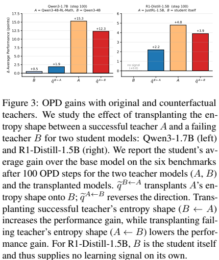
图 2-2｜原文 Figure 3，PDF 第 7 页，[来源](https://arxiv.org/pdf/2610.39020v1)。100步后六数学集平均准确率相对初始学生的点数增益。左Qwen：原失败教师+0.5、移入成功形状+1.9、成功教师+15.3、换入失败形状+12.3；右DeepSeek：自我教师0、移入JustRL形状+2.2、JustRL+4.8、换入自身形状+3.9。该干预支持熵形状有作用，但正温度同时改变分布尖锐度和每token权重，不能宣称已隔离所有可能机制，也不能说how不重要。

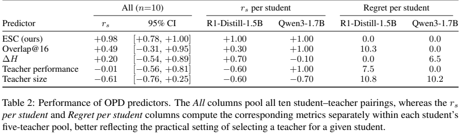
图 2-3｜原文 Table 2，PDF 第 8 页，[来源](https://arxiv.org/pdf/2610.39020v1)。两学生×五教师，共十点；按预测收益方向排列后的ESC score总体Spearman+0.98、95%bootstrap区间[+0.78,+1.00]，每学生+1、regret0。raw ESC与收益是负关联，不能把表里的正号理解为越高ESC越好。Teacher size等基线有时负相关。5000次pair重采样并不能消除同一学生下多个教师组合之间的相关性和小样本局限。

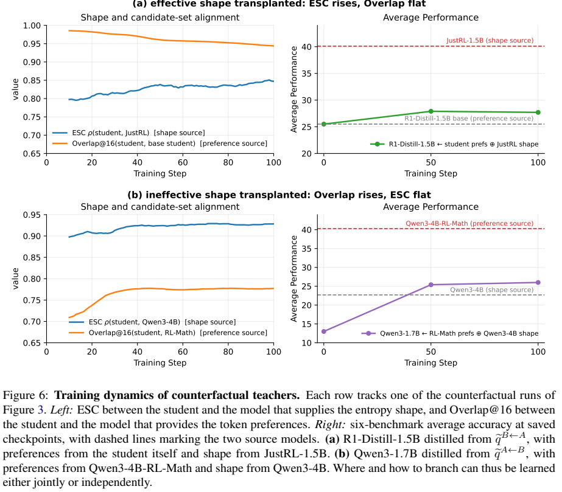
图 2-4｜原文 Figure 6，PDF 第 13 页，[来源](https://arxiv.org/pdf/2610.39020v1)。每行一个反事实run，左ESC对shape source、Overlap对preference source，右为下游准确率；上行主要ESC变化、下行主要Overlap变化。不可把左边两条线当成同一个教师的两项完整校准度，也不可将轨迹相关性单独称为因果证明，干预证据来自Figure3。

【原文事实】both-wrong与both-correct子集：JustRL教DeepSeek平均+6.1/+4.4，7B同配方教师+0.0/−0.6；RL-Math教Qwen+13.7/+13.4，8B+1.2/+0.2。支持“单次教师最终答错不代表其所有前缀分布无用”，并不支持取消正确性评估。局限是小模型、数学、sampled OPD和仅十组合；熵形状是低维摘要，遗漏知识内容与分词/上下文兼容性。辅助阅读：[作者代码说明](https://github.com/maybenotime/opd-esc/tree/master/verl_opd)、[Pearson官方定义](https://docs.scipy.org/doc/scipy/reference/generated/scipy.stats.pearsonr.html)、[PyTorch自动微分教程](https://docs.pytorch.org/tutorials/beginner/basics/autogradqs_tutorial.html)。未核实独立作者博客，仓库说明作官方辅助资料。

## 3. P²-MOPD：把专家权重变成可微分的优化先验

原文：[P²-MOPD: Accelerating Multi-Teacher On-Policy Distillation via Parameter Priors](https://arxiv.org/abs/2611.03953)，Sinuo Wang等；首投2026-11-02，阅读11-05更新的 [v2](https://arxiv.org/pdf/2611.03953v2)。重点§3—5与附录A/B/C/F/G。PDF自署11-06不能代替arXiv首投日期。

### 问题与原始架构图

【原文事实】task arithmetic用专家参数差合并，快速但缺少行为校正；常规MOPD从合并模型继续训练，仍可能遗落某个专家方向。本方法同时训练完整学生权重和沿专家task vector的系数。它改变优化路径，不通过限制完整模型只能留在少数方向来“省参数”；推理最终仍是普通单学生。

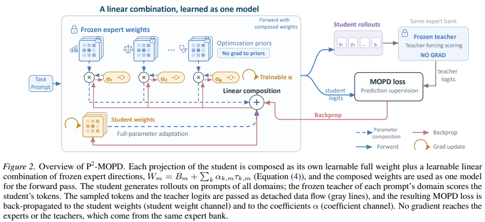
图 3-1｜原文 Figure 2，PDF 第 4 页，[来源](https://arxiv.org/pdf/2611.03953v2)。每个projection由完整学生矩阵加冻结专家方向的可学组合构成；同一MOPD梯度有weight和coefficient两通道，冻结教师只给detached标签。蓝虚线是参数组合，红线是反传，不表示每次额外执行K个学生前向。教师评分网络与参数先验来自同一expert bank，但作用不同。

### 公式：为什么它不是“学几个合并系数”那么简单？

【原文事实，式 1】共享base θ0，K个同架构专家θk，task vector τk=θk−θ0。普通TA是 θ_TA=θ0+Σ_k λkτk，本期实验K=4、λk=0.25。若只学λ，模型永远留在这些方向张成的仿射空间。

【原文事实，式 4—5】对decoder线性projection m，W_m=B_m+Σ_k α_k,m τ_k,m。B_m 是可训练完整矩阵，τ冻结，α是每模块K个标量。其余embedding、norm、输出head记φ，走常规weight通道。令G_m=∂L/∂W_m，链式法则给∂L/∂B_m=G_m，∂L/∂α_k,m=〈G_m,τ_k,m〉，内积为所有矩阵元素乘积之和。α系数没有必须非负或和为1的概率约束。

【本文推演】若专家方向与当前梯度内积为负，增加该α会一阶降低loss。每个batch混合四域，所以系数梯度是所有领域贡献之和，不是“医疗专家系数只看医疗题”。B无限制，任意W均可通过取B=W−Σατ表示，因此表达能力与普通学生相同。增加的方向改善的是优化几何，不是凭空扩大函数类。

【原文事实，式 2—3】每位置在学生top-16加nucleus0.99确定支持V_i；完整词表概率p/q不在支持内各自重新归一化，w_i(v)=p(v)/Σ_(u∈V_i)p(u)，r_i(v)=−w_i(v)[ln p(v)−ln q(v)]。固定这些reward，用L=−Σ_batch,i,v stopgrad(r_i(v))lnπ_W(v|prefix)/N更新，N为有效响应token数。每batch只用一次optimizer update，方法没有新增独立的正确性reward。

【本文推演，支持语义】设P=Σ_V p，Q=Σ_V q，p_tilde=p/P、q_tilde=q/Q，则Σ_V w ln(p/q)=KL(p_tilde||q_tilde)+ln(P/Q)。若错误地把教师q也在V重归一化，就删掉支持质量项，改变训练信号。这是附录A专门指出的区别；不能只看到top-16就替换成常规归一化KL。

【原文事实，式 6—7】工程不额外保存一份B，而是维护FP32 materialized W：先用未裁剪G算g_α=D^T G，再分别裁剪两通道。weight通道用AdamW更新W得到W_plus，coefficient通道用Adam更新α，最后 W_new=W_plus+D(α_new−α_old)。D按列堆叠vec(τ_k)；^T为转置。两通道使用同一个pre-update G，无第二次反传。weight decay必须为0，才与显式维护B再重组合等价。

【本文推演】若weight decay非0，直接对W衰减含−ηλ_wdW，显式对B衰减含−ηλ_wdB，两者相差−ηλ_wdDα；不能继续引用等价性。系数共享到layer/model时，梯度为所覆盖module内积之和，而非均值；重用momentum/clip配置也需相应匹配。

【原文事实，式 8】在两通道都为纯SGD、无momentum/clip/decay的解释性特例下，ΔB=−ηW g、Δα=−ηαD^T g，因此ΔW=−(ηW I+ηαDD^T)g。I是恒等算子，DD^T是至多K秩的半正定项，放大专家子空间里的梯度分量。实际用Adam分别归一化和裁剪，不能把此矩阵当成其精确全程更新公式。

【本文推演，手算】二维参数，唯一专家方向τ=(1,0)，当前梯度g=(−2,1)，ηW=0.1、ηα=0.2。普通SGD位移为(0.2,−0.1)；系数梯度〈g,τ〉=−2，Δα=+0.4，合成位移(0.6,−0.1)。沿专家方向走得更远，同时B仍能改动第二维。若只训练α，则第二维永远不动；这个例子说明为什么“只学系数”和“双通道”不同，不是实际Adam数值复现。

### 数据、训练伪代码与算力

【原文事实】学生Qwen3-4B/1.7B，base为IM-MOPD通用SFT reference，同源四专家医疗/法律/金融/指令；公开prompt池分别13761/31396/8446/11472，共65075。评测MedQA/CaseHOLD/FinQA/IFBench，1273/5314/1147/300题。每batch128、每域32，每题1响应，生成T1/top-p1；最长prompt15872/response16384，截断响应mask掉。没有加入测试集prompt来训练系数，验证池仅IM-MOPD合并规则使用。

【原文事实】100步，25/50/75/100评测；weight lr1e−5、coefficient lr1e−2，均5%warmup后constant；AdamW/Adam betas(0.9,0.999)、decay0、分别global clip1。4B的252个projection×4=1008系数，1.7B为196×4=784。module为主设置，也测试layer/model tying。八GPU/run，论文给了卡数但未明确可核实的统一具体型号，不能补写成H100。

```text
计算四专家与共同base的冻结task vectors；加载同一TA merged start
每轮：四域均衡取prompt，用当前materialized学生生成
领域教师在学生前缀提供候选reward，固定reward反传一次得到G
用未裁剪G与task vector内积，累加成每个可学系数梯度
分别clip：weight AdamW(wd=0)，coefficient Adam(wd=0)
在更新后的W上加Σ(α_new-α_old)*τ
同步W给rollout；最终输出普通checkpoint，系数已折叠，无额外推理分支
```

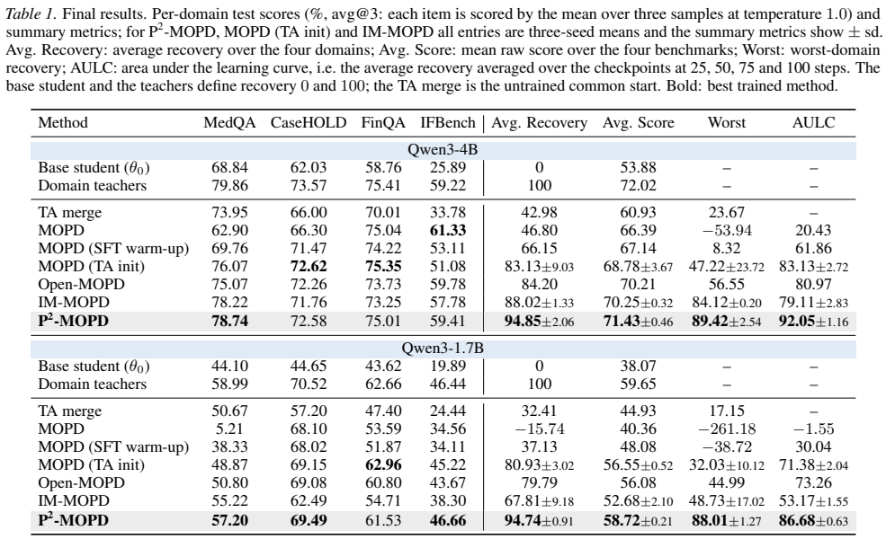
图 3-2｜原文 Table 1，PDF 第 7 页，[来源](https://arxiv.org/pdf/2611.03953v2)。raw score与recovery分开：recovery=(score−base)/(teacher−base)，四域等权均值；Avg.Score才是原始题目得分平均。三训练种子仅用于P²、TA-init和IM三者，其他行不应假装同样多种子。4B/1.7B最终平均恢复94.85/94.74%，TA-init83.13/80.93%；最差域89.42/88.01%，TA-init47.22/32.03%。1.7B原始平均分58.72vs56.55，不是准确率提高到94.74%。

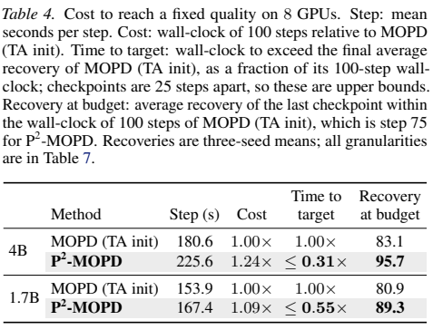
图 3-3｜原文 Table 4，PDF 第 8 页，[来源](https://arxiv.org/pdf/2611.03953v2)。4B/1.7B单步225.6/167.4s，基线180.6/153.9s，因此同100步总成本更高1.24×/1.09×；但达到基线最终平均恢复的时间≤0.31×/≤0.55×。checkpoint每25步，所以达标时间是观测上界。附录Table7完整作业wall为4B6.51vs5.26h、1.7B4.90vs4.48h；已包含作业从环境ready到最终checkpoint，勿把100×单步均时直接当完整wall。GPU-hour若乘八是本文推算，论文未提供完整跨run总账单。

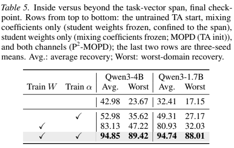
图 3-4｜原文 Table 5，PDF 第 9 页，[来源](https://arxiv.org/pdf/2611.03953v2)。TA、只学系数、只学weight、双通道按行比较；只学系数平均恢复52.98/49.31%，远低于双通道。Table3的额外干预也显示随机方向不能替代专家方向；只开放医疗系数近乎恢复全收益，但需要预先知道哪个领域落后，不能当成无需诊断的通用算法。

【消融与局限】主要收益集中于MedQA，FinQA相对TA-init有小幅牺牲，并非所有域逐点严格增加。module不是所有尺度和所有指标都绝对最优，model tying可有更高平均但域间离散更大。只测试两小模型和四任务、100步；专家需共享架构/基座，读写task vectors带来实际streaming成本，新增标量少不等于额外训练内存/带宽为零。论文未给完整峰值显存/美元费用。多个checkpoint和评测seed不是独立训练重复。

【代码核查】[官方仓库](https://github.com/SinuoWang/P2-MOPD)，固定 `68b19c5549f4fe7ed9cf43259fd8312b3476531a`。虽README写official implementation，当前完整tracked tree仅`.gitignore`、README及两张图片，没有训练脚本、优化器实现或权重。不能宣称已公开可跑代码。未核实独立作者博客，README作作者说明；基础资料：[task arithmetic原论文](https://arxiv.org/abs/2212.04089)、[PyTorch AdamW文档](https://docs.pytorch.org/docs/stable/generated/torch.optim.AdamW.html)、[OPD教程](https://thinkingmachines.ai/blog/on-policy-distillation/)。

## 4. RPSD：用其他用户的行为证据细化每个token的信用

原文：[RPSD: Retrieval-Privileged On-Policy Self-Distillation with Optimal Transport](https://arxiv.org/abs/2610.37281)，Dongyue Li等；首投2026-10-27，阅读 [v1](https://arxiv.org/pdf/2610.37281v1) §3—4及算法、实现、数据、vanilla OPSD和token/response对照附录。

### 问题定义、基础概念与原架构图

【原文事实】输入用户历史与候选item，学生输出下一item。GRPO整条响应共享一个优势，区分不出哪些token真正参与决策；只给教师正确item又只回答“是什么”，缺少“为什么符合这段历史”。RPSD从训练库检索其他用户相似历史及其后续item，作为训练期特权信息，并由同一当前模型的stop-gradient分支重评学生原响应。部署学生只看原prompt，无检索开销。

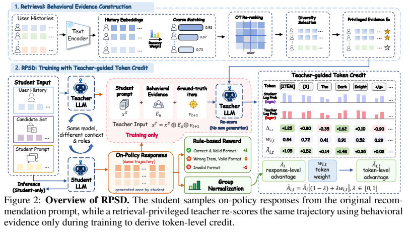
图 4-1｜原文 Figure 2，PDF 第 4 页，[来源](https://arxiv.org/pdf/2610.37281v1)。上半部title embedding→粗召回→时间OT→多样性选择；下半部学生原prompt生成，教师另看检索证据及ground-truth item，重评同一响应，塑造token weight。教师不另生成标准答案。图中token色条为作者机制示意，不当作实验均值。

【基础概念】最优传输OT把两段历史的概率质量配对，以兼顾语义相似与顺序；它不同于整段平均embedding余弦，也不是简单逐位置严格相等。unbalanced允许部分质量不匹配，适合只有部分兴趣重叠的用户；熵正则使传输矩阵更平滑、可用Sinkhorn迭代求解。

### 检索公式：时间感知OT与多样性

【原文事实，式 1—4】取K个最近item，p=0为最早，a_p=exp(−β(K−1−p))/Σ_r exp(−β(K−1−r))。title向量e_v单位归一化；历史向量e_bar(H)=Σ_p a_pe_vp / ||Σ_p a_pe_vp||。粗召回以此余弦选top-N0窗口。β越大越重近期；不要与后面KL正则β_KL混淆。

【原文事实】精排成本C_pq=1−〈e_vp,e_v'q〉+γ|p/(K−1)−q/(K−1)|，γ≥0衡量时间错位惩罚。求P≥0最小化〈P,C〉+εKL(P||11^T)+ρ[KL(P1||a)+KL(P^T1||b)]。P为K×K transport plan，P1/P^T1为两侧边缘，a/b为时间质量；此处KL是非负质量上的generalized KL，不能当成两个已和为1向量的普通分类KL。ε控制平滑，ρ控制边缘偏离。

【原文算法 3】令kernel Kmat=exp(−C/ε)、f=ρ/(ρ+ε)，从u=v=1开始，交替u=(a/(Kmat v))^f、v=(b/(Kmat^T u))^f，逐元素除法/幂；最后P=diag(u)Kmat diag(v)。ρ→∞时f→1，趋向balanced边缘约束。符号Kmat与历史长度K只是记号区分，不是两个不同算法。

【原文事实】用transported mass归一化得到c_j=〈P*,C〉/||P*||_1，s_j=exp(−c_j/τ)。再贪心选三条证据，j*=argmax_(j未选)[s_j−λdiv max_(k已选)〈e_bar(h_j),e_bar(h_k)〉]；第一条的max项设0。τ是相似度温度，λdiv平衡相关/多样；不是把三个最近邻全部不加筛选塞进教师。

【本文推演，手算】两个item历史、近期质量a=b=(0.25,0.75)，教学极限下仅对角可对齐；若对应语义差均0.2且时间对齐，单位总质量下成本0.2；如果唯一可对齐关系完全交换位置，时间项每单位多γ=0.5，成本变0.7。取τ=1，相似度约e^−0.2=0.8187与e^−0.7=0.4966。真实unbalanced有有限ε/ρ并可弃置质量，不保证这一极限矩阵；本例只说明顺序惩罚。多样性例：A/B相关度0.9/0.88，彼此余弦0.99；C相关度0.82、与A余弦0.1，λdiv0.2时选A后B得0.682，C得0.80，故选C。

### token信用、reward与最终loss

【原文事实，式 5—8】每prompt采G=8响应，格式正确且item正确reward+1、正确格式但item错误0、格式无效−1。A_i=(r_i−group_mean)/group_std。用当前模型两种上下文的detached评分，Δ_i,t=lnπ_sgθ(o_i,t|xT,history)−lnπ_sgθ(o_i,t|xS,history)；xT含检索证据和正确item，xS没有。先逐completion中心化并限幅：δ_i,t=clip(Δ_i,t−mean_t'Δ_i,t',−cδ,cδ)。

【原文事实】w_i,t=clip(exp(sign(A_i)δ_i,t),1−εw,1+εw)，A_tilde_i,t=A_i[(1−λ)+λw_i,t]，λ∈[0,1]。最终 L=−E[(1/G)Σ_i(1/T_i)Σ_t min(ratio_i,t A_tilde_i,t,clip(ratio,1−ε,1+ε)A_tilde_i,t)]+βKL L_KL；ratio=πθ/πold，L_KL约束reference。reward正确性仍决定优势方向，教师只改变每token强弱；不能把它写成直接KL匹配特权教师的纯蒸馏。

【本文推演】合法εw范围需保证下界为正，才严格保留优势符号；原文以positive weights解释该性质。若λ=0或εw=0退化GRPO。A=0的group没有有效结果差异，均值和标准差保护的具体代码未公开，不能杜撰ε值。逐响应中心化去掉统一概率抬升，但clip并不保证总token weight均值为1，因此不是严格保持原梯度总尺度。

【本文推演，信用算例】取A=+1、两个δ=(+0.3,−0.3)、εw=0.2、λ=0.5，则exp(δ)限幅成(1.2,0.8)，A_tilde=(1.1,0.9)。取A=−1，相同δ得到w=(0.8,1.2)，A_tilde=(−0.9,−1.1)：教师相对支持的token少惩罚，教师相对不支持的token多惩罚。两者均未反转结果reward符号。数值为教学自设，不是论文默认超参数。

### 数据、流程与成本缺口

【原文事实】Qwen3-4B SFT初始化，LoRA rank32/alpha64/dropout0.05、所有linear层；三epoch、lr8e−6、每设备batch4、gradient accumulation8、KL系数0.1、每500步存checkpoint。title embedding为SFT模型meanpool，经PCA降128维并归一化。历史最多九次交互，默认候选正确item+9个非交互负例，训练单item输出，评测Top3和Top5列表各自生成；另测100候选。数据MovieLens-1M、MicroLens、Netflix，仅使用ID/title，不读取图片或视频。

【原文事实】构造实例后7:1:2划分，使用当前实例最后item为target，前面为history。检索池来自训练用户序列，排除query用户自身窗口、完全相同query history，算法还排除每序列最后窗口。教师能看别的训练用户后续item，学生/测试不能看当前target。未充分说明全局跨用户时间截止与所有重叠实例去重细节，严格时间外推复现应补审计，不能仅凭“排除自身”就宣称绝无泄漏。

```text
从训练历史建窗口索引：title编码、PCA、recency向量
每轮对用户取history和候选，粗召回其他用户窗口
用时间unbalanced OT精排，再MMR选3条证据
学生原prompt采8响应，以item/格式算group advantage
同一当前模型stopgrad分支看证据+正确item，评分原响应
中心化/clip logp gap，按优势正负生成有界token weight
固定token优势，优化clipped GRPO+reference KL；部署只保留学生原输入
```

【未披露/未核实】GPU型号/数量、端到端wall/GPU-hour、峰值显存、OT索引构建/查询成本均未给出可核实完整数字；ε、ρ、γ、β、N0、τ及λ、εw等关键默认值也未在所读实施说明完整列明。不能仅凭算法写一个自选配置就称论文复现。代码/原文未核实明确总训练seed清单；统计显著性需具体重复单元，不以p<0.05替代稳定性信息。

### 核心实验、消融、局限

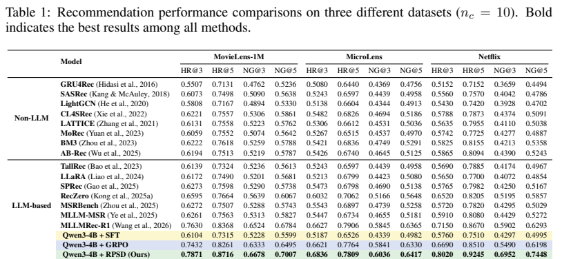
图 4-2｜原文 Table 1，PDF 第 6 页，[来源](https://arxiv.org/pdf/2610.37281v1)。10候选，列为三数据集HR3/5、NDCG3/5。同4B backbone对照：MovieLens HR3 0.7432→0.7871，Netflix HR3 0.6690→0.8020，MicroLens HR5却0.7764→0.7809。不是所有相对其他baseline单项均最好，例如MicroLens某些HR5有更强外部方法。随机负例小候选高命中率不能等同于全库检索指标。

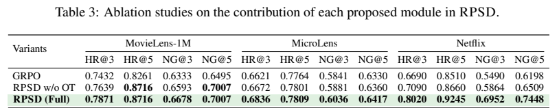
图 4-3｜原文 Table 3，PDF 第 7 页，[来源](https://arxiv.org/pdf/2610.37281v1)。GRPO、只用正确item特权的w/o OT、完整检索RPSD。MovieLens HR5：0.8261→0.8716→0.8716，加入检索在这一项并未再提高；Netflix NDCG5：0.6198→0.6509→0.7448。需要逐项看增益，不把“平均更好”变成每项严格提升。

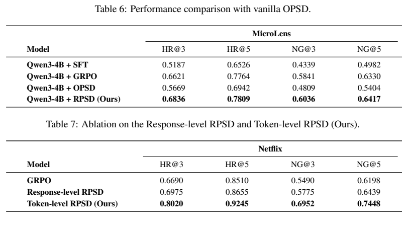
图 4-4｜原文 Tables 6、7，PDF 第 23 页，[来源](https://arxiv.org/pdf/2610.37281v1)。Table6的MicroLens，vanilla OPSD NDCG5为0.5404，GRPO0.6330，RPSD0.6417，说明直接特权KL并不足够；Table7的Netflix，response-level重加权NDCG5为0.6439，token-level为0.7448，支持信用粒度价值。两表数据集不同，不能横向拼成同一实验曲线。

【原文事实】去多样性选择通常损失较大；去OT精排、只余弦检索有时比完全无检索更差，说明差证据可误导教师。跨域MovieLens→MicroLens改善，但→Netflix时SFT略胜RPSD/GRPO，存在负迁移。标题embedding不覆盖全部协同关系，检索pool覆盖不足或用户兴趣变化会降低指导可靠性；ground-truth特权可能导致答案合理化，token重加权只是约束强度/符号而非证明教师正确。

【资源核查】原文链接、arXiv metadata及精确方法名搜索中未核实专门官方训练代码或独立作者博客；附录伪代码可复述流程，不能冒称可运行发布。基础资料：[POT unbalanced OT官方API](https://pythonot.github.io/gen_modules/ot.unbalanced.html)、[POT教程示例](https://pythonot.github.io/auto_examples/plot_UOT_1D.html)、[PEFT LoRA基础](https://huggingface.co/docs/peft/main/en/conceptual_guides/lora)、[PPO基础教程](https://spinningup.openai.com/en/latest/algorithms/ppo.html)。这些是辅助知识，不占论文数。

## 5. SA-OPSD：把自蒸馏对准beam search的保留与淘汰

原文：[Search-Aware On-Policy Self-Distillation with Sibling Alignment for Generative Recommendation](https://arxiv.org/abs/2611.01568)，Rongfeng Guo等；首投2026-11-01，阅读 [v1](https://arxiv.org/pdf/2611.01568v1) §3—4与附录B—E。页眉出现WWW’27字样，本期不据此推断已录用；收录依据是窗口内公开的OPSD论文。

### 问题、基础概念与原架构图

【基础概念】生成式推荐可把item编码成多级semantic ID（SID）。beam search每层扩展多个前缀、按累计log概率保留前B个。一条目标路径的局部下一token概率不低，仍可能被别的前缀整体挤掉；只在正确路径或一条随机学生轨迹上教学，可能没有教到真正决定淘汰的竞争者。兄弟分支指同一parent的合法下一token，跨parent还要比较此前累计得分。

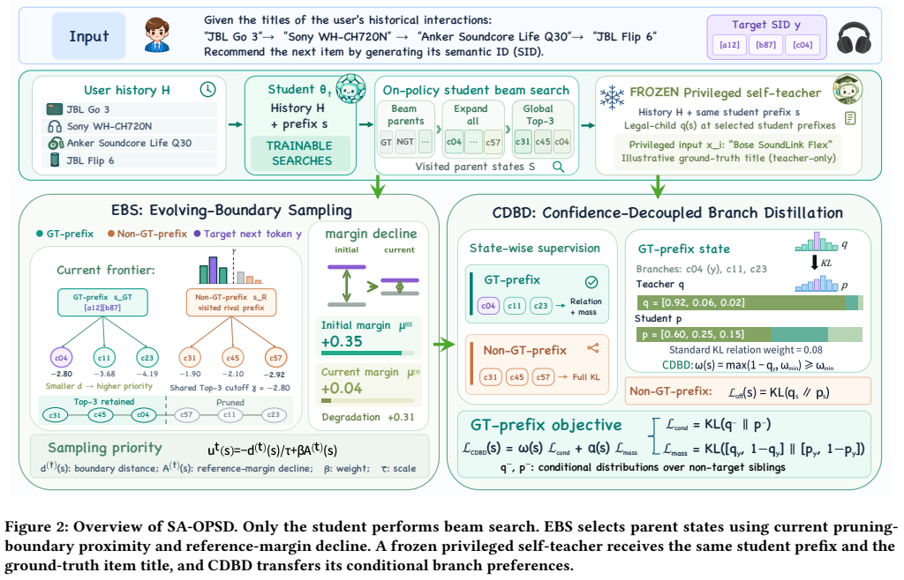
图 5-1｜原文 Figure 2，PDF 第 4 页，[来源](https://arxiv.org/pdf/2611.01568v1)。仅当前学生运行beam search，冻结同源教师额外看ground-truth item完整title，在相同学生前缀给合法child分布。EBS决定询问哪些parent，CDBD决定教target mass还是non-target sibling关系。训练时给教师的title不会进入部署学生；图中例子为作者示意，不是实验测量。

【原文事实】学生/特权教师Qwen2.5-1.5B-Instruct，同一task-adapted初始化，教师冻结。学生状态s=(H,学生SID前缀)，合法child集C(s)，概率只在C(s)上归一化。目标前缀GT-prefix匹配正确SID开头，其他为non-GT；即使non-GT不能到达目标item，其child仍占据beam名额，所以关系监督可能影响目标保留。

### EBS全部关键量：边界、退步与覆盖

【原文事实，式 1—5】前缀累计分z(sc)=z(s)+ln p(c|s)，每层保留TopB。某parent的child压过目标的数量N_s(y)=Σ_(c∈C(s))1[z(s)+ln p(c|s)>z(y)]，说明全局排名不能只由目标token局部概率决定。frontier F_i,ℓ的第B高分γ_i,ℓ是阈值；parent距边界d_i(s)=(1/ℓ)min_(sc∈F)|z(sc)−γ|。若frontier数≤B，均保留，d=+∞。ℓ是深度，除ℓ平衡不同SID深度的累计分尺度。

【原文事实，式 6—8】用初始学生一次性记录目标prefix的retention margin μ0；当前μt=(目标累计分−第B高non-target child累计分)/ℓ。只有两轮都实际展开、竞争者足够且μ0>0才定义退步D_i,ℓ=1[μ0>0]max(μ0−μt,0)。初始打平或margin未定义不能强造退步信号。首次prune发生时目标child仍在expanded frontier，信号只归给实际访问的目标parent和阈值竞争者parent，不虚构更深未访问状态。

【原文事实】A_i(s)为归给parent的最大有效退步值，priority u_i(s)=−d_i(s)/τ+βA_i(s)。初次抽样P_i(s)=(1−ρ)/M_i+ρ exp(u_i(s))/Σ_v exp(u_i(v))，M_i是合法child非空的visited parent数，τ>0、β≥0、ρ∈[0,1]。uniform部分保覆盖、priority部分偏向边界及初始优势衰退；β=0回到仅当前边界。全为−∞时priority视作均匀。

【原文事实】batch教师query预算C，最多取C'=min(C,Σ_i M_i)。预算够时先给每个合格interaction至少1次，再按剩余状态量分配；否则先抽C'个interaction。每个interaction抽k_i个distinct parent，无放回、每次按剩余权重重归一化。draw/selection均detach。本方法没有用逆概率权重恢复全状态平均，而是有意改变训练目标的状态权重。

【本文推演，边界算例】B=2，当前三个child累计log分为目标−1.2、竞争者−1.0/−1.1，目标被prune；其parent中目标child的log概率可能仍高，只是parent累计分劣势。若某深度初始μ0=0.10、当前μt=−0.02，D=0.12；即使当前距离与另一parent相近，它可获得更多priority。若μ0≤0，不能说“原先安全后来退步”。数值仅教学，实际分数按相同tie-breaking与深度规则算。

【原文事实，式 17/21—22】采样KD loss先在每interaction内平均，再在收到KD的interaction间平均：L_hat=(1/|I_C|)Σ_i (1/k_i)Σ_(s∈A_i)ℓ_s。实际inclusion probability π_i,s(k)一般≠k_iP_i(s)；条件期望为(1/k_i)Σ_s π_i,s(k)ℓ_s。k、P和有效性mask固定时反传选中loss，不对选择机制求导。无效教师评分贡献零且保留在该平均分母中。不能把它写成对所有visited states的无偏均匀估计。

### CDBD：目标置信度和非目标关系为何要拆开？

【原文事实，式 9—12】同parent两child分差z(sc_i)−z(sc_j)=ln[p(c_i|s)/p(c_j|s)]。GT-prefix中目标child为y，定义p_minus(c)=p(c)/(1−p_y)、q_minus(c)=q(c)/(1−q_y)，c≠y。L_mass=KL(Ber(q_y)||Ber(p_y))，L_cond=KL(q_minus||p_minus)。完整forward KL精确分解为 KL(q||p)=L_mass+(1−q_y)L_cond。它的非目标关系项在教师极自信时被(1−q_y)压小。

【本文推演，分解推导】对c≠y代入q_c=(1−q_y)q_minus,c、p_c=(1−p_y)p_minus,c，求和得到(1−q_y)ln[(1−q_y)/(1−p_y)]+(1−q_y)Σ_c q_minus,c ln(q_minus,c/p_minus,c)；再加目标项q_yln(q_y/p_y)即可。这个分解要求同一个合法child空间和归一化，不是全词表任意token的直接替换。

【原文事实，式 13—15】关系权重ω(s)=max(1−stopgrad(q_y),ω_min)；target mass gate α(s)=1若q_y≥p_y，否则α_min，0≤α_min≤1且两概率detach。L_CDBD=ωL_cond+αL_mass。教师q_y低于学生p_y时，mass匹配与本地hard-label SFT相反，gate只衰减这一项；不是删除所有非目标学习。

【本文推演，梯度推导】合法softmax logits为a，∂L_SFT/∂a_c=p_c−1[c=y]。Bernoulli mass对p_y求导(p_y−q_y)/(p_y(1−p_y))，再乘softmax导数，得grad_a L_mass=−(p_y−q_y)/(1−p_y) grad_a L_SFT；特别对a_y为p_y−q_y。条件分布p_minus=softmax(a_non-target)，不依赖a_y，故∂L_cond/∂a_y=0、对其他c为p_minus,c−q_minus,c。shared参数仍会耦合不同状态，零直接target-logit导数不保证target概率不变，更不保证完整CDBD梯度与SFT始终相容。

【本文推演，数值算例】q=(0.98,0.018,0.002)、p=(0.8,0.02,0.18)，后两类条件分布分别(0.9,0.1)/(0.1,0.9)。L_cond=0.8ln9≈1.7578；完整KL关系项只0.02×1.7578≈0.03516。取原文主消融ω_min=0.15，关系项变0.26367，非目标第一类logit梯度从0.02(0.1−0.9)=−0.016变成−0.12。后面还需统一除合法child数3，这是局部关系项算例，不是完整模型梯度倍率。另取p_y0.9、q_y0.8，mass梯度+0.1而SFT为−0.1；教学设α_min0.2则该mass冲突缩为+0.02，不把它伪称论文默认gate值。

【原文事实，式 16/18—19】每state branch loss为L_CDBD/|C(s)|（GT）或KL(q_s||p_s)/|C(s)|（non-GT）。少于两个非目标child时关系项为0，singleton整个branch为0；非有限或不可靠条件概率不硬除零。实现通过non-target logits的log-sum-exp归一化，而非直接除一个极小概率差。目标SID loss独立在完整GT路径teacher-force：L_SID=mean_i mean_ℓ[−lnp(y_i,ℓ|GTprefix)]，即使该路径被beam prune仍监督。总L=L_SID+λKD L_hat，没有GRPO结果reward。α_min=1、ω_min=0只恢复局部Full KL；要比较完整baseline，还必须匹配/|C(s)|与跨interaction归一化。

### 数据、实现和披露缺口

【原文事实】Amazon Reviews2018 Industrial/Office/Instruments，过滤用户/item少于5交互，留最近10个history，按时间8:1:1。用户7694/8328/7537，item3685/3459/3399；train36259/38924/39956，valid4532/4866/4994，test4533/4866/4995。使用Qwen2.5-1.5B-Instruct与共同初始化，只有教师见完整target title。状态选择比较共享460 parent query预算；β=0.4、ω_min=0.15为主要组件设置，诊断beam width50。

```text
初始化时按固定beam规则记录每条训练interaction的有效target margin
每batch：当前学生跑一次constrained beam，保存frontier与visited parents
算当前边界距离和有效reference-margin decline；detach所有selection量
按coverage-first预算分interaction，再无放回抽distinct states
冻结教师多看target title，评分同一学生prefix的合法children
GT状态用条件关系floor+mass gate，non-GT用Full KL，均除child数
加全GT路径SID交叉熵，更新学生；推理维持原constrained beam
```

【未披露/未核实】所读PDF未给完整可运行lr/optimizer/epoch/总步数/LoRA参数、GPU型号与卡数、全部beam和采样温度、ρ/τ/λKD/α_min默认值及训练seed重复清单；不能由460-state预算推出这些数字。训练资源代码未核实。多方法表格并非每行都和matched student controls具有相同训练与初始化条件；因果判断优先看matched component ablation。

### 核心图表、消融与成本

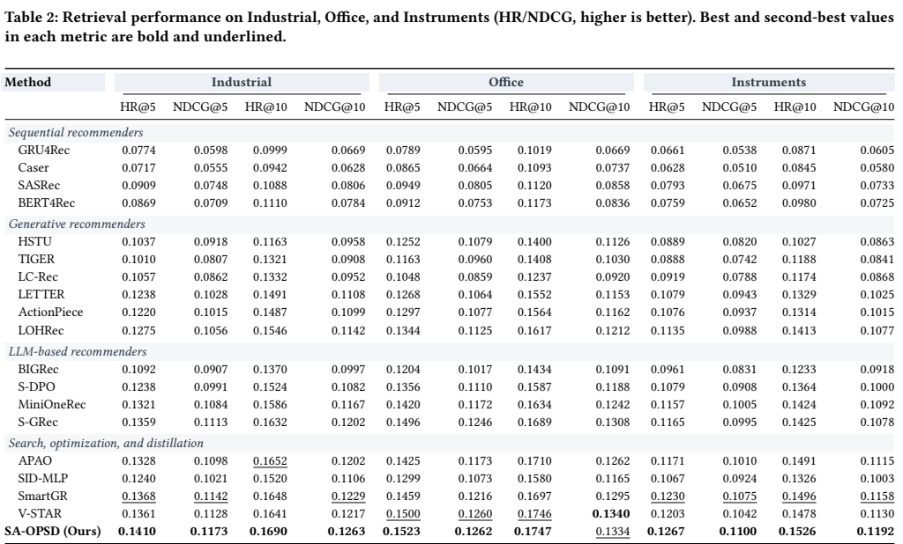
图 5-2｜原文 Table 2，PDF 第 7 页，[来源](https://arxiv.org/pdf/2611.01568v1)。列为三数据集HR5/NDCG5/HR10/NDCG10，越高越好。SA的NDCG10为0.1263/0.1334/0.1192，SmartGR0.1229/0.1295/0.1158；Office仍低于V-STAR0.1340，不能写成所有指标全胜。这里是合法SID目录搜索，不是RPSD的10随机候选，二者命中率绝对值不可直接对比。

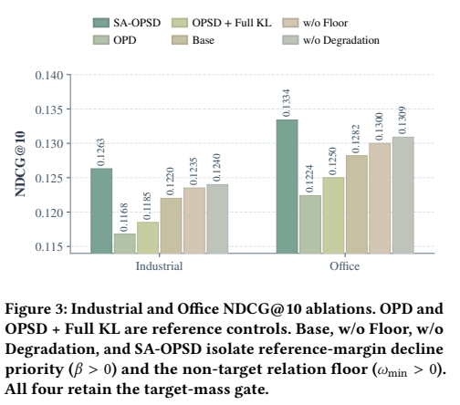
图 5-3｜原文 Figure 3，PDF 第 8 页，[来源](https://arxiv.org/pdf/2611.01568v1)。Industrial/Office NDCG10：OPSD+Full KL0.1185/0.1250，Base0.1220/0.1282，去Floor0.1235/0.1300、去Decline0.1240/0.1309、完整0.1263/0.1334。Base及三组件配置都保留当前边界采样和target-mass gate，差别仅β与ω_min；因此不能把完整对Full KL的全部增益都归给“两个新开关”而忽略公共组件。

【原文事实】相同CDBD和460预算下，uniform/current boundary/EBS的Industrial NDCG10为0.1216/0.1240/0.1263，初始Top10正确case的regression16.1%/14.5%/10.7%；打乱reference decline给0.1248/14.4%，支持状态特异性。深度4目标prefix生存Full KL26.3%→Base28.4%→完整30.2%；这是百分点差3.9，不是提高3.9%。小超参扫描β从0到0.4提升、0.8回落，ω_min0到0.15提升、0.30回落，不能越加强监督越好。

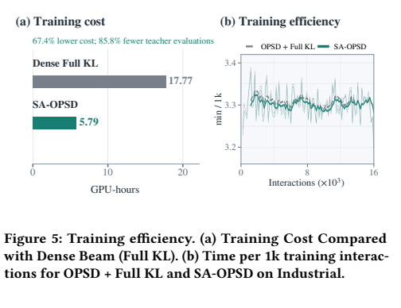
图 5-4｜原文 Figure 5，PDF 第 9 页，[来源](https://arxiv.org/pdf/2611.01568v1)。左是Dense Beam Full KL17.77 GPU-hour vs SA5.79，训练成本减少67.4%，教师state evaluations减少85.8%；剩余学生beam和更新使两者比例不同。右为Industrial每千训练interaction耗时，SA与OPSD+Full KL接近，不是每条query推理延迟。未充分披露硬件/总准备成本口径，因此不把GPU-hour进一步换算成真实费用或宣称同预算必达同质量。

【局限与可复现性】EBS优化采样加权目标，没有全状态均匀无偏保证；初始reference也可能不佳，undefined margin覆盖不足；teacher title可能过度确定答案、掩盖有用非目标关系。floor增强弱概率关系，也可能放大不可靠teacher偏好，需数值支持检查。SID树/合法child/tie-breaking与初始缓存缺一会改变选择；全模型梯度的跨状态干扰不由局部softmax证明消除。结果无完整训练seed统计，微小差异不自动显著。

原文及精确标题搜索未核实专门作者训练代码/独立博客；SA-OPSD缩写还可指别的论文，不能按缩写搜索结果误配旧代码。基础阅读：[Decoupled Knowledge Distillation原论文](https://arxiv.org/abs/2203.08679)、[DKD作者实现](https://github.com/megvii-research/mdistiller)、[Transformers beam-search策略说明](https://huggingface.co/docs/transformers/main/en/generation_strategies)。这些是基础资料，不能冒称本论文实现。

## 把五篇放在一起：分清“选谁、在哪里学、沿什么方向学”

| 论文 | 主要改动 | 保持的部分 | 评估时最容易误读之处 |
| --- | --- | --- | --- |
| RDS-MOPD | noisy per-domain统计与混合预算 | 基础MOPD token监督 | 稳定预算界不保证真实能力；BB不是单checkpoint |
| ESC | 教师关系诊断与反事实熵干预 | sampled OPD主流程 | 训练前低ESC预测潜力、训练中ESC上升是不同问题 |
| P²-MOPD | weight/专家方向两通道优化 | MOPD监督和单模型推理 | 恢复率非准确率；单步更贵却更早达标 |
| RPSD | 检索特权信息产生token权重 | GRPO结果reward方向 | 不是纯特权KL；10候选指标不是全库检索 |
| SA-OPSD | beam状态采样、mass/关系解耦 | SID学生与部署beam | 无IPW即有意重加权；局部梯度相容不等于全模型保证 |

【本文推演】共同信息是：教师越强、监督越密、置信度越高都不能单独预测收益。必须同时写清学生访问的状态、teacher可见信息、概率支持集、归一化、detach、预算与评测选择。本期没有论文测试把五种方法组合，因此不承诺它们叠加一定有效。

推荐阅读顺序：初学者先看共同基础和各篇手算；进阶读RDS的DRO/KKT、ESC温度求解、P²的两通道更新；实现时再读RPSD的Sinkhorn与SA的inclusion概率/合法child检查。官方文档、作者说明与基础论文均只作辅助，不占五篇。PDF完整性、字体、图像和渲染检查记录见 [QA](https://github.com/daihuangyu/papers-daily/blob/main/OPSD/2026-11-22/assets/QA.md)。
