# OPD / OPSD 专项精读 · 2026-11-23

今日主题：学生该去哪里探索，教师的信号又能传多远？

检索窗口为2026-10-23至2026-11-23，目标5篇，实际5篇；全部为窗口内首次发布、跨方向历史未收录的论文。没有扩大窗口，没有用博客替代论文。日期按arXiv提交历史，不按搜索引擎收录时间。本文阅读以下五篇的v1；MPOPD已有10月28日v2，本文只把它作为同一论文，分析严格注明使用v1，不把版本变化重复计数。

证据标签：【原文事实】指定PDF的陈述或实测；【本文推演】数学解释、算例与复现建议，不是作者实验；【资源核查】作者链接与公开资源的静态核对；【未披露】所读材料没有足够信息。论文图表直接由原PDF渲染裁切，未重绘实验结果。正文数学使用LaTeX：GitHub原生渲染，PDF由同一源码经MathJax排版；公式素材与原论文图表分开记录。图源、裁切坐标、文件哈希及去重清单见当日manifest与assets/SOURCES.md。

| 论文 | 首投 | 核心问题 |
| --- | --- | --- |
| [O²PD](https://arxiv.org/abs/2611.07731) | 2026-11-05 | 前缀可靠性与top-k之外的概率质量 |
| [Adaptive-Policy Distillation](https://arxiv.org/abs/2611.00852) | 2026-10-31 | 信息不对称下，怎样真正注入新知识 |
| [Generalization Limitation](https://arxiv.org/abs/2611.05609) | 2026-11-03 | 域内追平教师是否掩盖泛化遗忘 |
| [On-Policy Self-Training](https://arxiv.org/abs/2610.32770) | 2026-10-23 | 连问题和特权信息也由模型生成 |
| [Proposing Better Rollouts](https://arxiv.org/abs/2610.36477) | 2026-10-27 | 学习一个教师引导的rollout提议策略 |

## 入门：把“在哪里学”与“学什么”分开

【基础概念】令$`s=(x,y_{\lt t})`$为问题和已生成前缀，$`p_\theta(v\mid s)`$是学生，$`q(v\mid s)`$是教师。OPD在学生自己走过的前缀上问教师；OPSD则让同源模型额外看答案、文档或其他训练期信息。forward KL为

```math
F=D_{\mathrm{KL}}(q\Vert p)=\sum_v q_v\log\frac{q_v}{p_v}
```

reverse KL为

```math
R=D_{\mathrm{KL}}(p\Vert q)=\sum_v p_v\log\frac{p_v}{q_v}
```

教师概率被视为固定目标。采样出的前缀通常也固定后再更新，不应把局部loss梯度冒充对整个生成过程的全导数。

【本文推演】对学生logit $`z_a`$，

```math
\frac{\partial F}{\partial z_a}=p_a-q_a,\qquad\frac{\partial R}{\partial z_a}=p_a\!\left[\log\frac{p_a}{q_a}-R\right]
```

前者会强力抬高教师喜欢而学生几乎不出的token；后者按学生概率加权，往往在已会的模式附近调整。两种loss即使有相同全局最优，有限预算下也可能学出不同东西。另一方面，loss再好也不能直接监督从未访问的正确前缀，这叫状态覆盖问题。

【本文推演，手算】$`p=(0.99,0.01)`$、$`q=(0.1,0.9)`$。第二个token的forward梯度为−0.89；reverse KL约2.225，第二logit梯度约$`0.01[\log(0.01/0.9)-2.225]\approx-0.0672`$。两者都往正确方向，但力度很不相同。这里不把这个两token例子当作大模型实测。

## 1. O²PD：先学可靠前缀，再补上被top-k漏掉的质量

原文：[O²PD: Overlap-Gated On-Policy Distillation on Reliable Prefix](https://arxiv.org/abs/2611.07731)，Shuaishuai Zu等，[v1 PDF](https://arxiv.org/pdf/2611.07731v1)，11月5日首投。重点阅读§3—5及附录B/C/E/F。

### 问题、机制与原始方法图

【原文事实】学生生成的长前缀对教师而言是off-policy。MATH500的交叉续写实验中，Qwen3-1.7B学生接更长教师前缀会变好，Qwen3-4B教师接更长学生前缀反而变差。作者据此仅在每条完整rollout前20%位置计算蒸馏loss；后80%仍生成。与此同时，常见top-k OPD把教师top-k内的师生分布各自归一化，会丢失支持集外质量。

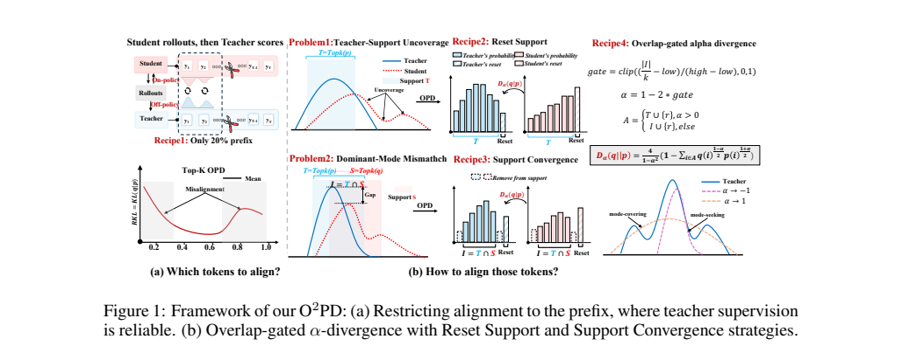
图1-1｜原文Figure 1，PDF第2页，[来源](https://arxiv.org/pdf/2611.07731v1)。左侧是前缀选择，右侧是Reset Support、Support Convergence与$`\alpha`$散度。图中的概率曲线为机制示意，不是准确率测量；方法不改变推理网络结构。

### 公式逐符号解释、推导与算例

【原文事实】此段沿用原文符号：p为教师、q为学生；T为教师top-k，S为学生top-k，$`I=S\cap T`$，$`\rho`$为top-k重叠率。

```math
q_a^T=\frac{q_a}{q(T)},\qquad p_a^T=\frac{p_a}{p(T)}
```

原始loss $`L_T=D_{\mathrm{KL}}(q^T\Vert p^T)`$只依赖T中学生logits，对T外logit导数为0。即使$`q^T=p^T`$，也没有约束$`q(T)=p(T)`$。有限softmax概率不是真正的0，论文的零质量命题是边界模型，实际对应很弱的梯度。

【本文推演，手算】教师T内两token质量(0.4,0.2)，外部0.4；学生(0.2,0.1)，外部0.7。T内归一化均为(2/3,1/3)，top-k KL为0，但完整分布显然没匹配。增加reset原子r后，分布变成(0.4,0.2,0.4)和(0.2,0.1,0.7)，差异重新可见。r把外部合为一类，只约束外部总量，不知道外部每个token如何分配。

【原文事实，式3】在$`A=T\cup\{r\}`$上，$`\pi_p(a)=p(a)`$、$`\pi_q(a)=q(a)`$，r分别为$`1-p(T)`$、$`1-q(T)`$。forward KL的简单形坐标梯度为$`\pi_q-\pi_p`$，能在学生质量极低时仍覆盖教师偏好。reset同时提供外部质量的汇总抑制通道，不能直接说每个外部token都有独立教师目标。

【原文事实，命题4】若固定剩余集合$`T\setminus I`$上学生质量$`\varepsilon=q(T\setminus I)`$，在$`T\cup\{r\}`$最小化reverse KL，I中最优

```math
q(a)=\frac{(1-\varepsilon)p(a)}{1-p(T\setminus I)},\qquad a\in I
```

当$`\varepsilon\lt p(T\setminus I)`$，I中的质量仍会高于教师。高重叠时改用$`I\cup\{r\}`$，把剩余教师质量折入reset，消除这个固定切片上的归一化偏差。该命题有固定leftover坐标的条件，不是所有优化轨迹必然过冲的定理。

【本文推演】若$`p(I)=0.6`$，$`p(T\setminus I)=0.2`$，$`p(\mathrm{outside})=0.2`$，而学生$`\varepsilon=0`$，则前一个最优$`q(I)=0.6/0.8=0.75`$；缩到$`I\cup\{r\}`$后目标恢复0.6。这解释“已经共享的模式为什么还会过强”。

【原文事实，式4—7】

```math
D_\alpha(\pi_q\Vert\pi_p)=\frac{4}{1-\alpha^2}\left[1-\sum_{i\in A}\pi_q(i)^{\frac{1-\alpha}{2}}\pi_p(i)^{\frac{1+\alpha}{2}}\right]
```

$`\alpha\in(-1,1)`$。$`\alpha\to1`$为$`D_{\mathrm{KL}}(\pi_p\Vert\pi_q)`$，$`\alpha\to-1`$为$`D_{\mathrm{KL}}(\pi_q\Vert\pi_p)`$。设当前参与loss的前缀token集合为P，low/min和high/max是其$`\rho`$极值，

```math
g=\mathrm{clip}\!\left(\frac{\rho-\mathrm{low}}{\mathrm{high}-\mathrm{low}},0,1\right),\qquad\alpha=1-2g
```

$`\rho`$低于P中位数时用$`T\cup\{r\}`$，否则用$`I\cup\{r\}`$。

```math
\mathcal L=\mathbb E_{y\sim\pi_s}\left[\sum_{i=1}^{|y|}\mathbf1\{i\le0.2|y|\}\,D_{\alpha_i}(\pi_q^{(i)}\Vert\pi_p^{(i)})\right]
```

【本文推演，端点推导】令$`\alpha=1-2\varepsilon`$，则$`\pi_q^\varepsilon\pi_p^{1-\varepsilon}=\pi_p[1+\varepsilon\log(\pi_q/\pi_p)+O(\varepsilon^2)]`$。求和得$`1-\varepsilon D_{\mathrm{KL}}(\pi_p\Vert\pi_q)`$，而$`\frac4{1-\alpha^2}\approx\frac1\varepsilon`$，乘起来得forward KL；另一端交换师生即可。若$`\rho`$范围为0.2—0.8，中间$`\rho=0.5`$得$`\alpha=0`$，$`D_0=4(1-\sum_i\sqrt{\pi_q(i)\pi_p(i)})`$。$`\mathrm{high}=\mathrm{low}`$、I为空、极小reset概率和$`\alpha`$接近端点均须保护；所读材料不足以核实全部可运行分支，不凭空指定其实现。

### 数据、loss、流程与训练成本

【原文事实】三组学生←教师：Qwen3-1.7B←Qwen3-4B、DeepSeek-R1-Distill-1.5B←JustRL-1.5B、Qwen3-1.7B←Qwen3-4B-NTRL。训练DAPO-MATH-17K，无额外过滤。top-k=16，AdamW、lr2e−6、cosine最小比例0.1、weight decay0.01、warmup10步、clip1；train/mini batch64/16，micro batch每NPU4，prompt/response1536/4096，rollout温度1、n=1，BF16与FSDP offload。loss最大clamp10、logq最小−10，额外KL loss关闭。没有GRPO结果奖励；评测verifier不等于训练奖励。

【原文事实】Qwen3-4B教师组计划200步，其余300步，但下游表使用60或100步的中间最佳checkpoint。评测温度0.6、top-p0.95、top-k20、上限31744token，AIME24/25/26及HMMT25为Avg@8，Minerva/Olympiad/MATH500为单样本pass@1。训练最大4096与评测长度不是同一口径。未核实完整NPU型号/数量、wall time、总卡时与美元成本，不能把只监督20%写成端到端节省80%。

```text
学生生成完整响应，教师在相同前缀评分
仅保留响应前20%位置作为loss位置
取教师/学生top16，求交集、重叠率和reset质量
用当前前缀重叠统计选择support与α；稳定计算散度
按mask聚合、clamp并更新学生；下一批重新生成
```

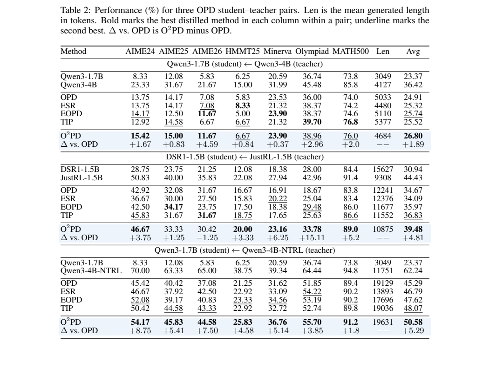
图1-2｜原文Table 2，第7页，[来源](https://arxiv.org/pdf/2611.07731v1)。每组内部比较OPD、ESR、EOPD、TIP与O²PD；右侧Avg为七项平均。O²PD相对OPD分别24.91→26.80、34.67→39.48、45.29→50.58，即+1.89/+4.81/+5.29个百分点。它不是每列都第一：JustRL组AIME26为30.42，低于OPD31.67；强教师组长度19631还高于OPD19129。

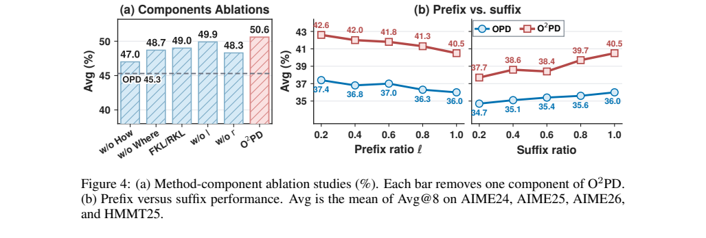
图1-3｜原文Figure 4，第8页，[来源](https://arxiv.org/pdf/2611.07731v1)。左是Qwen3-1.7B/NTRL组件消融，右是前缀/后缀监督比例。左的七项Avg与右的四项竞赛Avg不同，不能直接连成同一条曲线。去reset是较大跌幅；去I增益较小。前20%优于全长和同预算后20%，支持本设置的选择，不证明所有任务只学前缀最好。

【局限与复现】重叠率是离散排名指标，不等于教师正确率；min/max和中位数受batch影响。最好checkpoint选择、小测试集、多次采样与独立训练种子要分开。未核实专门官方代码或独立作者博客；依赖veRL不是本方法代码发布。复现需先验证reset质量和端点极限，再锁定窗口、clamp、checkpoint选择与评测长度，不能仅改loss名。

## 2. APD：把新知识的“梯度不足”与“根本到不了”分别解决

原文：[Adaptive-Policy Distillation: Knowledge Injection under Information Asymmetry](https://arxiv.org/abs/2611.00852)，Hojun Cho等，10月31日首投，[v1 PDF](https://arxiv.org/pdf/2611.00852v1)，§3—6及附录A—E。

### 问题与机制诊断

【原文事实】教师是冻结初始模型加文档，学生从同一模型开始但不看文档。任务是把固定文档知识写入参数以便closed-book回答，不是从更强模型迁移通用推理。随机key-code实验独立改变字母表大小与code长度，交叉比较teacher/student生成×forward/reverse KL。reverse KL对学生不知道的内容信号弱；改forward后，长正确前缀仍很难被学生访问。

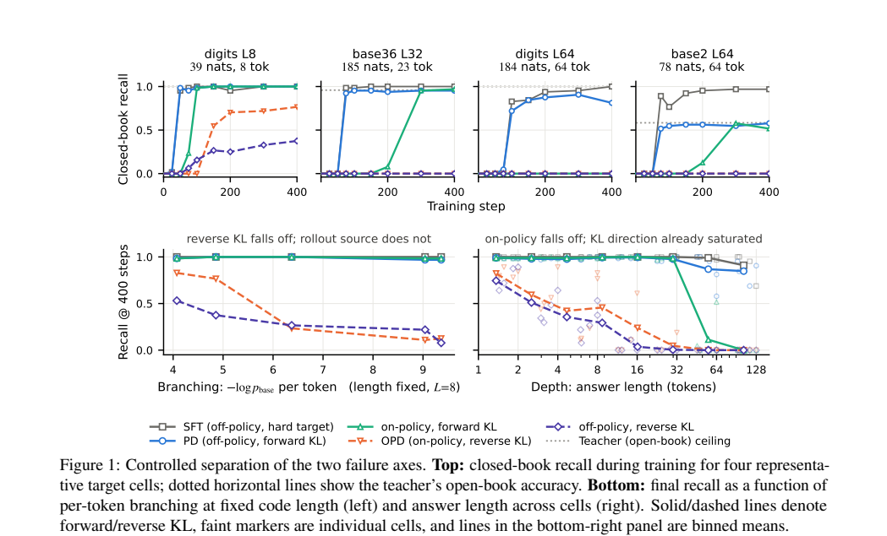
图2-1｜原文Figure 1，第3页，[来源](https://arxiv.org/pdf/2611.00852v1)。上排是四个难度单元随训练步的闭卷召回，虚线为开卷教师；下排分别改变分支不确定性与长度。比较同颜色/线型才能区分loss和rollout来源。原文没有独立新网络架构图，使用其真实机制诊断图；下面公式和伪代码解释算法，不编造一张“作者架构”。

### 核心公式与数值直觉

【原文事实，式4—7】p是学生、q是文档教师，

```math
\kappa_t=D_{\mathrm{KL}}(q_t\Vert p_t),\qquad g_t=1-\exp\!\left(-\frac{\kappa_t}{\tau}\right)
```

$`\tau>0`$。$`\kappa`$与g在反传中detach。采样分布

```math
m_t=(1-g_t)p_t+g_tq_t
```

同一个g还控制loss

```math
\ell_t=(1-g_t)D_{\mathrm{KL}}(p_t\Vert q_t)+g_tD_{\mathrm{KL}}(q_t\Vert p_t)
```

再对m生成轨迹求和。高分歧处同时改善覆盖和梯度，学会后两种干预一起退去。并不是先一次性决定整条响应交给教师。

【本文推演】$`\kappa\to0`$时$`g\approx\kappa/\tau`$，$`\kappa`$很大时g接近1；$`\tau\to\infty`$接近OPD，$`\tau\to0`$在$`\kappa>0`$的位置趋向teacher采样+forward KL，$`\kappa=0`$时本来没有分布差异。detach后每个状态的梯度就是两种KL梯度的固定加权，不含$`\partial g/\partial\theta`$，也不含对采样轨迹的全梯度。

【本文推演，手算】$`p=(0.99,0.01)`$、$`q=(0.1,0.9)`$，$`\kappa\approx3.821`$；$`\tau=1`$得$`g\approx0.978`$。第二token在混合采样中的概率从0.01升到约0.881。若四个目标token各只有0.01机会，纯学生完整正确路径约$`10^{-8}`$；干预能让后续正确前缀更容易被访问。这个独立同概率假设仅帮助理解，不是对自回归实际成功率的估计。

【本文推演】APD相当于每步按g抽一枚“用教师还是学生”的软硬币后从相应分布采样，但其边际是算术混合，不能换成MPOPD的几何混合；两者在小概率事件上差异很大。

### 数据、训练与实现

【原文事实】QASPER与BioASQ各20个文档作为单独注入单元，每文档独立训练。Qwen3-235B生成训练问题，文档条件下的基础模型生成答案，每文档约0.6—1.3k对。测试每文档约100道GPT-5.4生成问题与参考，使用人写问题作风格示例；不是直接对原benchmark原始完整测试集打分。“无标签/无verifier”指训练不需人工正确答案，不代表整个数据构造没有外部强模型。

【原文事实】Llama-3.1-8B-Instruct与Qwen3-8B（非thinking），10epochs、batch64、seed42、AdamW1e−5、betas(0.9,0.999)、eps$`10^{-8}`$、wd0.01、cosine warmup0.03、clip1；BF16参数、FP32优化器、DeepSpeed ZeRO-2、两张B200。最长总序列16384，生成上限512、温度1、无top-k/top-p截断；loss在完整词表算。$`\tau`$在10个独立BioASQ开发文档上每模型选一次再用于两数据集。没有GRPO outcome reward，生成答案可用于基线SFT而APD消费soft teacher分布。

```text
教师引擎输入文档+问题，学生引擎只输入问题
每个生成位置：双方在同一已生成前缀计算完整分布
用detached forward KL形成gate，混合采样token并追加到两端
缓存或重算gate和分布，累加双向KL的固定门控loss
更新学生；教师冻结；下步刷新学生生成引擎权重
```

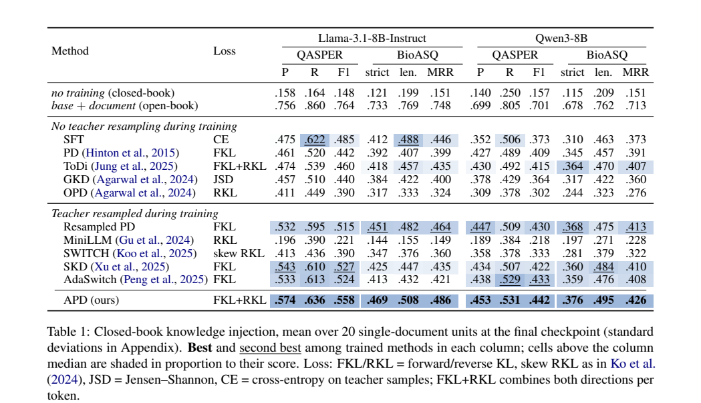
图2-2｜原文Table 1，第6页，[来源](https://arxiv.org/pdf/2611.00852v1)。按“是否在训练中重新采教师样本”分组，避免把APD与固定教师语料比较的增益全归于gate。Llama QASPER F1为OPD0.390、Resampled PD0.515、APD0.558；BioASQ MRR为0.324/0.464/0.486。Qwen对应F1 0.302/0.430/0.442，MRR0.276/0.413/0.426。最大相对增益54.6%来自0.302→0.442，绝对差0.140；不能说+54.6个百分点。APD仍远低于开卷教师。

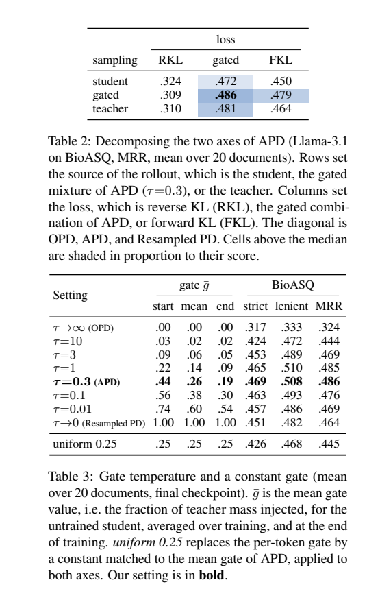
图2-3｜原文Tables 2—3，第7页，[来源](https://arxiv.org/pdf/2611.00852v1)。Table2横向先改变loss、纵向再改变采样。只换采样而保留reverse KL均约0.31—0.32；换forward后才恢复。Table3比较温度和恒定0.25gate；均值近似匹配但常数gate MRR0.445低于APD0.486，说明“在哪干预”也重要。$`\tau`$=3平均gate约0.06已达0.469，不能把gate均值当硬接管token百分比。

【原文事实，成本】附录Table5在两B200、各一个文档、预热5步后20步中位数比较。Qwen BioASQ OPD总23.5s/步、APD15.2；rollout2.9→7.0s，update20.8→8.3s，峰值每卡预留175→179GB。APD需教师resident KV cache，生成更慢但响应变短、单独教师pass减少，局部总步时间可更快；这不是全40文档训练总卡时或所有硬件下零开销。

【局限与复现】仅两8B模型、两类单文档注入；测量单位为文档配对，而不是20个独立训练seed。作者显著性阈值p<0.10，比常见0.05宽松。生成评测与外部question generator引入偏差，原文不能支持所有通用蒸馏都该用APD。未核实专门官方代码/独立作者博客；不能借用其他同名Adaptive Policy Distillation代码。复现应先做2×2 loss/生成来源实验，确保teacher看文档、student完全不看，记录完整词表概率和KV成本。

## 3. Generalization Limitation：域内追平教师，不代表能力真的合并

原文：[On the Generalization Limitation of On-Policy Distillation for Post-RL Consolidation](https://arxiv.org/abs/2611.05609)，Yichen Wang等，11月3日首投，[v1 PDF](https://arxiv.org/pdf/2611.05609v1)。阅读§3—8、附录A/D。它是诊断研究加两种探索性补丁，不是又一个通用最优蒸馏算法。

### 问题、原始机制示意与指标

【原文事实】区分域内IND、超出训练范围的外推OOD，以及分别训练组件却同时需要它们的组合OOD。Qwen3-8B是主要学生，self-RL专家来自同一base，外部generalist包括Qwen3-32B。合成研究另外使用Qwen2-100M，预训练2—10操作，RL/OPD训练11—14，测试15—17。它让“更难”有明确操作数，不能把真实benchmark划分当作同样严格的难度刻度。

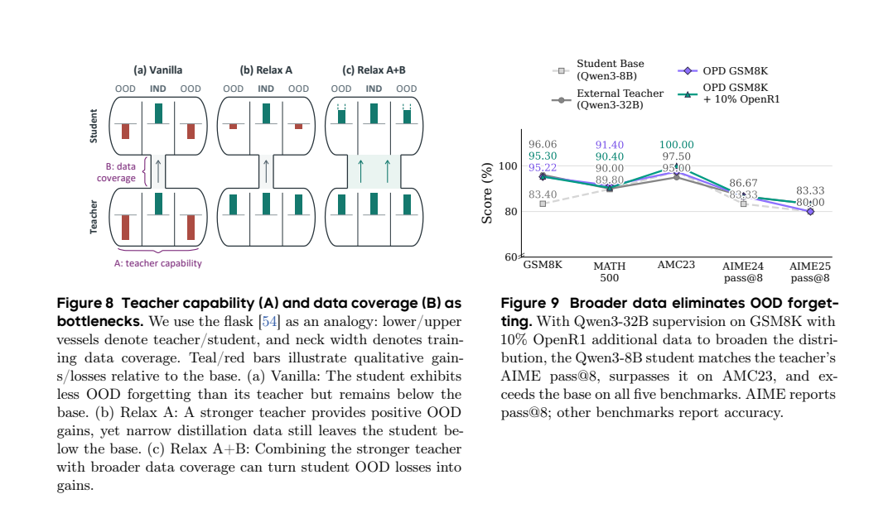
图3-1｜原文Figures 8—9，第9页，[来源](https://arxiv.org/pdf/2611.05609v1)。左边烧瓶是教师能力/数据覆盖的解释性示意，不是测量曲线；右边是Qwen3-32B教8B，GSM8K加10% OpenR1后的实验。AIME在该图为pass@8，其他部分图为avg@8，二者不同。不要把“8次至少成功一次”与“8次成功率均值”直接比较。

【原文事实，式1—2】

```math
\begin{aligned}J_{\mathrm{OPD}}&=\mathbb E_{x\sim\mathcal D,\,y\sim\pi_\theta}\!\left[\sum_t D_{\mathrm{KL}}\!\left(\pi_\theta(\cdot\mid h_t)\Vert\pi^*(\cdot\mid h_t)\right)\right],\\J_{\mathrm{MOPD}}&=\sum_i\alpha_i J_{\mathrm{OPD}}(\mathcal D_i,\pi_i^*).\end{aligned}
```

$`\alpha_i\ge0,\ \sum_i\alpha_i=1`$；按数据来源固定教师，不按token动态挑教师。RL专家用GRPO任务reward；(M)OPD主要k1+policy gradient、task reward关闭。蒸馏本身不验证教师OOD是否正确。

【本文推演】域内接近教师只是D上期望风险接近，并不能约束D外的函数值；有限参数共享还可能让训练方向损害别的能力。合成图中的恢复率=$`\frac{s_{\mathrm{student}}-s_{\mathrm{base}}}{s_{\mathrm{teacher}}-s_{\mathrm{base}}}`$，不同于主文“学生分数/教师分数”。若base40、teacher60、student59，则后者98.3%，恢复率95%；若teacher低于base，恢复率更不能直觉理解为“越高越好”。

### 更新几何、patching与replay的公式

【原文事实】定义$`\Delta W=W-W_0`$。

```math
\begin{aligned}\mathrm{srank}(\Delta W)&=\frac{\|\Delta W\|_F^2}{\|\Delta W\|_2^2},&E_k&=\frac{\sum_{j\le k}\sigma_j^2}{\sum_j\sigma_j^2},\\R^2&=1-\frac{\|\Delta-\widehat\Delta\|_F^2}{\|\Delta\|_F^2}.\end{aligned}
```

OPD平均更新norm0.154对RL0.278，top64能量0.690对0.399，stable rank6.90对19.0。MOPD比mixed RL更能由单任务更新张成的空间解释，但R²仍仅约0.11—0.186，不能声称大部分变化已经线性可合并。

【本文推演，手算】矩阵奇异值$`(3,1)`$时总能量10、top1占90%、stable rank10/9≈1.11；$`(\sqrt5,\sqrt5)`$的F范数相同，top1仅50%、stable rank2。小norm与低rank是不同概念，更集中的更新也可能集中破坏关键方向，不能从几何相关性推出泛化因果。

【原文事实，式3】选attention矩阵，$`\Delta_S=W_{\mathrm{OPD}}-W_0`$、$`\Delta_T=W_{\mathrm{RL\ teacher}}-W_0`$。

```math
\begin{aligned}R^*&=\underset{R^\top R=I}{\arg\min}\;\|\Delta_S R-\Delta_T\|_F^2,\\\Delta_S^\top\Delta_T&=U\Sigma V^\top,\qquad R^*=UV^\top,\\E_{\mathrm{Proc}}&=\Delta_T-\Delta_S R^*,\qquad W_{\mathrm{patch}}=W_{\mathrm{OPD}}-\alpha E_{\mathrm{Proc}}.\end{aligned}
```

注意是减去这个差，不是直接把教师加回来。

【本文推演，推导】展开范数后，唯一依赖R的项为$`-2\mathrm{tr}(R^\top\Delta_S^\top\Delta_T)`$，最大化迹在SVD下给$`UV^\top`$。该最小二乘只对齐矩阵，并不直接最小化OOD损失。若一维$`\Delta_S=0.2`$、$`\Delta_T=0.5`$、$`R=1`$，$`\alpha=0.4`$，补丁为−0.12，最终更新0.08；它可能接近base，但符号方向须逐矩阵核验。

【原文事实与本文推演】base-preserving replay在任务教师监督的prompt之外混入其他域prompt，以冻结base作教师，loss仍是OPD。可写成

```math
J=(1-\lambda)J_{\mathrm{task}}+\lambda J_{\mathrm{replay\text{-}base}}
```

作为两来源混合的教学表示；$`\lambda`$具体值不能由此推定。它限制所采replay前缀上的行为，不保证整个预训练分布都保留。

### 实验、数据、流程与成本

【原文事实】数学训练GSM8K/MATH/DAPO，代码Nemotron competitive-coding，工具BFCL synthetic/xLAM60K/ToolACE，长上下文DocQA-RL-1.6K。组合测试SWE-bench Verified、DocMath/GSM-Infinite、LongBench-v2 Code。各源固定教师与比例、随机shuffle；数学聚合IND/OOD部分依“每个self-RL教师是否超过base97%”操作性划分，95/96/98%也同划分。这是与教师训练相容性的分组，不证明测试数据未在预训练出现。

【原文事实】lr1e−6、rollout温度1、top-p1。OPD数学prompt batch16/mini16、每prompt1条；RL batch64/mini8、8条。代码agent32/mini16；长上下文16/mini16，max prompt59561/response16384、YaRN4。其他最大长度按任务为8192—16384。选择最高平均IND的recipe/checkpoint。主文没有可完整核算的训练硬件数量、总wall、卡时与费用；不同rollout数意味着不能把这些方法当作严格同计算量比较。

```text
从同一base训练单任务专家，或选择外部教师
按来源给prompt固定教师，学生自己生成，k1+PG蒸馏
分别测组件IND、外推OOD与组合OOD，保留base参考
计算更新norm、奇异谱、单任务span投影，不把相关性当因果
另做attention Procrustes补丁或base教师replay实验
```

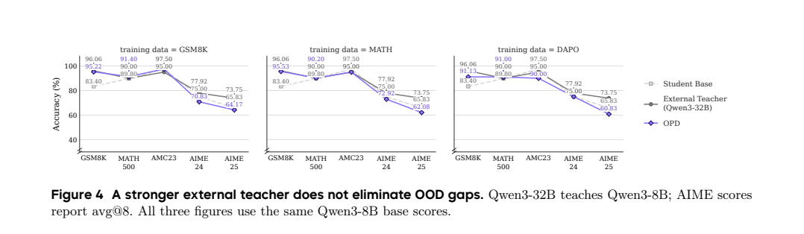
图3-2｜原文Figure 4，第7页，[来源](https://arxiv.org/pdf/2611.05609v1)。Qwen3-32B教Qwen3-8B，三种训练数据分别画线，灰虚线为base。即使教师在OOD更强，OPD平均达到教师IND的99.34%，OOD仍较base低2.96个百分点（相对3.73%）。这将“忘记只是教师自己弱”与“训练覆盖不足”区分开。

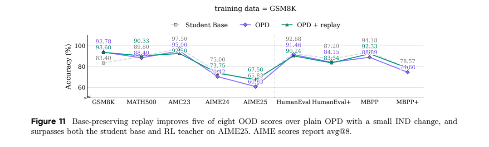
图3-3｜原文Figure 11，第11页，[来源](https://arxiv.org/pdf/2611.05609v1)。GSM8K self-RL教师的OPD加入代码replay，比较OPD、base、教师与replay。AIME25 avg@8从60.83到67.50，GSM8K下降0.18点；八项OOD五项提升，不是所有指标都升。Procrustes另把AIME25提高至65.00，仍比base低0.83点，两种补丁不能混报为一项实验。

【原文事实】组合任务也有反例：code+long-context各组件提升，但组合LongBench-v2 Code仍44.00，与base相同，低于两个教师50与58；code+agent SWE-bench从6.63→8.05仍低于9.84教师。更宽数据加更强教师的Figure9好于base，不构成普遍保证。

【局限与复现】多任务balance未全面搜索；采样seed的局部检查不等于独立训练重复，几何假说尚无因果证明；patch强度也可能用测试偏好选择。先复现IND/OOD分组与指标分母，再做固定预算的数据覆盖对照、随机方向补丁控制。作者[项目长文](https://yichenzw.com/opd-generalization.github.io/)已读，项目GitHub链接为网页源码；未核实专门训练实现，不能把网页仓库当训练代码。

## 4. OPST：自己出题、自己提供特权信息，但别跳过公式一致性检查

原文：[On-Policy Self-Training: Data-Free Self-Improvement in Large Language Models](https://arxiv.org/abs/2610.32770)，Leon Sick等，10月23日首投，[v1 PDF](https://arxiv.org/pdf/2610.32770v1)，§3—4及附录A。本文聚焦文本OPSD机制；不延伸成VLM方向日报。视觉扩展只作为论文边界说明。

### 问题、数据构造与原始循环

【原文事实】只有粗粒度topic描述，没有人工问题集或正确答案。generator按topic生成$`(x,z)`$，x为问题，$`z=(r,a)`$为理由和候选答案。generator可用EMA教师或冻结初始模型，student本身不负责生成题库，但它的解题rollout决定题目难度过滤。

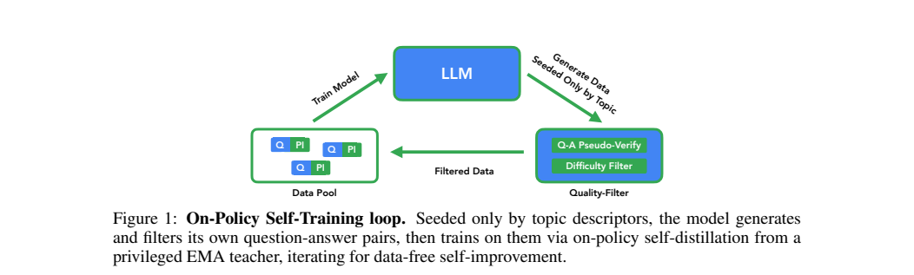
图4-1｜原文Figure 1，第2页，[来源](https://arxiv.org/pdf/2610.32770v1)。沿箭头看出题、QA伪验证、难度过滤、数据池和模型更新的循环；它没有外部正确性oracle。模型原本已经预训练，“data-free”只指本轮post-training不需人工任务数据，并非从无数据学知识。

【原文事实】伪验证要求fresh context重新解x得到a，且语义不变改写$`x^{\prime}`$后也得到a：

```math
v(x,z)=\mathbf1\{\widehat a(x)=a\}\,\mathbf1\{\widehat a(x^{\prime})=a\}
```

consensus gate让student对同题采G条，

```math
c(x,z)=\frac1G\sum_{g=1}^{G}\mathbf1\{\widehat a_g=a\}
```

若$`c=1`$就丢掉，保留尚未稳定解会的题。不是挑选多数票本身最一致的题。下一轮重新出题并去掉历史重复。

【本文推演，手算】候选答案B，独立重解与改写重解都是B，通过v；student四条答案(B,B,A,C)，$`c=0.5`$，保留。若四条都B则$`c=1`$丢掉；若改写答C，即使学生没会也会先被伪验证排除。这只能检查自一致性，模型可以在原题和改写上一起犯同一个错。

### 训练、EMA与原式存在的矛盾

【原文事实，式1—3/6】student $`p_t=\pi_\theta(\cdot\mid x,y_{\lt t})`$，teacher $`q_t=\pi_\phi(\cdot\mid x,z,y_{\lt t})`$，监督位置是student自己的轨迹，mask $`M_t`$去padding；每样本先除$`\sum_t M_t`$，再在batch中平均$`D_\alpha`$。教师stopgrad，不直接把z当硬SFT目标。

```math
\mathcal L_{\mathrm{OPST}}=\frac1B\sum_{i=1}^B\frac{\sum_tM_{i,t}D_\alpha(p_{i,t}\Vert q_{i,t})}{\sum_tM_{i,t}}
```
EMA更新

```math
\phi_k=(1-\beta)\phi_{k-1}+\beta\theta_k
```

$`\beta=0.05`$为主要消融默认；最终评测和返回的是EMA教师参数，在测试时也不需要特权z。

【本文推演】展开EMA得

```math
\phi_k=(1-\beta)^k\phi_0+\beta\sum_{j=1}^k(1-\beta)^{k-j}\theta_j
```

近期约$`1/\beta=20`$步有显著权重。若$`\phi`$旧=1、$`\theta`$新=3、$`\beta=0.05`$，则$`\phi`$新=1.10，缓慢跟随；$`\beta=1`$则立即变成3。它能平滑噪声，不保证伪答案正确。

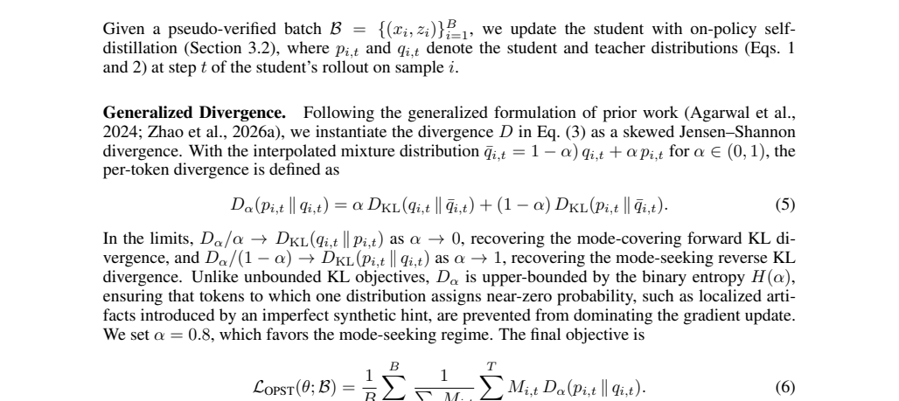
图4-2｜原文第5页混合分布定义与式5—6，[来源](https://arxiv.org/pdf/2610.32770v1)。这是原公式截图而非本文重写；请把上方$`\bar q`$的系数与式5中的KL权重对照阅读。本文在下面说明其不一致处，不能据此截图推断实际代码采用哪一个版本。

【原文事实，逐字母重述】所读v1写

```math
\underbrace{\bar q=(1-\alpha)q+\alpha p,\quad D_\alpha=\alpha D_{\mathrm{KL}}(q\Vert\bar q)+(1-\alpha)D_{\mathrm{KL}}(p\Vert\bar q)}_{\text{as printed in v1; inconsistent with the claimed limits}}
```

$`\alpha=0.8`$；又声称$`D_\alpha/\alpha`$在$`\alpha\to0`$时趋向$`D_{\mathrm{KL}}(q\Vert p)`$，$`D_\alpha/(1-\alpha)`$在$`\alpha\to1`$时趋向$`D_{\mathrm{KL}}(p\Vert q)`$，且上界为二元熵$`H(\alpha)`$。这些是作者文本陈述，不能全部同时成立。

【本文推演，一致性反例】取$`p=(1,0)`$、$`q=(0,1)`$，$`\alpha=0.8`$，打印的$`\bar q=(0.8,0.2)`$，

```math
D_{0.8}=0.8\log5+0.2\log1.25\approx1.3322>H(0.8)\approx0.5004
```

因此原式并不满足所述上界。$`\alpha\to0`$时$`\bar q\to q`$，$`D\to D_{\mathrm{KL}}(p\Vert q)`$，通常不是0，也无法除以$`\alpha`$得到声称极限。这不是数值舍入导致。

【本文推演，可能但未证实的修正】若保持式5外部KL权重，改混合为$`\bar q=\alpha q+(1-\alpha)p`$，则成为标准加权JS。$`\alpha\to0`$时$`D_{\mathrm{KL}}(p\Vert\bar q)=O(\alpha^2)`$，$`\alpha D_{\mathrm{KL}}(q\Vert\bar q)=\alpha D_{\mathrm{KL}}(q\Vert p)+O(\alpha^2)`$，于是$`D/\alpha\to D_{\mathrm{KL}}(q\Vert p)`$；另一端同理，且有$`D\le H(\alpha)`$。这与作者文字性质一致，但只是数学上自洽的候选修正，未核实作者实际实现，不能据此宣称已复现。原论文分布为softmax时无精确0，可用接近0的分布得到同样违反上界的连续反例。

### 奖励、流程、结果与复现信息

【原文事实】OPST以稠密自蒸馏loss训练，没有外部verifier reward；GRPO基线则奖励与生成答案一致，SFT基线直接拟合生成答案。问题和PI来自topic级合成，过滤掉噪声、已会和重复题；topic标签仍是人工先验，评测few-shot示例也不属于训练数据无监督的断言。

```text
初始化student θ与EMA teacher φ
每轮：按topic生成问题及理由/答案；fresh与paraphrase伪验证
student多rollout过滤掉c=1的题，去跨轮重复
对保留题student不看z生成，teacher看z在同前缀给soft监督
按mask与每样本长度归一化loss更新θ；EMA更新φ
重复后返回φ；实际散度版本须先向作者/代码确认
```

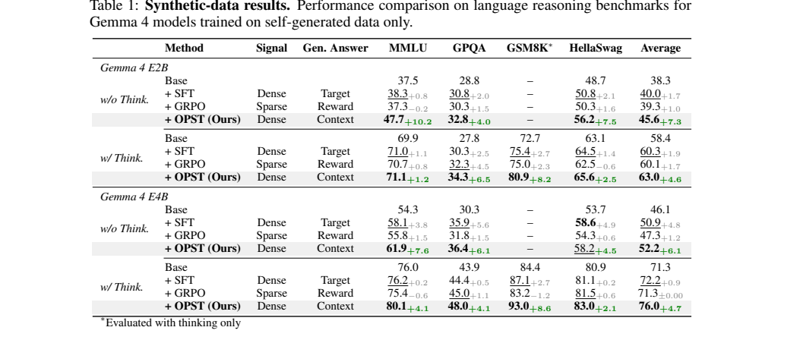
图4-3｜原文Table 1，第7页，[来源](https://arxiv.org/pdf/2610.32770v1)。相同合成数据比较SFT/GRPO/OPST；分Gemma4 E2B/E4B及thinking开关。E2B非thinking MMLU37.5→47.7、GPQA28.8→32.8、HellaSwag48.7→56.2，平均38.3→45.6；thinking平均58.4→63.0。非thinking的GSM8K没有测，不能把空格当0填入平均。评测是EMA，直接拿student45.9去和47.7比较需注明差别。

【原文事实，消融】Table6：$`\beta=1`$仅MMLU38.1，$`\beta=0.05`$为47.7，$`\beta=0.01`$为45.2；每轮57/171/285/570题对应43.8/47.2/47.7/46.9；3/7/12/20轮为43.1/47.7/46.2/46.2，并非轮数越多越好。Table7对E2B做3个seed，标准差不超过1.2。文本主模型按作者命名E2B/E4B记录，不把有效参数标签当完整显存规格；另有Qwen3-4B-Base扩展。

【原文事实与限制】多域平均OOD可提升，但MATH500在某混合下退4.9点，不能只宣传完全保留。无人工正确答案的过滤可能自我强化错误，题库覆盖受topic与预训练知识制约。视觉扩展还需要未标注图片，因此不适用纯文本无外部输入的严格表述。所读材料未完整给出可执行优化器、lr、batch、全训练步数、G默认、生成/验证总token与硬件卡时清单；本文不拿7×285直接当总训练token或GPU-hour。

【资源核查】已读[作者项目说明](https://leonsick.github.io/opst/)，未核实专门可运行训练仓库或对上述公式的代码勘误。复现优先级：先确认散度权重，再锁定teacher更新时序、generator来源、过滤答案比较器与跨轮去重，最后记录出题+重解+改写+G条筛选+训练全部成本。仅计算蒸馏阶段会遗漏大量生成成本。

## 5. MPOPD：不让学生反复走到教师不会教的区域

原文：[Proposing Better Rollouts for On-Policy Distillation](https://arxiv.org/abs/2610.36477)，Sirui Chen等，10月27日首投，本期读[v1 PDF](https://arxiv.org/pdf/2610.36477v1)，§2—4与附录A/E/F。当前元数据有10月28日v2，本期未把v1/v2比较当新贡献或第二篇。

### 原始架构、问题与信任域推导

【原文事实】纯student rollout可在训练中反复采到教师低可达的重复模式，教师在这些前缀的监督又不可靠。MPOPD把rollout分布本身作为优化对象，用teacher/student几何混合形成目标，再训练一个完整proposal模型来近似，避免生成时每个token都同步运行师生。

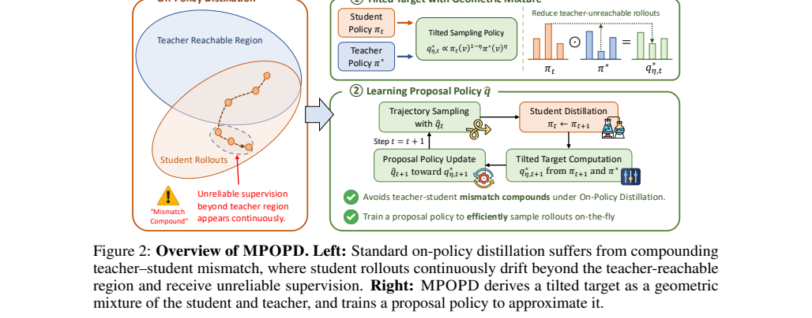
图5-1｜原文Figure 2，第3页，[来源](https://arxiv.org/pdf/2610.36477v1)。左为失配累积示意，右为proposal生成、student蒸馏、tilted target、proposal更新的循环。额外模型主要服务训练，最终返回student；几何混合用在rollout目标，与把几何混合当student蒸馏教师的方法不同。

【原文事实，式2—5】当前student $`\pi_t`$、冻结teacher $`\pi^*`$，相对支持$`s(v)=\log\pi^*(v)-\log\pi_t(v)`$。在每个固定前缀解$`\max_q\mathbb E_q[s]`$，约束$`D_{\mathrm{KL}}(q\Vert\pi_t)\le\delta`$。拉格朗日解

```math
q_\eta^*(v)=\frac{\pi_t(v)e^{\eta s(v)}}{Z}=\frac{\pi_t(v)^{1-\eta}\pi^*(v)^\eta}{\sum_{v^{\prime}}\pi_t(v^{\prime})^{1-\eta}\pi^*(v^{\prime})^\eta}
```

$`\eta`$是约束乘子的倒数，实践固定调$`\eta\in[0,1]`$，不是逐前缀精确解$`\delta`$。$`\eta=0`$为student，$`\eta=1`$为teacher。

【本文推演，推导】对q_v求导$`s_v-\lambda[\log(q_v/\pi_v)+1]-\mu=0`$，得到$`q_v\propto\pi_v\exp(s_v/\lambda)`$。$`\eta=1/\lambda`$。softmax logit几何插值等于$`\mathrm{softmax}((1-\eta)z_{\mathrm{student}}+\eta z_{\mathrm{teacher}})`$，因各自归一化常数最终抵消；但需要分词和词表对齐，不能直接跨不兼容词表混合。

【本文推演，手算】student(.9,.1)，teacher(.2,.8)，$`\eta=0.5`$，未归一化为$`(\sqrt{0.18},\sqrt{0.08})\approx(0.4243,0.2828)`$，归一化(.6,.4)。算术平均是(.55,.45)，并不相同。几何混合对双方都接近0的事件仍谨慎，不等于新知识覆盖一定充分。

【原文事实，式6】小$`\delta`$时相对支持提升

```math
\mathbb E_{q^*}[s]-\mathbb E_{\pi_t}[s]=\sigma\sqrt{2\delta}+o(\sqrt\delta)
```

$`\sigma^2=\mathrm{Var}_{\pi_t}(s)`$。这是局部前缀上支持分数的提升，不是最终正确率单调保证。附录减少噪声监督的结论也依赖结构性噪声与协方差条件。

【本文推演】$`\log Z(\eta)`$的前两导数给$`\mathbb E_q[s]`$与$`\mathrm{Var}_q(s)`$。$`\eta`$小，支持提升≈$`\eta\sigma^2`$，$`D_{\mathrm{KL}}(q_\eta\Vert\pi)\approx\eta^2\sigma^2/2`$；消去$`\eta`$即得$`\sigma\sqrt{2\delta}`$。$`\sigma=0`$时倾斜没有东西可重新分配，非退化展开要单独处理。

### 两模型更新、loss与重要性权重边界

【原文事实，式7—10】用proposal $`\widehat q_t`$生成$`\tau`$，student最小化$`\sum_jw_{t,j-1}D_{\mathrm{KL}}(\pi\Vert\pi^*)`$；

```math
w_{t,j}=\mathrm{clip}\!\left(\frac{\pi_t(y_j\mid x,y_{\lt j})}{\widehat q_t(y_j\mid x,y_{\lt j})},\frac1C,C\right)
```

$`w_{t,0}=1`$。然后用更新后的student形成$`q^*_{\eta,t+1}`$，在已采的前缀上以reverse $`D_{\mathrm{KL}}(\widehat q\Vert q^*)`$更新proposal。proposal是完整模型，论文实验说明每轮由当前student初始化；高层Algorithm1描述交替更新，实际参数同步时序需要代码确认。

【本文推演】这里用截断的一步ratio，而不是完整前缀密度比$`\prod_{k\lt j}\frac{\pi_t(y_k\mid x,y_{\lt k})}{\widehat q_t(y_k\mid x,y_{\lt k})}`$。因此不能把其修正称为对纯student状态分布严格无偏；截断还进一步引入偏差。若前两步ratio均2，完整prefix修正为4，一步只2，两者已经不同。student仍在proposal访问的状态上学习，严格意义上不是完全未改动的on-policy采样。

```text
从当前student初始化/同步完整proposal
proposal单模型生成；teacher训练期批量评分
用detached clipped one-step ratio加权student reverse KL
用更新后的student和teacher定义geometric目标
在已有前缀上训练proposal朝目标靠近；下一轮再采样
```

### 训练数据、配置、原始结果与成本

【原文事实】student Qwen3-1.7B/4B-Base，teacher Qwen3-4B-Instruct-2507。数学DAPO-Math-17K，知识ARPO-10k，医学M23K的5k子集；知识与数学用full split。主文写额外领域batch128，而附录A.1与Table5写知识QA256、医学128，存在配置口径差异，本文不静默统一。数学batch256/mini128，医学128/64；两GH200、rollout TP2、n1、温度.8、top-p1、prompt2048/response4096、lr3e−6、wd.1。$`\eta`$主要.2，top16局部support；所读配置未给出全部optimizer/epoch/clip C与总训练账单，不能凭框架默认补成论文事实。

【原文事实】student训练目标是教师分布KL，没有独立任务reward；图中training reward可作为诊断，不应自动理解为额外GRPO优化项。数学评测温度.8、top-p.9、上限16384、Avg@32，Olympiad为Avg@8；知识3任务Avg@8，医学5任务Avg@1。

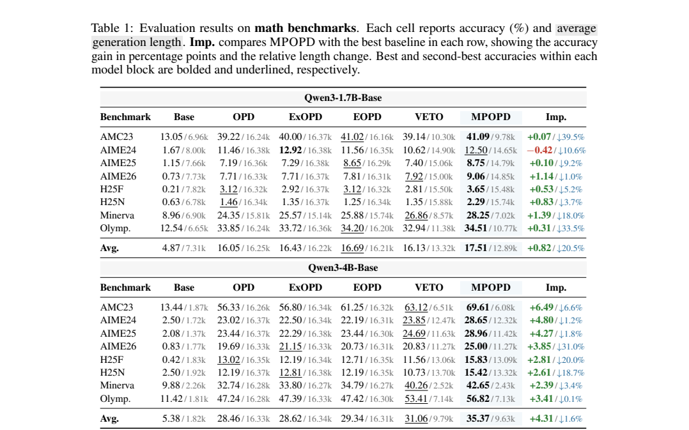
图5-2｜原文Table 1，第6页，[来源](https://arxiv.org/pdf/2610.36477v1)。每格准确率/生成长度，Imp列对比该行最强baseline，不固定为OPD。4B平均OPD28.46/16.33k，MPOPD35.37/9.63k，差+6.91点、长度约少41%；相对最强平均baseline VETO31.06则+4.31。1.7B平均16.05→17.51，但AIME24未胜ExOPD；不能把“7/8第一”写成全胜。

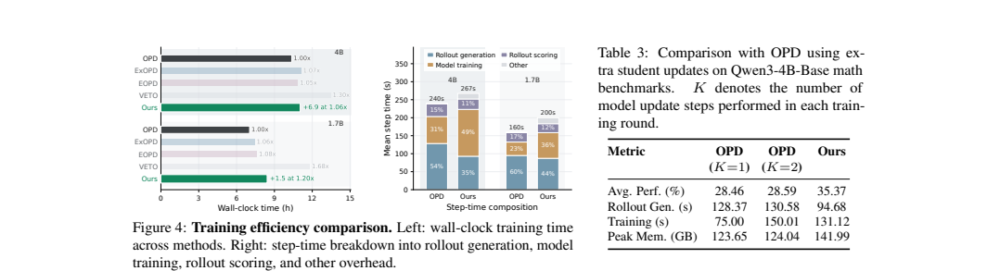
图5-3｜原文Figure 4与Table 3，第8页，[来源](https://arxiv.org/pdf/2610.36477v1)。左看总wall/分项，右比较OPD一/两次student更新与MPOPD。训练分项75.00/150.01/131.12s，rollout128.37/130.58/94.68s，峰值123.65/124.04/141.99GB。MPOPD比只做一次OPD多约13%总wall，但比多做一次student更新效果更好，且生成更快；“单forward生成”不等于没有额外模型训练成本。VETO多训一个epoch，也不是完全同预算柱状图。

【原文事实与局限】$`\eta`$=.1/.15/.2/.3三个选定数学任务均值26.93/27.41/27.69/27.48，支持该范围内温和敏感，不证明任意teacher都稳。低可达轨迹重复与PRM分数的关联是机制证据，PRM可能偏差；短响应改善部分来自基线反复撞长度上限，不应外推所有推理都可缩41%。训练/评测长度不同、单次ratio偏差、额外proposal存储、不同epoch和独立训练种子缺失都限制可比性。

【资源核查】论文链接[官方仓库](https://github.com/csr16/MPOPD)，本次已固定提交并检查完整tracked inventory：只有README和overview图片。README明确“code is being prepared”，没有可运行训练代码或权重。README可作作者辅助说明，不能称已经完成源码复现。复现首先核对proposal重置/同步时序、ratio使用的前一位置和clip C，然后再测额外模型的完整端到端成本。

## 基础资料与横向选择

以下不占五篇名额。入门：[Thinking Machines OPD教程](https://thinkingmachines.ai/blog/on-policy-distillation/)、[PyTorch自动微分](https://docs.pytorch.org/tutorials/beginner/basics/autogradqs_tutorial.html)；实现：[veRL官方文档](https://verl.readthedocs.io/en/latest/)、[PyTorch KLDivLoss注意方向](https://docs.pytorch.org/docs/stable/generated/torch.nn.KLDivLoss.html)；进阶：[SciPy orthogonal Procrustes](https://docs.scipy.org/doc/scipy/reference/generated/scipy.linalg.orthogonal_procrustes.html)、[PyTorch SVD](https://docs.pytorch.org/docs/stable/generated/torch.linalg.svd.html)。作者辅助长文：OPST项目与泛化研究项目，已在对应篇目链接；O²PD/APD未核实独立博客，MPOPD只有README说明。

| 需求 | 本期论文最有帮助之处 | 不应推定 |
| --- | --- | --- |
| 教师在长学生前缀上失真 | O²PD前缀选择与reset质量 | 少算loss就同比节省总训练成本 |
| 注入文档里原本不知道的信息 | APD同时调loss方向与前缀覆盖 | 所有推理蒸馏都必须混teacher采样 |
| 合并专家后保留/组合能力 | 泛化研究分开测IND与多种OOD | IND追平就是能力已完整迁移 |
| 没有人工问题集 | OPST伪验证+EMA循环 | 一致性等于正确，原式已可直接复现 |
| 避免退化rollout反复强化 | MPOPD学习几何提议策略 | 截断一步ratio严格恢复纯on-policy期望 |

【本文推演】共同结论是监督方向、状态覆盖、教师可靠性、目标能力与预算口径必须分别测量。先明确需要新知识、稳定迁移还是保留泛化，再决定改loss、改采样或改数据；不要把五种方法的组件默认叠在一起并声称有论文支持。
