# OPD / OPSD 论文精读 · 2026-11-25

## 先读这五篇

**1. VOPD｜让阅卷结果决定教师的话该信多少。** 数学题可以判对错，但只在末尾打分，学生很难知道哪一步该改。强教师能逐步给建议，也可能偏爱走向错答案的写法。作者让学生给同一题写几份解答，比较阅卷结果和教师的偏好是否相符。同向就加强教师提供的细节，反向就调低甚至倒转这部分建议。所有答案同时判对或判错时，退回固定的教师引导。[读第 1 篇精读](#paper-vopd)

**2. cOPD｜用两个教师找出该学和该戒的习惯。** 强教师知道怎么做好，弱教师常示范学生也容易犯的错。作者专挑强弱教师表现拉开差距的题，并沿着学生自己写的内容检查下一步。强教师最偏爱、弱教师最不偏爱的候选被鼓励，反过来的候选被压低，意见混杂时就跳过。这样可以用弱教师辨认坏习惯，同时避免把它的平均表现直接教给学生。[读第 2 篇精读](#paper-copd)

**3. Muted Distillation｜让老师看不见学生的草稿。** 普通蒸馏给教师看学生已经写好的长草稿，教师接着补想法，学生因此也学会多写草稿。作者保留学生完整的工作记录，但把教师那一侧的草稿遮掉，再让教师只对回答和工具动作打分。学生依然可以推理，直接的训练信号集中在推理之后真正要做的事情上。[读第 3 篇精读](#paper-muted)

**4. 蒸馏目标的理论分析｜整段评分和逐步评分会学出不同习惯。** 学生可能发现，选一个容易续写的开头，就更容易和老师在后半段一致，即便老师不喜欢那个开头。作者把整段评分与逐步评分拆开，再比较几种逐步评分方法如何看待学生几乎从不选的词。树导航、回答请求和新接口补全分别展示了这两种偏差，还有在哪些数学任务上保留学生原有能力反而合适。[读第 4 篇精读](#paper-theory)

**5. Fin-SD｜先找第一处错，再让自己重写一小步。** 金融推理错一处口径，后面算得再整齐也会错。作者把答案交给冻结的学生副本定位第一个概念错误，切掉错误之后的内容。学生从正确前缀短写一段，教师副本多看一行反馈并给同一段打分。每轮重新挖错并刷新教师。把具体反馈换成一句通用提醒仍有近似效果，这让「从哪里开始改」成为最值得关注的变量。[读第 5 篇精读](#paper-finsd)

## 范围与阅读准备

本期收录 **5 篇**。按北京时间日报日期使用 2026-10-25 至 2026-11-25 的一个月窗口。表中首发使用 arXiv v1 的 UTC 日期，具体到时刻的提交历史见清单。检索覆盖 on-policy distillation、on-policy self-distillation 和 self-distillation。arXiv 查询返回 158 条记录，另以关键词检索补核。标题同名、历史重复、范围不符及缺少窗口内实质更新的条目经筛选后，选入以下五篇。原图裁自对应 v1 PDF。文中「原文」指论文报告的内容，「本文推演」指为教学补出的推导、算例或解释，「未披露」指在已核对材料中缺少的细节。

| 论文 | 首发（UTC） | 作者实现核验 |
| --- | --- | --- |
| [Verifiable On-Policy Distillation](https://arxiv.org/abs/2611.30325) | 2026-11-23 | 项目仓库仅含 README |
| [Contrastive On-Policy Distillation via Dual-Branch Supervision](https://arxiv.org/abs/2611.28359) | 2026-11-20 | 原文称将开源，未找到公开实现 |
| [Muted Distillation: Sealing Reasoning from Teacher Unlocks Token-Efficient Agents](https://arxiv.org/abs/2611.28445) | 2026-11-21 | 可定位训练框架，未找到该方法的作者实现 |
| [Which Tokens, in What Order, and How Fast? A Theoretical Analysis of On-Policy Distillation Objectives](https://arxiv.org/abs/2611.23397) | 2026-11-17 | 作者仓库含实验代码和配置 |
| [How Much Does the Hint Matter? Scope Conditions for Hindsight Self-Distillation in Financial Reasoning](https://arxiv.org/abs/2610.36082) | 2026-10-26 | 作者仓库含训练、数据和消融配置 |

**先认识三个词。** 自回归模型每次预测下一个 token。前缀是当前已有的题目和输出。OPD 让学生生成这些输出，由老师在学生实际到达的前缀上给监督。OPSD 让同一模型在训练中扮演两种角色，教师可以看附加线索，学生学习在部署时只凭自己能看到的信息答题。给定分布 $`p,q`$，KL 衡量两者的差异。学生作第一个参数时称反向 KL，教师作第一个参数时称前向 KL。

```math
D_{\mathrm{KL}}(p\Vert q)=\sum_{v\in\mathcal V}p(v)\log\frac{p(v)}{q(v)}
```

这里 $`\mathcal V`$ 是词表，$`v`$ 是候选 token，$`p(v)`$ 与 $`q(v)`$ 是它的两个概率。对数用自然底。前后顺序决定哪个分布给每项加权。若某条轨迹的结果由程序判对错，那是可验证的结果奖励。若只让教师比较下一词的概率，那是稠密的蒸馏监督。

<a name="paper-vopd"></a>
## 1. Verifiable On-Policy Distillation

原文 v1 · Juntong Shi 等 · 2026-11-23 09:04:36 UTC。[原文](https://arxiv.org/pdf/2611.30325v1) · [作者项目](https://github.com/juntongshi48/VOPD)

### 问题与机制

原文 §3–4。RLVR 能确认整条答案正确，但同一个终局奖励覆盖很多 token。普通 OPD 经常能在每一步提供监督，但教师的偏好不保证和题目的正确性一致。VOPD 对每题在学生现场生成的多条轨迹上测这种一致性。基础蒸馏始终在，程序判分只负责调整额外的教师方向。

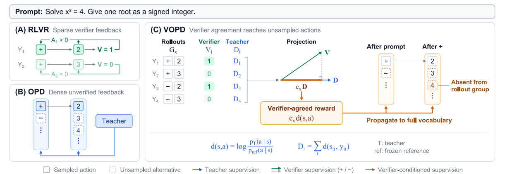

**原文 Figure 1，PDF 第 2 页。** 左上 A 是只给已采样答案判分的 RLVR，左下 B 是老师给学生访问过的状态做稠密监督的 OPD，右侧 C 是 VOPD。沿右图从左到右看，先用同题轨迹估计教师与验证器的关系，再把这个系数带回每个前缀的候选词。右侧的未采样候选也能有训练信号。图是机制示意，量化对照见表 1、2。

### 关键公式与推导

```math
\begin{aligned}
y_i&\sim\pi_\theta(\cdot\mid x),\qquad V_i=\mathrm{Verify}(x,y_i),\\
d(s,a)&=\log\frac{\pi_T(a\mid s)}{\pi_{\mathrm{ref}}(a\mid s)},\qquad
D_i=\sum_t d(s_{it},a_{it}),\\
A_i^V&=\frac{V_i-\bar V}{\sigma_V},\qquad
A_i^D=\frac{D_i-\bar D}{\sigma_D}.
\end{aligned}
```

$`x`$ 是题目，$`i`$ 是同题第几条轨迹，$`y_i`$ 是第 $`i`$ 个学生答案，$`t`$ 是 token 位置。$`s_{it}`$ 是当前前缀，$`a_{it}`$ 是学生抽中的 token。$`\pi_T`$ 是 RL 教师，$`\pi_{\mathrm{ref}}`$ 是冻结的初始学生。$`d`$ 为单步隐式奖励，$`D_i`$ 为整条轨迹累加后的教师偏好，$`V_i`$ 是验证器分数。横杠是同组均值，$`\sigma`$ 是组内标准差。

```math
\begin{aligned}
c&=\arg\min_b\frac{1}{n}\sum_{i=1}^n(A_i^V-bA_i^D)^2\\
 &=\frac{\sum_i A_i^V A_i^D}{\sum_i(A_i^D)^2}
 =\frac{1}{n}\sum_i A_i^V A_i^D,\qquad -1\le c\le1 .
\end{aligned}
```

$`n`$ 是同题轨迹数，$`b`$ 是回归系数。对平方目标求导得到 $`\sum_i A_i^D(A_i^V-bA_i^D)=0`$。标准化后 $`\sum_i(A_i^D)^2=n`$，所以解是两种标准化优势的相关系数。预测的验证器优势乘回 $`\sigma_D`$，对应 $`c(D_i-\bar D)`$。负 $`c`$ 表示教师隐式偏好和验证器方向相反。验证器方差为零时，原文设额外监督系数为固定正值 $`\lambda=0.25`$。

原文先把投影后的序列信号变成逐位置形式，再用即时奖励 $`d(s,a)`$ 近似后续回报。跨候选动作求条件期望，能去掉仅依赖前缀或组的基线。因为 $`\sum_a\pi_\theta(a\mid s)\nabla_\theta\log\pi_\theta(a\mid s)=\nabla_\theta 1=0`$。该恒等式解释动作边际化，序列回报投影和即时近似仍会改变原始验证器梯度。

```math
\begin{aligned}
\ell(s)
 &=D_{\mathrm{KL}}(\pi_\theta\Vert \pi_T)
 -\lambda c\sum_a\pi_\theta(a\mid s)d(s,a),\\
q_c(a\mid s)
 &=\frac{\pi_T(a\mid s)^{1+\lambda c}
          \pi_{\mathrm{ref}}(a\mid s)^{-\lambda c}}{Z_c(s)},\\
\ell(s)&=D_{\mathrm{KL}}(\pi_\theta\Vert q_c)-\log Z_c(s).
\end{aligned}
```

$`\lambda`$ 是调节幅度，$`q_c`$ 是等效教师，$`Z_c`$ 对候选归一化。把对数比展开，合并 $`\log\pi_T`$ 与 $`\log\pi_{\mathrm{ref}}`$ 的系数就得到幂次。训练梯度把本批前缀、组系数、教师和参考模型视作固定。理论式是全词表，实验采用学生 top-16 近似。

**本文推演。** 同一道题两份作答的 $`V=(0,1)`$、$`D=(-0.7,0.3)`$，标准化后两组相同，所以 $`c=1`$。某一步老师对 A/B 给 0.8/0.2，初始参考给 0.5/0.5。$`\lambda=0.25`$ 时，A 的等效概率由 0.80 升至 $`4^{1.25}/(1+4^{1.25})\approx0.850`$。若两条作答的阅卷结果对调，$`c=-1`$，A 降到约 0.739。基础教师仍偏向 A，只是减弱它的偏好。

### 数据、实现和成本

原文 §5 与 Appendix A。DAPO-Math-17k 共 17,917 个题目，提示要求盒装最终答案，程序判分。教师 Qwen3-4B-RL-Math。学生和冻结参考分别是初始 Qwen3-4B 或 Qwen3-1.7B，两组均为非思考模式。每步 64 道题，每题 4 条，最长作答 12,288 token。AdamW，学习率 $`2\times10^{-6}`$，每个 rollout batch 一次更新，4B 跑 140 步，1.7B 跑 160 步。训练使用 veRL/FSDP，每个 run 8 张 A100。参考模型额外前向和多条采样带来训练开销。原文未披露总 GPU 小时或额外前向的实测墙钟开销。

```text
for batch of prompts:
    sample 4 student answers per prompt; verify each final answer
    score each sampled path with teacher and frozen initial reference
    per prompt: estimate c from answer rewards and summed log ratios
    choose effective scale: lambda * c, or +0.25 for zero verifier variance
    for each sampled prefix: compute baseline and reward term on student top-16
    update student once with token-mean loss
```

部署只用学生和正常提示，不运行教师、参考或训练验证器。作者仓库核查到提交 21c6c15，仅 README。可照论文实现，但原文未详述教师分数完全相同或近同的数值容错，也未提供可供核验的 top-16 概率张量测试。

### 实验、消融与适用条件

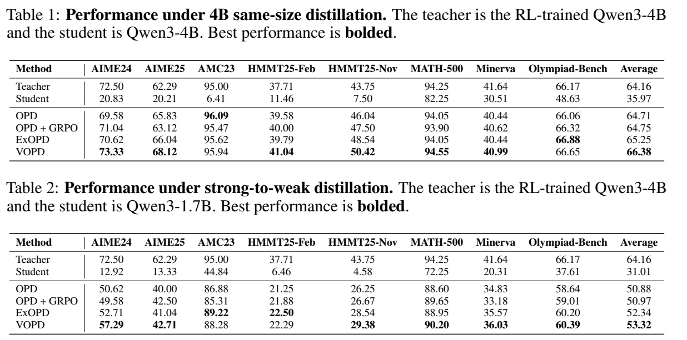

**原文 Tables 1、2，PDF 第 8 页。** 横向是八个数学基准，最右是平均分。对照为初始化、教师、普通 OPD、OPD 加 GRPO 和固定外推 ExOPD。评估是每题独立采样后取正确率均值，和多抽几次至少答对一次的 pass@k 不同。4B 平均为 66.38，OPD、OPD+GRPO、ExOPD 为 64.71、64.75、65.25，教师为 64.16。1.7B 对应 53.32、50.88、50.97、52.34。VOPD 并非每列第一，判断稳定性要看分题集和重复试验。

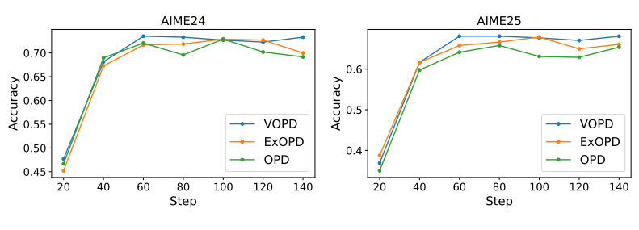

**原文 Figure 2，PDF 第 9 页。** 4B 同尺寸下的 AIME24/25 曲线。横轴更新步，纵轴验证准确率，连同普通 OPD、固定 ExOPD 比较。几条曲线早期一起上升，后段有交叉，论文主张 VOPD 更早达到有竞争力的准确率并通常以更高值收尾。训练步不能换算为同等墙钟成本。

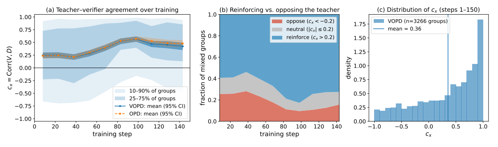

**原文 Figure 3，PDF 第 10 页。** 左图是 OPD 与 VOPD 轨迹上相关系数随训练的变化，中图把 VOPD 有效组分成支持、近零和反对教师三类，右图合并训练步展示分布。图中的正平均值伴随一部分负值，解释了为何固定放大和按题调整会不同。Table 3 比较放大系数，默认 0.25 在 AIME25 更有利。Table 4 比较 $`n=4/8`$，AIME24 为 57.29/57.08，AIME25 为 42.71/43.54。增大组数减少零方差组，最终收益小且方向不统一。

**局限。** 强到弱设置中每题只抽 4 条时，后期约 65% 组同分。此时等效目标退回无验证器适配的固定外推。分组相关性只是轨迹级信号，单个 token 的因果功劳并未被标注。结论支持具有可靠验证器、可访问教师 logits、相同词表的数学设置，其余领域和前沿教师可用性待验证。

<a name="paper-copd"></a>
## 2. Contrastive On-Policy Distillation via Dual-Branch Supervision

原文 v1 · Zhibo Hou 等 · 2026-11-20 22:16:32 UTC。[原文](https://arxiv.org/pdf/2611.28359v1) · [作者主页](https://yipingli.dev/)

### 问题与双分支

原文 §3。弱模型有些输出习惯与学生的错法相似。把弱教师用成反面参照，能不能区别「强教师擅长的候选」和「弱教师过度偏爱的候选」？cOPD 让学生自己生成前缀，用一强一弱教师与冻结的参考学生在同一位置作三方对比。只有三方的概率呈严格排序且相邻差距过阈值，该候选才有监督。

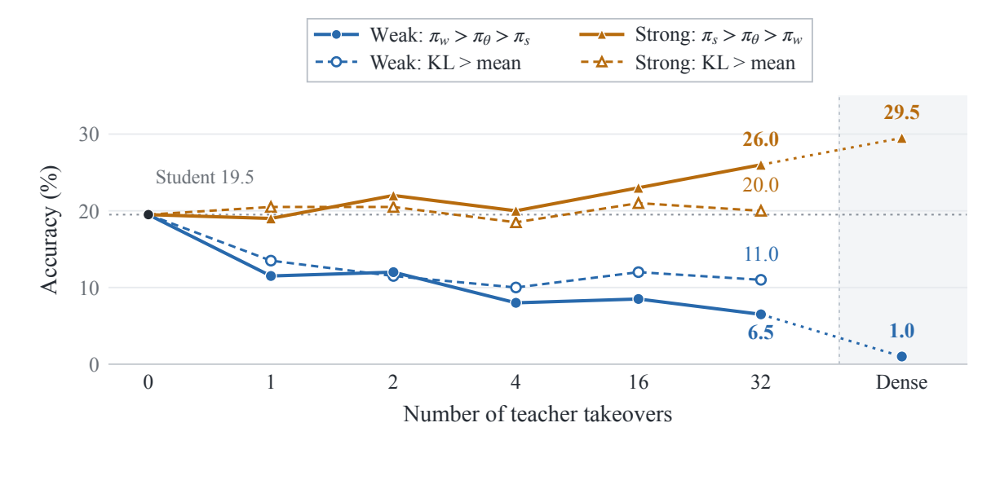

**原文 Figure 1，PDF 第 3 页。** 原文给两教师接管学生生成的动机实验，方法由原文方程给出，没有独立网络架构图。横轴是允许接管的 token 数，纵轴是准确率。对照用 KL 高于均值来选接管位置。正分支由强教师接管、负分支由弱教师接管。两条线方向相反，说明所选位置与行为差异有关。该图是干预诊断，训练时两个教师在学生前缀上打分。

### 关键公式与推导

```math
\begin{aligned}
m_v^+&=\mathbf 1[p_s(v)-p_r(v)>\delta]\,
          \mathbf 1[p_r(v)-p_w(v)>\delta],\\
m_v^-&=\mathbf 1[p_w(v)-p_r(v)>\delta]\,
          \mathbf 1[p_r(v)-p_s(v)>\delta],\\
m_v&=m_v^++m_v^-,\qquad
r_v=m_v\tanh\left(\frac{\log p_s(v)-\log p_w(v)}{\tau}\right),\\
\ell(h)&=-\sum_{v\in S(h)}q_\theta(v\mid h)r_v .
\end{aligned}
```

$`h`$ 是学生采样的前缀，$`v`$ 是一个候选，$`S(h)`$ 取冻结参考学生的 top-16。$`p_s,p_w,p_r`$ 分别为强教师、弱教师、参考学生的下一词概率，$`q_\theta`$ 为更新中的学生。$`\delta`$ 控制强弱间隔，$`\tau`$ 控制压缩幅度，$`\mathbf1`$ 是条件成立时取 1 的指示量。正、负分支互斥。正分支有 $`p_s>p_w`$，对数差为正，最小化负期望会奖励该候选。负分支符号相反。tanh 将大比率压在有限区间。

**本文推演。** 将支持集外 $`r_v`$ 置零，以全词表 softmax 解读原文，logit $`z_j`$ 的局部梯度如下。$`j`$ 是任意候选下标。即使候选没被直接选中，概率归一化也可能导致其 logit 有梯度。

```math
\begin{aligned}
\frac{\partial q_v}{\partial z_j}&=q_v(\mathbf1[v=j]-q_j),\\
\frac{\partial\ell}{\partial z_j}
 &=q_j\left(\sum_v q_v r_v-r_j\right).
\end{aligned}
```

原文 §3.2 用理想化混合解释排序。三个分布都可写为 $`\alpha H_i+\beta_iG+\gamma_iB`$，权重总和为 1。$`H_i`$ 是模型自己的中性分布，$`G`$ 与 $`B`$ 是共享的好、坏模式，支持集互不交叠。若好模式的混合权重满足 $`\beta_s>\beta_r>\beta_w`$，对任一有质量的好候选乘相同的 $`G(v)>0`$ 即得到正分支排序。坏模式以逆序的 $`\gamma_i`$ 同理。这是充分条件的直觉，中性项、混叠与非零 margin 都会使真实世界偏离理想化假设。

**本文算例。** A/B/C 概率，强教师为 0.60/0.10/0.30，参考兼当前学生为 0.45/0.25/0.30，弱教师为 0.25/0.45/0.30。用论文 $`\delta=0.05,\tau=1`$，A、B 分别通过两门，C 不通过。$`r_A=\tanh(\log 2.4)\approx0.704`$，$`r_B=\tanh(\log(0.10/0.45))\approx-0.906`$。局部 loss 约为 $`-(0.45\times0.704-0.25\times0.906)=-0.090`$。这里 loss 可为负，因为它是带符号分数的负期望。

### 数据、实现和成本

原文 §4 与 Table 3。数学从 DAPO-Math-17k 筛出弱教师 8 抽全错、强教师 8 抽至少一对的题。JustRL/Qwen2.5-Math/DeepSeek-R1-Distill 三个 1.5B 模型的组合保留 6,016 题。Qwen3 的强 4B、弱 0.6B、学生 1.7B 组合保留 7,488 题。指令遵循取 IF-RLVR，每题至多五个可验证约束，留出 7,000 条评测，同法筛出 Qwen3 6,892、Llama 6,903 条训练题，按严格满足约束计分。拒答问答取 SQuAD 2.0，筛出 Qwen3 8,080 和 Llama 16,359 条训练题，后者用 8B/1B/3B 的强弱学生组合。测全量 11,873 道官方 dev 题。任务判分定义筛题和评测，训练的逐词奖励来自两教师的概率对比。

```text
screen prompts using 8 samples from each teacher and a task checker
for epoch:
    freeze a reference copy of current student
    for batch:
        sample 4 on-policy continuations per prompt from current student
        score their prefixes with strong teacher, weak teacher and reference
        select the reference top-16; apply positive and negative margins
        update current student with the signed contrastive loss
```

三任务均跑 3 epoch，64 prompts/批，AdamW 学习率 $`10^{-6}`$。数学回复上限 7,168 token，另两任务 4,096。需要两个教师与参考的前向评分，推理时只用学生。原文未报告 GPU 型号、设备量、时长或 GPU 小时。原文可复现性声明称将发布实现，检索到作者主页的论文线索，未找到可下载的独立作者实现。复现时尤其要锁定 top-k 归一化、margin 边界、模板和参考更新时间。

### 结果、消融与局限

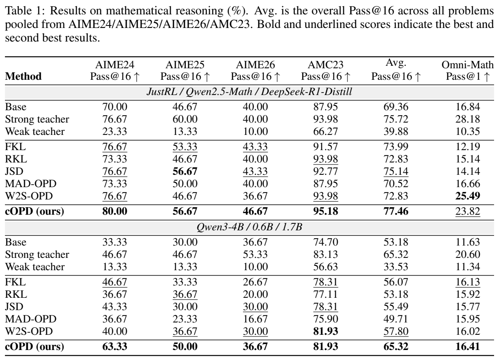

**原文 Table 1，PDF 第 5 页。** 左侧四列分别是 AIME24/25/26、AMC23 的 Pass@16，Avg. 是合并这些题后的 Pass@16，右侧 Omni-Math 是 Pass@1。基线为强教师与基座、FKL、RKL、JSD、MAD-OPD、W2S-OPD 等。JustRL 组 cOPD 合并 77.46，强教师 75.72、JSD 75.14。Qwen3 组为 65.32，W2S 57.80，强教师 65.32。Omni-Math 的 JustRL 组 W2S 25.49 高于 cOPD 23.82。跨列数值对应不同采样口径。

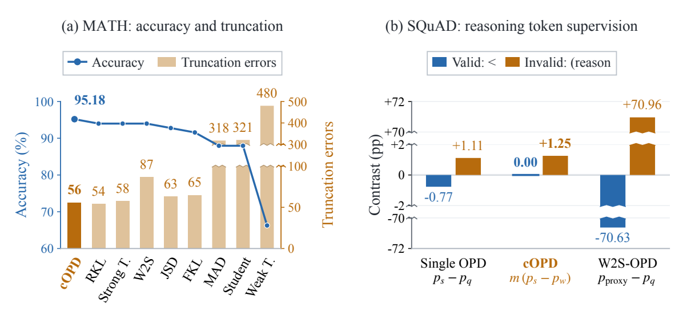

**原文 Figure 3，PDF 第 8 页。** 左图把不同方法的数学准确率与长度截断次数并列，纵轴分别读数。右图是在 Llama SQuAD 条件下抽查 128 条训练提示，比较普通 OPD、cOPD、W2S 在合法开头和非法开头的监督差。W2S 代理把非法开头的概率由强教师 1.25% 推到 71.10%。cOPD 在两个开头的相对差很小。右图比较的是监督系数，三种方法的系数定义随图例变化。

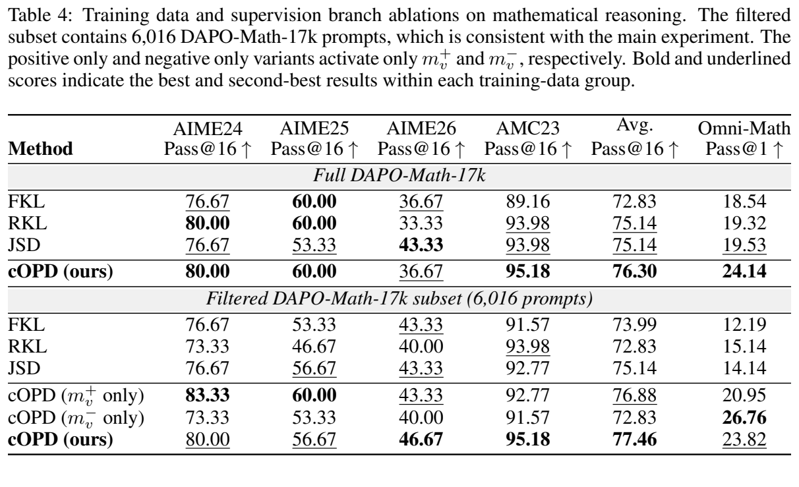

**原文 Table 4，PDF 第 13 页。** 比较同样的 JustRL 数学组，完整集与 6,016 筛选题分别成块。筛选集仅正分支、仅负分支、双分支的合并 Pass@16 为 76.88/72.83/77.46，但 Omni-Math Pass@1 为 20.95/26.76/23.82。双分支在合并指标最好，负分支在出域集有独立价值。全量集 cOPD 的合并分 76.30。Table 2 中两组正确拒答率 71.59% 和 73.04%，相对各自最强蒸馏基线高 1.73 和 2.46 个百分点。

**局限。** 学生的 top-16 决定可直接干预的候选集合。弱教师能力差距、词表对齐、任务可判分性和筛题选择都关系到监督覆盖。原文混合模型不保证真实指令数据一定存在两类干净分离的 token。表格缺少种子方差，保留单任务胜负差异解读。


<a name="paper-muted"></a>
## 3. Muted Distillation: Sealing Reasoning from Teacher Unlocks Token-Efficient Agents

原文 v1 · Yuwei Zhang 等 · 2026-11-21 00:50:35 UTC。[原文](https://arxiv.org/pdf/2611.28445v1) · [Slime 框架](https://github.com/THUDM/slime)

### 问题与机制

原文 §2–3。在多轮工具任务中，教师单独用的 token 少，普通 OPD 训练出的学生却可能更啰嗦。作者在同一条轨迹上比较教师看不看思考块。如果教师读了学生的长推理，常会接着重新考虑。学生因此得到扩写的局部反馈，而真正决定任务结果的工具动作与回答只占较短的一段。

Muted Distillation 做两件事。第一，教师侧的本轮与先前思考块换成空块，保留提示、观察和可见动作。第二，loss 只落在本轮可见尾段。学生自己仍保留完整历史和思考，用原提示交互。

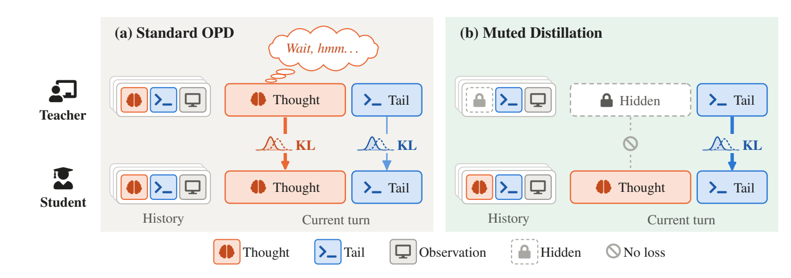

**原文 Figure 3，PDF 第 4 页。** 上排是教师，下排是学生。左栏普通 OPD 给思考和动作两处损失。右栏锁表示教师看不到该块，禁用符号表示学生该位置没有直接 loss，蓝色箭头对应工具调用或回答处的监督。箭头粗细是机制示意。mask-think-tail 基线只屏蔽 loss，教师仍看见思考，区分这两项改动。

### 关键公式与推导

记 $`y=(z,a)`$。$`x`$ 是已有交互记录，$`z`$ 是当前生成的思考，$`a`$ 是其后的尾段，$`y_t`$ 是此处学生现场生成的 token，$`y_{\lt t}`$ 是它之前的完整输出。$`\mathcal T`$ 为所有训练 token，$`\mathcal A`$ 为尾段位置，$`\mathcal Z`$ 为思考位置。$`\tilde x`$ 是历史思考被遮住的教师记录，$`\varnothing`$ 表示当前空思考块。原文式 1、3 对已采样上下文取期望，普通与 Muted 的局部目标可写为

```math
\begin{aligned}
L_{\mathrm{OPD}}&=\mathbb E_{y\sim\pi_S}
 \left[\frac{1}{|\mathcal T|}\sum_{t\in\mathcal T}
 D_{\mathrm{KL}}\big(\pi_S(\cdot\mid x,y_{\lt t})
                 \Vert\pi_T(\cdot\mid x,y_{\lt t})\big)\right],\\
L_{\mathrm{MD}}&=\mathbb E_{y\sim\pi_S}
 \left[\frac{1}{|\mathcal A|}\sum_{t\in\mathcal A}
 D_{\mathrm{KL}}\big(\pi_S(\cdot\mid x,y_{\lt t})
           \Vert\pi_T(\cdot\mid\tilde x,\varnothing,a_{\lt t})\big)\right].
\end{aligned}
```

实际用单个已采样 token 的 logprob 差估计局部 KL 的梯度。$`\pi_S,\pi_T`$ 是学生、教师策略，$`\log\pi_S(y_t\mid x,y_{\lt t})`$ 是学生为实际动作给出的对数概率。$`A_t`$ 是式 4 中的局部蒸馏优势，公式里的教师只在尾段估分。

```math
\begin{aligned}
A_t&=\begin{cases}
\log\pi_T(y_t\mid\tilde x,\varnothing,a_{\lt t})
 -\log\pi_S(y_t\mid x,y_{\lt t}),&t\in\mathcal A,\\
0,&t\in\mathcal Z ,
\end{cases}\\
\widehat{\ell}_t&=-\mathrm{stopgrad}(A_t)\,
                      \log\pi_S(y_t\mid x,y_{\lt t}).
\end{aligned}
```

**本文推导。** 固定前缀，记学生和教师当前分布为 $`p,q`$。直接求 $`D_{\mathrm{KL}}(p\Vert q)`$ 的梯度得 $`\sum_v\nabla p(v)[\log(p(v)/q(v))+1]`$。$`\sum_v\nabla p(v)=0`$ 消去加一项，再用 $`\nabla p=p\nabla\log p`$ 就能从一个学生 token 无偏估计**局部**梯度。公式中对优势停梯度可避免重复微分。对整轮采样前缀的分布仅作取样处理。上面的书写按单条序列归一化，原文 §3.4 的实际训练按批内所有受监督 token 求平均。

**本文算例。** 尾段候选是发起一个工具动作。学生评分 0.20，教师看长思考时也给 0.20，优势为 0。若遮住思考后教师评分为 0.40，优势是 $`\log(0.40/0.20)\approx0.693`$，本位置推动学生提高这个动作的概率。思考 token 的直接 loss 为零，但共享模型参数仍可能通过尾段梯度间接改变其概率。

### 数据、实现和成本

原文 §3。OfficeQA 以约 89,000 页美国财政部公报作知识库，用 Easy 的 113 道题训练，报告 Pro 的 133 道题，最多 120 轮。SpreadsheetBench 用 502 条训练指令，与专家核验的 400 条测试指令分离，最多 50 轮。学生用首个工作簿构造可重放程序，评测对一条指令的所有工作簿核对目标格。指标是独立尝试的平均 pass@1，每题 8 次。教师 Qwen3.5-397B-A17B 由 SGLang 评分，学生 Qwen3.5-4B、9B、27B。上下文 64k，单轮输出最多 8,192 token，Adam 学习率 $`10^{-6}`$、权重衰减 0.1、采样温度 1。OPD 与 MD 每步 16 prompts，4B 在两项任务分别训练 139、154 步。

```text
sample an episode from the student with full history and tool observations
for each current turn:
    build teacher view by blanking old and current thought blocks
    teacher-score each sampled visible-tail token on this shortened view
    student-score the same tokens on the unchanged view
    backpropagate only the sampled tail advantages
aggregate over all supervised tokens in the batch; update once
```

教师只返回用到的单 token logprob，避免反向过程保存全词表差。MD 不引入额外任务奖励。Dr. GRPO 使用 OfficeQA 的 exact match 或表格软约束分数，8 条 episode 成组，减组均值并作固定长度归一化。部署时用学生原工具环境和完整思考。原文提供按 token 计价的估算和评测 token 数，未报告可核对的训练卡时与推理墙钟。可查到 Slime 和 SGLang 框架，未找到作者方法仓库，复现特别依赖两侧思考块、尾段切分和工具序列的时间对齐。

### 结果、消融与局限

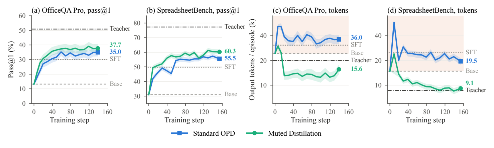

**原文 Figure 6，PDF 第 6 页。** 4B 学生、397B-A17B 教师。左两格为 OfficeQA Pro、SpreadsheetBench 完成率，右两格为平均每个 episode 的输出量。横轴都是训练步，灰虚线是未训练学生，另有教师和 SFT 参照。看两组曲线时同时检查完成率和长度，避免把失败后提前退出当成效率提升。MD 较普通 OPD 更早达到其最终完成率，输出长度的差异自第一批评估后就已经出现。

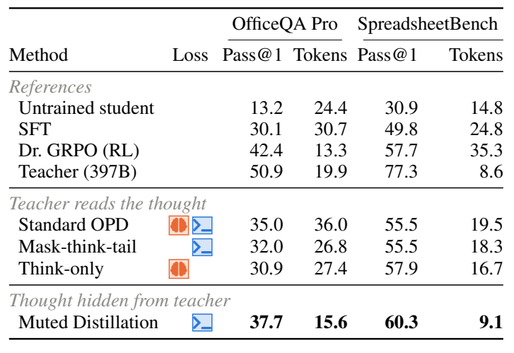

**原文 Table 1，PDF 第 5 页。** 表内按每次输出的 pass@1 和千 token 对比 4B 的末 checkpoint。OfficeQA 普通 OPD 35.0%、36.0k，MD 37.7%、15.6k。表格普通 OPD 55.5%、19.5k，MD 60.3%、9.1k，分别少约 57% 和 53% 输出。只 mask-think-tail 得 32.0%、26.8k 和 55.5%、18.3k，显示仅删思考 loss 不能解释全部变化。Dr. GRPO 的对应准确率是 42.4% 与 57.7%，MD 在第一项低、第二项高。

原文 Figure 4 把 $`|\log(\pi_S/\pi_T)|\le0.05`$ 的思考 token 记为低差异填充，标准 OPD 后它们从每轮 157 增到 271，高差异部分约 100。Figure 5 在尾段前 8 token 对比读草稿与遮草稿，报告采样 KL 均值约 0.10 与 0.35。梯度诊断中思考占 79% token，梯度范数中位数是尾段的 5.5 倍。这个诊断是在固定样本和参数的局部测量，不能据此直接估出训练加速比例。

**局限。** 使用相同模型家族和结构化思考标记。在推理本身必须可见或接受专业审计的任务上，遮掉草稿可能移除有价值的指导。两个应用及更难的迁移集支持部分外推，其他领域、教师裁剪方式和成本仍需单独测量。

<a name="paper-theory"></a>
## 4. Which Tokens, in What Order, and How Fast? A Theoretical Analysis of On-Policy Distillation Objectives

原文 v1 · Hubert Strauss、Liam Fowl、Noam Razin · 2026-11-17 19:01:02 UTC。[原文](https://arxiv.org/pdf/2611.23397v1) · [作者代码](https://github.com/princeton-pli/opd-objectives-analysis)

### 两个问题与训练目标

原文 §2–4。第一个问题是整段对齐会不会把「后续两人意见接近」误当「当前词更好」。第二个问题是局部对齐时，哪项损失有足够梯度教会学生几乎从没选过的词。作者控制参数化，先研究每个前缀拥有独立 logits 的表格模型，再在 Transformer 与不同 LLM 任务做比较。原文 Figure 1 是理论任务结构，本论文不需要新网络结构。

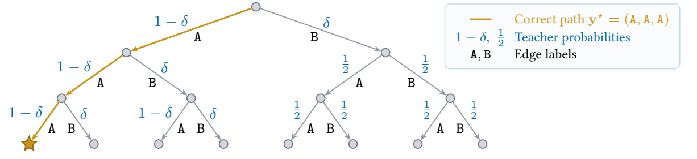

**原文 Figure 1，PDF 第 6 页。** 二叉树任务的深度-3 示例。A/B 分别走左/右，金色路径全选 A 才到目标。教师在根和左侧偏爱 A，选错根以后教师与均匀初始化学生一样，后续都是均匀。这个条件为了隔离「教师也容易续写错误开头」的效应。模型和目标函数的对照在原文 Figure 2。

对同一输入 $`x`$，令 $`p_c(v)=\pi_\theta(v\mid x,c)`$ 是学生概率，$`q_c(v)=\pi_T(v\mid x,c)`$ 是教师概率。$`c`$ 是前缀，$`cv`$ 是追加 token $`v`$ 后的前缀。$`w_c=\pi_\theta(c\mid x)`$ 是学生到达该分支的概率。$`R(c)`$ 是从该前缀开始整段续写的反向 KL。固定长度下，将联合分布按链式因子分解，整段对数比是逐步对数比之和。先对第一词求条件期望可得

```math
R(c)=\sum_v p_c(v)\left[\log\frac{p_c(v)}{q_c(v)}+R(cv)\right].
```

序列级 OPD 对 $`R(\varnothing)`$ 更新。token 级 OPD 从学生采样前缀，在每处只最小化局部散度，更新时固定采样路径。公式中的等价教师与梯度针对独立的 logit $`z_{c,v}`$。

```math
\begin{aligned}
\frac{\partial L_{\mathrm{seq}}}{\partial z_{c,v}}
 &=w_c p_c(v)\left[
 \log\frac{p_c(v)}{q_c(v)}+R(cv)-R(c)\right],\\
\tilde q_c(v)&=
 \frac{q_c(v)e^{-R(cv)}}{\sum_u q_c(u)e^{-R(cu)}} .
\end{aligned}
```

**本文推导。** 对递推式用 softmax 导数。当前前缀之外的续写 logits 独立，$`R(cv)`$ 对当前 $`z_{c,v}`$ 视为常量。第一项带来的加一项在 softmax 归一化中抵消，中心化常数恰是 $`R(c)`$。替换教师为 $`\tilde q_c`$ 就把后续 KL 放进当前词的权重。附加 KL 小的分支权重上升。逐词 OPD 若采用反向 KL，可由上式局部化得到，去掉两个续写量并减去当前局部对数比均值。原文在指定的均匀表格学生、二叉任务、深度 $`L`$ 与 $`\delta=e^{-L}`$ 下给出序列法所需 $`\exp(\Omega(L^2))`$ 与逐词法 $`O(L\log L)`$ 的差异。它比较满足定理条件的更新步数。

**本文算例。** 老师对开头 A/B 给 0.9/0.1，学生给 0.5/0.5。如果 A 的后续 KL 为 4、B 后续 KL 为 0，那么等效教师的 A 概率是 $`0.9e^{-4}/(0.9e^{-4}+0.1)\approx0.142`$。逐词法把 A 从 0.5 往 0.9 拉，整段法此刻会把它往 0.142 拉。学生先学会 A 后的续写，会逐步减弱这个偏差。

### 稀有词的梯度

```math
\begin{aligned}
D_f(q_c\Vert p_c)&=\sum_v p_c(v) f\left(\frac{q_c(v)}{p_c(v)}\right),\\
a_f(u)&=e^u f'(e^u)-f(e^u),\qquad
u_v=\log\frac{q_c(v)}{p_c(v)},\\
g_v&=-w_c p_c(v)\left[a_f(u_v)-\mathbb E_{j\sim p_c}a_f(u_j)\right].
\end{aligned}
```

$`f`$ 是凸生成函数且 $`f(1)=0`$，$`a_f`$ 将对数比映射为局部更新信号，$`g_v`$ 是第 $`v`$ 个 logit 的梯度。对 $`p f(q/p)`$ 求导是 $`f(q/p)-(q/p)f'(q/p)`$，乘上 softmax 导数便得到上式。$`j`$ 是从学生词分布取均值的求和下标。对于 FKL，$`f(t)=t\log t`$，代回得到 $`a_f(u)=e^u`$，因此梯度中的学生概率约掉。RKL 取 $`f(t)=-\log t`$，得到 $`a_f(u)=u-1`$，合并居中后保留学生概率。JS 使用学生和教师的等权混合 $`m_c`$，公式相当于用一半的反向局部梯度追该混合。

```math
\begin{aligned}
g_v^{\mathrm{FKL}}&=w_c(p_c(v)-q_c(v)),\\
g_v^{\mathrm{RKL}}&=w_c p_c(v)
    \left[\log\frac{p_c(v)}{q_c(v)}-D_{\mathrm{KL}}(p_c\Vert q_c)\right],\\
\|g^{\mathrm{FKL}}\|_1&=2w_c\,\mathrm{TV}(p_c,q_c).
\end{aligned}
```

$`\mathrm{TV}`$ 是总变差距离，即概率绝对差的一半。$`w_c`$ 有正下界时，FKL 梯度小意味着两分布接近。RKL、JS 则可能在学生极端自信地选错时梯度也小。若稀有正确词的 $`p=0.001,\ q=0.8,\ w_c=1`$，两词场景下 FKL 一阶信号是 $`-0.799`$，RKL 约 $`-0.00829`$。原文 Theorem 2 在固定教师、表格参数和前缀访问下界的条件下证明达到指定概率所需的上/下界。令 $`p_0`$ 为稀有词初始概率，$`m=|\mathcal V|`$，FKL 与等权线性混合是 $`O(\log(1/p_0))`$，RKL 与 JS 是至少 $`\Omega(p_0^{-1/(1+\log(m-1))}/\log(1/p_0))`$。JS 与线性混合 KL 有实质区别。

### 数据、实现、结果与复现

```text
sample student responses; keep all selected prefixes
if objective is sequence RKL:
    use the student path and teacher path log-probability ratios across time
    propagate the remaining log-ratio sum to each sampled decision
else:
    fix each sampled prefix; compute the selected next-token divergence
    for the API experiment, compute this over the full vocabulary
step student optimizer; keep the teacher frozen
```

没有用于蒸馏更新的任务奖励。成功路径、答案核对、拒答分类与 API 名称检查均为评估信号。二叉树为合成数据，Figure 2 是随机初始化 Transformer、$`L=15,\delta=10^{-4}`$，后两个面板用学生 512 条轨迹估计各位置的 KL。拒答使用 WildJailbreak 6,000 条训练提示，良性和有害各一半。API 任务取学生发布后上线的 14 个 Python 库中的 96 个 API，每个 5 个提示，教师先用这些程序补全 SFT。数学训练使用 MATH 7,500 题，测试 MATH500，每题 8 抽平均。

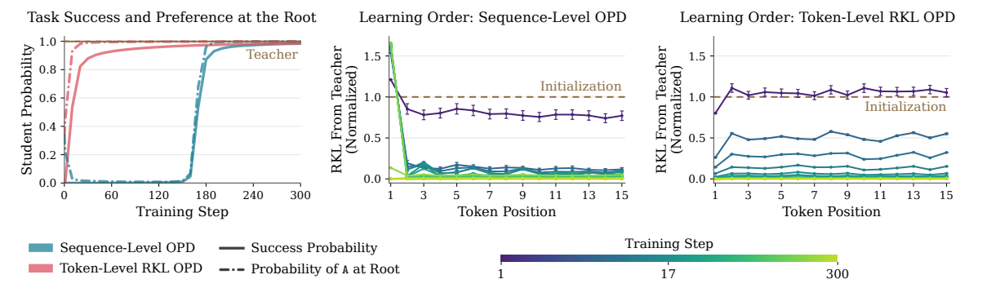

**原文 Figure 2，PDF 第 6 页。** 左图点划线与实线分别区分选对根与走完整条正确路径，两目标直接比较。中、右横轴是 token 位置，颜色是不同训练步，纵轴为相对初始化的局部反向 KL。序列法先在尾部接近教师并把根选错，逐词 RKL 较早在根及整体成功率上上升。该实验是有限深度的机制验证，定理的最坏情况时间量级来自表格假设。

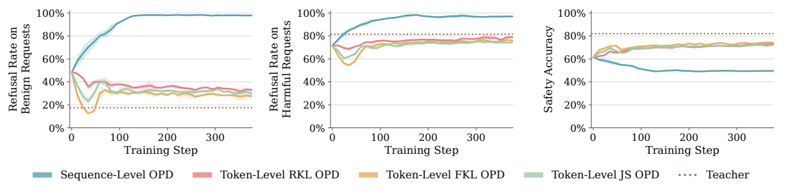

**原文 Figure 3，PDF 第 7 页。** Qwen3-1.7B 学生、Qwen3-8B 教师，三种逐词散度与序列级 OPD 在三种拒答指标上的三种子比较。教师良性拒答 17.5%，序列级训练使学生对良性请求接近全拒，逐词目标降低良性拒答同时提高有害拒答。中图拒答率越高越合适，左图越低越合适，综合准确率看右图。附录报告 Gemma 4B/27B 同方向结果。

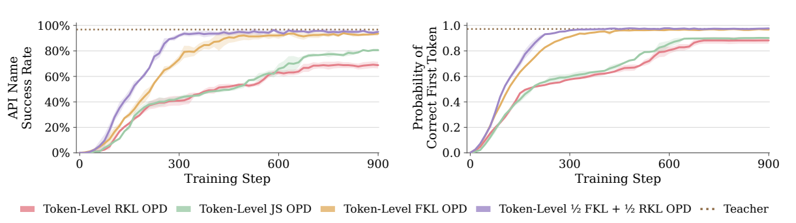

**原文 Figure 4，PDF 第 10 页。** Qwen2.5-1.5B-Base 学生，Qwen3-8B-Base 教师先 SFT。限定初始正确词概率至多 0.001 的 93 个训练提示和 26 个 API。左图看正确名称率，右图看第一个正确 token 的概率，横轴 900 次更新，三种子均值和标准差。FKL 和一半 FKL、一半 RKL 的线性混合涨得快。这里使用全词表且只核对 API 名称，曲线展示低概率词梯度问题，无法推出完整程序正确性或新 API 泛化成绩。

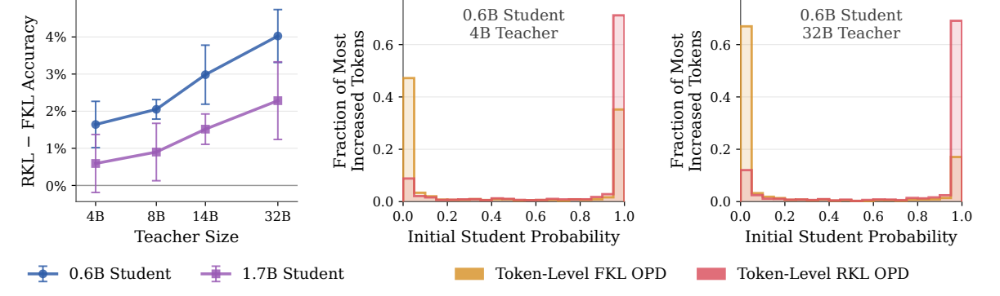

**原文 Figure 5，PDF 第 11 页。** MATH500 上看 Qwen3 0.6B/1.7B 学生配 4B/8B/14B/32B 教师，左图纵轴为 RKL 相对 FKL 的准确率差，右侧两个直方图看最显著增加的 token 原来有多常见。强弱差拉大时，RKL 更可能围绕学生已有的可用路径，实验相对优势增大。API 的稀有知识与数学的能力差距属于不同条件。附录也给出序列级偏差有益的构造，即较易匹配的续写确实正确。

**成本、边界与复现。** Appendix E 中 Qwen 拒答每跑 1 张 H100 80GB，Gemma 为 2 张，API 为每跑 1 张，数学为每跑 4 张，数学诊断取 400 步。总 GPU 小时未披露。作者仓库 e0f3713 有树导航脚本、真实任务数据与配置。图表为特定 logits 和采样条件，Transformer 的参数共享和罕见前缀会打破表格假设。拒答分类使用模型裁判，API 子图直接基于训练提示。推理沿用学生常规解码。

<a name="paper-finsd"></a>
## 5. How Much Does the Hint Matter? Scope Conditions for Hindsight Self-Distillation in Financial Reasoning

原文 v1 · Johnny Yu、Cyril Gorlla · 2026-10-26 18:07:20 UTC。[原文](https://arxiv.org/pdf/2610.36082v1) · [作者训练与数据仓库](https://github.com/johnnyhyu/fin-sd)

### 问题与机制

原文 §3。学生知道一些金融概念却可能一上来用错口径。若把整段参考答案交给教师，它给出的提示也许太多，蒸馏预算会分到早已学过的步骤。Fin-SD 先用真值找到第一处概念错误，让训练从错误发生之前立刻开始。教师是学生冻结副本，附加一条短反馈后对同一续写评分。每轮重新找错并刷新其权重。论文对比反馈细节、反馈作者和蒸馏位置附近的训练长度。

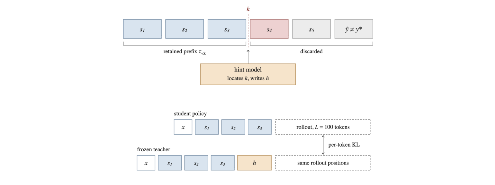

**原文 Figure 1，PDF 第 3 页。** 先看上部红色错误位置及被丢弃的右侧，蓝色前缀来自学生。再看下部两条对齐的短续写，教师专有的黄块是反馈。老师识别错误能看真值，蒸馏打分只额外看反馈。训练和比较条件详见原文 Figure 3 与 Table 2。

### 公式、样例与梯度

```math
\begin{aligned}
(k,h,e)&\sim\pi_H(\cdot\mid x,y_{\mathrm{fail}},y^\star),\\
I_S&=[x;y_{\lt k}],\qquad I_T=[x;y_{\lt k};h],\\
u&\sim\pi_\theta(\cdot\mid I_S),\qquad |u|\le L,\\
p_j&=\pi_\theta(\cdot\mid I_S,u_{\lt j}),\qquad
q_j=\pi_\phi(\cdot\mid I_T,u_{\lt j}),\\
\phi&=\theta_{\mathrm{prev}},\qquad
L_{\mathrm{RKL}}=\mathbb E_{(x,y_{\lt k},h)\sim\mathcal F}
              \left[\sum_{j=1}^{|u|}D_{\mathrm{KL}}(p_j\Vert q_j)\right].
\end{aligned}
```

$`x`$ 为题目，$`y^\star`$ 为数值真值，$`y_{\mathrm{fail}}`$ 为学生原先的失败解，$`\pi_H`$ 是提示撰写者。$`k`$ 是第一处错误的起点，$`h`$ 是批注，$`e`$ 是算术或概念类型，$`\mathcal F`$ 是去掉纯计算失误后的集合。模型用输出的错句引用定位字符边界，再映射到前缀。$`I_S,I_T`$ 是学生、教师两种输入，分号表示拼接；$`u`$ 是学生新生成的最多 100 token 续写，$`j`$ 是续写内的位置。$`p_j,q_j`$ 是全词表分布。$`\theta_{\mathrm{prev}}`$ 是本轮开始前的学生权重。教师 $`\phi`$ 和采样位置固定，只有学生 $`\theta`$ 更新。公式省略了给定失败前缀后对 $`u`$ 采样的外层记号，实现每个样本取一次 rollout。

**本文推导。** 展开 KL 得 $`\sum_v p_j(v)\log p_j(v)-\sum_v p_j(v)\log q_j(v)`$。第一项给学生熵梯度，第二项推学生靠近教师。对 $`z_{j,v}`$ 求导，按上文的 softmax 恒等式得到以下表达式，$`K_j`$ 是该位置的 KL。它只在续写位置计算。更换为前向 KL，则梯度为两种概率的直接差。

```math
\begin{aligned}
K_j&=D_{\mathrm{KL}}(p_j\Vert q_j),\\
\partial_{z_{j,v}}L_{\mathrm{RKL}}
 &=p_j(v)\left(\log\frac{p_j(v)}{q_j(v)}-K_j\right),\\
\partial_{z_{j,v}}L_{\mathrm{FKL}}&=p_j(v)-q_j(v).
\end{aligned}
```

**本文算例。** 学生在一个金额计算题读完共享前缀后，给「只用租金」0.4、「租金加杂项」0.6，看到提示的教师给 0.8/0.2。反向 KL 是 $`0.4\log(0.4/0.8)+0.6\log(0.6/0.2)\approx0.382`$。前一候选 logit 的梯度约 $`0.4(-0.693-0.382)=-0.430`$，一步梯度下降会提高它。题末判分只决定加入失败集，算例中的 $`0.382`$ 来自分布对齐。

### 数据、实现和成本

原文 §4 与 Appendix/Limitations。FinanceReasoning 的种子库有 3,133 个 Python 财务函数，GPT-OSS-120B 按难度筛出候选，DeepSeek-V4-Flash 判断可否生成答案唯一的场景，留下 295 个公式。GPT-5.5 写多步题，Claude Fable 5 批评歧义，人工复核，最终 220 题，训练/验证按 80/20。每轮约 60 道候选失败，排纯算术错误后约 25 道。分类器小样本审计 48/50 正确。评测 FinanceReasoning Hard 238 题，另测 MMLU-Pro 与 FinTrust，后两者各一跑。

训 GPT-OSS-20B 的 all-linear LoRA，attention rank 64、experts rank 8、缩放 128、AdamW 学习率 $`2\times10^{-5}`$，梯度累积等效批次 16，最多 10 epoch，15 步 warm-up。失败挖掘和评测上限 8,192 token，短蒸馏上限 100。论文限制部分称典型调度总共 20 次优化。作者仓库 f6f268f 给出两张 80GB H/A100 的 20B 复现配置，论文未报告卡时和端到端训练费用。120B 对照只负责诊断及写提示，冻结的 20B 提供梯度目标。作者仓库含 §3 的实现和各组配置，代码采用 Apache-2.0，仓库数据说明标注 CC BY 4.0。阅读 paper-to-code 对照可逐项核对。作者原文和开源许可均以其发布页为准。

```text
for epoch:
    freeze student weights as teacher; generate answers on training questions
    keep final-answer failures; ask hint writer to locate earliest faulty clause
    discard pure arithmetic slips from training updates
    cut at the matched clause; student samples up to 100 new tokens
    teacher reads the same prefix plus hint, scoring the same continuation
    accumulate full-vocabulary RKL gradients over rollout positions; update
    validate; save the best epoch
```

推理不提供额外提示、参考答案或教师。纯算术失败在评测仍算错，避免把训练过滤当作评测过滤。

### 核心实验、消融与局限

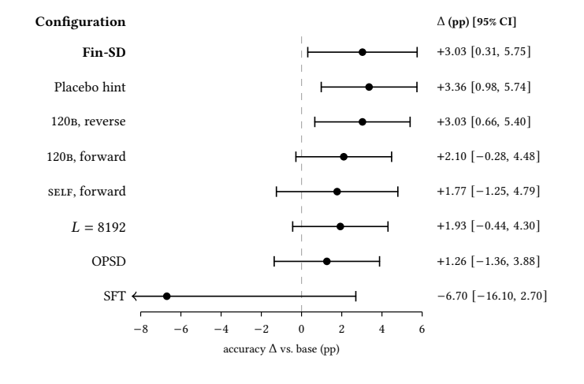

**原文 Figure 3，PDF 第 6 页。** 点是相对 20B 基座的绝对百分点差，须和零线及横向 95% 区间一起读。各组一般 5 种子，SFT 3，基座 5 次独立运行。通用反馈加 3.36 pp，与自写定向反馈加 3.03 pp 接近；120B 写提示配反向 KL 同是 +3.03 pp。前向 KL 与长 rollout 的区间都含零。图是相对基座的区间，提示组之间的重叠不能当作严格等效性证明；左侧 SFT 区间被坐标轴截断。

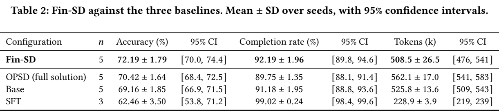

**原文 Table 2，PDF 第 7 页。** 238 题全量评测，把给教师完整参考解的 OPSD、SFT、基座与局部 Fin-SD 排成四行。Fin-SD 准确率、预算内完成率和总输出为 72.19%、92.19%、508.5k；基座 69.16%、91.18%、525.8k；完整 OPSD 70.42%、89.75%、562.1k。$`(562.1-508.5)/562.1\approx9.5\%`$ 是本次评测输出量减少，和训练速率是不同指标。Table 5 的 self-forward 70.93%，L=8,192 为 71.09%，只与五种子范围内的平均差比较。

**局限。** 概念错误位置仍由能看到真值的模型提供，通用提示对照保留了这项信息，因此不能单独证明完全无需定位。17 个种子公式在 22 道评测题的解中出现，属领域内迁移。只有 220 道生成题和一个学生规模，模型若本来不知道正确概念，提示仍可能关键。MMLU-Pro 去业务和经济分类后整体 68.91%→68.34%，化学下降 5.47 pp；FinTrust 的个别指标也有下滑。单次外部评测不足以推定不同司法环境或产品中的合规性。

## 横向对照

- VOPD 和 cOPD 都改变教师信号，前者用可验证终局调节一个教师方向，后者用双教师的概率次序直接给候选正负分。它们分别依赖验证器或有合适能力梯度的教师。
- Muted Distillation 与 Fin-SD 都控制教师所见和 loss 位置。前者遮住思考来集中工具动作监督，后者给教师反馈并从第一个错误前重新续写。
- 理论论文区分「在哪个前缀学」和「用什么局部散度学」。反向 KL 在学生有可用解的数学题可能适合；在必须提升学生极罕见词的任务上，前向 KL 的梯度更直接。结合每篇的候选支持集、评估条件和硬件成本再判断适用性。

## 基础资料与复现入口

- [GKD 原论文，解释为什么沿学生自生成轨迹蒸馏](https://arxiv.org/abs/2306.13649)。
- [Kevin Lu 与 Thinking Machines Lab 的 OPD 技术博客，含反向 KL 与伪代码](https://thinkingmachines.ai/blog/on-policy-distillation/)。
- [Hugging Face TRL 官方蒸馏训练文档](https://huggingface.co/docs/trl/distillation_trainer) 和 [GRPO 文档](https://huggingface.co/docs/trl/grpo_trainer)。
- [PyTorch 交叉熵 API，理解前向 KL 与交叉熵的关系](https://docs.pytorch.org/docs/stable/generated/torch.nn.CrossEntropyLoss.html)。
- [Slime 官方实现，理解生成与训练分离](https://github.com/THUDM/slime)；[Fin-SD 作者复现仓库](https://github.com/johnnyhyu/fin-sd) 和 [理论论文作者实验仓库](https://github.com/princeton-pli/opd-objectives-analysis)。这些资料不计入五篇。
