# OPD / OPSD 论文精读 · 2026-11-26

## 先读这五篇

**1. E2L｜会用的提示，值得写进模型吗？** 有些经验放在题目前立刻有用，拿来教模型却没有同样效果。作者先让模型生成并改写经验，再看每条经验带来的训练方向，是否与「修正学生原来答错的题」同向。搜索还保留在个别题上有独特长处的经验，让它们有机会继续演化。最后选训练方向最合拍的一条，只给教师看，学生从自己的回答中练习，部署时省掉这条经验。[读第 1 篇精读](#paper-e2l)

**2. 推理档位｜如何让一个模型既能快答，也能深想？** 直接给短答案奖励，能让一个模型变短，却容易把几个档一起压短。作者先用擅长不同推理长度的教师分别给低、中、高档逐词指导，再用一个更省阶段的版本，只在高档保留逐词约束，让低、中档独立学习省力。把档位说成自然语言指令，还能让模型更早分出长短，并把一部分控制迁到多轮任务。[读第 2 篇精读](#paper-effort)

**3. CPSD｜让模型知道哪些写法该少用。** 固定压低一段要删除的旧回答，覆盖不到学生更新后实际会说什么。作者让学生现场生成，由冻结副本分别在看过和没看过目标信息时给同一段打分。目标信息特别抬高的候选被压低，普通语言候选更多留在原位。另一批保留数据负责维持一般能力，需要压制逐字复述时再叠加序列级约束。[读第 3 篇精读](#paper-cpsd)

**4. 学生为什么学不会｜高重合也可能是坏消息。** 如果学生几乎从不考虑教师喜欢的词，单看学生抽中的那一个词，训练很难把正确选项救回来。不同位置的梯度还会相互干扰，后续采样可能走到两者都习惯重复的地方。作者测学生覆盖了教师多少高概率选项，在覆盖不足或严重低估时才换一种会主动抬高教师选项的损失。[读第 4 篇精读](#paper-dynamics)

**5. TA-OPSD｜该继续算时别停，该停时别绕圈。** 普通自蒸馏里，结束只是词表里少数几个候选，提前交卷和反复写同一步却都很常见。作者单独教学生区分「现在停」和「继续写」，并从失败答卷里找到重复第三次的片段，只在那个原场景中降低重复的概率。两项训练各管一种错误，合在一起也不强求所有答案都变短。[读第 5 篇精读](#paper-ta)

## 选题范围与基础

本期收录 **5 篇**。窗口为北京时间日报日期 2026-10-26 至 2026-11-26，表内按 arXiv v1 UTC 首次提交日期标注。以 on-policy distillation、on-policy self-distillation、自蒸馏等检索，arXiv API 返回 169 条，再比对题名、ID、DOI、规范 URL 和各方向历史清单。已收录的 Communicative On-Policy Distillation 不重复列入。纯离线蒸馏和以视觉任务为主的候选不占本期名额。全文以各论文 v1 为准。本文数值算例用于解释机制，训练实测见逐篇原图。

| 论文 | 首发 UTC | 实现核查 |
| --- | --- | --- |
| [Evolve to Learn](https://arxiv.org/abs/2611.32390) | 2026-11-24 | 原文有配置，未找到作者方法仓库 |
| [Rethinking Reasoning Effort Training](https://arxiv.org/abs/2611.32131) | 2026-11-24 | 未找到方法仓库，原文有提示和分项结果 |
| [Contrastive On-Policy Self-Distillation for LLM Unlearning](https://arxiv.org/abs/2611.31932) | 2026-11-24 | 可核对 OpenUnlearning 框架，未找到作者方法仓库 |
| [When Students Fail to Learn from Teachers](https://arxiv.org/abs/2611.27125) | 2026-11-20 | 原文注明 veRL，未找到作者路由实现 |
| [Learning When to Continue and When to Stop](https://arxiv.org/abs/2611.19925) | 2026-11-15 | 核查到作者训练、诊断和配置 |

**共同记号。** 前缀是题目和学生到目前为止写出的内容。OPD 在学生自己生成的前缀上学老师的下一词分布。OPSD 用同源模型另开教师分支，可额外看到提示或答案。$`p,q`$ 是词表 $`\mathcal V`$ 上的概率分布，$`v`$ 是候选 token。

```math
D_{\mathrm{KL}}(p\Vert q)=\sum_{v\in\mathcal V}p(v)\log\frac{p(v)}{q(v)} .
```

把学生放在第一个参数是反向 KL，强调学生当前放过质量的词。把教师放在第一位是前向 KL，教师概率大的词会直接影响损失，即使学生几乎从不选它。训练一般固定采样前缀后求局部梯度。对整条轨迹分布完整求导时，还要考虑该位置改变后续前缀概率。

<a name="paper-e2l"></a>
## 1. Evolve to Learn: Gradient-aligned experience evolution for model self-improvement

Haoyuan Li 等 · 2026-11-24。[原文 v1](https://arxiv.org/pdf/2611.32390v1)

### 问题与搜索机制

原文 §2–3。推理时的高分只反映模型能否借助外置经验答好。蒸馏后要靠参数自己答，训练方向可能和原目标相反。E2L 把经验当可改写文本，用反思模型读取父经验的执行轨迹和错误反馈来改写；给候选同时测逐题分数和梯度对齐，任一准入机制允许就可在树里生长。第一路保留非支配且在至少一道验证题达到最好分数的候选（允许并列），第二路保留高对齐候选。最终按对齐取一个经验蒸馏，而学生生成和正式评测都不读经验。

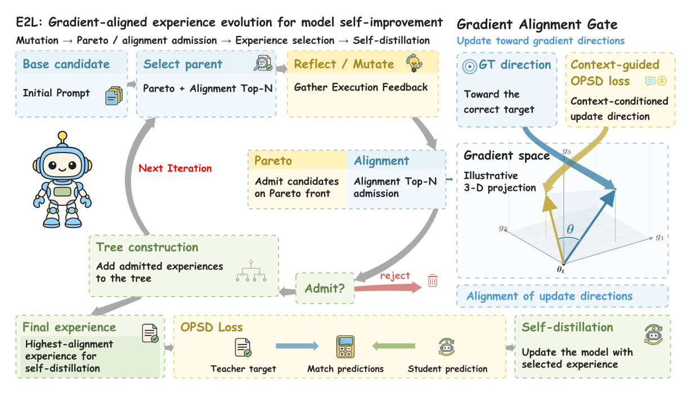

**原文 Figure 2，PDF 第 5 页。** 黄色和蓝色路径对应按表现与按梯度两条准入通道，树图表示可从被保留的早期经验再产生后代。看右侧夹角可理解对齐评分，最后沿底部箭头追踪经验何时只给教师。原图给方法流程。结果基线包括 Pareto 搜索和同池取验证最高分。

### 公式和推导

```math
\begin{aligned}
p_t&=\pi_\theta(\cdot\mid x,y_{\lt t}),&
q^c_t&=\pi_{\bar\theta}(\cdot\mid x,c,y_{\lt t}),\\
L_c&=\mathbb E_{x,y\sim\pi_\theta}
  \left[\frac{1}{|y|}\sum_{t=1}^{|y|}D_{\mathrm{KL}}(p_t\Vert\mathrm{sg}(q_t^c))\right],\\
L_{\mathrm{ref}}&=-\frac1{|\mathcal D_{\mathrm{err}}|}
  \sum_{(x,y^\star)\in\mathcal D_{\mathrm{err}}}\log\pi_\theta(y^\star\mid x).
\end{aligned}
```

$`x`$ 是题目，$`y`$ 是学生回复，$`t`$ 是位置，$`c`$ 是候选经验，$`\theta,\bar\theta`$ 是学生和教师参数，$`\mathrm{sg}`$ 表示教师不回传。$`\mathcal D_{\mathrm{err}}`$ 是初始化没做对的有标注样本，$`y^\star`$ 是正确参考回复。参考负对数似然只用来选经验。蒸馏中训练 loss 来自教师软概率，答案判分和其他任务得分用于找错、比较经验与评估。

```math
\begin{aligned}
g_r&=\nabla_\phi L_{\mathrm{ref}},\quad g_c=\nabla_\phi L_c,\qquad
 A(c)=\frac{g_r^\top g_c}{\|g_r\|_2\|g_c\|_2},\\
 L_{\mathrm{ref}}(\phi-\eta g_c,\psi)-L_{\mathrm{ref}}(\phi,\psi)
 &\approx -\eta\|g_r\|_2\|g_c\|_2 A(c).
\end{aligned}
```

$`\phi`$ 是最后四层参数，$`\psi`$ 是其它层，$`\eta`$ 是教学推导的一步 SGD 学习率。原文 Eq.5–7。沿负梯度展开一阶泰勒得到点积，再把点积写成两范数乘夹角余弦。在相同更新范数下，同向越明显，局部参考 loss 下降越大。跨多步、全层和 AdamW 的最终收益只是经验预测。零范数时余弦没有定义，候选必须有有效对齐分数才参加最终排序。

**本文算例。** 两经验推理时都答对 7/10。若参考梯度为 $`(3,4)`$，经验甲的梯度为 $`(0,2)`$，乙为 $`(0,-2)`$，余弦依次为 0.8 和 −0.8。以 $`\eta=0.1`$ 更新时，参考损失的一阶变化约为 −0.8 和 +0.8。第一路准入还会保留乙可能独有的解题法，最后真正蒸馏则优先甲。

### 数据、实现与预算

原文 §4 与附录 A。学生/教师同源 Qwen3-8B，候选反思用 Qwen3.7-Max、DeepSeek-V4-Pro 或 GLM-5.2。AIME 2022–24 分 45 题训练、45 题验证，AIME25/26 各题抽 12 次取平均；另外测 LiveBench Math、HotPotQA、JailbreakBench。安全集合报告综合正确/错误拒答的指标。搜索固定基准 checkpoint 并缓存参考梯度和学生采样。主实验一般 50 步、全局批 32；JailbreakBench 为 20 步、批 64。相关性和固定池对照是每候选 20 步。训练响应 1,024 token，AdamW 学习率 $`10^{-6}`$。实际 KL 取教师/学生各自 top-256 的并集，使用原概率，不把截掉的词重新归一。教师和学生在每次更新内使用同一 checkpoint，教师 logits 停梯度。硬件 GPU 小时和三款反思模型调用总费用未披露。

```text
cache student rollouts and the reference gradient from initial failures
while feedback budget remains:
    pick a parent by Pareto frequency or top-alignment sampling
    rewrite its experience from rollout feedback
    measure validation scores and gradient cosine
    keep a candidate admitted by either route
take the accepted candidate with the highest valid cosine
train on native student rollouts with only the teacher seeing the experience
infer without the experience or reflection model
```

### 结果、消融、复现

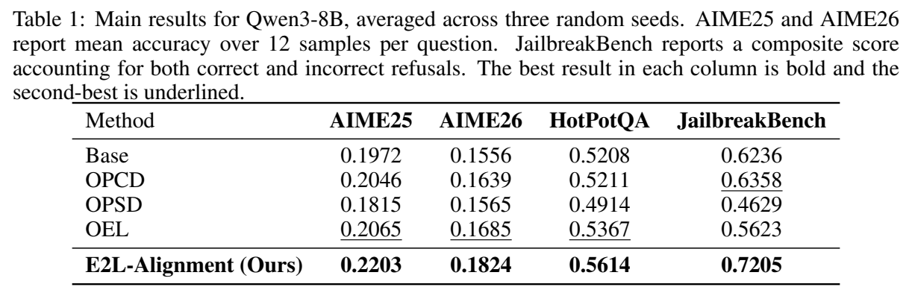

**原文 Table 1，PDF 第 7 页。** Qwen3-8B 三种子均值。AIME25/26 逐次作答的均值，HotPotQA 与综合安全分按列各读各的。E2L 对 Base 分别为 0.2203 对 0.1972、0.1824 对 0.1556、0.5614 对 0.5208、0.7205 对 0.6236。基线 OPCD、参考答案 OPSD 和 OEL 均有列出。参考答案 OPSD 在部分列低于 Base，不能用其下降来代替与未训练模型的比较。

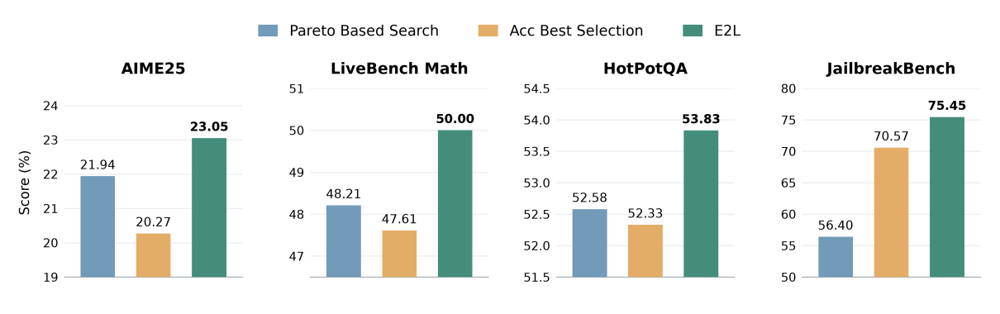

**原文 Figure 4，PDF 第 8 页。** 四簇柱看同一评测集中的 Pareto 搜索、同池按验证准确率取最优、同池按对齐取最优。后两组直接分离选拔标准，E2L 对应高 2.78、2.39、1.50、4.88 个百分点。Figure 3 的 33 个候选是在数学任务上的探索性相关分析。Table 2 中固定池 Accuracy-Top3 在 AIME25 仍优于 Alignment-Top3。Table 3 在 2,000 搜索预算下，两路合用的树深 6、候选 27、蒸馏后 AIME25 0.2305，对齐单通道为 2、6、0.1944。

**边界。** 有标注参考和昂贵反思模型仍参与搜索。末四层的余弦不足以保证全模型方向或跨次更新都一致，主要学生只有一个规模。原文提供附录实现设置和 veRL/GEPA 入口，未核实作者专用代码；数据切分、固定缓存和搜索预算应随复现实验公布。

<a name="paper-effort"></a>
## 2. Rethinking Reasoning Effort Training in Large Language Models: On-Policy Distillation or Reinforcement Learning?

Tianliang Lv 等 · 2026-11-24。[原文 v1](https://arxiv.org/pdf/2611.32131v1)

### 单模型压缩、档位分离与新任务

原文 §3–5。压缩是同一模型平均少用 token；分档是在同一模型里按请求选择不同计算量。先在单轮数据对一条策略用终局奖励和逐级减小的生成预算。再把三种长度的教师按请求档位分给学生打逐词分。最后的单阶段配方只在高档给冻结初始化的逐词约束，低中档用带长度压力的 RL。加入自然语言档位说明，让熟悉指令的模型更早知道三档的语义。

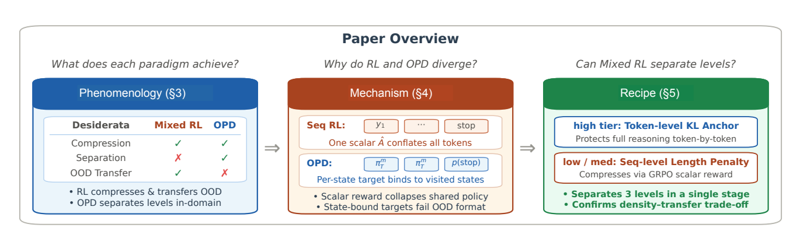

**原文 Figure 1，PDF 第 4 页。** 左到右分别读现象、机制、训练配方。最右蓝色高档受逐词保护，低、中档可通过长度奖励适应。下文 Figure 3 比较 Mixed RL 和多教师 OPD，Figure 9 比较单阶段方案。

### 稀疏奖励和逐词约束

```math
\begin{aligned}
r_m(x,y)&=v(x,y)-\lambda_m g(L_{\mathrm{th}}(y),B_m),\\
g(L,B)&=\min(1,\max(0,(L-B)/L_{\mathrm{buf}})),\\
\hat A_j&=\frac{r_j-\bar r}{\sigma_r+\epsilon}.
\end{aligned}
```

$`m`$ 是档位，$`x,y`$ 是题目和生成，$`v\in\{0,1\}`$ 是最终答案验证，$`L_{\mathrm{th}}`$ 统计思考结束前的长度。$`B_m`$ 是目标预算，$`L_{\mathrm{buf}}`$ 是罚分缓冲，$`\lambda_m`$ 是压力，$`r_j,\bar r,\sigma_r`$ 是同题第 $`j`$ 条轨迹的得分、组均值和标准差，$`\epsilon`$ 避免除零。对同组正确性相同的情况，中心化后分子变 $`-\lambda_m(g_j-\bar g)`$，分母为 $`\lambda_m\sigma_g+\epsilon`$。若所有轨迹都超出到惩罚饱和，组内全相同，长度优势为零。简单增大系数无法恢复这个信号。训练用 GSPO 执行序列级策略更新。

```math
\begin{aligned}
D_{\mathrm{KL}}(p\Vert q)
 &=d_{\mathrm B}(p(e)\Vert q(e))\\
 &\quad +(1-p(e))D_{\mathrm{KL}}(p_{\ne e}\Vert q_{\ne e}),\\
L_{\mathrm{DA}}
 &=-\sum_{m\in\{\mathrm{low},\mathrm{medium}\}}J^m_{\mathrm{RL}}
   +\beta\,\mathbb E_{x,y\sim\pi_\theta^{\mathrm{high}}}
                   \sum_i \widehat k(p_i,q_i).
\end{aligned}
```

$`e`$ 是思考结束标记，$`p,q`$ 是固定前缀的学生/教师分布，$`p_{\ne e},q_{\ne e}`$ 是在其余词上重新归一的条件分布，$`d_{\mathrm B}`$ 是停止与继续的二值 KL。本文展开将词表求和分成 $`e`$ 和其余项，再将其余项的共同质量提出，剩下非负 KL。这正是原文 Proposition 4.2 的上界关系。$`J^m_{\mathrm{RL}}`$ 为低、中档的长度惩罚目标，$`\beta=0.5`$ 为高档锚点权重。$`p_i,q_i`$ 在第二式表示当前位置学生与冻结初始化，$`\widehat k`$ 是其逐词 KL 估计。多教师版本则由档位选择已训练教师。实作抽词时常用 $`\ell_i=\log p_i(y_i)-\log q_i(y_i)`$，对学生当前词求期望是局部 KL，$`-\ell_i`$ 可作局部优势；求整条轨迹的完整梯度还有后续项。

**本文算例。** 教师当前思考结束概率 0.2，学生为 0.5。两者即使对继续后的候选比例完全一致，KL 仍至少为 $`0.5\log(0.5/0.2)+0.5\log(0.5/0.8)\approx0.223`$。与之对比，同组两条答对轨迹均超预算到罚分饱和，优势都为 0。一个信号能直接告诉学生在此处少停，另一个要靠组内出现可区分结果。

### 训练流程与实测

原文先用 Qwen3-8B、GLM-4.5-Air 训练单轮数学、科学与指令数据。分阶收紧采样 cap 分别为 32k→4k、16k→6k，缓冲 4k，统一用 32k cap 验证。多教师 OPD 主比较用 GLM-4.5-Air（总约 106B、激活约 12B，见官方模型卡）。提示版另外用 DeepSeek-V4-Flash（284B/13B，见官方模型卡），分别 25、20 步，批 256，学习率 $`10^{-6}`$，只见科学、人文、逻辑的单轮提示。论文未给完整提示语料、卡数和端到端 GPU 小时。多教师方案的师资训练和额外前向明显改变成本口径，不能以末段步数直接比较总预算。[GLM 模型卡](https://huggingface.co/zai-org/GLM-4.5-Air) · [DeepSeek 模型卡](https://huggingface.co/deepseek-ai/DeepSeek-V4-Flash)

```text
for each prompt, choose a requested effort tier and sample the student
if comparing multi-teacher OPD:
    score the prefix with the teacher for that tier; apply token distillation
else if tier is high:
    compare student and frozen reference on each high-tier token
else:
    score correctness and buffered length; update via GSPO
for prompt-guided training, include a description of the chosen effort tier
at inference, supply the effort request and use only the learned student
```

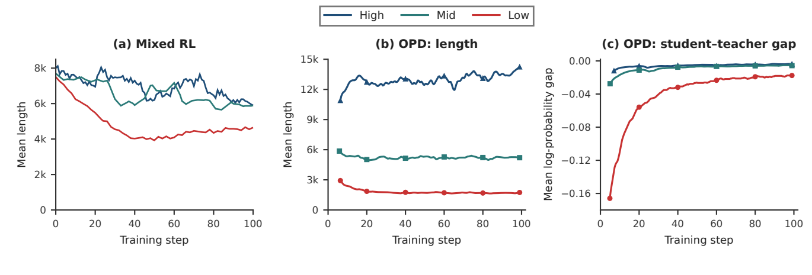

**原文 Figure 3，PDF 第 7 页。** 左图展示 Mixed RL 长度曲线。图注称其为不缩放设置，但曲线在千级。正文另外报告不缩放三档最终约 330 token，及重标高档优势后高档约 4–6k、低档截断超过 65%。以正文报告这两种配置，图中曲线与正文的对应关系待作者澄清。中、右图是多教师 OPD 的长度与学生教师差，横轴更新步。看长度分开和低于 1% 截断是否同时出现，避免把硬限长误认为会停。

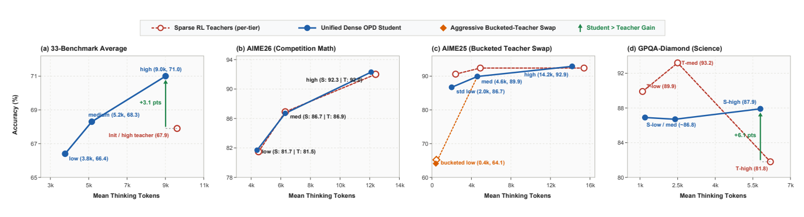

**原文 Figure 4，PDF 第 8 页。** 横轴平均思考 token，纵轴准确率。33 基准聚合中 GLM 学生低/中/高档为 3.8k/5.2k/9.0k 与 66.4/68.3/71.0，高档参考 67.9。AIME26 看同档师生差，AIME25 更换极短教师后低档可降到 0.4k、64.1；标准低档约 2.0k、86.7。GPQA 的高档超过自己的教师，低、中档则低于各自教师。

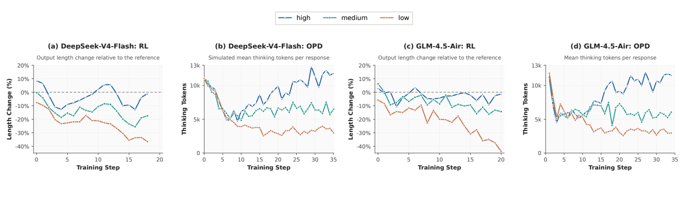

**原文 Figure 9，PDF 第 17 页。** 按子图标题，(a) 与 (c) 是带档位说明的锚定 RL，(b) 与 (d) 是对应模型的 OPD 参照，和图注的顺序表述不完全一致。自然语言加锚点在头 20–25 步已分档。只给单轮 OPD 时，工具任务低档思考仍约为高档 88%，代码约 95%，而原文 Table 2 的独立多轮说明：高到低轮数 91.6→78.2、每轮思考 60.9→59.1。它们是不同实验。原文 §4.3 加入多轮 OPD 轨迹恢复分档，提示版在部分未见多轮任务也转移。

**边界。** 单轮的结束标记是停止思考；多轮要学什么时候再调工具。逐词约束只覆盖学生来过的状态。短档本来就可能牺牲难题准确率，统一使用一个指标会漏掉质量与长度的交换。原文给提示文本、曲线、评测设置；未找到专用作者代码或独立配套博客。


<a name="paper-cpsd"></a>
## 3. Contrastive On-Policy Self-Distillation for LLM Unlearning

Fangzhou Lin 等 · 2026-11-24。[原文 v1](https://arxiv.org/pdf/2611.31932v1)

### 问题与训练结构

原文 §3。给定要遗忘和要保留的两份数据，固定答案上的负监督无法覆盖学生改变后实际访问的状态。CPSD 让当前学生先针对遗忘提示采样，再让冻结原模型读同一段学生输出两遍，一遍只读问题，另一遍额外看目标内容。第二遍使某些词的分数抬升，训练将该变化反向，同时保护一般能力。遗忘数据用来构造教师视图，保留数据走标准语言模型监督。

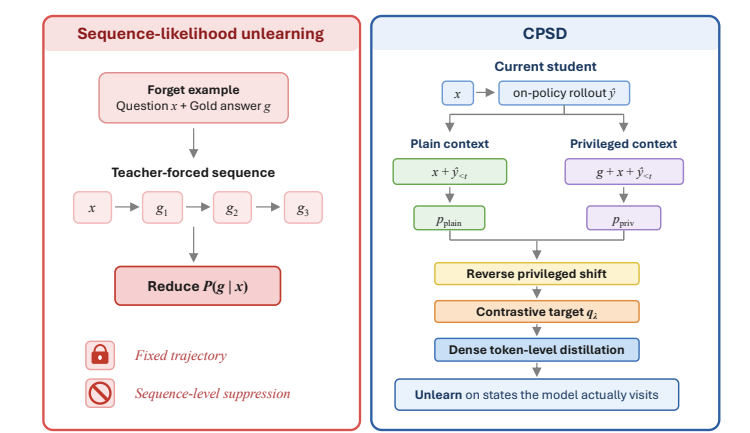

**原文 Figure 1，PDF 第 1 页。** 左侧固定序列法调低原答案，右侧 CPSD 沿学生现场生成的路径比较两个参考视图。看箭头时分清谁负责采样、哪一侧能读目标内容、损失落在哪条路径。图示用于和序列 NPO-类方法比较。

### 反向构造教师与训练损失

```math
\begin{aligned}
\hat y&\sim\pi_{\mathrm{sg}(\theta)}(\cdot\mid x),\\
p_t^0(v)&=\pi_{\phi,T}(v\mid x,\hat y_{\lt t}),\quad
p_t^+(v)=\pi_{\phi,T}(v\mid c(g),x,\hat y_{\lt t}),\\
\rho_t(v)&=\log p_t^+(v)-\log p_t^0(v),\\
q_{\lambda,t}(v)&=\frac{p_t^0(v)e^{-\lambda\rho_t(v)}}{Z_t},\qquad
Z_t=\sum_u p_t^0(u)e^{-\lambda\rho_t(u)} .
\end{aligned}
```

$`x`$ 是诱发提示，$`g`$ 是该题遗忘内容，$`c(g)`$ 是加上它的模板；$`\theta`$ 表示更新学生、$`\phi`$ 是冻结初始副本。$`T`$ 是参考温度，$`\hat y`$ 是学生回复，$`t`$ 是位置，$`v,u`$ 是词表候选。$`p^0,p^+`$ 分别是普通/特权预测，$`\rho`$ 是附加信息造成的对数概率变化，$`\lambda`$ 为反转强度，$`Z_t`$ 保证总质量为 1。式中正的 $`\rho`$ 相对降权，负的相对升权。

```math
D_{\mathrm{KL}}(s_t\Vert q_{\lambda,t})
=D_{\mathrm{KL}}(s_t\Vert p_t^0)
+\lambda\sum_v s_t(v)\rho_t(v)+\log Z_t .
```

$`s_t`$ 是当前学生在采样前缀处的概率。展开 $`\log q`$ 可得此式。把 $`s_t`$ 换成任意候选分布 $`q`$，双重目标「距离原模型近、特权支持少」等价于 $`D_{\mathrm{KL}}(q\Vert q_{\lambda,t})`$ 减常量，因此正概率条件下唯一最优解就是反向倾斜的目标。本文补充，固定前缀时 $`\partial_\lambda\log Z_t=-\mathbb E_q[\rho_t]`$，再求导得 $`\partial_\lambda\mathbb E_q[\rho_t]=-\mathrm{Var}_q(\rho_t)`$，目标平均特权影响随强度下降。这项性质只针对局部目标。

```math
\begin{aligned}
L&=\gamma(L_{\mathrm{CPSD}}+\eta L_{\mathrm{NPO}})+\alpha L_{\mathrm{ret}},\\
L_{\mathrm{NPO}}&=-\frac{2}{\beta_N}
  \mathbb E_{(x,g)\sim\mathcal D_f}
    \log \sigma\big(\beta_N(\ell_\theta-\ell_\phi)\big).
\end{aligned}
```

$`L_{\mathrm{CPSD}}`$ 是有效回复位置的 KL 均值，$`L_{\mathrm{ret}}`$ 是保留集正确回复的 token 负对数似然，$`\gamma,\alpha`$ 是两路权重，$`\eta`$ 为额外隐私版本的序列权重，基础版取 0。$`\mathcal D_f`$ 是遗忘集，$`\ell_\theta,\ell_\phi`$ 是数据原答案的平均负对数似然，$`\sigma`$ 是 sigmoid，$`\beta_N>0`$ 控制饱和。对 $`\ell_\theta-\ell_\phi`$ 求导得到负值，在梯度下降中推动学生降低原答案概率。正文写逐条均值，附录 C.6 的实现为全批有效 token 均值，对长短样本权重略有不同。没有单独 RL 奖励。

**本文算例。** 对 A/B，普通教师 0.4/0.6，特权教师 0.8/0.2。$`\lambda=1`$ 时新权重分别为 $`0.4^2/0.8=0.20`$ 和 $`0.6^2/0.2=1.80`$，归一化为 0.10/0.90。当前学生可更新为在这个前缀少选 A，即便本次真实输出恰好选 B。

### 数据、实现和结果

TOFU 的虚构作者问答是 Q/A 结构，分别请求忘掉 5% 或 10%，用开放平台的全量训练 checkpoint Llama-3.2-1B/3B 与 3.1-8B。MUSE-News 切原始段落，前段为问题、后段为特权内容，使用 Llama-2-7B。默认 $`\lambda=8,T=1,\gamma=\alpha=1`$，最多生成 128 token、温度 1、top-p 0.95、top-k 50，学习率选 $`5\times10^{-5}`$ 或 $`10^{-4}`$。CPSD-H 的 NPO 权重在 TOFU 隐私实验 0.3、MUSE 0.1。两次参考前向、学生 rollout 和全词表损失带来额外开销，原文未披露训练耗时、卡数和实测显存。代码查到 [OpenUnlearning](https://github.com/locuslab/open-unlearning) 框架，未核实专用作者实现。

```text
sample a forget batch and a retain batch
generate responses from the current model from forget prompts
teacher-score matched positions with plain and privileged prompts
compute target via log_softmax((1 + strength) * plain - strength * privileged)
use masked reverse KL plus retain language-model loss
optionally add NPO on fixed forget completions; update only student
```

复现时左填充，位置 ID 依据 mask，教师额外插入 $`B`$ token 的前置块后切 logits 索引相应平移 $`B`$，严格保证对应同一生成位置。推理使用普通提示与学生。

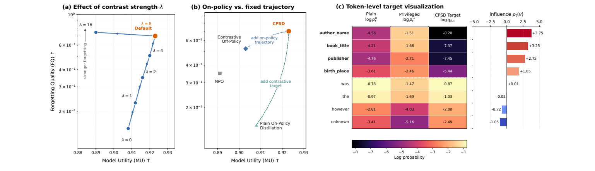

**原文 Figure 2，PDF 第 6 页。** 左图同配置扫对比强度，横轴保留能力 MU，纵轴 FQ；中图比较 NPO、固定数据轨迹上的对比目标、普通在线教师与完整方法；右图并排看候选词在普通、特权和反转目标上的分数。TOFU forget10 的 3B，CPSD 对 NPO 的 FQ 为 0.155 对 $`1.65\times10^{-8}`$，MU 0.615 对 0.552。FQ 是分布统计检验量，不能当含义线性的删除比例。基线还有 GA、GradDiff、SimNPO、UNDIAL、RMU。

**原文内部有一处需复核。** 8B forget05 的 CPSD MU 正文写 0.515，Table 1 为 0.564，NPO 对照为 0.547。由该版本不能确定这一组的 MU 变化方向。8B forget10 隐私版 CPSD-H 的 FQ 和 PrivLeak 改善，但 MU 从 NPO 的 0.648 降到 0.480。MUSE-News 上 CPSD-H 对 NPO 的逐字复述指标 0.242 对 0.256、知识 0.291 对 0.361；Table 3 可见四列，正文还说「五个指标」及保留能力，但表中没同列给出第五列数值。MUSE 的 PrivLeak 越靠零越好，TOFU 的论文口径不直接套用。

**局限。** 反向移动代表对上下文差异的建模，无法分辨偏好变化究竟来自指定知识还是文本风格。评测支持行为改变，未证明信息从参数中彻底删除。结论依赖遗忘和保留切分、挑选的学习率及短 rollout 上下文。

<a name="paper-dynamics"></a>
## 4. When Students Fail to Learn from Teachers: Learning Dynamics of On-Policy Distillation

Xinnan Zhang 等 · 2026-11-20。[原文 v1](https://arxiv.org/pdf/2611.27125v1) · [veRL](https://github.com/volcengine/verl)

### 三种失效与诊断图

原文 §3–5。少见的教师词难被抽中，抽中后概率也难大改。共享参数将其它位置梯度加进来，可能把方向翻转。最后学生在重复片段里仍和教师局部重合，因为老师接着这个前缀也容易重复。作者把这种情况称为虚假一致。提出只在学生低覆盖或显著低估教师支持时切换前向 KL。

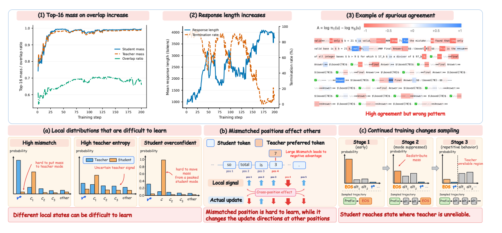

**原文 Figure 1，PDF 第 2 页。** 上排三图展示高重合、过长和重复，下排三图展示局部状态、跨位置相互作用与下一轮采样。深色块对应教师偏好或停止 token 的错配。最右是出现循环时局部高重合的示意。后文同一教师、不同学生的对照，以及 EOS 人工对齐和 mask 对照，用于区分三层机制。

### 局部梯度与跨位置推导

```math
\begin{aligned}
A_u&=\log q(u)-\log p(u),&
\Delta z&=\eta A_u(e_u-p),\\
B(c,u)&=(e_c-p)^\top(e_u-p),&
\Delta p(c)&=\eta p(c)A_u B(c,u)+O(\eta^2).
\end{aligned}
```

固定前缀，$`p,q`$ 为学生/教师，$`z`$ 为 softmax logits，$`u`$ 是抽中的词，$`c`$ 是任一候选，$`e_u,e_c`$ 为 one-hot，$`\eta`$ 是单步学习率。$`A_u`$ 是教师 logprob 与学生 logprob 的差；停止梯度后用它乘负学生 logprob。由 $`\nabla_z\log p(c)=e_c-p`$ 展开一次，得到 $`\Delta\log p(c)\approx\eta A_uB(c,u)`$，再对指数作一阶展开得概率式。抽中词的 $`B(u,u)=(1-p(u))^2+\sum_{b\ne u}p(b)^2`$ 非负，且随饱和下降；未抽中词的 $`B(c,u)=\|p\|_2^2-p(u)-p(c)`$ 可正可负。采样固定前缀，忽略后续逐词奖励对当前选择的贡献。

```math
h_i=\nabla_\theta\log p(u_i\mid s_i),\qquad
\Delta\log p(u_i\mid s_i)
 \approx\eta A_i\|h_i\|_2^2
 +\sum_{j\ne i}\eta A_j h_i^\top h_j .
```

$`s_i,u_i`$ 是第 $`i`$ 个前缀及动作，$`h_i`$ 是共享模型中的分数梯度，$`A_i`$ 是对应局部优势。将 SGD 的 $`\Delta\theta=\eta\sum_j A_jh_j`$ 代入一阶展开得到展开式。自身项跟随优势，其它项可以增强、抵消或倒转。原文 Figure 5 的单位置符号接近全同，真实批含多位置时约一半，因此不能把单词方向机械映射到真实批。

**本文算例。** 学生三词为 0.6/0.3/0.1，教师为 0.65/0.05/0.30，抽到第三词。其优势为 $`\log 3`$。未抽中两词的 $`B`$ 值分别为 −0.24/0.06，因此第一词虽也受教师偏好却下降，第二词虽需压低却上升。这是固定前缀单步概率的变化；全词表平均、跨位置和后续采样会再改变效果。

### 用覆盖率切换 loss

```math
\begin{aligned}
M(s)&=\sum_{v\in S_p(s)}p(v\mid s),\\
V(s)&=\sum_{v\in S_p(s)}\widehat q(v\mid s)
      \mathbf1[q(v\mid s)/p(v\mid s)>\epsilon_1],\\
r(s)&=\mathbf1[V(s)>\epsilon_2\ \mathrm{or}\ M(s)\lt\epsilon_3],\\
L(s)&=(1-r(s))L_{\mathrm{sample}}(s)
    +r(s)\sum_{v\in S_K(s)}q(v\mid s)\log\frac{q(v\mid s)}{p(v\mid s)} .
\end{aligned}
```

$`S_p`$ 是累计教师质量到阈值的最小集合，$`S_K`$ 是教师最大 $`K`$ 个候选。$`\widehat q`$ 是教师在 $`S_p`$ 内归一化后用于投票的概率。$`M`$ 量学生给了多少质量，$`V`$ 量集合内师生比超过 $`\epsilon_1`$ 的教师质量，$`r`$ 决定走哪一路。默认教师累积阈值 0.9、$`K=16`$、$`(\epsilon_1,\epsilon_2,\epsilon_3)=(6,0.3,0.2)`$。投票需要归一化，FKL 项保留原始概率。对 FKL 项的负梯度为 $`q(b)\mathbf1[b\in S_K]-p(b)\sum_{v\in S_K}q(v)`$，$`b`$ 为任意 logit 的词。这直接从交叉熵和 softmax 导数得到。老师看好的词即使学生不抽中，也能被显式提高。

```text
roll out from the current student; score same prefixes with the teacher
for each valid position:
    measure student mass on teacher nucleus and underestimation vote
    if low coverage or strong underestimation: use unnormalized teacher top-16 FKL
    else: use the sampled-token log-ratio advantage
aggregate valid tokens, update once, then generate again
```

方法不加入任务级 reward，数学/程序判分用于评估。实作须让两侧 EOS 和 chat 模板语义一致。部署只有学生，没有路由教师。

### 数据、实验与适用边界

DAPO 训数学，CodeR1-12k 训代码，后者测 HumanEval+、MBPP+、LiveCodeBench v6。学生 Qwen3 1.7/4/8B，Qwen3-8B 教师。Base 初始化配非思考教师，200 步；共享 SFT 初始化配思考教师，100 步。SFT 来自 OpenThoughts3 的 50k 题，每题 8 答，共 400k。两列差异包括教师模式，不能把跨列全部差额归给 SFT。每步批 128、每题抽一条，学习率 $`10^{-6}`$。Base/SFT 最大训练回答 4,096/16,384。原文附录 G 的短时开销测量为 4 张 H100、10 步均值，三种学生规模下路由额外峰值约 2.5–5.5 GB，相对单词估计不能忽略，原文未给整次 GPU 小时。

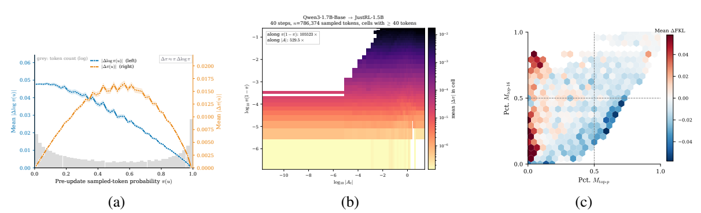

**原文 Figure 2，PDF 第 5 页。** 左图用双轴分开对数概率变化与原概率变化，中图联合分箱看 $`|A|`$ 和 $`p(1-p)`$，右图在固定教师前缀上比较覆盖与前向 KL 变化，蓝降红升。比较从 Qwen3-1.7B-Base 蒸馏 JustRL-1.5B 的诊断，不能把 logprob 变动大的桶当作概率变动最大。

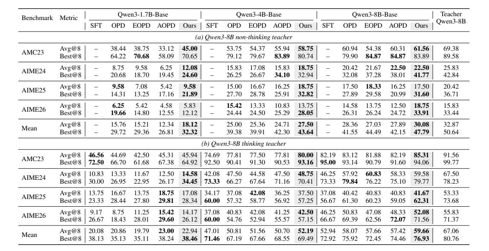

**原文 Table 1，PDF 第 9 页。** 上下两块区分起点与教师模式。和普通 OPD、熵路由 EOPD、优势路由 AOPD 同列比较。Base 4B 的均值 Avg@8 从 25.00 到 27.50，Best@8 从 39.38 到 43.64。Avg@8 是八次平均，Best@8 是有放回重抽的估计。附录 Table 10 在 1.7B 中覆盖规则单独 Avg@8 17.06，两路合用 18.12，应用 FKL 的位置比例 0.4%→6.7%。

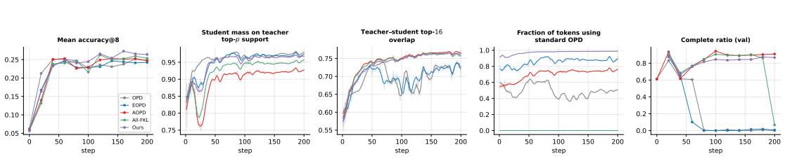

**原文 Figure 7，PDF 第 10 页。** Qwen3-4B-Base、非思考 Qwen3-8B，五个面板依次为均值精度、教师 nucleus 覆盖、top-16 重合、常规 OPD 比例、正常完成率。比较 All-FKL 和选择性 FKL 时，同时读覆盖与完成率，不能用重合代替答题正确率。单位置理论针对小 SGD，EOS 案例有特殊格式冲突。代码入口核对到通用 veRL；原文有公式和超参，未找到该路由的公开作者实现。

<a name="paper-ta"></a>
## 5. Learning When to Continue and When to Stop: Termination-Aware OPSD

Chaoqun He 等 · 2026-11-15。[原文 v1](https://arxiv.org/pdf/2611.19925v1) · [作者代码](https://github.com/gtbxdf4/TA-OPSD)

### 两类停止错误

原文 §3–4。先诊断 500 道留出题，Qwen3-1.7B 的 236 道失败中，210 道被教师独立答对，其中 93 条错误学生轨迹短于教师。移除 EOS 并让教师从这 93 条前缀续写，51 条继续推理，34 条最后做对。另一头是在失败路径中反复写同一段直到耗尽预算。TA-OPSD 提供两路信号，第一路把「停或继续」单独拉到桌面上，第二路针对原失败前缀中的重复续写。

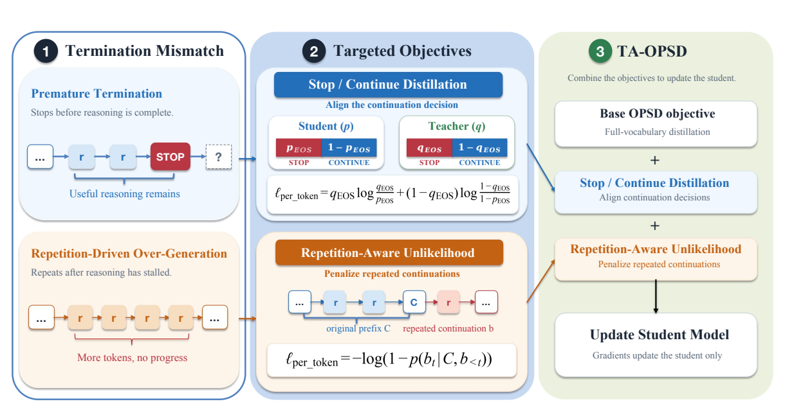

**原文 Figure 1，PDF 第 2 页。** 左侧对应提前终止与重复过长，右侧把基础 OPSD、停止分布监督和重复负例 loss 共同纳入更新。蓝色分支比较师生停止概率，橙色分支只处理重放负片段。量化比较参照 Table 1 及 Figure 3、4。

### 基础蒸馏、停止概率与负例 loss

$`x`$ 为题，$`y^\star`$ 为参考解，$`\hat y`$ 为学生回复。学生只看 $`(x,\hat y_{\lt t})`$，冻结初始同源教师多看 $`y^\star`$。$`L_0`$ 是实现的全词表 pointwise-clipped 蒸馏损失。原文 Eq.1 与附录 A 用通用散度 $`D(p_T\Vert p_S)`$ 表示逐词差异；本文保留其抽象记法，SC 明确是教师到学生二值 KL。

```math
\begin{aligned}
p_t&=\sum_{v\in\mathcal E}p_S(v),\quad
q_t=\sum_{v\in\mathcal E}p_T(v),\\
d_{\mathrm B}(q_t\Vert p_t)
 &=q_t\log(q_t/p_t)+(1-q_t)\log((1-q_t)/(1-p_t)),\\
L_{\mathrm{SC}}&=\frac1B\sum_{i=1}^B\frac1{n_i}
                      \sum_{t=1}^{n_i} d_{\mathrm B}(q_{i,t}\Vert p_{i,t}).
\end{aligned}
```

$`\mathcal E`$ 有 Qwen 的两个结束 token，$`p_t,q_t`$ 为各自总停止概率。$`B`$ 是批次回复数，$`n_i`$ 是第 $`i`$ 条有效位置数。先逐回复平均，再批平均，把短回复和长回复作为同样权重。用学生二分类 log-odds $`z=\log(p_t/(1-p_t))`$ 作为教学变量，可由链式求导得 $`\partial_zd_{\mathrm B}=p_t-q_t`$，因此老师该继续时会压低学生停止概率，反过来亦然。整个词表其它词的内部比例不进入这一路。

```math
\begin{aligned}
L_{\mathrm{UL}} &=-\frac1{|\mathcal B_-|}\sum_{(C,b)\in\mathcal B_-}
  \frac1{|b|}\sum_j\log(1-p_S(b_j\mid C,b_{\lt j})),\\
L&=L_0+\lambda_{\mathrm{SC}}L_{\mathrm{SC}}
       +\lambda_{\mathrm{UL}}L_{\mathrm{UL}}.
\end{aligned}
```

$`\mathcal B_-`$ 是负例批次，$`C`$ 是原错答的题目和重复前缀，$`b`$ 是第三次出现的小片段，$`b_j`$ 是接下来的标记词。$`-\log(1-p)`$ 对 $`p`$ 的导数为 $`1/(1-p)>0`$，梯度下降压低重复，且越确信重复越该纠正。$`\lambda_{\mathrm{SC}}`$ 用共享初始化下基础与 SC 的 logits 梯度范数比校准，$`\lambda_{\mathrm{UL}}`$ 用基础加 SC 的 LoRA 参数梯度范数除以负例梯度范数，UL-only 改用自身基准 $`L_0`$。之后两系数固定。

**本文算例。** 学生停的概率 0.4、教师 0.1，则 SC 对二分类 logit 的梯度为 +0.3，更新后更愿继续。另一个已重复的前缀下，若重复词概率 0.7，UL 的单词损失 $`-\log(0.3)\approx1.204`$；把概率降到 0.2 后为约 0.223。两项针对不同位置，不能把总方法简化成全局短答惩罚。

### 数据、实现和成本

OpenThoughts 训 Qwen3-1.7B/4B/8B，三组都关闭思考模式，500 个诊断问题留出。负例从相同数据来源、未进正式训练批的问题生成；用初始模型采样，在同一模式第三次出现处截取最多 256 token，排除 EOS，每条最多一个负片段。在每步 32 条新 rollout 之外重放 16 条负例，长 $`C`$ 缓存且不回传。8 张 A800；LoRA rank 64、缩放 128，AdamW 学习率 $`5\times10^{-6}`$，线性衰减 100 步，生成上限 1,024，温度 1.1、top-p 0.95、top-k 20。已核实作者仓库提交 aa75c4c 的运行脚本、校准、诊断与配置。1.7B 有效回传 token 比 OPSD 多 6.66%，平均每个负片段 33.46 token；原文没有实测卡时，缓存前向依然花时。训练不另加任务奖励，给答案打分用于评估和 GRPO 基线；部署无需额外检测器。

```text
freeze initial teacher; mine local repeat negatives on held-out source prompts
calibrate two weights once at the shared initialization
for each update:
    generate 32 student rollouts
    teacher scores the same prefixes with reference solutions
    compute clipped base distillation and binary stop loss
    replay 16 failing prefixes; apply unlikelihood only on negative suffix
    update adapter with the combined loss
```

### 结果、消融与边界

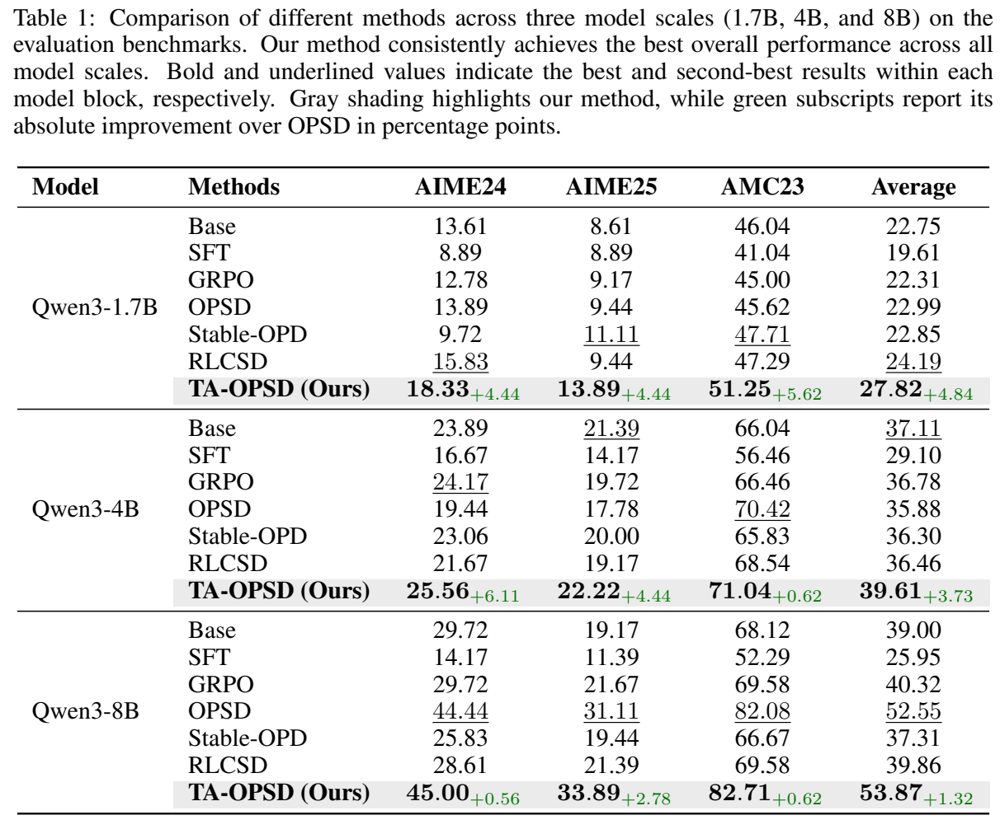

**原文 Table 1，PDF 第 7 页。** 每题采 12 条按单条正确率平均，AIME24/25 各 30 题、AMC23 40 题。比较 Base、SFT、GRPO、原 OPSD、Stable-OPD 的同源改版及 RLCSD。对原 OPSD 从 22.99→27.82、35.88→39.61、52.55→53.87。GRPO 用 500 步、每题 8 条，不能解读成相同总训练 FLOPs。

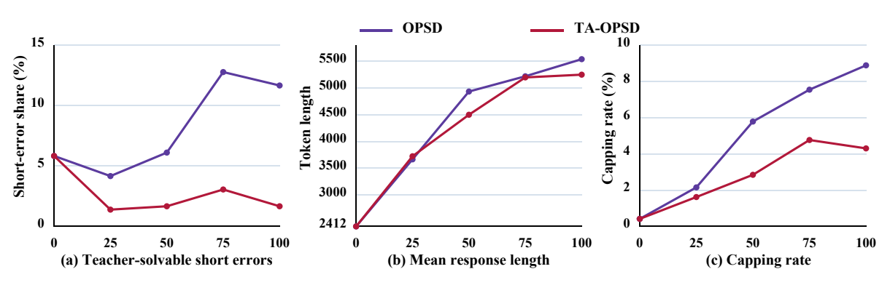

**原文 Figure 3，PDF 第 8 页。** 1.7B 横轴训练步，左是可被教师解出的短错答比例，中间是平均长度，右是预算耗尽比例。结束时短错答由 46/360 变 11/360，截断率三集合等权平均由 7.55% 降至 4.77%，整体长度约 5,219→5,198。只有同时看三幅，才能发现延长一部分和缩短另一部分抵消。

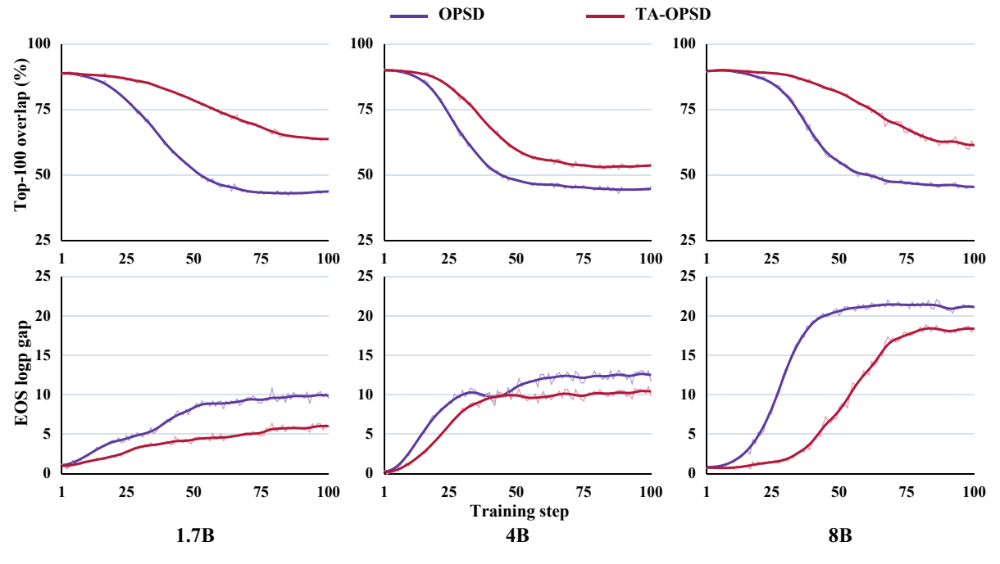

**原文 Figure 4，PDF 第 8 页。** 每列一个规模，上排 top-100 候选交集比例，下排两个结束 token 的师生 logprob 差的算术均值。TA-OPSD 的 1.7B 末端交集为 63.9%（OPSD 44.0%），EOS gap 5.97（OPSD 9.59）。Table 2 与 Figure 5 拆掉一支后，SC-only 精度 26.34%、截断 6.46%，UL-only 精度 23.66%、截断 2.92%，合用精度 27.82%。Table 3 使用 OPSD 后学生挖负得到 28.38%、截断 3.50%，引入附加训练成本。

**局限。** 手工重复规则可能压掉必要的复核，且负例来自固定初始策略，未必覆盖后来遇到的新循环。教师续写改对是特殊诊断，不能将所有短答案都判为提前终止。只在 Qwen3 非思考数学场景验证，换 tokenizer 或工具任务需先重新定义结束语义。

## 横向对照与参考资料

E2L 决定「什么提示值得学」；CPSD 用特权提示识别需要反向调整的概率。推理档位与 TA-OPSD 都看停止，前者控制思考档和交互格式，后者专治当前回答早停和循环。学习动态论文提示，在几乎不共享高概率候选的前缀上，先测学生实际覆盖率再决定用哪种局部散度。

- [GKD 原始论文](https://arxiv.org/abs/2306.13649)与 [Kevin Lu 的 OPD 技术博客](https://thinkingmachines.ai/blog/on-policy-distillation/)解释采样前缀上的蒸馏。
- [TRL 官方蒸馏训练教程](https://huggingface.co/docs/trl/distillation_trainer)与 [TRL 官方 GRPO 教程](https://huggingface.co/docs/trl/grpo_trainer)提供实现和分组奖励入门。
- [OpenUnlearning](https://github.com/locuslab/open-unlearning)提供 TOFU 与 MUSE 的评测工具。[TA-OPSD 作者复现说明](https://github.com/gtbxdf4/TA-OPSD)列出负例、校准和正式运行入口。本期检查代码和协议，未重新训练模型。
