# OPD / OPSD 论文日报 · 2026-11-27

## 先读这五篇

**CARE-OPD｜长程代理的环境交互很贵，哪些历史值得重放？** 让学生先在部分任务中走几步，再让教师接手，把学生实际容易遇到的状况纳入历史库。任务结束后，教师回看后续证据，挑出真正帮助定位问题、纠错或验证结果的回合。训练时学生对选中的旧历史重新作答，教师给出逐词反馈。如果教师自己对某个新回答也很犹豫，这次反馈就先跳过。这样能复用昂贵的环境交互，同时仍训练现在的学生会写出的回答。[读 CARE-OPD 精读](#paper-care)

**ELPSD｜反复思考的模型，也能从自己较早的想法中找到老师。** 作者让同一份冻结模型分别给出第一轮和第四轮预测，再提高那些经过多轮思考后才更受支持的选项的权重。训练中的模型在自己写到的地方接收这份反馈。它只需要题目，训练时无需参考解或判分器，部署时也沿用原来的四轮生成方式。[读 ELPSD 精读](#paper-elpsd)

**Training–Inference Mismatch｜为了提速，采样引擎和训练模型可以差多远？** 低精度推理或稍旧的权重能减少等待，但会改变学生写出的答案。作者让训练端和教师重新给样本打分，用独立题集检验最终质量，再用开跑前的短测估计某个引擎配置是否值得用。实验还分开测了量化权重、压缩缓存及异步采样各自带来的提速。[读训练与推理偏差精读](#paper-mismatch)

**D²-OPD｜教师提示应该放大哪些词，又该放大到什么程度？** 方法先比较强教师与两个参考模型，找出强教师更偏好的词，并压低波动很大的方向的权重。接着给改动幅度设预算，防止把偶然的偏好放大过头。学生在自己生成的轨迹上学习这份新分布，还会收到明确的反馈，把概率挪向教师支持的词。[读 D²-OPD 精读](#paper-d2)

**SPTA｜先训练教师接手学生真正写过的半份解答。** 学生写下推理草稿，训练程序截取不同长度，交给教师继续。判分器核对拼接后的最终答案，教师由此练习从各种半成品中找回正确解法。之后冻结适配好的教师，让它在学生新写的前缀上逐词打分。作者还单独测了教师从头答题和接手答题的能力，发现两者可能向不同方向变化。[读 SPTA 精读](#paper-spta)

## 本期检索与阅读约定

以北京时间 2026-10-27 至 2026-11-27 本次运行时为窗口。arXiv 主题检索返回 176 条初筛记录，以上五篇均核对了首发时间、v1 全文和代码可用性。按无版本 arXiv ID、DOI、规范 URL 和标题对照全仓历史清单。本文把论文数据和自拟算例分开标注。表里的百分数是原文结果，算例中的小分布用来演示机制。未找到独立工程的论文注明可查到的实现细节。所有结果均来自论文，未重跑训练。

在语言模型里，**前缀**是当前已经看到的题目及已写出的 token。**在策略蒸馏**（OPD）通常让学生自己生成前缀，再请教师在同一个前缀上给出下一词的分布；**在策略自蒸馏**（OPSD）让同源模型、不同条件或不同读出承担教师角色。下面统一用自然对数，KL 的单位是 nat。若用多个采样回答，avg@8、avg@16 衡量单次抽样准确率的平均；pass@k 衡量至少一次答对，两者回答不同问题。[GKD 原论文](https://arxiv.org/abs/2306.13649) · [作者的 OPD 入门](https://thinkingmachines.ai/blog/on-policy-distillation/) · [TRL 蒸馏文档](https://huggingface.co/docs/trl/distillation_trainer)

<a name="paper-care"></a>

## 1. CARE-OPD · 为覆盖而采集，按证据回放

**原文** 2026-11-25 UTC 首发（北京时间 11 月 26 日）。[arXiv 摘要与版本](https://arxiv.org/abs/2611.34756) · [v1 PDF](https://arxiv.org/pdf/2611.34756v1)

### 问题、方法与原架构图

长程代理每一步都可能调用工具、改变仓库或检索环境。在线蒸馏让最新学生真正跑完整个任务，既可覆盖它当前遇到的历史，也付出长尾交互成本。用教师历史做回放很便宜，但学生跌入的状态常常不同。作者把一个训练样本拆成四件事：从哪个历史库采样、选哪一轮、由谁生成当前回答、这份反馈是否足够可靠。

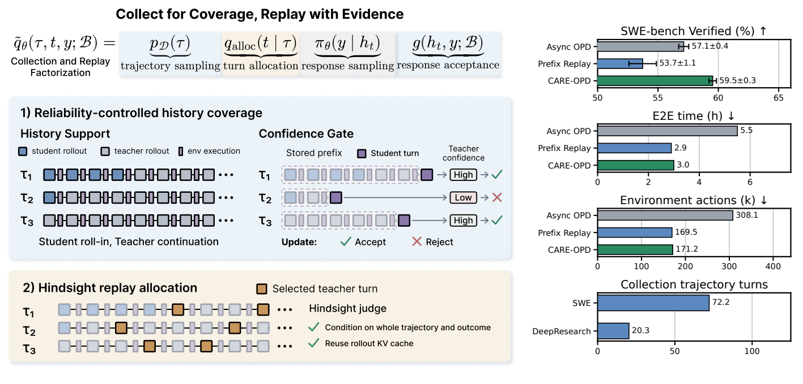

**原文 Figure 1，PDF 第 3 页。** 左侧上方依次对应历史库、回合分配、学生回答和接受门；下方用学生先行和事后选择替代纯教师历史及按位置采样。右侧前三组柱比较 Qwen3.5 的 SWE 成绩和端到端成本，对照异步一回合在线和普通前缀回放；最下一组给出 SWE 与研究任务的平均采集轨迹长度。

### 关键公式与小算例

设 $`\tau`$ 是含工具观察的轨迹，$`h_t`$ 是第 $`t`$ 轮开始前可见历史，$`y=(y_1,\ldots,y_L)`$ 是学生新生成的一整轮文本，$`B`$ 是当前小批次。先采轨迹、再采回合、然后采回答，应用接受门，未归一化的样本权重可写为

```math
m(\tau,t,y;B)=p_{\mathcal D}(\tau)\,q_{\rm alloc}(t\mid\tau)\,\pi_\theta(y\mid h_t)\,g_\gamma(h_t,y;B).
```

$`p_{\mathcal D}`$ 是收集后的轨迹分布，$`q_{\rm alloc}`$ 是挑回合的条件分布，$`\pi_\theta`$ 是当前待训练学生，$`g_\gamma`$ 是 0/1 门。前三项是按采样次序展开的联合概率，乘 0 的样本没有梯度；实际更新按接受数求均值。轨迹历史来自固定池，单轮回答由当前学生生成，且不再执行这次工具动作。

对第 $`i`$ 条采集轨迹，$`z_i\sim\mathrm{Bernoulli}(\alpha)`$ 决定是否让初始学生 $`\pi_{\theta_0}`$ 先行；若为 1，$`K_i\sim\mathrm{Uniform}\{1,\ldots,K_{\max}\}`$ 确定先行轮数，否则全程由教师 $`\pi_T`$ 生成。学生回合只留作上下文。验证失败、学生先行时就结束且没有教师回合的轨迹都不入库。教师回合集合为 $`E_i`$，判别器看完整轨迹和执行结果，选 $`m_i=\lceil r|E_i|\rceil`$ 个诊断、纠错或验证回合组成 $`S_i`$，其中 $`r`$ 是保留比例。每个入选回合得到 $`q_{\rm alloc}(t\mid\tau_i)=\mathbf{1}[t\in S_i]/m_i`$，未入选者权重为零。选择器的回合编号和后续证据不会进入回放前缀。

令 $`s_j=(h_t,y_{\lt j})`$ 为当前词的上下文；$`p_{\theta,j}(v)`$ 与 $`p_{T,j}(v)`$ 是两模型在同一上下文上给词表 $`V`$ 中的 $`v`$ 的概率。原文的回答级损失与置信门是

```math
\begin{aligned}
\ell(\theta;h_t,y)&=\frac1L\sum_{j=1}^L D_{\rm KL}(p_{\theta,j}\|p_{T,j}),\\
C(h_t,y)&=\frac1L\sum_{j=1}^L\max_{v\in V}p_{T,j}(v),\\
g_\gamma(h_t,y;B)&=\mathbf{1}\!\left[C(h_t,y)\ge \mathrm{Quantile}_\gamma\{C_b:b\in B\}\right].
\end{aligned}
```

每个位置的 KL 展开成 $`\sum_v p_{\theta,j}(v)\log[p_{\theta,j}(v)/p_{T,j}(v)]`$，即用学生概率对对数概率差做平均。置信度是逐位置最高教师概率的平均，与采样词是否正确没有等价关系。$`\gamma`$ 控制批内剔除比例；实作时分位点并列可能影响实际保留数。验证器筛历史，置信度筛这轮反馈，学生优化使用 KL，不把环境成败当作策略梯度的奖励。

**本文算例。** 某条轨迹有 20 个合格回合，保留 40% 就得到 8 个，每个入选回合的条件采样概率为 1/8。另一条轨迹只有 5 个合格回合，保留 2 个，每个入选回合虽分到 1/2，两条轨迹仍有同等机会先被抽到。若四条回答的置信度是 0.40、0.60、0.70、0.90，示意去掉最低四分之一时，只跳过第一条回答；以后同一历史仍能生成新回答。

```text
对每个采集任务按比例让旧学生先行，再由教师在环境中完成
只保存验证成功且存在教师回合的轨迹
教师回看完整轨迹，一次性选出固定比例的有证据回合
重复训练:
    等概率取轨迹，再等概率取其入选回合，恢复当时真实历史
    当前学生重新生成一轮，不执行工具动作
    教师在这一轮新回答上逐位置打分，计算 KL 和置信度
    用批内分位点剔除低置信回答，对保留者的平均损失更新
```

### 数据、实验、消融与复现

**原文事实。** 软件工程用 SWE-Gym 训练，留出 100 个验证任务，使用 OpenHands 工具架构，测试 SWE-bench Verified。研究代理用公开资料自建训练数据，在 BrowseComp-Plus 测答案准确率，检索器为 Qwen3-Embedding-8B，判分器为 gpt-oss-20b。主模型为学生 Qwen3.5-9B、教师 Qwen3.5-27B，另一组是 Qwen3-8B 和 Qwen3-Coder-30B-A3B。后一组工具格式先通过 500 个 R2E-Gym-Subset 任务的成功教师轨迹做冷启动。OPD 4 台机器各 8 张 H200，教师、采样、更新分别占 1、2、1 台，学习率 $`\!10^{-6}`$，批量 64，60 步，128K 上下文、最多 150 轮，各方法三种子。

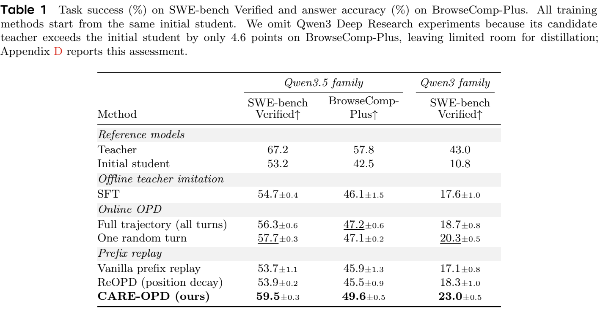

**原文 Table 1，PDF 第 7 页。** 横向三列分别是 Qwen3.5 软件、Qwen3.5 研究和 Qwen3 软件。三列 CARE-OPD 为 59.5、49.6、23.0；同列同步单回合在线是 57.7、47.1、20.3，教师历史均匀回放是 53.7、45.9、17.1。研究任务全轨迹在线是 47.2。误差是三种子的样本标准差。

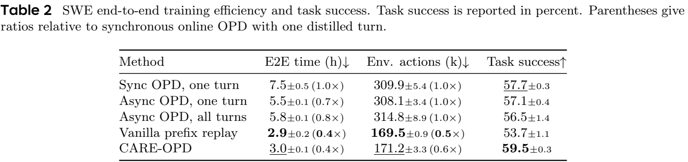

**原文 Table 2，PDF 第 8 页。** 在同 GPU、环境工人和批量下，CARE-OPD 共 3.0 小时、171.2k 次环境动作，异步单回合在线 5.5 小时、308.1k 次，分别减少约 45% 和 44%。回放时间已算采集、选择和训练，动作计入失败尝试。普通回放 2.9 小时而成绩 53.7，说明证据选择与置信门并未吃掉主要节省。

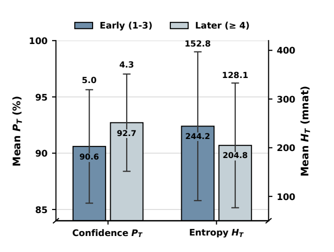

**原文 Figure 2，PDF 第 8 页。** 比教师刚接手的前三轮和后续轮。读左轴置信及右轴熵：原文 §4.4 文本报告前三轮置信低 2.1 个点、熵更高。表 3 中纯教师历史、有学生先行、有置信门、两者一起为 53.7、55.1、54.5、57.1；表 4 中同样选 40% 回合，随机为 53.7，教师事后选择 57.3。后者的同条件消融表明改变采样内容比只缩减样本数更重要。

**复现与局限。** 论文给出收集算法、训练配置和选择提示，未核实到本方法的公开独立仓库。静态池对迭代后学生错误的覆盖不受保证；只保留验证通过的任务也受验证器与任务分布影响。置信门可能删去教师恰好能提出多种合理改法的前缀。三条实验线均为具备结果验证的长程任务。[OpenHands](https://github.com/OpenHands/OpenHands) · [SWE-bench](https://www.swebench.com/)

<a name="paper-elpsd"></a>

## 2. ELPSD · 用模型自己的循环差分做教师

**原文** 2026-11-24 首发。[arXiv 摘要与版本](https://arxiv.org/abs/2611.32452) · [v1 PDF](https://arxiv.org/pdf/2611.32452v1)

### 问题与方法

循环模型把同一堆 Transformer 层重复用多次。标准部署只读取最后一次输出；较早的读出能告诉我们模型多算几遍后具体改了哪些词。ELPSD 在冻结的初始模型上读出第一轮和第四轮，把第四轮比第一轮新增的偏好再放大一点。当前模型仍用第四轮生成并学习，不增加部署循环数。

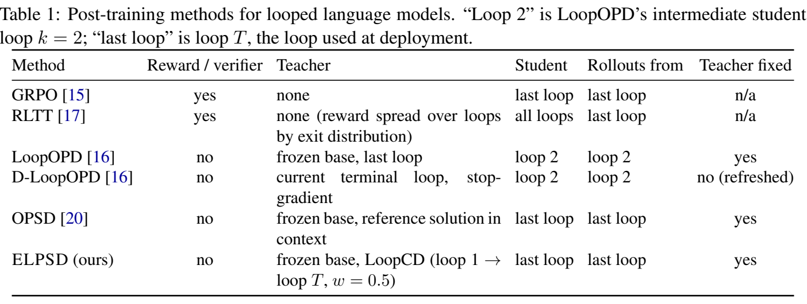

**原文 Table 1，PDF 第 4 页。** 这是 v1 的方法对照表，原文未提供架构图。按列核对奖励、教师、接受训练的读出、采样与评估读出。ELPSD 教师来自冻结模型的第一与最后一轮；普通 OPSD 的冻结教师额外看参考解，GRPO 使用验证器。列在表中的 LoopOPD 只用于设计比较，未进入本期引用的主成绩表。

### 公式、推导与数值例

在同一前缀 $`s`$ 上，$`h_\theta^{(j)}(s)`$ 是循环 $`j`$ 的隐藏状态，$`W_\theta`$ 是共享词表头，$`P_\theta^{(j)}(\cdot\mid s)=\mathrm{softmax}(W_\theta h_\theta^{(j)}(s))`$。取冻结参数 $`\theta_0`$，将末轮分布记 $`p_T=P_{\theta_0}^{(T)}`$，早轮分布记 $`p_r=P_{\theta_0}^{(r)}`$。默认 $`T=4,r=1`$。$`w=0.5`$ 控制外推幅度。对每个词 $`v`$，把两轮的对数比加到末轮：

```math
\begin{aligned}
q(v)&=\frac{\exp[\log p_T(v)+w(\log p_T(v)-\log p_r(v))]}{Z}\\
&=\frac{p_T(v)^{1+w}p_r(v)^{-w}}{Z},\qquad
Z=\sum_u p_T(u)^{1+w}p_r(u)^{-w}.
\end{aligned}
```

$`u`$ 遍历词表，$`Z`$ 归一化。对长度 $`L_i`$ 的第 $`i`$ 条当前学生回答，$`s_{ij}`$ 是它第 $`j`$ 个 token 的前缀。令 $`M`$ 是批里的回答数，训练损失为

```math
\mathcal L=\frac1M\sum_{i=1}^M\frac1{L_i}\sum_{j=1}^{L_i}
D_{\rm KL}\big(P_\theta^{(T)}(\cdot\mid s_{ij})\|q(\cdot\mid s_{ij})\big).
```

每条回答先取 token 均值，再取回答均值。代入 $`\log q=(1+w)\log p_T-w\log p_r-\log Z`$，并利用分布 $`p`$ 质量为 1，可得

```math
D_{\rm KL}(p\|q)=(1+w)D_{\rm KL}(p\|p_T)-wD_{\rm KL}(p\|p_r)+\log Z .
```

这里 $`p`$ 是当前末轮读出，$`\log Z=wD_{1+w}(p_T\|p_r)`$，$`D_{1+w}`$ 是 Rényi 散度。第一项贴近末轮，第二项相对地拉开早轮，但整体仍是对正规化教师 $`q`$ 的非负 KL。在初始化时若 $`w=0`$，两者完全一样，此时固定前缀上的损失及其梯度均为零。论文还推导了理想化刷新会让当前教师与固定早轮参考的对数相对赔率每轮乘 $`1+w`$：把当前末轮换成上一轮拟合的 $`q`$ 后，归一化常数在两个词的赔率里相消。这需要精确拟合、固定参考和同一前缀。实际实验只有冻结教师的单次训练。

**本文算例。** 早轮对两个词各给 0.5，末轮给 0.8 和 0.2。取 $`w=0.5`$，末轮赔率 4 比 1 再乘一次自身平方根，教师变成 8 比 1，即约 0.889 和 0.111。若两轮意见一致，赔率不变。若末轮碰巧转向错误选项，外推也会强化错误。训练没有任务奖励，答题验证可用于日志和评估。

```text
冻结 Ouro 初始模型和保留当前学生四轮模型
每步学生从末轮采样八条解答
对同一组前缀，用冻结模型取第一与第四轮隐藏状态
用共享词表头生成两套 log-prob，再计算归一化外推目标
按 token 分块算反向 KL、按回答平均后反向传播
部署依旧只从第四轮采样
```

### 实验与可复现性

**原文事实。** Ouro-1.4B-Thinking，24 层共享 Transformer，循环四次。数据为 14,684 道筛选的 DeepMath 数学题；64 题乘 8 条回答每步，100 步，AdamW 学习率 $`\!10^{-6}`$，预热 10 步，单机 8 GPU。训练温度 1、top-p 1、回答上限 16,384；冻结教师 FP32 在每卡约 5.6 GB，输出两轮隐藏状态，词表 KL 按位置分块配合激活检查点。原文未列 GPU 型号、墙钟和 GPU-hours。

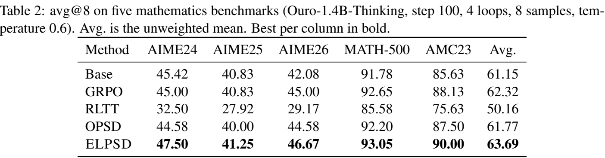

**原文 Table 2，PDF 第 7 页。** v1 无实验曲线，表给出同一四轮读出、温度 0.6、top-p 0.95、630 题及每题 8 次采样的主结果。最右五基准等权平均，ELPSD 63.69，Base 61.15，GRPO 62.32，RLTT 50.16，特权参考解 OPSD 61.77。每列均以同一基模型为起点，平均比 GRPO 高 1.37 个百分点。RLTT 的第一轮熵从 1.684 降到 0.382 nats，是作者观察的训练诊断；论文未给出完整的不同 $`w`$ 或不同参考轮的多种子消融。

**复现与局限。** 附录给出评测与分块训练设置，未核实到本论文独立实现。结果来自单个基础模型、单种子、数学基准。方法假设后续循环经常改善早轮的决策，部署仍需付四轮计算，不能用这里的结果推断线性模型或更短推理预算。[Ouro 模型](https://huggingface.co/ByteDance/Ouro-1.4B-Thinking) · [TRL GRPO 文档](https://huggingface.co/docs/trl/grpo_trainer)

<a name="paper-mismatch"></a>

## 3. 训练与推理偏差 · 在质量约束下挑更快的采样器

**原文** 2026-11-08 首发。[arXiv 摘要与版本](https://arxiv.org/abs/2611.11450) · [v1 PDF](https://arxiv.org/pdf/2611.11450v1) · [作者代码与配置](https://github.com/benyucong/train-inference-mismatch-opd/tree/1fc4571cc5cb07173193fec546827956ae647fe5)

### 问题与架构

训练模型用高精度更新，但生成回答的引擎可能是量化版本，或比训练器落后数个更新。即便把每个采样词重新用训练精度打分，学生已经走过的前缀仍由推理引擎决定。论文问的是：哪些偏差在给定质量标准下可接受、能否在长跑前筛掉较差配置、以及最快的可用配置是什么。

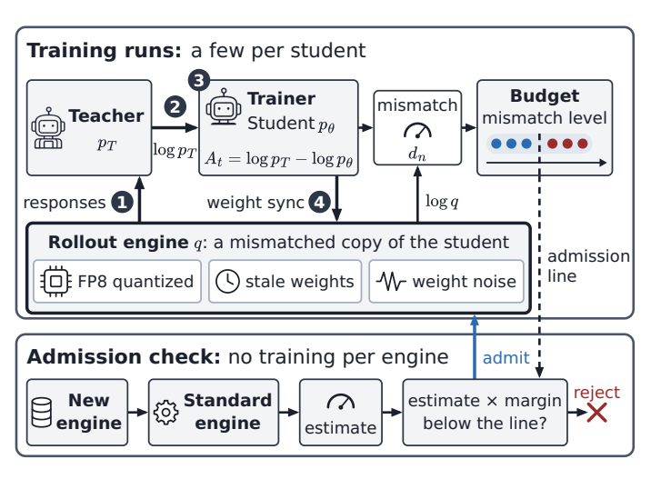

**原文 Figure 2，PDF 第 3 页。** 上部把学生引擎、训练端、教师三条概率路径分开，再用训练中偏差和最后的独立集质量构造区间。下部是训练前短测，用标准 BF16 采样器重打分。三条概率各有来源，复现实验时要注意谁生成样本、谁打分。

### 公式与测量

用 $`s_j=(x,y_{\lt j})`$ 表示题目 $`x`$ 和位置 $`j`$ 之前的生成前缀，$`a_j=y_j`$ 是实际采样词，$`q_c`$ 是配置 $`c`$ 的采样引擎分布，$`p_\theta`$ 是训练精度下的学生，$`p_T`$ 是固定教师。局部反向 KL 与作者使用的逐词策略梯度写为

```math
\begin{aligned}
D_{\rm KL}(p_\theta\|p_T)&=\sum_a p_\theta(a\mid s)
  [\log p_\theta(a\mid s)-\log p_T(a\mid s)],\\
A_j&=\mathrm{stopgrad}[\log p_T(a_j\mid s_j)-\log p_\theta(a_j\mid s_j)],\\
g_{\rm loss}&=-\mathbb E_{y\sim q_c}\!\left[\sum_j A_j
      \nabla_\theta\log p_\theta(a_j\mid s_j)\right].
\end{aligned}
```

$`a`$ 遍历同一前缀上的词表，$`A_j`$ 是该词的教师优势，不由题目正确性给出。取局部 KL 的梯度时，对第一项概率的梯度可提取成 $`\nabla_\theta p_\theta=p_\theta\nabla_\theta\log p_\theta`$；对 log 学生概率的显式梯度求和为 $`\sum_a\nabla_\theta p_\theta(a\mid s)=0`$。因此在固定前缀、用 $`p_\theta`$ 采样时可用这一局部估计。实际引擎分布 $`q_c`$ 代替了训练分布，改变采样词和到达前缀，梯度估计一般有偏。

第 $`n`$ 步的样本集合记 $`I_n`$，共有 $`N_n`$ 个生成 token；训练走 $`U`$ 步：

```math
d_n(c)=\frac1{N_n}\sum_{j\in I_n}\log\frac{q_c(a_j\mid s_j)}{p_\theta(a_j\mid s_j)},
\qquad D(c)=\frac1U\sum_{n=1}^{U}d_n(c).
```

条件采样下，这是在引擎访问到的前缀上估计 $`D_{\rm KL}(q_c\|p_\theta)`$，每个样本的对数比可以为负。记 $`K(c)`$ 为训练后标准 BF16 评估在独立 530 道题上的学生对教师 KL，$`K(0)`$ 为同训练条件的标准引擎对照。原文主规则比较 $`\Delta(c)=K(c)/K(0)-1`$，达到 20% 且按题做配对 bootstrap 的 95% 区间排除零才判失败。括号区间的端点是试过的最大通过 $`D(c)`$ 和最小失败 $`D(c)`$。

短测使用相同初始权重，让候选在 16 题上每题采两条解答，然后用标准引擎 $`q_0`$ 计算同位置的 log-prob：

```math
\widehat D(c)=\frac1{N}\sum_j \log\frac{q_c(a_j\mid s_j)}{q_0(a_j\mid s_j)},
\qquad \alpha\widehat D(c)\lt L .
```

$`N`$ 是短测 token 数，$`L=0.41`$ 是导自 100 步试跑的质量界线，安全倍率 $`\alpha=1.5`$ 也由试跑选定，因此入场线约 0.27。这里分母是标准推理引擎，原因是开训前不必启动完整训练器；它和最终训练中统计量用途不同。

**本文算例。** 引擎在一个位置给 0.8、0.2，训练端给 0.6、0.4。按引擎加权，平均对数比为 $`0.8\log(0.8/0.6)+0.2\log(0.2/0.4)\approx0.0915`$ nat。若最终独立集 KL 从 0.048 升至 0.060，相对恶化 25%，还要看区间是否排除零。前一个数字测“采样差多远”，后一个测“最后学成什么样”。

```text
同初始权重短测候选引擎，用 BF16 标准引擎在候选轨迹上重打分
根据已校准的安全倍率和质量线筛选候选
对标准与候选各训练一条配对设置的曲线:
    引擎采学生回复并返回引擎 log-prob
    教师和训练器在相同前缀分别重打分
    累计逐步引擎偏差，只以教师优势更新学生
    用固定 BF16 评估设置追踪独立集 KL 与答题准确率
```

### 训练、主实验和可复现性

**原文事实。** 主要配对是 DeepSeek-R1-Distill-Qwen-7B 学生与 Skywork-OR1-Math-7B 教师，另测 1.5B 和 3B 配对。用 DAPO-Math 题目，64 条序列每更新（8 题各 8 条），最长 16,384，AdamW 学习率 $`\!10^{-6}`$，200 步。主硬件为 2 台各 4 张 GH200。独立集由 AIME24 与 MATH-500 组成。公开工程的固定提交中有训练脚本、奖励实现、测量代码和日志，本文核对目录，未重跑。

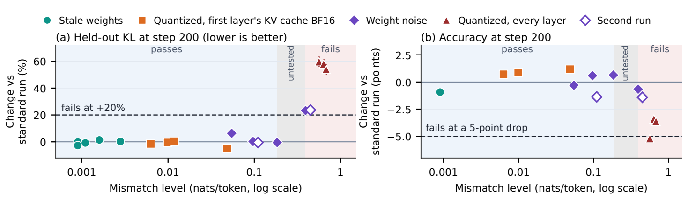

**原文 Figure 3，PDF 第 7 页。** 横轴是 200 步平均训练偏差，纵轴是 held-out KL 的相对变化。看 20% 虚线和置信区间，7B 的实测通过端为 0.184、失败端为 0.39 nat/token。空心符号表示同配置复跑。右图给出第 200 步对其中一部分运行的准确率变化；通过或失败仍按左图的 held-out KL 判据。

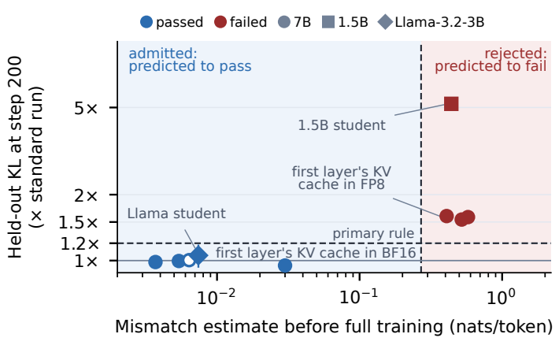

**原文 Figure 4，PDF 第 7 页。** 横轴短测预估，纵轴是第 200 步的 held-out KL 相对标准运行的倍数，背景标识准入区域。九项配置有八项预先定了决策，八项与结果一致，其中五项来自离线检查；点主要集中在离边界很远的两组，不能外推为临界附近的准确率。第一层 KV 保留 BF16 的配置在 7B 上可通过，第一层也转 FP8 的对应配置失败。

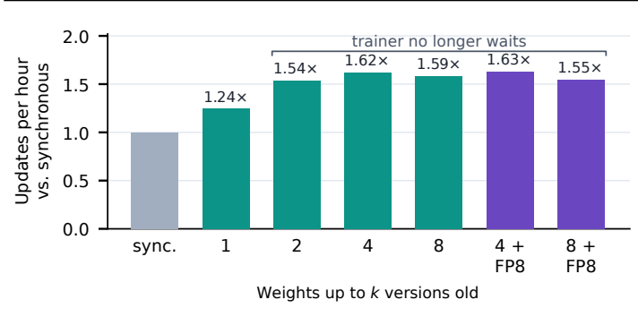

**原文 Figure 6，PDF 第 8 页。** 以同步 BF16 为基准看每小时更新数。允许至多滞后四次或八次更新时，速度约 1.62、1.59 倍，质量在标准 KL 的 3% 内。两种更深的异步设置接近训练器上限，额外加速采样未必增加端到端吞吐。

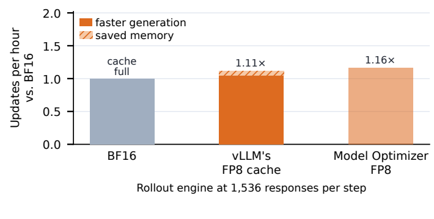

**原文 Figure 7，PDF 第 8 页。** 比较缓存受限时的不同低精度设置。64 序列的对照中 FP8 KV 基本没有更新收益，但容量至少 1.93 倍；1,536 序列时可减少驱逐重算，缓存和权重量化方案分别为 1.11、1.16 倍吞吐。附录表 11 同质量实验中，FP8 加最多八次权重滞后在 3.69 小时达到同步终点 KL，约快 1.62 倍，终点答题准确率 60.46% 对 61.54%。

**局限。** GRPO 和 REINFORCE 的对照改由规则奖励学习，在同三种干扰下分别有两种和三种出问题，说明相同预算不能直接套到不同算法。区间横跨多个不同干扰类型，是一次实验的观测范围，不能当连续且单调的数学阈值。代码可核对包括低精度模拟与实测配置的区别；独立题集、架构和新的量化内核均应重新标定。[veRL 训练文档](https://verl.readthedocs.io/en/latest/)

<a name="paper-d2"></a>

## 4. D²-OPD · 分别控制分布外推的方向和距离

**原文** 2026-11-04 UTC 首发（北京时间 11 月 5 日）。[arXiv 摘要与版本](https://arxiv.org/abs/2611.07241) · [v1 PDF](https://arxiv.org/pdf/2611.07241v1)

### 问题与方法原图

直接模仿教师可能只是平移概率，外推可凸显教师确实比参照更擅长的决策。但同一个放大倍率在不同前缀上会造成大小很不一样的变化，也可能把教师低概率词不合理地推到前面。论文将这个过程分成找方向、限制目标移动、让学生拟合三个阶段。

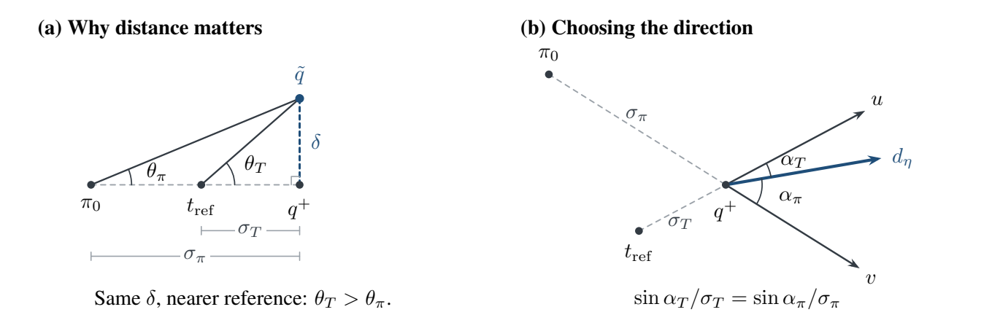

**原文 Figure 2，PDF 第 4 页。** 左图比较相同尺度在不同起点上造成的移动，右图显示强教师与教师参考、初始学生形成的两条对数比方向，以及它们的合成。图是固定前缀的示意；对照普通 OPD 的目标就是强教师本身，没有这些外推步骤。

### 方向、预算与损失推导

固定学生自己生成的前缀 $`h`$。令 $`q^+`$ 为强教师、$`t_{\rm ref}`$ 为教师侧参考、$`\pi_0`$ 为固定初始学生，$`S`$ 为强教师概率最高的 $`K`$ 个词（默认 16）。记 $`b(v)=q^+(v)/q^+(S)`$ 为强教师在支持集 $`S`$ 内对 $`v\in S`$ 归一化的分布。方向信号和去中心化为

```math
\begin{aligned}
\Delta_T(v)&=\log\frac{q^+(v)}{t_{\rm ref}(v)},&
\Delta_S(v)&=\log\frac{q^+(v)}{\pi_0(v)},\\
\bar\Delta_j(v)&=\Delta_j(v)-\mathbb E_{u\sim b}\Delta_j(u),&
\sigma_j^2&=\mathbb E_{u\sim b}\big[\bar\Delta_j(u)^2\big],\quad j\in\{T,S\}.
\end{aligned}
```

下标 $`T,S`$ 指来自教师参考或学生参考的信号；这里 $`S`$ 同时是支持集符号。两个对数比减去各自在 $`b`$ 下的均值，避免为所有词增加同样的常数。通过最小化两项相对平方误差 $`\sum_j\mathbb E_b[(d-\bar\Delta_j)^2]/\sigma_j^2`$，对每个 $`d(v)`$ 求导，可得逆方差加权解：

```math
d=(1-\eta)\bar\Delta_T+\eta\bar\Delta_S,\qquad
\eta=\frac{\sigma_T^2}{\sigma_T^2+\sigma_S^2}.
```

波动更大的信号分得更低权重。近零方向不参与融合，两者都近零则停止外推。没有合适教师参考时，只用学生参考。若两参考一样，合成方向也一样。基于此方向求一个分布 $`q`$，用 $`\kappa`$ 在期望位移和偏移正则间折衷，用 $`\epsilon`$ 给偏移设硬上限：

```math
\begin{aligned}
&\max_{q\in\Delta(S)} (1-\kappa)\mathbb E_{v\sim q}d(v)-\kappa D_{\rm KL}(q\|b),\\
&\text{subject to}\quad D_{\rm KL}(q\|b)\le\epsilon,\qquad
\widetilde q_\beta(v)=\frac{b(v)\exp(\beta d(v))}{\sum_{u\in S}b(u)\exp(\beta d(u))},
\quad\beta=\frac{1-\kappa}{\kappa+\lambda}.
\end{aligned}
```

$`\Delta(S)`$ 指支持集上的概率单纯形，$`\lambda\ge0`$ 是硬约束的拉格朗日乘子。把硬约束惩罚并入目标，对 $`q(v)`$ 求导，再通过总质量为 1 解出指数归一化形式。令 $`Z_\beta=\sum_{u\in S}b(u)e^{\beta d(u)}`$，则 $`D_{\rm KL}(\widetilde q_\beta\|b)=\beta\mathbb E_{\widetilde q_\beta}d-\log Z_\beta`$，其对 $`\beta`$ 的导数是 $`\beta\mathrm{Var}_{\widetilde q_\beta}(d)\ge0`$。因此在零和未加硬约束的 $`(1-\kappa)/\kappa`$ 之间二分，选仍满足界线的最大幅度。若一小组词在 $`b`$ 下总质量至多 $`\rho`$，聚合成组内、组外并用二元熵至多 $`\log2`$，能得 $`q(\text{组内})\le(\epsilon+\log2)/\log(1/\rho)`$。预算会约束极稀少的一整组词能拿走多少质量。

用正向 KL 把外推分布对齐到当前学生 $`\pi_\theta`$，学生使用全词表 softmax：

```math
\begin{aligned}
\ell_\theta&=D_{\rm KL}(\widetilde q_\beta\|\pi_\theta)\\
&=D_{\rm KL}(\widetilde q_\beta\|\pi_{\theta,S})-\log\pi_\theta(S),\qquad
\frac{\partial\ell_\theta}{\partial z_v}=\pi_\theta(v)-\widetilde q_\beta(v).
\end{aligned}
```

$`\pi_{\theta,S}`$ 是学生在 $`S`$ 内的归一化分布；$`z_v`$ 是学生全词表 logit，集合外的 $`\widetilde q_\beta(v)=0`$。分解来自 $`\pi_\theta(v)=\pi_\theta(S)\pi_{\theta,S}(v)`$，说明即使集合内相对次序完美，学生也会因把大部分质量留在集合外而受罚。梯度由交叉熵对 softmax 求导；学生极少采样到某个教师支持词，也收到直接梯度。没有序列任务奖励用于训练这个损失。评测则用规则验证器判分。

**本文算例。** 两个去中心化信号的标准差为 0.2、0.4 时，学生参考方向占 20%。另取两个词，基准各 0.5，合成改动为 +1、−1。不受限时若 $`\beta=0.5`$，目标第一词约 0.731，离基准约 0.111 nat。若预算只有 0.05 nat，二分找到约 0.326，第一词约 0.657。词的增减方向相同，移动幅度变小。

```text
当前学生为每题生成四个回复，逐 token 取得访问到的前缀
从强教师取 top-K，收集两参考对这些词的 log-prob
在教师归一化 top-K 上对信号去中心化，按逆方差合成
若未受限目标超预算，二分 24 步缩小倾斜系数
固定外推目标，使用学生全词表归一化的正向 KL 更新
```

### 数据、主结果、消融与局限

**原文事实。** 设置 A 为 Qwen3-8B 蒸馏至 Qwen3-4B-Base，B 为 Qwen3-4B 到 1.7B-Base，C 为 Qwen3-30B-A3B-Instruct-2507 到 Qwen3-8B-Base。A、C 用 DAPO-Math-17K，B 用 OpenThoughts3-1.2M 中约 30K 道数学题。每组一 epoch，64 批量，每题 4 个回复，学习率 $`\!10^{-6}`$，训练温度 1。每台 8 张 A100 40GB，A、B 一台、C 两台。全研究约 9,000 GPU-hours、50 次运行，覆盖扫参和消融。原文 Table 4 的不含 rollout 时间为每步 38.48 s 对普通 OPD 33.42 s，约 15% 增量；不能直接当全程开销。

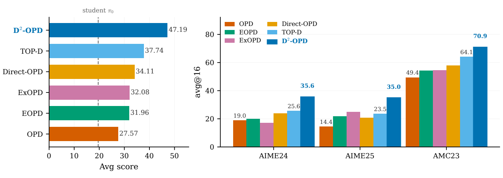

**原文 Figure 1，PDF 第 2 页。** 设置 A 左图读三基准等权准确率，右图分别读 AIME24、AIME25、AMC23。每题十六次采样求 avg@16。D²-OPD 报 47.19，强基线 TOP-D 37.74，普通 OPD 27.57；AIME24/25 与 AMC23 的方向一致。B 为 22.31 对普通 OPD 14.22，C 为 46.27 对 38.91。每个主配置报告一次训练终点，无种子误差条。

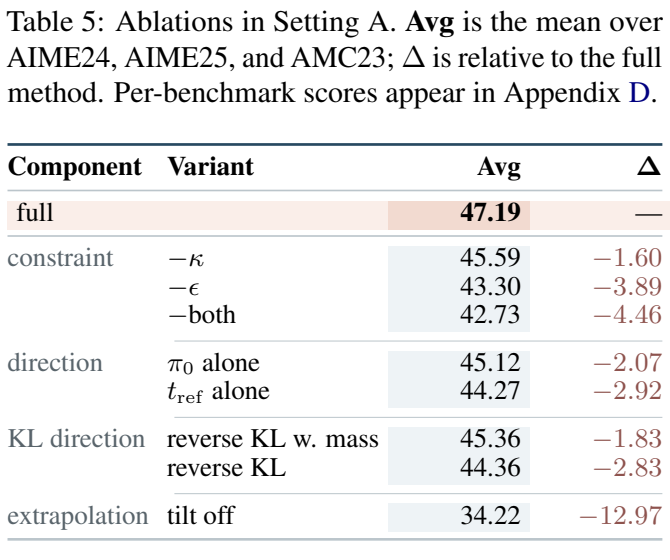

**原文 Table 5，PDF 第 8 页。** 设置 A 同条件逐项比。取消硬预算 $`\epsilon`$ 得 43.30；只用学生参考得 45.12；反向 KL 加质量项得 45.36；关闭外推仅 34.22。右列为相对全方法的差，不应与图 1 相对普通 OPD 的差累加。原文也检查生成长度和学生熵，主结果不能简单归因于回答更长或分布更尖。

**复现与局限。** 已核对附录训练参数和区间二分，未核实到作者发布的专用训练代码或 checkpoint。本文例子用二元支持便于算账；真实支持截断后，教师 top-K 之外的优质低概率词无法被外推保留。每个主配置仅一次运行，结果局限于数学、Qwen 家族及指定基线调参范围。[PyTorch 交叉熵文档](https://docs.pytorch.org/docs/stable/generated/torch.nn.CrossEntropyLoss.html)

<a name="paper-spta"></a>

## 5. SPTA · 让教师先练习接手学生的前缀

**原文** 2026-11-02 首发。[arXiv 摘要与版本](https://arxiv.org/abs/2611.03133) · [v1 PDF](https://arxiv.org/pdf/2611.03133v1)

### 问题与两阶段方法

普通 OPD 有一个容易漏掉的前提：教师必须能从学生实际写出的半成品继续下去。标准教师在干净题目上很强，接到学生已经偏题的中间步骤时可能比预期更差。SPTA 先让教师从学生前缀出发用结果奖励练习，再用这个教师指导学生。

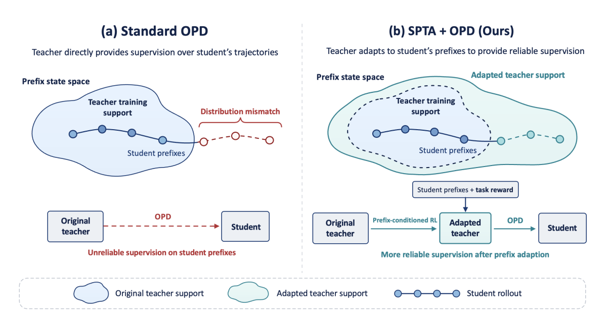

**原文 Figure 1，PDF 第 2 页。** 左侧标准 OPD 的原教师直接评分学生走过的状态。右侧先采学生前缀，适配教师从那里继续求解，再冻结适配教师做相同类型的蒸馏。沿箭头读，第一阶段奖励进入教师，第二阶段教师概率进入学生。

### 数据构造、奖励和公式

对于训练题 $`x`$，让冻结的起始学生 $`\pi_{S_0}`$ 采四个回复，挑一个作为截断对象。令 $`L`$ 为它的长度，从 $`r\sim\mathrm{Uniform}(0.01,0.90)`$ 抽相对进度，保留前 $`k=\lfloor rL\rfloor`$ 个 token。得到 $`h_S=(x,y^S_{1:k})`$；$`y^S_{1:k}`$ 是截短的学生文本，整个前缀库 $`B`$ 在一次教师适配中固定。教师 $`\pi_\phi`$ 采样后缀 $`c`$，验证器 $`\mathrm{Ver}`$ 看的是原题和拼完整的回答：

```math
R(x,y^S_{1:k},c)=\mathrm{Ver}(x,y^S_{1:k}\oplus c)\in\{0,1\},\qquad
J_{\rm prefix}(\phi)=\mathbb E_{h_S\sim B,\,c\sim\pi_\phi(\cdot\mid h_S)}R(x,y^S_{1:k},c).
```

$`\oplus`$ 表示拼接，答对给 1、答错给 0。固定 $`\mathrm{Ver}`$ 时，期望奖励对参数的导数为 $`\mathbb E[R\nabla_\phi\log\pi_\phi(c\mid h_S)]`$，来自对采样概率求导；把后缀概率拆成逐词乘积，梯度只来自教师生成的后缀动作。实作用 GRPO，对同一前缀下 $`G=8`$ 条教师续写做组内归一化。概念上，第 $`i`$ 个结果的优势是 $`(R_i-\bar R)/(\sigma_R+\varepsilon)`$，$`\bar R`$ 和 $`\sigma_R`$ 为组内均值和标准差，$`\varepsilon`$ 为数值稳定项；然后用剪裁比率约束更新。学生前缀参与注意力条件，不计作教师动作。只做干净题面 RL 的 Tea-RL-OPD，用相同教师优化流程控制额外训练的影响。

第二阶段冻结适配教师 $`\pi_{\phi^\star}`$，当前学生 $`\pi_\theta`$ 从题目起重新采样。令 $`p_t=\pi_\theta(\cdot\mid x,y^S_{\lt t})`$、$`q_t=\pi_{\phi^\star}(\cdot\mid x,y^S_{\lt t})`$，$`a_t=y_t^S`$ 为生成词。论文的分布目标及实际采样信号是

```math
\begin{aligned}
\mathcal L_{\rm SPTA}(\theta)&=\mathbb E_{x,\,y^S\sim\pi_\theta}
  \sum_{t=1}^{|y^S|} D_{\rm KL}(p_t\|q_t),\\
d_t&=\log p_t(a_t)-\log q_t(a_t),\qquad
A_t=-\mathrm{stopgrad}\big[\mathrm{clip}(d_t,-10,10)\big].
\end{aligned}
```

$`d_t`$ 是单采样词的 $`k_1`$ KL 估计；对 $`p_t`$ 加权求和即反向 KL。实现以 $`A_t`$ 作逐 token 的对数概率差优势，PPO 式比率剪裁区间为 0.8 至 1.2，负优势 dual clip 系数 3，聚合按回复 token 求均值。当前与采样时学生概率的比率控制更新步幅。第二阶段关闭任务奖励及另加的参考 KL；学生侧不对 $`A_t`$ 累计奖励到未来，也不把它按题目组归一化。

**本文算例。** 某学生写了 100 个词，抽 $`r=0.36`$ 就保留 36 个。若八个教师续写四对四错，组内均值是 0.5，按总体标准差 0.5 计算，正确与错误组优势约为 +1 与 −1。只有第 37 个词之后的教师动作接受这个反馈。如果训练后的教师在某个新前缀给学生采样词 0.5 而学生自己给了 0.25，则学生优势是 $`\log 2\approx0.693`$，更新倾向增加该词的概率。

```text
对每题用固定学生采四条回复，保留一条并随机截取
对固定前缀库训练教师:
    每个前缀采八条后缀，只对完整拼接答案验证
    以组内相对奖励更新教师，屏蔽学生前缀动作
冻结适配教师；用当前学生从新题面采样
在学生生成历史上由教师和学生重打分，以逐词优势更新学生
可选再从更新后的学生采前缀，教师和学生都接续训练
```

### 主实验、算力与可复现性

**原文事实。** 基于 DAPO-Math-17K。配对为 Qwen3-4B 到 Qwen3-4B-Base、DeepSeek-R1-Distill-Qwen-7B 到 1.5B、以及由同一学生经过 RL 得到的 JustRL-DeepSeek-1.5B 到该 1.5B 学生。阶段一每批 256 前缀乘 8 后缀，五 epoch；阶段二每批 64 题乘 4 回答，一 epoch。两阶段 AdamW 学习率 $`10^{-6}`$，BF16、FSDP 和梯度检查点。原文列第二阶段额外 8 张教师推理 GPU；未披露完整 GPU 型号、训练墙钟或 GPU-hours。推理沿用蒸馏后学生。

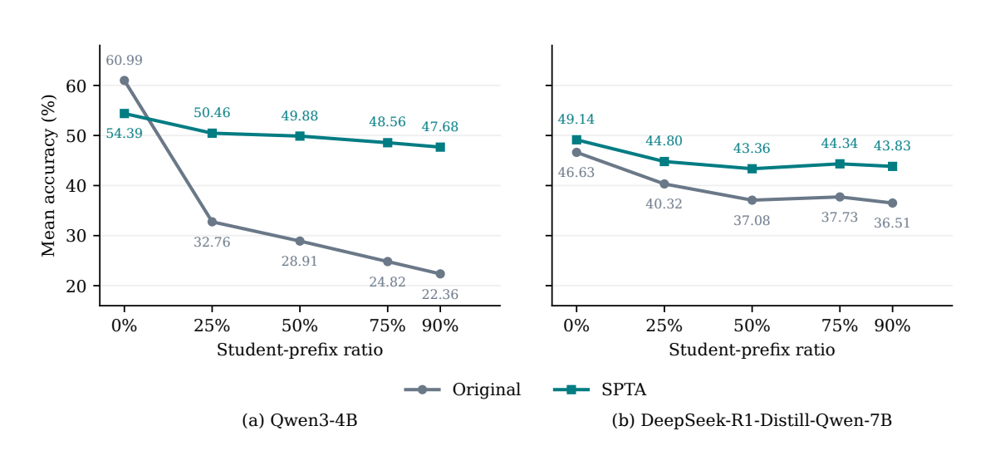

**原文 Figure 2，PDF 第 4 页。** 横轴是保留学生解答的相对比例，纵轴是教师续写的五基准平均 avg@16。起点代表干净题面，其余点每组使用同一学生前缀。Qwen3-4B 原教师从头 60.99%，在 90% 学生前缀上只有 22.36%；适配后对应为 54.39%、47.68%。因此这里从头能力下降，但在蒸馏最关心的接手条件下恢复能力提升。

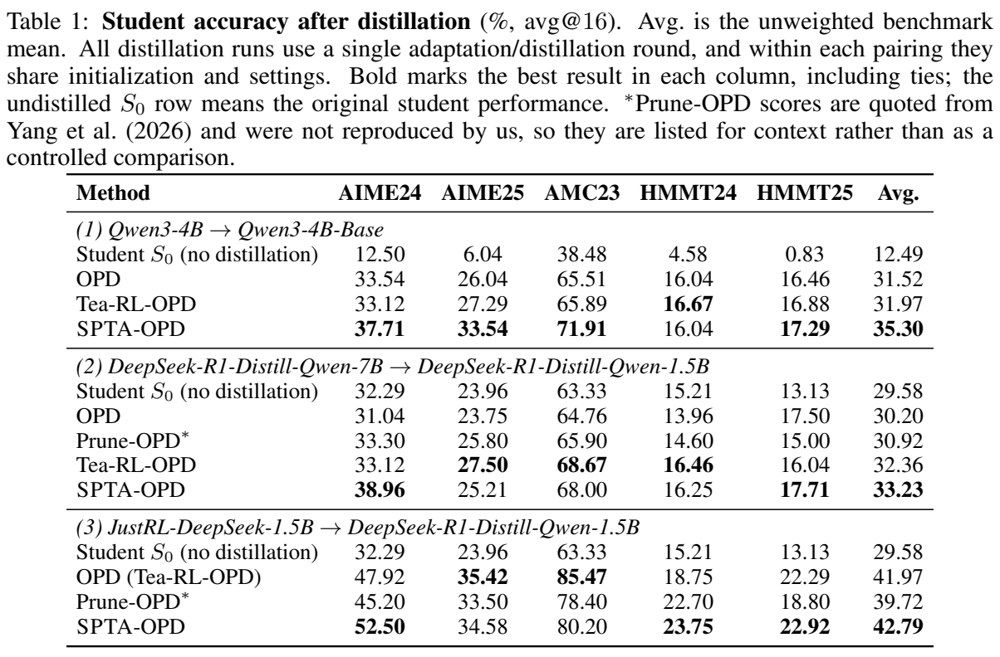

**原文 Table 1，PDF 第 7 页。** 从右列读五基准等权 avg@16。Qwen 组普通 OPD 31.52、教师先做题面 RL 31.97、SPTA 35.30；7B 到 1.5B 为 30.20、32.36、33.23；同源 1.5B 组题面 RL 对照 41.97，SPTA 42.79。AIME24、AIME25、AMC23、HMMT24/25 各列有升有降，原文转引的 Prune-OPD 并非同条件复跑。第二轮起始于上一轮权重并刷新前缀，35.30 到 36.57 的差同时包含新增教师与学生训练。

**复现与局限。** 论文公开截断、奖励、超参、训练和恢复评估协议，未核实到专用方法仓库。训练用一次冻结学生构造一个静态前缀库，比例采样只是覆盖启发式，未做系统比例扫参；结果奖励无法直接证明教师每个位置都校准得更好。实验在可自动判分的数学上，未证明迁移到开放式任务。适配优先改善续写，会牺牲某些干净题面能力；多一段教师训练的成本也需和任务收益一起衡量。[DAPO 原文与项目](https://dapo-sia.github.io/) · [TRL GRPO 说明](https://huggingface.co/docs/trl/grpo_trainer)

## 可继续查阅的基础材料

- **OPD 为什么让学生自己写前缀。** 作者团队的逐词蒸馏说明，以及 GKD 对离策略监督和在策略采样的对照。[Thinking Machines Lab](https://thinkingmachines.ai/blog/on-policy-distillation/) · [GKD 原文](https://arxiv.org/abs/2306.13649)
- **从纸面到实现。** 可对照 teacher log-prob、学生 rollout 和损失方向的配置，再用 GRPO 的组内优势理解 SPTA 的教师阶段。[TRL Distillation Trainer](https://huggingface.co/docs/trl/distillation_trainer) · [TRL GRPO](https://huggingface.co/docs/trl/grpo_trainer)
- **公式入门。** 从交叉熵的目标分布和 logits 梯度理解 D²-OPD 的质量转移。相关论文的模型、验证器与代码状态已在各节注明。[PyTorch CrossEntropyLoss](https://docs.pytorch.org/docs/stable/generated/torch.nn.CrossEntropyLoss.html)
