# OPD / OPSD 论文日报 · 2026-11-28

## 先读这五篇

**ATI-OPD｜学生推理走偏时，让教师只接管一小段。** 学生先独立写完一遍，训练程序找出最早一段教师和学生意见明显分歧的地方。教师只改写那一段，学生接着把题做完。若接管后又连续两段意见分歧很大，训练会忽略那之后的反馈，已经写出的回答仍保留。部署时学生独立作答。[读 ATI-OPD 精读](#paper-ati)

**MASS｜同一道题有不同解法，教师看参考解时不必总盯着一条路。** 把一份参考解切成多段，随机遮住不同部分，让多份教师意见相互补充。然后检查这些意见究竟在稳定地纠正学生，还是仅因抽到了不同遮罩而摇摆。训练还记下哪些片段会改变教师意见，下次遇到这道题时会更有针对性地选择遮罩。[读 MASS 精读](#paper-mass)

**ISA-Distill｜搜索代理究竟缺证据，还是已经有证据但没用好？** 对学生刚才可能要查的事实，先藏住事实值，试探它凭现有信息能不能答出来。再让两个教师视角给同一个动作打分：一个知道事实，教它怎么用；另一个只知道要找什么，教它何时去查。根据学生掌握事实的程度混合意见，最终答案对错仍决定本次更新的基本方向。[读 ISA-Distill 精读](#paper-isa)

**OC-OPD｜兼顾学生眼下考虑的选项，以及它还没想到的选项。** 让教师和学生分别给双方偏好的候选词打分，得到两组修正。两组修正有时角度不合，算法会找一个同时对两组有利的更新方向。两模型的看法已经接近时就少改，差异明显时才给更多反馈。[读 OC-OPD 精读](#paper-oc)

**算力对照｜换一个教师，蒸馏更快的结论就可能反过来。** 作者把学生生成、重新评分、模型更新和教师评分分别计入算力账。实验先用现成的外部教师，再用从学生起点训练出的同源教师比较。后者的蒸馏阶段很省，但之前训练教师花过的算力也要算。把数学、代码等专家合成一个模型时，研究还比较了这笔总账。[读算力对照精读](#paper-compute)

## 检索及阅读说明

北京时间 2026-10-28 至 2026-11-28 本次运行。arXiv 主查询返回 166 条初筛记录，结合题名检索和版本历史，入选五篇。全部对照全仓清单的无版本 arXiv ID、规范 URL、DOI 和标题。SSD 虽有 11 月 arXiv 记录，作者机构已在 10 月上旬 COLM 研讨会列出同题工作，本期未以该 arXiv 日期当作首发。以下原文数字与本文算例分开标注，代码按可见文件核对，未重跑训练。[Stanford COLM 记录](https://ai.stanford.edu/blog/colm-2026/)

**共同概念。** OPD 让学生采样出训练前缀，再让教师在这些前缀上给反馈。OPSD 通常借同一基础模型的不同条件，例如教师有参考解而学生没有。局部蒸馏的 KL 衡量下一个 token 的分布差，RL 的结果奖励通常只看最终答案。avg@16 是十六个样本的平均正确率，pass@16 想知道至少有一次成功，两者不能直接对比。[GKD 原文](https://arxiv.org/abs/2306.13649) · [Thinking Machines Lab 的 OPD 教程](https://thinkingmachines.ai/blog/on-policy-distillation/)

<a name="paper-ati"></a>

## 1. ATI-OPD · 局部改写与续写掩码

**原文** 2026-10-28 首发。[arXiv 版本记录](https://arxiv.org/abs/2610.38160) · [v1 PDF](https://arxiv.org/pdf/2610.38160v1) · [作者代码](https://github.com/jubgjf/ATI-OPD/tree/db347f69ae737e48f71b4648a8c4762c9a1d3fea)

### 问题与方法

普通 OPD 在学生自己写的前缀上请教师评分。长回复里，学生先走偏，教师在偏离自己常见轨迹的前缀给出的反馈会变得不稳。只截短训练监督不能修复前缀。ATI-OPD 因此先找出最早出现持续分歧的候选段，替换原回复的一段并重采后缀；重新评分后，仅把后来可信位置计入监督。

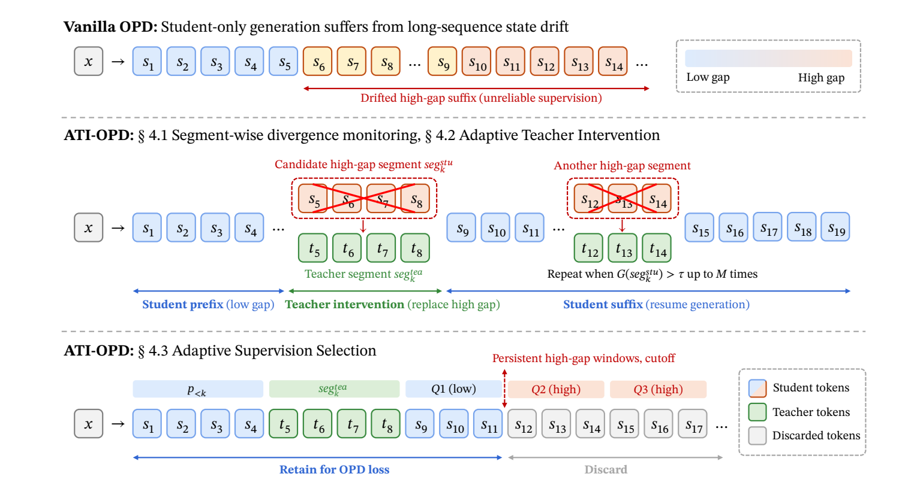

**原文 Figure 2，PDF 第 5 页。** 自左到右读原学生回复、首个分歧触发段、老师的有限段落、学生重采后缀。最后两窗确认偏离后只改变损失掩码。普通 OPD 对照用原学生全回复，固定截短 ESR 对照没有先局部改写。

### 公式、训练信号与算例

题目 $`x`$ 与已生成文本 $`y_{\lt t}`$ 构成前缀 $`h_t`$。冻结的采样快照为 $`\pi_{\rm old}`$，教师为 $`\pi_T`$，已采样词 $`y_t`$ 的对数概率差与 K3 定义为

```math
\delta_t=\log\frac{\pi_T(y_t\mid h_t)}{\pi_{\rm old}(y_t\mid h_t)},\qquad
g_t=e^{\delta_t}-\delta_t-1 .
```

由 $`e^z\ge1+z`$ 得非负；学生分布有全支持且不裁剪时，$`e^{\delta_t}`$ 的学生期望为 1，所以 $`\mathbb E[g_t]=-\mathbb E[\delta_t]=D_{\rm KL}(\pi_{\rm old}\|\pi_T)`$。阶段一将裁剪后的 $`\bar g_t`$ 在每段 $`S_i`$ 上平均，只用有效学生 token 的指示 $`m_t`$，得到 $`G_i=\sum_{t\in S_i}m_t\bar g_t/\sum_{t\in S_i}m_t`$。选择第一个超过固定阈值 $`\tau`$ 的段。保留它之前的原前缀，教师最多生成 $`L_T`$ 个词，学生从拼接前缀重新续写到 EOS 或总预算。

令 $`W_j`$ 为接管后第 $`j`$ 个有效续写窗，$`b_j`$ 是该窗起点。$`H_s`$ 是历史上答对的原回复窗口分数的延迟缓冲区。自适应边界是

```math
\begin{aligned}
Q_j&=\frac1{|W_j|}\sum_{t\in W_j}\bar g_t,\quad
\eta_s=\mathrm{Quantile}_{0.90}(H_s),\\
j^\star&=\min\{j:Q_j>\eta_s,\ Q_{j+1}>\eta_s\},\quad
c=b_{j^\star}-1 .
\end{aligned}
```

没有连续两窗超界时，$`c`$ 取完整回答长度；缓冲不足 128 个点时用 $`\tau`$。候选需至少 32 个有效词。教学写法下令 $`M_t`$ 指输出序列中受监督的位置，复用 OPD 局部目标

```math
\ell \ \propto\ \sum_t M_t
D_{\rm KL}\big(\pi_\theta(\cdot\mid h_t)\|\pi_T(\cdot\mid h_t)\big).
```

$`\theta`$ 是训练中学生；教师 token 在主实验也有监督，后缀超过 $`c`$ 部分掩去。上式展示分布级意图。实作取 rollout 学生 top-16 中两方 log-prob 有限的候选集合 $`V_t`$。下式的 $`w_t`$ 是候选内归一化的旧学生概率，$`A_t`$ 是其加权教师信用，$`\rho_t`$ 是当前对旧学生概率比，$`\bar\rho_t`$ 经过 PPO 剪裁：

```math
\begin{aligned}
w_t(v)&=\frac{\pi_{\rm old}(v\mid h_t)}{\sum_{u\in V_t}\pi_{\rm old}(u\mid h_t)},\\
A_t(v)&=w_t(v)\left[\log\pi_T(v\mid h_t)-\log\pi_{\rm old}(v\mid h_t)\right],\\
\ell_t^0(v)&=\max[-\rho_t(v)A_t(v),-\bar\rho_t(v)A_t(v)] .
\end{aligned}
```

原文先把比率的 log 裁到 ±20，再取指数，PPO 比率裁在 0.8 到 1.2；对负优势还取 $`\min(\ell_t^0,-3A_t)`$ 作双重裁剪。对每位置的候选求和，按掩码保留的位置平均。原答案对错用于跟踪可信窗阈值，学生核心学习信号为教师分布。测试时去掉接管、K3 打分和剪裁。

**本文算例。** 一个词的学生概率 0.4、教师概率 0.2，得到 $`\delta_t=-0.693`$，K3 是 $`0.5+0.693-1=0.193`$。如果连续三段均值是 0.07、0.19、0.25，阈值 0.15 时首先改写第二段。改写后学生三窗为 0.10、0.16、0.21，若该步边界 0.15，就在第二窗前停止监督，保留第一窗中的学生贡献。

```text
从旧学生采完整解答，教师在原序列上给分
分段计算裁剪 K3，找到第一个超过阈值的片段
教师从其前缀写短片段，学生接力，直至完成
对续写分窗，若相邻两窗超历史分位点，从第一窗开始掩去
用新轨迹有效 token 的 top-16 OPD 更新学生
将正确原回复的窗口分数写入延迟阈值缓冲
```

### 数据、实验与局限

**原文事实。** DAPO-Math-17K。老师是 JustRL-DeepSeek-1.5B 或 JustRL-Nemotron-1.5B，学生分别为 DeepSeek-R1-Distill-Qwen-1.5B 或 OpenMath-Nemotron-1.5B。每题 4 条、批量 64、217 步、AdamW 学习率 $`10^{-6}`$，回复至多 23,552 词。默认一段接管，监测及替换各 128 词，续写窗 64。教师温度 0.6、top-p 0.95、top-k 20。原文主配置未披露 GPU 型号或端到端训练时间，额外开销至少包括初始全答复评分和被触发样本重采。已核对公开代码的接管训练入口、剪裁参数和分析脚本。

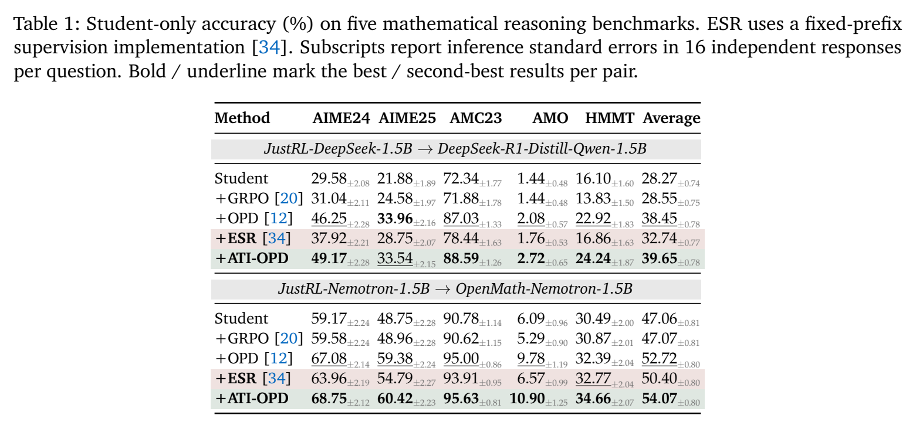

**原文 Table 1，PDF 第 6 页。** 五个基准 AIME24、AIME25、AMC23、AMO、HMMT。教师不参与评测，每题十六次样本。DeepSeek 家族的普通 OPD 是 38.45%，ATI 为 39.65；Nemotron 为 52.72 对 54.07。前者 AIME25 略降，所以平均提升不代表逐项领先。旁边误差来自推理样本，不能当独立重复训练的不确定性。

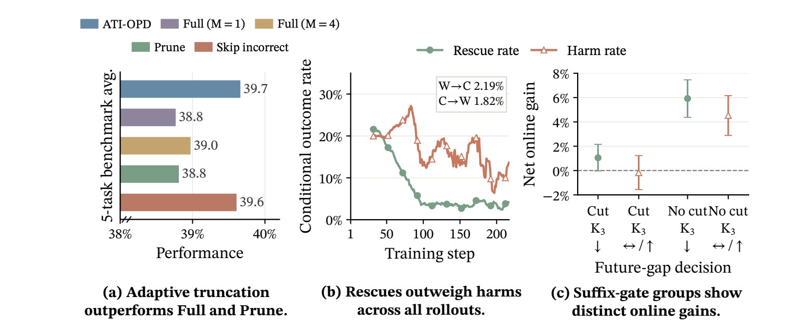

**原文 Figure 7，PDF 第 10 页。** 先比左侧完整方案和全后缀、只保留到接管段、丢整条错题的平均分；中间读接管把错误变对和把正确变错的比例。全样本上救回 2.19%、带坏 1.82%，即时净收益 0.37 个百分点。去掉答错的整条样本仍有 39.60，对完整 39.65。因此被采路径最终错时，部分词仍可提供有用反馈。右侧按续写有无剪裁以及局部 K3 是否下降分组。

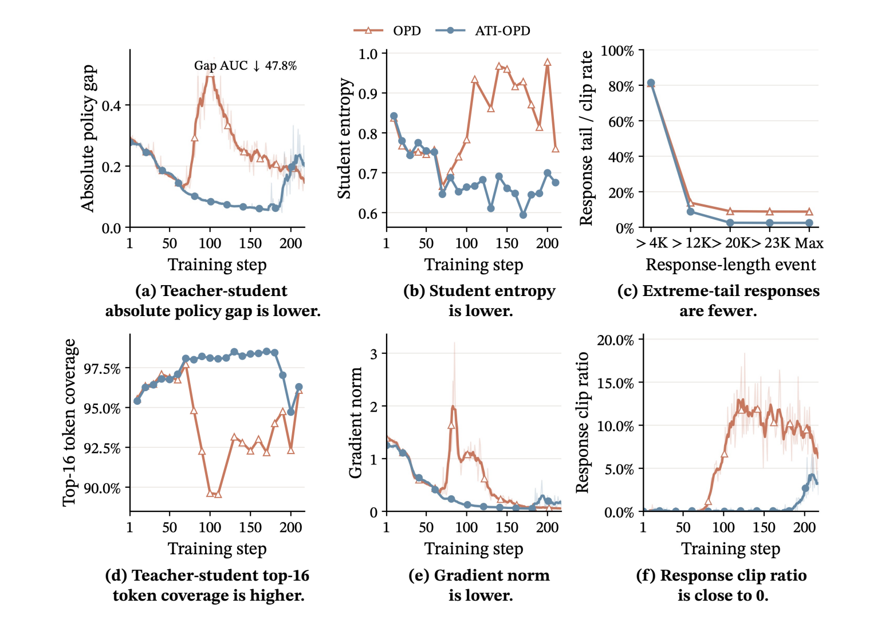

**原文 Figure 3，PDF 第 7 页。** JustRL-DeepSeek 对照普通 OPD 与 ATI。曲线分别看逐词 log-prob 绝对差、熵、top-16 覆盖、梯度范数和截断率，尾部长度是最后 32 步的快照。原文对 1 至 217 步的原始绝对差用梯形积分，报告 AUC 降 47.8%。诊断统计还含被掩去的生成位置，两方案承载的轨迹也不同。

**边界。** 长文本先全生成再改写和重采，请勿把这个方法理解为节省 rollout；论文展示的是更稳的训练诊断和平均准确率。主要两对学生均 1.5B，7B 附录为探索性；生效阈值会受教师概率校准、温度和长度影响。程序判断的是分布差而非逻辑错误。[veRL 文档](https://verl.readthedocs.io/en/latest/)

<a name="paper-mass"></a>

## 2. MASS · 参考解多遮罩与可靠性加权

**原文** 2026-10-28 首发。[arXiv 版本及摘要](https://arxiv.org/abs/2610.38154) · [v1 PDF](https://arxiv.org/pdf/2610.38154v1) · [作者代码](https://github.com/researcheranoymous-oss/MASS_2027/tree/32bcedf580799d34fe0bc79bd414f130dad2ba86)

### 问题、方法与原图

教师看完整参考时可能偏爱参考解的写法，压低别的正确路径。MASS 让学生完全独立采样，将参考解按标点和公式边界切成片段，然后让教师分别看不同遮罩。它用均值当目标，用分歧评估估计噪声，并利用全参考教师作为参照，判断纠正是否打破原参考偏好。对训练里会重复访问的样本，归因器可以把遮罩搜索集中到最能影响意见的片段。

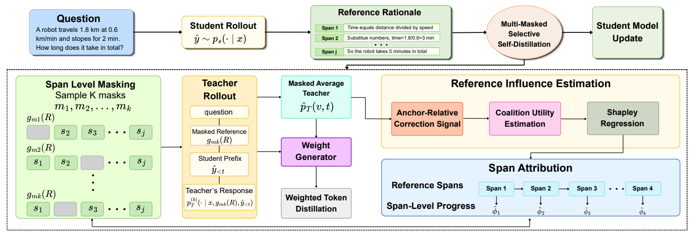

**原文 Figure 2，PDF 第 3 页。** 学生先仅凭题目出轨迹。同一前缀流向多份遮罩教师，完整参考教师供应锚点。汇总后一路进入加权蒸馏，另一路计算片段归因并更新下次遮罩。普通 OPSD 只用全参考教师。

### 教师均值与方差

在词位置 $`t`$，学生分布 $`\pi_t`$，完整参考教师 $`p_{0,t}`$。参考 $`R`$ 有 $`J`$ 个片段，每片段遮盖独立抽 $`m_j\sim\mathrm{Bernoulli}(q_j)`$。第 $`k`$ 个遮罩给教师分布 $`p_{k,t}`$。定义 $`p_t^\star=\mathbb E_m[p_{m,t}]`$ 为理想遮罩平均，$`\widehat p_t=K^{-1}\sum_k p_{k,t}`$ 为 $`K`$ 个独立样本的估计。把估计代入学生与教师的正向 KL，softmax logits 梯度就是概率差 $`\widehat g_t=\pi_t-\widehat p_t`$。

```math
\begin{aligned}
\widehat V_t&=\frac{\sum_{k=1}^K\|p_{k,t}-\widehat p_t\|_2^2}{K(K-1)},\\
\widehat S_t&=\|\pi_t-\widehat p_t\|_2^2-\widehat V_t,\\
\widehat B_t&=\langle\pi_t-\widehat p_t,p_{0,t}-\widehat p_t\rangle-\widehat V_t .
\end{aligned}
```

$`\widehat V_t`$ 是样本均值的方差迹，分子是各教师离均值的平方距离，分母先无偏化方差再除以 $`K`$。$`S_t`$ 是理想纠正的平方范数，$`B_t`$ 是学生与锚点相对理想目标的同向量；都用同一随机均值时额外含一份方差，故减去 $`\widehat V_t`$。令 $`[a]_+=\max(a,0)`$，$`T`$ 是输出长度，$`\mathrm{sg}`$ 停止梯度，损失为

```math
\begin{aligned}
\widehat w_t&=\min\!\left(1,\frac{[\widehat S_t]_++\lambda[\widehat B_t]_+}
{[\widehat S_t]_++\widehat V_t+\epsilon}\right),\\
\mathcal L&=\frac1T\sum_{t=1}^T
\mathrm{sg}(\widehat w_t) D_{\rm KL}\big(\mathrm{sg}(\widehat p_t)\|\pi_t\big).
\end{aligned}
```

$`\lambda`$ 给锚点证据加权，$`\epsilon`$ 防除零。论文从缩放后的纠正误差 $`(1-w)^2S+w^2V+\epsilon w^2-2\lambda w[B]_+`$ 出发，独立采样下误差期望的交叉项为零。对 $`w`$ 求导、设为零，再截断到 1，即得到该式的总体版本。低信噪比减小权重，锚点强证据可保住纠正。任务奖励不进入蒸馏，验证解作训练特权条件。

**本文算例。** 两个遮罩教师对候选甲的概率 0.6 和 0.8，学生 0.9，完整参考教师 0.95，候选乙为各自的余数。均值 0.7，所以 $`\widehat V=0.02,\widehat S=0.06,\widehat B=0.08`$。忽略微小正则，$`\lambda=0`$ 时给纠正 0.75 倍；$`\lambda=0.5`$ 时比值 1.25，截到 1。这里完整参考教师只决定保留力度，目标仍是 0.7。

### 遮罩归因与更新

令 $`A`$ 为被遮片段集合，$`p_{A,t}`$ 为其教师预测。同次训练的所有遮罩共用一个固定比较方向；效用 $`v(A)`$ 对各词求学生偏差与教师从锚点改变的内积。片段 $`j`$ 的 Shapley 值是随机排列中该片段加入时带来的平均边际效用：

```math
\begin{aligned}
v(A)&=\frac1T\sum_t\langle\mathrm{sg}(\pi_t-\widehat p_t),p_{0,t}-p_{A,t}\rangle,\\
\phi_j&=\sum_{A\not\ni j}\frac{|A|!(J-|A|-1)!}{J!}
[v(A\cup\{j\})-v(A)] .
\end{aligned}
```

不枚举所有片段组合。原文用抽到的遮罩做带 Shapley 核与采样概率修正的岭回归，正则中心为以往归因的 EMA $`z`$，并约束归因和等于全遮罩效用。具体以 $`v(A_k)`$ 为第 $`k`$ 个观测、$`m^{(k)}`$ 为其遮罩向量、$`\omega_k`$ 为采样校正后的核权重，在以下约束中求解：

```math
\begin{aligned}
\widehat\phi&=\arg\min_{\beta}\sum_k\omega_k[v(A_k)-(m^{(k)})^\top\beta]^2
+\tau\|\beta-z\|_2^2,\\
&\quad \sum_j\beta_j=v(\{1,\ldots,J\}).
\end{aligned}
```

$`\tau`$ 是岭强度，解向量 $`\widehat\phi`$ 的坐标用作片段归因。用 $`I_j=[\widehat\phi_j]_+`$ 做下一轮遮罩优先级，求

```math
\begin{aligned}
q^{+}=\arg\max_{q\in Q}\;\sum_j I_j H_{\rm Ber}(q_j)
-\eta^{-1}\sum_j D_{\rm KL}(\mathrm{Ber}(q_j)\|\mathrm{Ber}(q_j^{\rm old})).
\end{aligned}
```

$`Q`$ 要求 $`\sum_jq_j=\rho J`$ 且 $`\epsilon_m\le q_j\le1-\epsilon_m`$。$`H_{\rm Ber}`$ 是二元熵，在半开半关处最大，所以高归因片段获得更均衡的有无对照机会；Bernoulli KL 限制邻轮变动，$`\eta`$ 控制更新幅度。做法不是把贡献大的片段一律永远藏起来。

```text
学生从题目独立生成一条推理，保存访问前缀
从参考片段独立抽 K 份遮罩，教师并行对各前缀评分
取遮罩均值，同时用全参考锚点、样本方差估计各词可靠性
用停止梯度的词权重做正向 KL
对抽样遮罩做归因回归，平滑保存归因及下一次的遮罩概率
```

### 数据、数值与边界

**原文事实。** OpenThoughts 数学 30K 条；Qwen3-1.7B、4B、8B 及 OLMo-7B。批量 32，250 步，每题一条，训练温度 1.1、序列上限 1,024，学习率 $`5\times10^{-6}`$。默认 $`K=8,\rho=0.3,\lambda=0.5`$。评测 AIME24、AIME25、HMMT25 各 360 条生成，按 Avg@12。表 7 在同 4B 假设下估算每步 MASS 为 $`3.41\times10^{15}`$ FLOPs，OPSD 为 1.31、RLSD 为 $`8.39\times10^{15}`$，MASS 约为 OPSD 的 2.60 倍。原文未给实际训练时间或 GPU 型号；算力估计不能代替墙钟。

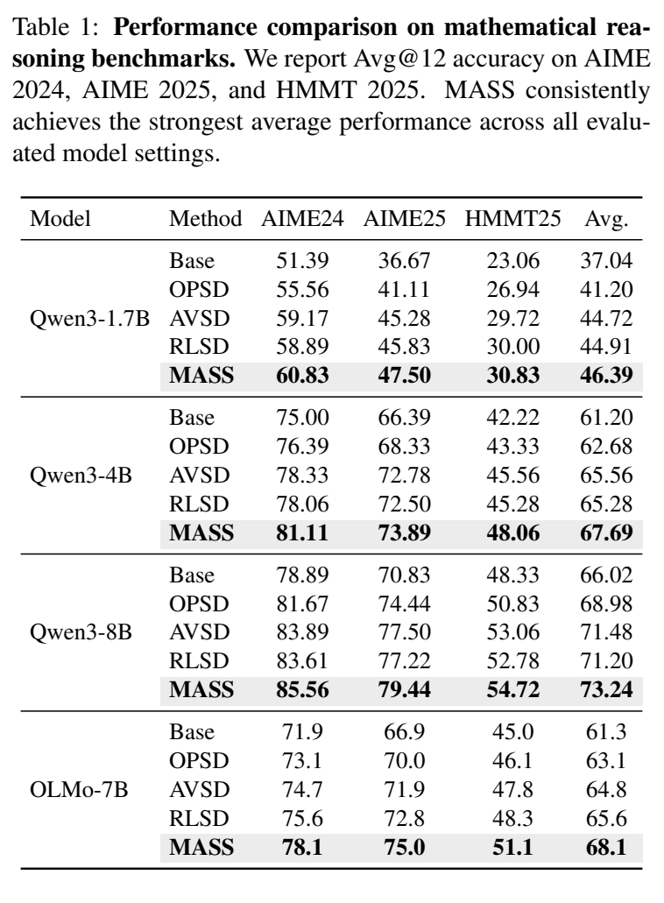

**原文 Table 1，PDF 第 4 页。** 每个规模内部比较 Base、OPSD、AVSD、RLSD 和 MASS。4B 的三数据集等权平均从 OPSD 62.68、AVSD 65.56、RLSD 65.28 到 MASS 67.69。8B 的 MASS 73.24，对 OPSD 68.98；OLMo 为 68.1，对 63.1。

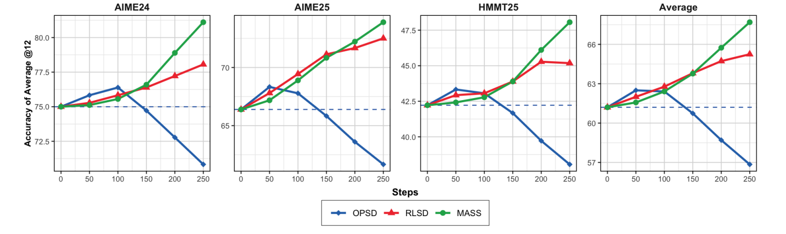

**原文 Figure 3，PDF 第 5 页。** 各面板横轴均为训练步，按面板标题读取评测集。图注特别点出 AIME25，对比 OPSD 先快后降、RLSD 更稳和 MASS 后程追上。步数没有计入额外教师前向，须结合表 7 解读。

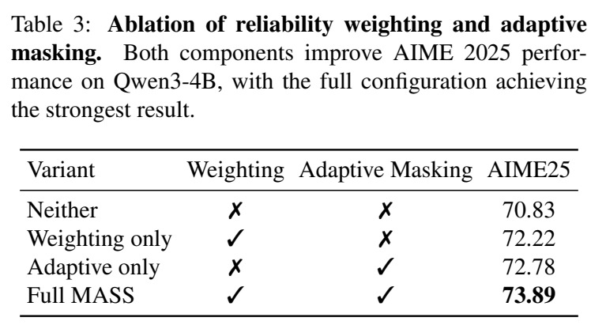

**原文 Table 3，PDF 第 6 页。** 在 4B AIME25 上，无加权也无自适应为 70.83，只用加权 72.22，只用自适应 72.78，全开 73.89。表 2 把锚点加到教师目标后 4B 降到 72.50。

**复现与局限。** 作者公开版本含训练和评测脚本，以及均匀遮罩与可靠性加权实现。代码注释声明默认关闭自适应遮罩，Shapley 拟合及概率更新内核暂未公开，默认运行对应只加权消融。遮罩平均是单一参考的近似，不能枚举独立正确解法。归因来自少量采样的正则回归，对强交互片段的解释应慎重。原文同时给出数学以外的 GPQA 和 BBH 迁移实验，但主要训练只覆盖数学，亦没有独立种子方差来量化小幅差异。[OpenThoughts 项目](https://www.openthoughts.ai/) · [OPSD 原文](https://arxiv.org/abs/2601.18734)

<a name="paper-isa"></a>

## 3. ISA-Distill · 按学生能否找回事实分配反馈

**原文** 2026-11-01 首发。[arXiv](https://arxiv.org/abs/2611.01987) · [v1 PDF](https://arxiv.org/pdf/2611.01987v1)

### 问题与两个教师视角

搜索代理如果已经知道事实，可以直接用事实回答；不知道就应该检索。教师若在训练中提前拿到参考答案，可能觉得学生的检索动作多余，给出和学生当下信息相冲突的反馈。ISA-Distill 从当前动作选一个关键事实，测学生能否从行动前已有信息中恢复它。训练时的两个教师视角对同一个学生动作评分：知道值的继续使用事实，只知道信息需求的鼓励找证据。

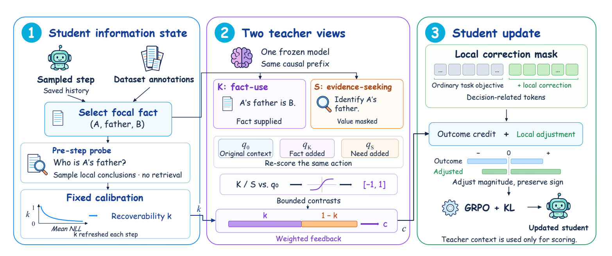

**原文 Figure 3，PDF 第 3 页。** 左侧探针用行动之前的保存状态，当前查询和其结果尚未出现；中央两路用同一采样动作打分；右侧才与结果优势合并。对照 EviSD 加实例证据，ISA 单独评估学生拿到事实前需要什么信息。

### 从问题状态到局部优势

令 $`s_t^-=(q,h_{\lt t},E_{\lt t},b_t)`$ 是行动前状态，分别指问题、已有文本历史、已完成检索的证据和剩余搜索预算。选择器用训练时的支持证据或标准答确定焦点事实。探针 $`P`$ 问实体和关系，省略焦点值及参考答案的独有别名。冻结旧策略 $`\pi_{\rm old}`$ 不检索，生成 $`J=32`$ 条局部结论。每条 $`y^{(j)}`$ 有 $`M_j`$ 个 token，均值负对数似然和探针读数为

```math
\begin{aligned}
U_j&=-\frac{1}{M_j}\sum_{m=1}^{M_j}
\log\pi_{\rm old}(y_m^{(j)}\mid P,y_{\lt m}^{(j)}),\\
u&=J^{-1}\sum_j U_j,\qquad k=f_{\rm cal}(u)\in[0,1].
\end{aligned}
```

$`u`$ 低表示模型对自己写的局部结论更有信心，仍需用已标注状态校准。原文把校准状态分入 100 个等宽区间，保留样本数 $`n_j\ge50`$ 的箱子，箱均 NLL $`\Phi_j`$ 与正确率 $`\Psi_j`$。令 $`W_h=e^{-(u-\Phi_j)^2/(2h^2)}+e^{-(u+\Phi_j)^2/(2h^2)}`$ 为高斯核加零边界的镜像项，$`h=0.055`$。于是 $`k=\sum_j n_jW_h\Psi_j/\sum_j n_jW_h`$ 是一组正确率的归一化加权平均，每种骨干训练前拟合并固定。训练中重新计算 $`u`$，不会用标签修改这一批的校准函数。

令 $`a`$ 为实际生成的 token，$`q_0(a)`$ 是原上下文概率，$`q_K(a),q_S(a)`$ 分别是加事实提示和求证提示的冻结旧模型评分。$`m\in\{0,1\}`$ 选择查询开头标签、查询词或相关结论片段；$`\tau`$ 是对数差灵敏度。两个证据视角及局部修正为

```math
\begin{aligned}
z_j&=\tanh\!\left(\tau\log\frac{q_j(a)}{q_0(a)}\right),\quad j\in\{K,S\},\\
c&=m[kz_K+(1-k)z_S],\qquad
\widehat A_i=A_i+\lambda |A_i|\,\mathrm{sg}(c).
\end{aligned}
```

$`A_i`$ 用同题组的 0/1 最终答案奖励求去均值、除以组内稳定化标准差。$`\lambda\in[0,1)`$ 保证局部修正不翻转结果信用的正负，因为 $`|\lambda c|\lt1`$。原文附录的训练损失为下式括号按回答 token、组和题目平均后的负值：

```math
\begin{aligned}
\rho_{i,n}(\theta)&=\frac{\pi_\theta(a\mid s)}{\pi_{\rm old}(a\mid s)},\\
J_{i,n}&=\min\{\rho_{i,n}\widehat A_i,\,
\mathrm{clip}(\rho_{i,n},1-\epsilon,1+\epsilon)\widehat A_i\}
-\beta_{\rm KL}D_{\rm KL}(\pi_\theta\|\pi_{\rm ref}).
\end{aligned}
```

$`s`$ 是原始可见前缀、$`i,n`$ 分别是轨迹与 token 索引，$`\epsilon`$ 定义 PPO 比率区间。最后一项拉住固定参考策略 $`\pi_{\rm ref}`$；实现可用标准 KL 估计。两个教师分数通过优势进入 GRPO，没有全词表蒸馏项。如果组内全对或全错，结果优势和局部修正都为零，只剩参考项。

**本文算例。** 某个搜索 token 的教师对比值取 $`z_K=-0.6,z_S=0.5`$。学生找回事实的估计为 0.2，$`c=0.2(-0.6)+0.8(0.5)=0.28`$。若 $`A=-1,\lambda=0.2`$，剪裁前的局部优势为 −0.944，搜索动作受到的负反馈小一点。若 $`k=0.9`$，$`c=-0.49`$，优势降至 −1.098。两个例子的结果奖励一样，信息状态不同。

```text
旧策略按题分别采八条可调用检索器的轨迹
对每个选中的动作恢复行动前状态，构造隐去事实值的探针
用旧策略采 32 条局部结论，用骨干专属校准图换算可恢复率
从相同动作前缀按原始、已有事实、需要求证三个视角评分
在目标动作词上加有界修正，照终局奖励做 GRPO 更新
```

### 数据、成本、评测与复现

**原文事实。** Qwen2.5-3B/7B-Instruct，另测 Llama-3B。NQ 与 HotpotQA 为域内，另五个 QA 数据集检验迁移。论文给出 51,713 题评估样本，焦点事实来源为训练时支持证据及答案；校准示例用 50,000 个 7B 已保存的前状态、每个 32 条结论。训练 4 GPU，300 步，128 题每批、每题 8 次 rollout，完整参数训练，学习率 $`10^{-6}`$，最多 3 次检索，每次取 3 条。推理仅学生与检索工具。论文给出单步耗时，无独立端到端 GPU-hours 或 GPU 型号。

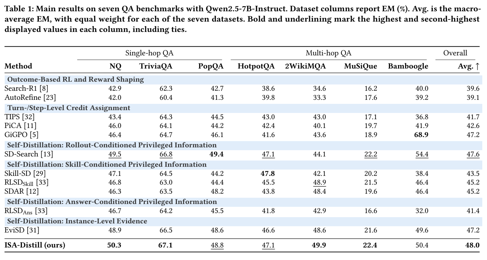

**原文 Table 1，PDF 第 4 页。** 从右列读 7 个数据集的等权 EM。7B 的 ISA 为 48.0，EviSD 47.2、SD-Search 47.6、Search-R1 39.6。3B 表 2 则是 43.9 对 EviSD 42.6。7B 的检索分组表显示单跳比 EviSD 少 7.21%，多跳多 2.94%，总体少 2.45%；调用数的组汇总按样本数权重，不同于准确率宏平均。

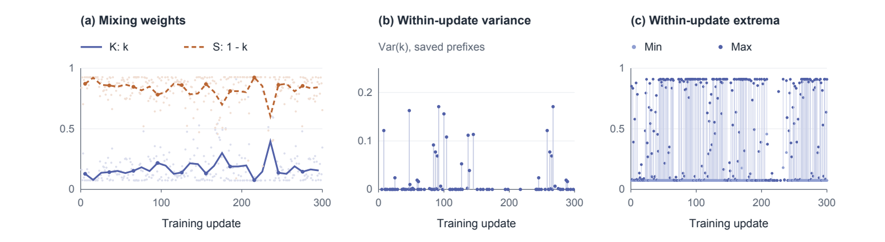

**原文 Figure 7，PDF 第 7 页。** 左看训练步上的十步平均，两视角大致以求证为主；中看单步方差，右看每步的极值。不同状态的权重有差，故平均权重固定不一定等效。3B 消融中，只用事实为 41.2 EM、1.92 次搜索，只用求证为 43.3、2.97 次；固定 0.2/0.8 混合为 41.3、2.13；自适应为 43.9、2.22。

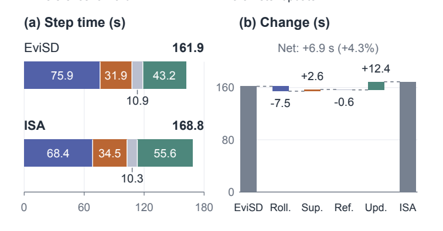

**原文 Figure 9，PDF 第 7 页。** 堆叠条形拆解 rollout、监督及优化。ISA 平均 168.8 秒，EviSD 为 161.9 秒，多 4.3%；论文称新增视角打分与探针成本被较少的 rollout 和检索部分抵消。附录给出提示词和训练参数，作者声明将开源代码和权重，本期未核实到发布。模型自信不保证事实正确，刷新学生后固定校准可能漂移；视角去掉的只是附加提示的事实值，旧历史和模型记忆里可能仍有答案。需要相同检索语料、评估分割和有效输出格式才可对照。[Search-R1 原文](https://arxiv.org/abs/2503.09516) · [TRL GRPO 文档](https://huggingface.co/docs/trl/grpo_trainer)

<a name="paper-oc"></a>

## 4. OC-OPD · 协调排序修正与覆盖修正

**原文** 2026-11-01 首发，2026-11-21 更新。本文用 v2 的公式和实验，按同一 ID 只收录一次。[arXiv 版本记录](https://arxiv.org/abs/2611.01965) · [v2 PDF](https://arxiv.org/pdf/2611.01965v2) · [作者代码](https://github.com/RuoranXu/OC-OPD/tree/2105b38b35e9452ef498ee89383782991ebbf239)

### 问题与原架构图

按学生分布加权的反向 KL 主要修正常见候选词。教师很喜欢、学生却几乎不采样的词，在反向 KL 下会得到很弱的反馈。按教师分布加权的正向 KL 可以补它们，但在多个词的候选空间里，两个更新方向可以成钝角。OC-OPD 将它们写成对同一前缀的四元观察，求同时降低两个差异的局部方向，再按分布差调强度。

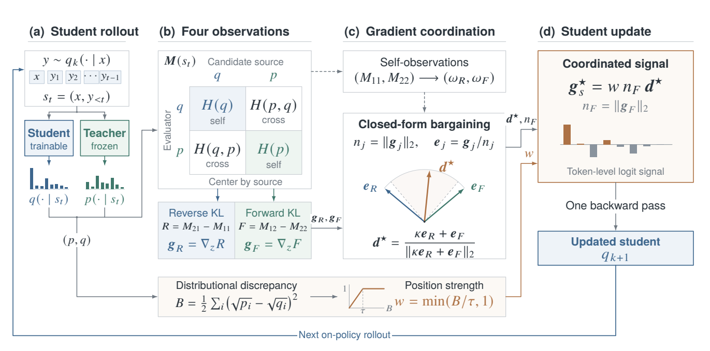

**原文 Figure 1，v2 PDF 第 1 页。** 从左向右看学生采样、两模型对同一前缀各出分布、四格观察、协商和一次反传。反向 KL 普通 OPD 只用其中一个方向，不需要协调器；本方法同时保留正向与反向两路。

### 从四格交叉熵到同降方向

在共享前缀 $`s`$，学生分布 $`q`$ 与冻结教师分布 $`p`$ 定义在对齐词表上。$`H(a,b)=-\sum_i a_i\log b_i`$ 表示用分布 $`a`$ 的候选来评测 $`b`$，$`H(a)=H(a,a)`$。行是评分者，列是候选来源，均先学生后教师：

```math
M=\begin{pmatrix}H(q)&H(p,q)\\ H(q,p)&H(p)\end{pmatrix},
\quad R=M_{21}-M_{11},\quad F=M_{12}-M_{22}.
```

同一列减去自评分，拆开求和即可得 $`R=D_{\rm KL}(q\|p)`$ 和 $`F=D_{\rm KL}(p\|q)`$。令 $`z`$ 是学生 logits，$`\odot`$ 为逐元素乘法，$`\mathbf1`$ 是全 1 向量，$`\log(q/p)`$ 按坐标求比。对 softmax 求导得

```math
J=\mathrm{diag}(q)-qq^\top,\qquad
g_R=J\log(q/p)=q\odot[\log(q/p)-R\mathbf1],\qquad
g_F=q-p .
```

正向 KL 对学生的导数只来自交叉熵，减去教师自身熵不改变梯度。反向 KL 中常数向量被 softmax Jacobian $`J`$ 消掉。若学生词概率趋零而教师概率固定为正，$`g_{R,i}`$ 趋零，$`g_{F,i}`$ 趋于 $`-p_i`$。在两分布都正的条件下，$`g_F`$ 的坐标和为零，在 Fisher 矩阵 $`J`$ 的值域。用 $`J^+`$ 表示伪逆，便得到

```math
g_R^\top J^+g_F=\log(q/p)^\top(q-p)=R+F .
```

第一等号是因为 $`JJ^+g_F=g_F`$；第二个是展开两方向的 KL。只要 $`q\ne p`$，右端严格正，两个非零梯度不能是反向共线，否则左端会负。于是存在一个单位向量 $`d`$ 同时让两个梯度的内积为正，沿 $`-d`$ 走足够小的**固定前缀 logit 步**会同时下降。共享参数和新 rollout 会改变前缀，结论不能直接套给每一步大模型训练。

### 如何选方向和强度

把学生和教师熵转为 $`h_q=H(q)/(H(q)+h_0)`$、$`h_p=H(p)/(H(p)+h_0)`$。未归一化权重 $`u_R=\epsilon+(1-h_p)h_q`$、$`u_F=\epsilon+h_p`$ 求和归一后为 $`\omega_R,\omega_F`$。含义是教师分布更分散时偏覆盖，教师集中而学生很分散时加强修正。对 $`j=R,F`$，设 $`n_j=\|g_j\|_2`$、$`e_j=g_j/n_j`$，$`c=e_R^\top e_F`$ 是夹角余弦。最大化 $` \sum_j\omega_j\log(e_j^\top d)`$，约束每个内积为正且 $`\|d\|_2\le1`$。对数提高弱势一方的边际贡献。最优方向在两梯度张成的平面，置 $`d=(\kappa e_R+e_F)/D`$，$`D`$ 为归一因子。将这两个投影代入目标求导可化成 $`\omega_F\kappa^2-c(\omega_R-\omega_F)\kappa-\omega_R=0`$，取正根：

```math
\begin{aligned}
\kappa&=\frac{c(\omega_R-\omega_F)
+\sqrt{c^2(\omega_R-\omega_F)^2+4\omega_R\omega_F}}{2\omega_F},\\
D&=\sqrt{\kappa^2+2\kappa c+1},\qquad
d^\star=\frac{\kappa e_R+e_F}{D}.
\end{aligned}
```

定义平方 Hellinger 距离 $`B=\tfrac12\sum_i(\sqrt{p_i}-\sqrt{q_i})^2`$ 和位置门 $`w=\min(B/\tau,1)`$，输出修正 $`g^\star=w n_Fd^\star`$。当两分布完全相同直接返回零。等价线性系数是 $`a=w n_F\kappa/(D n_R),b=w/D`$，所以 $`g^\star=ag_R+bg_F`$。它们冻结后可加权两种 KL，论文实装的 surrogate 是

```math
\mathcal L_s=\sum_i\mathrm{sg}(g^\star_i)\log q_\theta(i\mid s).
```

这里使用正号。因 $` \sum_i g^\star_i=0`$，对 log-softmax 求导的共同归一化项相消，梯度正好为 $`g^\star`$。对有效回复位置平均并一步反传。学生优化不需要 0/1 任务奖励，GRPO 对照才用奖励。

**本文算例。** 两个词上教师 $`p=(0.8,0.2)`$、学生 $`q=(0.6,0.4)`$。正向梯度是 $`(-0.2,0.2)`$，反向梯度约 $`(-0.235,0.235)`$，同向且归一方向一致。$`B\approx0.0243`$ 超过论文阈值 0.01，门开满，最终是前者的幅值。若教师变成 (0.51,0.49)、学生 (0.5,0.5)，$`B\approx0.00005`$，门只有约 0.005。两词例只展示门，真正多方向协商需要更多候选。

```text
当前学生采样回复，教师对同前缀给全词表概率
分块计算交叉熵、两种 KL 梯度及熵偏好
由夹角与偏好求协商方向，用 Hellinger 距离缩放
冻结得到的词级向量，调用一次学生反传
部署沿用训练后的学生及对应思考开关
```

### 数据、结果、消融及可复现性

**原文事实。** DAPO-Math-17K、重新采样、整词表。学生 Qwen3-1.7B/4B、另测 Qwen3-4B-Base，教师 Qwen3-30B-A3B 的 Instruct-2507 或 Thinking-2507，附录另测 OLMo 7B 对 32B。Qwen3 批量 128、每组 1、上限 32,768，BF16、4 张 A800 80GB，AdamW 学习率 $`10^{-5}`$。原文每 128 位置一块处理 151,936 词表，固定 10,875 回复词的测试增加最多 0.435 GiB 单卡峰值；全程表逆 KL 250 步 6:54:29、OC 220 步 6:36:12，步数不同，不能用总时差当每步提速。

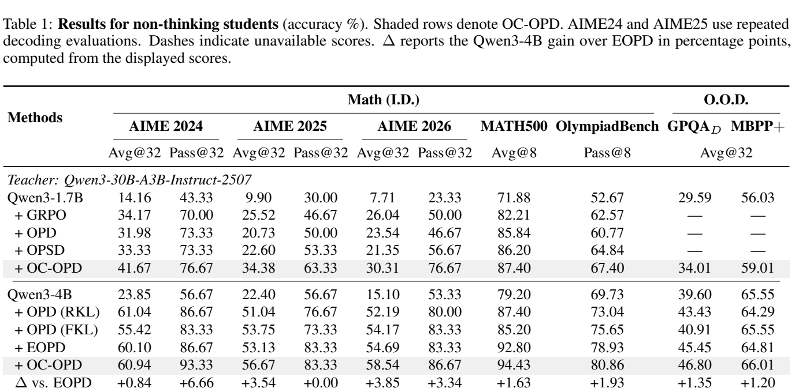

**原文 Table 1，v2 PDF 第 7 页。** 4B 非思考 AIME24 的 Pass@32 是 93.33，EOPD 86.67；Avg@32 为 60.94，对 EOPD 60.10、纯反向 KL 61.04。相同采样预算下覆盖更多题和典型单次正确率可以分开变化。GPQA-Diamond Avg@32 为 46.80，EOPD 45.45。基准使用不同样本数指标，须读表头。

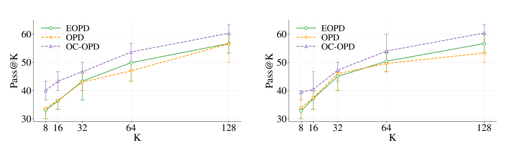

**原文 Figures 2–3，v2 PDF 第 8 页。** 左 AIME24，右 AIME25；横轴是可用采样数，纵轴是对应 Pass@k，用重复解码同一 4B-Base checkpoint 估计，与 OPD 等对照比较。到右端仍有题数上限和重复解码波动，不能当独立训练误差。

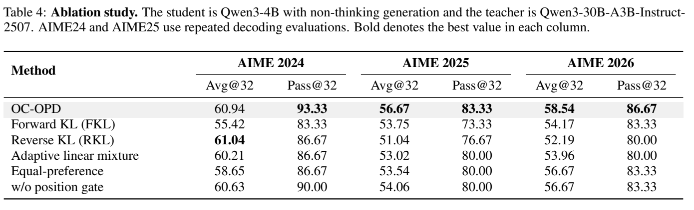

**原文 Table 4，v2 PDF 第 8 页。** 4B 非思考 AIME26 的 Avg@32 全方法 58.54，直接自适应线性混合 53.96，均等偏好 56.67，去位置门 56.67。方向、偏好与强度各自有对照。已核对公开仓库的训练、数据预处理和对照入口。共享词表、完整 logits、分块和数值稳定实现都是复现条件。论文的 Fisher 保证不等于任务奖励、全模型收敛或在新前缀上的普遍改善。[作者项目索引](https://ruoranxu.github.io/) · [TRL 蒸馏文档](https://huggingface.co/docs/trl/distillation_trainer)

<a name="paper-compute"></a>

## 5. 强到弱 OPD 与 GRPO · 按 FLOPs 对账

**原文** 2026-11-05 UTC 首发（北京时间 11 月 6 日）。[arXiv](https://arxiv.org/abs/2611.08453) · [v1 PDF](https://arxiv.org/pdf/2611.08453v1)

### 问题、两种训练流程与读图

更密的反馈可能让蒸馏每步学得更多，但每步开销也不同。学生每生成一个 token，OPD 还要调用教师评分；如果回复长度暴涨，优势可能被抵消。论文明示比较的横轴是达到某个分数要用的累计训练 FLOPs，逐一控制学生起点、训练题、分组和共享训练设置，再将教师从外部模型替换为学生自己的 GRPO 检查点。

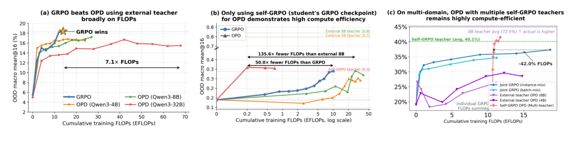

**原文 Figure 1，PDF 第 1 页。** 论文未提供独立架构图，这张是原始结果总览。左看外部教师与 GRPO，中央看同源教师是否可迅速恢复教师成绩，右看按领域路由时把教师训练成本加回后的结果。横轴 FLOPs、纵轴准确率。每条曲线只在相同评测任务及检查点条件下解释，线条斜率没有直接给出墙钟。

### 损失、算力公式与算例

给题 $`x`$，当前学生 $`\pi_\theta`$ 采同题组 $`G`$ 条解答，第 $`i`$ 条长度 $`L_i`$，在位置 $`t`$ 的前缀是 $`s_{i,t}`$。结果奖励 $`r_i\in\{0,1\}`$，答题由规则或测试用例验证。GRPO 的简化损失用去均值而不除以组内标准差：

```math
A_i=r_i-G^{-1}\sum_{j=1}^G r_j,\qquad
\mathcal L_{\rm GRPO}=-\mathbb E\Big[G^{-1}\sum_{i=1}^G A_i
\sum_{t=1}^{L_i}\log\pi_\theta(y_{i,t}\mid s_{i,t})\Big].
```

同一答案里每个词继承同样的组结果信用，组内没差别时这部分信号为零。实际用附录的 DAPO 式 0.8–1.28 比率剪裁、token-mean、一次策略更新，关闭参考 KL；上式展示每项分工。OPD 对相同学生前缀从学生取 $`S_k`$ 个最高概率候选，教师 $`\pi_T`$ 固定，各自在同一学生支持上重新归一：

```math
\begin{aligned}
\widetilde\pi_m(v\mid s)&=\frac{\pi_m(v\mid s)}{\sum_{u\in S_k}\pi_m(u\mid s)},
\quad m\in\{\theta,T\},\ v\in S_k,\\
\ell_{\rm OPD}(s)&=\sum_{v\in S_k}\widetilde\pi_\theta(v\mid s)
\log\frac{\widetilde\pi_\theta(v\mid s)}{\widetilde\pi_T(v\mid s)} .
\end{aligned}
```

$`u,v`$ 是同支持集词。按生成位置聚合局部反向 KL。主配置 $`k=16`$，候选外不会直接受监督，结果奖励也不进入这个损失。附录比较了不同反向 KL 估计器。推理时两条线用各自训练好的学生，教师不参与。

令 $`N_s,N_T`$ 为学生、教师参与矩阵运算的参数数，$`M_G,M_D`$ 为 GRPO 和 OPD 实际生成的 token 总数。按每参数每词一次前向约 2 FLOPs 来计，更新近似为一次前向、两次量级对应的反向共 6 倍参数计数，得到

```math
\begin{aligned}
C_G&=(2N_s+2N_s+6N_s)M_G=10N_sM_G,\\
C_D&=(10N_s+2N_T)M_D,\qquad
C_{\rm pipeline}=\sum_d C_{{\rm expert},d}+C_D.
\end{aligned}
```

前两个 $`2N_s`$ 分别对应 rollout 和学生 log-prob 重算。教师只多一次前向，忽略共享提示前缀的相同开销；多域总成本加每个领域 $`d`$ 训练教师的 FLOPs。近似未详计注意力长度和硬件效率。**本文算例。** 4B 学生、8B 教师时，GRPO 一词约 40G FLOPs、OPD 56G，蒸馏若生成等量词，成本是 1.4 倍。若一套蒸馏要达到相同精度，至少得少用约 28.6% 的词才抵消这个差额；生成多一倍就是约 2.8 倍。教师已经训练过时可把新增蒸馏费用单列，但报告从零成本还需相加。

```text
固定起点、训练题、采样配方并运行对照
GRPO 按最终正确性给组内信用，对学生轨迹更新
OPD 在同样生成的前缀上由教师评分，以局部反向 KL 更新
把每步真实 token 数乘相应阶段成本，累计到每个检查点
多域时预训独立 GRPO 专家，按当前题目所属域选老师
用独立题目和固定解码对比误差，分别报告阶段及总 FLOPs
```

### 实验、消融、数据与成本

**原文事实。** Qwen3 1.7B/4B/8B 为主，多为 Base，另有 SFT 冷启动与 OLMo。教师跨 4B 到 32B、外部思考型、外部教师再做 GRPO、以及同源 GRPO 检查点。训练用 DAPO-Math-17K 或 DeepMath-103K；代码用 LiveCodeBench v1–v5 或过滤后的 CodeForces；多域外加 MMLU-Pro、IFBench。CodeForces 仅保留官方全测试集并删去题面泄漏部分，1,107 训练、100 验证。数学 OOD 为 AIME24/25 及 AMC23 等权 mean@16；代码评估 LCBv6。主实验单机 8 张 H200，veRL 定制分支与 SGLang，批量 64、组大小 8、200 步、学习率 $`2\times10^{-6}`$，BF16 rollout 与 FSDP，最大回应通常 7,168。说明是共享主配置，具体域和消融配置允许变化。

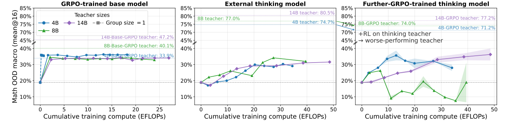

**原文 Figure 3，PDF 第 6 页。** 4B-Base 学生固定，数学 OOD，按列看三种教师来源，虚线标各教师自己的分数。左侧同源 4B 教师分数 33.9%，共享组大小设置下学生 1.62 EFLOP 达到，GRPO 到同分数 10.1 EFLOP；附录把组减为 1 后蒸馏约 0.2 EFLOP，得到约 50 倍阶段差。外部 8B 思考教师峰值 34.2% 消耗 27.2 EFLOP；外部 4B 进一步 RL 后虽一度冲高，终点从 38.7% 峰值跌到 26.0%。这里用 EFLOP 表示 $`10^{18}`$ 次运算。

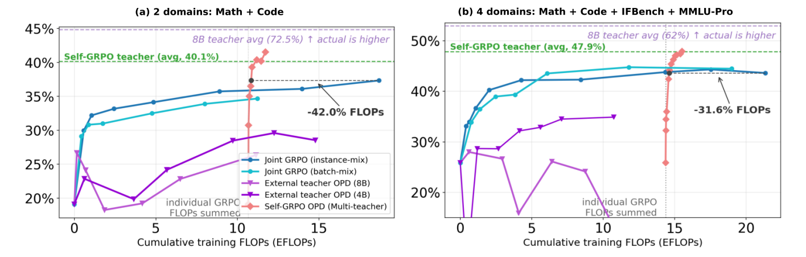

**原文 Figure 5，PDF 第 8 页。** 左图两域、右图四域；同源教师合并线从取得全部专家的 FLOPs 处开始，横向虚线参考各域专家的平均上限。两域 10.7 EFLOP 专家加 0.55 合并，四域 14.4 加 1.15，合并占前段约 5.2%、8.0%。计总量后同分数对联合 instance-mix GRPO，原文报告两域少 42.0%、四域少 31.6%。对照还含每批同领域的 joint GRPO、单外部 8B 教师 OPD。不是把同源教师的阶段比 50 倍套给端到端。

**消融与复现。** 难度分层训练看学生本来能否解题和教师成功水平；Figure 2 的八个域内格里外部教师都落后 GRPO，附录 Figure 8 在最难的部分 OOD 格见例外。学习率、批量、SFT 冷启动和两类 reverse-KL 估计器均有控制试验；组大小 1 可改善某些外部教师数学对照，未同样挽救代码。Figure 4 将初始 top-16 教师/学生交集比例与 $`(T-S^\star)/(T-S_0)`$ 比较，$`T,S^\star,S_0`$ 分别是教师成绩、训练后学生最佳成绩、起点；0 代表完全追上。14 组拟合 $`R^2=0.85`$，是这一组配置内的相关诊断。论文公布参数和数据构造，但本期未核实到实验定制分支的公开实现。等 FLOPs 不等价于等 GPU 时间，复现需固定计算口径、长度预算和评估检查点。[veRL 文档](https://verl.readthedocs.io/en/latest/) · [DAPO 项目](https://dapo-sia.github.io/)

## 基础材料

- **第一遍读 OPD。** 学生走自己的轨迹，教师逐词评分；GKD 论文比较采样来源，作者文章给出直观的同前缀对照。[GKD](https://arxiv.org/abs/2306.13649) · [Thinking Machines Lab 教程](https://thinkingmachines.ai/blog/on-policy-distillation/)
- **再对照实现。** 前向与反向 KL 的选择见蒸馏训练器，分组奖励与剪裁见 GRPO 训练器。[TRL 蒸馏](https://huggingface.co/docs/trl/distillation_trainer) · [TRL GRPO](https://huggingface.co/docs/trl/grpo_trainer)
- **公式复习。** 交叉熵和 softmax 的概率与 logits 区别有助于阅读 MASS 与 OC-OPD。[PyTorch 交叉熵文档](https://docs.pytorch.org/docs/stable/generated/torch.nn.CrossEntropyLoss.html)
