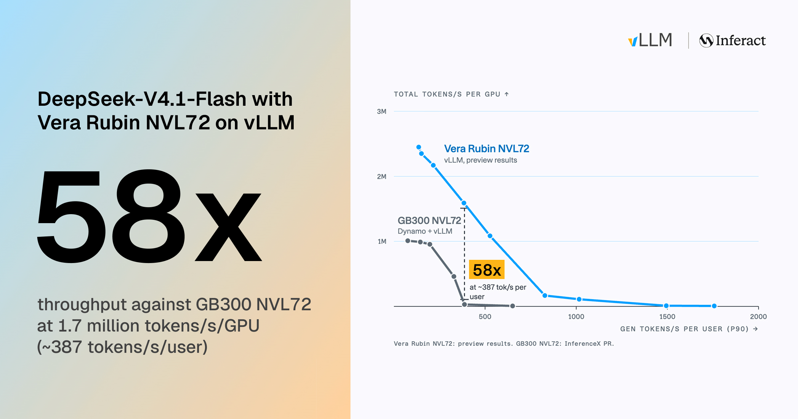
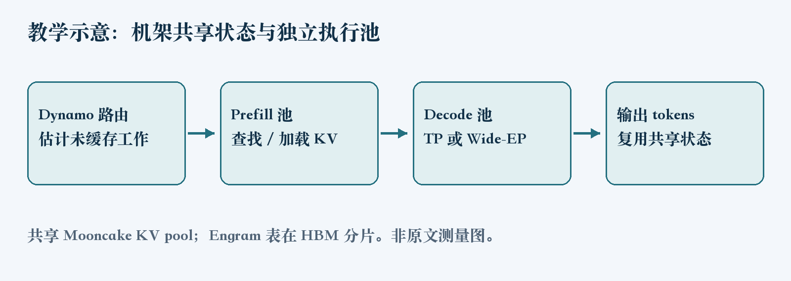
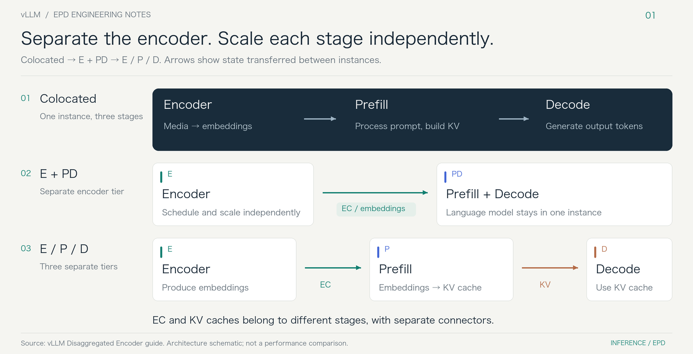
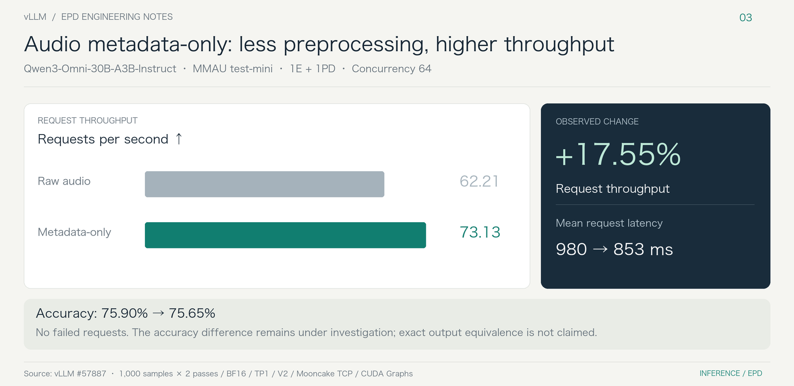
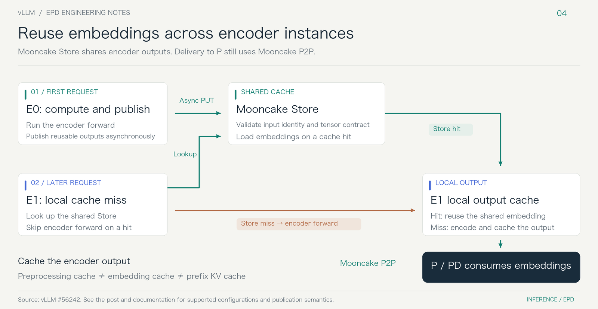
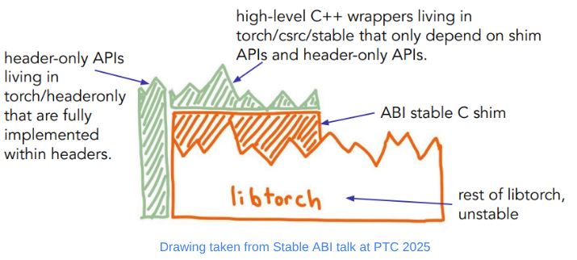
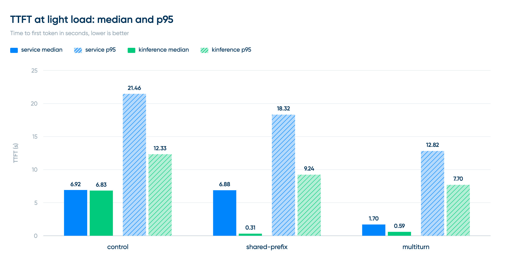
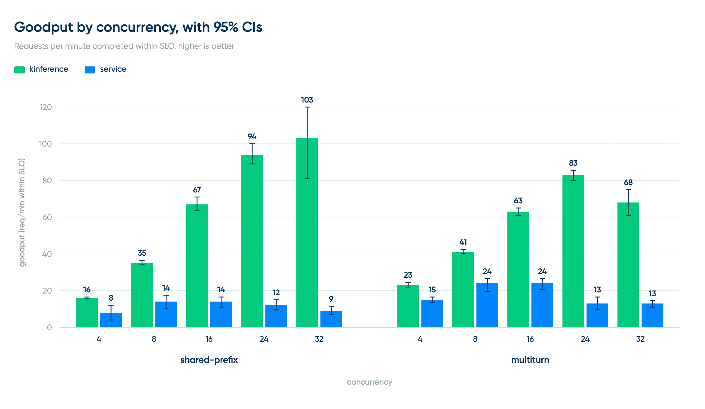
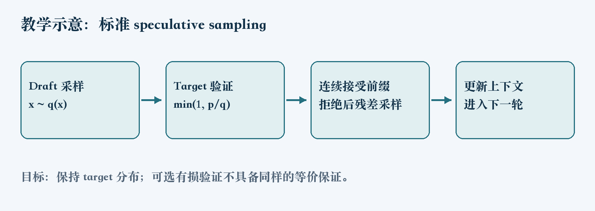

# vLLM 推理系统图文精读 - 2026-11-16

本报告归档在 VLM 方向，子主题为多模态与大模型推理系统。vLLM 是推理框架，VLM 是视觉语言模型，两者并不等同。今天的 5 项均为近期官方工程文档，非 5 篇学术论文。

**阅读方式：** 每篇先读问题和方法，再看“机制、公式与实现推演”。原文事实、作者实验、本文推导分开标注。图为原文图或明确标注的教学示意。所有本文伪代码都是概念表达，不保证可直接调用 vLLM API。

## 零基础速查：先弄懂这六件事

**Token 与自回归生成。** 模型不是一次输出整段文字，而是计算“给定前文，下一个 token 的分布”。一个 token 可能是一个字、一个子词或特殊符号。若输入是 x，已生成 y_1 到 y_(t-1)，第 t 步计算 p(y_t | x, y_<t)。所以长输出必须走很多步；单步少 1 ms，生成 1,000 tokens 就可能省约 1 秒。

**Prefill 与 Decode。** Prefill 一次处理已有 prompt，建立注意力状态；Decode 在状态上逐个产生新 token。前者往往有大矩阵乘法，后者小 batch 下常被读取权重与 KV 的带宽限制。把两种阶段放在不同 GPU 池，叫 P/D disaggregation；代价是必须搬运状态。

**KV cache。** Transformer 每层注意力将输入投影成 Q、K、V。旧 token 的 K、V 不需要每一步重算，保留下来即可。用未分片、未压缩的标准注意力作教学估算，缓存字节数约为 M_KV = 2 × L × B × S × H_KV × D × b。L 是层数，B 是并发序列数，S 是平均长度，H_KV 是 KV 头数，D 是头维度，b 是每元素字节数；2 对应 K 与 V。例：32 层、B=8、S=8192、8 个 KV 头、D=128、FP16 的 b=2，约占 8 GiB。MLA、混合注意力、量化、分片会改变这个估算，不能套成所有模型的精确值。

**PagedAttention 与前缀复用。** 分页 KV 把连续逻辑 token 映射到物理 block，减少必须预留最大长度的浪费；prefix caching 进一步在请求间复用相同前缀的 KV。两者解决的问题不同：分页管分配，前缀复用省计算。同样的文本还必须匹配模型、tokenization、模板以及其他会影响状态的条件。

**TP、DP、EP。** TP 把一个张量计算切到多个 GPU，常需 all-reduce；DP 让不同副本处理不同请求；EP 把 MoE 专家分散到 GPU，按路由发送 token。MoE 每 token 只访问部分专家，所以总参数很大但激活参数较少；专家不均衡与 token dispatch 的网络开销因此很关键。

**TTFT、TPOT 与 goodput。** TTFT 是发请求到第一个输出 token 的时间；TPOT 是后续每输出 token 的平均时间。教学近似 T_E2E ≈ TTFT + (N_out - 1) × TPOT；流式场景用户对两者都敏感。goodput 是同时满足既定延迟约束的有效吞吐，不能把所有完成但超时的请求都当作等价收益。

### 注意力公式怎样读

在单个注意力头中，Q=XW_Q、K=XW_K、V=XW_V，X 是 token 的表示矩阵，W 是训练出的投影权重。Attention(Q,K,V)=softmax(QKᵀ/√d_k + M)V。QKᵀ 给出每个位置对其他位置的匹配分数；除以√d_k 控制点积尺度；M 是 causal mask，让当前 token 看不到未来；softmax 将一行分数变成总和为1的非负权重；最后对 V 加权求和。这里 softmax(z)_i=exp(z_i)/Σ_j exp(z_j)。

一个便于手算的例子：当前 Q=[1,0]，两个历史 K 分别为[1,0]和[0,1]，d_k=2，无屏蔽时 scaled scores 约为[0.707,0]，softmax 权重约[0.67,0.33]。若对应 V 是[2,0]和[0,2]，输出约为[1.34,0.66]。这一步要读历史 K/V，却不必重新计算历史 token 的投影。KV cache 保存的是这种中间状态，通常不是最终答案，也不是一种普通的字符串缓存。

新 token 到来时，只计算它的 q_t/k_t/v_t，将 k_t/v_t 追加到缓存，再用 q_t 与历史 K 做匹配。因果关系使历史 token 的旧 K/V 不随未来新 token 改变，所以复用合法；改变模型参数、位置处理或上文 token，原状态可能就不再等价。这也是缓存 key 必须包含模型/上下文身份的原因。

入门阅读见文末的分级阅读路线。下文计算均使用这些定义。

**检索窗口：** 2026-10-17 至 2026-11-16（含）。  
**选题口径：** 选择 vLLM 官方近期发布、且包含可复用系统设计或实现细节的硬核技术文档；本日 5 篇互不重复。性能数字均为原文特定硬件、模型和工作负载下的结果，不应直接外推为通用结论。

## 今日总览

| # | 发布 | 主题 | 适用问题 |
| --- | --- | --- | --- |
| 1 | 2026-11-12 | DeepSeek-V4.1-Flash on Vera Rubin NVL72 | 超大 MoE 的机架级低延迟与高并发服务 |
| 2 | 2026-11-11 | Encoder Disaggregation (EPD) | 图像/视频/音频请求的独立扩缩容 |
| 3 | 2026-11-06 | LibTorch Stable ABI | 降低 vLLM 与 PyTorch 的二进制耦合 |
| 4 | 2026-11-04 | Kinference | Kubernetes 上多租户、KV 感知路由 |
| 5 | 2026-11-02 | vLLM v0.33.0 Release | 推测解码、可观测性与跨平台生产升级 |

---

## 1. DeepSeek-V4.1-Flash on Vera Rubin NVL72: 58x Throughput vs. GB300 NVL72 at 387 tokens/s

- **原文：** [vLLM Blog](https://vllm.ai/blog/2026-11-12-deepseek-v41-flash-vera-rubin)
- **发布日期：** 2026-11-12
- **性质：** 大规模 MoE 推理系统优化报告。

### 问题与动机

DeepSeek-V4.1-Flash 这类稀疏 MoE、长上下文、代理式工作负载同时压迫预填充（prefill）、解码（decode）和跨 GPU KV 复用。单个 kernel 的峰值吞吐并不够：在高并发下，KV 放置、专家派发、路由均衡和用户级 TPOT 都会成为端到端瓶颈。文档以一台 72 GPU Vera Rubin NVL72 为对象，试图同时提升高并发吞吐与单用户交互速度。

### 方法拆解

1. **按阶段选择并行形态。** 保留 `DEP2` 预填充、`Wide-EP (DEP16/32)` 解码和 `TP8` 极低延迟解码三种 engine shape，而非用一个并行配置覆盖全部请求。DEP 表示数据并行注意力加专家并行；这把长 prompt 吞吐与生成阶段的 MoE 通信解耦。
2. **面向 Rubin 的 kernel 重写。** 预填充侧让残差流尽量留在本地 memory domain、把注意力的依赖 load 提前发射，并用门控上界只对可能进入 top-6 的专家计算精确分数。解码侧优化 Wide-EP 的远端拉取，让每个 token 只付一次 NVLink 往返，并让 combine 在数据就绪时工作而非等待全局 barrier。
3. **低延迟 TP8 路径。** 对 batch=1，采用跨两个 tray 的 TP8；将 all-reduce 与 mHC/路由等相邻操作融合，并将 sparse MLA 的 KV gather、RoPE、KV 写入放入同一关键路径，减少小 kernel 和同步开销。
4. **机架级共享状态。** Mooncake 把前缀 KV 扩到全机架 DRAM 与空闲 HBM；Engram n-gram 表在同一 NVLink 域的 GPU HBM 分片。Dynamo 再按未缓存工作量选择 rank，使请求不再被 session affinity 锁死。

### 结果与工程含义

原文在 AgentX 场景报告每 GPU 1.7M tokens/s、每用户 P90 387 tokens/s；32K-token DEP2 prefill step 约快 28%，DEP decode step 约快 25%。更值得迁移的是设计原则：**缓存共享扩大后，路由策略必须同时从“会话黏性”升级为“剩余工作量感知”**；否则硬件和 KV pool 的收益会被 rank 不均衡吞掉。

### 限制与落地建议

结果高度依赖 Rubin、NVL72、DeepSeek kernel 与 AgentX；HBM pool 仍标为 experimental。没有该拓扑时，先验证 P/D 分离和 KV 命中，再逐步加入共享存储与路由，不要直接复刻 TP/EP 数字。应分别观测 TTFT、TPOT、KV hit rate、rank idle time 和网络拥塞。

---



图 0：原文核心性能图，来源为本节官方文章。横轴是每用户 P90 生成速度，纵轴是每 GPU 的 total tokens/s，含缓存输入。58x 是在约387生成tokens/s/用户的匹配交互水平上比较，不是整条曲线上任意点都有58x，也不是单GPU生成速度提升58x。

### 机制、公式与实现推演

**A. 为什么 decode 常常卡在带宽？** 一个教学 roofline 模型是 T_step ≥ max(F/P, W/BW)，F 是本步运算数、P 是有效算力、W 是需要搬动的字节、BW 是有效带宽。小 batch 时同一组权重只服务少量 token，W 难摊薄，所以减少读权重或让读操作命中更近的内存，可能比增加计算单元更有效。这里 BW 是实际可用带宽，不是芯片规格峰值；跨 domain、跨 GPU 的读还具有额外延迟。

**B. TP 从 4 到 8 为什么不总是变快？** 教学模型 T_TP(p) ≈ W/(p×BW) + T_collective(p) + T_launch。第一项随 p 增大而下降，但通信项可能上升。在本文的硬件拓扑里跨 tray all-reduce 便宜，才使更大的 TP 有利；换成 PCIe 或跨普通以太网，通信可能抵消收益。另一个限制是切分后 GEMM 太小，单 GPU 利用率也会下降。因而需要测整个 decode step，而不能只比较每卡分到的参数量。

**C. 异步 pipeline 真正隐藏什么？** 顺序执行时读取、计算、写回耗时相加；稳定流水下，理想每 tile 时间接近 max(T_load,T_compute,T_store)，但还要保留依赖与启动开销。前提是缓冲足够、load 发得足够早，且 consumer 只能读取完成的数据。把同一依赖链拆成更多流而不改善数据就绪时间，并不会自动重叠。

**D. 专家 combine 的局部就绪条件。** 教学伪代码如下。sentinel 应保证不与合法结果冲突，发布需要正确的 memory ordering；真实实现不能省略 GPU/NVLink 的可见性约束。

```text
for token in owned_tokens:
    wait_until(all selected_expert_outputs[token] are published)
    y[token] = sum(gate_weight[token,e] * expert_output[token,e])
    release_output(token)
```

这里等待的是“这个 token 的依赖”，而不是“所有 token 的所有专家都结束”。如果某个稀有专家慢，局部就绪允许其他 token 先完成，减少尾部空等。是否获益取决于专家负载分布；所有专家同时完成时收益会变小。

**E. 不要误读 1.7M tokens/s。** 原文明确总 throughput 包括 cached input、uncached input 和 output tokens，因此不能称为每 GPU 1.7M 个“新生成 token/s”。缓存命中 token 不需要等量模型计算。跨机器比较必须同时固定 token 计数方式、命中率、输入/输出长度和用户交互速度。

**本文复现设计。** 固定模型/权重、真实请求 trace、prompt 长度和缓存初态；先分别比较 local pool、共享 pool、共享 pool+路由三组，再对 kernel fusion 做逐项 ablation。报告 output tok/s、uncached prefill tok/s、cached tok/s、TTFT p50/p90/p99、TPOT 与功耗。不要把 kernel 百分比相加：若某 kernel 只占总耗时 20%，它加速 2 倍，Amdahl 定律给出总加速 1/(0.8+0.2/2)=1.11 倍。

原文的 [prefill 优化交互图](https://vllm.ai/blog-assets/interactive_pages/dsv41-rubin-prefill-kernels.html?v=20261112)、[TP8 关键路径交互图](https://vllm.ai/blog-assets/interactive_pages/dsv41-rubin-tp8-step.html?v=20261112)、[共享 KV/Engram pool 架构图](https://vllm.ai/blog-assets/interactive_pages/dsv41-rubin-kv-pool-arch.html?v=20261112) 可打开逐步查看；它们是作者交互式原图，不是本文重建的测量结果。



图 1：本文教学示意。箭头表示状态流，矩形大小和距离不代表耗时或吞吐；原始拓扑与数值以原文为准。

---

## 2. Encoder Disaggregation in vLLM: Scaling Multimodal Serving with EPD

- **原文：** [vLLM Blog](https://vllm.ai/blog/2026-11-11-encoder-disaggregation-epd)
- **发布日期：** 2026-11-11
- **性质：** 多模态服务架构与实现说明。

### 问题与动机

多模态请求并非只有 prefill/decode：图片、视频、音频先经过 encoder 生成 embedding。媒体尺寸和模态比例会让 encoder 负载独立波动；若与语言模型 colocate，扩容会浪费 GPU，且 P/PD 端可能重复下载、解码或 patchify 相同媒体。

### 方法拆解

1. **E/P/D 三段化。** 将 Encoder (E)、Prefill (P)、Decode (D) 部署为独立 vLLM 实例，也支持 E+PD 的折中形态。EC connector 传 embedding，KV connector 传 P 到 D 的状态。
2. **metadata-only handoff。** E 端除 embedding 外发布结构元数据，如图像 `image_grid_thw`、视频时间戳和音频特征长度。下游 P/PD 用该元数据构造占位 token，而不再重新获取、解码和预处理原媒体；embedding 仍走专门 EC 数据路径。
3. **独立 encoder 执行路径。** 为 encoder 配置 Model Runner V2、encoder-only CUDA Graph 与较低 checkpoint 加载 I/O，使其不被 decoder 的资源行为绑架。
4. **远程传输、复用与编排。** 通过 NIXL/Mooncake 传 embedding，并用 Mooncake Store 做跨 encoder 输出复用；路由层由 vLLM Router、SMG 或 llm-d 承担，减少 Python EPD proxy 的控制面开销。

### 结果与工程含义

在文中的音频实验（Qwen3-Omni-30B-A3B、1E+1PD、并发 64）中，metadata-only 路径从 62.21 提升到 73.13 req/s，均值延迟从 980 ms 降到 853 ms；准确率变化很小但作者指出仍需调查。关键不是“传 embedding”本身，而是让 embedding 与**可重建输入布局的元数据契约**一起交付。

### 限制与落地建议

跨节点 EPD 引入连接器、失败隔离、版本一致性和 metadata schema 的复杂性。首先为每个模型固定 metadata contract 和 embedding shape 校验；让一次传输失败只失败该请求；再按 encoder 利用率与 P/D 利用率独立 autoscale。实时流式及组合音视频路径的覆盖范围需逐模型确认。

---

### 原图与实验条件



图 2：原文 Figure 1。来源为本节 vLLM 官方文章。读图重点是两条不同数据面：E 输出 embedding，而 P 输出用于自回归的 KV，不能混淆。E+PD 少一条 P→D 跨节点边，E/P/D 则提供更细的资源调节能力。



图 3：原文 Figure 3。MMAU test-mini、1,000 samples、两遍，Qwen3-Omni-30B-A3B-Instruct、BF16、TP=1、MRV2、Mooncake TCP、1E+1PD、并发64、开启 CUDA Graph。它比较 EPD 内两条输入路径，不能用于证明 EPD 一定快于 colocated serving。

### 机制、公式与实现推演

**A. 为什么 embedding 到了，下游还要元数据？** 想象一张图被拆成 patch，每个 patch 对应若干 embedding。语言模型需要知道这些 embedding 应替换 prompt 中哪个区间、占多少位置、以什么网格组织。只有一块 [N,D] 浮点数组不足以确定 token 布局；布局错误即使 shape 合法，也可能导致模型回答失真。metadata-only 是把布局控制信息与大张量传输拆开，而不是删掉布局信息。

以下是本文建议的概念契约，不是已经存在的 vLLM 请求 schema。它帮助读者检查自己的系统是否传了足够信息。

```text
EmbeddingEnvelope:
    request_id, item_id
    model_fingerprint, preprocessing_revision
    modality, dtype, actual_shape
    grid_or_timestamps_or_feature_lengths
    placeholder_range
    transfer_handle, completion_status
```

接收端先核验模型/预处理版本和 shape，再分配缓冲、等待传输完成，最后把 embedding 绑定到对应占位区间。不能用某个 LM hidden_size 盲猜所有模态的 D；文档列举的视觉和音频输出宽度本就不同。

**B. 分离值不值得：先算一笔账。** 教学近似 T_colocated = E+P+D；串行跨节点 T_split = E+X_EC+P+X_KV+D+R。单请求看，split 多了传输 X 和路由 R，不保证更快。其收益通常来自批处理、异构硬件、阶段间资源隔离，以及流水线并发。若一个 embedding 有 N=1024、D=4096、FP16 2 bytes，则数据约 8 MiB；有效 25 GB/s 链路单纯搬运下界约 0.34 ms，但实际还包括查找、排队、注册、同步和协议启动。这是教学算例，不是原文实测。

**C. 吞吐由最慢阶段限制。** 假设 E/P/D 单副本平均服务时间分别为 e、p、d，有 n_E/n_P/n_D 个副本，粗略容量 μ ≤ min(n_E/e,n_P/p,n_D/d)。为说明原理，若 e=40ms、p=20ms、d=80ms，配置 1E+1P+1D 时上界 12.5 req/s；把 E 扩到2个仍卡 D，D 扩到4个后可能改卡 E。这解释了 encoder 加速后瓶颈迁移，不能只观测 encoder FPS。

**D. 音频图应该怎样读？** 由作者数字可算 throughput 相对增加 (73.13/62.21-1)=17.6%，平均延迟相对下降 (1-853/980)=13.0%。准确率 75.90% 到 75.65% 是下降 0.25 个百分点，不是下降 0.25%。只有两个 pass，且作者仍在调查差异；没有方差/显著性信息时，不应写成“精度完全不变”。



图 4：原文 Figure 4。共享 Store 负责“是否已有结果”，P2P delivery 负责把结果送给当前消费者；存储复用与传输路径是两个独立层次。

**E. 跨 encoder 缓存的收益条件。** 教学期望成本 E[T] = T_lookup + h×T_fetch +(1-h)×T_encode，其中 h 是跨实例有效命中率。若 fetch 比 encode 慢，小媒体或低命中 workload 可能亏；还要算写入与内存成本。建议 cache key 至少涵盖媒体身份、模型、预处理版本及输出契约，避免同一 URL 内容已变却命中旧 embedding。并发冷 miss 可用 single-flight 合并，但不能把作者当前异步发布的缓存当成已有全局去重锁。

**本文复现方案。** 同一批输入分别运行 colocated、raw-media EPD、metadata-only EPD、metadata-only+shared-store；每种至少多次，分冷缓存与暖缓存。测 E/P/D 利用率、真实网络字节、缓存命中、TTFT、TPOT 和任务准确率。让一个 EC transfer 故意失败，确认只结束该请求且其他请求继续，防止错误处理把 EngineCore 一起拖垮。

---

## 3. Migrating vLLM to the LibTorch Stable ABI

- **原文：** [vLLM Blog](https://vllm.ai/blog/2026-11-06-stable-abi-cuda)
- **发布日期：** 2026-11-06
- **性质：** C++/CUDA 扩展的构建与兼容性工程报告。

### 问题与动机

vLLM 的 C++ 后端频繁调用 LibTorch。过去即使 Python API 未变，PyTorch 的 ABI 变化也可能迫使 vLLM 重新编译、重新发轮子，延迟新版 PyTorch 的采用并增加运维风险。v0.33.0 开始发布 ABI-stable CUDA wheel，目标是将二进制耦合改为可控兼容层。

### 方法拆解

1. **使用三层 Stable ABI。** 底层为稳定 C shim；其上是便于 C++ 调用的 wrapper；不链接 `libtorch.so` 的工具放入 `torch::headeronly`。
2. **全面盘点依赖面。** 先枚举 PyTorch API 调用与缺口，再将大量 CUDA/C++ 代码迁到独立 stable library，按可审查的小批次完成迁移，而非一次重写。
3. **将不稳定功能移到 Python。** Stable ABI 尚不覆盖 SymInt 与 autograd machinery，因而 meta function 和 AutogradFunction 移至 Python；对推理引擎而言 backward 不在关键路径。
4. **用 dispatcher 补齐缺口。** 例如 `is_pinned()` 一度没有稳定封装，改以 `torch_call_dispatcher` 调用 ATen op；既保持语义，又避免直接依赖不稳定 C++ 符号。

### 结果与工程含义

发布物可在兼容的 PyTorch 版本间更换 torch wheel 而无需重新构建 vLLM。Stable shim 有类型转换、查找和 boxing 成本，但原文称 CUDA Graph warmup 后消失，迁移中未见显著运行时回退。该案例说明：高性能系统的“升级速度”也是性能工程的一部分。

### 限制与落地建议

ABI 稳定不等于所有兼容：Python API、最低 CUDA、第三方依赖仍须验证。生产升级宜做四级门禁：import/符号检查、单请求正确性、长时间并发压测、目标模型的 kernel/graph 回归；不要仅因 wheel 可安装就跳过兼容矩阵。

---

### 原图与机制细节



图 5：原文 LibTorch Stable 架构图，来源为本节官方文章。重点是稳定边界：普通 C++ 对象的布局、符号名和调用约定不能随意跨库暴露，稳定 shim 才能为兼容性提供长期约束。

**A. API 没变为何二进制还会坏？** API 是“你可以在源码里调用什么”；ABI 是“编译后参数放哪里、对象怎么排布、去哪里找函数符号”。两版头文件都叫 Tensor，不代表内部布局相同。wheel 已编译后不会重新理解新版头文件，加载时找不到旧符号或对象布局错位便可能失败。稳定 ABI 用受控接口屏蔽实现变化。

**B. 注册算子和 boxing。** 原文迁移使用 STABLE_TORCH_LIBRARY 与 TORCH_BOX。可以把 boxing 理解为给参数装入共同的容器：稳定边界接收通用 StableIValue，adapter 再恢复 C++ 函数需要的类型。这样边界不必直接依赖每一个实现类型的二进制布局。代价是包装、解包和动态派发。

```text
Python torch.ops call
  -> dispatcher operator schema
  -> boxed stable arguments
  -> stable adapter unwraps inputs
  -> CUDA kernel launch
  -> stable results cross the boundary
```

**C. 开销如何估算？** 教学模型 T_eager = N_launch×(T_python+T_dispatch+T_box+T_launch)+T_GPU。在大量极短 kernel 时，N_launch×T_box 可能可见；在长 kernel 中占比很小。CUDA Graph replay 将许多 host dispatch 从每次重放路径移开，但 capture、动态形状 eager fallback、未覆盖操作仍需单独测试。因此“graph 后影响小”不等于任何 workload 都零开销。

**D. 审计必须覆盖完整依赖闭包。** 只把 vLLM 自己的主 .so 改好不足够：attention、GEMM 或其他编译依赖仍可能引用不稳定 PyTorch 符号。原文用 torch-abi-audit 检查 stable/unstable symbols 和最小所需 torch 版本。本文建议发布 gate 检查所有随 wheel 交付的共享库，而非仅看文件名含 abi3；CPython abi3 与 LibTorch stable ABI 是两种不同承诺。

**E. 兼容性不是单个布尔值。** 更合理的教学表达是 Compatible = ABI ∩ Python_API ∩ CUDA_driver ∩ Dependency_constraints ∩ Semantics。交集任意一项不满足都可能失败。对同一个 wheel，先用构建基线 torch，再用兼容较新 torch 做 import、模型加载、eager/graph、长上下文/量化模型交叉回归；输出差异应按实际精度策略解释，不能仅比较吞吐。

本文复现操作建议：运行 torch-abi-audit vllm，记录每个共享库未稳定符号数；不改 vLLM wheel 只切 torch；同一固定 seed、输入和解码配置下，比较 logits 容差、输出 token、p50/p99 latency。原文没有公布全面的统计性能表，不应自行补造“提升若干倍”。这一项的核心结果是部署兼容性能力，不是 GPU 算法加速。

---

## 4. Introducing Kinference: An Open Source Inference Control Plane for vLLM and Kubernetes

- **原文：** [vLLM Blog](https://vllm.ai/blog/2026-11-04-introducing-kinference)
- **发布日期：** 2026-11-04
- **性质：** Kubernetes 推理控制面与路由策略文档。

### 问题与动机

Kubernetes 的普通 Service/L4 负载均衡不了解 GPU 队列、模型异构性和 KV cache，可能把共享前缀请求送到冷 worker，导致额外 prefill 与 TTFT。多租户平台还需要 token 限流、成本归因、SLO、溢出到云端及数据策略，而这些不是 vLLM worker 本身应承担的控制面职责。

### 方法拆解

1. **把控制面置于 vLLM 之上。** 客户端仍向兼容 OpenAI/Anthropic 的 HTTP endpoint 发请求；Kinference 负责策略、观测和选择后端，vLLM 专注底层执行。
2. **KV-aware load balancing。** 路由同时考虑 GPU queue、历史性能和各 GPU 的 KV 内容，目标不是最少排队，而是预测请求在某后端的最少实际工作量/TTFT。
3. **声明式 InferencePolicy。** CRD 允许把“低复杂度优先廉价模型”“在 cache pressure/queue depth 超阈值时溢出到云端”“含 PII 时优先本地”等业务规则表达为策略，再以 `PredictedTTFT` 等目标选择后端。
4. **把好吞吐定义为满足 SLO 的 goodput。** 这避免仅用 token/s 掩盖尾延迟和多租户公平性问题。

### 结果与工程含义

原文基准称，相比标准 Kubernetes service，在一种工作负载上中位 TTFT 降 95%，中位端到端延迟改善 45%；容量测试中共享前缀 goodput 为 7.4x、多轮会话约 3.5x。这里最可迁移的洞见是：**路由应优化 cache-work-aware 的预测代价，而不是只优化连接数或队列长度。**

### 限制与落地建议

这些数字来自项目基准，具体效果取决于 prefix overlap、缓存可见性、后端异构程度和策略模型质量。落地时先 shadow mode 记录“实际 TTFT - 预测 TTFT”校准误差；对 PII/外溢策略做默认拒绝和审计；为 cache 命中、队列、token 预算和模型版本增加可追溯标签。

---

### 原图与机制推演



图 6：原文轻负载 TTFT 对比，来源为 Kinference 官方文章。轻负载可减少 queueing 干扰，突出前缀复用效应；不能拿这一图预测饱和时尾延迟。



图 7：原文容量实验。读图先找每个 workload 的 SLO 定义，再看并发增大时有效吞吐是否继续上升。若只报告平均完成率，可能掩盖超时请求。

**A. 为什么轮询可能选错？** 教学例子：请求有8,000个输入 token。worker A 排队80ms，缓存命中7,000 token；worker B 空闲但没有缓存。若 uncached prefill 处理速度为20,000 tokens/s，忽略其他因素，A 预计首 token 时间为80+1000/20000×1000=130ms；B 为0+8000/20000×1000=400ms。最空闲 worker 反而慢。这是手算示例，不是 Kinference 官方实现或实测。

**B. 路由代价函数。** 可用教学模型 C_i(r)=Q_i + U_i(r)/v_i + X_i(r) + F_i 描述决策。Q 是排队时间；U 是该请求未命中的 token 数；v 是对应长度/硬件/模型的有效 prefill 速度；X 是远程状态或媒体传输时间；F 是其他固定开销。选 i*=argmin C_i 前，先应用模型能力、租户、隐私、预算等硬性约束。官方支持 PredictedTTFT 等策略目标，但这条显式公式是本文解释，不是声称作者逐项这样实现。

**C. 为什么不能永远追缓存？** 某热门前缀会把大量请求吸到同一 worker，引起 queueing hotspot。随着 Q_i 增加，继续命中未必划算；cache locality 与 load balance 必须放在同一目标里。预测还可能滞后，需要观测实时队列、校准误差、过载回退，避免所有 router 同时向同一“最优”worker 扎堆。

**D. goodput 定义和算例。** 本文形式化为 G=(1/T)×Σ_j 1(TTFT_j≤a 且 TPOT_j≤b 且成功完成)。T 为实验时长，a、b 是预先确定的 SLO，指示函数满足条件取1否则取0。若一分钟完成120个请求但只有60个达标，goodput 是1 req/s，而不是2 req/s。不同实验的 a/b、输出长度和并发不同，7.4x 不能当作任意请求都7.4x。

**E. 多租户与语义路由的误差。** “简单请求路由便宜模型”增加了一层分类误差，可能牺牲质量。应把质量约束和平台隐私规则放在优化目标之前。建议测分类器成本、错路由率、输出任务准确率、每租户 p99 及费用；隐私策略最好允许静态规则兜底，而非完全依靠分类器判断。

本文实验建议：分别开关 queue-awareness 与 KV-awareness，构成四组；合成0%、25%、50%、90%前缀共享率；冷/暖启动各测，重复运行并报告置信区间。对比 random/round-robin、least-queue、KV-only、joint cost，才可解释收益来自何处。

---

## 5. vLLM v0.33.0 Release

- **原文：** [GitHub Release v0.33.0（实际关联 tag：v0.33.0rc3）](https://github.com/vllm-project/vllm/releases/tag/v0.33.0rc3)
- **发布日期：** 2026-11-02
- **性质：** vLLM 核心版本发布说明（927 commits）。

### 问题与动机

这一版本把近期的服务优化变为可安装、可运维的能力：更快的推测解码、NVIDIA/AMD 平台路径、API 及诊断增强，同时也带来 CUDA、Ray、speculator 等兼容性变化。它值得作为生产升级而非“新功能罗列”来阅读。

### 方法拆解

1. **推测解码资源再分配。** 引入面向 DFlash/DSpark 的 XPress refiner、可选有损验证 FLy、量化 draft `lm_head`、保留最后一个 prefix-cache block 的 lookahead hash，以及 Transformers backend 的 MTP draft。关键变化是 DFlash/DSpark 不再预留 draft slots，增加了 target token budget 可用空间。
2. **专用硬件路径。** NVIDIA 侧有 GB300 延迟专用 decode、Hopper 上将 DeepSeek MXFP4 expert 以 block FP8 经 Humming 执行、Blackwell sparse MLA 等；AMD 侧升级 ROCm 10、引入 MonoKernel decode 与 3-4 bit `ROCM_OCTAVE` KV cache。
3. **服务面与可观测性。** OpenAI-compatible `/v1/decisions`、embeddings late chunking、Rust frontend 长会话健壮性、TP>1 并发 worker 启动，以及卡住 engine/worker 时导出 stack trace 的 watchdog。
4. **交付与兼容策略。** CUDA wheel 改为 LibTorch ABI stable；新增 AWS EFA + Mooncake 镜像用于多节点 KV transfer；同时默认发布物转向 CUDA 13.0，移除 legacy Ray compiled-graph executor、Medusa/MLP speculator 等。

### 结果与工程含义

发布说明列举的 PR 基准中，DeepSeek-V4.1-Flash + DSpark 在 GB300 从 1373 到 3390 output tok/s；量化 draft LM head 在并发 1 下约 +18% decode；某些特化路径的提升更依赖模型与硬件。真正的工程价值在于形成“模型 - draft - KV - kernel - 运行时”的联动升级，而不是孤立开一个 speculative flag。

### 限制与落地建议

这是大版本升级：CUDA 12.9 镜像/轮子不再发布、NIXL connector 需 >=1.5、旧 Ray executor 及若干 speculator 被移除。建议把升级拆成环境兼容、功能等价、性能回归、故障注入四步；并用生产流量回放测试长会话、暂停生成、KV transfer 和 watchdog 的可操作性。

---

### 推测解码：从直觉到公式

先看最容易误解的点：draft 模型猜得多不代表 target 可以无条件接受。对于希望保持目标采样分布的推测解码，需要验证与拒绝后的修正。以下是标准 speculative sampling 的教学推导，**不是声称 v0.33.0 的每个 speculator 都使用同一实现**；FLy 被发布说明明确列为可选有损验证，不能套成分布严格等价。

在同一前缀下，target 分布记为 p(x)，draft 分布为 q(x)。先从 q 采样候选 x，再以 a(x)=min(1,p(x)/q(x)) 接受。为什么这样设？候选被接受的总概率质量为 q(x)×a(x)=min(p(x),q(x))，恰好是两分布的重合部分。剩下的概率质量用拒绝后的残差分布 r(x)=max(0,p(x)-q(x))/Z 补齐，其中 Z=Σ_x max(0,p(x)-q(x))。

数字例：词表只有 A/B/C，p=(0.6,0.3,0.1)，q=(0.4,0.4,0.2)。A 总被接受；B 的接受概率为0.75；C 为0.5。总体接受率为0.4+0.3+0.1=0.8；拒绝概率0.2，残差仅落在 A 上，所以最终边缘分布恢复到(0.6,0.3,0.1)。只“拒绝后从 p 再采样”一般不满足这个证明所需的补偿关系。

一次并行验证 k 个 draft token 的收益还依赖连续接受长度。假设各位置接受概率近似为 α 且相互独立，则包含 bonus token 的期望推进数 E[N]=1+α+α²+...+α^k=(1-α^(k+1))/(1-α)。这个独立同分布假设只用于教学；真实接受率与位置、上下文、模型和请求有关。设 α=0.8、k=4，则 E[N]≈3.36。若 draft 总耗时4ms、target 批量验证8ms、额外开销1ms，约3.36/0.013=259 tokens/s；若普通 decode 8ms/token 是125 tokens/s，则理论相对速度约2.07x。换成 α=0.3，E[N]≈1.43，收益就可能被额外成本吃掉。



图 8：本文教学流程，表示分布保持的标准 speculative sampling 思路；不是 XPress、FLy 或 DSpark 的完整实现图。

### v0.33.0 中哪些变化值得实际测

**Token budget 与 draft slots。** 若调度器总 budget 为 B，历史上某方案保留 k 个 draft slots 后，target 可用 budget 可能更紧。解除不必要预留可以改变批容量与吞吐，但物理 KV/activation 内存约束仍然存在。应同时记录每批请求数、验证长度、KV 使用和有效推进 token 数，不能把“调度预算更松”理解成“硬件内存不需要”。

**Draft LM head 量化。** 若 head 的词表投影在 draft 耗时占比大，量化可降低读权重成本，但接受率可能变化。总收益取决于 draft 加速是否大于 acceptance 下降造成的额外验证；只汇报 draft latency 不够。尤其要对长尾词、结构化输出、代码等 token 分布单独观察。

**KV 量化与解码。** KV 压缩可以容纳更多上下文或并发；解量化、scale 读取和精度变化也会付出代价。对于标准 cache 模型，FP16 变4bit 的理想原始 payload 为1/4，实际还包含 scales、padding 和 metadata，因此不能只按位宽计算完整容量收益。

**版本复现陷阱。** 官方 releases 页面显示名称为 v0.33.0，但该条目指向 v0.33.0rc3，短 commit 为4ba787e。做基准应锁定实际 commit / wheel hash / image digest，而不能只在实验记录写“latest”或只看展示标题。本日报的 source_id 固定到 vllm-release:0.33.0，后续不因 URL/tag 展示变化重复收录。

**本文 ablation 表建议。** 固定 target、输入/输出长度、温度、seed、并发和缓存；比较无 draft、draft默认、量化head、资源预算变化、可选有损验证。每组测 output tok/s、TTFT/TPOT分位数、接受长度分布、GPU内存、任务准确率。对于声明 exact 的算法测分布与采样正确性；对 lossy 算法测任务质量和失败类型，二者评判标准不同。

---

## 分级阅读路线：从小白到实现

以下基础资料**不计入今日5篇新资料**，可能早于一个月窗口；用于解释概念。每日主题资料仍严格限定近期范围并去重。

1. [The Illustrated Transformer](https://jalammar.github.io/illustrated-transformer/)：先看 Q/K/V、attention 和多头注意力图。读完能解释“当前 token 的 Q 为什么需要读历史 K/V”。
2. [vLLM：PagedAttention 官方介绍](https://blog.vllm.ai/2023/06/20/vllm.html)：理解 block table、内存碎片、共享与 copy-on-write。对照本文 KV 容量估算，看分页改善分配而非改变模型数学。
3. [vLLM Automatic Prefix Caching 文档](https://docs.vllm.ai/en/latest/features/automatic_prefix_caching/)：理解前缀命中为何主要省 prefill；重复输入少时不能期待同样收益。
4. [vLLM Disaggregated Prefill 文档](https://docs.vllm.ai/en/latest/features/disagg_prefill/)：看 connector、P/D 部署和示例，再回看本文 EPD 数据面。
5. [vLLM Speculative Decoding 文档](https://docs.vllm.ai/en/latest/features/spec_decode/)：了解框架支持的方案与配置；版本特性以具体 release 为准。
6. [Fast Inference from Transformers via Speculative Decoding](https://arxiv.org/abs/2211.17192)：本文 acceptance/residual 教学推导对应的经典论文；重点看算法与分布保持证明。
7. [PyTorch Custom Operators 教程](https://docs.pytorch.org/tutorials/advanced/custom_ops_landing_page.html)：从 Python 调用到 C++/CUDA op 注册，再理解 stable dispatcher 的迁移价值。
8. [PyTorch LibTorch Stable ABI 文档](https://docs.pytorch.org/docs/stable/notes/libtorch_stable_abi.html)：查询稳定 API 范围、最低版本与不稳定接口边界。

### 一个建议的实操顺序

先在单 GPU 上固定小模型与数据，测冷/暖 prefix 的 TTFT；再做 speculative acceptance 与吞吐的关系；最后才进入跨节点 E/P/D。每次只改一个因素，保留模型、软件、硬件、输入 trace 和原始结果。上述是本文学习建议，不是原文的验证结果。

## 今日横向结论

1. **推理系统的单位优化对象已从“GPU/模型”扩展到“跨阶段状态”。** KV、embedding、metadata、路由和控制面是同一条关键路径。
2. **分离并不自动带来性能。** E/P/D 或 P/D 分离必须配合明确的传输契约、失败隔离和 cache-aware routing，否则容易把计算瓶颈换成网络和编排瓶颈。
3. **版本与构建体系是生产性能的一部分。** Stable ABI、发布镜像、硬件后端和诊断工具决定优化能否安全、及时地到达线上。

## 去重记录

本日已登记 5 条唯一来源：4 篇 vLLM 官方技术文章和 v0.33.0 release。后续每日任务将对标题、URL、版本号/发布日期及本文件进行交叉检查；已收录项目不会再次选择。
