# VLM 后训练论文精读 · 2026-11-18

本期主线：让小模型从正确的视觉证据中学习。5 篇论文分别处理工具观察、视频语言捷径、推理中途回看、有限标注预算下的数据选择，以及新能力的遗忘。前四篇是直接的方法论文，第五篇是理解与生成统一模型的持续后训练实证研究；没有把推理框架博客当作论文。

检索窗口：2026-10-18 至 2026-11-18，按 arXiv v1 首次公开日期核验。已对仓库全部方向的 sources.json 和历史 manifest 按 arXiv、DOI、规范 URL、标题交叉去重。今天 5 篇均未收录。以下数字是原文实验结果，本次没有训练模型；“教学算例”“本文推导”“复现建议”均与作者实测分开。

本次实际执行环境：用户电脑上的本地补位任务。云端长期调度的环境绑定核验尚未完成，本期不能作为“已脱离本机运行”的证明。

| 顺序 | 论文与首次公开日期 | 模型/范围 | 最值得学的技术点 |
| --- | --- | --- | --- |
| 1 | Reframe · 11-09 | Qwen3.5-9B，图像/视频工具 agent | 先让模型依赖工具证据，再修复错误观察后做多教师 OPD |
| 2 | BSPO · 10-27 | Qwen3-VL-4B / 8B，视频 RLVR | 用原则条件与视频扰动的分布差异，重分配 token advantage |
| 3 | RECAP · 10-22 | 三个 7B/8B 主干；72B LoRA 扩展 | 将视觉回看的时刻放进动态折扣与 value，而非增加奖励 |
| 4 | DISCOVER · 11-08 | Qwen3-VL-2B-Instruct | 用稀疏奖励反馈预测未查询样本的 GRPO 价值，严格核算 10% 预算 |
| 5 | Continual Adaptation Across Modalities · 10-28 | 四种统一多模态架构 | 参数隔离缓解跨模态干扰，但不能自动阻止同模态个性化遗忘 |

## 读论文前：把几个术语真正算明白

VLM 接收图像/视频与问题，逐个生成 token。policy 是生成下一个 token 的概率分布；rollout 是按当前 policy 完整生成的一条回答或工具交互轨迹。on-policy 指训练所用轨迹来自当前或近邻的学生策略，而不是长期不变的老师答案库。teacher forcing 则固定已有前缀，比较不同输入条件下“下一个词”的概率，适合做可控诊断。

SFT 的基础是提高参考回答的概率；RLVR 给完整答案一个可验证分数；OPD 在学生自己的前缀上，让教师提供下一步概率监督。三者分别解决“参考答案长什么样”“这次做得好不好”“在你实际走到的这一步该怎样修正”。视觉任务还多一层：老师和学生究竟看到了什么。

```text
SFT: L = - mean_t log pi_theta(y*_t | image, question, y*_<t)
GRPO: A_i = (R_i - mean_j R_j) / (std_j R_j + eps)
ratio_i,t = pi_theta(y_i,t | h_i,t) / pi_old(y_i,t | h_i,t)
J = mean_i,t min(ratio*A, clip(ratio,1-e,1+e)*A)
```

theta 是待训练参数；y* 是参考 token；h 是图像、问题与已生成文本组成的历史；i 是同一问题的一条 rollout，t 是 token 位置；R 是 verifier 给的分数；eps 防止除零；e 控制更新范围。最终最小化 loss 时通常使用 -J，并按方法加入 KL 或 value 项。

教学算例：四条答案的奖励为 [1,1,0,0]，均值 0.5、总体标准差 0.5，advantage 约为 [1,1,-1,-1]；[1,1,1,1] 或 [0,0,0,0] 的组没有相对区分信号。正 advantage 鼓励生成这一轨迹，负 advantage 压低它。clipping 限制一次更新的幅度，不负责验证视觉证据是否正确。

KL 是两套概率分布之间的差异。D_KL(P||Q)=sum_a P(a) log[P(a)/Q(a)]，a 遍历词表，使用自然对数。方向很重要：学生在自己会生成的位置向老师对齐，常使用 reverse KL。sg 或 stop-gradient 指把信号当作固定目标，不让主 loss 通过它反向修改信号本身。下面的方法会反复使用这两个概念。

## 1. Reframe：修好观察状态，再把空间与时间专家蒸馏到一个学生

论文：[Reframe: Observation-Aligned Multi-Teacher On-Policy Distillation for Agentic Visual Reasoning](https://arxiv.org/abs/2611.12886)。首次公开：2026-11-09；[v1 PDF](https://arxiv.org/pdf/2611.12886v1)；[官方代码、数据与模型入口](https://github.com/EliYuan30/Reframe)。作者 Haozhi Yuan 等。以下方法与数字对应 v1 第 3–8、14–15 页。

### 1.1 问题：调用工具、定位正确、使用证据，是三件不同的事

问图片中骑手的号码，模型可以裁剪骑手再回答，也可能裁了别处，仍凭原图或语言先验猜答案。只奖励最终正确，无法区分两种策略。即使教师更强，在学生裁错后的观察上进行概率蒸馏，也不能让那张错误裁剪突然包含正确号码。

Reframe 因此先训练两个 Qwen3.5-9B 专家：空间专家学习 CropImage，时间专家学习 SelectFrames。再从同一个基础模型初始化统一学生，以两个专家为教师。它不是将两个专家的参数直接相加，也没有额外的任务专用 SFT 冷启动。

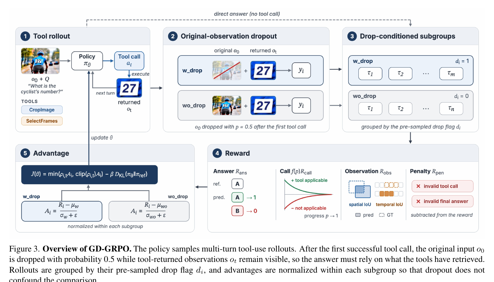

图 1-1：原论文 Figure 3，PDF 第 4 页。左边是工具交互，中间在首次成功工具调用后，以 0.5 概率移除最初的视觉输入 o0，保留工具返回 ot；右边按预采样 dropout 标记分组比较奖励。下方箭头是奖励到 advantage 再到参数更新。图中的“移除”只用于训练，推理保留原图。

### 1.2 GD-GRPO：奖励“拿到证据”，再阻止绕过证据

```text
R(tau;x,p) = R_ans + f(p)*R_call + lambda_obs*R_obs - R_pen
f(p) = [exp(-kappa*p) - exp(-kappa)] / [1-exp(-kappa)]
A_i = (R_i - mu_x,d_i) / (sigma_x,d_i + eps)
```

tau 是多轮工具轨迹；x=(Q,o0) 是问题与初始观察；p∈[0,1] 是训练进度。R_ans 衡量答案；R_call 根据标注判断此题是否适合调用工具；R_obs 衡量取回的区域/帧与证据的重合；R_pen 扣除无效调用与无效最终回答。lambda_obs=0.4，kappa=5。f(0)=1、f(1)=0，临时探索奖励逐渐消失，持续有效的观察奖励仍然存在，防止长期靠“多调用工具”得分。

图像观察奖励把一条轨迹的多个裁剪与标注框做全局一对一 IoU 匹配，避免反复裁同一区域重复领分。IoU=交集面积/并集面积。视频使用最后一次选帧尝试的 frame IoU，不能回看整条轨迹只挑最有利的那次。后续尝试的观察乘数是 0.85，按原文只折扣一次，不按调用次数连续乘方。定位监督不以答对为前提：拿对证据但推理失误仍可学习取证动作。

图像/视频有效调用奖励分别为 0.3/0.45，不适用调用系数为每次 -0.3；无效/失败调用的扣分量分别为 1.4/1.2。无标注题不获得 R_call、R_obs。答错不等于动作全错，这是该设计的重要分工。

教学算例：训练进度 p=0.5 时，f(p)≈0.0759。若图像题答对、有效调用、R_obs=0.6、无惩罚，则总奖励约 1+0.0759×0.3+0.4×0.6=1.2628。临时调用奖励只贡献约 0.0228，准确观察仍贡献 0.24；这解释了为何后期不应只追求工具调用次数。

dropout 也会改变难度。d_i 是 rollout 开始前随机采样的标记，mu_x,d 和 sigma_x,d 仅由同一问题、同一标记的轨迹计算；子组只有一条时 advantage 设为 0。必须按预采样标记分组，而不是按“最后真的丢没丢原图”分组，后者受是否调用工具影响，会把模型动作与随机处理混在一起。

### 1.3 OG-MOPD：有选择地修复动作，并分开两类监督

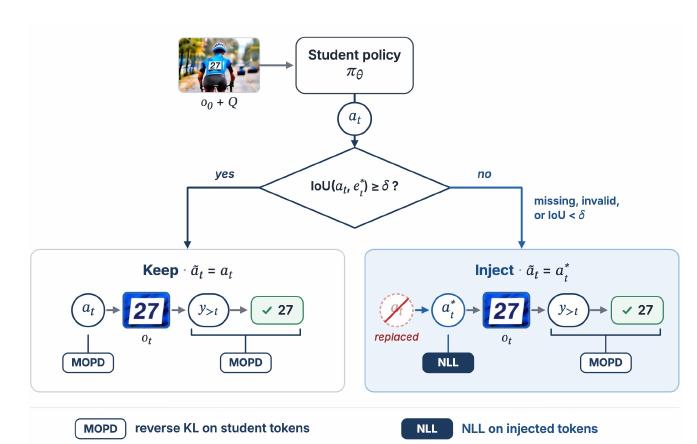

图 1-2：原论文 Figure 4，PDF 第 5 页，裁取完整流程图。菱形检查学生动作与标注证据的 IoU；左支保留合格动作，右支注入规范动作。蓝色 NLL 只教注入动作，MOPD 教学生生成的延续；不是把注入 token 伪装成学生采样。

```text
executed_action = canonical_action,
    if missing/invalid OR IoU(proposed_action, evidence) < delta
executed_action = proposed_action, otherwise

L_OG = L_MOPD(S) + lambda_br * L_NLL(I)
L_NLL(I) = - mean_{k in I} log pi_theta(y_k | h_k)
```

canonical_action 来自证据标注。空间阈值 delta_crop=0.25，时间阈值 delta_select=0.15；有效动作与原始、扩展证据分别算 IoU，取较大者，再判断是否修复。S 是学生实际生成的 token 集合，I 是注入动作 token。lambda_br 在 OG-MOPD 中为 1；无注入则省略该项。教师路由跟随实际执行的工具动作，以输入模态初始化。

MOPD 的理想 reverse-KL 形式可写成 E_h sum_a pi_theta(a|h)[log pi_theta(a|h)-log pi_teacher(a|h)]；这里用于解释分布对齐，并非声称实现每步都物化全词表 KL。论文实现对教师与学生的 log-prob 差裁剪到 [-5,5]，提供密集 token 信号。实现采样式 reverse KL 时须保留正确的采样梯度/代理目标；不能对单个 log 比值机械求导就声称得到了期望 KL 的梯度。

教学算例：学生裁剪 IoU=0.10，低于 0.25，执行标注框取回号码清晰的图，再让学生继续生成。注入动作某 token 的学生概率从 0.1 提到 0.2，其 NLL 从 2.303 降到 1.609。这一项教“怎么去到好观察”，后续教师信号教“有好观察之后怎么答”。这也是一个有监督干预的混合训练过程，不能称为全程纯 on-policy。

### 1.4 数据、训练设置与可实现流程

Reframe-100K 包含约 63K 图像 QA、37K 视频 QA，代码 README 给出的精确数是 63,020、36,706，总计 99,726。原文数据构造先过滤可仅凭文本回答的问题；对完整视觉输入与证据单独输入各采样 8 次，以 F、E 表示正确次数。F=0 或 8 的极端题删除；E=0 或 F−E≥3 的证据不足题删除。随后诊断并复核可疑标注。F、E 在阈值处是次数，不能与 0–1 正确率混用。

空间框围绕中心放大 1.5 倍并裁到图像边界；连续视频证据区间首尾各扩一帧，补足理解上下文；只扩一次。工具是否适用来自标注覆盖，不单靠模型“我觉得要用工具”的判断。这里的标注和审计成本是方法的真实前提，并非无监督获得证据。

训练只更新语言模型参数，BF16、Fused AdamW、学习率 1e-6、cosine、warmup 0.1、weight decay 0.1、梯度裁剪 1、ZeRO-2，一轮训练。专家阶段 KL=0.03，每题 8 条轨迹、每次更新 128 题/1,024 条轨迹；蒸馏每题 1 条、每批 224 条轨迹，重复优化 4 次不算 4 条独立样本。温度 1、top-p 0.95、上下文 32,768、至多 3 轮 assistant。

论文配置专家训练 32 GPU、蒸馏 8 GPU；未给 GPU 型号、完整训练时长、GPU-hours、峰值显存和货币成本。公开脚本默认专家 8 GPU，蒸馏为学生 0–6、教师 GPU 7，默认配置不等于论文实验配置。复现应固定提交、展开实际参数，并保留有效 batch 与并行方式的差异。

```text
for modality in [image, video]:
    expert = copy(base_9B)
    sample 8 trajectories/question with pre-sampled drop flags
    execute tools; after first success optionally remove original vision
    score answer, call applicability, evidence IoU and validity
    normalize advantages within each drop subgroup; update expert
student = copy(base_9B)
for question in mixed_data:
    sample student until tool boundary
    retain good action; repair deficient action using annotation
    execute the chosen action; resume student rollout
    apply teacher signal to student tokens; NLL to injected actions
```

### 1.5 实验怎样读，结论有多大

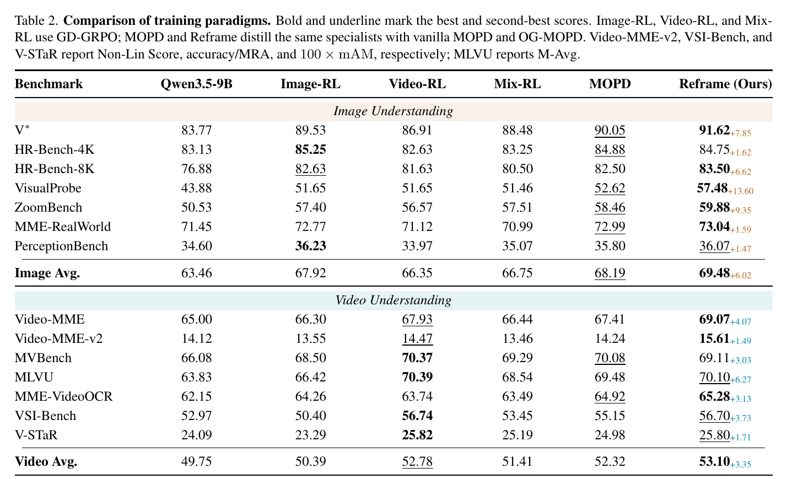

图 1-3：原论文 Table 2，PDF 第 7 页。各列是同一基础模型下的训练范式；MOPD 与 Reframe 使用同一组专家，适合判断观察修复的增量。Image Avg. 与 Video Avg. 各自平均 7 个任务；视频列包含 Non-Lin Score、MRA、mAM 等异质指标，不能将平均值直接解释成总体样本准确率。

图像平均：基础 63.46、Mix-RL 66.75、MOPD 68.19、Reframe 69.48；视频平均：49.75、51.41、52.32、53.10。因此修复相对 vanilla MOPD 增加 1.29/0.78 分，不应把相对基础的 6.02/3.35 全算作修复收益。Reframe 并非逐列最好：MVBench 69.11 低于 Video-RL 的 70.37。

Table 3 的图像专家对照中，GD-GRPO 对比仅结果奖励 GRPO，图像平均 65.85→67.92，工具增益 1.97→3.82；受控观察依赖指标 52.59→69.03。统一模型依赖指标为 75.53。该指标用真实、随机、空白返回观察做控制，范围与原始准确率不同；它支持“工具结果会影响答案”，还需结合绝对表现确认不是被无关图轻易误导。

局限与复现建议：标注框/帧质量决定修复上限；只有裁图与选帧两种工具，不能直接推广为网页搜索 agent 的完整结论。原文 GD-GRPO 对照同时改变奖励与 dropout，不能仅凭该表分别量化两者贡献。先复现正确/随机/空白观察干预，再做 reward-only、dropout-only、二者结合及修复阈值扫描。首选看官方仓库的 training、reframe、evaluation 目录；本期核验到公开实现，但没有执行训练或核对权重指标。

## 2. BSPO：奖励答对，仍可能把语言捷径越练越强

论文：[Uncovering Shortcut Amplification in Video RLVR through the Lens of Perceptual Uncertainty Collapse](https://arxiv.org/abs/2610.37211)，首次公开 2026-10-27；[v1 PDF](https://arxiv.org/pdf/2610.37211v1)。作者 Jiafeng Liang 等。方法名 BSPO。本期在论文及检索结果中未核验到可用的官方实现仓库或作者教程，代码可复现性记为待补。

### 2.1 先区分“更有自信”与“更会看视频”

假设问“他接下来会做什么”，常见动作先验可能让模型不用视频也答对。RLVR 奖励答案会压尖分布，但压尖的来源未必是视觉。作者固定真值回答前缀，分别在有视频与无视频条件下测下一 token 的熵，避免两次自由生成前缀不同造成混淆。

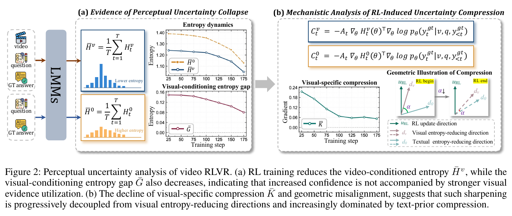

图 2-1：原论文 Figure 2，PDF 第 3 页。左半比较有视频与纯文本预测熵；中间曲线是训练进程；右半用梯度方向解释压缩来自何处。重点不是熵越低越好，而是视觉条件相对无视觉究竟增加了多少信息。

```text
H_v(t) = -sum_a p(a | v,q,y*_<t) log p(a | v,q,y*_<t)
H_0(t) = -sum_a p(a | q,y*_<t) log p(a | q,y*_<t)
G(t) = H_0(t) - H_v(t)
C_v(t) = -A_t * grad H_v(t) dot grad log p(y*_t | v,q,y*_<t)
C_0(t) = -A_t * grad H_0(t) dot grad log p(y*_t | v,q,y*_<t)
K(t) = C_v(t) - C_0(t)
```

v 是视频，q 是问题，y* 是固定真值序列，a 是词表元素。H_v/H_0 是条件预测熵；G 是视觉条件熵差；C 是沿 RL 更新方向的熵压缩分量；K 对比视觉与文字先验压缩。各指标可再对 token 平均。dot 是参数空间内积，A_t 是简化分析中的 advantage。

本文展开原文一阶分析：令 theta_new=theta+eta*A_t*grad log p，则 H_v(theta_new)−H_v(theta)≈eta*A_t*grad H_v dot grad log p=−eta*C_v。C_v>0 表示这一小步让有视频的分布更尖，但如果 C_0 同样大，视觉特有贡献 K 仍很小。它是局部近似，不包括完整 clipping、多步更新及高阶项。

教学算例：二分类文本分布 [0.5,0.5] 的熵 0.693；视频分布 [0.8,0.2] 的熵约 0.500，G≈0.193。训练后若文本与视频都变成 [0.9,0.1]，各自熵 0.325，G=0。虽然模型更自信，视频相对作用却消失。G 不是无条件严格互信息估计，也不能单独证明因果使用，需要视觉扰动等控制。

### 2.2 两个“焦点”：好推理原则与视觉反事实

PCA 是 Principle-guided Credit Assignment，先按 verifier 将同一问题的 rollouts 分成正确、错误集合，让旧策略综合它们生成简短经验原则 p，再在固定学生前缀下比较原条件与加入原则的概率分布。这里 PCA 不是主成分分析。

SCP 是 Shortcut-aware Contrastive Perturbation，把视频变成弱化相关证据的 v_tilde，保持问题与回答前缀不变。两种 KL 的方向均为原条件分布到条件改变后的旧策略分布：

```text
d_pca(i,t) = KL(pi_old(.|v,q,o_i,<t) || pi_old(.|v,q,p,o_i,<t))
d_scp(i,t) = KL(pi_old(.|v,q,o_i,<t) || pi_old(.|v_tilde,q,o_i,<t))
z_m(i,t) = [d_m(i,t)-mean_t d_m(i,t)] / [std_t d_m(i,t)+eps]
```

o_i 是学生第 i 条回答，m 为 pca 或 scp。原文按每条回答的有效 token 位置归一化，不能把不同长度回答直接拼起来统一算均值。d_pca 小意味着原预测更贴近原则条件；d_scp 大表示削弱视觉证据后分布改变更明显。两者都只是代理信号：对无关纹理敏感也可能产生大 KL，原则本身也可能总结错。

### 2.3 怎样改变 advantage，又不反转奖惩方向

```text
w(i,t) = 1 + lambda*tanh[ sign(A_i)*(z_scp(i,t)-z_pca(i,t))/tau ]
A_tilde(i,t) = A_i * clip(w(i,t), 0.8, 1.2)
J_BSPO = mean min(ratio*A_tilde, clip(ratio,1-e,1+e)*A_tilde)
```

lambda=0.5 控制门幅度，tau=1 控制平滑度；sign 是 advantage 的正负号。由于 0<lambda<1，未截断门就在 (1−lambda,1+lambda)，最终权重又限制为 [0.8,1.2]，永远为正。正确轨迹中“贴近原则、依赖视频”的 token 获更大正更新；错误轨迹中“偏离原则、不依赖视频”的 token 获更强压制。这里不会将答错轨迹因视觉敏感而翻成正奖励。

教学算例：A=+1、z_scp=1、z_pca=−1，tanh(2)≈0.964，未截断权重 1.482，最终 1.2，A_tilde=1.2。对于 A=−1，若 z_scp=−1、z_pca=+1，sign(A)×两者之差仍为 +2，A_tilde=−1.2，错误捷径被更强惩罚。若混淆这个 sign，负轨迹可能被错误地减弱惩罚。

这不是额外奖励模型，也不是直接最小化两种 KL；KL 提供 detached 的重加权信息，verifier 决定方向。模型自身充当不同条件下的参考，所以叫自蒸馏；不需要另一个独立大教师，但额外条件前向与原则生成仍有训练开销。

### 2.4 训练流程、数据与成本

```text
rollouts = sample_group(old_policy, video, question)
rewards = verify(rollouts)  # correctness and format
principle = summarize(correct_rollouts, incorrect_rollouts)
perturbed_video = shuffle_or_crop_or_replace(video)
for each fixed rollout prefix:
    compute original, principle-conditioned and perturbed distributions
    compute both KL probes, normalize within response, stop gradients
    multiply outcome advantage by positive bounded bifocal weight
update current policy with clipped policy-ratio objective
```

实现采用 EasyR1；Qwen3-VL-4B、8B；从 Video-R1-260k 抽 20K QA，一轮训练，8×NVIDIA A100、全局 batch 128、学习率 1e-6。reward 是答案与格式均正确时的二值结果，不是给每个视觉动作额外标注。评估所有方法均使用 64 帧，同主干、数据、reward 与评测协议。原文没有给出完整 wall-clock、显存峰值、GPU-hours、货币成本；不能用“一轮”推断比基线更省计算。没有独立教师也不代表只有一次前向。

实现缺口：训练日志、随机种子汇总、精确数据 ID、全正确或全错误组的原则构造回退、KL 是否完整词表/近似计算，都应在官方代码可用后逐项核对。实践上对零标准差显式加 eps、对无混合反馈组跳过/回退原则是稳健实现建议，本期不能把它们冒充为作者已经验证的配置。

### 2.5 核心结果、消融和限制

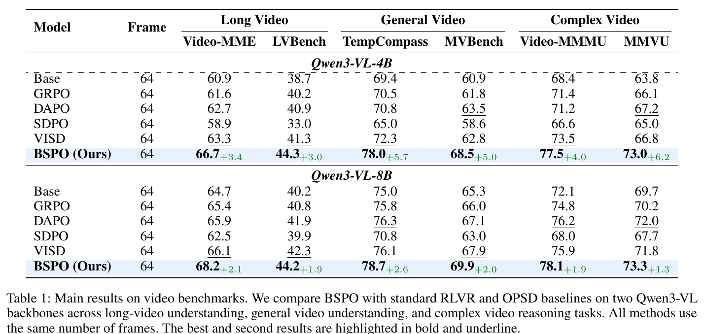

图 2-2：原论文 Table 1，PDF 第 5 页。行区分 4B/8B，列分长视频、一般视频、复杂视频推理。右上角小增量对比该列最强非 BSPO 基线，不是统一对 GRPO 的增量。必须在同一 backbone 块内比较。

4B 的 Video-MME：基础 60.9，GRPO 61.6，VISD 63.3，BSPO 66.7；MMVU：基础 63.8，GRPO 66.1，VISD 66.8，BSPO 73.0。8B 的 Video-MME：64.7、65.4、66.1、68.2。不能将 4B 相对 8B 的提升当作纯算法对照。

8B 消融 Table 2：完整方法 Video-MME 68.2，去 PCA 为 65.7，去 SCP 为 65.9；MMVU 分别 73.3、70.2、71.0。Shuffle/Crop/Replace 在 Video-MME 分别 68.2/67.7/67.4；打乱保留帧级内容、破坏时间顺序，作为时间证据干预较合适，但未必适合只问静态物体属性的题。

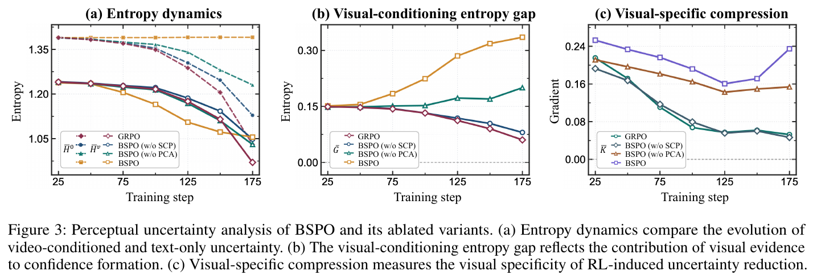

图 2-3：原论文 Figure 3，PDF 第 7 页。横轴是训练步；(a) 预测熵，(b) 视觉条件熵差，(c) 视觉特有梯度压缩。GRPO 的低熵可能伴随 G、K 下降，BSPO 与去除模块的曲线帮助判断额外分数是否同时支持视觉依赖。曲线中的差异不是跨随机种子的置信区间，原图没有给出相应误差带。

局限：破坏时序可能让合法答案本来就改变，需要检查数据适配；高视觉敏感不等于语义正确；自总结原则会继承当前模型偏差。建议先保存每题原/扰动视频及正确性变化，分开静态与时序问题，再核对收益是否集中于确需时间证据的子集。对小模型迁移时先测额外三条件前向的实际耗时，不套用未披露的效率优势。

## 3. RECAP：在推理的正确时刻，把终局奖励传回去

论文：[RECAP: Looking Once Is Not Enough for Vision-Language Reasoning](https://arxiv.org/abs/2610.30834)，首次公开 2026-10-22；[v1 PDF](https://arxiv.org/pdf/2610.30834v1)，作者 Zhaolu Kang 等。论文标注 NeurIPS 2026，附录列出训练与复现承诺。本期第三方给出的 GitHub 地址访问为 404，不能当作已开源实现；以 v1 数学与附录为依据，代码状态待核验。

### 3.1 visual revisit 是“比刚才更看图”，不只是 attention 大

长 CoT 可能先提取图像，再在语言内部推演，关键时刻重新读取图像。RECAP 关注这种相对近期基线的正向跳变。持续高 attention 可能只是背景模式；简单提高所有 token 的看图权重，也可能干扰本来不需要图像的代数推理。

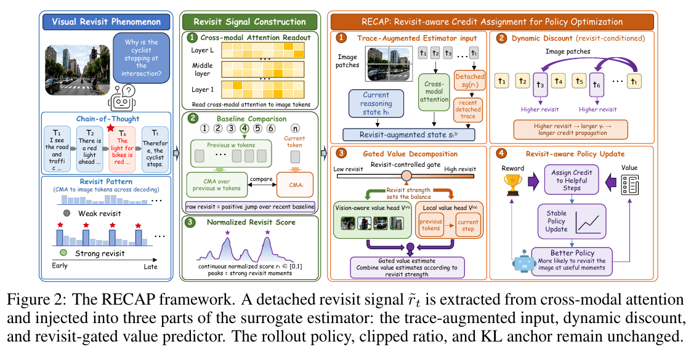

图 3-1：原论文 Figure 2，PDF 第 4 页。左边为回看现象，中间从跨模态 attention 构造有界信号，右边分别进入估计器输入、动态折扣与双 value head。绿色/紫色结构用于训练时信用分配；采样 policy 与推理过程不新增这些模块。

```text
CMA_t = average_{layer in middle_third, head} sum_{j in visual_tokens} attention(t,j)
baseline_t = mean_{k in previous W tokens} CMA_k
z_t = ReLU(CMA_t-baseline_t) / (baseline_t+eps)
r_t = sigmoid(eta * [(z_t-min z)/(max z-min z+eps)] - eta/2)
```

CMA 是当前文本位置对视觉 token 的总 attention mass，再平均选定层/头；W=16，第一位置无历史时 z=0。ReLU 只保留正向回升；eta=6，min/max 在该 rollout 内求，r 约在 [0,1]。这个信号不是奖励，也不是当前 token 生成前可用的在线观测：整条 rollout 完成后才做归一化，再 detached 地用于训练。

教学算例：近期 CMA 基线 0.10，当前 0.15，则 z≈0.5；若本 rollout z 的最小值 0、最大值 1，r=sigmoid(0)=0.5。当前 CMA=0.20 时 z=1，r=sigmoid(3)≈0.953；若无正跳变则 r≈sigmoid(-3)=0.047。因此实际归一化边缘不是精确的 0 与 1，不能直接当作硬开关。

### 3.2 三处注入，核心是改变回报传播路径

```text
s_trace_t = (h_t, sg(r_t), sg(r_{t-1}), ..., sg(r_{t-K}))
gamma_t = gamma_base + beta*(gamma_max-gamma_base)*sg(r_t)
V_gated(t) = (1-sg(r_t))*V_local(s_trace_t) + sg(r_t)*V_visual(s_trace_t)
u_t = 0 if t<T else max(R_raw,0)
G_T = u_T;  G_t = u_t + gamma_{t+1}*G_{t+1}
A_VR_t = G_t - V_gated(t)
L_value = mean_t [sg(G_t)-V_gated(t)]^2
```

h_t 是正常语言上下文状态，K=8 是补入的回看历史长度；gamma 是折扣，控制未来奖励衰减；V_local 与 V_visual 是共享主干上的两个可学习 value head，分别由当前回看门混合，并不是两个独立大模型。gamma_t 附着在“进入位置 t”的转移上，因此从 t+1 向 t 传回奖励使用 gamma_{t+1}，这是容易写错的一位偏移。

Qwen2.5-VL-7B 的 gamma_base=0.97、gamma_max=0.99、beta=0.6，所以 gamma 最大实际为 0.982，而不是 0.99。增大未来关键位置的 gamma，会使更多终局信用传回它之前的选择；单纯在当前位置给 advantage 乘一个权重不具有相同的跨步作用。

教学算例：三 token 回答最后奖励 1，r_2=0.2、r_3=0.8，则 gamma_2=0.9724、gamma_3=0.9796。G_3=1，G_2=0.9796，G_1≈0.95256；固定 0.97 时 G_1=0.9409。若第一位置的 gated value=0.7，则 A_1≈0.25256。这只展示折扣路径，不表示 attention 高就一定值得更大奖励；最终仍受成功/失败与 value 基线影响。

### 3.3 policy loss 的梯度、偏差与数值问题

```text
rho_t = pi_theta(y_t|h_t) / pi_old(y_t|h_t)
L_policy = -mean min(rho_t*sg(A_VR_t),
                     clip(rho_t,1-e,1+e)*sg(A_VR_t))
           + beta_KL * KL(pi_theta || pi_ref)
```

ratio 的条件仍是正常 h_t，不包括完成后才知道的未来回看信息。value 通过 L_value 学习；policy loss 不通过 A、return 或 r 反传。移除 stop-gradient 会让模型通过调整 attention/估计器来改变自己的信用信号，形成自我投机通道。

作者明确这是 surrogate advantage。动态折扣与将负终局奖励截为 0 都改变了训练目标，不能声称对原始未折扣 GRPO reward 是无偏估计。格式罚分可以降低正回报或消除它，但负值不沿该递推传播。仍可能出现负 advantage，因为 value 大于非负 G。原文给出偏差与方差分析；工程上不能只保留“更低方差”，忽略目标已改变的前提。

长序列的多个 gamma 连乘容易下溢，尤其 mixed precision。应按附录在 log 域执行回报计算、处理 u=0 的分支，并保持估计器需要的精度；不要在 BF16 中天真累乘。提取 attention 还可能与高效 attention 后端冲突，复现需记录实际后端与内存，不只抄方法公式。

```text
sample ordinary policy rollouts and raw terminal verifier rewards
read selected attention heads/layers on fixed rollouts
build per-rollout revisit trace; detach trace
construct trace inputs and dynamic transition discounts
compute gated values and stable backward discounted returns
update two value heads with MSE
detach advantages; update policy using unchanged causal ratios
```

### 3.4 数据、训练预算和真实收益

作者对 Qwen2.5-VL-7B、InternVL3-8B、LLaVA-OneVision-7B 做相同两阶段训练。先用基础模型采样并过滤正确长 CoT，约 50K 样本 SFT；再用不重合的 30K 可验证题 RL，72B 扩展为 20K。v1 没有在正文给出完整逐题数据来源清单，本期不能把可复现承诺视为数据 ID 已公开核验。

SFT 使用 AdamW、cosine、3% warmup、BF16、max length 4096。三个小模型均 3 epochs，峰值学习率分别 2e-5、1e-5、2e-5，token batch 2M，表 4 报 SFT 算量分别 12/14/12 GPU-days。RL：每题 8 条 rollout，prompt batch 256，2K–3K steps，clipping 0.2，KL 系数 0.04、参考为 SFT 模型。主结果 8 seeds，消融 5 seeds。

全项目包含三小模型、72B、消融等约 780 H20-equivalent GPU-days，作者折算约 320–400 H100-days，不能写成“训练一个 7B 需要 780 GPU-days”。在 16×H20 上测 200 steps，RECAP 每步相对 GRPO 增加约 5% wall-clock：CMA 3.8%、稳定回报递推 0.9%、value 0.3%；没有额外推理开销。附录给 7B 主行约 30 小时的复现估计，不是本期实测。货币成本、峰值显存未披露。

72B 只作为扩展：LoRA r=64、alpha=64、dropout 0.05，作用 q/k/v/o，每层 checkpointing、ZeRO-3、至少 32 GPU，可训练参数约 0.6%。不应把它的低训练参数比例当成 2B 级部署成本。

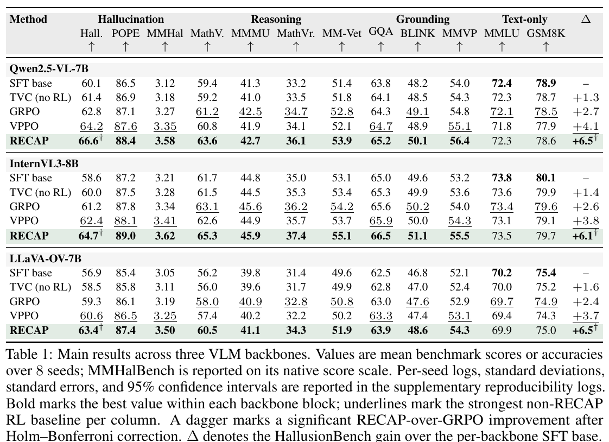

图 3-2：原论文 Table 1，PDF 第 7 页。每个 backbone 内比较 SFT、GRPO、VPPO、RECAP；Hall. 是 HallusionBench，右端增量相对本块 SFT。MMHal 的分数尺度不同，不能把整表混成平均准确率。主结果为 8 seeds 均值，显著性标记按作者 Holm–Bonferroni 校正说明解释。

HallusionBench：Qwen 60.1→66.6，相对 GRPO 62.8 增加 3.8 分；InternVL 58.6→64.7，相对 GRPO 增加 3.5；LLaVA 56.9→63.4，相对 GRPO 增加 4.1。Qwen MathVista 从 SFT 59.4 到 63.6，MMLU 从 72.4 到 72.3；说明视觉指标改善同时文字能力大体保持，但“保持”不等于所有文字项均有正增益。

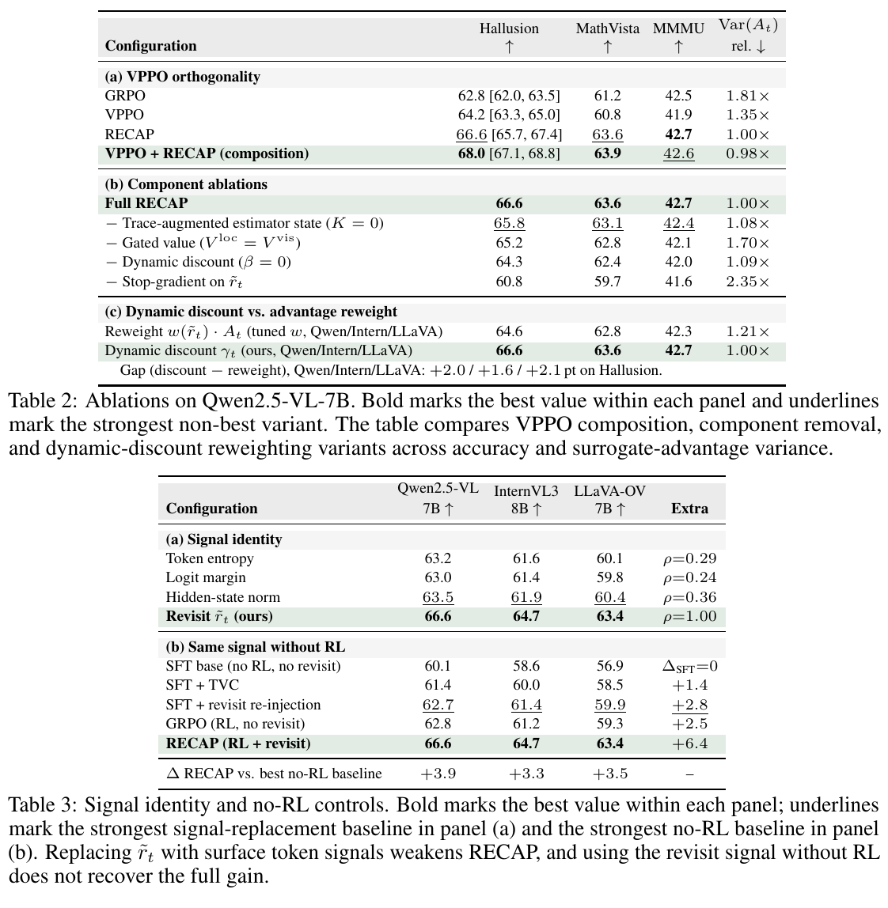

图 3-3：原论文 Tables 2–3，PDF 第 8 页。上表依次检验模块、动态折扣与局部乘权，下表用 entropy/logit margin/hidden norm 替换信号。Qwen 完整 66.6，移除动态折扣 64.3，去 value gate 65.2，去 trace 65.8，取消信号 stop-gradient 降为 60.8。相同信号做局部 advantage 乘权仅 64.6。VPPO+RECAP 达 68.0，支持二者作用位置互补，而非“任意 attention 加权都一样”。

局限：短于约 30 token 的任务缺少可利用的回看轨迹；复杂算术失误并非视觉回看能解决。attention 代理的因果证据来自特定遮蔽/注入干预，不等于所有层、所有任务都可当作忠实解释。建议先做 peak/non-peak 等量遮蔽与 entropy 替代控制，再决定是否改训练；公开代码未核验可用前，独立实现只能标为复现尝试。

## 4. DISCOVER：2B 模型预算有限时，应该让哪些题真正进入训练

论文：[DISCOVER: Online Variance-Guided Data Discovery for Budgeted Multimodal GRPO](https://arxiv.org/abs/2611.11145)，首次公开 2026-11-08；[v1 PDF](https://arxiv.org/pdf/2611.11145v1)；[论文给出的作者项目页](https://peymoon.github.io/discover/)。作者 Peyman Gholami 等。项目页自动读取未能稳定解析为可核验的代码说明，本期不填猜测的 GitHub 地址。

### 4.1 预算到底限制什么

训练一题时采样 8 个答案，如果全对或全错，GRPO 相对优势几乎全为 0。题目很难不代表它有训练价值，题目静态优质也不代表当前策略仍能从它学到东西。DISCOVER 不改变 GRPO 优化器，改变的是独特样本预算如何投入。

```text
D = {x_i=(image_i,question_i)};  |D|=N
V_verified = all unique prompts ever receiving verifier feedback
|V_verified| <= B = floor(budget_fraction*N)
T_train = prompts admitted for GRPO training, T_train subset V_verified
R_buffer = verified prompts with valid selector statistics
```

budget_fraction 主设置为 0.1。对题目只做探测、未用于训练，也算已经核验的独特样本；重复训练同一题不新增 unique count，但消耗计算。看完全池真值后挑 10% 训练，不能声称只用 10% 标注预算。论文因此把 exposure 分成 Selector-first/Training-first，另按最终用途分 Train/Probe-only，两种划分都要加到相同 Total。

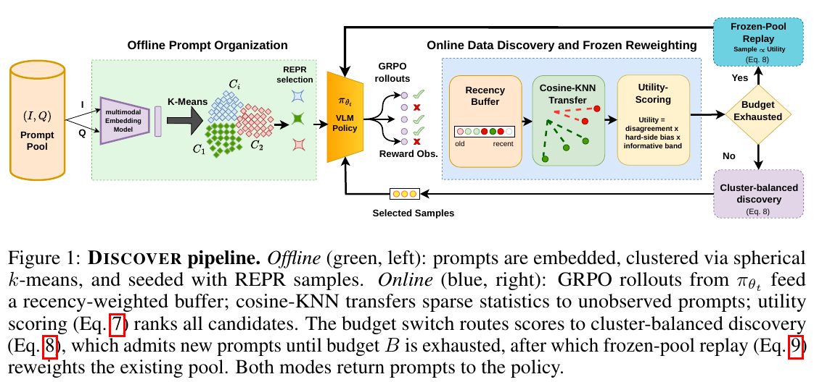

图 4-1：原论文 Figure 1，PDF 第 4 页。左边用冻结 embedding 形成语义地图；中间 rollout→最近反馈缓存→KNN 传播→utility；菱形预算开关决定继续发现新题还是只在已冻结题池重放。箭头闭环表明题目价值随 policy 更新，不是训练前选一次就结束。

### 4.2 从少量真实反馈，推测大池题目的可学性

使用 Qwen3-VL-Embedding-2B 提取 2048 维、L2 归一化的图文特征 z。spherical k-means 保持中心也单位化；因为 ||z_i−z_j||²=2−2 z_i·z_j，余弦相似与平方欧氏距离在这里单调对应。ViRL39K 用 150 簇、每簇最多 3 个 REPR，共 450 题；VLAA-Thinking 用 200 簇、最多 2 个，共 400。按密度与中心相似度选代表，并去掉相似度超过 0.85 的近重复。

每题 8 条 rollout 得到正确率 mu_i 与总体奖励方差 v_i；选择器只使用二值 correctness，训练 reward 则为 0.9×correctness+0.1×format。二者不能混为一列统计。

```text
mu_i = mean_g r_i,g; v_i = mean_g (r_i,g-mu_i)^2
v_norm_i = clip(v_i / [mu_i*(1-mu_i)+eps], 0, 1)
time_weight(t,s) = exp[-0.05*(t-s)]
mean_recent_i = sum_s time_weight*mu_i(s) / sum_s time_weight
var_recent_i = sum_s time_weight*v_norm_i(s) / sum_s time_weight
```

g 为同题 rollout；s 为历史观测步，t 为当前步。对于二值奖励，v=mu(1−mu)，混合对错时 v_norm 约 1，全对或全错时约 0；它不是又得到一个连续难度，而是先标记“这一组有无区分信号”。随着时间衰减与邻居混合，预测才成为连续的可用信号概率。

```text
alpha_i,j = exp(cos(z_i,z_j)/T_nn) / sum_l exp(cos(z_i,z_l)/T_nn)
mu_hat_i = sum_j alpha_i,j * mean_recent_j
v_hat_i = sum_j alpha_i,j * var_recent_j
utility_i = v_hat_i * [1+0.5*(0.5-mu_hat_i)]
            * indicator(0.05 <= mu_hat_i <= 0.95)
```

j 遍历有统计的 64 个近邻，T_nn=0.05。余弦相近的题传递最近奖励信息，不新增一个要训练的大 selector 网络。硬侧因子稍微偏向低正确率，但 dead zone 排除几乎总错/总对的题。难度是相对当前策略，不是题目的永久属性。

教学算例：预测 v_hat=0.8、mu_hat=0.3，utility=0.8×1.1=0.88；同样方差但 mu_hat=0.7，utility=0.72；mu_hat=0.99 则置零。旧观测距当前 20 步，时间权重 exp(-1)=0.368，说明早期的难题标签会逐渐让位于新反馈。KNN 的“邻近”只是假设学习价值可局部转移，遇到语义相似但解法难度完全不同的题会失效。

### 4.3 发现、封池与重放怎样实现

发现阶段按各簇候选平均 utility 进行 softmax 分配配额，簇温度 0.5，再取簇内高分题；修复四舍五入、簇容量与剩余预算冲突。不是大簇必然获得更多名额，大小主要通过容量起作用。ViRL39K 的预算填充 0–50%、50–85%、85–100% 三阶段，分别每 4/10/16 optimizer steps 发现一批，候选训练池比例为 1%/0.30%/0.15%。触发按绝对 step，切换阶段不应重新从零计时。

预算满后 P=T_train 固定，不再核验新题；仍更新 utility，按其比例有放回采样。对处于 dead zone 内的题设置 0.05×当前最大 utility 的 starvation floor，避免暂时低估后永远不再抽到；这不是给已被 dead zone 排除的题无条件分配概率。

教学预算例：若完整来源池 N=10,000，B=1,000；初始 450 题用于 selector，也已经用掉 45% 的 unique 预算。若后来把这 450 中 400 题纳入训练，不新增 count；再核验 550 道新题后必须停。不能在累计 1,000 个训练题外再偷偷加 450 个探测题。

```text
embed and cluster pool without consulting answers
verify REPR; charge unique IDs to budget; initialize recent statistics
for optimizer_step:
    if discovery_due and budget_remaining:
        KNN-transfer recent feedback; compute utility
        cluster-balance new candidates, cap by remaining unique IDs
        verify/admit selected prompts; update accounting
    else if budget_exhausted:
        sample existing pool with utility weights and starvation floor
    run GRPO; reuse rollout feedback to refresh buffer
```

### 4.4 模型、实验与必须分清的统计口径

Qwen3-VL-2B-Instruct，在 ViRL39K 与 VLAA-Thinking 上训练，HybridFlow 实现、4×H100、每题 8 条、分别 300/170 optimizer steps，所有 GRPO 行对齐步数与实现。来源池留出 10% 验证；完整训练划分是 90%，所以 Full train split 的 exposure=90%。正文未完整列出 optimizer LR、peak memory、训练时长、GPU-hours、货币成本；不可补成“只用 10% 数据，所以便宜 10 倍”。同样步数下，小池会被反复用约十轮。

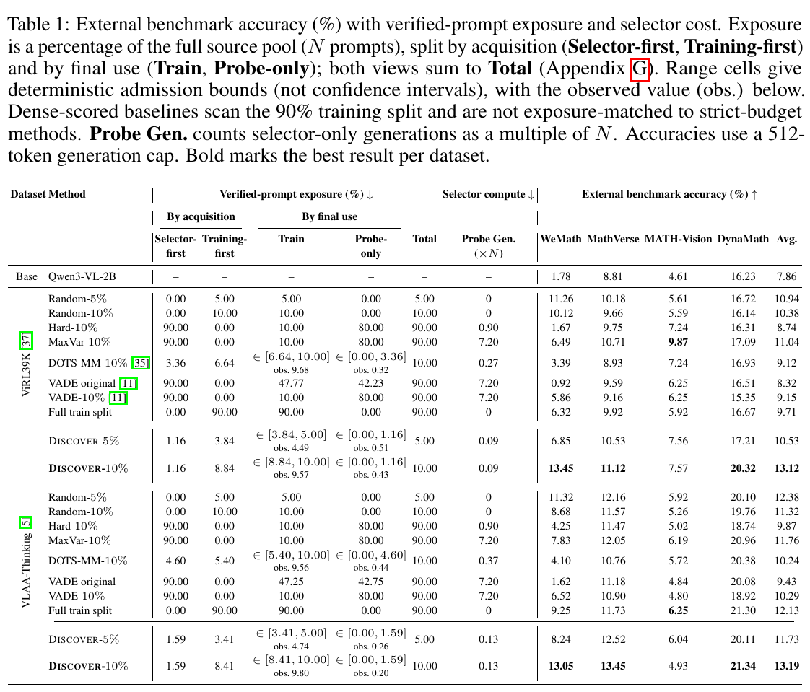

图 4-2：原论文 Table 1，PDF 第 8 页。左半是独特题目 exposure 与额外 selector generations，右半是 512-token 生成上限下的外部准确率。Train 与 Probe-only 的范围是确定性预算界，不是置信区间。表格很宽，下面同时转写关键值以便阅读。

| ViRL39K 条件，表 1 单次运行 | 总 exposure | 四任务平均 |
| --- | --- | --- |
| 基础 Qwen3-VL-2B | 无训练 | 7.86 |
| Random-10% | 10% | 10.38 |
| MaxVar-10%，先扫描训练划分 | 90% | 11.04 |
| Full train split，相同步数 | 90% | 9.71 |
| DISCOVER-10% | 10% | 13.12 |

正文与附录 F 的三 seed 均值是 DISCOVER 13.25、Random 10.01，相对提升 (13.25−10.01)/10.01≈32.4%；这与表 1 单次值 13.12/10.38 的增幅不同，不是矛盾，也不能混算。VLAA-Thinking 表中平均 13.19，相对 Random 11.32 为约 16.5%，但 MATH-Vision 4.93 低于 Full-data 6.25，收益并非逐任务成立。

ViRL39K 的 DISCOVER-10% exposure 按用途为训练 9.57%、仅探测 0.43%，合计 10%；按最初获取方式为 selector 1.16%、training 8.84%。selector-only 生成量 0.09×N 是额外成本，与总训练 rollout 数不同。Hard/MaxVar 训练只选 10%，却先核验 90% 划分，标注预算不等价，原表专门披露这一点。

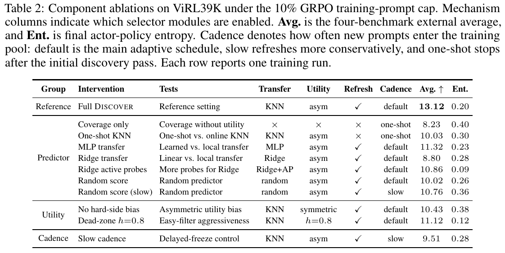

图 4-3：原论文 Table 2，PDF 第 8 页，每行单次运行。完整方法 13.12；仅覆盖 8.23、一次性 KNN 10.03、MLP transfer 11.32、去硬侧偏好 10.43、慢发现节奏 9.51。说明聚类、多样性本身不够，反馈转移与在线刷新都重要。消融不是三 seed 均值，不应据此声称所有模块差值已过统计检验。

### 4.5 局限与小预算复现路径

“同样 optimizer steps 胜过 full data”说明固定计算下信号利用更有效，不能推出永远少数据优于多数据。512-token 上限很短，论文另报 2048-token 结果；不同上限可能改变最优数据选择。图文 embedding 的邻近未必对应解题能力，需按图像必要性、数学题型、来源分组检查，而不只看平均分。

建议从 2B、单数据集、固定预算与 seed 做最小复现，记录每个 prompt 首次核验时间、是否训练、累计 token 与 selector 前向；先复刻全对/全错组比例，再比较 utility 预测与新 rollout 的相关性。官方代码未核验可用时，论文伪代码能支持独立实现，但不构成作者环境的完整复现。可配合 [TRL GRPO 官方说明](https://huggingface.co/docs/trl/grpo_trainer)学习组优势与 generation budget，再阅读本篇选择器。

## 5. Continual Adaptation Across Modalities：训练新能力之后，旧能力到底怎样丢失

论文：[Continual Adaptation Across Modalities: Learning and Forgetting in Unified Multimodal Models](https://arxiv.org/abs/2610.38436)，首次公开 2026-10-28；[v1 PDF](https://arxiv.org/pdf/2610.38436v1)。作者 Xinrui Wang 等，NeurIPS 2026 持续学习 workshop。它是后训练分析论文，侧重理解/生成统一模型，不是新的搜索 RL 算法。本期未核验到该论文官方代码仓库、作者博客或完整实验日志。

### 5.1 为什么值得与前四篇一起读

一个模型做完视觉 RL 或蒸馏，通常只报告当前任务涨了多少。若后续继续训练别的领域，刚学到的能力可能最先丢失。这篇把问题分成两条轴：理解与生成之间的跨模态干扰，以及同一模态内持续学新任务/新概念的遗忘。参数隔离能解决第一条的一部分，不等于第二条自然消失。

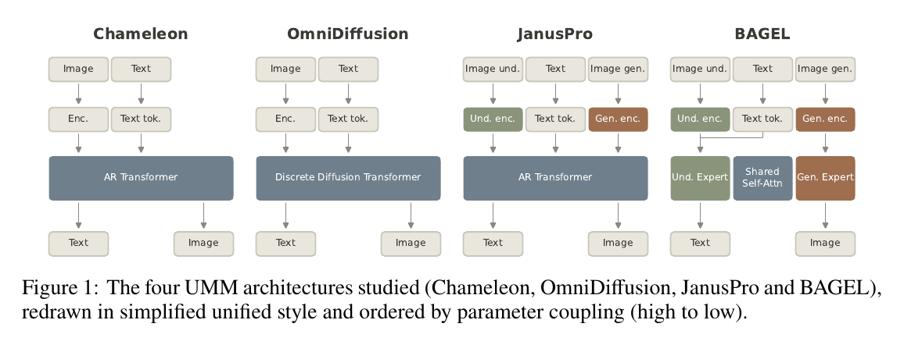

图 5-1：原论文 Figure 1，PDF 第 2 页。原作者把四架构画成相同风格，按参数耦合从高到低排列，本报告直接引用该图。Chameleon 全共享 AR；OmniDiffusion 共享主干、离散扩散；JanusPro 分开理解/生成视觉编码器但共享 AR 主干；BAGEL 在 Transformer 内采用模态专家与共享 attention。不能只看“有不同 encoder”就认为两个能力完全隔离。

### 5.2 实验协议本身就是核心方法

理解侧固定顺序训练七任务：VizWiz captioning、Finance、Science、Medical、Remote Sensing、Autonomous Driving、OCR；每次训练后回测已训练任务，额外评估 MMBench/MMMU 作为泛化探针。前六个 VQA 域加一个 captioning 任务的指标不同：VQA 用准确率，caption 用 SPICE，不能直接做无量纲混合平均。

生成侧依次学 19 个个性化概念，每概念仅 6–10 张参考图。DreamBooth 将所有概念连续训练进同一个 LoRA，后来的更新可能覆盖早先概念；不是每概念单独保存一个 adapter 再路由。训练添加概念标识与负样本/无关样本以稳定学习；作者报告若不加这些稳定样本，学到第二、第三个概念后可能连新概念也学不进去。

另一方案 YoPrompt 冻结模型，给概念 16 个 soft prompt token，按 CLIP 相似度挖掘负样本并渐进分配 prompt 长度。Chameleon/JanusPro/BAGEL 用文本描述初始化 prompt，OmniDiffusion 则用图像 patch cluster 初始化。两种适配方式对参数共享结构的压力不同。

### 5.3 把训练 loss 与遗忘量化写明白

原文是实证协议，没有发明统一的新 reward/loss。下面是为小白整理的标准训练表达与指标推导，不能误认成作者提出的新优化器。

```text
LoRA: W_adapted = W_frozen + (alpha/r)*B*A
SFT_AR: L = -sum_t log p_theta(y*_t | image, question, y*_<t)
Flow schematic: L = E ||velocity_theta(z_t,t,condition)-target_velocity||^2
```

W_frozen 是冻结权重；r 是低秩，A∈R^(r×d_in)、B∈R^(d_out×r)，alpha/r 控制更新尺度。比如 4096×4096 原矩阵有约 16.78M 参数，r=16 的 A/B 合计 131,072，约 0.78%；这是单矩阵教学算例，不是本论文整体参数占比。训练参数少，仍可能修改关键共享表示，不能据此保证不遗忘。

AR 用 token NLL；离散扩散在 masked token 位置预测；BAGEL 的图像生成使用 rectified-flow 类目标。上面的 flow 只是标准机制示意，原文未逐模型给完整 loss 权重、mask/timestep 调度，本期不杜撰同一个 DreamBooth 公式覆盖四种实现。生成侧没有额外 RL reward。

```text
S_i,j = performance on task j after training through task i
BWT = mean_{j < T} (S_T,j - S_j,j)
relative_drop = (quality_initial-quality_final) / quality_initial
Q_score = sum_{c=1..5} softmax(logits)_c * weight_c
weights = [1.0, 0.75, 0.5, 0.25, 0.0]
```

T 是最后任务，S_j,j 是该任务刚训练完的成绩；BWT<0 表示遗忘。最后任务不进入历史保留差的平均。Q-Align/Q-Quality 用五档评价 softmax 加权成 0–1 分数，前者侧重语义一致，后者侧重视觉质量；CLIP-I 测生成与参考图的相似，CLIP-T 测与文字的相似。它们都不是人工百分比正确率。

教学算例：任务刚学完 80 分，后续训练后 65 分，则贡献 -15 个百分点；不能称为相对下降 15%，相对值是 18.75%。第一个概念 Q-Align 从 0.81 到 0.09，下降 (0.81−0.09)/0.81≈88.9%，是质量指标相对衰减，不等于 89% 图片被人判错。

### 5.4 参数放哪里，比只报 rank 更重要

理解 SFT：每任务 1 epoch。Chameleon r=16/alpha=32/LR=1e-4，OmniDiffusion 16/32/2e-5，JanusPro-7B 16/32/2e-4，BAGEL 32/64/2e-5。前三者主要 q/k/v/o，JanusPro 再加 aligner；BAGEL q/v/o/gate/up/down，不包括 k。

DreamBooth：各模型 r=16、alpha=32；每概念步骤 Chameleon 100、OmniDiffusion 800、JanusPro 1000、BAGEL 1000；学习率依次 3e-5、2e-5、1e-5、1e-5。YoPrompt 各模型 4000/6000/4000/500 steps，学习率依次 1e-3/1e-3/5e-3/1e-3。不同优化器路径与步数经过按模型选择，不能当作完全等算力比较。

论文明确命名 JanusPro-7B；对其余主干，本期不从通用型号推断为实验中已确认的参数量。生成 LoRA 的可训练参数分别 39.9M、43.1M、37.4M、12.6M；BAGEL 更新被限制在生成专属投影，而前三者主要进入共享主干。GPU 型号/数量、完整时长、峰值显存、GPU-hours、货币成本未披露，不能凭 rank 估算实际账单。

```text
model = original_checkpoint
for understanding_task in fixed_seven_task_order:
    continue training the same adapter on this task
    evaluate learned tasks + general probes + image generation
model = original_checkpoint
for concept in fixed_nineteen_concept_order:
    continue training the same generation LoRA on 6-10 references
    include stabilizing negatives/unrelated samples
    evaluate earlier concepts and understanding benchmarks
store full performance matrix, not only last checkpoint average
```

### 5.5 三张图分别回答三个问题

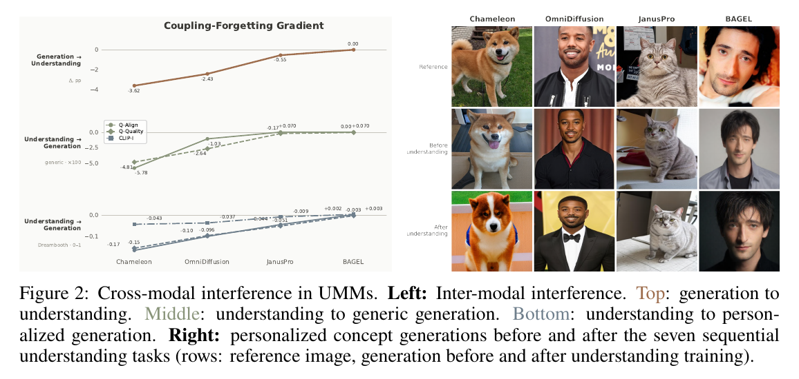

图 5-2：原论文 Figure 2，PDF 第 3 页。左上是个性化生成训练对理解的影响，Chameleon -3.62 pp、OmniDiffusion -2.43、JanusPro -0.55、BAGEL 0；中间是理解对通用生成影响，下面是对个性化生成影响。三排刻度不同，不能凭线长直接跨排比较。右侧展示理解训练前后生成例子，提示应同时看语义与指标。

BAGEL 在本协议中跨模态干扰接近零，与更新仅落在生成侧参数一致。但架构、预训练、checkpoint、模块与优化超参同时不同，这是有解释力的实证趋势，不是只改变一个架构开关的严格因果实验。原文使用“反映架构”的解释仍需要更严格的同主干匹配控制。

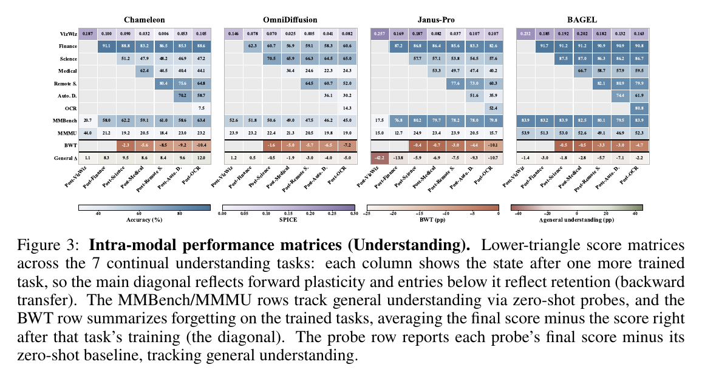

图 5-3：原论文 Figure 3，PDF 第 4 页。每列是训练一个新任务后的状态，对角线对应刚学完，各历史任务后续格子对应保留。底部 BWT 是最终与对角线的差。Chameleon/OmniDiffusion/JanusPro/BAGEL 分别为 -10.4/-7.2/-10.1/-4.7 pp。更隔离不等于完全不遗忘；captioning 与 OCR 等任务还可能干扰指令遵循。

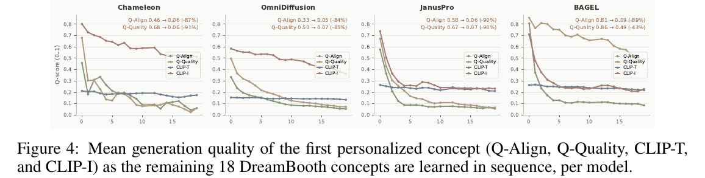

图 5-4：原论文 Figure 4，PDF 第 4 页。横轴是之后依次学入的其他概念，曲线跟踪第一个 DreamBooth 概念的 Q-Align、Q-Quality、CLIP-T、CLIP-I。原文报告 Q-Align：Chameleon 0.46→0.06（约 -87%）、OmniDiffusion 0.33→0.05（约 -84%）、JanusPro 0.58→0.06（约 -90%）、BAGEL 0.81→0.09（约 -89%）。BAGEL 保护了理解分支，却仍会在同一生成分支内覆盖早期个性化概念。

最值得带回小型 VLM 后训练的启示是：新学会的专门能力可能比预训练常识更脆弱；只测普通 VQA 不足以证明一次 RL/OPD 更新无副作用。复现建议是保留“训练后新增能力”小测集，每个后续阶段都回测，而不是只盯总体基准。按概念独立 adapter、replay、参数约束等是后续可实验方向，本论文没有证明其中任一方案已经解决问题。

局限：任务顺序固定、19 概念样本很少，指标依赖自动评价；缺少跨任务顺序/预算的充分匹配，部分模型版本信息与计算账单不足。正式复现需先补齐模型 revision、数据 ID、负样本池、顺序 seed 与评价器版本。不要把跨模型比较中的每个差值都解释为参数隔离的纯效果。

## 把五篇连起来：对小模型的一条可执行研究路线

| 训练环节 | 本期方法提供什么 | 需要补做的验证 |
| --- | --- | --- |
| 数据进入训练前 | DISCOVER 估计当前策略能学的题，严格管理核验预算 | selector 是否泄漏真值，是否计入探测与额外生成成本 |
| agent 取回证据 | Reframe 奖励取证、训练观察依赖、修复失效观察 | 不靠原图绕过工具；标注修复比例与推理时差距 |
| 视频 token 更新 | BSPO 用原则与反事实分布作 bounded advantage 门 | 视觉敏感是否为相关证据敏感，额外前向成本 |
| 推理跨步信用传播 | RECAP 把回看放进 return/value 估计 | stop-gradient、因果比例、数值稳定与 attention 后端 |
| 后续继续训练 | 持续适配研究提醒回测新增能力 | 多阶段保留矩阵、同/跨模态分别测试 |

本文研究建议，不是五篇联合实测：先从 Qwen3-VL-2B 的数据选择与固定 GRPO baseline 开始，只加一个改动；若做视频再测 BSPO；若模型能稳定暴露 attention 且 CoT 较长，再考虑 RECAP。做工具 agent 才引入观察修复标注。不要一次叠加全部方法：它们的主干、数据、目标与计算预算不同，组合收益必须独立测量。

最小验证表应同时记录：同题组全对/全错率、真实视觉与空白/打乱视觉分差、任务准确率、有效训练 token、额外教师/选择器前向、wall-clock、峰值显存，以及后续阶段的旧能力变化。本期只是读解与证据核对，没有声称已完成这些复现实验。

## 小白补课与官方链接：按这个顺序读

第一步，学会 attention 与 token 概率。[Jay Alammar 的图解 Transformer 博客](https://jalammar.github.io/illustrated-transformer/)适合从示意图开始；[PyTorch 官方知识蒸馏教程](https://docs.pytorch.org/tutorials/beginner/knowledge_distillation_tutorial.html)适合理解 logits、温度与教师监督。它是基础教程，不是本期主论文，也不是本期视觉 OPD 的完整实现。

第二步，理解训练目标。[TRL 的 SFT 文档](https://huggingface.co/docs/trl/sft_trainer)对应参考回答学习；[GRPO 官方说明](https://huggingface.co/docs/trl/grpo_trainer)对应多答案采样、组相对优势与 reward；[PEFT LoRA 官方文档](https://huggingface.co/docs/peft/developer_guides/lora)帮助读第 5 篇的低秩更新与可训练模块。

第三步，返回用户关心的方向锚点。[Vision-OPD 原论文](https://arxiv.org/abs/2605.18740)与[项目页](https://visionopd.github.io/)解释视觉特权信息如何用于 on-policy 自蒸馏；[MMSearch-R1 原论文](https://arxiv.org/abs/2506.20670)与[作者技术博客](https://blog.lmms-lab.com/blog/mmsearch-r1/)帮助理解多模态搜索和工具交互 RL。博客本次访问返回 502，保留已知作者入口，阅读时可先看论文。这两篇超出本期窗口，只作为学习链接，不计入今天 5 篇，也不重复入库。

第四步，看可用的一手实现：[Reframe 官方仓库](https://github.com/EliYuan30/Reframe)已能核验 training 与 evaluation 入口。其余四篇本期没有核验到可直接运行的官方仓库，项目页、匿名发布承诺和第三方重实现须分开看。缺少作者博客的条目没有用自动摘要站冒充作者教程。

## 资料边界与归档说明

全文使用 5 篇 v1 PDF 做方法与数字核对，原图/表 16 幅；所有图片是从真实论文页面裁取，没有重画实验曲线。图号、页码、裁剪框、文件校验值见 assets/SOURCES.md；原作者保留相应权利，图片仅随注明来源的精读进行必要引用。表格结果是作者实测，本报告新增的数值例子、公式展开与实现建议不代表论文实验。

Markdown 是唯一正文源，PDF 从同一全文生成，包含全部段落、公式代码块、表格、图与图注。PDF 文字/图像一致性、字体嵌入及逐页渲染检查记录见 assets/QA.md；manifest 保存首次发布日期、去重标识、代码状态、检索剔除项与执行环境。
