# VLM 后训练论文精读 · 2026-11-19

今天聚焦：小模型如何利用局部视觉证据、何时需要负监督，以及蒸馏之后还能否继续通过 RL 提升。共 5 篇新收录论文，按 arXiv v1 核验首次公开日期，窗口为 2026-10-19 至 2026-11-19；与全部方向的 sources.json、历史 manifest 做去版本 arXiv、DOI、规范 URL 与标题去重。

本期有 4 篇生成式 MLLM 训练论文，另有 1 篇冻结 CLIP 上的轻量证据适配器研究。最后一篇是细粒度感知和不确定性训练的补充，不冒充生成式 MLLM 的 OPD/RL 结果。所有主选项都是论文；博客、项目页与基础文档只辅助阅读。

本次实际环境：本机 macOS 补位任务。已读取远端运行约定并检查云端迁移聊天，长期云端调度的环境绑定仍待核验，因此不能声称已经脱离本机。仓库已按用户要求公开；本次发布使用原有 SSH 授权，不搬运凭据。

原文事实、作者实测、本文推导、教学算例与复现建议在正文明确区分；本期没有训练模型。论文缺少的超参数、算力账单和代码，不以经验数字补齐。

| 论文 | 首次公开 | 模型与任务 | 关键机制 |
| --- | --- | --- | --- |
| SPN-OPSD：Tiny Evidence Region Localization | 11-07 | Qwen3.5-0.8B / 2B，细粒度感知 | 全位置正蒸馏、两级选择的负教师间隔约束 |
| VIOS：Watching Itself Watch | 11-09 | Qwen2.5-VL-7B、InternVL2.5-4B/8B，视频推理 | EMA 答案特权教师、视觉对比、师生依赖差 gate |
| M3OPD-Reasoner | 11-17 | Qwen3.5-9B，三领域理解/推理 | GSPO 专家→top-32 MOPD→同数据继续 MixRL |
| Generalized CycleGRPO | 10-21 | 4B 主干，空间/时间/时空定位 | 区域→描述→重定位的嵌套 rollout 自评奖励 |
| PROVE | 10-23 | 冻结 CLIP，训练小适配器 | patch 级 Beta 证据、缺失目标 prior-pull、拒答排序 |

## 先补齐概念：今天的五篇到底在优化什么

policy 是模型下一 token 的概率分布，rollout 是从该分布生成的一条完整回答。on-policy 蒸馏让学生先自己生成，再在学生真正到达的前缀上听教师纠正；SFT 则在参考答案前缀上学习。两者状态分布不同，不能只因都有 token loss 就当成同一种训练。

```text
KL(P||Q) = sum_a P(a) * log[P(a)/Q(a)]
M = (P+Q)/2
JSD(P,Q) = 0.5*KL(P||M) + 0.5*KL(Q||M)
```

a 遍历词表。KL 不对称，方向决定哪边概率给误差加权；JSD 对称，使用自然对数时范围 [0,ln 2]。本文教学计算默认自然对数；SPN-OPSD 没有明确日志底数与代码细节的地方不自行补定。stop-gradient（sg）表示把某个信号当固定目标，主 loss 不能反过来修改它。

教学直觉：P=[0.8,0.2]、Q=[0.2,0.8]，JSD≈0.193；两边完全一样则为 0。蒸馏最小化距离，对比学习可能最大化距离；若对同一对分布同时无限制拉近与推远，训练目标会冲突。因此今天前两篇的重点都是：对谁拉近、向谁推远、在哪些 token 动手。

RL 的 advantage 是“比同组平均好多少”。同一问题四条答案奖励 [1,1,0,0] 时，组均值 0.5、总体标准差 0.5，归一化 advantage 约为 [+1,+1,-1,-1]。全对或全错时缺少相对区分信号。GRPO 通常使用 token 概率比与裁剪；GSPO 则用长度归一化的序列比。后文会分别说明，不能把它们的 clipping 数值直接互换。

## 1. SPN-OPSD：0.8B/2B 模型不只要知道看哪里，还要知道避开什么

论文：[Tiny Evidence Region Localization with Selective Contrastive On-Policy Self-Distillation](https://arxiv.org/abs/2611.10734)。作者 Yujuan Pang、Wenhao Xu、Yinglei Teng；首次公开 2026-11-07；[v1 PDF](https://arxiv.org/pdf/2611.10734v1)。简称 SPN-OPSD。本期未从原文与针对性检索中核验到官方代码、模型发布或作者博客，复现信息缺口较大。

### 1.1 问题与视觉条件

问高分辨率图片中一个微小商标的边框颜色，给局部放大图往往比给完整图片更容易。只向局部教师学习，可以增强证据使用，但没有明确惩罚背景捷径。作者加入“关键区域被模糊、其余背景仍保留”的负教师，教学生远离缺少决定性细节时的预测。

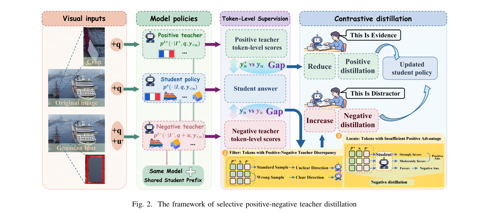

图 1-1：原文 Figure 2，PDF 第 3 页。上支将证据 crop 放大后交给正教师；中支是完整图学生；下支只模糊证据区域，并要求负教师依据框外内容回答。三个分支评分同一学生前缀，右侧用两级选择决定负约束位置。该图不是三个不同规模模型的强弱蒸馏。

训练样本为 (I,q,R)：I 是完整图，q 是问题，R 是问题相关证据框。正视图 I+=2×Crop(I,R)，负视图 I−=GaussianBlur(I,R)，模糊只作用于 R。由于问题来自局部区域，方法在完整图中标红框并加聚焦框内物体的指令；负教师额外收到忽略框内视觉、只用框外内容的指令。

这意味着训练依赖证据定位信息。报告中的“完整图推理”指学生不运行多轮裁图工具，不等于论文已证明面对任意无框问题都能自动发现证据。真实应用要核对红框、问题指代和区域来源是否与评测完全一致。

### 1.2 正蒸馏覆盖全部位置，负蒸馏只挑两类条件都满足的位置

```text
y ~ p_student(. | I,q)
S_n = p_student(. | I,q,y_<n)
P_n = p_positive(. | I+,q,y_<n)
N_n = p_negative(. | I-,q+negative_instruction,y_<n)
d_plus(n) = JSD(S_n,P_n)
d_minus(n) = JSD(S_n,N_n)
L_positive = mean_n d_plus(n)
```

n 是学生生成 token 的位置，y_<n 是该位置之前学生实际写出的前缀。学生与教师用同一 MLLM 在不同输入条件下实例化；正教师对每个有效位置提供目标，不随负分支 gate 一起关闭。

第一层选“教师确实有分歧”的位置：

```text
Delta_n = JSD(P_n,N_n)
g_n = indicator[argmax P_n != argmax N_n] * indicator[Delta_n > delta]
```

两个教师 top-1 不同与完整分布差异超过 delta 都要成立。top-1 相同但尾部分布略不同，可能只是词语风格；不应一边追随正教师、一边强行排斥几乎相同的负教师。论文默认候选阈值 delta=0.5。

第二层选“正教师相对优势还不够”的位置。定义相对差 IS_n=d_plus(n)−d_minus(n)。IS>0 表示学生更接近负教师；IS<0 表示更接近正教师，但领先幅度可能不足。最终目标为：

```text
L_negative = sum_n g_n * max(0, margin+d_plus(n)-d_minus(n))
             / (sum_n g_n + eps)
L = L_positive + lambda_negative * L_negative
```

margin 默认实验最优为 0.5；eps 防止没有候选时除零。要让负项关闭，需 d_minus≥d_plus+margin。负项不是“无条件把学生与负教师推到越远越好”，而是以正教师为锚的相对间隔。lambda_negative 是正、负项的权衡，v1 未披露完整默认训练参数，不能擅自写成 1。

### 1.3 逐项算一遍，并看梯度到底做了什么

教学算例：某 token 通过教师分歧筛选，d_plus=0.10、d_minus=0.25、margin=0.5，学生已经更像正教师，但 hinge=0.35，仍需加强正向优势。另一个 token d_plus=0.05、d_minus=0.60，hinge=0，不再推远负教师。若教师 top-1 一样，则 g=0，负项不作用，正蒸馏仍存在。

本文对固定教师目标的一步推导：hinge 激活且 gate 固定时，负项梯度是 grad d_plus−grad d_minus。因此它同时增强正向贴近和负向排斥。收益是否只是正教师被加权更多，必须用匹配位置的 positive-upweighting 对照，不能只比较有无负教师。

有一个数值边界需要复现者注意：若 JSD 使用自然对数，d_minus−d_plus≤ln 2≈0.693，margin=0.7 就无法在选中 token 上满足关闭条件。原文 m=0.7 的表现明显下降，但未公开实现的对数底与尺度需再核对；这里是条件性数学分析，不把它冒充为作者已确认的失效原因。

```text
sample one student continuation on full image
build positive crop and negative blurred view from evidence annotation
score the same prefixes under all three conditions
for every valid token: retain positive JSD objective
select negative candidates by teacher top-1 disagreement and Delta
activate hinge only when positive advantage is below margin
optimize positive loss plus selected negative loss
```

伪代码表达原文机制。教师分支的 stop-gradient、是否冻结/EMA、目标分布何时刷新，在 v1 中没有足够完整的优化说明；独立实现需明确自己的选择，不能照搬其他 OPSD 的 EMA 系数后声称复现原文。

### 1.4 数据、训练规模与结果

在 Vision-OPD 的 5.8K 样本中保留输入少于 4,096 token 的例子，训练 Qwen3.5-0.8B、2B。三项细粒度评测为 V*、ZoomBench、MME-RealWorld-Lite，另用 POPE 测幻觉。v1 未明确训练轮数/优化步数、学习率、batch、optimizer、GPU 数/型号、显存、训练时长、GPU-hours 与金钱成本；没有可用代码补齐，实际可复现性因此受限。

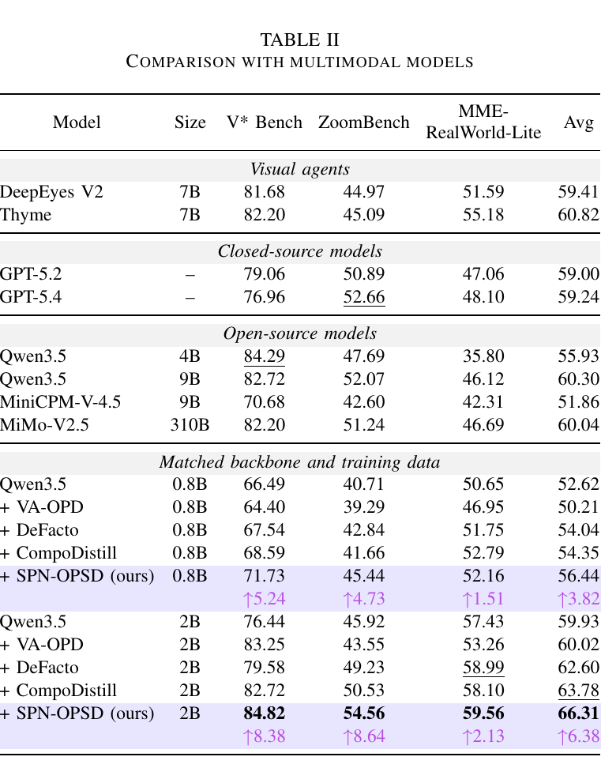

图 1-2：原文 Table II，PDF 第 4 页。上半跨模型比较存在规模、训练与工具差异；下半“Matched backbone and training data”才适合比较算法。表格 Avg 只平均 3 项细粒度任务。

2B 基础 V*/Zoom/MME-Lite 为 76.44/45.92/57.43，SPN-OPSD 为 84.82/54.56/59.56，分别 +8.38/+8.64/+2.13 个百分点，三项平均 59.93→66.31。0.8B 平均 52.62→56.44。2B 的 CompoDistill 平均 63.78，完整方法高 2.53 分；与数百 B 模型的跨表差值不能算等预算算法收益。

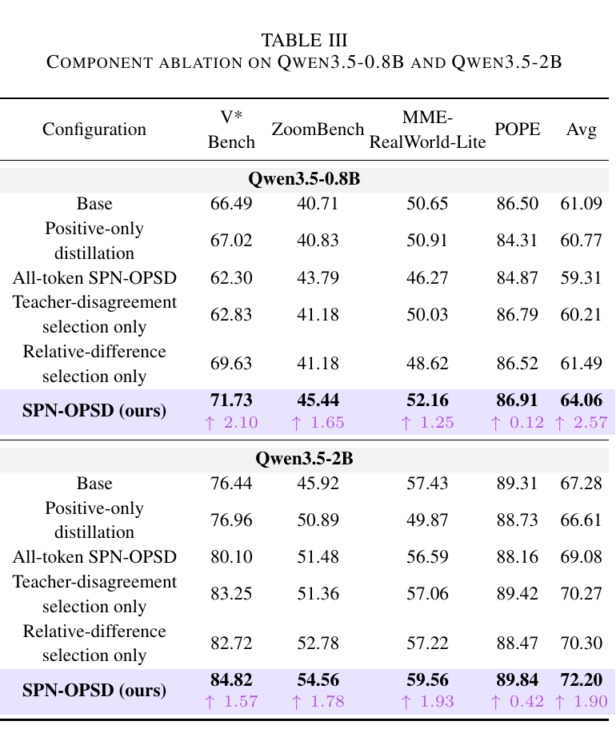

图 1-3：原文 Table III，PDF 第 5 页，包含两种模型规模。注意这里 Avg 又纳入 POPE，共 4 项，与 Table II 的三项平均不同。0.8B positive-only 平均 60.77、全 token 负约束 59.31、完整方法 64.06；全位置推远确实可能使模型更差。2B 完整方法四项平均 72.20。

Table IV 的额外控制（同页）更有解释力：2B 全两级选择下，匹配数量随机选择三项均值 63.92，选中位置只加强正监督 62.14，完整正负约束 66.31。它支持负教师提供了正加权之外的信号，同时说明不能把“更多困难 token”当作全部解释。正文没有把这些单次配置差异包装成跨 seed 显著性结论。

局限与下一步：负视图的语义正确性很重要，模糊后仍可能残留答案线索；框外指令也会改变教师语言行为。建议分开“仅模糊”“仅指令”“二者合用”，保存每个 token 被选中率与 hinge 激活率，按证据面积分桶，并检查是否牺牲无需局部证据的任务。先跑 0.8B 的最小机制实验，也仍须补齐缺失配置才有严格复现意义。

## 2. VIOS：用模型自己“有视频/无视频”的差异审计视觉依赖

论文：[Watching Itself Watch: Self-Auditing Visual Reliance for Video Reasoning](https://arxiv.org/abs/2611.11949)，Rohan Dugad、Mi Luo、Kristen Grauman；首次公开 2026-11-09；[v1 PDF](https://arxiv.org/pdf/2611.11949v1)；[作者项目页](https://vision.cs.utexas.edu/projects/VIOS/)。项目页明确写代码即将发布，所链接 rohand2412/VIOS 本次返回 404，不能称作代码已可运行。

### 2.1 为什么答案特权教师仍然可能给出坏监督

视频问题往往只有少数词决定成败：拿进还是拿出、第一次还是第二次、左边还是右边。教师看到了正确最终答案，可以在学生前缀上给密集目标；但它也可能靠答案和文字先验编出流畅过程，根本没看视频。VIOS 因而同时比较学生与教师各自在有/无视觉条件下的分布。

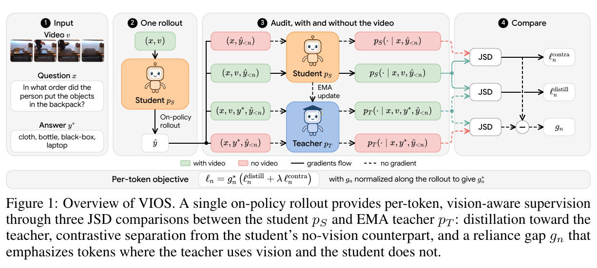

图 2-1：原文 Figure 1，PDF 第 3 页。只在正常视觉条件生成一条学生轨迹，之后对固定前缀进行四种条件评分。EMA 箭头更新教师参数，实线与虚线区分梯度与固定目标。右侧有蒸馏、视觉对比和依赖差三类 JSD，不能把“一个 rollout”读成“只有一次前向”。

### 2.2 三个目标、四种条件

```text
S_v = p_theta(. | question,video,student_prefix)
S_0 = p_theta(. | question,student_prefix)
T_v = p_EMA(. | question,video,gold_answer,student_prefix)
T_0 = p_EMA(. | question,gold_answer,student_prefix)
theta_EMA <- alpha*theta_EMA + (1-alpha)*theta

loss_distill(n) = JSD(T_v,S_v)
loss_contra(n) = -JSD(S_v,sg(S_0))
reliance_T(n) = sg(JSD(T_v,T_0))
reliance_S(n) = sg(JSD(S_v,S_0))
gap_n = reliance_T(n)-reliance_S(n)
```

教师与学生架构相同，EMA alpha=0.99；教师只额外看最终正确答案，不要求真值 CoT。蒸馏项最小化与教师的分歧，对比项有负号，因此鼓励正常学生分布与其无视觉分布分离。无视觉分支停止梯度，避免通过把它“练坏”来轻易增大差异；教师与 gap 同样不接受 policy loss 的反向梯度。

教师依赖减学生依赖的 gap 较大，直觉上表示教师看视频受益、学生却没用好。注意这不是直接测“每个词的视觉正确率”：JSD 只测分布变化，模型可能对无关画面也敏感，所以必须靠任务实测与控制实验判断语义作用。

### 2.3 gate 归一化与容易忽略的边界情况

```text
g_tilde_n = (gap_n-min_k gap_k)/(max_k gap_k-min_k gap_k)
g_star_n = g_tilde_n/mean_k g_tilde_k
L = mean_n sg(g_star_n) * [loss_distill(n)+lambda*loss_contra(n)]
```

归一化在每条轨迹内做，lambda=0.5。第一步拉开近零信号的相对差异，第二步令权重均值为 1，减少 loss 整体尺度变化。它是相对优先级，不是绝对门槛。

教学算例：gap=[0.02,0.08,0.05]，min-max 后 [0,1,0.5]，再除均值 0.5，最终权重 [0,2,1]。第二个位置获得第一位置没有的监督，总平均权重仍为 1。若某位置蒸馏 JSD=0.10、视觉 JSD=0.02，综合项=0.10−0.5×0.02=0.09，权重 2 后为 0.18。

本文补充：若所有 gap 都为负，min-max 仍会把“最不负”的位置赋高权重；因此高权重不保证原始 gap>0。所有 gap 相等时，原公式分母为 0，代码需有 eps 或显式回退；原文主公式没有写全这种边界，代码尚未发布，本报告只将其列为待核验项。不能擅自加 ReLU(gap) 后仍称完全同一算法。

```text
rollout = sample(student, question, video)  # only one generation
teacher_score = score(EMA, fixed_prefixes, video+answer and answer_only)
student_score = score(student, fixed_prefixes, video and no_video)
compute JSD distillation and visual contrastive term
compute detached teacher/student reliance gap
normalize gate within each rollout; check constant-gap case
backpropagate through student with-video distribution only
update optimizer, then EMA teacher
```

### 2.4 数据与实际训练成本

使用 Video-R1-260k。Qwen2.5-VL-7B 从 Video-R1 发布的 SFT checkpoint 开始，以具备 CoT 生成能力；另有 InternVL2.5-4B/8B。主实验每模型 100 steps，8×H200，每 GPU batch 8，学习率 2e-6、cosine、weight decay 0.01、无 warmup、seed 42。训练温度 1.1、top-k 20、top-p 0.95；Qwen completion cap 768，InternVL 为 4096。帧数上限训练 16、推理 32，每帧视觉 token 上限分别 128/256；Video-MME 不使用字幕。

与 Video-R1 的效率对照另跑 4 GPU、每设备 batch 1、LR=1e-6、110 steps，不能用主实验的 100-step/大 batch 设置直接对比别人的 1000-step 结果。原文用语言/视觉模块参数与 token 计数，按前向约 2N、前向反向约 6N 的近似估算 FLOPs；额外计入教师有/无视频、学生无视频条件前向。Video-R1 的时间奖励还额外生成 4 条轨迹。

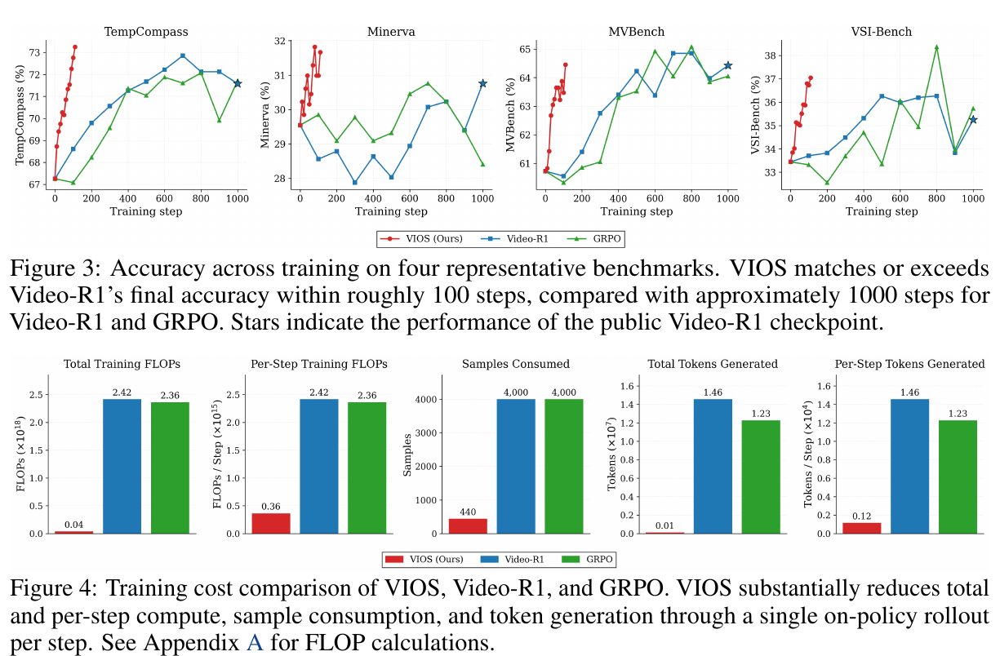

图 2-2：原文 Figures 3–4，PDF 第 8 页。上图横轴训练步，对四项指标跟踪收敛；下图分别比较总与每步 FLOPs、样本与生成 token，各面板单位不同。作者报告相对 Video-R1：总训练 FLOPs 约少 60 倍、每步约少 6.7 倍、总生成 token 少 111 倍、每步生成 token 少 12 倍。这是该配置的估算与计数，不等于实测 GPU wall-clock 快 60 倍。

GPU 时长、峰值显存、GPU-hours 与货币成本未完整披露。教师 EMA 副本和多个条件评分仍占内存与计算；“single model”表示同源架构/自蒸馏，不表示不保存教师参数。

### 2.5 核心实验与消融

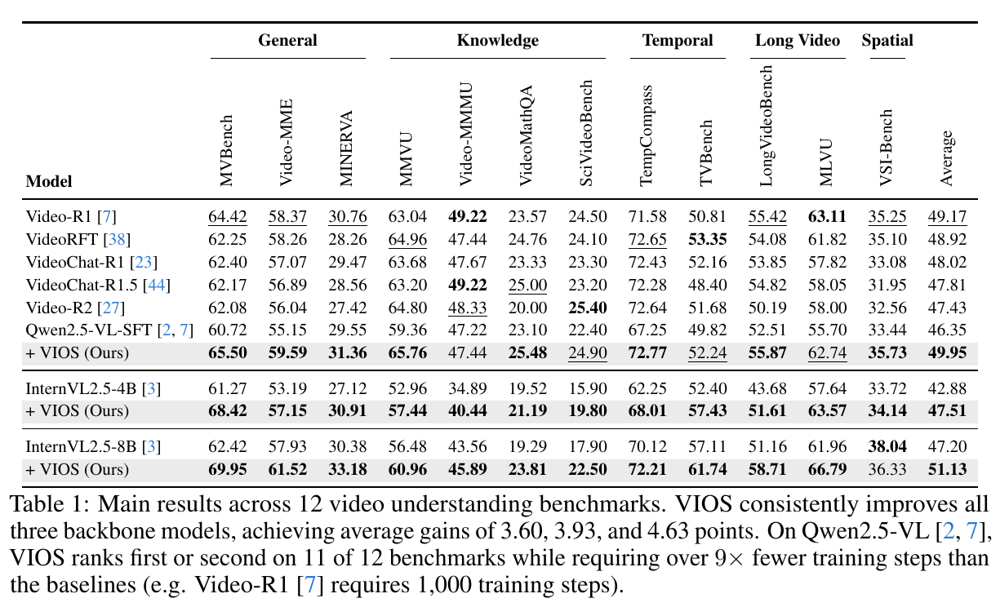

图 2-3：原文 Table 1，PDF 第 6 页。共 12 项视频基准，三组初始化分开比较。Qwen 的 46.35→49.95（+3.60），InternVL4B 的 42.88→47.51（+4.63），8B 的 47.20→51.13（+3.93）。Qwen Video-MME 55.15→59.59，MMVU 59.36→65.76。各任务收益不同，Video-MMMU 只 +0.22，不能说全部复杂知识推理都大幅提升。

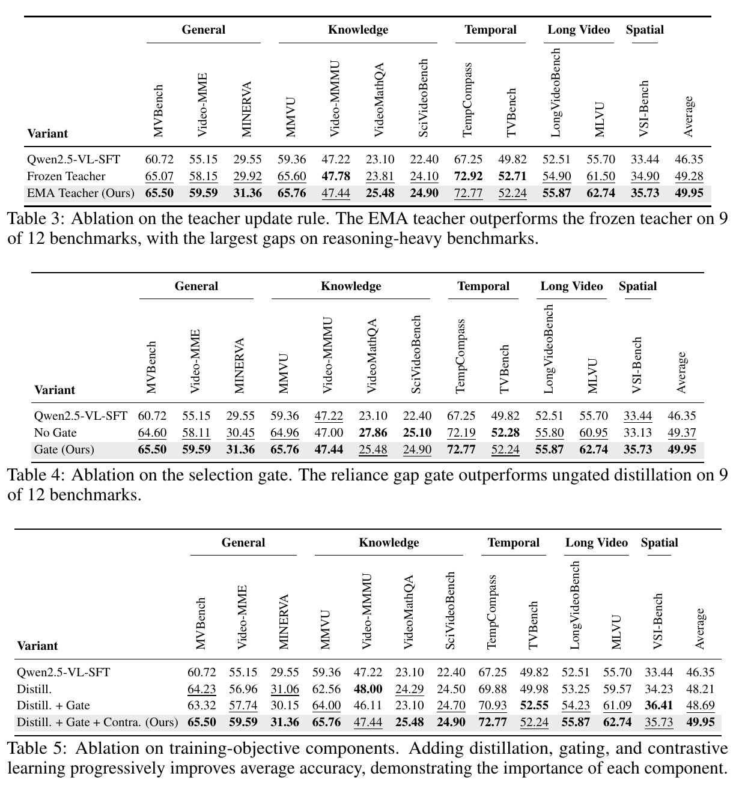

图 2-4：原文 Tables 3–5，PDF 第 9 页。从 Qwen 相同初始化比较：冻结教师平均 49.28、EMA 49.95；无 gate 49.37、有 gate 49.95；只蒸馏 48.21，蒸馏+gate 48.69，再加视觉对比达 49.95。完整方法并非每列都胜，例如无 gate 的 VideoMathQA 27.86 高于带 gate 的 25.48；应看整体及任务代价。

局限与复现路线：仍依赖最终答案标注，因此“无 external reward”不等于无标注；答案特权可能产生合理化目标，EMA 也会继承模型错误。主表主要一个 seed，附录多 seed 的梯度/熵诊断不等于所有主结果均有多 seed 置信区间。先核对 gate 常量回退、前向次数与长序列峰值内存；代码可用后再复刻 4-GPU 效率配置。作者项目页本身有图解与实例，可作为辅助教程，不额外计入论文数量。

## 3. M3OPD-Reasoner：三个领域教师先合并能力，奖励再把学生往前推

论文：[M3OPD-Reasoner: An Open Recipe for Post-Training Multimodal Reasoning with Multi-Teacher On-Policy Distillation](https://arxiv.org/abs/2611.23034)，Nguyen Quang Trung 等，首次公开 2026-11-17；[v1 PDF](https://arxiv.org/pdf/2611.23034v1)；[官方代码](https://github.com/ngquangtrung57/M3OPD-Reasoner)；[作者项目页](https://ngquangtrung57.github.io/m3opd-reasoner-page/)。代码目录、数据与模型入口可核验；项目页本次自动读取失败，方法事实以 PDF 与官方 README 为准。

### 3.1 核心问题是阶段分工，而不是再造一个大教师

把图像 STEM、图像感知和视频任务混合训练，一个方向的梯度可能影响另一个方向。MOPD 先为每个域训练专家，再由域标签路由，在学生前缀上提供监督。常规比较把 MOPD 与 mixed RL 当作二选一；本篇进一步问：MOPD 已经把多个能力放进学生，能否继续用同一批问题做 RL，获得教师模仿之外的收益。

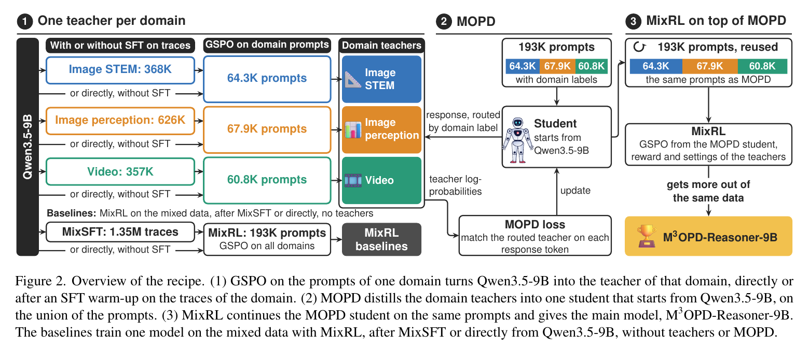

图 3-1：原文 Figure 2，PDF 第 3 页。左边从相同 Qwen3.5-9B 初始化，分别学三个域，比较有/无 SFT warm-up；中间学生也从基础 9B 初始化，用自己的回答接受域教师纠正；右边从 MOPD 学生继续 MixRL。右边没有声称再收集一套新题，193K prompts 被重复用于不同目标。

### 3.2 GSPO：为什么是长度归一化的序列概率比

```text
reward_i = 0.9*R_acc(i) + 0.1*R_fmt(i)
A_i = [reward_i-mean_group reward]/[std_group reward+eps]
s_i = exp(mean_t [log pi_theta(y_i,t|h_i,t)-log pi_old(y_i,t|h_i,t)])
J_GSPO = mean_i min(s_i*A_i, clip(s_i,1-e_low,1+e_high)*A_i)
```

i 是同题八条回答之一，h 含图像/视频、问题与回答前缀。s_i 是完整序列概率比的 1/长度 次方，整个回答共用一个比率与 advantage。教学算例：三 token 的新/旧概率比为 [1.1,1.2,0.9]，序列比乘积=1.188，但长度归一化 s≈1.059；直接拿 1.188 做裁剪就是另一种算法。

论文裁剪 e_low=3e-4、e_high=4e-4，远小于常见 token PPO 的 0.2；不能把“看起来太小”自行改成 0.2 仍称复现。KL penalty 和 entropy coefficient 均关闭，学习率 1e-6、20 步 warmup 后常数、AdamW、weight decay 0.1。每题八条，按 accuracy 全同的组过滤，一组全对或全错不进入更新。

R_fmt：正确闭合一次 thinking block、推理与答案非空且只有一个 boxed answer 时为 1；thinking block 有效但 box 数不符合则 0.5；block 无效为 0。R_acc 只有在 R_fmt=1 时计入；大多数答案类型为二值，set/box 类型按原规则可能是部分正确分值，不能统一替换成字符串 exact-match。格式只有一半时总奖励仅 0.05，答对但格式无效不能拿到 0.9。

### 3.3 top-32 reverse KL 不是“只取老师前 32 词重新 softmax”

对每个域教师，返回同一学生前缀处 top-32 token 集合 K_t 及其 log-prob。学生在这些词上的原始概率记 p(v)，教师记 q(v)。原文目标：

```text
ell_t = sum_{v in K_t} [p(v)*log(p(v)/q(v)) - p(v) + q(v)]
L_MOPD = sum_response mask(y)*sum_t min(ell_t,10)
         / sum_response mask(y)*len(y)
mask(y)=0 if response hits 16384-token cap without ending, else 1
```

K_t 上的概率没有各自重新归一化，因此 sum p、sum q 不一定为 1。若只保留 p log(p/q)，截断支持集上的和可能为负。尾部修正 −p+q 让每个词的项等于 q×[z log z−z+1]，z=p/q；括号函数在 z=1 取最小 0，所以逐项非负。这是本文对原公式的推导。

教学算例：一个入选词 p=0.1、q=0.2，p log(p/q)=−0.0693；加 −p+q=0.1 后为 0.0307。若把前 32 词重新 softmax，这个解释和梯度都变了。tail correction 的名字也不意味着精确恢复了未取入词表尾部的所有概率结构：它仍是受限集合上的训练目标。

原文直接通过学生概率反传，不用任务 reward，不是拿一个 sampled token 的 log-ratio 假装完整分布梯度。log-prob floor 为 −10，学生使用未 floor 值的梯度；per-token loss clamp=10，超过上限梯度为零。截断回答在 loss 与分母中一起 mask，避免分母仍把坏样本算进去。过大 clamp 命中率会使有效信号减少，复现应记录这些比例。

### 3.4 数据构造、异步实现与成本

M3OPD-SFT-1.35M：图像 STEM 约 368K、图像感知 626K，采用基础 9B 的 self traces；视频约 357K 采用 Qwen3.8-Flash-Next 的 traces。样本过滤答案不符、显式引用给定答案、拒绝正确答案、截断/退化。强教师的回答风格不必更适合学生：原文图像 STEM SFT，强教师 trace 60.6、self trace 63.4，因此保留这个对照，而不宣称所有阶段必须用更大教师。

RL 为 193,027 题，按域 64,307 / 67,915 / 60,805。路由来自数据域标签，不是一个额外学出的 MoE router。来源包括 MMFineReason、FineVision、Vero、ViRL39K、VideoChat3、OneThinker 等。对 21 个评测基准做文本 13-gram、图像 pHash≤4、视频 source ID/帧 hash 去污染；SFT 与 RL 再按 prompt/media hash 做互斥。规则可减轻已知重复，不保证所有语义近重复都被发现。

训练完整参数，依赖 lmms-engine 0.1.4、verl 0.9.1、vLLM 0.19.1、PyTorch 2.10.0。论文用 64 张 80GB GPU 资源池；公开 README 进一步写每节点 8×H100 80GB，每配置 4 节点，即 32 卡。GSPO 为两训练、两 rollout 节点；MOPD 为两训练、一 rollout、一 teacher 节点。模型小于十 B 不代表整套多阶段训练是单机轻量任务。

MOPD 每题一条、每 step 1008 prompts/一次 optimizer update；GSPO 通常每 step 256 prompts、mini-batch 64，即四次 optimizer update。都允许至多两版本旧的轨迹，但处理不同：GSPO 会丢弃过旧样本并作截断重要性修正；MOPD 监督式目标不使用 rollout IS，等待在途样本而不丢弃。不能把同名 step 当成等优化次数。

原文按训练指标收敛结束，未给所有阶段统一固定总 steps、完整 wall-clock、GPU-hours、峰值显存与账单；因此同 prompts 对照不是严格相同总 FLOPs 对照，尤其还需训练三个教师。

```text
train three Qwen3.5-9B domain teachers with GSPO
student = fresh Qwen3.5-9B
for union prompt batch:
    sample one student response per prompt
    route each to its domain teacher; gather top-32 scores
    apply corrected top-k divergence, floors, clamp and truncation mask
    update student; synchronize rollout weights
final = GSPO initialized from MOPD student on the same prompt union
```

### 3.5 主结果：增益来自哪一段

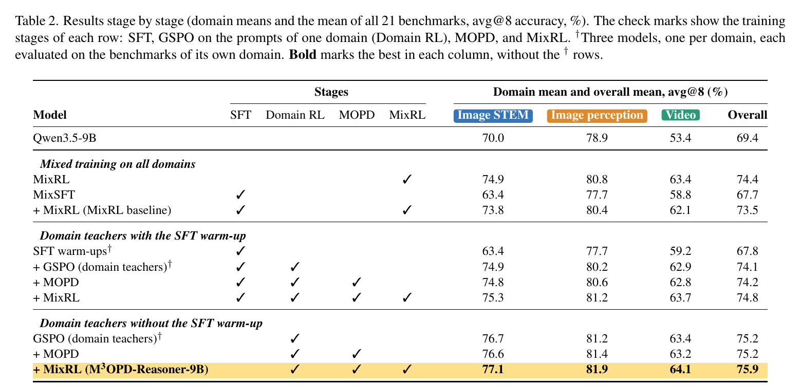

图 3-2：原文 Table 2，PDF 第 7 页。打勾表明各行经过哪些训练阶段；教师行的总体数是三个专家各做本域后的组合，不是单个通用模型。Overall 按全部 21 个 benchmark 平均，并非三个域均值再等权平均。

| 路线 | STEM 8 项 | 感知 8 项 | 视频 5 项 | 21 项均值 |
| --- | --- | --- | --- | --- |
| 基础 9B | 70.0 | 78.9 | 53.4 | 69.4 |
| 基础直接 MixRL | 74.9 | 80.8 | 63.4 | 74.4 |
| MixSFT→MixRL | 73.8 | 80.4 | 62.1 | 73.5 |
| 无 SFT 专家→MOPD | 76.6 | 81.4 | 63.2 | 75.2 |
| 上一行→MixRL | 77.1 | 81.9 | 64.1 | 75.9 |

最终相对 MOPD 为 +0.7，总体相对基础为 +6.5，相对基础直接 MixRL 为 +1.5。这三个差值回答不同问题，不能把总 +6.5 都归功于最后一段 RL。SFT warm-up 专家路线的最终均值 74.8，说明在本基础模型与数据上，前置 SFT 并非必需，不能外推所有弱模型都应跳过 SFT。

评测每题采样 8 次、温度 0.6、top-p 0.95、top-k 20，报告平均准确率 avg@8；不是 pass@8、best-of-8 或投票准确率，也不是八次独立训练 seed 的均值。thinking cap 32768、视频最多 150 帧等评测预算与其他论文不同，跨文分数不能直接排名。

局限：这是一套实用开放配方，强项在完整阶段和数据对照，而非证明某个 divergence 理论最优；混合域数据来源、教师选择与训练预算都会影响结果。复现建议先跑官方各 stage 配置的 CPU/小批量路径检查，再用相同 eval prompt 与 answer matcher 验证基础 checkpoint；保存 teacher 成本、mask/clamp 率、域内样本数和多 seed 方差。不要只复刻最终平均表就丢失分阶段证据。

## 4. Generalized CycleGRPO：让描述能把自己带回原区域

论文：[Generalized CycleGRPO for Fine-Grained Multimodal Understanding and Grounding](https://arxiv.org/abs/2610.29552)，Xin Zhang 等，首次公开 2026-10-21；[v1 PDF](https://arxiv.org/pdf/2610.29552v1)；[官方代码](https://github.com/devinxzhang/CycleGRPO)；[作者扩展项目页](https://devinxzhang.github.io/Generalized-CycleGRPO-Page/)。它扩展了较早的空间 CycleGRPO：今天重点是新的时间/时空训练、DOVE 及相应对照，旧空间结果只作上下文，不把同一旧方法拆成几篇。

### 4.1 为什么重定位能评价一段文字

给定一段视频中第二次倒液体的区间，模型写“一个男人在倒液体”可能句句属实，却区分不了同视频的第一、第三次。若用这句话在完整视频里重新定位，会随机落到相似动作，重构得分低。写出液体颜色、容器和当时状态，才更可能找回指定区间。

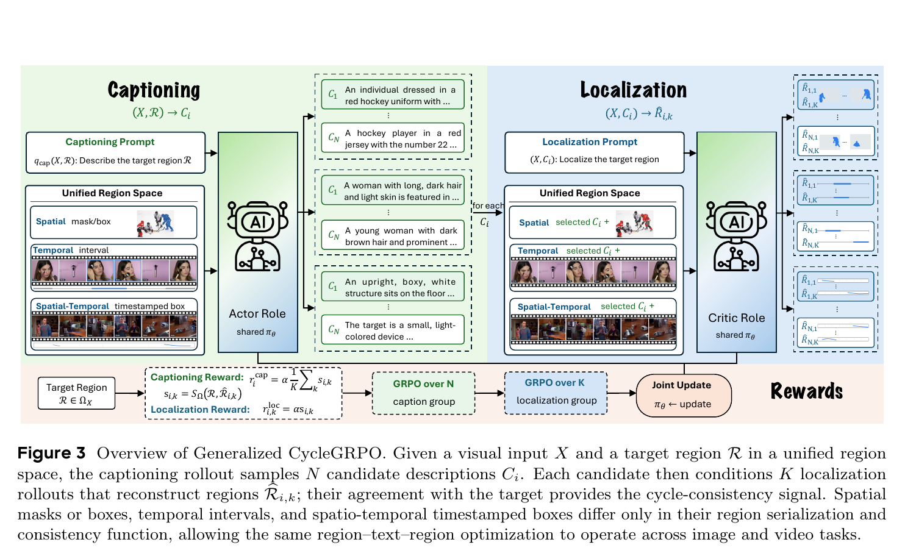

图 4-1：原文 Figure 3，PDF 第 5 页。左侧同一区域生成 N 个描述，每个描述再在右侧生成 K 个定位；重构一致性分别产生描述组与定位组奖励，最后联合更新共享 policy。图像 mask/box、视频 interval 和时空 timestamp-box 的区别在区域接口与一致性函数，而不是都强行用同一个二维 IoU。

定义 X 为视觉输入，R∈Omega_X 为指定区域；f_theta(X,R)→C 为描述，g_theta(X,C)→R_hat 为定位。S_Omega(R,R_hat)∈[0,1] 衡量是否找回原区域。空间 mask token 可以用 token consistency surrogate，显式 box 可用几何 IoU；时间区间用 tIoU，多个重叠区间先合并再算长度。

```text
C_i ~ pi_old(.|X,R), i=1..N
R_hat_i,k ~ pi_old(.|X,C_i), k=1..K
s_i,k = S_Omega(R,R_hat_i,k)
r_caption_i = alpha*mean_k s_i,k + validity_caption(C_i)
r_localize_i,k = alpha*s_i,k + validity_region(R_hat_i,k)
```

alpha 控制重构奖励尺度，validity 检查格式、重复、坐标泄漏等，不需要参考 caption。RL 阶段只需 X、R，但初始化模型必须会消费与输出两种接口，且数据筛选仍可能用外部 VLM；“无外部 judge”仅针对 RL 奖励，不代表整条数据构造从未用过 judge。

### 4.2 两层相对优势必须分开算

```text
A_caption_i = (r_caption_i-mean_over_N)/(std_over_N+eps)
A_localize_i,k = (r_localize_i,k-mean_over_k_for_fixed_i)
                 /(std_over_k_for_fixed_i+eps)
J_total = lambda_caption*J_GRPO_caption + lambda_localize*J_GRPO_localize
```

描述之间竞争“哪句话更能闭环”，定位之间只在同一父描述下竞争“怎样定位更准确”。把 N×K 个定位样本全拼在一起算同组优势，会混入父描述质量差异，改变算法。原文未特别声明时使用相等任务权重，两个分支梯度先累积再更新共享参数。

教学算例：原区间 [10,20]、预测 [12,22]，交集长 8、并集长 12，tIoU=2/3。两个描述分别得到内层分数 [0.8,0.6] 与 [0.2,0.4]，外层奖励均值 0.7 与 0.3，描述组 advantage 约 +1/−1；第一个父描述的定位组则是 +1/−1，第二个父描述是 −1/+1。不能拿第一个组的 0.6 因低于 0.8 就认定它比所有其他描述下的定位都差。

为防坐标复制，时间描述中显式时间戳会受罚，并在作为定位输入前去掉。否则模型可直接写“10 至 20 秒”，重构满分却没学会语义。视觉重复事件会使通用描述获得多峰定位，K 次采样均值才体现“可靠找回”的程度。

### 4.3 数据与预算：不是一个单 rollout 的便宜方法

空间从 Qwen3-VL-4B-SAMTok 接口开始，约 20K DenseWorld 图像与 1K GRES no-target，语言模型+projector 可训练、视觉编码器冻结，一轮、global batch 128、LR=1e-6、AdamW、weight decay 0.01。N=6、K=6，每区域概念上要生成 6+36=42 条路径。

时间侧从 Qwen3-VL-4B 加双向 co-SFT 初始化，按来源视频互斥分割，RL 18,742 例；另一条 OMTG-4B 路线经离线质量筛选保留 18,735 例。均 N=4、K=4，即每区域 4+16=20 条路径；LR=1e-6，KL=0.01，ratio clipping [0.8,1.3]，负 advantage dual-clip 系数 c=3，BF16、FSDP。Qwen 路线 0.25 fps、prompt/response cap 8192；OMTG 2 fps、cap 16384/768。不能把两个初始化的分数当成同数据、同感知预算的一列。

时空侧 Open-o3-Video-4B 先做一轮逆向 caption+QA co-SFT，再混合 35,887 例，其中空间 4,143、时间 4,820、时空 11,924、一般视频 QA 15,000。辅助 QA 有参考答案 reward，只有循环分支不需要参考 caption。论文没有完整 GPU 数/型号、总训练时长、GPU-hours、峰值显存和金钱账单；嵌套 rollout 明显增加生成成本，不能因无大 judge 就声称整体最省。

```text
for each annotated region:
    generate N descriptions
    for each description:
        remove prohibited coordinate/time leakage
        generate K independent reconstructions
        compute consistency against known region
    normalize caption rewards across descriptions
    normalize localization rewards separately under each description
    accumulate the two clipped-policy objectives; one shared update
```

### 4.4 DOVE、主实验与不能省略的强 baseline

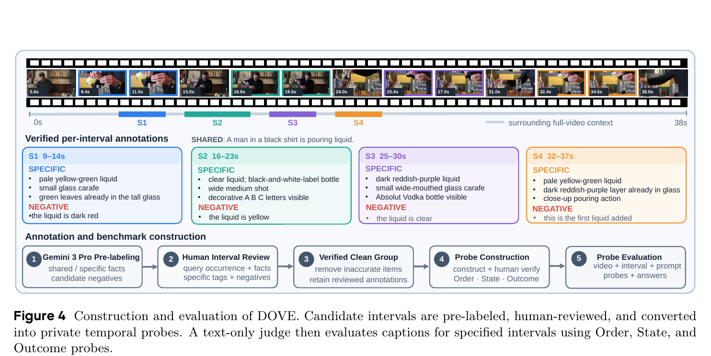

图 4-2：原文 Figure 4，PDF 第 6 页。同一个人四次倒液体，共享描述相同，但颜色、容器、先后状态不同。先用 VLM 预标注再人工复核，构造 Order/State/Outcome 私有问题；固定文本 judge 判断生成描述是否支持问题答案。这里评估阶段确实使用 judge，不与“RL 不用外部 judge”矛盾。

DOVE 包含同视频相似事件的对比组，论文统计 180 组、1,223 个经人工核验 probes，目标区间中位数 6.8 秒，来源视频中位数 100.9 秒。TEC 衡量对正确 probe 答案的支持比例，Clip-Complete 检查区间描述对该区间相关 probes 的完整性，N/M 是无信息或误导情况；不等于 caption BLEU，也不等于时间框 tIoU。

空间旧任务示例：GroundingSuite gIoU 57.5→68.2，说明循环机制的出发点。真正本期增量应看时间/时空与控制实验。

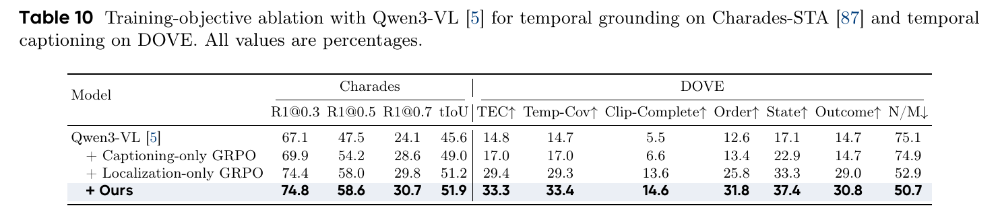

图 4-3：原文 Table 10，PDF 第 15 页。同一 Qwen3-VL 初始化比较：Charades tIoU 基础 45.6、caption-only GRPO 49.0、localization-only 51.2、完整循环 51.9；DOVE TEC 14.8、17.0、29.4、33.3。定位单独训练已经贡献大部分主收益，完整循环相对它额外 +0.7 tIoU/+3.9 TEC，不能把相对基础的 +18.5 TEC 全说成循环独有贡献。

Table 9 是保留循环 rollout 但只开一边 reward 的另一组实验，和 Table 10 的单任务 GRPO 对照不同；表 9 的 caption reward-only TEC=30.1，不能与表 10 的 caption-only GRPO=17.0 当作同一个配置。时空同初始化 Table 11 的 mLGM 为基础 47.2、localization-only 47.3、完整 49.8；比较必须跟随对应主干与 reward 路线。

局限：共享模型可能形成自洽但不完全真实的描述/定位共谋，几何一致不能覆盖所有语言细节；相似事件、遮挡和稀疏采帧仍可能使正确区域不可辨。复现先用官方 generalized 三条 profile，固定数据 hash、坐标 serializer、co-SFT checkpoint 与 judge prompt；按同一父描述检查内层采样，再报告额外生成 token。作者仓库提供 release 与论文成绩差异，不应隐藏这些差异。

## 5. PROVE：把“图里没有目标”与“目标在背景”区分开

论文：[PROVE: Probabilistic Visual Grounding via Patch-Level Evidence for Vision-Language Models](https://arxiv.org/abs/2610.32440)，Mayank Nautiyal 等；首次公开 2026-10-23；[v1 PDF](https://arxiv.org/pdf/2610.32440v1)；[官方实现](https://github.com/mayank05942/PROVE)。本期核验到 main、experiments、ablation 与说明文件，未执行训练。它是冻结 CLIP 的有监督后适配，不是生成式视觉语言大模型的 on-policy RL。

### 5.1 动机：不应强迫每个问题都出现一个热点

问“这张图里的汽车在哪”，即使没有汽车，很多 saliency 方法仍产生最大响应点。空间 softmax 更强制总概率为 1，不允许所有 patch 同时“没找到”。PROVE 把每个 patch 看成独立的目标成员判断，让它可以覆盖零个、一个或多个位置；同时为这个判断提供证据强度。

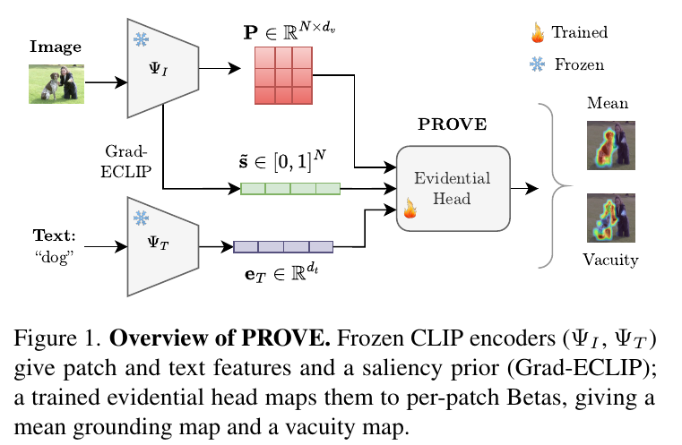

图 5-1：原文 Figure 1，PDF 第 1 页。冻结 CLIP 给 patch/text 特征，Grad-ECLIP 提供 saliency prior，小证据 head 输出 mean 与 vacuity。雪花表示冻结、火焰表示训练。原文“single forward”针对给定缓存特征后的 head 及闭式读数，不意味着原始图文到 Grad-ECLIP 的全部准备完全没有额外成本。

### 5.2 Beta：均值相同，证据可以完全不同

```text
r_i ~ Beta(alpha_i,beta_i)
alpha_i = 1+e_positive_i; beta_i = 1+e_negative_i
e = capacity * tanh(softplus(raw_e)/capacity)
s_i = alpha_i+beta_i
mean_i = alpha_i/s_i
vacuity_i = 2/s_i
Var[r_i] = mean_i*(1-mean_i)/(s_i+1)
```

i 是 patch；r_i∈[0,1] 是与目标的成员相关度，alpha/beta 分别积累支持与反对的证据，均不小于 1。capacity=20，使单通道证据小于 20，避免无界浓度。均值决定定位，s 决定证据总量，vacuity 大说明证据少。这里 Var[r_i] 是相关度概率本身的方差，不是一次 Bernoulli 成员标签的方差，后者不能照抄此式。

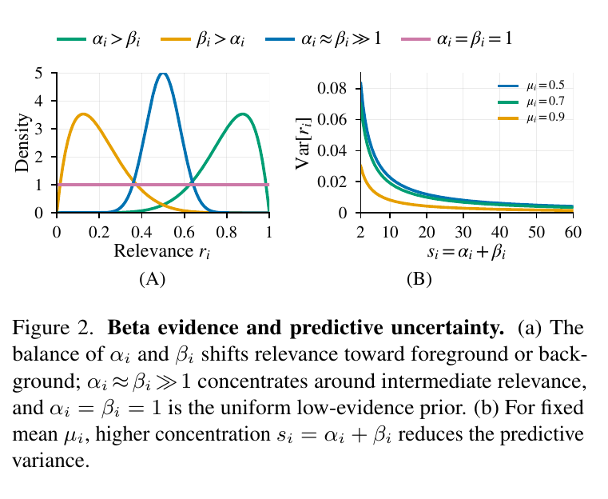

图 5-2：原文 Figure 2，PDF 第 3 页。左边画不同 alpha/beta 的概率密度；右边固定均值，浓度越大、概率方差越小。绿色“倾向前景”、橙色“倾向背景”、蓝色“有证据支持的中间值”与粉色“没证据”四种状态不同。

教学算例：Beta(1,1) 的均值 0.5、vacuity=1、方差 1/12≈0.0833；Beta(5,5) 均值仍 0.5，但 vacuity=0.2、方差≈0.0227，代表有支持的中间覆盖。Beta(5,1) 均值≈0.833、vacuity≈0.333、方差≈0.0198。同为 0.5 的热图点，不能只凭均值判定模型是否知道自己在做什么。

### 5.3 监督来自区域覆盖率，loss 怎样约束两类证据

对真值区域 mask M 与 patch 面积 Omega_i，软标签 y_i=|M∩Omega_i|/|Omega_i|。边缘 patch 可能只有 30% 被覆盖，保留 y=0.3 比强制变成 0/1 更接近 patch 分辨率的实际信息。

```text
L_loc_i = E_{r~Beta}[-y_i*log r-(1-y_i)*log(1-r)]
        = y_i*[digamma(s_i)-digamma(alpha_i)]
          +(1-y_i)*[digamma(s_i)-digamma(beta_i)]

L_reg_i = (1-y_i)*KL(Beta(alpha_i,1)||Beta(1,1))
          +y_i*KL(Beta(1,beta_i)||Beta(1,1))
L_absent_i = KL(Beta(alpha_i,beta_i)||Beta(1,1))
```

digamma 是 log Gamma 的导数，利用 Beta 分布中 E log r=digamma(alpha)−digamma(alpha+beta) 得到闭式损失；因此不用 Monte Carlo 抽样估计每个 patch 的 BCE。L_loc 把均值拉向覆盖率，也倾向增加浓度，L_reg 才约束目标不支持的证据：y=1 时压背景通道 beta，y=0 时压前景通道 alpha；partial target 对两侧都有约束。

本文展开一个便于手算的特例：KL(Beta(a,1)||Beta(1,1))=log a−1+1/a。a=1 时为 0，a=5 时约 0.809；若这个 patch 真是背景 y=0，错误前景证据越多，罚分越高。它没有罚正确背景通道，不能误写成所有 alpha/beta 一起压回 1。

完整目标由是否有目标的 z 决定：有目标时平均 class-balanced 的定位与逐步加权正则；无目标时对全部 patch 使用 prior-pull。后者把 alpha、beta 都拉回 (1,1)，保留“完全没找到”的低证据状态。若只把无目标例子练成强背景 beta 很大，它会与有目标图里的普通背景 patch 混淆。

```text
if target_present:
    L = mean_i weight_i * (L_loc_i + lambda_reg(t)*L_reg_i)
else:
    L = lambda_absent * mean_i L_absent_i
foreground = {i: mean_i > 0.5}
U_foreground = average vacuity over predicted foreground
absence_score = -max_i s_i
```

absence_score 越大（越接近 -2）越像无目标，阈值只用验证集选，不在测试集重调；U_foreground 用于按不确定性拒绝定位结果。若预测前景集合为空，需要明确回退行为，不能直接除以 0；这应与原实现核对，不在报告里偷偷给一个“作者默认值”。

### 5.4 模型与训练：真正轻的是哪部分

CLIP ViT-B/16 在 224×224 输入上产生 14×14=196 个 patch，patch 维 768、text 维 512。冻结特征先投到 256 维，经 text FiLM、saliency 与位置编码，加入全局 token；证据 head 为两层 Transformer、4 heads、FFN=1024、dropout 0.1，再由 MLP 输出两通道。预测分布按 patch factorize，不代表每个参数只看本 patch：head 的 self-attention 仍聚合全空间。

训练 gRefCOCO 约 209K 图文表达式，其中单目标 57.6%、多目标 33.2%、无目标 9.1%；约 14K validation 做模型选择/缺失阈值。多目标 mask 合并后算软覆盖；测试 gRefCOCO A/B，并迁移 Flickr30k Entities 与 PhraseCut，无需重新训练。

10,000 steps、batch 512、AdamW LR=5e-4、weight decay 0.01，warmup 1500 后 cosine、clip norm 5，eval EMA=0.999。lambda_reg 最终 2，前 2500 步线性上升；lambda_absent=1，五 seed 主实验。CLIP 与 Grad-ECLIP 特征缓存后只训练 head。总 head 参数量、硬件型号/数量、完整预计算+训练时长、峰值显存、GPU-hours 和账单未完整披露，不能把“冻结 150M CLIP”当成只加载几 KB adapter。

```text
precompute frozen image/text features and Grad-ECLIP cue
project segmentation masks to fractional patch coverage
for training batch:
    predict two bounded evidence channels
    form Beta parameters and closed-form present/absent losses
    update head only; maintain eval EMA
on validation: select checkpoint and absence threshold
on test: keep threshold fixed; evaluate localization, absence and selective risk
```

### 5.5 最重要的对照：定位涨分主要是监督，概率头贡献在可靠性

原文 Table 1：gRefCOCO people IoU@k，PROVE 0.616±0.002，最好训练免费 baseline 约 0.299；objects 0.538±0.003。这个巨大差距有重要前提：PROVE 看了 gRefCOCO 的有监督训练，baselines 没有。不能据此说 Beta 本身让定位翻倍。IoU@k 取与真值目标 patch 数相同的 top-k，只是排序评估，不是部署时已经知道目标大小。

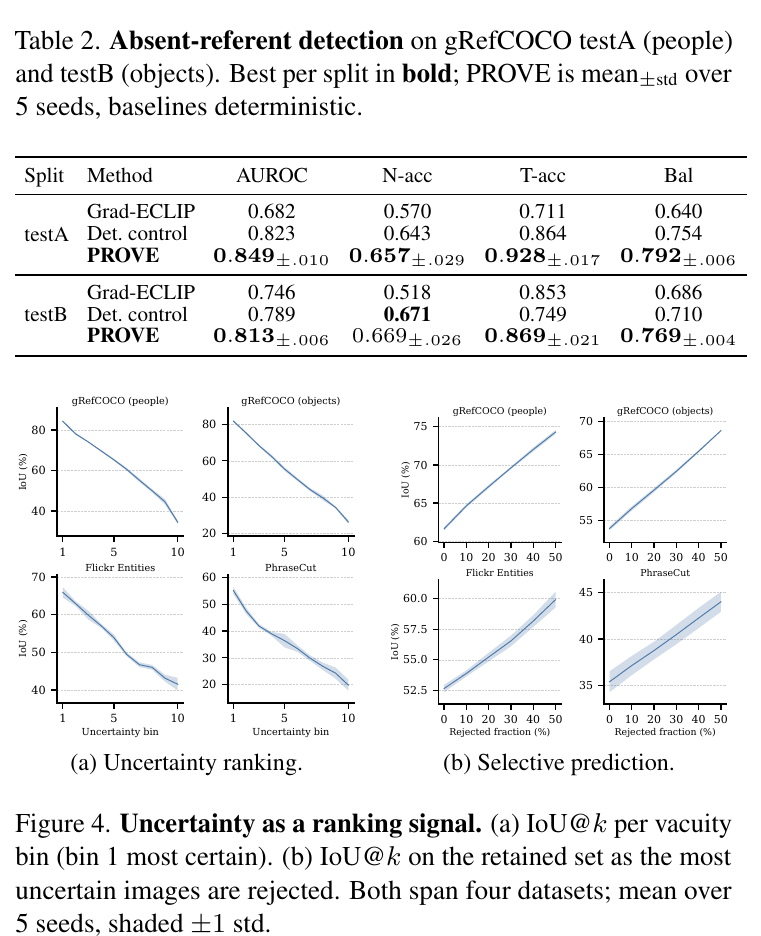

图 5-3：原文 Table 2 与 Figure 4，PDF 第 7 页。表格的 AUROC 评估目标缺失检测排序，N-acc 为缺失例拒绝率，T-acc 为有目标例保留率；阈值在验证集设定。右/下图按 vacuity 分箱及拒绝最不确定样本，检查保留样本 IoU 是否升高，不能只看拒绝后精度而不报保留比例。

people 缺失 AUROC：Grad-ECLIP 0.682、同架构 deterministic control 0.823、PROVE 0.849±0.010；有目标保留率 0.928、balanced accuracy 0.792。objects AUROC 0.813±0.006。不能把 AUROC 0.849 说成 84.9% 分类准确率。

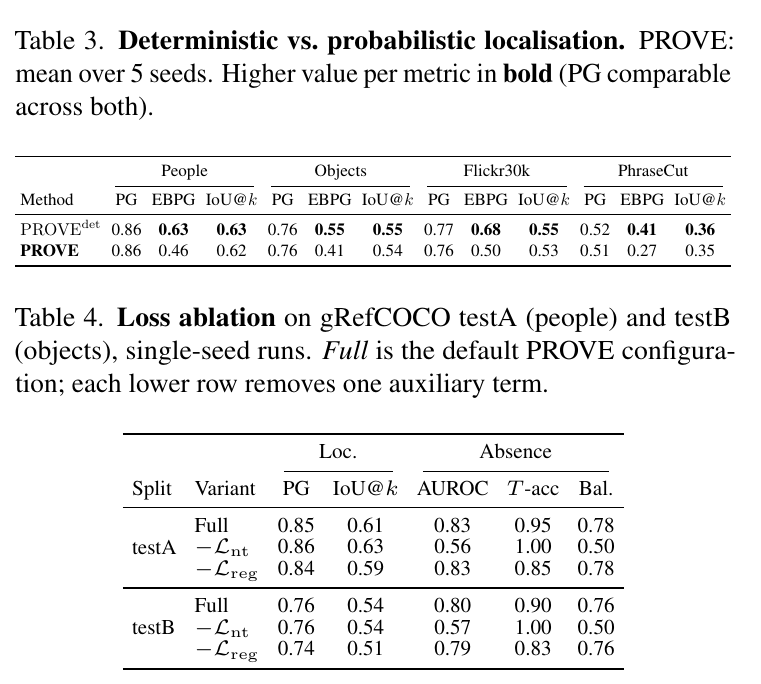

图 5-4：原文 Tables 3–4，PDF 第 8 页。相同监督的确定性 head，people IoU@k 约 0.63，PROVE 约 0.62，前者 EBPG 也更高；概率化付出小幅定位代价，换来证据/拒答接口。下表单 seed 去 prior-pull 后 people AUROC 0.83→0.56、objects 0.80→0.57，balanced accuracy 到 0.50，而定位大体保持。缺失信号主要来自专门的 absence loss，不能称为无缺失监督自然涌现。

局限：196 个 patch 难表达极小目标，saliency prior 错误会传入 head；证据浓度受 capacity 与训练目标影响，并非天然校准的真实概率。缺失对分布外场景的泛化仍有限；单次 head forward 不包含所有前处理的速度账单。建议先复现 deterministic control 与去 prior-pull 的差异，再做图像尺寸、目标面积、不同缺失类别的误拒/漏拒曲线。

## 五篇如何放进一条小模型研究路线

| 当前问题 | 本期可借鉴项 | 先验证什么 |
| --- | --- | --- |
| 0.8B/2B 局部细节识别差 | SPN-OPSD 的正负教师与相对间隔 | 教师视图正确性、选中率、负项激活率、缺失超参 |
| 视频训练偏向文字先验 | VIOS 的四条件 JSD 审计 | 有/无视频的语义差异，gate 常量回退与额外前向 |
| 多域混训相互干扰 | M3OPD 的专家蒸馏后继续 RL | 域内与总体分开，等 prompts 和等计算分开 |
| 描述流畅却不能定位 | Generalized CycleGRPO 的重构奖励 | 定位单任务强 baseline、反时间戳泄漏、嵌套成本 |
| 没有证据仍硬画热点 | PROVE 的 prior-pull 与拒答接口 | 同监督 deterministic control、缺失标签、保留率 |

本文建议：若资源有限，先做 0.8B/2B 的局部证据训练或冻结 CLIP head 的机制复现；若已有视频 SFT checkpoint，再考虑 VIOS。M3OPD 的完整多教师路线需要多节点预算；CycleGRPO 的嵌套采样并不便宜。这个顺序是研究实施建议，不是五篇原文做过的组合实验。

不要把五种 loss 一次全部叠起来。它们对目标分布、基础主干、teacher 条件、采样和监督要求不同。每次只变一个因素，记录同任务视觉必要性干预、训练 token、教师/反事实评分前向、wall-clock、显存，以及对其他任务与已有能力的回测。

## 小白到实现：辅助阅读与作者说明

先读 [PyTorch 官方知识蒸馏教程](https://docs.pytorch.org/tutorials/beginner/knowledge_distillation_tutorial.html)，理解 logits、teacher target 与梯度；再看 [Thinking Machines 的 On-Policy Distillation 作者技术博客](https://thinkingmachines.ai/blog/on-policy-distillation/)，用图解区分学生轨迹与静态参考轨迹。该博客为基础资料，不占今天论文名额。

训练算法读 [TRL GRPO 官方文档](https://huggingface.co/docs/trl/grpo_trainer)；Beta 概率密度、均值与方差可用 [SciPy Beta 官方说明与例子](https://docs.scipy.org/doc/scipy/reference/generated/scipy.stats.beta.html)手算后核对。它们只用于基础机制，不替代各篇特定目标。

作者的一手图解/实施资料：[VIOS 项目页](https://vision.cs.utexas.edu/projects/VIOS/)有方法、结果和效率说明；[M3OPD 官方 README](https://github.com/ngquangtrung57/M3OPD-Reasoner)含数据、各阶段入口、模型集合；[CycleGRPO 的 generalized 说明](https://github.com/devinxzhang/CycleGRPO/tree/main/generalized)含时间与时空训练配置；[PROVE 官方仓库](https://github.com/mayank05942/PROVE)提供训练与消融目录。SPN-OPSD 本期未核验到作者博客/代码，VIOS 代码仍标 coming soon，未以第三方解读站充当已开源证据。

方向锚点仍是 [Vision-OPD](https://arxiv.org/abs/2605.18740)与 [MMSearch-R1](https://arxiv.org/abs/2506.20670)。二者超出本期窗口，只放阅读链接，不重复收录。Where-OPD、PRISM 等检索命中也因首次发布日期过早剔除，没有用最近代码更新日期换算成新论文。

## 图源、验证与内容边界

16 幅图表均裁自 5 篇真实 v1 PDF，未重画实验曲线。图号、物理页码、裁剪框与 hash 见 assets/SOURCES.md、manifest.json。PDF 由同一 Markdown 全文生成，保留公式、伪代码、图注与表格；字体、文字一致性和逐页检查见 assets/QA.md。教学算例及推导不代表作者实测。
