# VLM 后训练论文精读 · 2026-11-20

今天读 5 篇近一个月新公开、此前未入库的论文，集中讨论“特权信息到底该怎样变成训练信号”。覆盖小型视频 VLM 的 GRPO+OPSD、主动观察的 OPD、分割中的正优势调节、长程视觉 agent 的过程奖励，以及幻觉偏好优化。窗口为 2026-10-20 至 2026-11-20，首次日期以 arXiv v1 为准；DTP-OPSD 虽然编号以 2611 开头，v1 实际提交于 10 月 29 日。

本次实际执行环境：本地 macOS 补位；已读取远端运行约定并核对云端迁移聊天，长期云端日程仍暂停，等待环境绑定核验。没有同日已完成的云端日报证据。本次使用既有授权 SSH 发布，没有复制凭据，没有运行模型训练。根目录及所有方向 manifest 参与交叉去重。

阅读标记：**原文事实**来自 v1 PDF、附录或已验证作者代码；**教学算例/本文推导**用于解释机制，不是作者实验；**未披露**表示原文或可核验公开资料不足，不能据此编造训练预算、代码可用性或显著性。图表均直接裁自原论文，完整图源与哈希在 assets/SOURCES.md。

| 论文与首次日期 | 模型/训练对象 | 本篇最值得学的机制 |
| --- | --- | --- |
| DTP-OPSD · 10-29 | Qwen3-VL 2B/4B/8B | 红蓝时间特权、0/1/2 蒸馏门控、全零组救援 |
| PQ-OPD · 11-17 | Qwen3.5 9B→4B、9B→9B、27B→9B | 只告诉老师看什么，不给答案；学生自己调用 seek/zoom |
| HISD · 11-11 | Qwen2.5-VL-7B + 冻结 SAM2 | EMA 老师、Top-16 支撑集、只调正优势幅度 |
| ViStep-RL · 11-18 | Qwen2.5-VL 3B/7B LoRA | 证据依赖图、势能差奖励、带来源的主动记忆 |
| Beyond Seeing · 11-16 | LLaVA-1.5-7B LoRA | 偏好验证与修复、严重度 margin、幻觉和覆盖率权衡 |

## 先补概念：这五篇的 loss 为什么不能混为一谈

VLM 可以被看成根据图像/视频和已有文本，逐 token 选择下一步的策略 πθ。rollout 是模型生成的一次完整尝试；agent rollout 还包含工具调用和返回图像。on-policy 指监督沿着**当前学生实际走过的前缀**发生，不能把事先收集的老师答案简单换个名字就算 OPD。

GRPO 用同题多次尝试的相对奖励决定更新方向。若奖励为 [0,0,0,0]，每条减去组均值仍是 0；有无标准差归一化都无法产生相对差异。DTP-OPSD 在此额外加入分布匹配梯度；HISD 则乘在已有优势上，所以零乘任何权重仍为零。ViStep-RL 通过中间证据状态生成新的非零转移奖励，但还会过滤总回报无差异的 rollout 组。三者解决的“稀疏”层次不同。

Jensen-Shannon divergence（JSD）衡量两份下一词概率分布是否一致。设学生分布为 p，老师为 q，M 是两者等权平均，KL 是相对熵：

```text
M(v) = [p(v)+q(v)]/2
KL(p||M) = sum_v p(v) log[p(v)/M(v)]
JSD(p,q) = 0.5 KL(p||M) + 0.5 KL(q||M)
```

v 遍历词表，log 下文教学计算采用自然对数。JSD 非负，一致时为零；自然对数下上界为 ln2。stop-gradient（sg）使 q 只提供目标而不被这项 loss 直接更新；M 仍依赖 p，不能把 M 也错误 detach。教学例：p=[0.8,0.2]、q=[0.2,0.8]，M=[0.5,0.5]，JSD≈0.193。数字本身不是 reward：它告诉你两个分布不同，而不是哪条回答必然正确。

两篇视频蒸馏都把词表压成“老师 top-100 + 一个剩余质量桶”，因此得到 101 类归一化分布；HISD 则在“老师 top-16 与已采样 token 的并集”内重新归一化，丢弃集合外概率。**保留尾桶**与**集合内重归一化**对应不同目标，不能互换。后文逐篇展开。

## 1. DTP-OPSD：让全零奖励的困难视频也能产生梯度

论文：[DTP-OPSD: Reinforcement Learning with Distractor-Aware Temporal-Privilege On-Policy Self-Distillation for Temporal Video Grounding](https://arxiv.org/abs/2611.00120)；Zhaoyu Chen、Yongwei Nie；首次公开 2026-10-29。[v1 全文](https://arxiv.org/pdf/2611.00120v1)；[作者代码](https://github.com/nian1125/DTP-OPSD)。PDF 仍写将发布，但当前仓库已可访问，含 configs、dtp_opsd、scripts 和 TimeLens 子目录；不应继续把代码状态写成“完全未公开”。未验证到独立作者博客。

### 1.1 问题：认识动作，却找错了同一动作发生的那一次

Temporal Video Grounding（TVG）输入视频 V 和描述 q，输出起止时间 τ̂=[t̂s,t̂e]。一个人先打开烧烤架、关闭、再打开；问题要求“再次打开”，模型可能认识“打开”，却落在第一次。预测与真正目标完全不重叠时，时间交并比 tIoU 为零。

```text
r_i = tIoU(tau_hat_i,tau_gt)
    = duration(intersection) / duration(union)
A_i = r_i - mean_j(r_j)             # 本文没有标准差缩放
```

i 是同题第 i 条回答，G=8，A 是 group-relative advantage。无法解析、负时间、结束早于开始的回答也得零分。原文只用 tIoU reward，没有独立格式奖励或时间距离奖励。GT=[20,24]、预测=[21,25] 时交集 3 秒、并集 5 秒，reward=0.6；预测=[5,9] 时为 0。八条全找错发生次数，就形成作者所称 dead group。

### 1.2 红蓝视频特权：同一权重，不同输入

训练时老师和学生共享当前 θ；学生看干净视频，老师看带边框的副本。目标时间窗围绕中心扩大到原时长 1.5 倍后标红，同视频经过验证的干扰时间窗标蓝；重叠时红优先。视频内容和时长不变，文本 prompt 也一样，甚至不解释颜色。

这样老师得到“本题应关注哪次发生”的训练专用信息。扩大时间窗使红边框不与 GT 边界完全一致，但**并不消除 GT 信息泄露**；这里的许可是训练特权，而不是声称老师没有用标注。测试只给学生原视频。

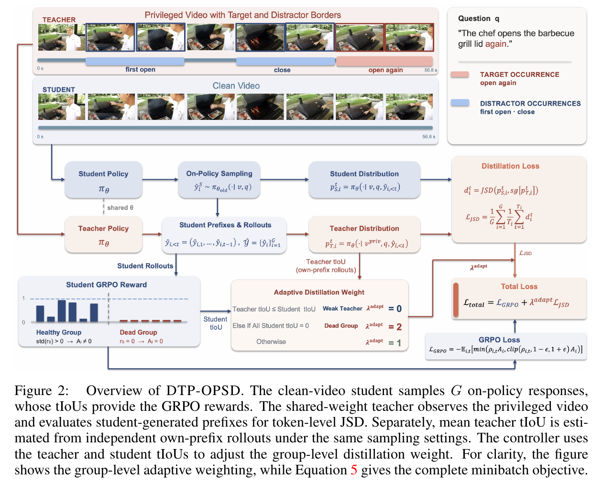

图 1-1：原文 Figure 2，PDF 第 4 页，[图源](https://arxiv.org/pdf/2611.00120v1)，访问于 2026-11-20。上半部分是干净/特权视频，下半部分分成 GRPO reward、同学生前缀 JSD 和自适应控制器三路。图中的 teacher tIoU 来自老师自己生成的独立 rollout；不能误读成用学生回答的分数代替老师能力。

### 1.3 为什么需要两种 teacher forward

第一种：老师在自己前缀下独立生成 8 条回答，算平均 tIoU r̄T；学生 8 条得到 r̄S。两者使用同一 snapshot、prompt、温度和采样设置，主要用于判断“这个老师此刻是否值得听”。

第二种：把每一条**学生生成前缀**喂给老师，在特权视频下计算下一 token 分布 q；学生干净视频分布为 p。此时老师不再单独生成另一条要模仿的答案，而是逐位置指导学生已经走到的状态。

```text
d_i,t = JSD(p_i,t, sg(q_i,t))
ell_g = (1/G) sum_i [ (1/T_i) sum_t d_i,t ]
a_g = 0   if mean_teacher <= mean_student
    = 2   if teacher_better AND all student rewards == 0
    = 1   otherwise
L = L_GRPO + lambda_JSD * mean_g(a_g * ell_g)
lambda_JSD = 1
```

g 是视频问题组，T_i 是非 padding completion token 数，prompt 不进入 loss，EOS 包含在内。a_g 属于 {0,1,2}，是整组蒸馏倍率。若双方全零，第一条规则生效，a_g=0；不是所有死组都强行救援。若学生八条都为 0.4、老师更好，它仍没有相对奖励梯度，但蒸馏倍率是默认 1，而不是 2。

GRPO 项使用 min(ρA,clip(ρ,1−ε,1+ε)A)，ρ 为当前策略对 rollout 策略的 token 概率比；每批只优化一次，梯度计算点 θ=θold，因此 ρ=1、clip 在该设置下不激活。参考 KL 系数为 0。本文的额外指导来自 JSD，不能把它与 reference-KL 正则混称。

### 1.4 top-100 + tail 的省显存实现与手算

令 K_t 是老师概率最高的 100 个词，映射 Φ 保留这些词各自概率，并把集合外概率求和为第 101 类。对 p、q 使用同一映射，不把前 100 项单独归一化。JSD(Φ(p),Φ(q)) 由数据处理不等式不大于完整词表 JSD：它是合并类别后的下界，不能监督尾部每个词的排列。

教学缩小例：老师 q=[0.6,0.3,0.1]，学生 p=[0.3,0.2,0.5]，假设只保留 top-1，则映射为 q′=[0.6,0.4]、p′=[0.3,0.7]，JSD≈0.0462。若错把保留词独立归一化，两者都变成 [1]，loss=0，丢掉的正是关键概率质量差异。

再设学生组 reward 全零，老师均值 0.75，a_g=2；即便 L_GRPO 当前梯度为零，2×0.0462 的蒸馏项仍有直接学生梯度。反之，若老师均值也为零，门控会拒绝这份指导。教学数值解释控制器，不表示作者某个 token 的测量。

### 1.5 数据与完整训练流程

HI-TVG-300 完全从 TimeLens-100K 训练集挑选，无外部视频。GPT-5.6 筛查重复/相似/相反动作并提出边界；人工检查目标与至少两个真实干扰窗；再用 8B 同 snapshot 的独立各 8 次采样，保留老师平均 tIoU>0.7、学生<0.3 的可教样本。这个筛选会偏向“老师加特权后能做、学生不会”的局部问题。

```text
cache red/blue privileged videos from verified training annotations
for batch of 8 prompt groups in one shuffled epoch:
    snapshot current shared weights
    sample 8 clean student responses per prompt
    sample 8 privileged teacher responses for controller only
    parse intervals; compute tIoU and mean-centered advantages
    choose a_g from independent teacher/student rewards
    teacher-score all student prefixes without gradients
    student-score same prefixes with gradients
    compute 101-category JSD and GRPO, respecting completion masks
    take one optimizer update; discard stale teacher distributions
```

初始化是 TimeLens-SFT，不是从零训练 Qwen3-VL；主模型 8B，额外验证 2B/4B。2 FPS、最多 448 帧、视觉 token 预算 14,336；全局 8 组、每组 8 条学生回答，即 64 completions/update，LR=1e-6。一轮 drop_last 后只处理 296/300 条，共 37 updates，双方配对实验漏掉相同 4 条。BF16、gradient checkpointing、ZeRO-2，老师 rollout、前缀打分、学生优化顺序执行并及时释放压缩 logits。论文没有足够资料确定其余 optimizer 细节，复现应以作者配置核对，而不是按惯例补写。

### 1.6 主实验、消融和真正的小模型收益

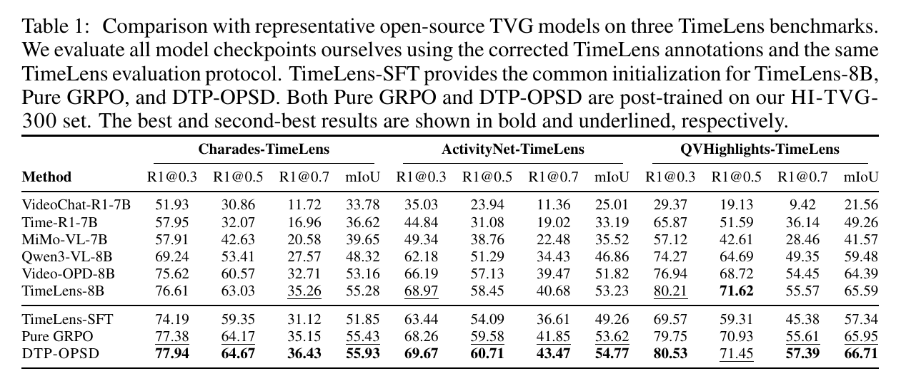

图 1-2：原文 Table 1，PDF 第 8 页，[图源](https://arxiv.org/pdf/2611.00120v1)。横向每个数据集都有 R1@0.3/0.5/0.7 与 mIoU；所有 checkpoint 由作者用修正 TimeLens 标注重评。最有力的比较是相同 TimeLens-SFT 初始化、相同 300 条数据的 Pure GRPO 与 DTP-OPSD，而非与所有公开模型直接归因于单一 loss。

三项 mIoU：Pure GRPO 为 55.43/53.62/65.95，DTP-OPSD 为 55.93/54.77/66.71，增益 +0.50/+1.15/+0.76；对应 R1@0.7 增益 +1.28/+1.62/+1.78。8B 全方法不代表所有指标都第一，原文是 12 项中 11 项第一、1 项第二。

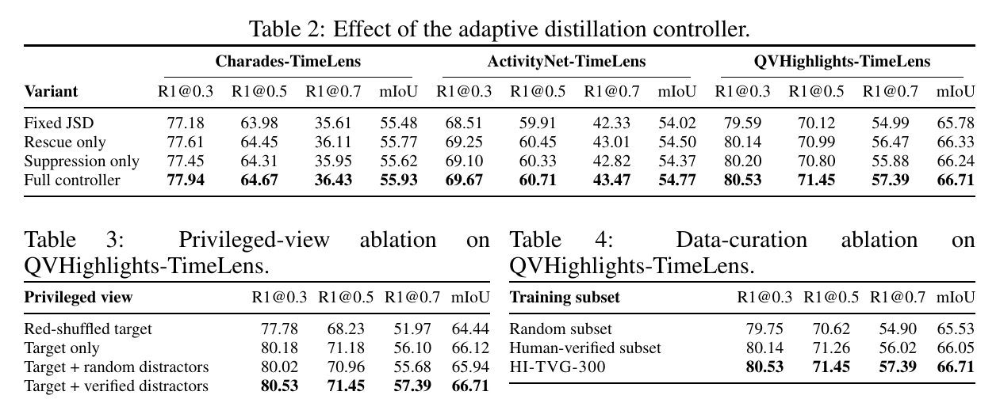

图 1-3：原文 Tables 2-4，PDF 第 9 页，[图源](https://arxiv.org/pdf/2611.00120v1)。上表拆 suppression 与 rescue；下左拆特权画法；下右保持 DTP 方法不变、替换数据子集。下右不是独立控制每一项标注质量的因果实验。

在 QVHighlights 上，固定 JSD 65.78，单救援 66.33，单抑制 66.24，完整控制器 66.71；固定指导略低于 Pure GRPO 65.95，说明“多一个老师 loss”不保证提升。红窗打乱只有 64.44；只标目标 66.12；加随机干扰 65.94；加验证过的干扰 66.71。颜色本身不是收益来源。附录中 JSD-only 只有 15.04 mIoU，GRPO+GT-SFT 为 66.23，进一步提示分布一致性不能取代任务正确性奖励。

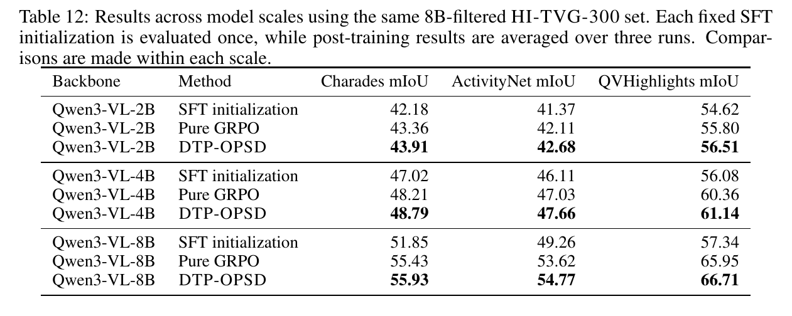

图 1-4：原文 Table 12，PDF 第 20 页，[图源](https://arxiv.org/pdf/2611.00120v1)。各规模使用同一个 8B 筛选子集，比较应在规模内进行，不能把分别训练的 SFT 初始化当作严格跨规模 scaling law。2B 在 QVHighlights 从 Pure GRPO 55.80 到 56.51；4B 从 60.36 到 61.14。

初始固定死组 142 条中，至少一条回答与 GT 有重叠的恢复率从 GRPO 38.7% 到 DTP 64.1%，不是“全部恢复正确定位”。初始 1,136 条死组 rollout 的 79.8% 与已验证干扰窗重叠，支持发生次数混淆这一诊断。

### 1.7 成本、局限与复现优先级

8 张 H20：一轮 Pure GRPO 7.3 h、58.4 GPU-hours、单卡峰值 54.6 GB；DTP 11.7 h、93.6 GPU-hours、59.1 GB。等算力延长 GRPO 到 11.7 h 得 66.09，仍低于 DTP 66.71；不是以更少总算力取得主表收益。特权视频离线渲染另需 0.6 CPU-hours，未计入训练 GPU-hours。三次配对训练均值±样本标准差中，QVHighlights 为 65.95±0.11 对 66.71±0.09；没有换算云端美元费用。

优先复现：先验证 parser 和 tIoU，再冻结一批真实死组，确认 teacher own-prefix 的能力估计与 same-student-prefix 的蒸馏确实分开；对 top-100 tail 检查总概率=1，检查只 detach 老师；最后做等 GPU-hours 的对照。范围局限是 Qwen3-VL 家族、300 条偏难可教视频、需要人工干扰标注，门控还受 8 次 Monte Carlo 采样噪声影响。推理没有新增老师或边框输入，但这不抵消训练数据准备和额外 forward 成本。

## 2. PQ-OPD：蒸馏“该去看什么”，而不是把答案塞给老师

论文：[Teaching What to Look For: Privileged Perception Questions for Agentic On-Policy Distillation in Video Captioning](https://arxiv.org/abs/2611.22755)；Yifan Xu 等；首次公开 2026-11-17。[v1 全文](https://arxiv.org/pdf/2611.22755v1)。论文承诺发布 PQ 数据、生成代码与权重；本次 PDF 外链检查及针对论文名/方法名的检索没有核实到作者实现、独立项目页或博客，不能把第三方总结当作已开源证明。

### 2.1 通用 caption 指令缺少“观察目标”

“详细描述视频”比“2-4 秒的人手里拿什么”更难指导探索。视频问答的问题本身限定了信息需求，而 caption agent 要主动决定哪些人、物、动作和状态变化值得看。固定抽帧容易漏过一瞬间的手部动作或小物体；但纯粹增加帧数又昂贵。

作者离线构造 Perception Questions（PQ）：标出**看什么、在什么时候看**，不给对应答案。例如“6.0-8.15 秒绿衣服的人拿起并带走什么？”这里可能透露有人和动作等语义，因此“answer-free”不意味着零内容泄露；论文另做 wording leakage 控制，后文会解释。

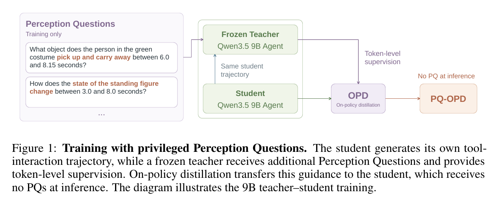

图 2-1：原文 Figure 1，PDF 第 2 页，[图源](https://arxiv.org/pdf/2611.22755v1)。PQ 只进入 frozen teacher，学生仍只依赖原始任务指令和自身观察历史。箭头“same student trajectory”非常关键：不是先让老师写一批答案，再离线 SFT。右端的部署学生没有 PQ。

### 2.2 工具轨迹和监督位置

学生一开始拿到任务指令、视频时长、工具说明；视觉证据通过工具获得。seek(start,end) 均匀返回该区间最多 8 帧，zoom(time,box) 返回单帧空间裁剪，box 是 [0,1000] 的 xyxy 归一化坐标。一个交互轮可包含工具调用；最终输出 caption，或达到交互轮上限。

```text
tau = (x, z_1, a_1, o_1, ..., z_R, a_R, o_R, z_final, caption)
o_r = Environment(video, a_r)
p_t = student(. | h_t)
q_t = frozen_teacher(. | h_t, PQ(video))
```

x 是任务与工具 prompt，z 是生成的思考，a 是工具调用文本，o 是真实工具返回图像，h_t 是生成第 t 个 token 前的全部因果历史。老师与学生共享学生已经选择的观测，老师不在另一个更理想的视觉世界里替学生重新探索。老师的 PQ 优势体现为对当前历史的下一步建议。

训练覆盖所有 assistant token：思考、工具 JSON/参数、最终描述；不把工具返回图像或用户 prompt 作为语言预测标签。因为动作也是 token，分布对齐能改变“下一步 seek 哪段”以及“该不该 zoom”。但环境裁剪是固定工具执行，没有通过像素或环境反向传播。

### 2.3 loss、冻结老师和长度加权：与 DTP 的差异

```text
K_t = top100(q_t)
Phi_t(p) = [p(v) for v in K_t] + [sum_{v outside K_t} p(v)]
L = sum_{i,t in assistant(tau_i)} JSD(Phi_t(q_t), Phi_t(p_t))
    / sum_i number_of_assistant_tokens(tau_i)
```

i 是 batch 中的轨迹；分母是整个 batch assistant token 总数。它是**全 batch token 平均**，长轨迹总贡献通常更大；DTP 先对每条 completion 平均，再对组平均，不能无意改成同一种 reduction。JSD mixture 为 0.5、温度 1.0，teacher top-100 后仍有 tail 桶。

没有 GRPO outcome reward，也没有作者另定义的 caption reward：本文主训练就是 OPD 的 JSD。老师固定在预训练初始化，9B→9B 时师生初值相同但老师一直 frozen；27B→9B 与 9B→4B 则跨尺度。不是 DTP 的每步共享当前参数，也不是 HISD 的 EMA。

教学例：某前缀下学生给下一动作 seek 的概率 0.2，老师在 PQ 下给 0.7，另一个粗化类别表示直接写 caption，得到 p=[0.2,0.8]、q=[0.7,0.3]，JSD≈0.1325。训练会减少两者差异。若学生已观察错误时段，老师不能假装学生已经看过关键帧，而要在这个真实历史建议补看；这正是 on-policy 对 agent 的意义。

教师 q 被 detach 时，直接 JSD 对 p 的分量导数为 0.5 log[p(v)/M(v)]，再经过 softmax Jacobian 转成 logits 梯度（本文推导，忽略数值截断）。小于老师偏好的 token 概率会得到相应提升方向；这不是保证每个独立 logit 都按该分量符号变化，因为 softmax 各类别相互耦合。

### 2.4 数据构造与可复现流程

5,979 个 Tarsier2-Recap-585K 视频，通过 Gemini 3.1 Pro 生成 43,477 个 PQ，均值 7.27/video，覆盖 object、action、temporal。生成时同时产出答案和证据说明用于 QC，训练真正保留的只有问题。自动 validator 检查时间区间、空答案/证据、答案泄露、重复与事件前提句，不合格重生成；PQ 区间并集平均覆盖视频时长 97.6%，这是时间覆盖而不是视觉细节召回。

两位专家检查随机 50 个视频的 344 PQ：343/344 的问题前提是画面真实存在的内容，342/344 的区间覆盖目标证据。生成答案只有 310/344 经检查一致，而这些答案已被排除。抽样高质量率不能替代全量人工审核，也不能将“答案不训练”解释成问题生成完全没有噪声。

```text
offline: generate timestamped PQs, answers, evidence
         validate; keep only questions as privileged teacher text
freeze teacher at its pretrained checkpoint
repeat refresh:
    student samples 4 interactive trajectories for each of 64 videos
    replay student histories and returned images under PQ teacher
    align reasoning + tool-call + caption token distributions
    mask tool observations and prompts; reduce over assistant tokens
    update student language-side parameters
evaluate without PQs using real seek/zoom observations
```

9B 配方：372 optimizer steps，AdamW β1=0.9、β2=0.95、peak LR=2e-6、cosine、warmup 0.05、weight decay 0.1、每卡 batch 1、梯度累积 8、ZeRO-3；冻结 vision encoder 与 aligner。每 refresh 64 unique prompts×4 rollouts=256 trajectories，但不能未经训练循环证据把 refresh 数直接等同 optimizer steps。论文未披露可核实 GPU 型号/卡数、训练墙钟时长、GPU-hours、API 生成费，不能从 ZeRO-3 推算实际预算。

### 2.5 核心结果：先看共同评测协议，再看榜单

默认 agent 最多 16 轮、128K context、总返回帧数上限 128，每图最多 460,800 pixels；direct 模型是固定 32 帧。CaReBench 与 DREAM-1K 原 judges 不再通过公开 API 可用，作者改用 GPT-4.1 重评，VidCapBench-AE 用 GPT-4o；caption-to-QA 用 Gemini 3.1 Pro 回答，再独立调用判答。因此不能把表分数和原榜单不加核对地横比。

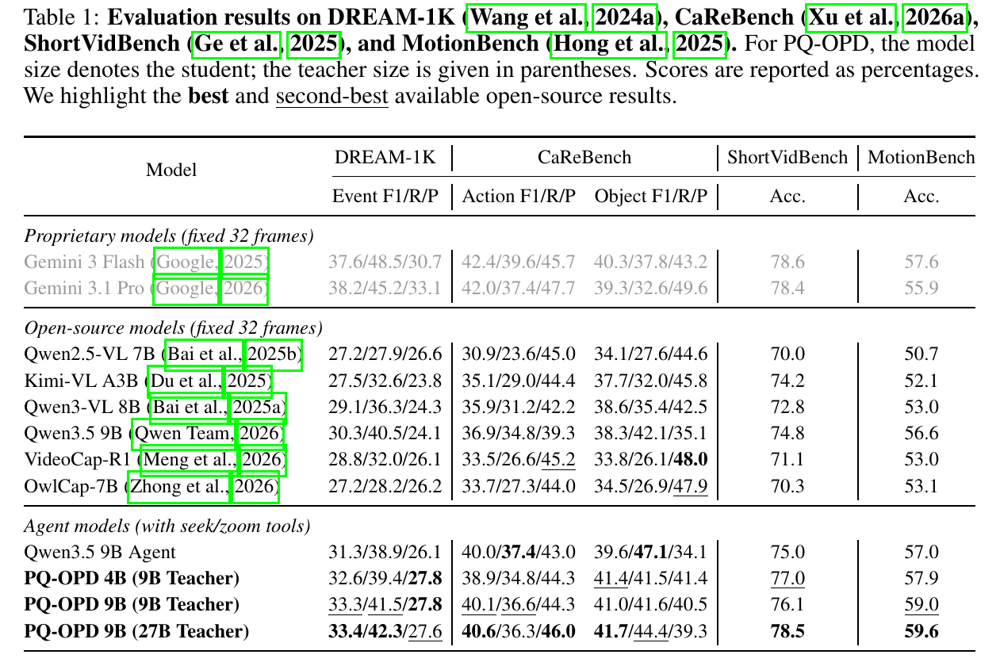

图 2-2：原文 Table 1，PDF 第 6 页，[图源](https://arxiv.org/pdf/2611.22755v1)。DREAM 的 F1/R/P 对应事件描述，CaReBench 分 Action 与 Object，后两列是 caption-to-QA accuracy。灰色闭源行和固定 32 帧组与工具 agent 组有条件差异；优先比较 base agent 与 PQ-OPD。

9B→9B：DREAM Event F1 31.3→33.3、Action F1 40.0→40.1、Object F1 39.6→41.0、ShortVid 75.0→76.1、Motion 57.0→59.0。CaReBench 总 F1 是 Action/Object 的算术均值，39.8→约 40.6，不是对所有 token 算一次 F1。9B→4B 的 DREAM 32.6、ShortVid 77.0、Motion 57.9 超过 base 9B agent，对小学生有意义，但不能说所有项都超过 9B 或 27B。

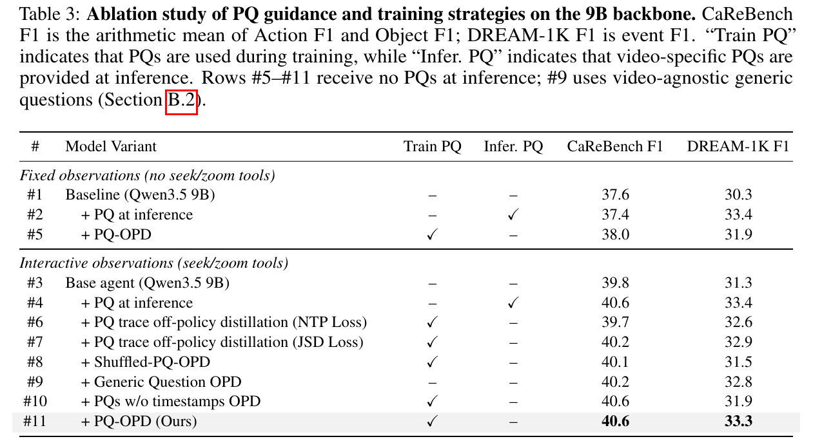

图 2-3：原文 Table 3，PDF 第 7 页，[图源](https://arxiv.org/pdf/2611.22755v1)。#1/#5 固定观察，#3/#11 可交互；#2/#4 测试时还给 PQ，是不同推理条件，不能当作可部署无 PQ 学生的公平对照。#6/#7 为老师轨迹 off-policy NTP/JSD，#8/#9/#10 分别是打乱 PQ、通用问题和去时间戳。

有工具时，off-policy NTP 39.7/32.6、off-policy JSD 40.2/32.9，PQ-OPD 40.6/33.3（CaRe/DREAM）。同为 27B→9B，vanilla OPD 40.1/31.2，PQ-OPD 41.2/33.4；9B→4B 则 39.4/30.8→40.2/32.6。无时间戳 DREAM 降至 31.9，通用问题仍达 32.8，说明通用探索提示也有作用，视频专属措辞与时间定位提供进一步差异。

trajectory swapping 把探索和写作拆开：base captioner 使用 PQ-OPD 收集的冻结轨迹，DREAM 从 31.3 到 32.6；PQ captioner 使用 base 轨迹到 32.2；完整组合 33.3。该实验支持两部分都有贡献，不代表可把百分比增益严格线性分解为独立因果份额。

### 2.6 答案泄露消融与实际工具成本

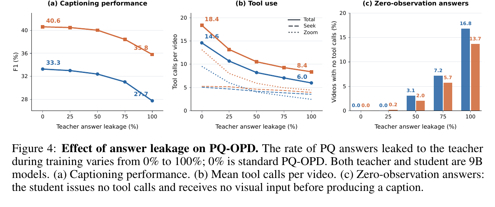

图 2-4：原文 Figure 4，PDF 第 10 页，[图源](https://arxiv.org/pdf/2611.22755v1)。横轴是老师训练时收到的 PQ 答案比例；左图 F1，中图 tool calls，右图学生完全不调用工具就作答的比例。全为 9B→9B，学生测试始终没有 PQ 或答案。它不是数据量 scaling 曲线。

答案泄露从 0% 到 100%，CaRe F1 40.6→35.8，DREAM 33.3→27.7；平均 tool calls 18.4→8.4 和 14.6→6.0，零视觉输入作答升至 13.7%/16.8%。老师如果靠文本答案就能讲好故事，学生可能学成不看视频的策略。措辞泄露另外在相同时间戳下控制：纯文本问题就能生成的 Action/Object F1 从标准 PQ 的 20.8/14.9 升至最泄露版 52.7/52.9，但学生结果反降至 37.3/29.4。不能把这类监督特权一概理解为“越详细越好”。

默认完整预算下 PQ 学生确实花更多计算：CaRe 返回帧 34.5→54.6、视觉 token 11.4K→17.6K、中位延迟 30→41 s；DREAM 31.3→48.8 帧、12.7K→19.8K、31→42 s。论文同时在相同帧上限比较：32 帧时 CaRe/DREAM，uniform=38.4/30.7，base agent=39.6/30.4，PQ=40.3/33.0，支持其选证据更有效，但“帧上限一样”仍不保证实际帧数、文本长度或 wall-clock 完全一样。

复现优先记录 tool image 数、不同工具调用次数、caption token 长度、零观察比例，而不是只有 F1。先用同一 frozen 9B 老师验证 PQ 是否改变 seek 的分布，再与通用问题、去时间戳和答案泄露对照；开放代码和权重尚未核实，完整重现实验仍受私有 API judge 与 PQ 生成版本影响。

## 3. HISD：老师只调“奖励多少”，不改奖励决定的方向

论文：[Hint-Informed Self-Distillation for Reasoning Segmentation](https://arxiv.org/abs/2611.14931)；Kunze Jiang、Yuchen Wang、Kang Li、Qixing Zhang；首次公开 2026-11-11。[v1 全文](https://arxiv.org/pdf/2611.14931v1)。本次没有核实到论文作者的代码、权重、独立项目页或博客；下列伪代码是依据原文重写的实现说明，不是已测试的作者实现。

### 3.1 推理分割中的目标消歧

“动物最硬的身体部分”要求先推断目标是角，再把角分割出来；“昆虫用什么掩护自己”可能问叶子，不是要分割昆虫。全回答 reward 只能说明最终 mask 是否好，难以告诉语言策略哪几个词帮助排除了相似目标。HISD 用离线结构化提示，让老师判断学生 token 是否支持正确目标，而不额外增加一个直接 JSD loss。

训练 backbone 为 Qwen2.5-VL-7B-Instruct，产生推理与几何提示，由冻结 SAM2-Large 确定性生成 mask。老师是学生初始化的 EMA，另收 Segment Hint；推理时只保留普通学生及 SAM2，不提供 Hint 或 EMA teacher。

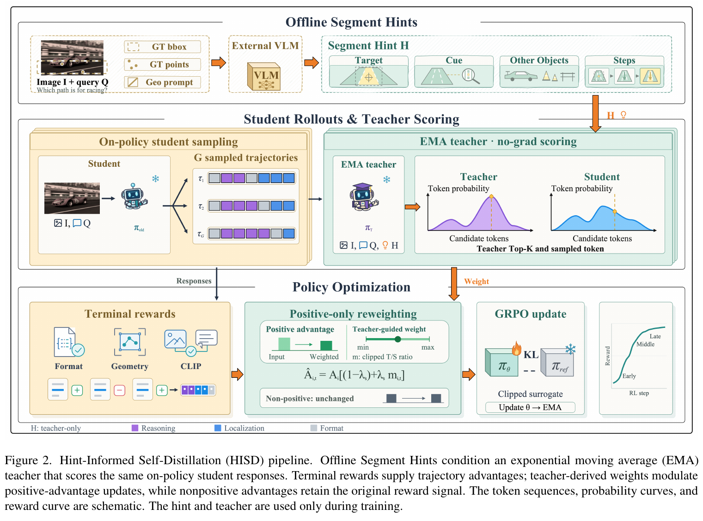

图 3-1：原文 Figure 2，PDF 第 3 页，[图源](https://arxiv.org/pdf/2611.14931v1)。上路离线生成 Hint，中路学生 rollout 与 no-gradient 老师/学生打分，下路先以 terminal rewards 得优势，再对正优势 token 调权。概率曲线与 reward 曲线是作者的机制示意，不是实测曲线。

### 3.2 Hint 如何从标注转成“视觉证据”

Gemini 2.5 Pro 离线看原图和审计副本，副本上有目标框及两个目标内部正点，输出四个字段：target 目标类别、cues 区别性外观/位置线索、others 易混物及区别、steps 从锚点找到目标的路径。输入有 GT，生成的 Hint 却禁止直接写坐标、框、彩色标注或像素数，要求描述原始图像可见证据。

这里训练标签不是人工逐字书写的 reasoning trace，但也不是无监督：GT 框与正点参与生成，并需要外部强模型。拥挤框里同时包含邻人衣服时，提示模板要求不能借用邻居属性；看不清的属性省略。该模板能降低错误，不能证明每条 Hint 都正确。原文未提供全量字段级人工可靠性和 API 成本。

### 3.3 从证据比率到受限的 token 优势

对同题 G=8 条学生回答，奖励 R_i 的组均值 μ、标准差 σ 决定优势 A_i=(R_i−μ)/σ。原文公式没有写全零方差保护，复现必须明确 no-signal 组如何处理，不能悄悄制造非零优势。奖励框架涉及格式、几何与冻结 CLIP ViT-B/32 判别信号；本文没有足够证据恢复完整各项 reward 系数、阈值、policy clip/KL/entropy 的具体数值，因此不把猜测拼成“原文完整 reward 实现”。

老师和学生在相同学生前缀下各做一次无梯度 signal forward。C_t 是老师 top-K（K=16）与实际采样 token y_t 的并集，大小最多 17。令 Z_T、Z_S 为各自在 C_t 内的总概率，局部分布分别为 P_T/Z_T、P_S/Z_S。

```text
Delta_t = sg[log P_T(y_t) - log Z_T
             - log P_S(y_t) + log Z_S]
m_t = clip(exp(Delta_t), 0.9, 1.1)
Ahat_i,t = A_i * [(1-lambda_s)+lambda_s*m_t]  if A_i > 0
         = A_i                              if A_i <= 0
lambda_s = 0.5 * max(0, 1 - s/(0.25*T))
teacher_theta <- 0.95*teacher_theta + 0.05*student_theta
```

s 为 optimizer step，T 为总优化步数。EMA 的 0.05 是学生混合率，不是老师保留率；保留率是 0.95。lambda 在前 25% 步数从 0.5 线性降到 0，后 75% 训练不再通过此因子调节优势。m 与 P_S 的 signal 计算也 stop-gradient，避免把“信用系数”自身优化成逃避 loss 的路径。

教学推导：exp(Delta)=P_T(y)/P_S(y)×Z_S/Z_T。所以局部证据比率不等于完整词表裸概率比。例如 P_T(y)=0.12、P_S(y)=0.08、Z_T=0.8、Z_S=0.4，则局部比率=1.5×0.5=0.75，裁成 0.9；虽然老师全局给该词概率更高，在受限集合内相对支持反而较低。这个例子说明 Top-K 重归一化改变了比较基准，不能按常识跳过。

若另一 token 的局部比率为 1.5，则 m=1.1，初始 lambda=0.5，A=2 会变成 2×(0.5+0.5×1.1)=2.1。比率很小则最低 1.9；初始正优势幅度最多 ±5%，而不是扩大 10 倍。A=−2 始终是 −2，A=0 始终是 0。训练中途 lambda=0.25 时幅度只改 ±2.5%。这些都是由原公式算出的教学结果，不是作者新消融。

为什么不调负优势？Hint 给出一条可行的正确目标路径，却不一定指出学生失败的真正原因。负轨迹中某词与 Hint 不一致，不代表该词必错；若让老师把所有“不像提示”的词进一步压低，容易把多种正确表述一并抑制。原文通过消融支持这一设计，但不构成所有任务负优势都不该调的定理。

### 3.4 最终策略 loss 与实现顺序

```text
rho_i,t = pi_current(y_i,t|history) / pi_old(y_i,t|history)
ell_i,t = min(rho_i,t*Ahat_i,t,
              clip(rho_i,t,1-eps_pg,1+eps_pg)*Ahat_i,t)
          - eta_KL*k_i,t + eta_H*H_i,t
L = -mean_i mean_t(ell_i,t)
```

eps_pg 是策略比率裁剪宽度，eta_KL/eta_H 是参考 KL 与熵系数，k 是 KL 估计项，H 是策略熵。它们与证据权重的 eps_w=0.1 是不同变量；不能用 0.1 擅自代填 policy ratio clip。最大化 ell 等价最小化上式 L。

```text
generate structured hints once from annotated training images
initialize student and EMA teacher; freeze SAM2 and CLIP
for training batch:
    sample 8 responses per image/query from old student
    parse geometry, run SAM2, compute existing task rewards
    form group-relative advantages
    no_grad: replay completed student traces under EMA+Hint
             and under clean student for signal probabilities
    build top16 UNION sampled-token support; renormalize both
    compute detached evidence ratios, clip, schedule lambda
    rescale positive advantages; keep nonpositive unchanged
    fresh student forward with gradients for clipped policy loss
    optimizer step; EMA update after student update
```

最后那个 fresh student forward 不能复用无梯度 signal tensor，否则没有学生梯度。teacher score、student signal 和真正优化 forward 的角色需要分清。模型生成的几何提示与 SAM2 mask 之间也不能假设有可微端到端梯度。

### 3.5 统一预算下的结果与真正被缩短的部分

三种本地复现 SegZero、DPAD、HISD 共用 3,000 条 RefCOCOg、7B backbone、SAM2-Large、一轮训练。batch=16，LR=1e-6，weight decay=0.01；没有披露足够 GPU 型号/卡数、墙钟时长、GPU-hours、峰值显存或 optimizer 全参数。不能用 3,000/16 自动认定作者的确切更新数，因为尾批和并行配置未说明。

ReasonSeg test：DPAD gIoU/cIoU=57.45/53.94，HISD=60.45/57.49，增益 +3.00/+3.55。validation=60.45/57.38→63.76/61.98。RefCOCO testA cIoU=79.12→80.10，RefCOCO+ testA=75.02→76.31，RefCOCOg test=71.24→73.24。

gIoU 是每张图算 IoU 再平均；cIoU 是先把全数据 intersection 与 union 分别累加再相除。教学例：两个样本交/并为 1/2 与 90/100，则 gIoU=(0.5+0.9)/2=0.7，cIoU=91/102≈0.892。后者更受大区域影响，不能只说“两种 IoU 同义”。

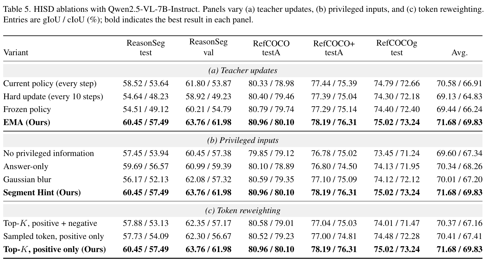

图 3-2：原文 Table 5，PDF 第 7 页，[图源](https://arxiv.org/pdf/2611.14931v1)。每格是 gIoU/cIoU；(a) 老师更新，(b) 老师输入，(c) token 调权。固定其余设置后逐组变化，比较比只看主表更能定位机制。

ReasonSeg val cIoU：当前策略 teacher=53.87、每 10 步硬更新=49.23、frozen=54.79、EMA=61.98。无特权 57.38，answer-only=59.39，框外模糊=57.32，完整 Hint=61.98。Top-K 同时调正负优势为 57.17，仅已采样 token 调正为 56.67，Top-K 只调正为 61.98。两个修改单独看都变差，支持“Hint 内容与具体优化方式要匹配”。这里没有多个 Hint 字段的独立消融，不能声称 target/cues/others/steps 每个字段都有单独已证实增益。

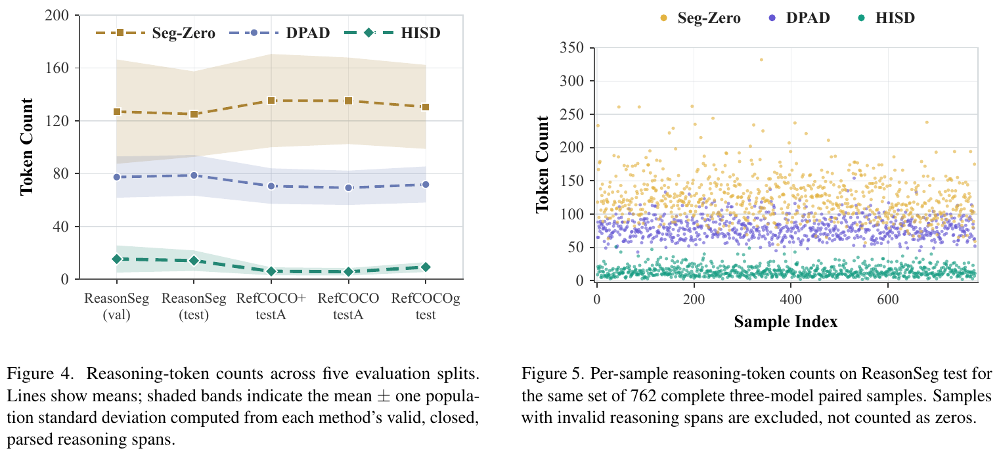

图 3-3：原文 Figures 4-5，PDF 第 8 页，[图源](https://arxiv.org/pdf/2611.14931v1)。左图跨五个 split 的 mean±一个总体标准差，描述有效样本差异，不是训练种子置信区间。右图是同一批 762 个完整三模型配对样本的 reasoning token 数，不能用散点数当作全测试集规模。

ReasonSeg test 的有效 closed `<think>` span 平均长度 DPAD 78.69、HISD 14.07；各 split 减少 80.17%-91.83%。但完整 response 还要包含结构与定位，附录显示 HISD ReasonSeg test 原生完整回答平均 105.28 tokens；不是“整个回答只用 14 个 token”。无效推理段被排除而非计为 0，统计必须同时报告解析率。CLIP 的绝对 ROI 相似度在 HISD 中反而略低，但 ROI/AOI 比率更高，也不能概括成所有语义相似度都上升。

### 3.6 局限、复现和效率证据的边界

附录等 token replay 是**截断已有输出后重新解析**，不是限制 max_new_tokens 后重新解码。K=105 的 ReasonSeg test 中 HISD 60.45→60.34 gIoU、parse retention 99.61%；DPAD 因截断破坏结构只保留 1.93%，不能据此声称重新生成时必然相同失败率，更不能换算真实 wall-clock 加速。

优先复现时保存每条轨迹原奖励、优势符号、Z_T/Z_S、裁剪比例、lambda、闭合 reasoning span 和完整回答长度；分开测 SAM2 的时间。需要核实全零标准差策略、task reward 细节、KL/entropy 系数、decay 的具体 T。论文只测一个 7B 家族及一个 Hint generator，暂无 2B/4B scaling 证据；短推理和更准分割同时出现，不足以单独证明“短”导致“准”。

## 4. ViStep-RL：奖励证据链的净进展，而不反复奖励已完成的状态

论文：[ViStep-RL: Stepwise Reinforcement Learning for Long-Horizon Visual Agents](https://arxiv.org/abs/2611.24170)；Junyang Chen 等；首次公开 2026-11-18。[v1 全文](https://arxiv.org/pdf/2611.24170v1)。本次在作者 PDF 和定向检索中没有核实作者代码/模型发布地址或独立作者博客；第三方页面出现相互冲突的作者、会议信息和“代码链接”，均不作为作者发布依据。复现状态是 paper-level recipe 可读，完整公共运行栈未验证。

### 4.1 从“看见了”到“保留下来，并在后续真的用上”

场景：先 OCR 读第一张图的标签，翻到第二张图后再比较。native Qwen 每次进入新视觉 turn 会重建 prompt，上一张图、对话和 OCR 文本一起移出上下文。模型必须主动把关键记录写入环境记忆，然后检索；否则终局即使碰巧答对，也没有可追溯的证据链。

记忆记录保存 payload、source image/semantic identity，以及产生观察的 tool event reference。工具成功不等于记录有用，检索返回一段文字也不等于它支持答案。作者将任务编译为有向无环图 G=(V,E)，节点表示视觉证据、计算、写入、检索和最终回答，边表示需要引用的前置证据。

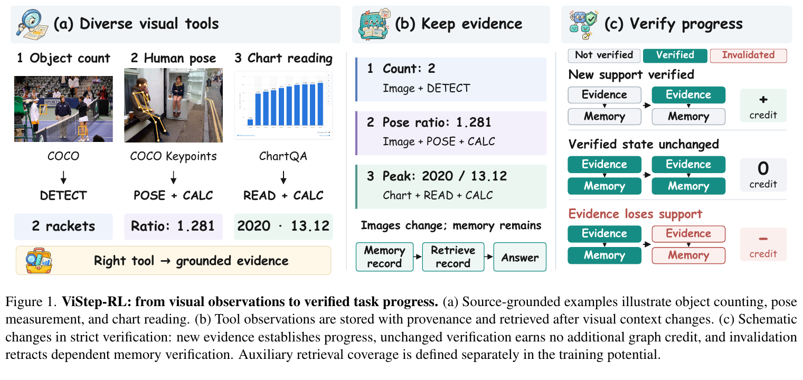

图 4-1：原文 Figure 1，PDF 第 3 页，[图源](https://arxiv.org/pdf/2611.24170v1)。从左到右是视觉工具、跨图证据记忆和验证进展。右图强调新证据使进度增加、原地保持不再得分、父证据失效会撤销依赖节点验证；这是机制示意，不是作者实测 reward 时间序列。

### 4.2 严格验证如何把来源和依赖纳入 reward

```text
b_t,i = 1 if node i's local evidence predicate is valid, else 0
z_t,i = product_{j in {i} UNION Anc(i)} b_t,j
W = sum_i w_i                    # w_i > 0, default all 1
Phi_t = sum_i w_i*z_t,i / W
Strict_t = product_i z_t,i = product_i b_t,i
```

t 是动作执行后的状态，i 是子目标，Anc(i) 为所有祖先，b 是本地谓词，z 是包含祖先门控的严格验证。一个记忆节点不仅要内容正确，还要引用成功产生它的视觉工具事件；缺少来源时 b 就不成立。祖先全部满足才给 z=1；不是模型自己宣称“我完成了”就算。

任务图所有节点最后都指向唯一 sink：answer node。每条边 j→i 都要在 i 的 provenance predicate 里对应真实事件引用，因此边不是随意加的抽象计划。删除父记忆会使其后代失效，防止保留曾经正确、现在证据已被破坏的分数。

对 retrieval，作者另给可训练的部分覆盖 credit：M_i 是需要的 record IDs，R_t,i 是已返回 IDs，c=|R∩M|/|M|，非 retrieval 或空集合时 c=0。训练势能为：

```text
Phi_tilde_t = sum_i w_i*max(z_t,i,c_t,i) / W
           = Phi_t + sum_i w_i*(1-z_t,i)*c_t,i/W
```

检索可以先返回某个正确 ID，即使其 provenance 尚未整体验证，仍先获得部分训练反馈；正式评测 Strict/Graph 始终用 z，不用 c 粉饰指标。max 防止同节点重复加和超过自己权重。唯一 answer sink 且 answer 没有 c，保证 Phi_tilde=1 时必有完整 Strict，这个结论依赖上述编译器条件。

### 4.3 势能差 reward 的推导和可手算例子

```text
r_t = Phi_tilde_t - Phi_tilde_(t-1) - e_t/|V|
sum_t r_t = Phi_tilde_T - Phi_tilde_0 - sum_t(e_t)/|V|
```

e_t=1 表示协议违规、状态/工具检查失败、错误或无支持的答案；罚一个平均节点份额。正进展、负进展和执行惩罚是不同因素。上式没有折扣因子；它通过望远镜求和消掉中间势能，不可无说明套成任意 γ 的 discounted shaping。

教学图：四个等权节点 OCR→write→retrieve→answer。无错误时势能从 0→0.25→0.5→0.75→1，每次 reward=0.25，总和 1。OCR 后连续做三个不改变已验证状态的合法空动作，额外进展都是 0；若改成每步直接奖励当前势能，等在 0.25 的三步会额外获得 0.75，诱导模型拖延。若从 0.75 删除 write，使 write 与 retrieval 都失效，势能跌到 0.25、进展 −0.5；随后修复回 0.75 仅 +0.5，来回循环净进展 0，错误操作仍另受罚。

两个需检索 IDs 的节点只返回一个时，c=0.5，节点至多先贡献自身份额的一半；不能靠不断检索同一 ID 反复领新分。原文论证 loop-neutral 的进展函数恰可写成某个 h(后势能)−h(前势能)，本文采用 h(x)=x；这是一种对循环奖励结构的结论，不等于已经证明在任意环境和有限采样下训练达到全局最优。

### 4.4 为什么还要保留“奖励符号”

同 prompt 采 8 条轨迹，只有 episode returns 的总体标准差>1e-5 才保留该组。动作按相同 prompt、execution phase、visual turn 和 round(10×前动作势能) 分箱；bin 内对转移 reward 做标准化 u=(r−μ)/(σ+1e-4)，σ≤1e-6 时 u=0。

若一箱 reward 为 [−0.1,−0.3]，第一个虽然也犯错，中心化后却是“比别人好”的正 u。作者不用该 u 直接决定更新正负，而定义：

```text
s_t = sign(r_t), sign(0)=0
g(r_t) = 0.25*clip(r_t/0.05,-1,1)
A_t = s_t*max(s_t*u_t,0) + g(r_t)
```

教学算例忽略分母 1e-4 的极小差别：上面两个 u 约为 +1、−1，s 都是 −1，所以 A 约为 −0.25、−1.25；两个坏动作都不会被正向强化。若 reward=[0.05,0.15]，u≈[−1,+1]，则 A≈[0.25,1.25]，两个真进展都保留正确方向。singleton bin 或同 reward 时 u=0，但 g 可提供绝对方向；r=0 时 A=0，|r|≤1e-8 的实现阈值也给零。

由 r×A=|r|×max(su,0)+r×g(r)≥0 可得 A 与 r 不反号（本文展开原文证明）。但这只是**选中动作的局部权重符号保证**，不是所有后续 token 的整体概率保证，也不能忽略共享参数对其他状态的影响。

每条 rollout 仅选 |A| 最大的至多 2 个动作（3B）或 4 个（7B），同一动作内 token 共享 A。token loss 为：

```text
rho = pi_current(y|h)/pi_old(y|h)
v = log pi_SFT_reference(y|h) - log pi_current(y|h)
L_token = -min(rho*A, clip(rho,0.8,1.2)*A)
          + 0.03*(exp(v)-v-1)
```

先对动作内 token 平均，再对选中动作平均，最后对 rollout 平均。reference 是冻结 SFT，第二项是 nonnegative KL estimator 型正则，系数 0.03。不能把它和 DTP 的 β=0 或 PQ 的直接 JSD 统一成“都是 GRPO”。episode return 用于组准入，action transition reward 用于实际信用，两者角色不同。

### 4.5 数据、训练预算与可复现伪代码

ViInteract 整体构建有 76,000 SFT episodes、15,000 RL source pool、4,000 benchmark candidates；训练整体涵盖 10 execution domains、34 task-program types，而 benchmark pool 是其中 9 domains、29 types。Core200 是预先冻结且按应用加权的 200 episodes，Process500 用于过程度量，Holdout200 是排除旧面板后、没有读取模型预测进行选择的新实例。数据源包含 COCO、TextOCR、ChartQA、SOP、LVIS、AITW 与 memory controls，LLM 辅助改写指令，gold replay 检查任务可执行性。

```text
build task DAG and hidden reference predicates from source annotations
SFT visual agent on executable tool/memory episodes
for RL update:
    sample 8 rollouts per prompt through the actual runtime
    after each action, verify local predicates and ancestor closure
    log provenance, Phi_tilde before/after, errors and transition rewards
    drop groups with return std <= 1e-5
    bin actions by prompt, phase, visual turn, rounded old potential
    compute signed A_t; select top absolute-weight actions per rollout
    optimize clipped token loss against frozen SFT reference
evaluate final adapter with full strict verifier, not auxiliary coverage
```

Qwen2.5-VL 3B/7B 用 LoRA attention+MLP projections，rank16、alpha32、LR=2e-7、seed42、温度0.9、top-p0.95、BF16、768 token generation cap、每图≤262,144 pixels。7B prompt≤8,192 tokens、rollout≤32 actions，1,000 updates/32,000 sampled rollouts，4 GPUs 合计 36.94 GPU-hours；由此算训练墙钟约 9.235 h 是本文按四卡同时工作的算术换算，不是另一个计时实测。GPU 型号、显存和完整 SFT 总成本未披露，不能把 36.94 当作从基础模型到最终系统的全部预算。3B resumed 模型的评测 checkpoint 是 step700、prompt≤11,520、rollout≤16 actions；不存在可直接从 7B 外推的 3B 成本证据。

### 4.6 主结果：同一接口、同一面板才可比较

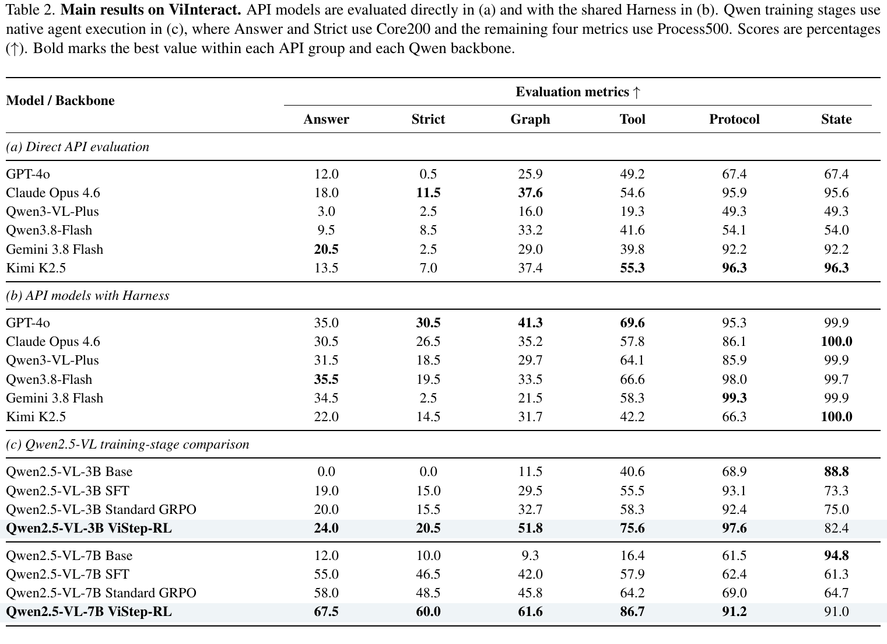

图 4-2：原文 Table 2，PDF 第 5 页，[图源](https://arxiv.org/pdf/2611.24170v1)。分 (a) direct API、(b) API+Harness、(c) native Qwen。native 的 Answer/Strict 来自 Core200，其余 Graph/Tool/Protocol/State 来自 Process500，六列不是对同一 200 条样本统计；跨行还应区分工具控制接口。

最清楚的 7B 同初始化对照：SFT Strict=46.5%，standard terminal-answer GRPO=48.5%，ViStep=60.0%；Answer=55.0/58.0/67.5。3B Strict=15.0/15.5/20.5，Answer=19.0/20.0/24.0。7B 相对 SFT 提高 13.5 个百分点，episode paired bootstrap 95% interval [8.0,19.0]；不是三个训练种子的置信区间。

standard GRPO 对照共享 SFT 初始化、工具、action cap、rollouts 和 optimizer updates，但它更新整条轨迹，ViStep 只更新选中动作，因此是“奖励+更新颗粒度”的总体比较。额外 7B 交叉实验：固定动作级更新换图奖励，Strict 53.5→60.0；固定图奖励换 trajectory→action 更新，54.0→60.0，分别说明两部分均有贡献。

在 shared Harness 下，任务训练 7B 的 Answer=59.5，最强通用 API 参考=35.5，差 24.0；不能拿 native 67.5 对 Harness 35.5 宣称完全公平。同样，API 通用模型没有同任务训练，结果体现特定环境适配，不是通用能力排行榜。

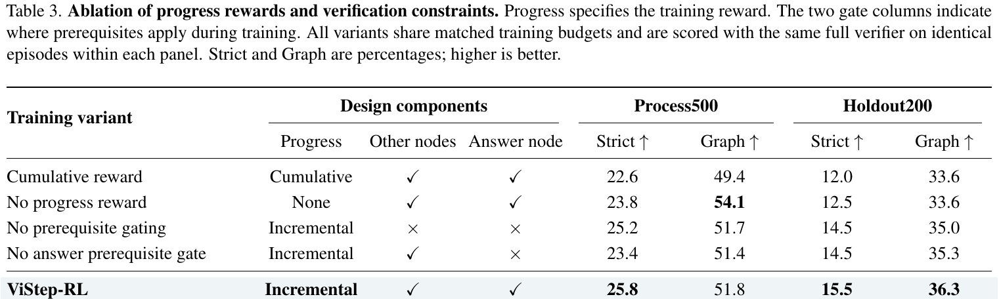

图 4-3：原文 Table 3，PDF 第 6 页，[图源](https://arxiv.org/pdf/2611.24170v1)。全部使用同一 3B 初始化及匹配预算，评测统一 full verifier。左侧不同训练 reward/门控，右侧两个独立面板，不能将 Process500 的 25.8% 与 Core200 的 20.5% 当作训练不一致。

Process500 的 incremental Strict=25.8，对 cumulative=22.6，差 3.2 点，配对 95% interval [1.0,5.6]、McNemar p=0.0113；Holdout200 对应 15.5 vs12.0。无进展项 23.8、去全部祖先门控25.2、只去 answer gate23.4。去门控并非每项指标都下降：例如 no-progress 的 Graph=54.1 高于完整51.8，但 Strict 更低，说明平均子目标数和完整证据链成功不是一回事。

### 4.7 记忆因素、延迟和泛化边界

固定 3B 权重、Core200、记忆容量（8 records×512 chars，最多返回4条），写入/检索 2×2 实验的 Strict：Active/Active17.0、Active/BM25 14.5、Automatic/Active8.5、Automatic/BM25 7.5。主动写入平均收益 [(17−8.5)+(14.5−7.5)]/2=7.75 点，主动检索平均1.75点。这个17.0与 native20.5接口/容量条件不同，不应隐去差异。

Holdout200 禁止记忆写入，Strict 降至0；损坏记忆后 Answer仍3.5、Strict0，说明偶然答对不足以通过证据检查。工具成功率仍可达60.47%，再次说明“工具没报错”不等于答案有根据。

3B 的 Direct observation notes 对比 Harness，训练后 Answer18→29，但输入 tokens2,796.97→24,249.02、calls4.815→15.235、延迟23.58→37.00秒；训练收益不能脱离 runtime 成本。外部匹配输入/提示下 MMLongBench-Doc15.00→19.10、MuirBench35.62→40.15、MMSI25.50→27.20，支持有限迁移，尚不足以证明对开放网络搜索等任意环境通用。

最难复现的是 verifier 与 provenance，不只是 RL loss。建议先用四节点玩具 DAG 测：父节点删除是否撤销后代、先搜索空结果后写入是否必须重新搜索、重复检索是否没有增量、严格指标是否排除 auxiliary credit。原文固定轨迹误差推导说明势能差总和只剩端点误差，但中间 verifier 噪声仍会改变动作权重和分箱；不能由端点界宣称训练免疫奖励错误。未核实公共运行栈、主要训练只报seed42、新基准由作者构建，均限制独立复现结论。

## 5. Beyond Seeing：幻觉变少，还要检查正确细节是否也被删掉

论文：[Beyond Seeing: Fine-Grained Preference Validation and Severity-Aware Alignment for Mitigating Visual Hallucinations in Vision-Language Models](https://arxiv.org/abs/2611.20478)；Abdulaziz Alqahtani、Alwaleed Alharthi、Muzammil Behzad；首次公开 2026-11-16。[v1 全文](https://arxiv.org/pdf/2611.20478v1)。本次没有核实论文作者的公共实现、权重、项目页或博客。它是一项已实现 pipeline 的实证分析，明确不自称发明原始 severity-aware DPO，也没有新建一个经充分验证的幻觉检测器。

### 5.1 为何“改写后的 chosen”还需要验证

图片没有狗，原描述却说有狗；改写删除了狗但又添了不存在的自行车。若仍把改写当 chosen，DPO 只会强化新的幻觉。另一个风险是删除所有细节就显得“没有幻觉”，代价却是漏说真实内容。

作者把已有细粒度监督规范化成对象、属性、关系错误，保留 evidence text、rationale 与 severity。minor/moderate/major 映射1/2/3，response severity S_i 是有数字分数的 critique 的平均值；缺失分数不能补造标签。附录 helper 在没有可用分数时返回0，clean 样本仍保留空 critique 集合、不被强行送去改写。

数据有16,143 normalized feedback records（7,643 hallucinated、8,500 clean），另有8,386 released preference pairs。它们是不同表示，可能来源相关，**不能相加成24,529条独立训练数据**。主实验主要直接消费已有 preference pairs，并非从头重新生成16,143条纠错链。

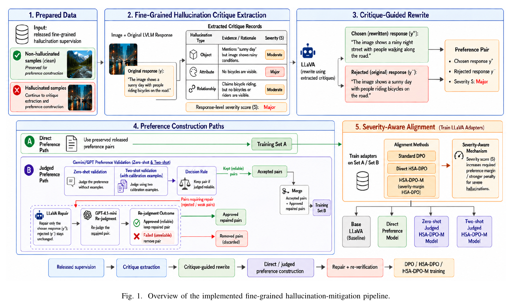

图 5-1：原文 Figure 1，PDF 第2页，[图源](https://arxiv.org/pdf/2611.20478v1)。上方列出监督处理和重写能力，下方实际偏好路线分 direct 与 judged 两条。图中场景和示例聚合severity为说明性内容；应以正文和附录公式的平均及归一化规则为准，不能把图内所有功能都当作单独完成且独立评估的实验。

### 5.2 judged preference 的真实准入规则与修复数据流

Direct 路线不调用额外 API judge，用 released preference 训练 standard DPO/direct HSA-DPO。Judged 路线把 image、问题、chosen、rejected和错误标签给 Gemini-2.5-Flash-Lite 与 GPT-4o-mini，每人输出 approved 布尔值与原因。

**任一 judge approve 就保留，不要求两人一致。**这是宽松 OR 规则。它能提高保留率，也可能保留争议对；自动批准不是人类真值。zero-shot只给准则；two-shot额外给两个纯文本校准例，不增加目标图片标注。

被拒绝的 pair 送 LLaVA-1.5-7B，只修改 chosen；rejected 内容及其 severity 保持不变。GPT-4.1-mini复核修复，two-shot也在此复用校准块。最终集合是初始已接受加上通过复核的修复，失败样本被排除。

| 路线 | source | 初始通过 | 初始拒绝 | 产生修复候选 | 修复获批 | verified | train-ready |
| --- | --- | --- | --- | --- | --- | --- | --- |
| zero-shot | 8,386 | 7,818 | 568 | 473 | 244 | 8,062 | 8,062 |
| two-shot | 8,386 | 7,132 | 1,254 | 1,063 | 746 | 7,878 | 7,874 |

zero-shot 的修复通过率是244/473≈51.59%，不是244/568；two-shot为746/1063≈70.18%。更多修复不代表最终数据更多，因为初始通过更少。two-shot verified到train-ready少4条，原文汇总不能确定其逐样本原因，不应替作者编写清洗解释。

### 5.3 标准DPO、rejected加权和severity margin是三种不同目标

固定图片/问题x，chosen y+、rejected y−，πθ是trainable policy，πref是冻结reference。令ℓ为整条回答的log probability（自回归token log probability之和）：

```text
Delta = (ell_theta_plus - ell_theta_minus)
        - (ell_ref_plus - ell_ref_minus)
L_DPO = -log sigmoid(beta*Delta)
```

Delta量化的是“相对reference，当前策略多偏爱chosen”。reference扣除预训练偏好，避免把chosen原本就更容易生成完全当作训练功劳。beta=0.1调节尺度；DPO不需要再拟合单独reward model，但它不是没有偏好标签。

Direct HSA-DPO只给rejected项乘released rejected score w_i：

```text
Delta_HSA = (ell_theta_plus - w_i*ell_theta_minus)
            - (ell_ref_plus - w_i*ell_ref_minus)
L_HSA = -log sigmoid(beta*Delta_HSA)
```

它没有对chosen加权，也不是把整个样本loss乘一个severity。w_i来自released训练路径，不能随意与下面归一化S互换。

Judged HSA-DPO-M保留标准Delta，改为gap margin：

```text
Sbar = clip(S_i,0,3)/3
margin_i = lambda*Sbar             # lambda=0.5
L_margin = -log sigmoid(beta*(Delta-margin_i))
```

margin在beta乘法内部。严重错误需要更大Delta才能达到相同sigmoid满意度；lambda=0恢复standard DPO。对单样本求导：

```text
z = beta*(Delta-margin_i)
dL/dDelta = -beta*sigmoid(-z)
```

推导：−logσ(z)对z导数是σ(z)−1=−σ(−z)，再乘beta。同一Delta下，margin更大使z更低、梯度幅度更大。它倾向于更强拉开严重负例，但是否改善视觉事实取决于pair本身的真实性和正确内容保留。

教学算例：Delta=1，beta=0.1，无margin时z=0.1、loss≈0.6444、梯度≈−0.0475；S=3、lambda=0.5时margin=0.5、z=0.05、loss≈0.6685、梯度≈−0.04875。logit只移动0.05，不是0.5。S=1/2/3分别产生gap margin1/6、1/3、1/2，logit shifts约0.0167/0.0333/0.05。这些是公式演算，不能冒充训练消融或新指标结果。

### 5.4 单卡训练配方与实现流程

```text
normalize released feedback; keep provenance and missing-value semantics
load 8,386 released preference pairs
if judged_path:
    approve if Gemini OR GPT judge approves
    repair rejected pairs by rewriting chosen only
    reverify repairs; merge approved records; prepare training set
freeze reference; initialize LLaVA-1.5-7B LoRA policy
for one epoch over path-specific train-ready pairs:
    compute chosen/rejected sequence log probabilities, mask prompts
    choose standard / rejected-weighted / severity-margin objective
    accumulate gradients to effective batch 32; optimizer step
evaluate binary presence, generated hallucination AND correct coverage
```

租用RTX6000 Ada48GB；LoRA rank128、alpha256、per-device batch1、effective batch32、LR2e-6、max sequence1024、cosine、零warmup、零weight decay、一轮、beta0.1，margin路线lambda0.5。launcher还指定BF16、TF32、gradient checkpointing、projector LR0与ZeRO-3；作者明确这些配置不等同保留下来的历史runtime日志。

没有可靠训练时长、GPU-hours、峰值显存或API账单，48GB是GPU容量而非实测峰值。各数据集大小不同，一轮和相同effective batch不代表更新数相同；不能把其与DTP等更新数的消融混为一谈。托管判断temperature0，OpenAI图片detail=low，但具体历史generation cap不能从可选默认值反推。

### 5.5 结果：生成幻觉下降，POPE并未超过base

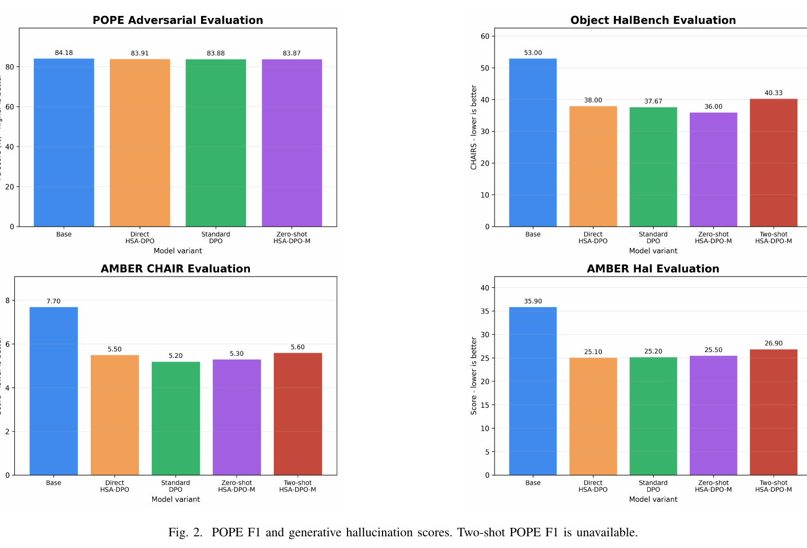

图 5-2：原文Figure2，PDF第4页，[图源](https://arxiv.org/pdf/2611.20478v1)。左上POPE F1越高越好，其他面板的幻觉值越低越好；不同子图纵轴不同，不能比较柱高绝对大小。two-shot没有有效POPE recall/F1，因此左上没有该行，不是得分零。

POPE adversarial是二分类presence：base F1=84.18，standardDPO83.88，directHSA83.91，zero-shotmargin83.87。precision89.92提升至90.25-90.70，但recall79.13跌至78.07-78.33，综合F1反而略低。没有训练种子和置信区间，0.03-0.04的差异不能当作稳健排名。

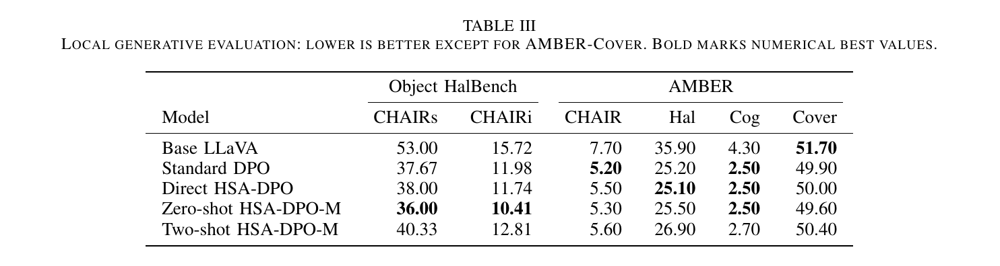

图 5-3：原文TableIII，PDF第5页，[图源](https://arxiv.org/pdf/2611.20478v1)。前两列Object HalBench CHAIRs/CHAIRi，后四列是作者保留的localAMBER汇总，其中Cover越高越好，其余越低越好。它们是补充本地评测，缺少部分逐样本协议，不能直接等同外部leaderboard。

Object HalBench：base CHAIRs/CHAIRi53.00/15.72；standardDPO37.67/11.98；directHSA38.00/11.74；zero-shotmargin36.00/10.41；two-shotmargin40.33/12.81。zero-shot相对base降17.00点、32.08%相对CHAIRs，不是“准确率提升32.08%”。CHAIRs衡量含不支持对象的句子比例，CHAIRi衡量对象实例层面的幻觉比例，不能把两者与POPE accuracy相减。

AMBER中standardDPO的CHAIR最低5.20，directHSA的Hal最低25.10，zero-shotmargin不是所有指标最好。baseCover51.70，而aligned只有49.60-50.40。减少无依据描述可能伴随更保守输出和正确细节遗漏，但汇总分数不能单独证明这种因果机制，需要匹配图片级输出审核。

### 5.6 这里什么是消融，什么还不是

目前比较是完整pipeline：judging、repair、severitymargin、样本数量同时变。two-shot还同时改变初始判断与修复复核；即使修复通过率更高也不保证下游更强。原文没有matched-data、matched-update的验证only/修复only/目标only factorial，因此不能声称“单独加入margin贡献了17点CHAIRs改善”。

复现可先固定同一份8,062 pairs、相同更新数、相同reference和三次种子，对lambda=0/0.5比较；然后固定目标比较unjudged/judged/repair。但这些是**本文建议的未来实验**，不是原文已有结果。数据层要保存每位judge输出和OR准入原因；评测层同时保存image-level generatedtext、长度、正确内容覆盖及幻觉标签，再补完整two-shotPOPE。没有独立人工偏好审核、托管API版本变化、单backbone和不完整样本日志是本篇最主要复现限制。

## 横向连接：为小VLM选择训练信号的实际顺序

| 观察到的失败 | 可借鉴机制 | 必须同时检查的反例/成本 |
| --- | --- | --- |
| 同一视频重复事件总选错，全组reward为0 | DTP的同前缀JSD+teacher能力门控 | teacher也不会则关闭；额外独立teacher rollout与人工标注 |
| caption agent不知道该探索哪段 | PQ只给观察问题与时间戳 | 答案/措辞泄露、更多工具调用；同帧cap及延迟对照 |
| mask可得reward，但reasoning冗长/目标混淆 | HISD的EMA+正优势证据比率 | 零优势仍是零；局部归一化、只统计有效think的偏差 |
| 多轮看到的证据无法留到终局 | ViStep的provenance DAG+势能差 | verifier错误、图构建成本、共享runtime公平性 |
| 幻觉下降但描述越来越少 | DPOpair审核+severitymargin | 正确内容覆盖、POPErecall、ORjudge争议样本 |

本文研究建议：先在2B/4B上做可观测的错误分类，而不是同时拼五个loss。需要“零奖励也有梯度”时选直接分布监督；已有可靠成功轨迹但需要精细信用时才考虑受限优势调权；跨图长期记忆任务先把证据状态与来源记清楚，再加复杂RL。如果对训练配方作迁移，记录未报告参数的自己选择，并和原文事实分开。

今天只有DTP核实到直接作者仓库；其他四篇仍可做paper-level方法研究，但不应描述为“已经一键可复现”。本报告没有执行作者训练，所有作者数值均是其报告结果；教学推导与改进建议没有被当作新增实验。

## 小白到实现：基础文档与辅助博客

1. **概率与蒸馏入门**：[PyTorch Knowledge Distillation Tutorial](https://docs.pytorch.org/tutorials/beginner/knowledge_distillation_tutorial.html)。先理解logits、softmax、温度、detach与teacher/student；该教程不是本文五篇的复现recipe。
2. **OPD直觉与伪代码**：[Thinking Machines Lab: On-Policy Distillation](https://thinkingmachines.ai/blog/on-policy-distillation/)。这是辅助作者技术博客，不占五篇论文名额；其reverse-KL教学不能直接代替DTP/PQ的对称JSD。
3. **GRPO实现阅读**：[TRL GRPO Trainer](https://huggingface.co/docs/trl/grpo_trainer)。重点读group reward、mask、clip、KL与loss reduction；今天三种GRPO变体的符号、奖励归一化和组准入策略不同，不要只复制一个default trainer。
4. **偏好优化入门**：[TRL DPO Trainer](https://huggingface.co/docs/trl/dpo_trainer)。理解chosen/rejected、reference与序列logprob后，再核对本篇margin位于beta内侧，和directHSA的rejected项加权区别。
5. **分割组件原始资料**：[SAM2官方实现](https://github.com/facebookresearch/sam2)，供理解HISD中冻结的promptable mask模块；这不是HISD自己的代码。
6. **低秩适配**：[PEFT LoRA文档](https://huggingface.co/docs/peft/main/conceptual_guides/lora)。学习rank、alpha和可训练参数，注意“7B backbone”不等于“训练7B个自由参数”。

建议按“tIoU与组优势→DTP两种teacher forward→PQ frozen与HISD EMA→ViStep证据图→DPO margin”的顺序阅读。Vision-OPD和MMSearch-R1仅作方向锚点，未重复计入。

17张图表均来自五份v1PDF；图源与哈希见assets/SOURCES.md和manifest.json，全文PDF与逐页渲染核验见assets/QA.md。
