# VLM 后训练论文精读 · 2026-11-21

今天的五篇分别解决五个训练问题：把视觉蒸馏预算用在有效 token 上、让超高清图像 agent 必须读证据、让持续 RL 保留旧任务收益、用可渲染界面训练 4B 模型、把 13B 专家蒸馏成约 3B 模型。全部是论文；博客和教程只作辅助。

检索窗口为 2026-10-21 至 2026-11-21，采用 arXiv v1 首次公开日期，跨所有方向按去版本 arXiv ID、DOI、规范 URL 和标题去重。UI-UG 2 的编号虽然是 2611，v1 实际发表于 10 月 31 日。今天实际收录 5 篇，不把旧文的新版本当新论文。本次执行环境是本机 macOS 补位、既有授权 SSH；云端长期任务仍暂停等待环境绑定核验，尚未完成脱离本机的迁移。

| 论文 | 首发日期 | 训练对象 | 核心技术 | 最值得读的部分 |
| --- | --- | --- | --- | --- |
| [VisAlloc](https://arxiv.org/abs/2611.25069) | 11-18 | 4B / 9B | 正负视图决定蒸馏权重，正视图独占目标 | token 权重的门控、守恒和局部归一化 |
| [ViRA](https://arxiv.org/abs/2611.21605) | 11-16 | 9B / 27B | 跨输入联合成功目标与 RLOO | 为什么不能把图像变体混进一个 GRPO 组 |
| [CoLiR](https://arxiv.org/abs/2611.25989) | 11-19 | 2B / 4B / 8B | 用策略改善筛选历史 prompt，当前策略重新 rollout | 正确/错误响应的双向似然分数 |
| [UI-UG 2](https://arxiv.org/abs/2611.00926) | 10-31 | 4B | SFT + 分任务 GRPO + 在线渲染奖励 | 可执行结构、召回/精度奖励、比较式打分 |
| [SurgPace](https://arxiv.org/abs/2611.03125) | 11-02 | 13B → 约 3B | 离线课程分数 + 跨 tokenizer 多层蒸馏 | Lorentz 难度、语义/位置对齐和目标调度 |

## 阅读约定与最低限度的基础

下文“原文”指固定 v1 论文及附录；“代码核验”指 2026-11-21 读取作者仓库；“本文推导/算例”用于解释机制，不是作者实测。没有运行训练，也没有把示意算例画成实验图。全部图片均从原 PDF 裁取，物理页码从 1 开始计数；原始 PDF 哈希、裁图范围和图片哈希见 manifest.json 与 assets/SOURCES.md。

模型 pθ(v|I,x,y<t) 根据图像 I、问题 x 和前缀 y<t，为下一个 token v 分配概率。logit 是 softmax 前的分数；token 是分词器单位，未必是一个字或完整英文单词。

SFT 使用人给的答案前缀，最小化 CE = -Σt log pθ(y*t|I,x,y*<t)。OPD 使用学生自己生成的前缀，再让教师给分布监督，因此更贴近学生实际会走到的状态。RL 先采样完整响应，得到 reward，再用 advantage 区分值得增加/减少概率的响应。三者可以使用同一个骨干，但训练分布和梯度含义不同。

KL(q||p) = Σv q(v) log[q(v)/p(v)]；教师到学生的 KL 会惩罚学生漏掉教师认为重要的候选。JSDα(q,p) = (1-α) KL(q||m) + α KL(p||m)，m = (1-α)q + αp；当 α=0.5 时是对称的。下文自然对数单位为 nat。sg(·) 表示停止梯度，避免模型通过改变权重而非改善预测来降低 loss。

GRPO 常用 A_i = (r_i - mean(r))/[std(r)+ε]。RLOO 使用其他响应的均值作 baseline：A_i = r_i - mean_{j≠i} r_j。它们都依赖组内差异，但不是同一个估计器。若每组奖励完全相同，中心化后的训练信号会消失；加一个正权重通常无法救活这个零信号。

## 1. VisAlloc：视觉蒸馏应该把预算放在哪些 token 上

论文：[Allocating Visual Supervision for On-Policy Self-Distillation](https://arxiv.org/abs/2611.25069v1)，v1 2026-11-18；[原 PDF](https://arxiv.org/pdf/2611.25069v1)；[作者代码](https://github.com/Kaelyn01/VisAlloc)。这是今天最接近 Vision-OPD 主线的一篇。

### 1.1 问题：看到了证据，不等于每个词都该同样学习

Vision-OPD 给教师看目标区域裁剪，让学生用全图学习教师分布。但回答里有大量模板词，例如“the answer is”；少数颜色、对象、空间关系词才真正依赖图像。如果所有位置权重相同，视觉证据可能被语言模板稀释。反过来，只根据正裁剪与全图的差别加权，也可能追逐输入变化造成的噪声。

VisAlloc 使用同一个 EMA 教师的两个视图：正裁剪包含目标证据，负裁剪把目标框平移到不重叠区域。学生仍只生成一次全图响应。负视图帮助判断“哪些位置值得强调”，但不作为学生要模仿的答案，也没有额外负视图学生 rollout。

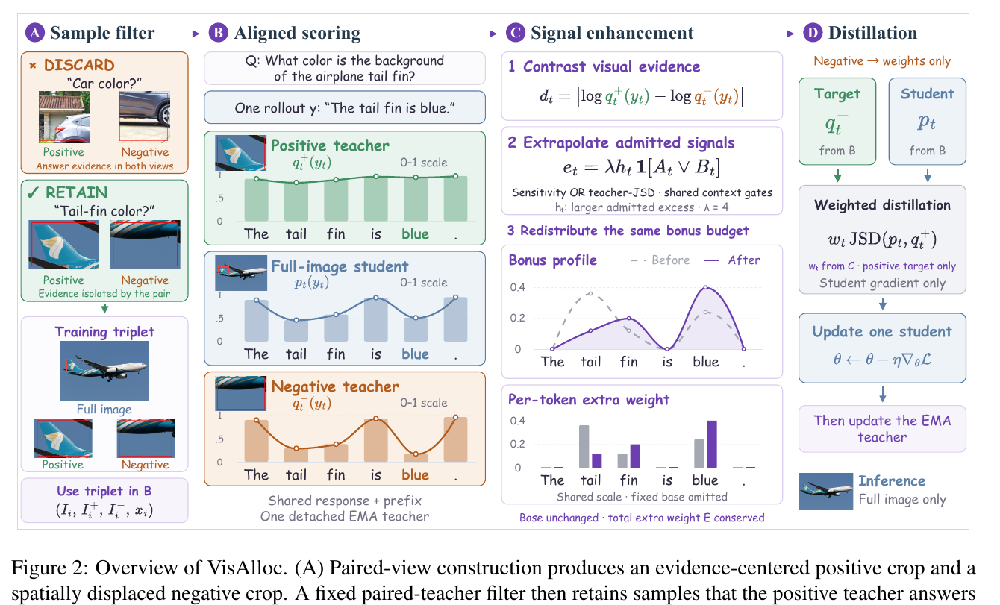

图 原文 Figure 2，PDF 第 4 页。按左到右读：固定样本过滤、对齐前缀评分、信号增强、正教师蒸馏。右侧两条箭头分别是学生更新和 EMA 更新；负视图只进入系数计算。图中的 Before/After 是权重分配示意，不能当作真实 benchmark 曲线。

### 1.2 数据先固定，再做 on-policy 训练

原文从 Vision-OPD 派生 6,241 对候选。正裁剪按官方处理像素级复现；负裁剪保持裁剪尺寸、框在裁剪内的几何关系、5 像素框线与 2 倍 LANCZOS 放大，目标框与原框 IoU 小于 0.1。这样尽量避免“负图更小/更糊/框线不一样”成为捷径。

在标注质量检查之后，用固定教师答案筛选：正视图答对且负视图答错，才保留；最终 5,795 例。这个筛选在训练前完成，不是每步依据学生能力动态开关。它主动选择了视觉对比明显的数据，因此实验不能简单解释为“任意图像加一张负裁剪都有效”。

学生看到全图及训练时的目标框提示，生成 y。对每个相同的 y<t，学生分布为 p_t，正/负 EMA 教师分布为 q+t、q-t。三个视图必须评分同一个已实现 token y_t；若让两个教师各自自由生成，下面的差值就混入了不同前缀的影响。

### 1.3 第一层：连续视觉敏感度，为什么用绝对值

原文定义 Δ_t = log q+t(y_t) - log q-t(y_t)，d_t = |Δ_t|。正值表示正视图更支持当前学生 token，负值则表示负视图更支持；取绝对值强调的是“视图改变影响大”，并不保证当前 token 正确，更不等于因果重要性。

对具有有效负视图的本地 micro-batch 位置集合 V，计算 τd = max(Q90({d_t}), 0.25)，s_t = d_t/(d_t+τd)，基础系数 b_t = 1+γs_t，γ=1。Q90 是经验 90 分位数。分母让极端 log 概率差饱和，0.25 的下限避免整批信号很小时放大数值噪声。

本文算例：q+(“红色”)=0.6、q-(“红色”)=0.1，则 d=log6≈1.792。若本批 τd=1，s≈0.642，b≈1.642；模板词两视图都约 0.9，则 d≈0，b≈1。若正视图是 0.1、负视图是 0.6，b 仍相同；是否值得蒸馏还要经过后续门控，目标始终由 q+ 提供。

### 1.4 第二层：额外预算需要“词类型先验 + 上下文证据”

先构建冻结的词类型先验。每个训练例只做一次全图贪心生成，最多 96 token，每 16 条响应组成统计组。将正负视图对比强度与学生/正教师差异分别做有下限的 Q90 饱和变换，取乘积并选严格高于该乘积 Q90 的位置。某词类型出现 n 次、入选 k 次，先验 r(y)=(k+5)/(n+50)，保留四位小数；未见词默认 0.10。它是平滑后的类型级经验统计，不是人工标注“视觉词表”。

若某相邻 bigram 在至少 25% 的响应出现，就视为模板 bigram，每条响应只计一次。判定需要前一个 token 同属有效响应；不能跨样本拼接 bigram，也不能把一个高频词永久封禁。只有 r(y_t)≥0.12、不是模板 bigram，才有资格拿额外预算。

还需要上下文门控。J_t = JSD0.5(q+t,p_t) 衡量正教师和学生的差异，H_t = JSD0.5(q+t,q-t) 衡量两教师视图的分布差异。两者都在“学生 top-100 token + 剩余质量桶”的共享支持上计算；尾桶是 1-Σtop100 概率，不是将 top-100 重新归一化。J_t 高于有效位置中位数才进入共享门 G_t。

θd = Q80({s_t})，θH = max(Q90({H_t}),10^-6)，u_t = H_t/(H_t+θH)。注意 θd 是 s 的分位数，不能拿原始 d 与它比较。两个分支为 A_t = G_t 且 s_t>θd；B_t = G_t 且 H_t>θH。

额外预算可写为 e_t = λ max[(s_t-θd)_+, 1[B_t](u_t-0.5)_+] · 1[A_t 或 B_t]。λ 在 4B 为 4、9B 为 2。分布差异分支能补充“当前 token 的 log 概率变化不大，但其他候选发生明显重排”的情况；OR 门不是要求两个分支同时满足。

### 1.5 第三层：低频重分配与最终 loss

令 E=Σt∈V e_t，a_t=(n_{y_t}+50)^(-1/2)。若 E>0，分配 ê_t = E·e_t a_t/Σu∈V(e_u a_u)；若 E=0，所有 ê_t=0。这个操作保持额外预算总量 E，倾向低频词；原本 e_t=0 的位置仍然是 0。基础 b_t 没有一起做低频重分配。

最终 w_t=(b_t+ê_t)/mean_{u∈V}(b_u+ê_u)。因此 ΣV w_t=|V|，没有有效负视图的位置 w=1，padding 排除。守恒的是系数总和，不是加权后的 loss、梯度范数或每个 token 的上限。所有统计发生在本地 micro-batch，改变 packing、设备切分或梯度累积结构，可能改变实际优化目标。

本文手算：原始 e=[2,1,0]，a=[0.5,1,1]，E=3，则 ê=[1.5,1.5,0]，总量仍为 3。若 b=[1.5,1.2,1]，合并后为 [3,2.7,1]，均值约 2.233，最终 w≈[1.343,1.209,0.448]，平均为 1。高敏感位置被强调，其他位置相对降权，并不是全批梯度都增加。

原文训练目标：L = Σt M_t sg(w_t ρ_t c_t) J_t / Σt M_t。M 是有效响应 mask；ρ 是当前策略相对 rollout 旧策略的重要性校正，截到 2；c 是框架继承的 rollout 校正项（如存在），不是前面数据筛选的答对标志。系数、分位数和教师都 detach，仅学生侧 JSD 反传。actor 更新后教师再以 0.05 EMA 率更新一次。

```python
# 教学伪代码：省略分布式、padding 和 rollout-engine 细节
paired_data = fixed_filter(candidate_pairs, positive_correct=True,
                          negative_correct=False)
prior, template_bigrams = build_frozen_prior(paired_data)
for microbatch in on_policy_batches(paired_data):
    response, old_logp = student.generate(full_images)
    p = student.score(full_images, response)
    q_pos = ema.score(positive_crops, response).detach()
    q_neg = ema.score(negative_crops, response).detach()
    support = student_top100_plus_tail(p)
    J = jsd_on_support(q_pos, p, support)
    H = jsd_on_support(q_pos, q_neg, support)
    weights = detached_local_allocation(q_pos, q_neg, J, H, prior)
    backward(masked_mean(weights * rollout_corrections * J))
# 累积完规定的 micro-batches 后：optimizer.step(); ema.update(0.05)
```

### 1.6 实验、消融与成本应该怎样读

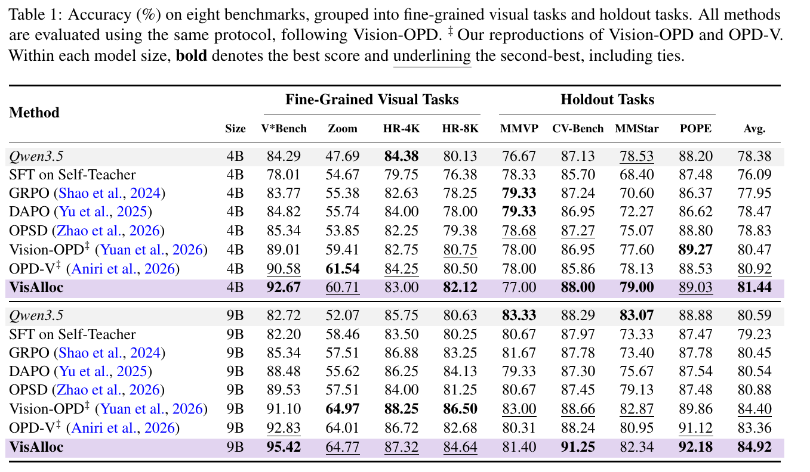

图 Table 1，第 6 页。上半 4B、下半 9B；列为 V*、Zoom、HR-4K/8K 等八个基准，Avg 是等权宏平均。先在同参数规模内比较 Vision-OPD 复现与 VisAlloc，不能把较大的 9B 改善算作方法收益。

| 模型/方法 | 八基准平均 | 相对同规模 Vision-OPD |
| --- | --- | --- |
| 4B 基座 | 78.38 | - |
| 4B Vision-OPD | 80.47 | 0 |
| 4B OPD-V | 80.92 | +0.45 |
| 4B VisAlloc | 81.44 | +0.97 个百分点 |
| 9B 基座 | 80.59 | - |
| 9B Vision-OPD | 84.40 | 0 |
| 9B VisAlloc | 84.92 | +0.52 个百分点 |

并非所有列都涨：4B MMVP 为 77，低于 Vision-OPD 的 78；POPE 89.03 也低于 89.27。另报 MME-RealWorld EN/CN 为 75.43/71.44，分别提高 0.98，但没有把它们混入主表八项平均。雷达图十个轴的面积也不是这个平均。

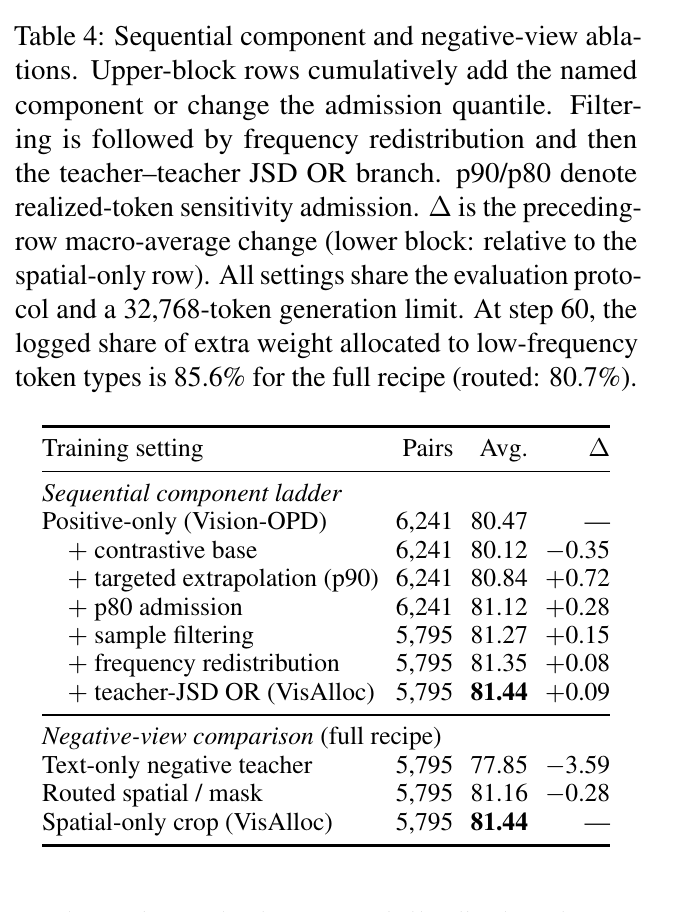

图 Table 4，第 12 页。顺序阶梯从 80.47 开始，直接加对比基础权重降到 80.12；加入额外门控与 p80 配置到 81.12；固定数据过滤到 81.27；低频分配到 81.35；JSD OR 门到 81.44。行与行可能同时改变有效数据分布或组合背景，不能将每行差值当作独立因果贡献。负图设计中 text-only 为 77.85、路由图为 81.16、空间平移为 81.44，说明匹配负视图本身重要。

训练基座 Qwen3.5-4B/9B；每更新 96 prompt、每 prompt 8 rollout，名义 768 个响应槽位；学习率 2e-6、warmup 10，最大 prompt 8,192、response 1,024；每节点 4 GPU，seed 42。VisAlloc 训练日志为 60 次更新，部分对照是 65 次；不能宣称所有方法完全相同步数。60×96×8=46,080 是本文计算的名义采样槽位，不是独立样本数或实际完整响应数。GPU 型号、墙钟时间与 GPU-hours 未披露。

代码核验：作者 README 已列训练、数据和 4B/9B 模型入口；本报告未执行训练。复现先锁定 5,795 例及裁剪几何，再检查 EMA 时机、共享 student-top100 尾桶、词类型先验和局部分位数；只复制公式而改变 micro-batch 结构可能复现不出权重。主要限制是单 seed、小幅平均收益、框提示/裁剪标注成本、两个额外教师评分和筛选偏置。需要额外验证负裁剪意外含相关证据、模板门误伤实体词、长响应频次偏移等失效情形。

延伸阅读：入门看 [PyTorch 蒸馏教程](https://docs.pytorch.org/tutorials/beginner/knowledge_distillation_tutorial.html)，再读 [Thinking Machines 的 OPD 技术博客](https://thinkingmachines.ai/blog/on-policy-distillation/) 和作者仓库的 Method/Training。博客是基础资料，不占今日名额；未核验到单独的 VisAlloc 作者博客。

## 2. ViRA：用跨输入奖励迫使超高清 agent 真正读图

论文：[ViRA: Toward Ultra-High-Resolution Visual Agents via Cross-Input Relative Policy Optimization](https://arxiv.org/abs/2611.21605v1)，v1 2026-11-16；[PDF](https://arxiv.org/pdf/2611.21605v1)；[作者仓库](https://github.com/huawei-lin/ViRA)。今天模型较大的补充项，核心价值是可迁移的 RL 估计器与细粒度证据训练。

### 2.1 为什么普通“答对就奖励”可能奖励语言猜测

超高清图像的关键物体可能只占万分之一左右。缩略图看不清时，模型可以凭题目常识猜一个高频答案，偶尔也拿到正奖励。ViRA 为同一道题构造 K 个图像版本，仅改变一个小区域，使答案不同。agent 每次 rollout 只看其中一个版本，不是一次输入多张图联合比较；训练器才知道这些版本属于同一 contrast set。

ViRA 使用全分辨率源图的 zoom 工具；初始图和每次裁剪各受相同 MP 预算，裁剪最多放大 4 倍、最多 6 次 zoom / 7 轮。工具动作也是模型生成的一部分。与只改变输出格式不同，训练希望“在不同输入上分别做对”，因此不能只优化同题某一版本的偶然正确。

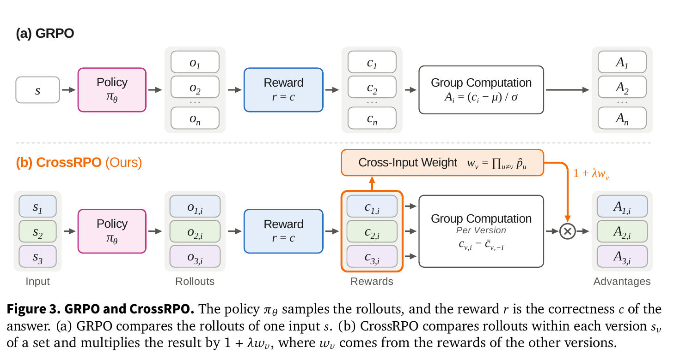

图 Figure 3，第 6 页。上图在一个输入的多条响应内计算 advantage；下图先在每个版本内做 baseline，再由其他版本的成功率给该版本乘权。橙色回路改变梯度权重，奖励 c 仍是答案正确性，并没有额外人工“看对位置”奖励。

### 2.2 从联合成功目标推到跨版本权重

令 p_v=Pπ(版本 v 答对)，c_{v,i}∈{0,1} 是版本 v 第 i 条响应的正确性，n 是每版本 rollout 数。对 K≤3，原文目标 J(θ)=Σv p_v + λΠv p_v。第一项要求各版本本身做好；第二项要求全部版本共同成功。在独立采样假设下，Πp 正是 set 全对概率。

本文展开乘积法则：grad_θ J = Σv [1+λΠu≠v p_u]grad_θ p_v。于是对当前版本 v，其他版本成功率的乘积应当成为它的额外系数。用有限样本 p̂_u=mean_i c_{u,i} 估计，令 w_v=Πu≠v p̂_u，计算 A_{v,i}=(1+λw_v)[c_{v,i}-mean_{j≠i}c_{v,j}]。K=1 的单图样本特设 w=0，回到普通 RLOO，不能把空乘积默认为 1 后平白放大。

为什么 baseline 排除自己？在当前响应的 score-function 梯度里，其他独立响应的 reward 是不依赖当前动作的 baseline，期望梯度为零；若把自己算进均值，需要追踪对应缩放。原文对未归一化估计器给出 E[ĝ]=ngrad_θ J。这里的优势是 RLOO，不是除以每版本 reward 标准差的 GRPO。

本文算例：K=3，λ=0.5，其他两版本 p̂2=0.75、p̂3=0.5，则版本 1 权重为 1+0.5×0.375=1.1875。若其四条奖励 [1,0,1,0]，第一条的其他均值为 1/3，A≈0.7917；第二条其他均值为 2/3，A≈-0.7917。若其他版本都已学会，系数达 1.5；若任一其他版本成功率为零，则退回系数 1，仍保留当前版本自己的学习信号。

### 2.3 为什么不能先把 K 个版本的响应混在一组

考虑三个版本正确答案各不同，模型对所有版本都机械回答“basketball”。假设第一版本的所有响应都正确，另外两版本全部错误。每版本内部奖励恒定，CrossRPO 的中心项全部为 0，因此不会奖励这条固定猜测捷径。若把三个版本响应混在一个 GRPO 组，正确的那一组仍高于总体均值，得到正 advantage；K=3 时该标准化值是 √2。

这不意味着“任何随机猜测都严格零梯度”。当随机输出在同一版本内产生正确/错误差异时仍可能得到梯度；原文针对特定输入无关策略给出的 set 成功上界 K^(-K)，K=3 时为 1/27，也不能误解成实验准确率。关键是不给“某个版本天生符合固定答案”提供虚假的组内比较优势。

原文用整个 batch 的 RMS 缩放 A：s=sqrt(mean A²)，Â=A/s，并使用常规 clipped policy ratio、εclip=0.2、token mean。若在每版本单独做标准差归一化，(1+λw_v) 会在分子分母中抵消，跨版本权重就被抹掉。batch RMS 保留同批相对权重；但随机分母、clipping 与有限步更新意味着实际优化器不能继续被无条件称为理论上的无偏梯度。

当 K>3，直接乘许多成功率会迅速变小。原文的扩展改用三元联合目标，当前版本权重取其他版本成对成功率乘积的均值；这主要在额外文本实验中检验，核心 VLM 训练的 K≤3，不应把扩展实验当作更大 K 的视觉结果。

```python
# 教学伪代码；每版本有 n 条独立 rollout
correct = rollout_all_versions(set_items)       # [K, n]
p_hat = correct.mean(axis=1)
for v in range(K):
    cross = 0 if K == 1 else product(p_hat[u] for u in range(K) if u != v)
    for i in range(n):
        baseline = mean(correct[v, j] for j in range(n) if j != i)
        advantage[v, i] = (1 + 0.5 * cross) * (correct[v, i] - baseline)
advantage /= global_batch_rms(advantage)        # 不能 per-version 标准化
clipped_policy_update(advantage, epsilon=0.2)
```

### 2.4 数据、工具和硬件预算

原始图像约 21–120MP。ViRA-Bench 有 762 个三版本 set、来自 466 张 24–108MP 照片；类别分为属性 458、推理 209、多对象 95。目标区域中位占比 0.0075%，在 1MP 输入上最长边最多 13 像素、在原图上最短边至少 28 像素。Real 子集有 78 set、平均约 45.4MP，通过真实拍摄改动物体，检查图像编辑伪影造成的捷径。

训练 9B 使用 Qwen3.5-9B，27B 使用 Qwen3.8-27B。每模型一遍数据：分别 3,642/3,401 个 item、227/212 步；item 是一个 contrast set 或单图题，不等于一张图片。每步 16 item，每 item 12 rollout，平均分配给 K 个版本；K=3 时每版本 n=4。λ=0.5，AdamW 学习率 1e-6、常数无 warmup、weight decay 0.01，BF16、梯度范数截到 1，无 KL penalty、无 entropy bonus。

训练每 item 从 0.5–16.8MP 对数均匀抽预算，同一 set 共用该预算。每轮输出最多 4,096 token，完整多轮轨迹上限另为 prompt 20,480 / generated 40,960；不能把单轮上限误写成整条轨迹上限。开放题由 GPT-4o 对照参考答案判分，选择题则可解析匹配，因此还存在 judge 成本与误判风险。

原文 Appendix C.4：8 张 H200，9B 墙钟 12.7 小时、27B 29.6 小时，约 100/240 GPU-hours；直接乘法为 101.6/236.8，是本文对四舍五入的解释。每个消融 13–22 小时×8 GPU，不是整个项目只花主模型这一笔。未披露完整数据构造与外部模型 API 的货币成本。

### 2.5 主实验和真正能支持机制的消融

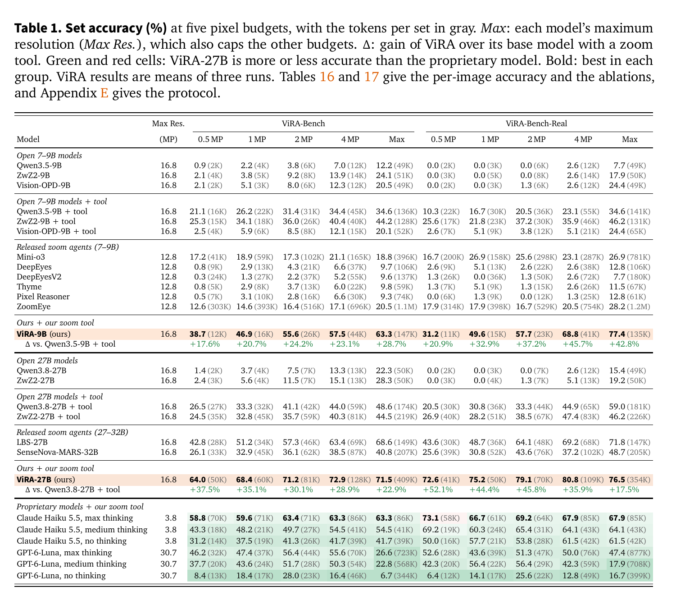

图 Table 1，第 9 页。每列为初始视图及裁剪的 MP 预算，灰色数字是每 set token 消耗；主指标要求同一 set 全部版本答对。先比较同一骨干 + tool 和 ViRA，再比较固定 1MP；Max 列每模型上限不同，不能当等算力排名。

9B 在 ViRA-Bench 的 1MP set accuracy 从基座+tool 26.2 提至 46.9，最大预算从 34.6 提至 63.3；27B 在 1MP 从 33.3 提至 68.4，最大预算从 48.6 提至 71.5。Real 子集 9B 最大预算从 34.6 到 77.4，表明收益没有完全依赖合成编辑痕迹。27B 在 4MP 为 72.9，高于其 Max 的 71.5，也说明增加输入像素不保证单调变好。

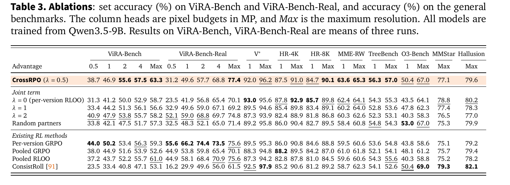

图 Table 3，第 11 页。均从 Qwen3.5-9B 起训。ViRA-Bench Max 下 CrossRPO 63.3，高于 per-version GRPO 59.3、pooled GRPO 52.6、λ=0 的 per-version RLOO 58.7。随机伙伴削弱收益，支持“输入应当构成有意义的对比集”；不能只凭主模型胜出就把增益全归因于新 advantage。原文还观察到 CrossRPO 与 per-version RLOO 找到目标区域的频率接近，后者仍读错更多，所以机制不只是多点几次 zoom。

关键控制是 set 划分、工具和预算一致。作者对 ViRA 及消融的若干视觉基准报告三次评测均值，这不同于三次独立训练 seed；不能据此宣称训练方差已充分检验。全对指标对单版本错误很敏感，必须同时看逐图准确率、工具次数和 token 花销。

代码核验：仓库提供训练/评测、模型和数据下载；`vira/common.py` 是 crossrpo_advantages，`vira/train/crossrpo.py` 实现 batch 缩放，`scripts/train.sh` 为训练参数。复现先用 CPU 构造上面的固定猜测例，验证零梯度组与 K=1 分支，再跑少量真实 set，记录每版本 p̂、w、RMS、工具成本与全对率。奖励全零的版本仍缺信号、训练编辑覆盖有限、开放题 judge 偏置以及 9B/27B 部署预算是主要限制。

延伸阅读：[TRL GRPO 文档](https://huggingface.co/docs/trl/grpo_trainer)用于理解 rollout/advantage/clipping，但不要把其默认归一化直接当成 CrossRPO；具体公式以 [ViRA 作者代码](https://github.com/huawei-lin/ViRA) 为准。没有核验到独立作者博客，README 和 74 页原文附录是主要技术材料。

## 3. CoLiR：持续 RL 要保留的是旧任务收益

论文：[Policy Improvement-Guided Replay for Continual Reinforcement Learning](https://arxiv.org/abs/2611.25989v1)，v1 2026-11-19；[PDF](https://arxiv.org/pdf/2611.25989v1)。CoLiR 是 Contrastive Likelihood Replay。核验原文链接与题名/作者入口后，未找到可确认的本方法官方源码；论文引用的 GSPO、CPO 实现不能算作 CoLiR 发布。

### 3.1 问题：旧答案没忘，不代表当前策略仍会答对

一个 VLM 连续学医疗问答、导航、数学、拼图、金融图表，后一个任务的 RL 更新会改变旧任务的响应分布。只约束参数、只模仿过去的好答案，未必维护当前策略在旧题上的实际成功率。CoLiR 把有限记忆留给训练中获得过有价值策略改善的 prompt，之后让当前策略重新生成响应并得到奖励。

将完整响应 y 当一次动作，任务 i 的目标 J_i(π)=E_{x∼D_i,y∼π}[R_i(x,y)]。在这一 contextual-bandit 形式下，参考策略成功率 p_ref(x)=Eπref R，advantage A_ref(x,y)=R(x,y)-p_ref(x)。于是 J_i(π)-J_i(πref)=E_{D_i,π} A_ref。这个等式解释了为什么需要当前策略的响应分布：保存一个旧答案不等于保存这个期望。

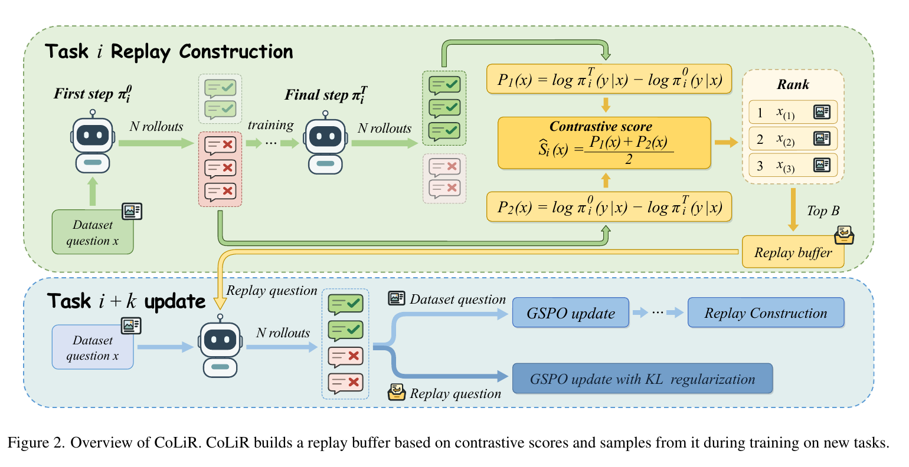

图 Figure 2，第 5 页。绿色上半框在任务边界，使用初始/最终策略的对数似然构造记忆；蓝色下半框在下一任务训练，旧 prompt 进入当前策略 rollout。只有回放分支加 KL。图中缓存响应服务于选题评分，不是把旧响应作为固定监督答案反复训练。

### 3.2 双向似然分数：增加好答案概率、压低旧错误概率

对某 prompt x，π0 是当前任务开训前策略，πT 是该任务训练结束策略。Y+T 是最终策略采样中的正确响应，Y-0 是初始策略中的错误响应。两个分量为：

P1(x)=mean_{y∈Y+T} [log πT(y|x)-log π0(y|x)]。

P2(x)=mean_{y∈Y-0} [log π0(y|x)-log πT(y|x)]。

S(x)=0.5[P1(x)+P2(x)]。

P1 奖励最终好响应的似然上升，P2 奖励初始坏响应的似然下降。每个 log π(y|x) 都是响应 token 的对数概率之和，不做长度平均。两类样本分别求均值后各占一半，不能将不同数量的正确/错误响应直接混在一起平均。

本文算例：两条最终正确响应的对数似然由 [-12,-10] 变到 [-10,-9]，P1=1.5；两条初始错误响应由 [-8,-9] 变到 [-11,-10]，P2=2，S=1.75。若再采到 20 条相似正确响应，不应仅因样本多就稀释 P2 的一半权重。对数似然累加会受长度影响，复现必须忠于序列和，同时监控候选长度分布。

### 3.3 为什么高分与策略改善相关，但不等同于准确率增益

原文先分析二元奖励、KL 正则下的理想最优更新：πT(y|x) ∝ π0(y|x) exp[R(y)/β]。β>0 控制更新强度。对正确响应，概率倍率为 exp(1/β)/Z；把 Z 按初始成功率分解，可得 P1=-log[1-A_ref(correct)(1-exp(-1/β))]，随参考 advantage 单调增加。这里是理想条件解释，真实神经网络更新不一定达到该解。

一般情况下，令 p0、pT 是初始/最终答对率，q+0、q+T 为条件在“答对”下的响应分布，q-0、q-T 为条件在“答错”下的分布。将 π(y)=p·q+(y) 代入，可分解 P1=log(pT/p0)+KL(q+T||q+0)；相似地，P2=log[(1-p0)/(1-pT)]+KL(q-0||q-T)。所以：

2S = logit(pT)-logit(p0)+ε，logit(p)=log[p/(1-p)]。

ε = KL(q+T||q+0)+KL(q-0||q-T)≥0。

本文解释：高 S 可能既来自成功率改善，也来自正确/错误响应内部风格重排。若已知 ε≤δ，S>δ/2 才能推出 pT>p0；不能说任意正 S 都严格保证改善。反过来，真实正改善会给正 S，而负 S 指向退步。有限 rollout 的估计误差还在这个理论分解之外。

### 3.4 候选过滤、缓存和真正的训练目标

候选需要最终响应组同时有正确与错误、初始响应组至少有一条错误。这样排除已全部答对的容易样本，以及最终全错、暂时没有组内成功信号的样本。每历史任务最多保留 top-80 prompt；不足 80 就全部保留，不补造。

任务训练期间缓存每 prompt 首次与最后一次不同的完整 generation 事件及其原策略 log 概率。任务结束后只补两种交叉评分：用 π0 评分最终正确响应，用 πT 评分初始错误响应。因此“记忆构建不额外生成响应”成立，但不是“整个回放免费”：下一任务每次回放都由当前策略重新采样，仍要算 rollout、reward 和反传。

历史任务之间均匀抽，再在其记忆内均匀抽。优化采用 GSPO：序列重要性比 η_i=exp{mean_t[logπθ(y_it|prefix)-logπold(y_it|prefix)]}，对序列 advantage 做 clipped surrogate。它与上面的 S 不同：GSPO 的比值按长度平均，记忆选择的 log-likelihood 分数按长度求和。两个公式看似相似，不能混用。

可把损失写成教学等价形式 L = -mean_i min[η_i A_i, clip(η_i,1-εlow,1+εhigh)A_i] + β·mean_{i∈replay} KL(πθ||πref)。原文设置 εlow=3e-4、εhigh=4e-4、回放 β=0.01。πref 冻结在当前任务开始时，不是每条旧题最初学完时各保存一个 teacher；KL 仅用于 replay，当前任务样本没有这一项。实际 token KL 估计与实现细节应以训练框架为准，此式用于说明结构。

```python
# 教学伪代码：只存 prompt + 选择所需的评分信息
for task in tasks:
    start_policy = frozen_copy(policy)
    for step in range(600):
        current = sample(task, current_quota(task))
        replay = uniformly_sample_tasks_then_prompts(memory, replay_quota(task))
        outputs = policy.generate(current + replay)    # 新的 on-policy 响应
        rewards = verifier(outputs)
        gspo_update(outputs, rewards, kl_on=replay, reference=start_policy)
        cache_first_and_last_complete_events(current, outputs)
    eligible = filter_mixed_final_and_initial_wrong(cache)
    scores = cross_policy_sequence_scores(eligible, start_policy, policy)
    memory[task] = top_k_prompts(scores, k=80)
```

### 3.5 数据、结果和反遗忘的代价

任务顺序为 MRCL 的 MedBookVQA → Navigation → WeMath2 → Puzzle → FinMME。作者修正原数据中的答案泄漏、格式/标注、打分错误、无效和重复样本，再在修正版上复现所有基线。比较应限于这些共同条件，不能直接拿旧数据集的公开数字计算改善。

Qwen3-VL 2B/4B/8B，学习率 5e-6，每任务 600 步，batch 32、每 prompt 8 rollout。第二任务旧题 4/新题 28；第三至第五任务旧题 8/新题 24。首任务没有历史记忆，GSPO/CPO/CoLiR 共用 MedBookVQA 训练后的 checkpoint，比较从第二任务开始。最多存 4×80=320 条历史 prompt；不能将记忆大小当作全项目总训练数据量。原文未给可确认的 GPU 型号、墙钟和 GPU-hours，无法从 600 步推导硬件成本。

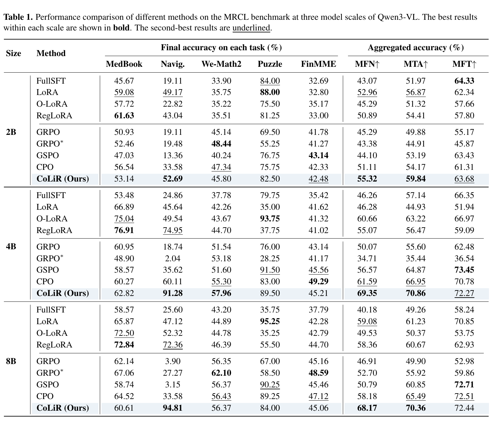

图 Table 1，第 6 页。左侧为每任务最后准确率，右侧为 MFN/MTA/MFT。MFN 是最终五任务等权平均；MFT 是每任务刚学完时准确率的平均；MTA 对每个任务从学完到最终的各阶段先平均，再对任务等权，不能直接把整个三角矩阵所有格子等权平均。

| 规模 | 方法 | MFN ↑ | MTA ↑ | MFT ↑ |
| --- | --- | --- | --- | --- |
| 2B | GSPO | 44.10 | 53.19 | 63.43 |
| 2B | CPO | 51.11 | 54.17 | 61.31 |
| 2B | CoLiR | 55.32 | 59.84 | 63.68 |
| 4B | GSPO | 56.57 | 64.87 | 73.45 |
| 4B | CPO | 61.59 | 66.95 | 70.78 |
| 4B | CoLiR | 69.35 | 70.86 | 72.27 |
| 8B | GSPO | 50.79 | 60.85 | 72.71 |
| 8B | CPO | 58.18 | 65.49 | 72.51 |
| 8B | CoLiR | 68.17 | 70.36 | 72.44 |

4B 最终平均比 CPO 高 7.76 个百分点，但 MFT 比 GSPO 低 1.18；不能把反遗忘收益写成所有新任务也更强。OOD 平均基座 57.28、CoLiR 55.52、CPO 54.88、GSPO 52.15，说明 CoLiR 比其他连续 RL 更保留通用性，仍未恢复基座水平；POPE 83.89 也低于基座 87.26。

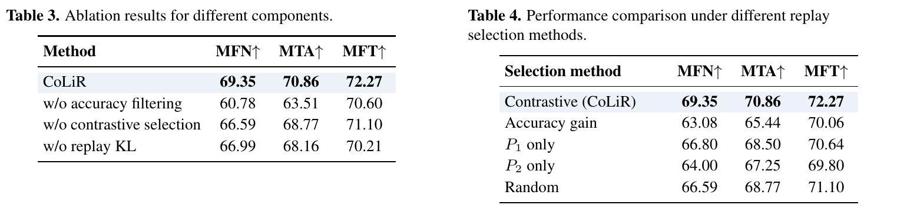

图 Tables 3/4，第 8 页。4B 完整 MFN 69.35；去候选过滤 60.78，随机选择 66.59，去 replay KL 66.99。用准确率增益排序为 63.08，只 P1 为 66.80，只 P2 为 64.00。它支持双向似然提供额外信息，但完整方法同时包含过滤与 KL，不能把总改善全归给分数。

记忆容量 40/80/160 的 MFN 为 58.23/69.35/67.95，增大记忆会引入低排名题，收益并不单调。附录还从同一个 T2 checkpoint 分叉，只在 T3 换导航回放集，导航准确率高分/低分/随机为 91.28/86.83/84.60，当前 WeMath2 则为 63.26/62.17/62.53；这个控制比跨全流程粗比较更直接，但仍是单特定分叉实验。

复现建议先在小任务保存原始评分日志、答案 mask 和每 prompt 的两端事件，重算 S 并检查长度相关性，再比较相同 replay 配额下的随机、accuracy-gain、P1/P2。缺少官方完整训练发布与明确总成本；评分噪声、错误 verifier、跨任务 prompt 分布失配以及长期记忆线性增长都是限制。未披露足够多独立训练 seed 的不确定性，百分点差异不等于统计显著结论。

延伸阅读：[GSPO 原作者论文](https://arxiv.org/abs/2507.18071)帮助区分序列级 importance ratio 与 token ratio；[TRL 文档](https://huggingface.co/docs/trl/grpo_trainer)帮助理解采样组和 KL。未核验到 CoLiR 作者博客或官方训练源码，第三方解读不能补成原作者开源声明。

## 4. UI-UG 2：让 4B 模型为界面结构与真实渲染结果负责

论文：[UI-UG 2: Advancing Mobile UI Understanding and Generation with Fine-Grained Supervision and Reinforcement Learning](https://arxiv.org/abs/2611.00926v1)，v1 2026-10-31；[PDF](https://arxiv.org/pdf/2611.00926v1)；[作者仓库](https://github.com/afx-team/UI-UG)。它不是只做“输入截图，输出描述”，而是同时训练组件识别、定位和结构化 UI 生成。

### 4.1 统一表示与数据构造

骨干 Qwen3-VL-4B-Instruct，视觉编码器冻结，LLM 与 VL adapter 训练。理解数据来自 RICO、VINS、Android in the Wild、Android Control，超过 30,000 截图，约各 7,500；先 CLIP 去重，再用检测/OCR 启发标注并人工审核。分类体系“80”包含 9 个父类与 71 个细粒度子类，不能写成 80 个叶子类。500 例审核集 κ>0.82 是标注一致性，不是模型准确率。

生成数据超过 5,000 个需求-截图-JSON 元组，通过 schema 与 render 检查。JSON DSL 节点包含 Component/Tag 类型、name、className（Tailwind）、params 的静态/数据绑定和 children，既能表达页面树，也便于解析和渐进渲染。论文比较中 DSL 比 HTML 少 16.7% token，只针对其表示/语料，不能外推为任意网页压缩率。

SFT 共 120k 样本、约 0.6B token，Referring:Grounding:Generation=3:3:4；所有目标统一成 JSON。referring 是给区域描述类别/OCR/颜色，grounding 则从语义要求找位置；不要把两者写成一个方向。后续 RL 分阶段 generation → referring → grounding，各一 epoch。

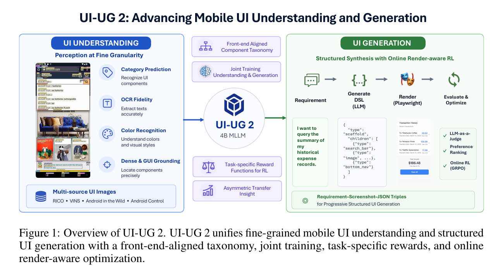

图 Figure 1，第 2 页。左侧细粒度感知任务，中间 4B 共享模型，右侧输出可渲染树。原图说明共享表示与训练闭环，并不等于所有 component runtime 都随开源推理仓库提供。

### 4.2 理解奖励：类别、文字与颜色需要不同距离

Referring 奖励 Rref = Rfmt + Rcls + 1[text type](Rocr+Rcolor)。Rfmt 检查结构可解析，Rcls 检查类别；只有 SingleLineText、MultiLineText、MoneyLineText 等文本类才启用后两项，避免给无文字按钮强行比较 OCR。

Rocr=1-EditDistance(pred,gt)/max(len(pred),len(gt))，双方空文本时为 1。Rcolor=max(0,1-ΔEab/50)，ΔE 是 CIE76 的 Lab 空间颜色距离；不是直接 RGB 差，也不是可微图像相似度。本文算例：参考“金额100”，若识别少一个字符，最大长度 5、编辑距离 1，则 Rocr=0.8；ΔE=10 则 Rcolor=0.8；格式和类别均正确时总奖为 3.6。该算例只解释奖励量纲。

Dense grounding 同时奖励 recall 与 precision：Rrec 对每个 GT 框找类别匹配预测中的最大 IoU 再平均；Rpre 对每个预测框找类别匹配 GT 的最大 IoU 再平均；Rdense=Rfmt+Rrec+Rpre。空集合按原文约定置 0。用 m(g,p) 表示类别匹配指示，则 Rrec=(1/N)Σg maxp[m(g,p)IoU(g,p)]，Rpre=(1/M)Σp maxg[m(g,p)IoU(g,p)]。

这不是训练时的匈牙利一对一匹配。多报框可能提高召回却制造重复和误检；Rpre 对每个预测都算，约束这种投机。举例：2 个 GT、预测 3 框，其中两个正确框 IoU=0.8，第三是无关类别，则 Rrec=0.8，Rpre=(0.8+0.8+0)/3≈0.533；只有 recall 时多报的代价不足。指令条件 GUI grounding 则用 Rcap=Rfmt+IoU，针对单个目标框，不能套用密集召回平均。

### 4.3 生成奖励：格式与可运行性先过关，再比视觉质量

每条采样 DSL 送到独立异步 Playwright 服务端解析、渲染截图。Rgen=Rfmt+Rrender+Rperc；只有格式有效且成功 render 才计算感知项，避免 judge 奖励一段不可执行却“看上去有道理”的文本。

绝对评分 Rjudge=(1/4)Σd score_d/10，四维为颜色/美观、结构/对齐、文字/内容、交互/响应设计。judge 是 Qwen3-VL-235B-A22B。比较评分 CPR 让同 prompt 的 G 个候选做两两比较，每维胜/平/负给 1/0.5/0，Ri_cpr 是候选 i 对其他 G-1 个候选、四维的平均。最终 Rperc=0.5Rjudge+0.5Rcpr。

本文算例：候选四维绝对分 [8,7,9,6]，Rjudge=0.75；若对比平均为 0.8，Rperc=0.775，格式和渲染均成功则总奖 2.775。另一候选绝对分高但 render 失败，不能继续获得感知奖励。比较分依赖本组对手：同一个结果换一组候选可能分数改变，因此训练日志应分开记录绝对分与 CPR。

G=8 时有 8×7/2=28 个无序候选对，每对四维即 112 个维度比较。它不必等于 112 次 API 调用，可能一次输出四维；如果实现对顺序偏置做镜像比较，还会增加调用。论文没有给完整端到端 judge 账单，不能只按 4B policy 的 GPU 时间估成本。

GRPO 对同一输入的 8 个候选计算标准化 advantage，使用 clipped policy surrogate 与 KL 系数 0.01。通用形式为最大化 mean[min(ρA,clip(ρ,1-ε,1+ε)A)]-βKL；ρ 是当前/旧策略 token 概率比，β=0.01，A 来自本任务奖励的组内归一化。原文未在已核验配方给出所有实现常数，不能擅自填一个“默认 ε=0.2”当实验参数。

```python
# 教学伪代码；训练顺序是 gen -> referring -> grounding
model = sft(backbone, task_mix=(3, 3, 4), samples=120_000)
for task in [generation, referring, grounding]:
    for prompt in task.dataset:
        candidates = model.sample(prompt, n=8)
        if task is generation:
            valid = validate_json(candidates)
            rendered = async_render_with_playwright(valid)
            reward = format_reward + render_reward
            reward += gated_absolute_and_pairwise_judge(rendered)
        else:
            reward = decomposed_ui_reward(task, candidates)
        grpo_update(candidates, reward, beta_kl=0.01)
```

### 4.4 训练成本与可复现边界

SFT 4×A100 80GB、2 epoch、学习率 1e-5、batch 16、warmup 0.05；GRPO 学习率 1e-6、batch 64、warmup 0.03、8 rollout，referring/grounding/generation 分别约 6,000/6,000/2,000 条。AdamW weight decay 0.01、Warmup-Stable-Decay、最长 8,192 token。原文约两天 SFT 加两天 GRPO；若四卡持续占用，本文估算 4×96=384 policy GPU-hours，排除大 judge、渲染 CPU、调参和失败任务，不是完整总成本。

2026-11-21 作者 README 明确：仓库包含推理、服务和 JSON DSL 渲染，训练代码不包含。提供 UI-UG2-4B 模型入口；Python renderer 支持 Tag 和数据绑定，Component 需要相应前端 runtime，仓库未捆绑。不能将运行一个示例 JSON 说成复现了论文全部 render-aware GRPO。

### 4.5 实验：感知、密集定位和生成要分别看

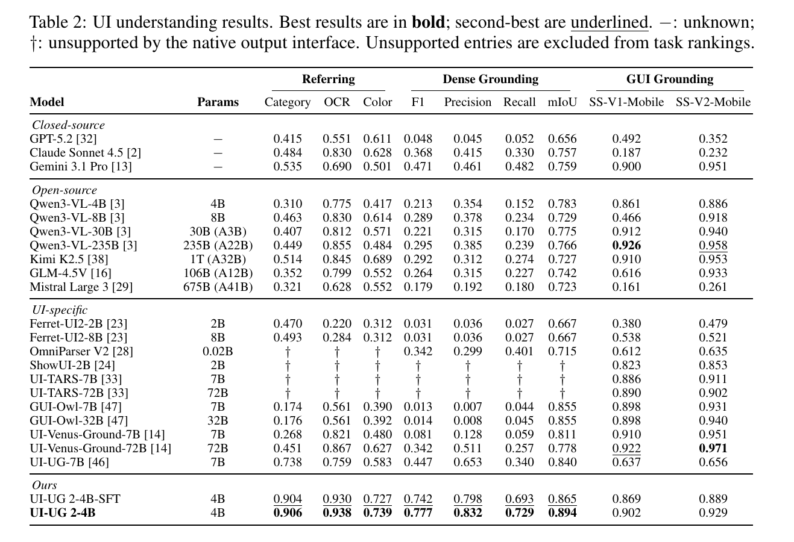

图 Table 2，第 9 页。同一个 4B 的 SFT → RL：类别 0.904→0.906、OCR 0.930→0.938、颜色 0.727→0.739；Dense F1 0.742→0.777、mIoU 0.865→0.894；ScreenSpot Mobile V1 0.869→0.902、V2 0.889→0.929。大 GUI 专用模型仍有更高点击定位项，不能写成全任务超过所有大模型。

评测 Dense grounding 用匈牙利一对一匹配，代价是同类 1-IoU、异类 1；类别一致且 IoU≥0.5 算 TP。P/R/F1 每图算后平均，因此 mean F1 不必等于 mean P/mean R 的调和平均。mIoU 只对 TP 匹配框计算，高 mIoU 不等于覆盖了全部物体。训练 max-IoU 奖励和评测 Hungarian 指标是两套不同规则。

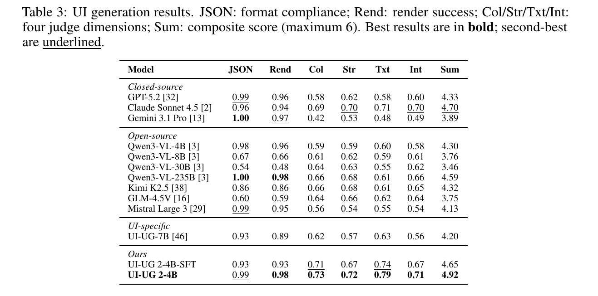

图 Table 3，第 10 页。4B SFT 的总分 4.65，RL 后 4.92，约 +5.8% 相对增幅；JSON 0.93→0.99、render 0.93→0.98，四维 0.71/0.67/0.74/0.67 → 0.73/0.72/0.79/0.71。总评测分 Sgen=pJSON+prender+Σd ŝ_d，上限 6，与训练 Rgen 上限 3 不同；评测总分没有加入 CPR，4.92 不能当作训练平均奖励。

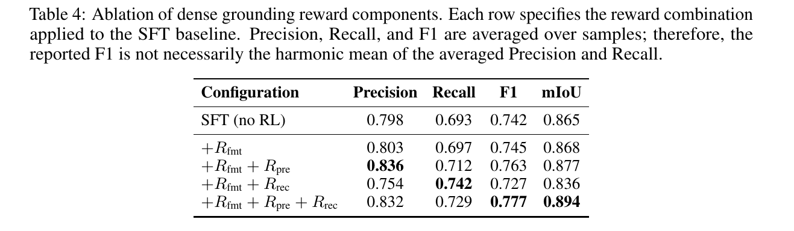

图 Table 4，第 11 页。在 SFT 上仅加格式+召回，F1 从 0.742 降到 0.727、mIoU 从 0.865 降到 0.836；加入 precision 和 IoU 等完整组合才到 0.777/0.894。这个消融是奖励投机的具体证据：发现更多框和更准确地检测不是一回事。

固定 120k SFT 数据预算的混合实验中，理解数据占 20% 的生成分 4.760，高于纯生成 4.668，支持感知监督促进生成；正式主配方理解比例是 60%，不能由这一组结果宣称 20% 是通用最优。分阶段 RL 比联合训练更好是在论文所述预算下观察到的，不是任意任务组合定律。

judge 与三名设计师的 100 例对照中，Qwen 的 MAE 为 0.17、方差 0.046，Gemini MAE 0.08 更低；选 Qwen 是实际取舍。训练和评测采用相近视觉评价维度，结果仍可能受到 evaluator 偏好影响。“交互质量”主要反映截图/设计可见线索，不是自动证明按钮业务逻辑可用。界面长尾类别、component runtime 完整性、外部 judge 成本与未公开训练实现，是复现与应用的主要约束。

复现先保存 schema、taxonomy、train/eval 匹配规则和 reward 各分量，再做离线 renderer 成功率检查，最后小组 rollout 验证 CPR 的顺序偏置与 G=8 成本。不要从总分跳过失败样本。基础资料：[Playwright 官方文档](https://playwright.dev/python/docs/intro)、[TRL SFT](https://huggingface.co/docs/trl/sft_trainer)、[GRPO](https://huggingface.co/docs/trl/grpo_trainer)；[作者 README](https://github.com/afx-team/UI-UG)可视作官方使用说明，未核验独立作者技术博客。

## 5. SurgPace：约 3B 学生的连续课程与跨分词器蒸馏

论文：[SurgPace: Complexity-Aware Progressive Distillation for Surgical Multimodal Large Language Models](https://arxiv.org/abs/2611.03125v1)，v1 2026-11-02；[PDF](https://arxiv.org/pdf/2611.03125v1)；[作者代码](https://github.com/hezhicheng2002/SurgPace)。它使用固定参考答案 teacher forcing，属于监督蒸馏，不是学生自由采样前缀的 OPD，也不使用 RL reward。

### 5.1 压缩目标与两种不同的调度

教师 EndoChat 13B；学生 TinyLLaVA 风格，Phi-2 语言骨干、SigLIP 视觉编码器、两层 GELU MLP connector，约 3.22B 总参数、其中语言部分约 2.78B。视觉冻结，语言 LoRA rank 64、alpha 128、无 bias；32 层的 q/k/v/dense/mlp fc1/fc2 共 192 模块，connector 全量训练，另学习对齐模块。

方法把两个问题分开：样本课程决定“这条题现在占多大权重”；目标课程决定“这一步更听教师，还是更依赖参考答案”。前者基于冻结教师的离线难度分，后者让蒸馏系数随进度降低。课程不是把难题永远删掉，也不是每批重新排序。

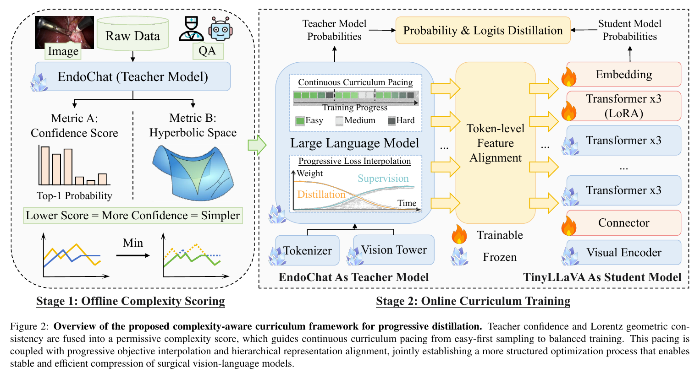

图 Figure 2，第 4 页。左侧先固定教师评分，右侧训练学生；token-level、feature alignment 和时间曲线分别对应不同约束。图里 Teacher 产生的几何分数来自输出 logits，不能看到“feature”就写成直接匹配教师中间 hidden states。

### 5.2 教师置信度与 Lorentz 轨迹离散度

对长度 L 的参考答案，教师在其真实前缀上的概率 pT_t、logit 向量 lT_t 已知。置信难度 sconf=1-(1/L)Σt maxv pT_t(v)。它看的是 top-1 置信度，不是参考 token 的概率：一个自信但错误的教师也可能给很低的“难度”，这是代理分数的限制。

几何分先把每个 logit 向量压到有界空间坐标 u_t=lT_t/sqrt(1+||lT_t||²+ε)，再提升到 Lorentz 双曲面 x_t=(sqrt(1+||u_t||²),u_t)。Lorentz 内积 <x,y>L=-x0y0+Σj≥1 xj yj，所以 <x,x>L=-(1+||u||²)+||u||²=-1，保证点在单位双曲面上。

距离 dL(x,y)=arcosh(max(1+ε,-<x,y>L))。对中心不能直接平均 x 的所有维度，因为欧氏平均未必仍在曲面上；先 ū=mean_t u_t，再 x̄=(sqrt(1+||ū||²),ū)。原始几何难度 g=(1/L)Σt dL(x_t,x̄)，再用整个训练集 min/max 固定归一化为 sgeom=(g-gmin)/(gmax-gmin+ε)。它衡量教师 logit 轨迹在该变换下的离散程度，不是解剖距离，也不是临床难度标注。

原文主式融合 s=min(sconf,sgeom)：任一信号认为容易就降低难度，是宽松的 OR 直觉。若置信难度 0.1、几何难度 0.8，最终 0.1；若用 max 就变成必须两个信号都容易才容易，训练行为会完全不同。

代码核验补充：`tinyllava/scoring.py` 在 min 融合后，还按 task_type 做平均经验秩校准，训练默认读取 `score_min_conf_lorentz_midrank_task`。若同任务 n 个样本相同分数位于排序 [a,b]（从 0 计），秩为 [(a+b)/2]/max(1,n-1)。因此论文主式的原始 min 分值和当前代码实际课程字段并非同一个量，复现要固定评分版本与所用字段，不能静默替换。

### 5.3 连续课程：初期偏容易，之后回到均匀

令 e_i=1-s_i 表示易度，初始权重 w_i=wmin+(wmax-wmin)e_i。训练进度 p=step/max_steps，a(p)=max(0,1-p/rend)，最终 ŵ_i(p)=1+a(p)(w_i-1)。p≥rend 后全部回到 1；难样本早期只是低权重，主方法没有硬删除。

作者代码 `tinyllava/utils/arguments.py` 当前默认 wmin=0.7、wmax=1.3、rend=0.4。本文算例：一容易样本 s=0.2，初始 w=1.18；一难样本 s=0.8，初始 w=0.82。到 p=0.2，a=0.5，变为 1.09/0.91；到 p=0.4 两者均为 1。它改变样本相对强调程度，不能理解成“前 40% 只训练简单题”。代码支持其他 pacing 消融，不能把它们当主方法。

### 5.4 教师和学生分词器不同，如何逐位置蒸馏

教师/学生的 token ID 空间不同，同一个答案也可能拆成不同数量的 token。直接把第 t 个教师向量对齐第 t 个学生向量会错位；直接将两个词表的第 v 列相减也没有语义意义。

第一步是位置对齐。把每个 token 解码表面字符串的正 UTF-8 宽度记作 b_j，定义归一化中心 r_j=(Σk≤j b_k-b_j/2)/Σk b_k。沿教师 r_j 线性插值 logit 轨迹，在学生中心处取值；区间外用端点，教师只有一个 token 时广播。它按解码文本宽度近似对齐，不是语义 embedding 的最近邻匹配。

本文手算：教师宽度 [2,2]，中心 [0.25,0.75]；学生宽度 [1,1,2]，中心 [0.125,0.375,0.75]。第一个学生位置取教师首端，第二个在两教师位置间按 0.25 比例插值，第三个取第二教师位置。前提是两者基于同一参考文本、只取 causal answer mask，不能把 prompt 或图像占位混进去。

第二步是词表对齐。通过精确解码 token 表面身份建立共享支持，PT、PS 是选择/投影到同一支持的矩阵；教师对齐 logits 可写为 zT=e^γ PT Interp(lT)，学生 zS=PS lS，γ 是可学习尺度。只在共享支持 softmax 后计算 KL，不能宣称是两个完整原始词表之间的 KL。当前 `train.py` 要求至少 1,024 个共享 token，并初始化对齐模块；对齐覆盖率和重复表面处理必须记录。

### 5.5 五项监督与整体 loss，逐项说明

ρ_i(·) 表示第 i 样本有效因果答案位置的平均。CE 直接以真实答案监督学生。KL 使用温度 T：LKL,i=ρ_i[T² KL(softmax(zT/T)||softmax(zS/T))]；教师到学生方向保留软候选信息，T² 补偿温度对梯度尺度的影响，当前代码温度默认 1。

Logit L2：LL2,i=ρ_i||C(zS)-C(zT)||²，其中 C(z)=z-mean_vocab(z)。减去均值让损失不受整体加同一个常数影响；softmax 本来就有这种平移不变性，未中心化 L2 会处罚无意义偏移。

Feature 项 Lfeat,i=ρ_i||hS-ψ(Standardize(zT))||²，hS 是学生 hidden representation；Standardize 先对词表维中心化，再除以带 ε 的标准差，ψ 是可学习投影。目标来自教师 logits，经投影后对齐学生特征，不是直接取教师相同层的 hidden state；教师/student 层数维度无需相同。

Entropy 项 Lent,i=ρ_i[-Σv pS(v)log pS(v)]。以正系数放进要最小化的 loss，作用是熵最小化、让预测更集中；不要套用 RL 中“最大化熵鼓励探索”的解释。过强可能导致过度自信，因此需要和 CE/KL 一起约束。

令任务平衡系数为 τtask(i)，ω_i=τtask(i)ŵ_i；R(ℓ)=(1/Nglobal)Σi ω_i ℓ_i。原文按全局样本数约减，不是除以 Σω；改为权重和归一化会改变整体尺度。分布式实现需补偿 DDP 的梯度平均，不能只对每卡样本独立归一化再假定等价。

整体目标 L=βce(p)·0.5R(CE)+βdist(p)·[1.0R(KL)+0.5R(L2)+0.2R(feat)+0.05R(ent)]。权重来自原文。βce=cs+(ce-cs)α(p)，βdist=ds+(de-ds)α(p)；α 在前 r1 比例为 0，中间 r2 比例线性从 0 到 1，之后为 1。

当前作者代码默认 phase_ratios="0,1,0"、cs=ce=1、ds=1、de=0.1，也就是全程线性减弱蒸馏，而 CE 不变。通用三阶段公式不代表主配置必须有一个非零平台期。课程的 rend=0.4 与目标调度的 r1/r2 是两条不同时间轴，不能合并成一个“第 40% 换阶段”。这些是 11-21 代码默认值，不保证每个论文实验的命令行都未覆盖。

```python
# 教学伪代码：固定参考答案，无 RL rollout
scored = teacher_forced_offline_scores(train_records)
scores = task_midrank(min_fusion(global_normalize(scored)))  # 当前代码路径
for step, batch in enumerate(loader):
    progress = step / max_steps
    weights = task_balance * continuous_curriculum(scores, progress)
    teacher_logits = frozen_teacher(batch.image, batch.reference_prefix)
    student_logits, student_hidden = student(batch.image, batch.reference_prefix)
    zT, zS = align_shared_tokens_and_surface_positions(teacher_logits, student_logits)
    losses = CE(), KL(zT, zS), centered_L2(zT, zS), feature(), entropy()
    ce_scale, kd_scale = progressive_scales(progress)
    loss = global_sample_mean(weights * combine(losses, ce_scale, kd_scale))
    loss.backward(); optimizer.step()
```

### 5.6 数据、成本和公开代码的边界

数据名称为 Surg-396K，但本文按处理后真实计数：训练 461,297、验证 64,878、测试 64,856，共 591,031。训练五类分别为 SPQA 156,983、VQA 109,960、描述 29,960、区域问答 92,287、grounding 72,107，合计正好 461,297。源包括 CoPESD、Cholec80-VQA、EndoVis17/18。不要因为名字带 396K 就把实际训练集写成 396,000。

统一初始化学生、1 epoch、2×A100 80GB、每设备 batch 1、AdamW 学习率 1e-4、cosine、warmup 0.03、BF16、ZeRO-2、序列长 1,024。52.443 GPU-hours 训练，加离线评分 3.11，为 55.553 GPU-hours。原文称离线评分覆盖 591,031 样本，而归一化公式定义训练集 D；复现应核验统计量只用训练划分。这个表述差异值得检查，不能未经审计直接断言发生测试泄漏。

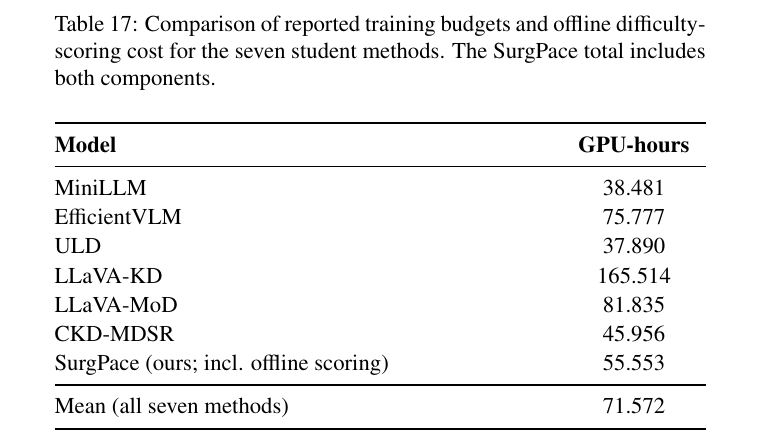

图 Table 17，第 14 页。所有方法使用相同学生架构，但成本不同；例如 EfficientVLM 为 75.777、ULD 为 37.890、LLaVA-KD 为 165.514 GPU-hours。共同初始化与数据不意味着 compute-matched，SurgPace 也不是所有方法里最便宜。表中 Mean 是方法成本均值，不是额外一次训练费用。

代码核验：有 `score.py`、`train.py`、`infer.py`、curriculum/分布式约减/对齐实现；权重和数据需用户另备，教师需要原生 EndoChat 源码。README 的启动示例用 4 进程，论文实验是 2 卡；`train.py` 要求 gradient_accumulation_steps=1。复现应保存覆盖后的完整配置，不能把示例启动命令当作论文精确算力配方。

### 5.7 主结果、三 seed 与容易夸大的性能结论

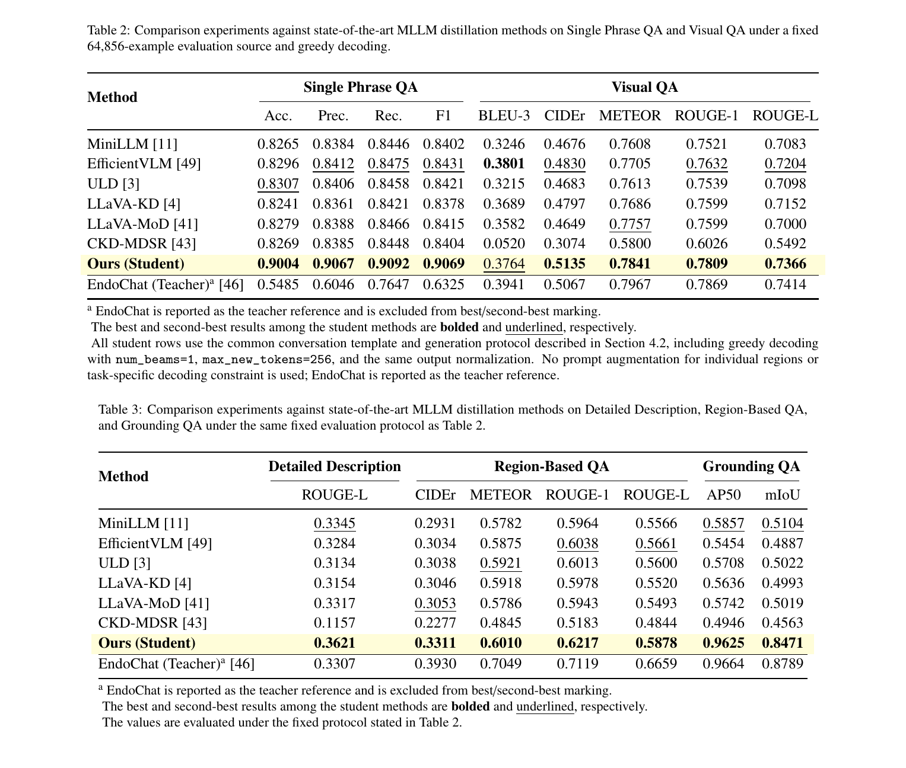

图 Tables 2/3，第 9 页。统一 64,856 测试例、共同 prompt 与输出规范、greedy、beam=1、最多生成 256 token。SPQA 准确率 0.9004，高于 EfficientVLM 0.8296；grounding AP50/mIoU 为 0.9625/0.8471，高于其 0.5454/0.4887，但仍低于教师 0.9664/0.8789。学生 SPQA 高于教师 0.5485，与任务适配和输出规范有关，不能推出学生通用能力超过教师。

16 个指标单次汇总平均 0.6955，15/16 学生方法最优；VQA BLEU-3 0.3764 低于 EfficientVLM 0.3801。把分类准确率、文本相似度和框重叠简单平均是论文汇总指标，不是统一的临床效用单位。三个独立 seed 0/1/42 下，16 指标平均为 0.6930±0.0038，EfficientVLM 0.6221±0.0029；grounding mIoU 为 0.8424±0.0069 对 0.5032±0.0136，支持关键收益跨 seed 保留，但并非每个单次细项都稳定排序。

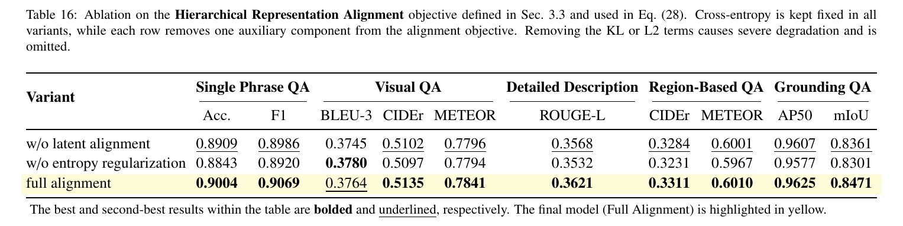

图 Table 16，第 14 页。完整 mIoU 0.8471，去 feature 为 0.8361，去 entropy 为 0.8301；去 entropy 的 BLEU-3 却略高（0.3780 对 0.3764），说明组件有多指标取舍。课程 pacing 的另一张表使用十项平均：线性 0.6585、无 pacing 0.6541、one-pass 0.5910。这里的 0.6585 不能与主表十六项的 0.6955 直接作差；连续课程相对无课程的收益也远小于整个蒸馏框架相对弱基线的收益。

推理效率实测在一张 A100 80GB、双方 FP16、batch 1、输入 128/输出 64 token、3 次 warmup 后 10 次测量，且是受控文本生成：加载显存 6.46 对 26.03GB；中位 16.50 对 23.51ms/token，约 1.42 倍；端到端 1.11167 对 1.54783 秒，约 1.39 倍。FLOP 代理未含视觉、二次 attention 等完整成本，不能改写成“整段手术视频端到端快 1.42 倍”。

所谓临床审计也需要看输入条件：300 条分层描述用 Qwen3.8-Max 文本 judge 评分，不看原图；并非临床专家图像盲审。汇总评分学生 72.70 高于对照 64.92、教师 63.97，但教师在 hallucination 项仍有优势，部分 action 项也不是学生最好。描述全量 judge 与 bootstrap 反映样本不确定性，不代替训练 seed、视觉真实性或实际临床验证。

建议复现顺序是：先核验五类划分与去重，再锁教师参考前缀/answer mask；导出难度分和任务内秩，检查相同分数的 tie 处理；验证共享 token 覆盖和插值边界；用小 batch 比较单卡/多卡全局约减；最后做等训练步数、等数据的 no-pacing/no-feature/no-entropy 对照。教师置信度不是事实、几何分依赖 logit 表示、共享词表遗漏专有术语、标注与临床域外分布是主要风险。

延伸阅读：先读 [PyTorch 知识蒸馏入门](https://docs.pytorch.org/tutorials/beginner/knowledge_distillation_tutorial.html)，再看 [PEFT LoRA 说明](https://huggingface.co/docs/peft/main/conceptual_guides/lora)；实现细节按 [作者 core](https://github.com/hezhicheng2002/SurgPace/blob/main/tinyllava/train/surgpace_core.py)、[scoring](https://github.com/hezhicheng2002/SurgPace/blob/main/tinyllava/scoring.py) 与 [参数定义](https://github.com/hezhicheng2002/SurgPace/blob/main/tinyllava/utils/arguments.py) 阅读。未核验独立作者博客，不用通用教程冒充项目公开说明。

## 6. 怎样将今天的机制放回自己的小 VLM 训练

下面是本文建议，不是五篇论文共同实测结论。先判断瓶颈属于“看不见”“看见了没用到”“不会分配训练信号”还是“后训破坏旧能力”，再选最小改动；不建议直接把五套 loss 全叠在一次训练里。

| 实际症状 | 优先借鉴 | 最小可检验改动 | 同时要记录的失败信号 |
| --- | --- | --- | --- |
| 回答模板好，视觉细节错 | VisAlloc | 一份固定正负裁剪和 token 对比诊断 | 负图含证据、模板门误伤、局部统计漂移 |
| agent 不断猜常见答案 | ViRA | 同题少量局部改图，分别组内 RLOO | set全对率、版本恒定奖励、zoom/token开销 |
| 新任务涨，旧任务大跌 | CoLiR | 小容量 prompt 回放并重新生成 | 旧任务成功率、S与长度相关、OOD退化 |
| JSON 能写，页面渲染常失败 | UI-UG 2 | schema/render 门控与分项 reward 日志 | 格式投机、误报框、judge偏置和调用量 |
| 目标学生分词器与教师不同 | SurgPace | 共享表面词表和位置插值小样本审计 | 专有名词丢失、answer mask错位、约减尺度 |

对小白的推荐路径：先用 SFT 跑通真实数据、评测和可回放日志；学习 CE/KL/JSD 与采样前缀区别；用十条手算/合成样例核对优势和权重；再上小规模蒸馏或 RL。单靠总 reward 上升无法证明读图更好，需要无图/错图、固定答案、重复预测、格式失败等对照。

## 7. 核验与归档说明

今日核验五份 v1 PDF（共154个物理页），引用17幅原图表。PDF与本Markdown全文一致，含全部公式、代码、表格和图片；算例不作为实测。原文事实、代码状态与本文推演分开标注。检索、去重和环境见manifest.json，图源见assets/SOURCES.md，全文、字体与逐页检查见assets/QA.md。
