# VLM 后训练论文精读 · 2026-11-22

今天的主线是让小型 VLM 的后训练收益落到真实行为上：抑制幻觉而保留信息、让工具返回的证据真正有用、从黑盒教师学可执行策略、把探索交给 4B 模型，以及用目标偏好改善下游 RL。五篇全部是论文，教程与博客仅作辅助。

检索窗口：2026-10-22 至 2026-11-22，按 arXiv v1 首次公开日期筛选；对所有方向的 sources.json/manifest，按去版本 arXiv ID、DOI、规范 URL 和归一化标题去重。今天实际收录 5 篇。旧论文的新版、纯推理控制方案和历史已收录条目不占名额。

| 论文 | 首次公开 | 模型与后训练 | 今天重点 |
| --- | --- | --- | --- |
| [SARGO](https://arxiv.org/abs/2611.19388) | 2026-11-14 | Qwen3-VL 4B/8B、Gemma3 4B；自指导 RL | 负优势不能照搬正优势的 token 权重 |
| [Learning to Think with Images Faithfully](https://arxiv.org/abs/2611.26199) | 2026-11-19 | FaithTwI，主模型 7B、另有 4B；SFT+GRPO | 动态选择“证据仍能帮助当前模型”的题 |
| [EmbodyAgent](https://arxiv.org/abs/2611.26196) | 2026-11-19 | Qwen3.5-9B；黑盒蒸馏+SFT+RL | 同一代码接口贯穿训练，诊断错误自强化 |
| [Efficient Multimodal Agents for Auditing 3D Worlds](https://arxiv.org/abs/2611.25543) | 2026-11-19 | Qwen3.5-4B；成功轨迹 SFT | 学会探索不代表学会识别，分工降低推理成本 |
| [Goal-Guided RL via Fine-Tuning VLMs](https://arxiv.org/abs/2611.25742) | 2026-11-19 | Qwen3-VL-8B；SFT+KLTDPO | VLM 离线偏好训练与小策略在线 PPO 分开 |

执行环境：本机 macOS 补位、现有授权 SSH。远端运行约定和云端迁移聊天状态均已检查；云端长期任务仍暂停等待环境绑定核验，今天没有已验证完成的云端日报。尚不能声称任务已脱离本机。

## 阅读约定与基础概念

下文“原文”指固定 v1 PDF；“本文推导/算例”只为解释公式，不是作者实验。“未披露”表示在本次可核验材料中没有找到，不使用通用默认值补成论文参数。本报告没有训练模型。18 幅图片全部是原论文 PDF 图表裁剪，物理页从 1 开始计数，逐图解释读法与比较条件；图源、范围和哈希见 manifest.json 与 assets/SOURCES.md。

初学者先区分三件事。SFT 最小化参考答案的负对数概率，让模型学输出格式和示范行为；RL 从当前模型采样，依据奖励改变它实际会生成的行为；蒸馏则表示从教师获得监督，既可以是教师生成的整段答案，也可以是每个 token 的软分布。黑盒教师只给答案的蒸馏，不等于能拿到教师 logits 的 OPD。

给定图像 I、问题 x 与前缀 y<t，πθ(v|I,x,y<t) 是下一 token v 的概率。logit 是 softmax 前分数，token 不一定是一个汉字或完整单词。CE=-Σt logπθ(y*t|prefix*) 使用参考前缀；on-policy 学生轨迹使用学生采样的前缀。KL(q||p)=Σv q(v)log[q(v)/p(v)] 是带方向的分布差异，调换 q/p 会改变训练。

GRPO 在同一个输入的 G 条响应内计算 A_i=(r_i-mean r)/(std r+ε)，正 A 增大相应行为概率，负 A 减小。重要性比 u=πθ/πold 比较更新中模型与采样策略；clipping 限制一次更新。奖励是“该行为得多少分”，advantage 是“相对同组其他行为好多少”。一条奖励为正的响应，也可能因同组更好而得到负 A。

## 1. SARGO：保留好信息的负向信用分配

论文：[SARGO: Agreement-Gated Reinforcement and Suppression via On-Policy Self-Guidance for Visual Hallucination Mitigation](https://arxiv.org/abs/2611.19388v1)，v1 2026-11-14；[原 PDF](https://arxiv.org/pdf/2611.19388v1)。作者 Jinyu Li 等，清华大学深圳国际研究生院、哈尔滨工业大学（深圳）。原文及有界题名/作者检索未核验到官方训练仓库或作者博客；搜索聚合页相邻论文的 GitHub 链接没有当成本篇源码。

### 1.1 问题：一条错误回答里，也有值得保留的正确 token

描述可能前半句正确、后半句虚构。普通 response-level RL 将同一负优势广播到整条回答，会一起压低正确物体和错误物体。直接加一个 OPSD KL loss 也未必解决：KL 独立地推动教师喜欢的 token，而 RL 可能正在惩罚整条响应，两种梯度目标并不自动一致。

SARGO 不额外增加分布匹配 loss，而用有标注的特权上下文评估当前模型自己的回答，调整 RL 梯度在 token 间的分配。原则很具体：有依据的 token 在正更新中多奖，在负更新中少罚；只有总体评价与幻觉专门评价方向一致时，才启用这种指导。

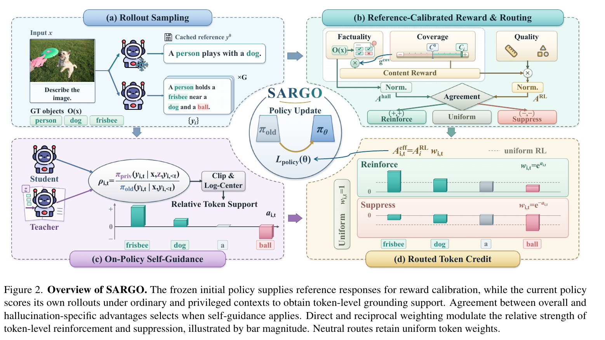

图 Figure 2，PDF 第 4 页。左上采样学生响应，右上用初始策略参考回答校准奖励，中下用普通/特权上下文评分同一 token，右下分 Reinforce、Suppress、Uniform 三条路。图中柱高代表相对更新强弱，不是实验准确率；Uniform 保留普通 RL，并不是丢掉样本。

### 1.2 第一个模型角色：冻结初始策略给奖励一个参照

对每张图，冻结初始策略 π0 预生成参考回答 y0。O(x) 是图中标注的对象类别集合，M(y) 是从回答提取并映射到 COCO 类别的集合；抽取使用词典与词形还原，标注集合还结合人类 caption 中可识别类别。它是类别集合，不是逐次提及计数，也不是能验证一切属性的通用事实审查器。

对象幻觉比例 hobj=|M(y)\O|/|M(y)|，响应幻觉标志 hresp=1[|M(y)\O|>0]。幻觉奖励 rhall=1-αhobj-(1-α)hresp，α=0.7。它同时关心错误占比和是否至少出现过一次错误，避免“九个正确物体掩盖一个错误物体”。空对象集合等分母边界的完整实现约定未公开，复现时必须明确，不能悄悄将空回答自动判满分。

覆盖率 C=|M(y)∩O|/|O|，C0 是参考回答覆盖率。相对损失 Δ-=(C0-C)_+/C0，相对增长 Δ+=(C-C0)_+/(1-C0)。前者按已覆盖信息归一化，后者按剩余可发现空间归一化；C0=0/1 的保护逻辑也需要实现时审计。

原文定义 dcov=0.5+0.5sqrt(Δ-)-0.5Δ+，gcov=1-Δ-。sqrt 对小幅丢失也给明显惩罚，优先保住原来已有的正确信息；线性增长项鼓励多发现物体。再令 dhall=1-gcov·rhall，让“少说以后不出错”不能拿完整事实奖励。

响应质量门 qresp=glen·gdiv。词数为 L、参考词数 L0，glen=1-sqrt((1-L/(βL0))_+)，β=0.35，到参考长度的 35% 即饱和，并非强制复述参考全文。对于 n=1..4，Vn 是词 n-gram 的 distinct/total 比例；δn=min(Vn/Vn0,1)，参考没有该阶 n-gram 时置为中性 1；δdiv=Πn δn，gdiv=1-sqrt(1-δdiv)。它防止用重复句子刷长度，但多样性不等于事实正确。

合成奖励 rRL=qresp·[1-sqrt((dhall²+dcov²)/2)]。平方使较大缺陷占主导，外层 sqrt 保持整体量纲。请注意：原文奖励是这一非线性组合，不是简单把 CHAIR、recall、长度相加。

本文算例：假设 qresp=1、回答提到的物体都正确，rhall=1，C0=0.6。若 C=0.6，dcov=0.5、dhall=0，rRL≈0.646；若删掉一半已覆盖物体使 C=0.3，Δ-=0.5，dcov≈0.854、dhall=0.5，rRL≈0.301；若 C=0.8，Δ+=0.5、dcov=0.25，rRL≈0.823。三条回答都可以“没有幻觉”，奖励仍区分信息损失与真实增长。

### 1.3 第二个模型角色：当前 rollout 快照提供自指导

πold 是本批采样前的当前策略快照，与冻结初始 π0 不同。特权教师 πpriv=πold(·|x,z,y<t)，z 包含训练图的对象标注、人类参考 captions、可用 COCO-Stuff 场景线索。它是同一个当前模型增加文本证据，不是另一个更大教师，也不是 EMA 教师。推理时无需这些训练标注。

在相同学生前缀上计算支持比 ρ_t=πpriv(y_t|x,z,y<t)/πold(y_t|x,y<t)。这是特权支持比；后面策略更新的重要性比 u_t=πθ/πold 是另一个量。若混淆两者，会把“视觉依据分配”错误地写成 off-policy correction。

先 clip ρ 到 [1/c,c]，c=3；a_t=logρ̄_t-mean_u logρ̄_u。减去序列内平均 log 比值，比较的是相对本回答几何均值的支持程度。它并不证明一个词由图像因果决定：标注文本可能直接提供词汇提示，教师也可能有错。

### 1.4 路由：为什么负更新要用倒数

在同一个响应组，分别将 rRL 与 rhall 标准化为 A_RL 和 A_hall。若两者都正，s=+1；若两者都负，s=-1；其他情形 s=0。总体优势仍决定奖惩方向，幻觉优势只判断特权指导是否适合这次更新。零优势与零方差组的工程保护未完整披露。

权重 w_t=exp(s·a_t)，有效优势 Aeff_t=A_RL·w_t。正路由使用相对支持的直接权重；负路由使用倒数；中性路由 w=1。例如一条回答 coverage 很差但幻觉很少，A_RL<0、A_hall>0，这时惩罚主要针对信息损失，不该借“幻觉证据”重新分配梯度。

本文手算：三个 token 的支持比是 [2,1,0.5]，log 几何均值为 0，所以正路由 w=[2,1,0.5]。若 A_RL=1，它们有效优势是 [2,1,0.5]；负路由且 A_RL=-1 时 w=[0.5,1,2]，有效优势为 [-0.5,-1,-2]，有依据的位置受到较小惩罚。若负优势仍用直接权重，就会变成 [-2,-1,-0.5]，恰好背离目的。

本文推导：log-centering 保证 Πt w_t=1，即几何均值为 1；不保证算术均值为 1。上例 sum w=3.5，不等于 token 数 3，因此不能称为总梯度/总权重守恒。由于 logρ̄∈[-log3,log3]，中心化 a∈[-2log3,2log3]，w 的安全外界为 [1/9,9]，不是 [1/3,3]。

最终最小化 Lpolicy=-mean_i{(1/T_i)Σt min[u_t Aeff_t,clip(u_t,1-ε,1+ε)Aeff_t]}，ε=0.2。先按响应长度平均，再按 G 个响应平均；没有单独 OPSD KL。快照评分、reward、路由与权重应视为固定信用系数，更新当前 θ；若通过特权权重反传，会改变这里的策略梯度含义。

```python
# 教学伪代码，不是作者公开实现
reference = cache(initial_policy.generate(images))
for batch in train_data:
    old = frozen_snapshot(policy)
    responses = old.sample(batch, n=8)
    r_hall, r_total = calibrated_rewards(responses, reference, annotations)
    A_hall, A_total = group_normalize(r_hall), group_normalize(r_total)
    route = sign(A_total) * (A_total * A_hall > 0)
    p = old.score(responses, ordinary_context)
    q = old.score(responses, privileged_context)
    log_support = log(clip(q / p, 1/3, 3))
    centered = log_support - masked_response_mean(log_support)
    effective_A = stop_gradient(A_total * exp(route * centered))
    update_with_clipped_policy_loss(effective_A, epsilon=0.2)
```

### 1.5 实验、消融、训练成本与复现限制

训练三个骨干用同一 10,000 个 COCO 图像-指令样本，评测图像不重叠；1 epoch、AdamW 学习率 1e-6、有效 batch 512 条响应、每图 G=8、temperature=1、top-p=0.95。等价名义每 batch 64 个图，但不据此推算未披露的实际更新步数。GPU 型号、卡数、墙钟、GPU-hours、最大长度、完整异常边界及多 seed 方差未披露；两个上下文的额外 scoring 不能当作零成本。

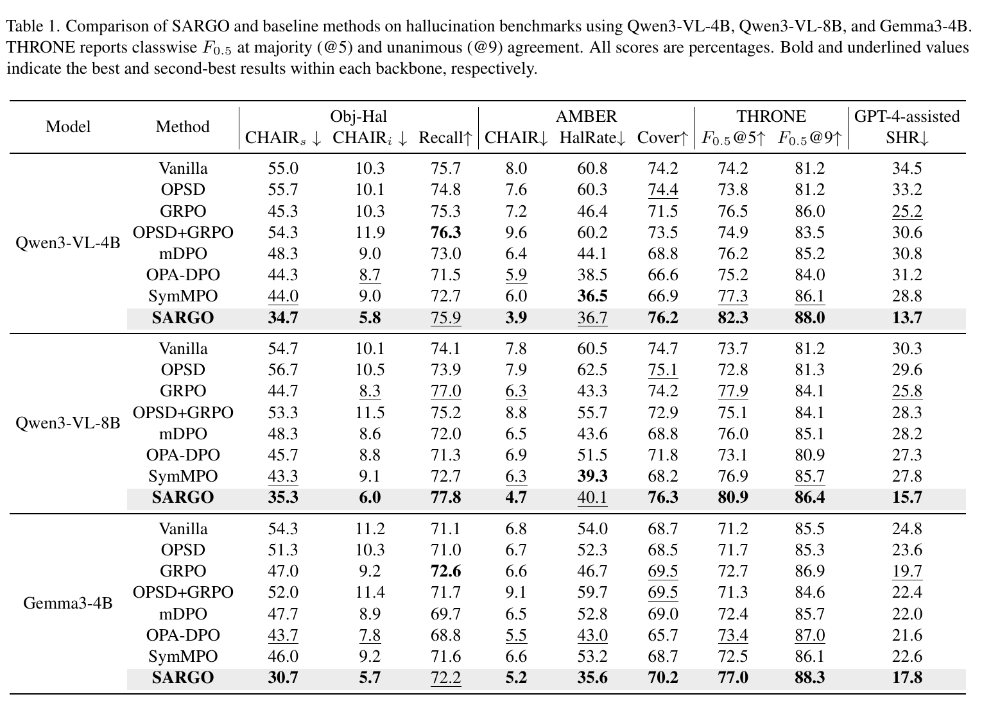

图 Table 1，第 6 页。先按骨干分组，再同时看向下的 CHAIR/SHR 和向上的 Recall/Cover。4B 的 Vanilla→SARGO：Obj-Hal CHAIRi 10.3→5.8，recall 75.7→75.9；AMBER CHAIR 8.0→3.9，cover 74.2→76.2；SHR 34.5→13.7。相对同奖励 GRPO，AMBER cover 从 71.5 到 76.2，而 CHAIR 从 7.2 到 3.9，比较更直接检验信用分配。

| Qwen3-VL-4B 方法 | Obj-Hal CHAIRi ↓ | Obj-Hal Recall ↑ | AMBER CHAIR ↓ | AMBER Cover ↑ | SHR ↓ |
| --- | --- | --- | --- | --- | --- |
| Vanilla | 10.3 | 75.7 | 8.0 | 74.2 | 34.5 |
| GRPO | 10.3 | 75.3 | 7.2 | 71.5 | 25.2 |
| OPSD+GRPO | 11.9 | 76.3 | 9.6 | 73.5 | 30.6 |
| OPA-DPO | 8.7 | 71.5 | 5.9 | 66.6 | 31.2 |
| SARGO | 5.8 | 75.9 | 3.9 | 76.2 | 13.7 |

单纯把 KL 与 RL 相加，CHAIR 甚至从 GRPO 7.2 恶化到 9.6，支持“监督如何进入目标”很重要；不代表所有任务上的 KL+RL 都无效。SARGO 也不是每个细项最好：4B 的 Obj-Hal recall 低于 OPSD+GRPO 的 76.3，AMBER HalRate 36.7 略高于 SymMPO 36.5。

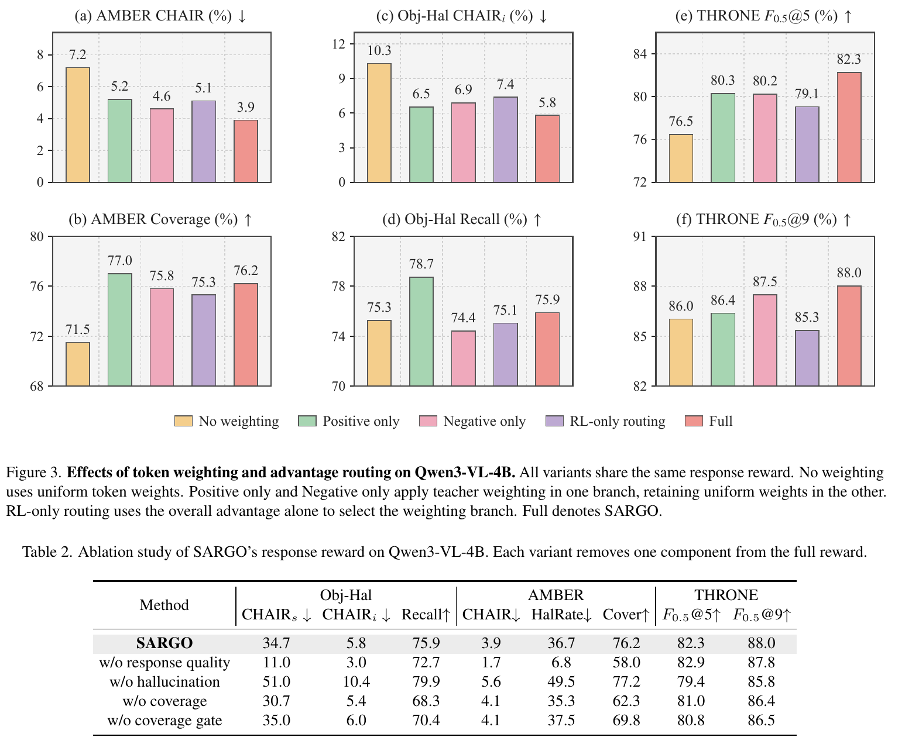

图 Figure 3 / Table 2，第 7 页。柱图共享相同 response reward；negative 分支加入 positive-only 后，AMBER CHAIR 5.2→3.9，cover 77.0→76.2，存在轻微覆盖取舍。只按 RL 优势路由到完整双优势路由，Obj-Hal CHAIRi 7.4→5.8。下面 reward 消融中，去质量门的 AMBER CHAIR 为更低的 1.7，但 cover 掉到 58.0；这是少说获得低幻觉率的直接证据。去 coverage 项 cover 为 62.3；去 coverage gate 为 69.8，二者并不重复。

一般能力另报 MME：4B 2321→2345，8B 2386→2398；MMStar 55.4→56.8、60.3→61.6，但 OPA-DPO 的 MMStar 更高。SHR 实际由 GPT-4o-mini 辅助评估，不能泛称“人工审查”或更大模型的临床级判断。

复现先审计类别抽取、空集合、C0边界与 reference 缓存，再单元检查正/负/中性三种路由；记录 reward 各分量、w 的算术/几何均值和梯度比例。缺少官方代码时，完整结果只能作为论文报告，不能声称可一键复现。类别标注漏项、文本特权直接泄露词汇、质量门造成冗长和 reward 对“说哪些对象”的偏置，是主要失效风险。

入门资料：[TRL GRPO 文档](https://huggingface.co/docs/trl/grpo_trainer)理解采样与 clipping；[Thinking Machines OPD 博客](https://thinkingmachines.ai/blog/on-policy-distillation/)理解学生前缀指导。它们不占五篇名额，也不代替 SARGO 的反向权重和路由公式。

## 2. FaithTwI：训练题必须随模型能力一起变化

论文：[Learning to Think with Images Faithfully via Adaptive Data Selection](https://arxiv.org/abs/2611.26199v1)，v1 2026-11-19；[PDF](https://arxiv.org/pdf/2611.26199v1)。作者 Yu Zhao 等；方法名 FaithTwI。主模型 Qwen2.5-VL-7B，另报 Qwen3-VL-4B、Qwen3.5-4B，符合小 VLM 后训练方向。原文外链及有界题名/作者检索未核验到官方方法仓库、模型发布或独立作者博客。

### 2.1 “最后答对”与“忠实描述工具返回图”是两个目标

模型可能把错误区域裁出来，却凭原图或先验答对，仍宣称“在裁剪图看到目标”；也可能正确裁到目标，却说没看到，再多试几次才答对。只对最终答案奖励，无法区分这些过程。本文的 faithfulness 主要是输出关于返回 crop 的陈述与 crop 内容一致，不能扩大为对内部思维因果机制的完整证明。

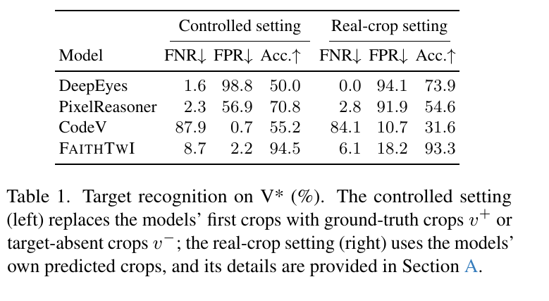

图 Table 1，第 3 页。受控设置用含目标的 GT crop 与不含目标的随机 crop 替换模型第一个返回图；FNR 是目标在却否认，FPR 是目标不在却声称存在。FaithTwI 为 FNR 8.7%、FPR 2.2%、accuracy 94.5%；DeepEyes FPR 98.8%，CodeV FNR 87.9%，两者是不同错误倾向。受控正负平衡，accuracy≈1-(FNR+FPR)/2，代入 8.7/2.2 得 94.55%，与四舍五入 94.5 一致。

右半真实 crop 按覆盖标注框至少 90% / 少于 10% 分正负，中间情况排除。FaithTwI 的真实负 crop 只有 22 个，FPR 18.2% 的分母很小；它不能与受控 FPR 2.2% 混成同一统计。该审计只看第一 crop 后的一次响应，不直接测 crop 对最终答案的因果影响。

### 2.2 合成题：难在细节，而不是靠含糊表述刁难

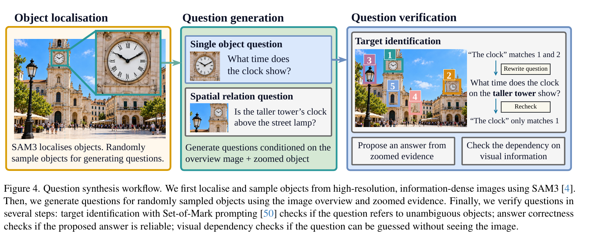

图 Figure 4，第 4 页。先定位小对象，再同时给 overview、对象与周围区域生成问题，最后检查目标唯一性、答案可证和视觉依赖。三步是数据构造流程，不是推理时给 agent 一个 GT 框。

长边至少 1,000 像素的图切成 1024×1024 tiles，相邻重叠 25%；Qwen3.8-27B 列对象类型，SAM3 定位，保留置信≥0.75、框不超过 64×64 且不触边的对象，映射回原图、合并重复，每图最多保留 32 个高置信对象。空间关系题使用约 1920×1080 的局部窗口挑第二对象，两个证据区域都保存。

三种校验分别防不同捷径。Set-of-Mark 让生成器在编号框中选出问题指代的全部对象，非恰好目标则改写并复核；答案验证独立采样候选再检查视觉证据，不能只接受最初草稿；无图也能答对的问题剔除。坐标与绝对位置不直接泄露到问题文本。

13K RL 题来自 CC12M、SA-1B、InfographicVQA、Wikimedia、VisDrone、TinyPerson、Unsplash、DOTA、DocVQA、SKU-110K、xView；单对象/空间关系/不可回答占 67.5%/25.0%/7.5%。不可回答题通过模糊、随机 patch、灰色遮挡目标区域构造，并用模型核验真的无法回答；同种编辑也放到非证据区做仍可回答的对照，减少“看到编辑痕迹就拒答”的捷径。GT crop 也来自编辑图，不能 zoom 找回被删证据。

### 2.3 自适应选择：测证据收益，不测预测框是否准确

设当前策略 π_t。a0=E[1(答案正确)|I,q]，a+=E[1(答案正确)|I,V+,q]，其中 V+ 是预存的 GT crop。两个条件都直接回答、不调用工具，并且不给参考答案。选择 a+-a0≥δ 的题，δ>0。它测已知证据能否帮助当前模型，不与该模型自己选框的能力混在一起。

本文算例：一题训练前无 crop 正确率 0.2、有 crop 0.8，差 0.6；假设教学阈值 δ=0.25，则保留。训练后变为 0.7/0.8，差仅 0.1，退出当前课程；另一题 0.1/0.1 虽然很难，正确证据也帮不上，不能仅因“难”入选。这里 δ=0.25 是教学假设；原文未披露可确认的实际 δ 数值及两个准确率各采样多少次。

选择用当前 π_t，所以它随能力更新。GT crop 只用于筛选，不作为 RL rollout 中额外免费观测；真正训练轨迹只给 I,q，由模型决定是否/如何 zoom。不可回答题不走这一增益过滤。每 batch 还固定放 16 个不可回答、16 个证据区外编辑题；能力分布与答案占比有约束，同能力一种答案不能超过选题的 10%，避免“白色”等频繁答案主导。

这仍不是对“必须依赖 crop 才能答对”的逐 token 因果约束。估计噪声、有限采样和模型能力变化都可能误选；GT 证据收益是训练代理信号。

### 2.4 为什么还需要奖励“能不调用工具就答对”

若策略习惯每题都先调用工具，其工具关闭时的能力可能没有被充分发挥，a0 就不可靠。原文增加 adaptiveness reward，但只奖励已能可靠直答的组；并不全局惩罚每次工具调用。

同题 G=12 条轨迹，racc_i∈{0,1}，u_i=1[调用过工具]。总体准确率 aG=(1/G)Σracc；直答正确占比 dG=(1/G)Σracc(1-u)。注意 dG 的分母是全部 G，不是仅直答的数量。

若 aG≥α=0.5 且 dG≥ρ=0.25，则 radapt_i=racc_i(1-u_i)，否则为 0。也就是至少 6 条正确、至少 3 条不用工具且正确时，才对这些直答成功轨迹加分。不可回答题即使直答拒绝正确，也不加这一奖励。

本文例：12 条中 7 条正确，其中 3 条直答正确，aG=7/12、dG=3/12，门打开；若 3 条直答全部正确、但总共仅 3 条正确，dG=0.25 而 aG=0.25，门仍关闭。若把 dG 写成“直答中的准确率=100%”，会错误地奖励很不可靠的组。

总奖 r=0.9racc+0.2radapt+wfmt·rfmt。原文给 wacc=0.9、wadapt=0.2，格式权重 wfmt 的可核验数值未找到，不能自动补成 0.1。随后 GRPO 在同题组内标准化，优势只施加到 policy 生成 token；工具图像和输出文本只是上下文。

### 2.5 SFT 冷启动与 RL 配方

1K SFT 对话覆盖直答、正确 zoom 后回答、首次错 zoom 后恢复、多区域搜索后判断不可回答。初始模型每题全图答四次，答对 3–4 次用于直答，至多一次用于 zoom 类。judge 对真实返回 crop 写说明并检查，失败改写一次再不合格就丢弃。

SFT 的 mask 很关键：监督有效 assistant 输出；prompt、工具输出以及 recovery 中请求错误 crop 的那一轮不算 loss。错误调用和错误 crop 仍留在上下文，让模型学会识别/恢复，却不奖励它模仿错误动作。

SFT 1 epoch、32 步、batch 32、LR 1e-5、warmup 6，冻结 vision encoder 与 projector；RL 40 步、每步 384 题×12=4,608 条名义轨迹，两个 192 题 mini-batch、LR 1e-6、clip 下界/上界 0.20/0.28、token-mean、无 KL 和 entropy reward，RL 时视觉与 projector 也更新。最多 8 交互轮，prompt/response 限额 24,576/20,480；越轮轨迹不进入 policy loss。

训练全图最多 10,240 visual tokens、每 crop 256–1,280；评测说明 crop 最多 2,048，SGLang greedy。训练和评测视觉预算并非字面完全一致。GPU 型号/卡数、墙钟、GPU-hours、合成和候选选择的额外生成成本未披露；40 步不能被宣传成没有数据成本的廉价训练。

```python
# 教学伪代码；N_MC、delta、format_weight 需由实际配置明确
policy = sft_with_recovery_masks(base, cold_start_dialogues)
for step in range(40):
    selected = []
    for item in candidate_stream:
        p0 = estimate_correct(policy, item.image, samples=N_MC)
        p1 = estimate_correct(policy, [item.image, item.gt_crops], samples=N_MC)
        if p1 - p0 >= delta:
            selected.append(item)
    batch = mix_selected_with_unanswerable_and_edit_controls(selected)
    trajectories = policy.rollout(batch.image_question_only, n=12)
    reward = correctness_and_format(trajectories)
    reward += gated_correct_direct_answer_bonus(trajectories, alpha=.5, rho=.25)
    grpo_token_mean_update(trajectories, reward, clip_low=.20, clip_high=.28)
```

### 2.6 实验：大幅提升相对基座，小幅领先强基线

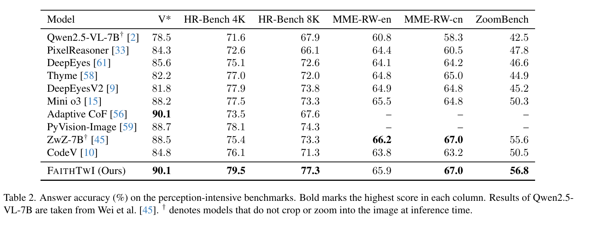

图 Table 2，第 6 页。主 7B 在 V* 为 90.1，基座 78.5；HR-4K 79.5 对 71.6，HR-8K 77.3 对 67.9，即 +11.6/+7.9/+9.4 个百分点是相对基座。相对强 TwI 基线，V* 与 Adaptive CoF 90.1 并列；HR-4K/8K 比最佳对照约 +1.4/+3.0，ZoomBench 56.8 比 ZwZ 55.6 高 1.2。MME-RW EN 65.9 低于 ZwZ 66.2，CN 同为 67.0，不是所有任务都独占最好。

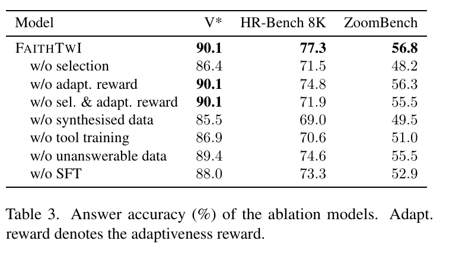

图 Table 3，第 6 页。完整 HR-8K 77.3；去 selection 为 71.5，去 adapt reward 为 74.8，二者都去 71.9；换回非合成数据为 69.0，去 tool training 为 70.6，去 SFT 为 73.3。不同消融改变的数据/工具可用性不同，不能把总差值全算作一个新 loss 的贡献。去 selection 时 tool-use 在 step24 后低于 1%；去 adapt reward 则终点 99.4%，完整为 88.8%，说明调用率既不能追求越高越好，也不能追求越低越好。

受控 crop 识别完整 94.5%，去 adapt reward 92.6%，去二者 91.9%；去 SFT 则 FPR 96.3%、accuracy 51.9%，说明冷启动恢复示例很重要。HaloQuest/VizWiz 为 70.7/57.1，对 CodeV 62.2/54.9；AMBER 87.3 仍低于 PixelReasoner 87.9，不能只挑有利列。

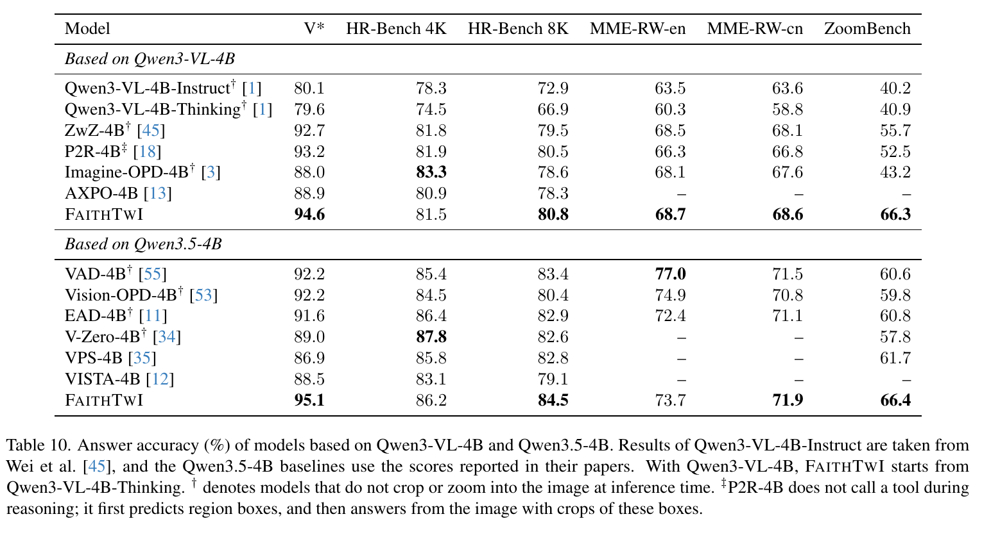

图 Table 10，第 15 页。Qwen3-VL-4B 版本 V*/HR4K/HR8K/Zoom 为 94.6/81.5/80.8/66.3；Qwen3.5-4B 版本为 95.1/86.2/84.5/66.4。它们都在各自骨干上训练；不能把跨骨干差异当成相同模型的方法增益。部分对照不使用工具，推理预算也不同。

复现重点是两次准确率估计都禁止工具、不给答案，候选选择刷新、不可回答例外、mask 与真实 crop 一致。原文报告 48,299 次候选检查、10,901 次通过（22.6%），与每步 384 题的名义训练槽位不是可直接互换的独立题数，具体重复/配额口径需源码澄清。真实 crop FPR 小分母、LLM judge、合成题分布、未披露 selection 参数和成本，是主要限制。基础资料：[SAM3 作者项目](https://github.com/facebookresearch/sam3)、[TRL SFT](https://huggingface.co/docs/trl/sft_trainer)、[GRPO](https://huggingface.co/docs/trl/grpo_trainer)，不占主选题名额。

## 3. EmbodyAgent：同一可执行接口里的黑盒蒸馏与在线 RL

论文：[EmbodyAgent: Post-Training Embodied VLM Agents via Distillation, SFT, and RL](https://arxiv.org/abs/2611.26196v1)，v1 2026-11-19；[PDF](https://arxiv.org/pdf/2611.26196v1)。作者 Wei Dai、Jinkun Liu 等，清华大学与西安电子科技大学。本文是 9B VLM 的完整后训练配方，不是新增一个独立动作解码器。原文及有界题名/作者检索未找到可验证的官方完整代码、数据 manifest 或独立作者博客。

### 3.1 问题与统一策略表示

现成 VLM 可以写代码，却未必遵守机器人交互格式；单纯模仿教师成功轨迹后，学生执行自己有误差的程序，看到的状态会偏离教师数据。训练因此包含黑盒成功轨迹合成、SFT 冷启动、当前策略在线 RL 三阶段，接口始终一致。

每轮生成解释 e_t 和 Python 程序 c_t，执行反馈 f_t 包含 stdout、异常、返回值和按需图像；历史 h_{t+1}=h_t 拼接 (e_t,c_t,f_t)。执行器只暴露 env.observation() 与 env.action(a)。前者返回主相机、腕相机及本体感知，后者传入 a∈[-1,1]^7，分别控制平移、旋转、夹爪。仍依赖模拟器已有底层控制器；“没有预定义动作 primitive”不等于从电机电流起学控制。

一个代码 cell 可以用循环执行多个控制步，再主动请求图像，因而“什么时候观察”“一次执行多长”都成为模型可学习的程序行为。三阶段若换工具名、相机返回格式或动作坐标，蒸馏到 RL 就会产生接口分布偏移。

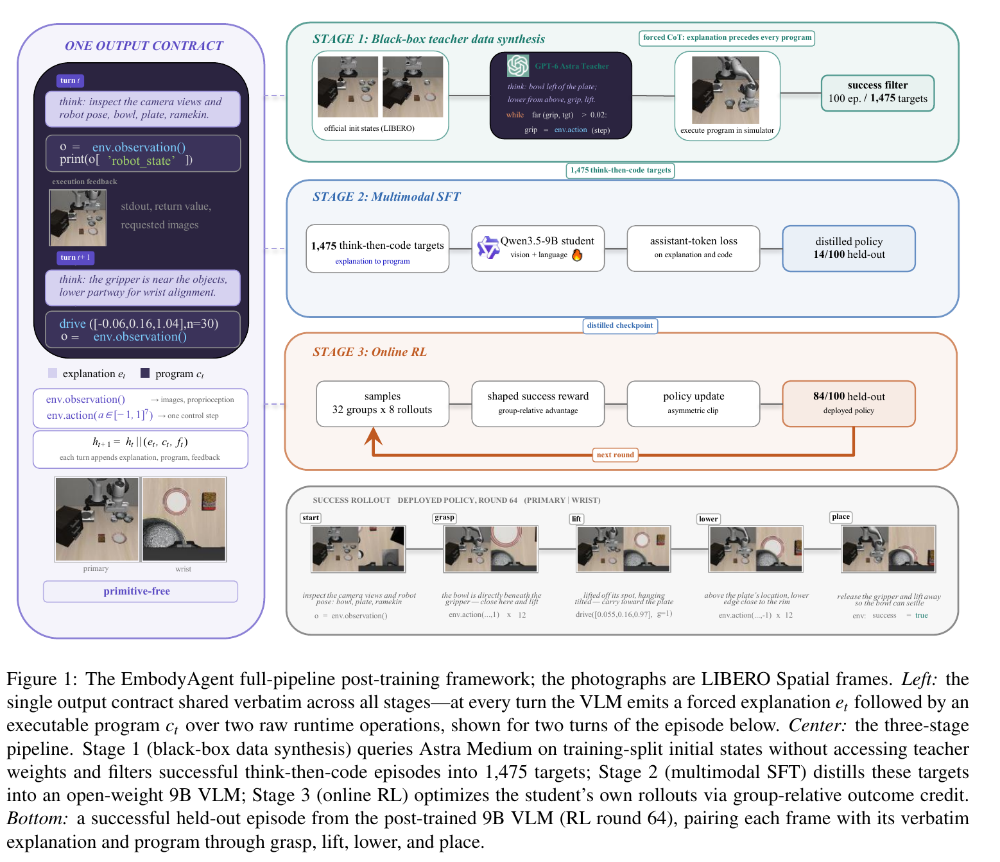

图 Figure 1，第 4 页。左侧是固定 think-then-code 合同，中央依次为教师合成、9B SFT、在线 RL，下方是 held-out 成功示例。箭头表示数据和 checkpoint 传递；教师只在离线合成阶段出现，RL 时不调用教师。

### 3.2 黑盒教师数据：成功筛选与格式筛选都重要

教师为 Astra Medium，只有 API 输出，没有教师权重、logits 或隐藏态。每一轮必须先解释再输出程序，缺解释直接判格式失败并丢弃；整条 episode 只有通过环境 BDDL 成功谓词才保留。不是让文本 judge 猜机器人是否成功。

从训练初始状态合成 100 条成功 episode，十个 LIBERO Spatial 任务各 10 条，拆成 1,475 个 assistant-response 训练目标。每个目标的输入含完整历史，监督目标为该轮解释、代码与输出格式 token。原文记录 1,620 次 synthesis attempts，同时报“有效尝试、按任务平均”的教师接受率 32%；100/1620≈6.17% 是不同分母的总体比例，不能把 32% 写成从 1,620 次直接得到 518 条训练 episode。

SFT 损失 Lsft=-(1/Σi|Y_i|)ΣiΣj∈Y_i logπθ(y_ij|h_i,y_i,<j)。Y_i 只含本轮要生成的 assistant token；历史 prompt、图像、工具输出不算 CE。语言与视觉编码器都可训练，Qwen3.5-9B 做 10 epoch。论文未完整给出可核验的 SFT batch/LR/硬件配方，不能把下述 RL 参数倒填给 SFT。

这是 sequence-level 的黑盒轨迹蒸馏。虽然数据来自强教师，也不能写成 soft-logit OPD；教师成功数据更不能替代学生实际执行时的探索。

### 3.3 在线组相对优化：终局成功 + 运行时错误代价

同一初始状态采样 G=8 条 episode。令 k_i 为产生 runtime error 的代码 cell 数，终局 reward 以成功谓词为主：成功 R_i=1-0.05k_i；一般失败 R_i=-0.05k_i，失败下限 -1；50 个模拟器步内结束的失败给 -0.2。原文公式的早停失败与错误计数边界，复现仍应对照实际执行顺序，不靠文字猜一个优先级。

训练在四个 runtime-error cell 后截断，所以成功奖励至少 0.8 的论述依赖执行保护；不是允许成功后任意出错仍永远比失败高。本文例：成功 k=2 为 0.90，干净失败为 0，失败 k=3 为 -0.15，极早失败为 -0.2。它避免只根据 0/1 结果把错误重试循环当完全免费的探索。

组优势 A_i=(R_i-mean R)/(sample_std R+ε)。但训练先按二元“成功/失败”筛组：八条全成功或全失败的组丢弃，即使全失败的错误数量不同、shaped reward 仍有方差，也不据此更新。每轮收集 32 个有成功对比的组，最多尝试 160 组。因此策略训练集会随成功概率变化，属于隐式课程，而不是固定随机样本的无偏平均。

本文解释：同一失败 episode R=0，在有许多成功的组里会有负优势；在错误很多的组里也可能相对更好。过滤二元同结果组限制了这种仅在失败之间互比的行为。不能仅用 reward std>0 代替原文的成功对比筛选。

优势广播到本 episode 新生成的所有解释/程序 token，过去历史和工具反馈 mask 掉。重要性比 ρ_ij=πθ(y_ij|h_ij)/πold(y_ij|h_ij)，损失为 -E[min(ρA,clip(ρ,1-εlo,1+εhi)A)]，εlo=0.2、εhi=0.28；即允许概率增加的上界略宽于下降下界。没有 learned critic，没有 KL penalty，也没有教师在线监督。

### 3.4 为什么执行错误会被 RL 自强化

错误 traceback 留在历史中。后续模型以它为上下文继续编程，如果某次“多次错误后碰巧成功”仍有正优势，先前出错程序也得到终局正信用，逐渐形成 traceback→重试→更多 traceback 的模式。只看总成功率可能延迟发现这一问题。

原文训练侧保护从 round1 就全部开启：不能 parse/compile 的 cell 最多重采样两次、尚未推进模拟器；真正 runtime error 保留作为反馈；四次错误截断；失败轨迹上下文累计超过一百万 token 时拒收重采样，每组最多替换三次，按最终组重算优势。无关基础设施故障另外最多重采样三次，并不作为策略失败奖励。

这些操作改变有效采样分布和组组成，不能省略后仍宣称同一配方。评测全部关闭重采样、错误截断与异常轨迹替换；采用 greedy，完整预算为 2,000 模拟器步、150 模型调用、单代码块 600 秒超时，或模型自愿结束。

```python
# 教学伪代码，环境与数据依赖未随本报告提供
student = sft(train_teacher_success_targets, train_vision=True, epochs=10)
for round_id in range(64):
    groups = []
    for state in sample_train_and_validation_states(max_groups=160):
        episodes = rollout(student, state, n=8, temperature=1,
                           training_only_safeguards=True)
        if all_same_binary_outcome(episodes):
            continue
        groups.append(episodes)
        if len(groups) == 32:
            break
    shaped_rewards = outcome_minus_runtime_errors(groups)
    A = normalize_within_each_group(shaped_rewards)
    dapo_style_update(A, generated_tokens_only=True, clip=(.2, .28))
    evaluate_greedily(test_states, safeguards=False)
```

### 3.5 实验范围、效率与未被隔离的因果贡献

每任务初始状态为 train30、validation10、test10。合成仅用 train；RL 用 train+validation，所以这里 validation 也是训练采样池，不能当独立验证证据。100 个 test 状态不进入合成或梯度训练，但每轮评测；论文没有另给完全不反复查看的最终测试集。

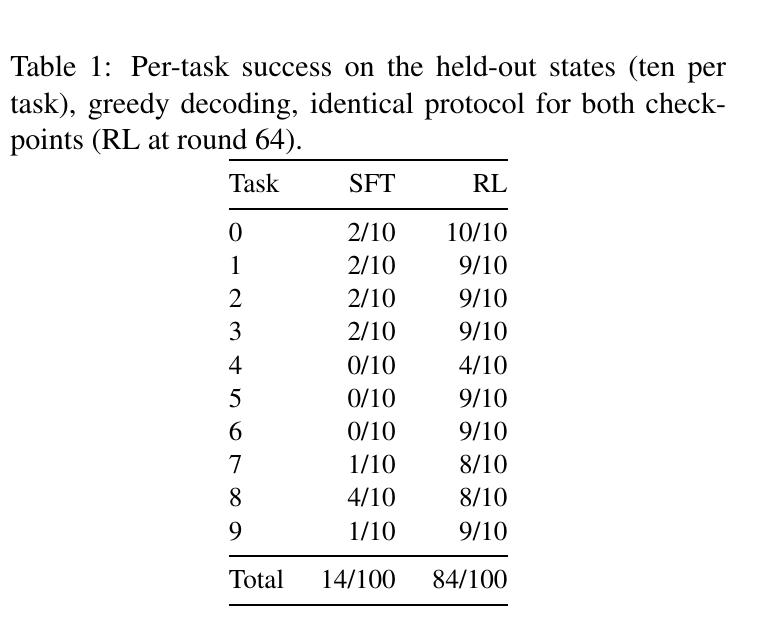

图 Table 1，第 6 页，每任务分母只有 10。基座 0/100 是全部格式失败，不是证明其视觉理解能力为零；SFT 14/100，RL round64 84/100。九个任务达到 8–10/10，最难任务4只有4/10。这里是同十类任务的新初始状态泛化，不是新任务、真实机器人或跨物体分布泛化。

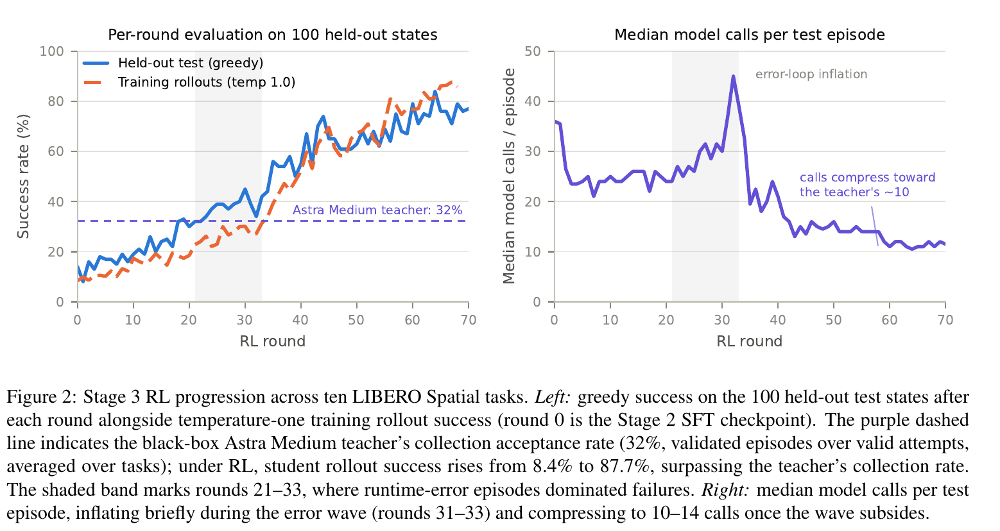

图 Figure 2，第 7 页。横轴 RL round，左边蓝线为 greedy test 成功率、橙线为温度1训练 rollout 成功率；不能当相同采样协议。阴影为错误主导区间；右图是模型调用中位数。21轮后错误 episode 激增，24–32轮达到每100例63–69个；后期降至14个，总成功达到84。保护机制一直存在，恢复与训练共同发生；没有“在33轮新加保护”的受控消融，不能归因于一次不存在的配方切换。

RL 训练 rollout 成功从 8.4% 到 87.7%；测试中位模型调用从 SFT 36 降到 11。与此同时成功 episode 墙钟中位数含模拟器为 SFT117秒、RL136秒，后者反而约慢16.2%。少调用不等于完整任务更快，成功案例组成和每段程序控制长度也变了。教师的 1,887秒/episode 是原文的离线 API 时间口径，不宜当作与本地模拟执行严格等条件的加速比。

RL 64轮，16个 PPU 加速器、ZeRO-3、全参数含视觉、AdamW LR2e-6、无 KL；vLLM 负责采样，flash-linear-attention 加速 gated-delta-rule。PPU 型号与总墙钟未披露，不能写成16张H100。每轮32×8=256条有信息的 episode 是上限目标，64轮名义16,384条保留槽位；还要付丢弃组、重采样、逐轮评测和教师合成成本。实际训练/合成总加速器时与 API 金额未给。

本篇主要是阶段递进，没有完整的等算力“去 penalty/去 safeguard/冻结视觉/只 RL”矩阵；无法从0→14→84分离所有组件贡献。100例、单套任务和未报告多训练 seed，也限制统计外推。复现应先锁初始状态 manifest、输出 parser、终止原因和实际动作步数，再监控 parse/runtime/预算耗尽各类比例；仅记录总 reward 容易漏掉自强化错误。基础阅读：[LIBERO 官方项目](https://github.com/Lifelong-Robot-Learning/LIBERO)、[PyTorch 知识蒸馏教程](https://docs.pytorch.org/tutorials/beginner/knowledge_distillation_tutorial.html)、[TRL GRPO](https://huggingface.co/docs/trl/grpo_trainer)。

## 4. WorldAuditor：4B 探索者与强模型审阅者的能力分工

论文：[Efficient Multimodal Agents for Auditing 3D Worlds](https://arxiv.org/abs/2611.25543v1)，v1 2026-11-19；[PDF](https://arxiv.org/pdf/2611.25543v1)；[论文给出的仓库](https://github.com/UCSB-NLP-Chang/WorldAuditor)。2026-11-22 GitHub 连接读取 README 返回“This repository is empty”，网页也明确空仓库：只能说有作者项目地址，不能说训练/推理代码已发布。未核验独立作者博客。

### 4.1 为什么把所有能力都蒸馏给 4B 可能不划算

检查一个3D世界中的灯突然变色，需要先走到灯前，再转身离开并回来触发变化，最后识别前后不一致。三种能力分别是 explore、trigger、recognize。微调后的小模型可能会走会试，却仍没认出画面异常。方法不是继续把所有能力硬塞进4B，而是先训练小探索者，再让强模型离线审阅它们记录的证据。

令 E 为目标进入视野，T 为触发所需行为完成，R 为报告正确识别。理论上 P(S)=P(E)P(T|E)P(R|T)，其中触发包含了找到目标这个前提。它提醒我们，导航短板与识别短板相乘。实际评测中的几何可见代理、engine触发和模型judge并非完全同一事件口径，不能把几列汇总比例机械相乘还原主表成功率。

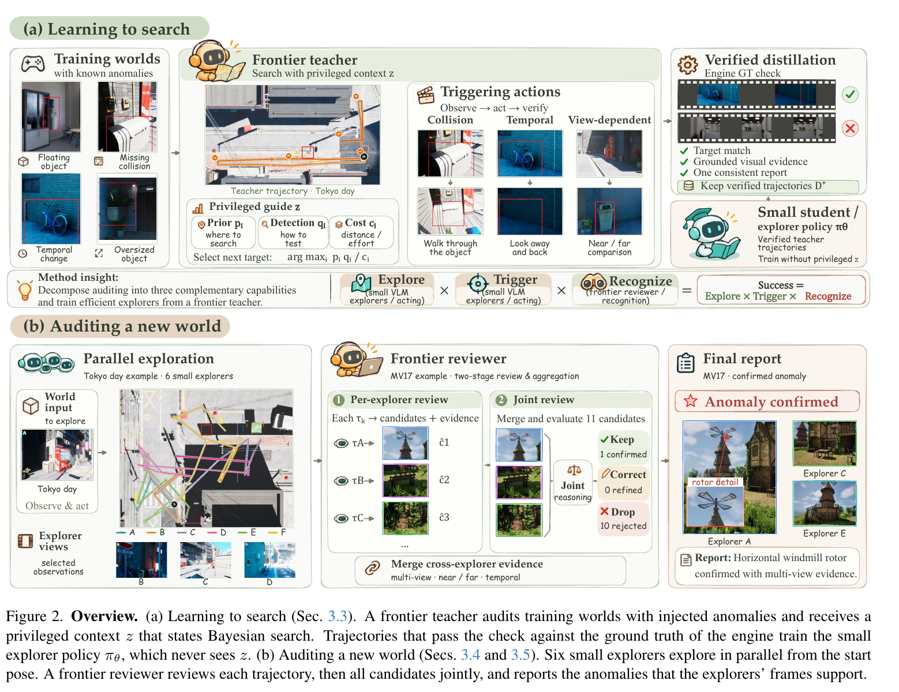

图 Figure 2，第 4 页。上半用已知注入缺陷的世界生成并验证教师轨迹；下半六个相同4B策略独立探索，强模型逐条审阅，再联合确认。强模型在测试不行动，只看记录；特权搜索提示 z 不给学生。

### 4.2 数据不是“教师说成功就算成功”

训练有55个程序生成的 Three.js 世界、七种场景类型；UE5 采用两个商业环境的三个场景（办公室、白天/夜间街区）。注入44类异常，覆盖几何、碰撞、外观、时间与语义。每帧 engine 记录可见目标面积、碰撞或其他触发事件。

教师 Gemini 4 Argon 获得自然语言 Bayesian-search 指导 z，把候选物体视为搜索单元：目标先验 p_i、检测概率 q_i、检查成本 c_i，优先 i*=argmax p_i q_i/c_i。p 与 q 由场景/缺陷卡提示并结合视觉估计，c 用行走距离近似；不是把正确异常坐标直接给教师，也不是实现了精确最优的带旅行成本路径规划求解器。

本文直觉：某物体 p=0.3、测试 q=0.8、成本2，收益比0.12；另一物体 p=0.2、q=0.9、成本1，比值0.18，优先检查后者。对静态单目标、检查无误报的简化情形，若检查 i 未发现，后验 p_i'=p_i(1-q_i)/(1-p_iq_i)，其他 p_j'=p_j/(1-p_iq_i)。这是本文展开的 Bayes 解释；论文实际用自然语言指导教师，不等于公开代码逐步执行这些浮点更新。

验收要求报告与注入异常一一对应，静态异常有足够可见帧、时间异常有前后帧、交互异常有日志触发；无异常世界必须空报告，文本暴露 z 的轨迹丢弃。Three.js 教师轨迹仅31%通过，缺碰撞类仅11%，说明强教师也会声称做过其实没做的检查。程序生成的非注入意外缺陷若被教师发现，会经近景VLM验证并修复，再重新收数据，减少把真实缺陷误当假警报。

### 4.3 训练目标与测试 swarm

2,599条验收轨迹：Three.js 1,798、UE5 801。学生 Qwen3.5-4B 学习 L=-E_{τ∼pT(·|S=1,z)}Σt logπθ(y_t|h_t)，h_t 不含 z。它是 rejection sampling 后的行为克隆/上下文蒸馏，没有 RL policy-gradient，也没有 soft-logit KL。

全模型端到端微调3 epoch、LR2e-5、batch16，最大上下文44,000，最长约5%轨迹不用于训练。收集轨迹总数不等于每条均进入最终SFT。训练硬件、墙钟、GPU-hours和完整合成 API 费用未披露。

测试 K=6 个探索者共享一个训练好的策略，从相同起点独立采样，每个最多40个环境动作；因此总行动额度可达240，不是全系统共享40。各自返回帧、带坐标/碰撞的动作日志与初步报告。SGLang temperature0.7、top-p0.8、top-k20、关闭thinking、640像素宽画面。

若每探索者独立触发概率为 ρ，则至少一个触发为 1-(1-ρ)^K。本文算例 ρ=0.3，K=6 得 1-0.7^6≈88.2%。共享策略、同起点和共同盲点会导致相关性，此式是理想独立模型，不是保证。多样探索主要补覆盖，不能自动修复六个模型共同的视觉识别错误。

强模型先对每条轨迹作中等推理、低媒体分辨率审阅，最多提出三条候选；再用高推理强度联合读候选、动作日志与固定96帧，去重、修正、否决，最多报告三条异常。最终96帧不是“六条轨迹全分辨率完整重放”；逐轨迹审阅成本随 K 增长，最后聚合仍有帧预算。

```python
# 教学伪代码：训练只有SFT，强reviewer仍在测试系统内
accepted = []
for training_world in injected_worlds:
    trajectory = teacher.explore(training_world, privileged_search_guide=True)
    if engine_verifies_bijective_findings(trajectory) and not leaks_guide(trajectory):
        accepted.append(remove_privileged_context(trajectory))
explorer = sft(qwen_4b, accepted, epochs=3, lr=2e-5)
records = parallel_rollout(explorer, copies=6, actions_each=40)
candidates = [frontier_review(record, max_candidates=3) for record in records]
report = joint_review(candidates, records, frame_budget=96, max_findings=3)
```

### 4.4 主实验、成本与分工消融

WorldAuditBench 共213题、13环境，UE5 126、Three.js 87，训练环境不包含这些测试环境。每题有一个隐藏异常，输入给场景描述、异常类型hint和in-context示例；GPT-6 Astra依rubric判报告，只要有一条匹配隐藏异常就成功。它不等同无提示开放世界找全所有问题，也不直接度量报告全集的precision。

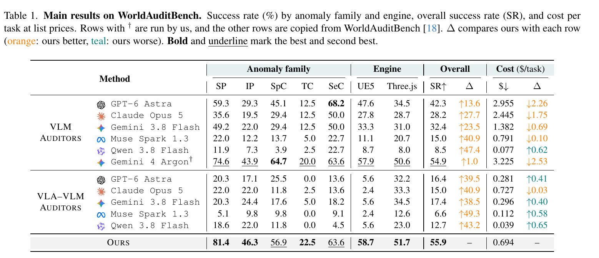

图 Table 1，第 6 页。† 为作者本次运行，其他若干基线复制自 WorldAuditBench，harness并不全相同。完整系统55.9%，旧最强报告基线42.3%，相差13.6个百分点；成本0.694美元/任务对2.955，约四分之一。与相同 reviewer Gemini 4 Argon 独自探索相比为55.9%对54.9%，成本0.694对3.225，约4.6倍成本比；逐engine McNemar p=1.00是没有检出差异，不是预设容忍区间的严格等效性证明。

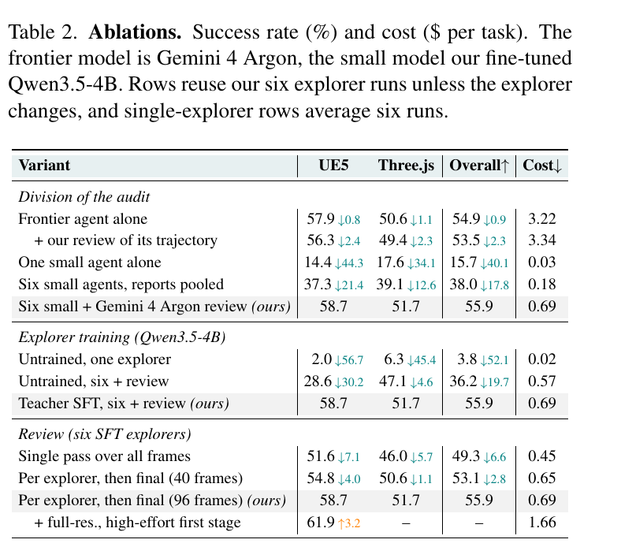

图 Table 2，第 7 页。单个未训练4B成功3.8%，训练后15.7%；六个训练4B只合并自己的报告38.0%，加强模型review达到55.9%。若六个换成未训练4B再review则36.2%。这支持训练提升了探索，以及强识别器仍不可少，不能只靠“多采几条”解释全部结果。

一次性审阅六条全帧为49.3%/0.45美元；分轨迹后最终40帧为53.1%/0.65，最终96帧55.9%/0.69。更昂贵的首轮全分辨率高强度设置只在UE5多3.2点，p=0.42、成本到1.66，不保证加算力有效。单强agent再审自己轨迹反而53.5%低于54.9%（p=0.51），审阅不是万能增益。

训练4B单个的探索/触发比例72.3%/65.7%，识别仅19.0%，强模型识别61.3%；六个合起来探索91.1%、触发88.3%，最后主要瓶颈仍是识别，时间异常仅22.5%被发现。未做额外EQA训练，184题OpenEQA A-EQA子集达到84.4% LLM-Match，强模型84.5%；这是换任务迁移的证据，不是同一异常检测指标。

论文成本是 token 数按当时列价计，不含judge calls、不含训练，也不是本机实付账单。4B未列价，作者用9B的token单价保守估算；本地推理仍消耗GPU。延迟假设每探索者一张H100并行，模型时间UE5/Three.js为5.8/6.0分钟，对强模型13.6/10.7；不能把模型时间自动等同包含模拟器、排队和网络的完整墙钟。多次review均值56.3±0.8%是在固定探索轨迹上重复review，不是多seed重新训练；bootstrap按任务取样也不是训练方差。

复现先固定注入器、验收条件、错误世界修复和z剥离，再分别测探索、触发、识别与最终报告。最关键限制是强API审阅仍在系统内、六份行动预算、模型judge与测试hint、空官方仓库、训练成本未知。基础资料：[PyTorch蒸馏教程](https://docs.pytorch.org/tutorials/beginner/knowledge_distillation_tutorial.html)理解行为克隆和软分布的区别；原文 Sec.3/Appendix C-D 的验收与prompt比一个泛用agent框架更接近本方法实际复现需求。

## 5. Goal-Guided RL：偏好分得清，不代表目标规划有用

论文：[Goal-Guided Reinforcement Learning via Fine-Tuning Vision-Language Models](https://arxiv.org/abs/2611.25742v1)，v1 2026-11-19；[PDF](https://arxiv.org/pdf/2611.25742v1)。作者 Yajie Qi 等，山西大学、天津大学。方法名 KLTDPO，基座 Qwen3-VL-8B-Instruct。原文无可验证的本方法官方源码或 CCGP-2M 下载地址；第三方页面的“code released”标签没有当作开源证据。

### 5.1 两阶段不等于两个模型同时在线 RL

Craftax-Classic 有22类成就、63×63×3局部视觉观测和17个离散动作，深层成就需要先收集材料、造工具再采矿，奖励稀疏。VLM 接收观察 o_t、文字描述 d_t、任务 l，生成带优先级的高层目标集 y_t={(g_k,ρ_k)}。小型 RL agent 读取观察与目标 embedding，决定底层动作。

离线先对 VLM 做 SFT 和偏好训练；在线将这个训练好的 VLM 作为 planner，PPO 更新另一个参数为 φ 的控制策略。原文没有证明 VLM 自身在在线阶段也用环境回报联合更新。Qwen VLM 的 θ 与 PPO agent 的 φ、目标优先级 ρ_k 与 DRO 半径 ρ，是不同对象。

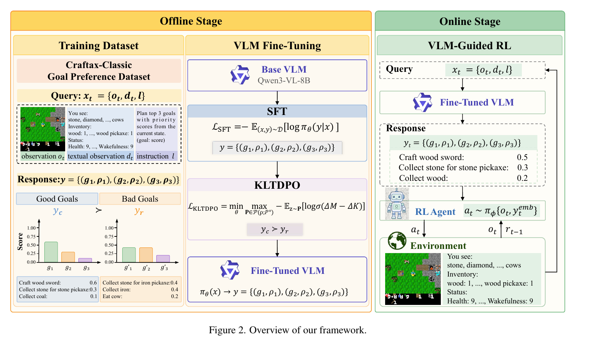

图 Figure 2，第 3 页。左边数据、中间SFT→KLTDPO属于离线阶段；右边训练后的planner生成goal，底层agent与环境交互。图内“Craft wood sword 0.5”等是目标优先级示意，不是经过人工测量的成功概率。

### 5.2 CCGP-2M：从有效目标与时机错误的目标构造偏好

数据来自 SGRL 风格的探索轨迹，planning code 由 DeepSeek-R1、Claude-Opus-4.7 生成。随机初始化60M环境步、27,355轨迹；给定铁镐的partial初始化30M步、360轨迹，总90M步、27,715轨迹、8,936,481观测。partial初始化用于覆盖钻石等深成就状态，是数据采集便利，不应假装最终在线agent全部从有铁镐的状态测试。

先删除无效观察、格式错误、优先级不一致及归一化 observation-goal重复项。质量分 Squality=B_t·min(R_t,Rmax)·Pgoal_t+ε_t，其中B强调目标变化、成就临近、状态变化和生存需求；R为稀有goal乘数，Rmax=4；Pgoal惩罚近期重复目标；ε∼U(0,0.15)只用于打破相同分数的排序。原文把具体信号权重与规则指向未附在可得v1 PDF的Appendix B.2，无法完整恢复。

为避免长轨迹独占样本，对episode i分配 Mi=floor{T[λ/Nep+(1-λ)Ni/ΣjNj]}，T为总采样预算、Nep为episode数、Ni为有效候选数；各episode按质量取top min(Mi,Ni)。λ控制“每个episode均匀照顾”与“按有效候选数照顾”的混合。取整后可能剩余配额，原文没有给完整再分配实现，不能把ΣMi一定等于T作为断言。

本文算例：两episode有效候选10与90，总预算20，假设λ=0.5，配额分别20×(0.25+0.05)=6、20×(0.25+0.45)=14；纯按长度则2/18，纯按episode则10/10。λ=0.5是教学设定，不是已披露实验参数。

chosen y_c 是该状态记录的planner响应，rejected y_r 从五类策略混合生成：附近未来目标（过早）、附近过去目标（过时）、混入邻近步骤子目标、改变goal顺序/优先级、同episode另一响应。负例仍保持语言流畅和格式正确，力图让模型学习时机与优先级而非只学JSON有效性。混合权重非负且和为1，但具体数值未披露。

最终2M偏好样本、43种goal覆盖22成就。SFT只用chosen；偏好训练再用完整pair。chosen来自已有planner轨迹，不是每个状态做反事实执行后得到的最优规划标签；有些“过早”目标也可能是合理长期准备，这种标签噪声会影响后面的困难样本加权。

### 5.3 从普通 DPO 的隐式奖励开始推导

对固定参考策略 πref，KL正则的理想目标 maxπ Eπ[r]-βKL(π||πref) 的解为 π*(y|x)∝πref(y|x)exp(r/β)。所以 r=βlog(π*/πref)+βlogZ(x)；chosen/rejected比较时，同prompt的logZ消掉。

定义 ΔM=β{log[πθ(y_c|x)/πref(y_c|x)]-log[πθ(y_r|x)/πref(y_r|x)]}。每条响应概率是token条件概率的乘积，log则是求和。Bradley-Terry偏好概率 P(y_c优于y_r|x)=σ(ΔM)，σ(u)=1/(1+exp(-u))；DPO损失为 -logσ(ΔM)。这解释为什么模型不必先拟合一个独立reward network。

问题是大量容易负例使reward accuracy快速接近1，只说明它们能分开，并不说明输出的goal能推动控制策略发现钻石。原文Fig.4的离线margin曲线与下游Table2并非同一指标，不能只选preference accuracy最高的checkpoint宣称任务最好。

### 5.4 KLTDPO：顺序 KL 修正与困难样本重加权

原文最终偏好logit为 u=ΔM-ΔK，ΔK=βDseqKL(x,y_r;πref||πθ)-βDseqKL(x,y_c;πref||πθ)。常见TDPO的顺序KL沿给定响应前缀累计：DseqKL(x,y)=Σt Σv πref(v|x,y<t)log[πref(v|x,y<t)/πθ(v|x,y<t)]。它比较每个前缀下整个下一token分布，不只是已实现token的一项log概率。

因此两条响应即使句级ΔM相同，路径分布偏移不同时，修正后偏好概率也不同。本文算例：ΔM=0.5，若ΔK=0.2，u=0.3，偏好概率约0.574、loss约0.554；无此修正的普通DPO为σ(0.5)≈0.622、loss≈0.474。ΔK也可能为负，不能当作一个永远正的独立罚项。

这里需要区分：原文推导起点公式14使用KL(πθ||πref)，最终公式16使用两条路径上的前向KL(πref||πθ)之差；不能把二者混成同一常数正则。v1 PDF指向Appendix A.2，但可得10页PDF未包含该附录。上面的顺序KL展开用于说明常见TDPO含义，实际是否使用stop-gradient、长度归一化及数值近似，仍需官方实现核验，不在本文伪代码里悄悄补成某个TDPO变体。

令每条pair损失 ℓ(z;θ)=-logσ(u(z;θ))。KLTDPO的原文目标是 minθ max_{P:KL(P||P0)≤ρ} E_P ℓ，P0为经验偏好分布，ρ为允许偏移的半径。它把训练分布交给一个“最挑剔的加权者”，在不能无限偏离原数据的条件下强调高loss样本。

本文展开其标准有限样本DRO对偶：引入η>0对KL约束作拉格朗日，固定θ时最坏权重 w_i∝P0(i)exp(ℓ_i/η)，目标可写为 min_{η≥0}{ηρ+ηlog E_{P0}exp(ℓ/η)}。推导来自对w_i求导再用Σw=1；不是论文已披露的具体优化器配置。

本文例：两条pair loss为0.2和1.2、η=0.5、P0均匀，归一化后权重约0.119/0.881，困难pair占88.1%。η大时回到近似均匀，η小时偏向最大loss；困难可能来自重要边界，也可能来自错标签。因此DRO不会自动清洗偏好噪声，半径/温度过激会放大错误数据。

### 5.5 在线策略、实验与实际成本

planner输出的goal文本用 paraphrase-MiniLM-L6-v2 编码为 yemb_t，底层策略 a_t∼πφ(·|o_t,yemb_t)。PPO重要性比 η_t=πφ(a_t|o_t,yemb_t)/πφold(a_t|o_t,yemb_t)，最大化 E[min(η_t Â_t,clip(η_t,1-ε,1+ε)Â_t)]。这里η_t是策略概率比，和上一节DRO对偶温度η只是同符号，不是共享参数；实际代码应改名避免混淆。

```python
# 教学结构；缺失参数保留为显式待填项，不是可复现实验脚本
pairs = construct_preference_pairs(quality_selected_trajectory_states)
planner = sft(qwen_8b, chosen_responses(pairs))
reference = frozen_copy(planner)
for batch in offline_preference_batches(pairs):
    margin = sequence_log_ratio_margin(planner, reference, batch, beta)
    correction = sequential_kl_difference(planner, reference, batch)
    pair_loss = -log_sigmoid(margin - correction)
    optimize_kl_ball_robust_objective(pair_loss, radius=rho)
freeze(planner)
for rollout in online_environment_steps:
    goals = planner(observation, text_description, instruction)
    actions = control_policy(observation, encode_goal_text(goals))
    ppo_update(control_policy, actions, environment_reward)
```

在线环境每个新成就+1，恢复/失去生命+0.1/-0.1；score不等于reward。原文score=exp[(1/22)Σj log(1+s_j)]-1，s_j是0–100尺度的成就成功率。本文例：两项成功率100和0，几何式score=sqrt(101)-1≈9.05，远低于算术平均50，强调不能只刷容易成就。比较score时不能更换为算术平均。

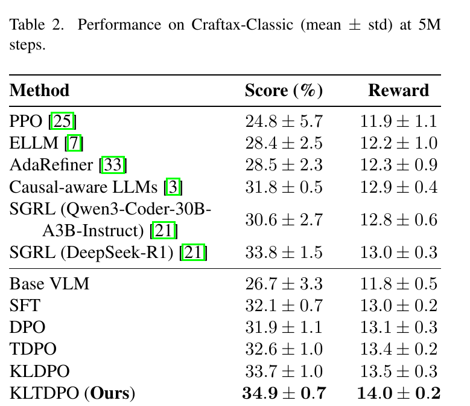

图 Table 2，第 6 页。比较的是底层agent在Craftax-Classic训练到5M环境步的性能。PPO score24.8±5.7，base-VLM指导26.7±3.3，SFT32.1±0.7，DPO31.9±1.1，TDPO32.6±1.0，KLDPO33.7±1.0，KLTDPO34.9±0.7；reward分别以本表为准，完整方法14.0±0.2、KLDPO13.5±0.3。DPO离线分得开，仍未超过SFT的score，印证需要下游验证。

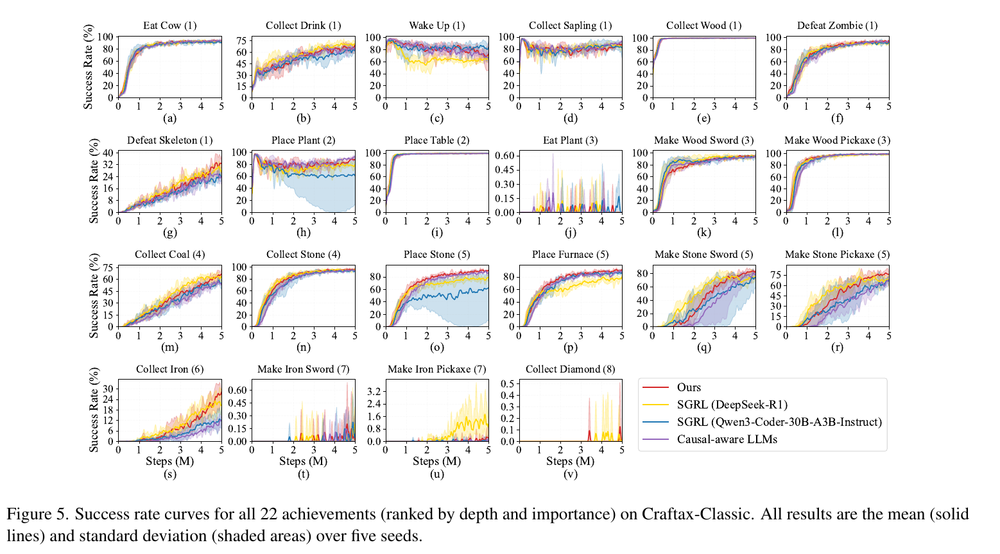

图 Figure 5，第 7 页。横轴环境步（百万），纵轴各成就成功率，不同子图量程不同；实线为五seed均值、阴影为标准差。作者报告首次钻石在3.38M步，对SGRL-DeepSeek-R1的3.71M；首次观察到不等于稳定高成功率。深成就曲线依然很低，不能由“较早首次成功”推导成可靠完成长程任务。15项第一、7项第二仅针对图6所列对照。

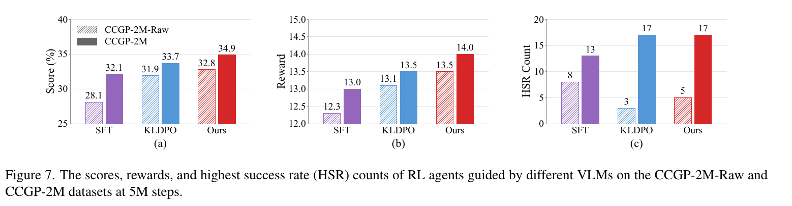

图 Figure 7，第 8 页。紫色为随机选2M的Raw，红色为质量筛选2M。SFT score约30.0→32.1，KLDPO31.9→33.7，KLTDPO32.8→34.9；完整方法reward13.4→14.0。样本数相同而选择方式不同，支持质量筛选有用；不能据此分离B_t各启发项或排除数据分布改变。HSR是对比较组中第一名的成就计数，不是成功episode数。

VLM微调用4×H100 80GB；但SFT/偏好训练步数、LR、β、DRO半径ρ、负例混合权重、完整PPO参数与总墙钟未在可得PDF给全，引用的A/B/C附录未包含在该v1 PDF中。不能从四卡推导GPU-hours，也不能只报在线5M步而忽略离线采集90M步、2M偏好对及强模型规划成本。五seed是在线RL曲线重复，不应自动理解成每个VLM偏好模型也独立重训五次。

复现先获得完整数据/附录，核对partial初始化用途、重复清理、chosen标签噪声和DRO权重尾部；然后等在线预算比较DPO/TDPO/KLDPO/组合，并分开记录planner开销与底层控制reward。仅一套Craftax环境、人工规则负例、缺少完整官方发布、深成就仍稀疏，是实际边界。基础阅读：[TRL DPO](https://huggingface.co/docs/trl/dpo_trainer)、[Craftax 官方仓库](https://github.com/MichaelTMatthews/Craftax)。这些是工具/背景来源，不是本篇KLTDPO作者实现。

## 6. 把五篇放回自己的小 VLM 实验

以下是本文建议，不是跨论文共同实测结论。五篇都说明“最终分数好”需要拆成可诊断的行为；但训练方案不应该直接叠加，先找到当前最主要的失败来源。

| 现象 | 优先借鉴 | 最小验证 | 不要用来替代验证的数字 |
| --- | --- | --- | --- |
| 答案掺假，负RL更新又丢正确内容 | SARGO | 正/负/中性路由、coverage与hallucination并看 | 单看CHAIR下降 |
| 工具调用很多，crop内容却没被读对 | FaithTwI | 首crop受控替换、动态证据增益选题 | 单看调用率或最终答对 |
| 代码agent越训越陷入报错循环 | EmbodyAgent | 固定接口、执行错误分类和训练/测试保护分离 | 单看总reward或调用次数 |
| 4B会探索却认不出异常 | WorldAuditor | 分开测探索/触发/识别，再决定分工 | 把强reviewer能力算成4B独立能力 |
| 偏好accuracy近1，任务收益很小 | Goal-Guided | 固定在线预算测planner下游作用 | 单看margin和离线pair准确率 |

小白阅读顺序：先用 [SFT 文档](https://huggingface.co/docs/trl/sft_trainer)学会assistant loss mask；用 [蒸馏教程](https://docs.pytorch.org/tutorials/beginner/knowledge_distillation_tutorial.html)区分教师答案与软分布；再读 [GRPO](https://huggingface.co/docs/trl/grpo_trainer)和 [DPO](https://huggingface.co/docs/trl/dpo_trainer)理解组相对优势与偏好logit；最后用本报告的手算例核对正负号、分母、clip与mask。作者代码缺失的项目，应先做低成本机制诊断，再决定是否投入完整训练预算。

## 7. 核验与归档

今天核验五份固定v1 PDF，共94个物理页（17+37+11+19+10），重点阅读方法、训练、实验和相关附录；引用18幅原图表。PDF由本Markdown全文生成，包含全部正文、公式、伪代码、表格和图片。检索与排除项、实际环境见manifest.json；图源见assets/SOURCES.md；全文、字体和逐页检查见assets/QA.md。本文未训练模型，所有教学算例、推导和复现建议均与原文实测分开。
