# VLM 后训练精读 · 2026-11-23

本期主题：多语言视觉证据偏好、主动视频观察、结构化回答奖励、导航联合 RL，以及反幻觉训练收益审计。筛选窗口为北京时间 2026-10-23 至 2026-11-23，以 arXiv 首次公开日期核验；5 篇均与全仓库历史来源交叉去重。论文 v1 是本文固定依据，作者代码与模型卡按 2026-11-23 访问状态说明。博客和基础教程不占论文名额。

本期重点是 7B/9B 级模型和后训练机制；ZeroVLN 作为一次慢快策略联合训练的延伸比较，其主 VLM 是总参数 35B、激活约 3B 的 MoE，不能算成总参数 3B 的小模型。最后一篇有自训 DPO 实验，也有对现成模型的审计，适合用来检查前几篇所报告收益的含义。

| 论文与首次公开日期 | 训练对象 | 核心技术问题 | 优先阅读内容 |
| --- | --- | --- | --- |
| VEPO · 11-13 | LLaVA-1.5-7B LoRA | 同一答案在有证据/缺证据图片下应该有不同置信度 | 跨输入偏好损失、遮挡消融 |
| Reviso · 11-02 | Qwen3.5-9B，SFT 后 GRPO | 视频该看哪里、什么时候值得再看一次 | 初始观察计划、质量门控的调用惩罚 |
| SurgQ-VLM · 11-01 | Qwen2.5-VL-7B，压缩器与 LoRA | 不同答案结构不能共用粗糙的对错奖励 | 671 token 压缩、分类型奖励与采样 |
| ZeroVLN · 11-19 | 35B-A3B VLM 与动作专家 | 如何让语言决策和连续动作共同进步 | RLOO、Flow-SDE、分离的梯度路径 |
| What Does Anti-Hallucination Training Buy? · 11-19 | 7B/8B 模型，DPO 与事后探针 | 少幻觉究竟来自少说、便宜筛选还是额外能力 | 匹配召回、删除分解、便宜偏好标签 |

证据标记约定：“原文”指论文及其附录直接给出的机制/数值；“本文推导/算例”用于解释，不是复现实测；“建议”是可执行的复现思路。未披露项明确保留，本文没有训练这些模型。16 张图片均为原 PDF 图表裁剪，来源、物理页码、文件哈希见 assets/SOURCES.md，未重画实验结果。

## 0. 小白先读：今天会反复用到的三个概念

SFT 像照着标准解答练习。给定图像或视频 $`x`$ 与回答 $`y`$，模型逐 token 最大化标准回答的概率。若回答有 $`T`$ 个 token，负对数似然为：

```math
\mathcal{L}_{\mathrm{SFT}}=-\frac{1}{T}\sum_{t=1}^{T}\log\pi_\theta(y_t\mid x,y_{\lt t}).
```

其中 $`\theta`$ 是可训练参数，$`\pi`$ 是输出分布；工具返回的观测通常只作为上下文，不能误当作要模仿生成的回答。

偏好训练像比较两份作业。常见 DPO 在同一输入 x 下区分好回答 $`y_w`$ 和差回答 $`y_l`$，并用冻结参考模型 $`\pi_{\mathrm{ref}}`$ 约束“相对初始模型的改变”。但今天 VEPO 改的是图像，y 完全相同，因此数据管线不能机械套成普通的 chosen/rejected 文本。这里的参考模型是概率比的基准，和给数据打分的 teacher/裁判不是同一个概念。

RL 则让模型先自己尝试，再按尝试结果更新。GRPO 常用同题一组回答的相对奖励：

```math
A_i=\frac{R_i-\mathrm{mean}(R)}{\mathrm{std}(R)+\epsilon}.
```

$`A_i`$ 不是正确答案标签，而是“这次比同组平均好多少”。RLOO 则用其余回答均值作基线，不除以标准差。模型若全答错但奖励有区分，仍可能学习；若所有奖励完全相同，标准组相对更新就没有有用方向。今天会分别看到“不给探索加惩罚”和“直接跳过无方差组”两种处理。

入门顺序建议先看 [Hugging Face 的 RLHF 图解博客](https://huggingface.co/blog/rlhf)，再看 [PEFT 官方 LoRA 概念说明](https://huggingface.co/docs/peft/main/en/conceptual_guides/lora)，最后对照 [TRL 的 DPO 文档](https://huggingface.co/docs/trl/dpo_trainer)和 [GRPO 文档](https://huggingface.co/docs/trl/grpo_trainer)。这些用于补基础，不能替代下面各篇自己的目标函数与训练设置。

## 1. VEPO：让多语言回答真正依赖图像证据

论文：[VEPO: Mitigating Multilingual Hallucinations in LVLMs via Visual Evidence-guided Preference Optimization](https://arxiv.org/abs/2611.18096)，首次公开 2026-11-13，固定阅读 [v1 PDF](https://arxiv.org/pdf/2611.18096v1)。作者 Chengpeng Fu 等。核查 v1 外链及题名/作者检索，未找到可确认的官方训练代码或独立作者博客；不把相邻论文的 GitHub 链接算作本方法代码。

### 1.1 问题：语言会变，图像证据却不应变

原文关注多语言 VLM 的物体幻觉：同一张图，用英语问能定位到相关物体，换成低资源语言却更容易凭语言先验回答。通常的目标语言 SFT 可以让输出更像该语言，却不保证回答更依赖图片。VEPO 选英语作为视觉证据定位的探针，然后在目标语言上训练“有证据时比缺证据时更相信同一个正确答案”。

例如原图确实有一只蓝鸟，问题是“鸟是什么颜色”。把鸟所在区域遮住，标准答案“蓝色”在原图下有支持，在遮挡图下则失去支持。VEPO 不另外编造一个错误颜色作为负答案，而是让答案的概率对这次证据破坏更敏感。遮挡后的答案不是被重新标注为事实正确，只是用于构造反事实输入比较。

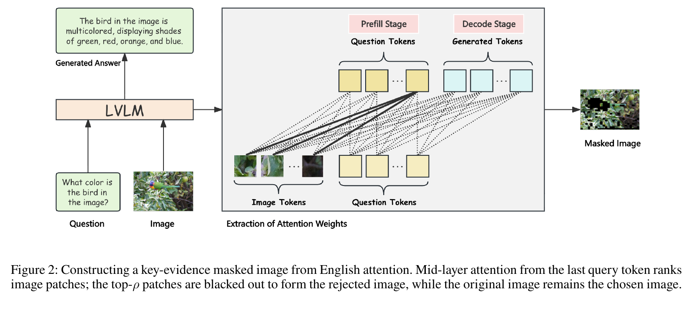

图 1 · 来源：VEPO 原文 Figure 2，PDF 物理第 3 页。左侧原图和英语问题产生注意力，右侧选取视觉 patch 后生成黑色遮挡图。注意被比较的是原图与遮挡图；英语只帮助找区域，最终被优化的问题与答案仍使用目标语言。此图是方法示意，没有实验坐标轴。

### 1.2 先定位证据，再构造跨输入偏好

原文从 LLaVA-1.5-7B 的第 11-14 层取最后一个问题 token 到视觉 patch 的注意力。设视觉 token/patch 总数为 $`m`$，第 $`i`$ 个 patch 的分数为：

```math
s_i=\frac{1}{|\mathcal{L}|}\sum_{l\in\mathcal{L}}A_l(t_{\mathrm{last}},v_i),\qquad\mathcal{L}=\{11,12,13,14\}.
```

$`A_l`$ 是该层从问题末 token 指向图像 token 的注意力，$`v_i`$ 是第 i 个视觉 token。问题末 token 已看到完整问题，作者认为它比平均所有提示 token 更集中；这是论文的设计与定性论证，不是“注意力天然等于因果证据”的保证。

取最高分的 $`\rho m`$ 个 patch，$`\rho=0.2`$，将对应原图区域像素置零，得到 $`I_l`$；完整图片为 $`I_w`$。问题 $`x_{\mathrm{lr}}`$ 和监督答案 y 不变。训练四元组为 $`(I_w,I_l,x_{\mathrm{lr}},y)`$。英语平行问题用于打分，目标语言问题用于损失。若 100 个 patch 中取 20 个，就有 20% patch 被置黑；这一比例指选中的 patch 比例，不能自动解释为恰好去掉 20% 的语义信息。

核心损失写成适合实现的对数形式：

```math
\begin{aligned}
u_w&=\log\frac{\pi_\theta(y\mid I_w,x_{\mathrm{lr}})}{\pi_{\mathrm{ref}}(y\mid I_w,x_{\mathrm{lr}})},\\[4pt]
u_l&=\log\frac{\pi_\theta(y\mid I_l,x_{\mathrm{lr}})}{\pi_{\mathrm{ref}}(y\mid I_l,x_{\mathrm{lr}})},\\[4pt]
z&=\beta(u_w-u_l),\\
\mathcal{L}_{\mathrm{VEPO}}&=-\mathbb{E}\big[\log\sigma(z)\big],\\
\log\pi(y\mid I,x)&=\sum_t\log\pi(y_t\mid I,x,y_{\lt t}).
\end{aligned}
```

$`\pi_\theta`$ 是更新中的模型，$`\pi_{\mathrm{ref}}`$ 是冻结的初始化模型，$`\beta=0.1`$ 控制偏好间隔的尺度。序列概率实际用各回答 token 的 log-prob 求和，避免概率连乘下溢。两路要使用相同的答案 token 与 answer mask，不能把英文定位提示也算进答案损失。

本文推导：对 $`z`$ 的导数是 $`\sigma(z)-1`$，始终非正，因此最小化损失会推动 z 增大，也就是提高完整证据路相对于缺证据路的相对优势。若把 $`r_w=\pi_\theta/\pi_{\mathrm{ref}}`$、$`r_l=\pi_\theta/\pi_{\mathrm{ref}}`$ 分别代入两路，目标比较的是 $`\log(r_w/r_l)`$。这与普通 DPO 的“同图两答案”差别就在条件分布本身不同。

本文手算：若 $`r_w=2`$、$`r_l=0.5`$，则 $`z=0.1\log4\approx0.1386`$，$`\sigma(z)\approx0.5346`$，损失约 0.626，小于无偏好间隔时的 $`\log2\approx0.693`$。但 $`r_w=0.2`$、$`r_l=0.05`$ 也给出同一个间隔。因此损失改善并不能单独证明完整图下正确答案的绝对概率上升；必须同时看任务指标和两路概率变化。

### 1.3 数据、参数和可复现训练流程

原文使用 PALO 已存在的图像、多语言问答及英语平行问题。PALO 总体约 210 万条、10 种语言；这是来源语料规模，论文没有明确给出各实验实际选中多少训练对，不能直接写成“每个实验训练 210 万条”。中文/法文使用对应语言数据；印地语采用印地语与英语偏好对 1:1 混合，防止纯低资源语言优化不稳定。不需要额外采集 rejected 文本，也不需要训练外部奖励模型，但依赖已有的英语对齐数据。

原文超参数：LoRA rank=128、alpha=256，训练 1 epoch，学习率 2e-5，batch size=8，$`\beta=0.1`$，遮挡比例 0.2。$`\pi_{\mathrm{ref}}`$ 保持冻结。GPU 型号、峰值显存、墙钟时间、GPU-hours、准确训练对数没有披露；主要结果是单次运行，不能据此估计方差或显著性。

```text
for (image, english_question, target_question, answer) in selected_PALO:
    scores = last_query_attention(image, english_question, layers=11..14)
    masked = black_out_top_patches(image, scores, ratio=0.2)
    # 以下四个序列 log-prob 都仅累计 answer token
    uw = logp(policy,image,target_question,answer) - logp(ref,image,...)
    ul = logp(policy,masked,target_question,answer) - logp(ref,masked,...)
    loss = -logsigmoid(0.1 * (uw-ul))
    update_LoRA(loss)  # reference 不更新
```

建议实现时保存 patch 到像素的映射、图像 resize/pad 参数、问题模板及所用 token 位置。若图像处理器改变分辨率，直接按原图网格置黑可能遮错区域。mask 生成模型与是否缓存也应固定；在没有官方代码的情况下，不能替作者假定在线重算或离线缓存的细节。

### 1.4 主结果：低资源语言提升大，但 SFT 并非处处增益

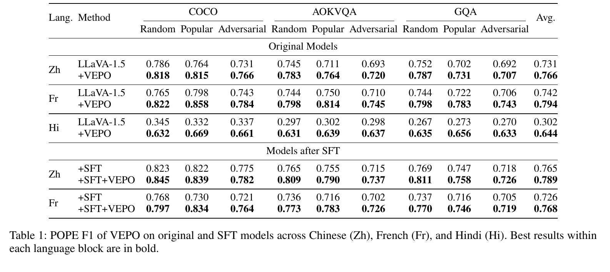

图 2 · 来源：VEPO Table 1，物理第 5 页。列分别是 COCO/A-OKVQA/GQA 的 POPE random/popular/adversarial F1，最右 Avg 为该语言块的平均，数值越高越好。上半为直接在原基座上做 VEPO，下半为目标语言 SFT 后再训练；不同块内加粗不能解释成跨块全局最优。

| POPE 平均 F1 | 原基座 | 直接 VEPO | 绝对变化 |
| --- | --- | --- | --- |
| 中文 | 0.731 | 0.766 | +3.5 个百分点 |
| 法文 | 0.742 | 0.794 | +5.2 个百分点 |
| 印地语 | 0.302 | 0.644 | +34.2 个百分点 |

原文还给出中文 SFT 0.765→SFT+VEPO 0.789、法文 0.726→0.768。法文基座本身 0.742 高于 SFT 的 0.726；SFT+VEPO 的 0.768 也低于直接 VEPO 的 0.794。这支持“该配方能修复 SFT 后的部分幻觉”，却不支持“先 SFT 再 VEPO 永远最好”。

MME perception 的中文/法文/印地语分数分别由 992/1059/544 变为 1061/1149/664；这些是原始分数而非百分比。认知子任务有升有降，不能把视觉感知提升扩写成所有推理能力全面提升。

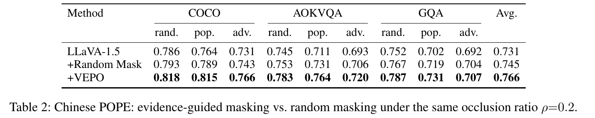

图 3 · 来源：VEPO Table 2，物理第 6 页。相同 20% 遮挡比例下比较中文 POPE。随机遮挡平均 0.745，高于基座 0.731，但仍低于证据引导 0.766；这是比“加了遮挡就变好”更有区分力的控制实验，额外增益为 2.1 个百分点。

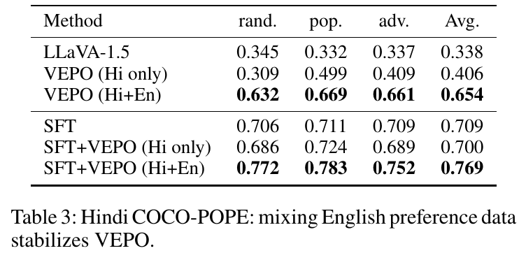

图 4 · 来源：VEPO Table 3，物理第 6 页，仅 Hindi COCO-POPE，不能与图 2 的跨数据源总平均混用。纯 Hindi VEPO 平均 0.406，混入英语后 0.654；SFT 后对应 0.700 与 0.769。随机拆分上纯 Hindi 还从基座 0.345 降到 0.309，说明混合语言是实质训练条件。

### 1.5 局限、迁移思路与阅读入口

方法依赖英语定位确实更可靠，也依赖遮挡能有效移除关键证据；遮掉背景、只遮掉局部而答案仍可从剩余区域判断，都会使负样本变弱。黑块还可能引入分布偏移。POPE 主要测物体存在性，不等同于开放式长描述、空间关系或视频时序的可靠性。注意力热图变集中是相关证据，不能直接证明因果机制。

建议最小复现同时记录原图/遮挡图答案概率、等比例随机 mask、目标语言单独训练与英语混合，以及未训练的开放式任务。为更小的 Qwen/InternVL 迁移时，11-14 层属于原骨干经验值，不应直接硬编码照搬。

辅助阅读：[DPO 原始论文](https://arxiv.org/abs/2305.18290)、[TRL DPO 实现文档](https://huggingface.co/docs/trl/dpo_trainer)、[PEFT LoRA 说明](https://huggingface.co/docs/peft/main/en/conceptual_guides/lora)。作者独立博客与可验证的完整代码本次未找到；这些通用材料也没有替 VEPO 处理跨图像成对输入，接入时需自行检查 loss 数据格式。

## 2. Reviso：先决定缺什么证据，再花预算补看

论文：[Reviso: Not All Visual Evidence Deserves Equal Attention in Video Captioning](https://arxiv.org/abs/2611.03602)，首次公开 2026-11-02；[v1 PDF](https://arxiv.org/pdf/2611.03602v1)、[官方代码](https://github.com/pkucs-Ltf/Reviso)、[作者模型卡](https://huggingface.co/TengfeiLiuCoder/Reviso)。模型卡给出全量 FP32 权重约 37.64 GB、9 个分片；文件体积不是训练显存或推理最低显存。

### 2.1 主动观察不是多抽几帧，而是按疑问选工具

原文将视频描述写成一个循环：先低帧率全局预览，再组织 Context-Focus-Points（CFP）计划，主动回看时间段、放大图像区域或 OCR，最后汇总证据。Context 是场景与活动，Focus 是在这个场景中值得优先关注的方面，Points 是具体待确认事实及对应工具。

小白例子：先看到篮球运动员做庆祝动作，不能立刻断言比赛结束。Context 为篮球比赛，Focus 为进球结果与剩余时间，Point 可以是“裁剪计分板做 OCR”“高帧率回看投篮片段”。观察后更新待办事实，再写结果。关键是观测动作有一个需要消除的不确定性，而非每轮机械执行所有工具。

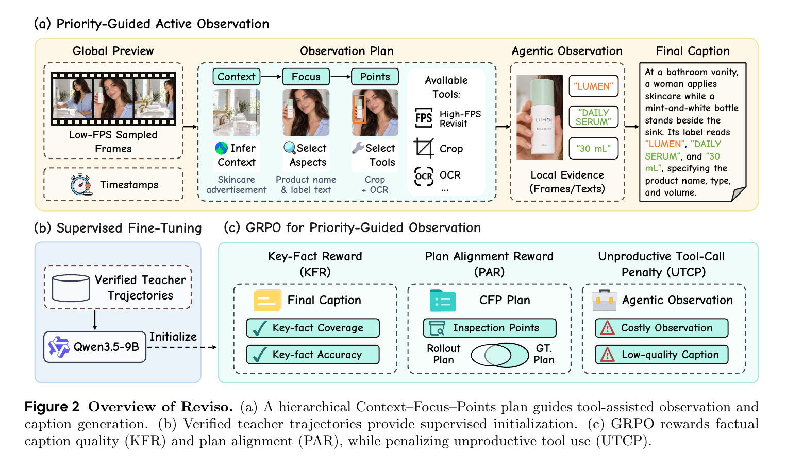

图 5 · 来源：Reviso Figure 2，物理第 4 页。上半为低帧率预览→CFP→局部证据→最终 caption；下半为验证轨迹 SFT 与三项奖励 GRPO。青色计划模块回答“看什么”，工具模块回答“怎么得到证据”。本图不是纯视觉编码器结构，也没有证明全部工具开销已经匹配。

### 2.2 三项奖励分别约束事实、计划与浪费

设 $`F_{\mathrm{ref}}`$ 为参考 caption 的去重原子事实集合，$`F_{\mathrm{pred}}`$ 为生成 caption 的去重事实集合。语义匹配采用一对一对应，匹配数量为 $`M`$：

```math
P=\frac{M}{|F_{\mathrm{pred}}|},\qquad Q=\frac{M}{|F_{\mathrm{ref}}|},\qquad F_1=\frac{2PQ}{P+Q}.
```

因此重复表达同一事实不会增加多次命中，且一个预测不能同时抵扣多个参考事实。

两项奖励分别为：

```math
\begin{aligned}
R_{\mathrm{KFR}}&=F_1(F_{\mathrm{pred}},F_{\mathrm{ref}}),\\
R_{\mathrm{PAR}}&=F_1\big(P(p_0),U_v\big).
\end{aligned}
```

KFR 同时关心“说对”和“说全”。其中 $`p_0`$ 是工具执行前的初始计划；$`P(p_0)`$ 为结合 Context 与 Focus 解释后的去重观察目标；$`U_v`$ 是参考中全局预览尚未解决、值得进一步观察的目标。PAR 不是给最终 caption 再打一次分，也不是奖励把所有可能细节都列进计划。多列无关目标会伤 precision。

对同视频采样组 G，定义：

```math
\begin{aligned}
g(\mathcal{G})&=\mathbf{1}\!\left[\max_{i\in\mathcal{G}}R_{\mathrm{KFR},i}\geq\tau_q\right],\\
b_i&=\mathrm{clip}\!\left(\frac{n_{\mathrm{calls},i}}{B_{\mathrm{calls}}},0,1\right),\\
P_{\mathrm{UTCP},i}&=g(\mathcal{G})\big(1-R_{\mathrm{KFR},i}\big)b_i,\\
R_i&=\alpha R_{\mathrm{KFR},i}+\beta R_{\mathrm{PAR},i}-\mu P_{\mathrm{UTCP},i}.
\end{aligned}
```

这里 $`n_{\mathrm{calls},i}`$ 是额外工具调用次数，$`B_{\mathrm{calls}}`$ 为固定调用预算。

$`\tau_q`$ 是质量阈值，$`b_i`$ 仅计共享全局预览后的额外调用，$`\alpha,\beta,\mu`$ 控制奖励权重。论文未提供可完整复现的这些具体值、固定调用预算和组大小，不能从公式猜成全 1。组内只要有一条质量够好，全部轨迹都按各自质量/调用量接受惩罚；若全组都没找到好解，就不惩罚探索开销。

本文算例：门控已经触发，两个轨迹均用半数预算 $`b=0.5`$，KFR 分别 0.8 与 0.2，则 $`P_{\mathrm{UTCP}}`$ 分别 0.1 与 0.4。同样花预算，低质量观测损失更大。若全组不达阈值，两个罚项都为 0。这不是“调用越少总越好”，它允许困难视频先学会找到证据。

本文机制推导：对固定 $`b`$，有 $`\partial P_{\mathrm{UTCP}}/\partial R_{\mathrm{KFR}}=-gb`$，奖励中有效的 KFR 斜率为 $`\alpha+\mu gb`$；一旦组内出现可行轨迹，高成本失败轨迹将受到更强质量压力。但门控依赖同组其他样本，采样组大小/随机种子会改变某条轨迹是否受罚，复现必须同时保存组信息。

GRPO 按组内 $`R`$ 计算相对优势。通用 clipped surrogate 可以写为：

```math
\begin{aligned}
\mathcal{L}_{\mathrm{clip}}&=-\mathbb{E}_{i,t}\!\left[\min\!\left(r_{it}A_i,\mathrm{clip}(r_{it},1-\epsilon,1+\epsilon)A_i\right)\right],\\
r_{it}&=\frac{\pi_\theta(y_{it}\mid x,y_{i,\lt t})}{\pi_{\mathrm{old}}(y_{it}\mid x,y_{i,\lt t})}.
\end{aligned}
```

若另加 KL，则需按训练器实现核对。这里是便于理解的标准形式，原文没有充分给出所有优化器系数，不能把 TRL 默认值当作者配置。

### 2.3 监督轨迹怎样构造，哪些参数更新

原文先把公开视频原有 caption 与 GPT-6 Astra/Gemini 3.1 Pro 生成候选交给人工筛选、合并、修正和补充，形成参考描述。Qwen3.8-27B 按 CFP 生成观察轨迹，Gemini 3.1 Pro 检验事实一致性、参考覆盖率和证据支撑。失败后重试完整轨迹，最多 N 次；N 的明确数值未披露。仍失败则由 teacher 产生新轨迹，接受 verifier 反馈后修订，再仅保留通过的轨迹。

所以这不是无需人工的纯自训练：人工参考构造、强模型生成、强模型验证都在数据成本中。验证器与 teacher 的关联错误也可能漏过。SFT 轨迹包括计划、工具动作、观测与最终描述，但训练 loss 应针对需要模型生成的 assistant token。

原文训练量：1 万条 SFT 轨迹，LoRA 2 epochs；2 万条 RL 样本，在线 GRPO 200 步。数据来自 LLaVA-Video-178K、Vript、Ego4D 与 YouTube，SFT/RL 视频不重合。视觉编码器全程冻结；GRPO 更新其余全部参数，不能称为“RL 阶段仅训练 LoRA”。GPU 型号/卡数、墙钟、显存、GPU-hours、完整 teacher API 成本没有披露。

```text
preview = low_fps(video)
plan = policy.make_CFP(preview)
while budget_remains and plan.has_unresolved_targets():
    action = policy.choose(revisit_segment, crop, OCR)
    observation = backend.execute(action)
    plan = policy.update(plan, observation)
caption = policy.summarize(preview, observations)
# 训练：同视频多条轨迹 -> KFR/PAR/UTCP -> 组内优势 -> GRPO
```

代码核验：仓库有 LoRA SFT、奖励模块、GRPO 接口与推理控制器，面向 veRL 0.9.1；仍需调用者提供观测后端/工具、dataset factory、原子事实提取与匹配器以及实际 GRPO runner。不能把有训练入口等同于无需配置的一键复现。实现还要为工具异常计数、保留最终回答轮，避免预算耗尽后没有 caption。

### 2.4 实验怎么读：128 帧公平，但计算开销未完全匹配

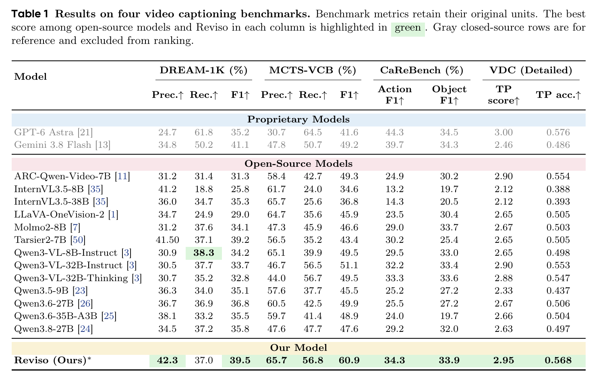

图 6 · 来源：Reviso Table 1，物理第 8 页。DREAM/MCTS 列为百分制 P/R/F1，CaReBench 为动作和物体 F1，VDC 为原始 TP score/accuracy，单位不同。所有模型至多 128 输入帧；基线均匀抽帧，Reviso 分配给预览与回看。绿色是开源模型列最优，灰色闭源参考不参与该排名。

| 指标 | Qwen3.5-9B 基座 | Reviso | 变化 |
| --- | --- | --- | --- |
| DREAM-1K F1 | 35.1 | 39.5 | +4.4 点 |
| MCTS-VCB F1 | 45.5 | 60.9 | +15.4 点 |
| CaReBench Action F1 | 25.2 | 34.3 | +9.1 点 |
| CaReBench Object F1 | 27.2 | 33.9 | +6.7 点 |
| VDC TP score / accuracy | 2.33 / 0.437 | 2.95 / 0.568 | 两项均升 |

VDC 的 GPT-6 Astra 参考为 3.00/0.576，高于 Reviso，因此“最佳开源结果”不能写成无条件超越所有模型。帧数上限相同有助于排除无限加帧，但工具次数、OCR、重编码、生成 token、延迟和外部模型成本并未因此相等。

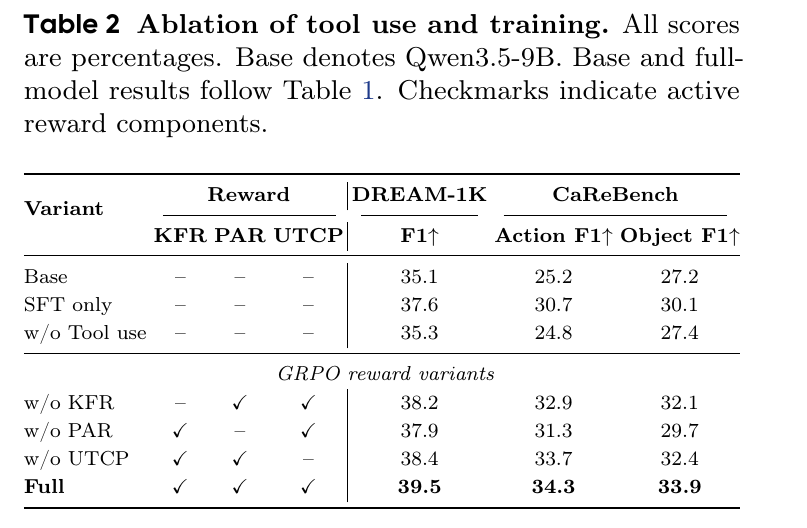

图 7 · 来源：Reviso Table 2，物理第 8 页。行分别去掉工具与某项奖励，列为 DREAM F1、CaReBench Action/Object F1。Full 为 39.5/34.3/33.9；去 PAR 变 37.9/31.3/29.7，物体项降 4.2 点。表中勾选代表启用奖励，不能把不同奖励行看成额外叠加的数据量。

SFT only 为 37.6/30.7/30.1；无工具为 35.3/24.8/27.4；去 KFR 为 38.2/32.9/32.1；去 UTCP 为 38.4/33.7/32.4。完整方法优于这些消融，但拆除奖励同时改变优化目标，不能据单次消融精确推算三者贡献相加。

### 2.5 最值得迁移的点与风险

最容易迁移到小 VLM 的是“先写待确认目标，再为目标选工具”，以及失败组暂不收成本罚款。风险是事实集合和计划标签依赖裁判，参考遗漏真实细节时，KFR 可能把真实但未标注的事实判成假阳性；PAR 还需要知道预览究竟已经解决了什么。OCR 错误、重复工具返回与上下文膨胀也会破坏收益。

建议先做固定 128 帧下的工具重放与事实匹配测试，再跑小规模 GRPO，逐组记录门控触发率、有效事实/调用、总输入输出 token、失败调用和完整墙钟。延伸阅读优先 [作者仓库 README](https://github.com/pkucs-Ltf/Reviso)、[模型卡](https://huggingface.co/TengfeiLiuCoder/Reviso)、[TRL GRPO 文档](https://huggingface.co/docs/trl/grpo_trainer)。本次未核实独立作者博客，二手新闻不作为实现依据。

## 3. SurgQ-VLM：先按问题压视频，再按答案结构给奖励

论文：[SurgQ-VLM: Question-Conditioned Dual-Stream Compression and Answer-Type-Aware Reinforcement for Surgical Video Question Answering](https://arxiv.org/abs/2611.01913)，首次公开 2026-11-01；[v1 PDF](https://arxiv.org/pdf/2611.01913v1)、[官方代码与配置](https://github.com/DhruvMakwana/SurgQ-VLM)。作者 Dhruv Makwana、Ananya Mantravadi。属于专域手术视频 QA 训练研究，下面的指标不构成临床有效性评估。

### 3.1 两个矛盾：时间证据不能压没，奖励不能一刀切

原文同时处理视觉输入与训练信号：30 秒视频问“什么阶段”可以粗看，问“何时切换器械”需要时间分辨率，问“出现几次”需要计数。统一压缩可能把关键变化平均掉；统一 exact-match 又会把“差一个器械”和“完全错误”都算零分。

SurgQ-VLM 用问题条件化的慢/快双流压缩器保留不同时间尺度，再用答案类型感知的连续奖励训练 LoRA。方法的贡献不能全部归于 GRPO：主任务提升相当一部分来自 SFT 和问题条件压缩，RL 需要用 SFT 基线单独比较。

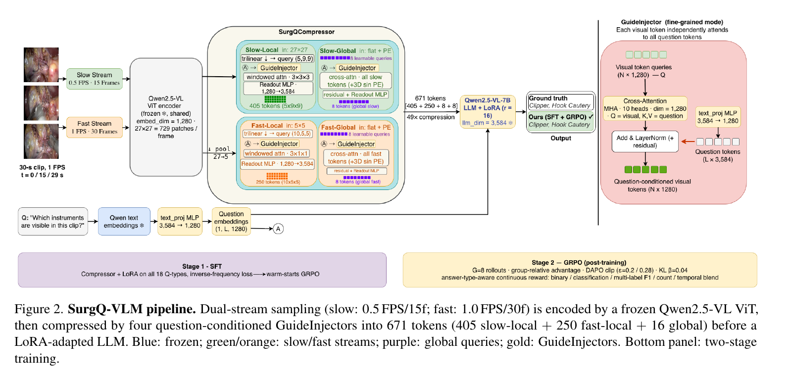

图 8 · 来源：SurgQ-VLM Figure 2，物理第 4 页。慢流/快流进入局部和全局压缩，GuideInjector 注入问题条件，底部两条训练带分别是压缩器+LoRA 的 SFT 与冻结压缩器的 GRPO。原文详细描述为视觉 query 对问题 key/value 做 cross-attention；README 的较宽泛描述不能替代具体张量方向。

### 3.2 671 个视觉 token 是怎样算出来的

慢流以 0.5 FPS 取 15 帧，快流以 1 FPS 取 30 帧；两组有重叠，实际不同帧最多是其中的 30 帧，送入两流的帧实例总数是 45，不能混成“45 个互不重复采样帧”。冻结 Qwen2.5-VL-7B 的视觉编码器，原始每帧 27×27 patch，则原始 token 为 45×27×27=32,805；骨干 post-merge 后为 7,605。

慢流局部输出 5×9×9=405，快流为 10×5×5=250；两流各 8 个全局 query，一共 16，合计 405+250+16=671。故原文的 49 倍压缩是相对 32,805 raw patch，约 11 倍是相对 7,605 post-merge token。二者基准不同，不能写成比正常骨干又少 49 倍。

局部窗口分别为慢流 3×3×3 和快流 3×1×1；全局 query 看全流，并结合三维位置编码。四个 GuideInjector 独立对应慢/快×局部/全局：视觉 query 经过 3584→1280 投影，问题提供 key/value，在 10-head cross-attention 中选择与问题有关的内容，再经 1280→3584→3584 的 GELU MLP 返回。

本文解释：局部压缩保留“附近几帧/相邻位置怎样变化”，全局 query 连接跨片段信息；问题条件可以使“数器械”的 query 与“判断阶段”的 query 关注不同证据。global query 即便零初始化，不同位置条件也可使梯度不同，不能仅凭 query 初值相同断言必然坍缩。

### 3.3 奖励拆开看：任务内容占主导，格式只辅助

原文总奖励：

```math
R=R_1+0.3R_2+0.05R_3-0.3R_{\mathrm{len}}.
```

各分量先在 [0,1] 内评分。R1 依结构选择正确性度量：二元题匹配归一化 yes/no；分类题要求至少一半 gold content words 出现在回答中；多标签题对预测/真实 item 集合计算 micro-F1；计数按相对误差给分；时间句子同时检查内容和时刻。

```math
\begin{aligned}
R_{\mathrm{count}}&=1-\min\!\left(1,\frac{|\hat c-c|}{\max(c,1)}\right),\\[4pt]
R_{\mathrm{temporal}}&=0.2\,\frac{k+\tau}{2}+0.8k\tau.
\end{aligned}
```

其中 $`c`$ 为真实计数，$`\hat c`$ 为预测计数。

k 是连续关键词准确率，τ 是 ±2 秒容忍下的时间准确率。乘积项要求二者同时好，小的加法项保留一侧成功的部分奖励。这里是 $`k\tau`$，不是几何平均 $`\sqrt{k\tau}`$。分类 content-word 阈值也不等于严格语义正确，必须注意关键词投机空间。

本文手算：gold count=4、预测 3，则计数奖励 0.75；若 gold=0，分母用 1 避免除零，预测 1 仍为 0 分。时间题 $`k=1,\tau=0`$ 时仅得 0.1；$`k=\tau=0.8`$ 时为 $`0.16+0.512=0.672`$。只写对器械名而不写对发生时间，很难拿到高分。

R2 检查推理格式：开/闭 think 标记各占三分之一，至少两个“Step N”标记再占三分之一，并惩罚照搬标注字段等捷径。SFT 目标没有推理轨迹，这种格式是在 GRPO 中产生的。R3 仅对六种时间类问题奖励数字秒数/帧引用与时间词，各 0.5；其他问题默认 $`R_3=1`$。对同一非时间题，常数 0.05 会在组中心化时消去，不会凭空提供区分回答的方向。

$`R_{\mathrm{len}}`$ 为线性超长惩罚；应从代码核对具体阈值与归一化，不能仅凭论文一句话补出公式。作者用 5% 数据、$`G=4`$ 做 pilot 后发现模型引用标注 schema 字段刷时序奖励，将 R3 权重由 0.2 降至 0.05，并用 R2 的捷径处罚补充。这段失败经验比只抄最终 reward 更有用。

### 3.4 两阶段训练、Q-type 权重与采样陷阱

阶段一：视觉编码器冻结，压缩器与 LoRA 联合 SFT；LoRA rank=16、alpha=32，覆盖 attention 与 MLP 的 q/k/v/o/gate/up/down 投影。8-bit AdamW，学习率 2e-4，batch=8、累积 8，有效 batch=64，3 epochs。按 Q-type 逆频率加权，降低多数简单题的支配。

阶段二：压缩器冻结，仅 LoRA 更新；参考为 SFT checkpoint，通过切换 LoRA 权重重建。$`G=8`$，DAPO 式非对称 clip 下界 0.2/上界 0.28，KL 系数 0.04；学习率 5e-7，batc$`h=4`$、累积 2，有效 batch=8，训练 1 epoch，rollout 最多 384 新 token。2 倍 oversampling 后，丢弃 reward std<1e-8 的无方差 prompt 组。

本文推导：若把某题所有奖励都乘同一个正的类型权重 $`w`$，再计算组内标准化，则忽略 $`\epsilon`$ 时：

```math
\frac{wR-w\mathrm{mean}(R)}{w\mathrm{std}(R)}=\frac{R-\mathrm{mean}(R)}{\mathrm{std}(R)}=A.
```

因此原文把逆频率权重乘在归一化后的策略梯度 loss 上，才能让稀有题实际获得更多更新权重。不要只把 reward 乘大，然后期待类别平衡自动生效。

```text
group = sample_8_answers(prompt, current_LoRA)
rewards = dispatch_by_answer_structure(group)
if std(rewards) < 1e-8: skip_this_prompt
A = normalize_within_group(rewards)
policy_loss = asymmetric_clip_surrogate(A, low=0.2, high=0.28)
loss = inverse_frequency[qtype] * policy_loss + 0.04 * KL_to_SFT
update_LoRA_only(loss)  # 压缩器、ViT 均冻结
```

这是训练逻辑伪代码，KL 与 token/prompt reduction 的准确位置仍需与作者 train_grpo.py 对齐。建议特别核查过滤以后各类型剩余多少样本：简单题容易全对被丢弃，困难题可能全错也被丢弃，最终有效训练分布不再等于原始分布。

### 3.5 数据构造与主结果：真正的 RL 增益是 2.5 点

原文由 Cholec80 与 CholecT50 的逐帧阶段、器械和三元组标注，用确定性模板生成 80,636 QA、6,701 个 30 秒 clip、18 种 Q-type，每类有 5 种表面问法，不是用语言模型合成答案。两库共有的 45 台手术先做身份规范化，再按手术切分，防止同一手术跨训练/测试。训练 52,100 QA/4,212 clips，验证 6,696/575，封存测试 21,840/1,914。

测试五结构数量分别为 binary 7,120、classification 3,522、multi-label 2,446、counting 542、sentence-temporal 8,210。计数题只有 542，分类不平衡决定了总分和各结构分数必须同时报告。

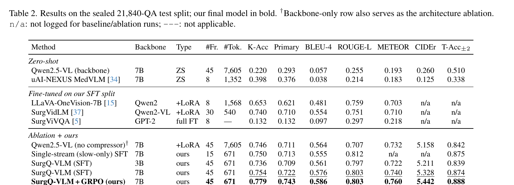

图 9 · 来源：SurgQ-VLM Table 2，物理第 6 页。上部零样本基线，下部同任务适配。重点看同一 7B 的 SFT→GRPO 行：K-Acc 0.754→0.779；ROUGE-L 都为 0.803。不同 zero-shot 模型不是判定 reward 有效性的受控对照，压缩倍率也不是这里每个基线共享的设置。

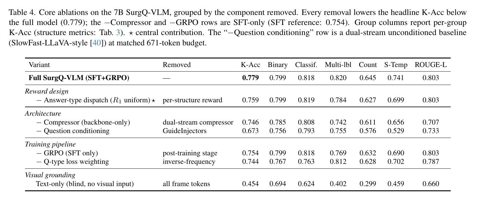

图 10 · 来源：SurgQ-VLM Table 4，物理第 7 页。Full K-Acc 0.779；统一 R1 后为 0.759；去问题条件为 0.673；SFT only 为 0.754。压缩器消融行也仅 SFT，因此必须和 0.754 的对应阶段比较，不能把所有差值都归为 GRPO 消融。

原文受控结论：GRPO 比 SFT 加 2.5 个百分点，其中类型感知 correctness reward 相对统一奖励带来 2.0 点。SFT 下无压缩器 K-Acc=0.746，问题无关的同 671-token 双流为 0.673，text-only 为 0.454。相同 token 预算下问题条件化尤其重要；但“压缩更少算力所以更好”的单一解释不成立。

评测 greedy，SFT 最多 192 新 token，GRPO 384，并非完全相同输出预算。报告的 batch=24、峰值 21.2 GB 是 A100 推理指标，不能写成训练峰值显存。论文没有完整训练 GPU-hours；README 估计单 A100-80GB 的 SFT/GRPO 各约一天，本文相加约 48 GPU-hours 只是按 README 计算的粗量级，不是作者测得的完整账单，未含数据处理与 pilot。

### 3.6 复现入口与限制

仓库有 data_prep、SFT/GRPO 配置、train_sft.py、train_grpo.py 和评测入口；原始手术数据仍需按原数据方要求申请访问，不能把仓库可见等同于数据无门槛。建议先验证共享手术 ID、五类奖励单元样例和 671 token 计数，再用小样本跑 SFT→RL，固定推理长度比较。

局限是数据来自单一类手术与模板标注，关键词和时间规则可能漏掉语义错误，格式奖励也不证明推理内容可信。ROUGE-L 不变与 K-Acc 提升支持指标改善，但不能单独排除长度因素。作者 README 是直接技术说明，本次未找到独立作者博客；基础可读 [TRL GRPO 文档](https://huggingface.co/docs/trl/grpo_trainer)和 [PEFT LoRA 文档](https://huggingface.co/docs/peft/main/en/conceptual_guides/lora)。

## 4. ZeroVLN：不做导航领域的脑部 SFT，怎样联合学决策与动作

论文：[ZeroVLN: Learning to Navigate without Supervised Fine-Tuning of the VLM Brain](https://arxiv.org/abs/2611.26414)，首次公开 2026-11-19；[v1 PDF](https://arxiv.org/pdf/2611.26414v1)、[官方代码](https://github.com/hzx122/ZeroVLN)、[模型发布](https://huggingface.co/hzxllll/ZeroVLN)。封面稿件日期 11-17 不是 arXiv 首次公开日期。本节是慢快 agent 联合训练的机制延伸，成本明显高于单卡 LoRA。

### 4.1 “Zero” 只限定 VLM brain 的导航 SFT

原文用 Qwen3.6-35B-A3B 作慢速 VLM brain，另有冻结 Qwen3.5-4B 的视觉骨干和 12 层 flow-matching 动作专家。4B 是视觉骨干来源，不能把整套系统描述为 4B 主模型；35B-A3B 的激活参数也不等于总存储参数。

brain 不先接受导航领域 SFT，它通过自然语言工具调用表达“走向门口”等语义请求。阶段一冻结 brain，用它真实发出的请求生成对应动作监督，适配 action expert 和语义 query；阶段二用环境反馈对 brain 与 action expert 联合 RL。所以它仍有动作专家的监督训练，RL 时 brain 也会更新，不是整网从头零监督或永久冻结脑部。

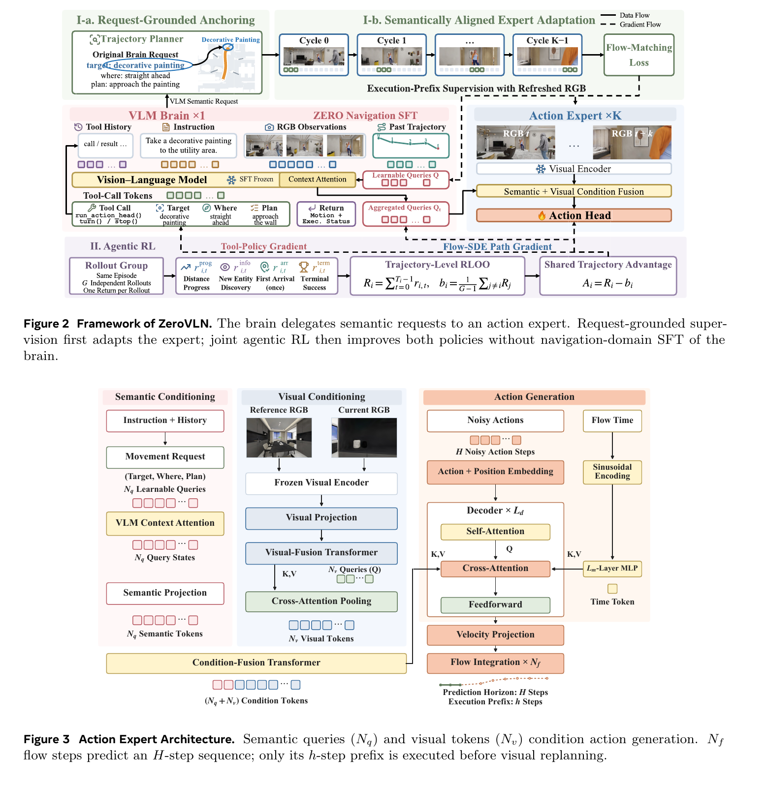

图 11 · 来源：ZeroVLN Figures 2、3，物理第 3 页。上图显示实际请求→训练期特权规划器→动作专家适配→联合 RL；下图显示语义 query、参考/当前图像与 flow-time 如何进入动作解码器。红色/蓝色分支分别对应脑部与动作策略，箭头不是表示可以通过仿真器直接反传所有梯度。

### 4.2 请求对齐监督与“只监督实际执行前缀”

核心数据问题是监督动作必须兑现 brain 实际发出的请求。若沿固定轨迹再补一句指令，标签动作可能与这句话不相容。原文在训练期使用语义 mesh map 和几何信息，把当前状态下的真实请求定位到可达局部目标，规划出执行验证的参考轨迹。推理时不输入这些特权地图。

动作专家每次预测 $`H=16`$ 步，仅执行前 $`h=4`$ 步，再更新相机观测重规划；同一 movement call 内语义意图与参考图像保持固定，当前 RGB 每个 fast cycle 更新。可学习 query Q 经过 brain 上下文成为语义条件 $`Q_t`$，再与图像条件融合。

设参考动作块 $`U^\star`$ 属于 $`H\times d_a`$，噪声 ε 来自标准高斯，u 为 flow time：

```math
\begin{aligned}
U_k(u)&=(1-u)U_k^\star+u\epsilon,\\
v_k^\star&=\epsilon-U_k^\star,\\
e_{kj}&=f_\phi\big(U_k(u),u,C_k\big)_j-(v_k^\star)_j,\\
\mathcal{L}_{\mathrm{FM}}&=\mathbb{E}\!\left[\frac{1}{Kh d_a}\sum_{k=1}^{K}\sum_{j=1}^{h}\|e_{kj}\|_2^2\right].
\end{aligned}
```

这里 $`v_k^\star`$ 是目标速度，$`e_{kj}`$ 是第 $`k`$ 个周期、第 $`j`$ 步的速度误差；将长式拆开写，损失与原文前缀监督目标一致。

$`\phi`$ 是动作专家参数，$`C_k`$ 是第 k 个快速周期的语义+视觉条件，K 为训练片段中的 fast cycles 数，$`d_a`$ 是每步动作维数。本文推导：插值 U(u) 对 u 求导即 $`\epsilon-U^\star`$，因此速度回归目标来自直线噪声路径。模型积分时从噪声向动作反向走，不要把 flow time 与环境导航时间混用。

原文保留 16 步的模型预测，但 loss 只监督实际执行的前 4 步，避免过多优化很快会被新观测丢弃的远期尾部。本文算例：若前 4 步均方误差均为 0.01、后 12 步均为 1，全文平均约 0.7525，前缀平均却为 0.01。两种目标会把优化资源放在不同位置。尾部仍可能通过注意力参与影响前缀，不能说后 12 步“绝对没有任何梯度”。

### 4.3 过程奖励让“都未到终点”也有相对区别

原文奖励为 success + first arrival + distance progress + 0.01×information discovery（前三项权重为 1）。成功由环境原生判据确认；first arrival 只在第一次进入目标区域发放，使用到达历史标记，避免往返刷奖。

设 $`d(s)`$ 为可通行距离，距离尺度与势函数为：

```math
\begin{aligned}
D&=\max\big(d(s_0),1\,\mathrm{m}\big),\\
\Phi(s)&=\frac{D}{D+d(s)},\\
r_{\mathrm{prog}}&=\Phi(s_{\mathrm{after}})-\Phi(s_{\mathrm{before}}).
\end{aligned}
```

最后一行是一次工具调用的进展。发现奖励统计深度验证、与任务相关、此前未见过的实体，初始视野已见实体排除，累计至 $`N_{\mathrm{info}}=5`$ 即封顶。因此发现项整条轨迹最多 0.05。

本文手算：初始 $`d=10`$ 米，$`D=10`$，$`\Phi=0.5`$；走到 $`d=5`$ 时 $`\Phi\approx0.6667`$，进展奖励约 0.1667；退回 10 米则给 -0.1667。连续调用的势差会望远镜求和为最终势减初始势，不会仅因把同一路程拆成更多调用而反复赚同一进展。封顶和去重则限制“到处看东西”刷发现分；任务实体与深度判据仍需依赖环境实现。

### 4.4 同一个轨迹优势，两个独立梯度通道

同任务采样 $`G=8`$ 条完整 rollout，累计回报与 RLOO 优势为：

```math
R_i=\sum_t r_{it},\qquad A_i=R_i-\frac{1}{G-1}\sum_{j\ne i}R_j.
```

组内不除标准差。本文推导：令 $`\bar R`$ 为组均值，则

```math
A_i=\frac{G}{G-1}(R_i-\bar R).
```

所以对 $`G=8`$ 是去均值优势的 $`8/7`$ 倍，但与标准化 GRPO 仍不同。

同一 $`A_i`$ 用于该 rollout 所有交互轮与动作周期，保持长期成功目标一致。例：四条轨迹回报为 3、1、0、0，首条相对其他三条均值的优势为 $`3-\frac13\approx2.667`$；第二条为 $`1-1=0`$；后两条各为 $`-4/3`$。这是教学用 $`G=4`$ 算例，实际训练 $`G=8`$。

brain 的文本 loss 先按回答 token 平均，再按 rollout 内轮次平均、再按 batch 平均：

```math
\begin{aligned}
\bar\ell_{it}&=\frac{1}{|\mathcal{T}_{it}|}\sum_{n\in\mathcal{T}_{it}}\log\pi_\theta(y_{itn}\mid x_{it},y_{it,\lt n}),\\[4pt]
\mathcal{L}_{\mathrm{text}}&=-\frac{\lambda_{\mathrm{text}}}{B}\sum_{i=1}^{B}\frac{1}{T_i}\sum_{t=1}^{T_i}\mathrm{sg}(A_i)\bar\ell_{it}.
\end{aligned}
```

其中 $`B`$ 是 batch 中 rollout 数，$`T_i`$ 是第 $`i`$ 条 rollout 的轮数，$`\mathcal{T}_{it}`$ 是该轮回答 token 的位置集合；$`\lambda_{\mathrm{text}}=0.1`$。$`\mathrm{sg}`$ 表示不对奖励/优势反传。动作通道将 $`A_i`$ 裁剪到 [-1,1]，用 Flow-SDE 采样路径的 log-likelihood 做策略梯度，更新 Q 和 $`\phi`$。

```math
g_\theta=\nabla_\theta\mathcal{L}_{\mathrm{text}},\qquad
g_{Q,\phi}=\nabla_{Q,\phi}\mathcal{L}_{\mathrm{action}}.
```

二者共享轨迹优势，但 action loss 不直接反传修改 brain $`\theta`$。

Flow-SDE 的随机路径让连续动作产生可计算的策略概率，而不只是确定性 ODE 预测。原文用 3 个转换步 u=1→2/3→1/3→0，noise scale=0.08，方差下界 1e-6，防止近确定性分布数值退化。动作优势裁剪限制极端回报尺度，但文本优势仍按原 RLOO 使用；二者不能统一改成一次端到端 loss 就假定等价。

### 4.5 训练数据和成本：零 brain SFT 不等于低算力

共同训练池 34,445 个导航 episode，来自 SAGE-3D、R2R、RxR。专家适配采样比为 1:1:2，RL 为 2:1:1。适配阶段 brain/视觉骨干冻结，训练 Q 和动作专家约 1.8 epochs、10,826 步，global batch=64 anchors，每 anchor 4 fast cycles，学习率 5e-5，4×16 个设备。

RL 200 步，每批 64 个任务×8 rollout=512 条轨迹，学习率 1e-6，8×16=128 个设备，视觉骨干仍冻结。设备数量是原文配置，不能在 GPU 型号和完整墙钟未披露时推算准确 GPU-hours/美元成本，也不能把 200 步理解为单模型只生成 200 条轨迹。

```text
# 适配
freeze(brain, visual_encoder)
request = brain.rollout_and_request()
reference = privileged_train_only_planner(request)
update_queries_and_expert(prefix_flow_matching(reference))
# RL
rollouts = collect_same_task_group(G=8)
advantages = leave_one_out(total_rewards(rollouts))
update_brain(text_logprob * stopgrad(advantages))
update_queries_and_expert(flow_path_logprob * stopgrad(clip(advantages,-1,1)))
```

### 4.6 实验：到达率升高，路径效率仍需看 SPL

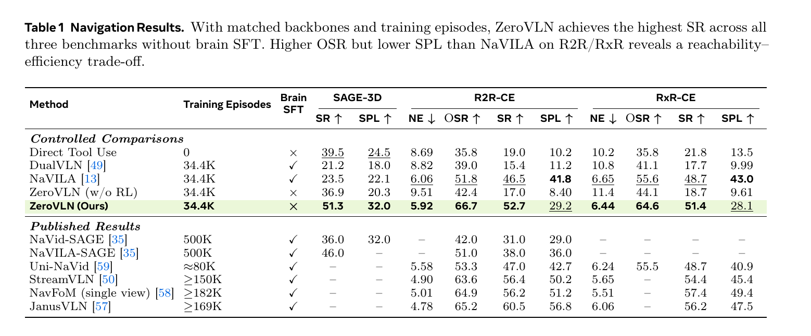

图 12 · 来源：ZeroVLN Table 1，物理第 8 页。优先看上半 Controlled Comparison：相同 backbone 和 34.4K 训练 episode。SR 是成功率，OSR 是路径中是否曾到目标，SPL 综合成功与路径长度；R2R/RxR 的 NE 越低越好。下半 Published Results 使用不同训练规模，不能直接当成数据匹配的因果比较。

| SR，百分制 | SAGE-3D | R2R-CE | RxR-CE |
| --- | --- | --- | --- |
| Direct Tool Use | 39.5 | 19.0 | 21.8 |
| ZeroVLN 未 RL | 36.9 | 17.0 | 18.7 |
| ZeroVLN 完整 | 51.3 | 52.7 | 51.4 |
| 同池 NaVILA | 23.5 | 46.5 | 48.7 |

完整 ZeroVLN 的 SPL 为 32.0/29.2/28.1；NaVILA 为 22.1/41.8/43.0。因此在 R2R/RxR 上成功率更高却 SPL 更低。本文解释：SPL 通常按 $`S\,L^\star/\max(L,L^\star)`$ 平均，其中 $`S`$ 是成功指示、$`L^\star`$ 是最短路径长度、$`L`$ 是实际路径长度；若最短 10 米、成功但实际走 20 米，单样本贡献只有 0.5。SR 的提升不能自动代表路径更省、更快。

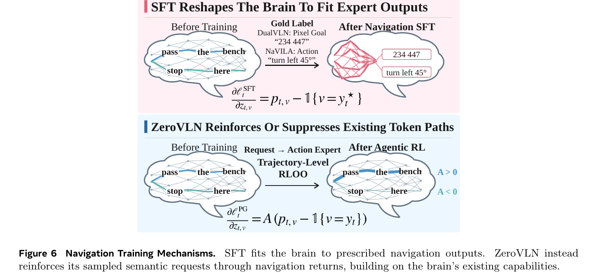

图 13 · 来源：ZeroVLN Figure 6，物理第 9 页。上半示意导航 SFT 塑造固定输出词路，下半示意 RL 强化/抑制已有 token 路径。这是作者的机制解释示意，不能当成量化消融曲线。量化支撑还包括 12 项通用能力均分 59.47→59.16、脑部权重位移约 0.041%；这些指标不意味着每项能力或所有分布都完全保留。

仓库已提供训练/评测接口与模型链接；本文没有执行导航训练。复现应先核对环境版本、训练特权信息不泄漏到评测、动作坐标/归一化、真实 h/H，以及两条梯度路径。长期统一优势仍难分辨哪一轮决策或动作贡献最大；地图质量、仿真到现实差距和高并发 rollout 成本是主要局限。官方 README 是作者技术文档，本次未核实独立作者博客；可配合 [RLOO Trainer 文档](https://huggingface.co/docs/trl/rloo_trainer)理解 leave-one-out，但不能用文本 RLOO 直接替代 Flow-SDE 动作更新。

## 5. 反幻觉训练买到了什么：用匹配召回拆开“少说”和“更会看”

论文：[What Does Anti-Hallucination Training Buy? Saying Less, Cheap Pruning, and the Rest](https://arxiv.org/abs/2611.25814)，首次公开 2026-11-19；[v1 PDF](https://arxiv.org/pdf/2611.25814v1)。作者 Lingkai Bu、Qian Gao。核查 PDF 外链与题名检索，未找到可确认的官方完整分析代码或独立作者博客，因此以下区分论文协议与建议实现，不声称已经跑通复现。

### 5.1 先控制说了多少，再讨论说得是否更准

原文提出一个评测问题：描述得少，幻觉也可能更少。假设基座说出猫、桌子、杯子、自行车，其中后两者不在图里；训练后只说“有猫”。幻觉率降为零，却也丢掉真实的桌子。只报 CHAIR 下降无法证明视觉理解更好。

原文的两个指标为：

```math
\mathrm{CHAIR}_d=100\,\frac{\sum_i H_i}{\sum_i N_i},\qquad
\mathrm{Recall}=100\,\frac{\sum_i C_i}{\sum_i G_i}.
```

其中 $`H_i`$ 是幻觉物体数，$`N_i`$ 是提到的物体数，$`C_i`$ 是正确提到的物体数，$`G_i`$ 是参考物体数。先把基座 caption 按出现顺序截成前 k 个不同物体，形成“只少说”的 CHAIR-Recall 曲线 $`\mathrm{Trunc}(r)`$，再将训练方法与相同物体召回 r 的基座截短结果比较。另一组实验在各模型完整召回的 80% 处比较探针/截短，这是曲线评估设置，不要与下面精确匹配删除数量的 accounting 混成同一个操作。

超越少说的收益为：

```math
G=\mathrm{CHAIR}_{\mathrm{Trunc}}(r)-\mathrm{CHAIR}_{\mathrm{system}}(r).
```

数值越大越好。本文算例：同样 $`\mathrm{Recall}=60\%`$，截短基座 $`\mathrm{CHAIR}=12`$，训练模型=8，则 $`G=4`$ 点；如果只看到未匹配召回的基座 20→模型 8，就会把减少信息量带来的部分收益也记给训练。此处是教学例子，不是论文表中实测。

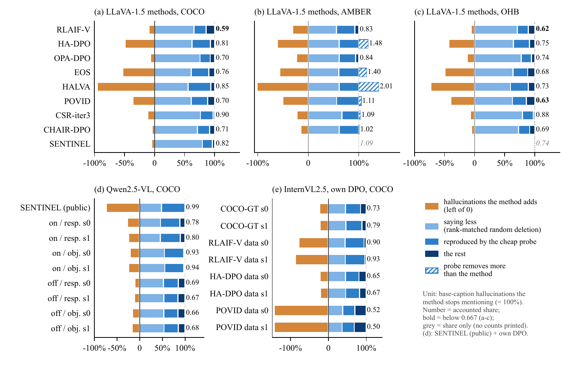

图 14 · 来源：原文 Figure 1，物理第 3 页。横轴为相对基座被移除幻觉物体数的百分比；浅蓝为位置匹配随机删除所覆盖部分，中蓝为便宜探针额外覆盖，深蓝为剩余。左侧橙色表示训练模型新增的幻觉，不能忽略。斜线表示探针覆盖超过训练本身，不是“视觉模型准确率超过 100%”。

### 5.2 弱探针到底用了什么信息

原文在 COCO 500 张标注图像上拟合冻结的 11 特征 logistic regression，标准化输入，正则 C=1 固定。特征分三组：5 个表面特征，包括 token 相对位置、物体出现顺序 bucket、同物体提及次数、caption 中物体数量、附近 hedge 词；3 个先验特征，包括类别幻觉率、共现 log-odds、真实类别频率；3 个模型置信度特征，即物体 token 的首个/最小/平均 log-prob。

模型置信度通过原生成模型对自己的 caption 做 teacher forcing 取得。8 特征纯文本版本可省去这次模型前向；11 特征版本有额外评分成本，不能说“完全零模型计算”。类别先验也来自有标注的拟合集，不是无标签免费知识。

数学上，探针的幻觉概率为：

```math
p_{\mathrm{hall}}=\sigma\!\left(w^\top\mathrm{standardize}(f)+b\right).
```

按较高的幻觉概率优先删除。目标是测试简单可见信号能复现多少收益，刻意没有引入新的视觉识别器。依然要防止数据泄漏：scaler、类别频率和共现统计都只在拟合侧计算，不能看 held-out 标签。

### 5.3 删除分解与净改善不是一回事

原文 accounting 比较基座 caption 中被某个训练方法删除的幻觉物体，并严格匹配不同物体位置 rank 的删除次数。随机 pruner 按同样 rank 配额随机删，probe pruner 按风险删。设它们各移除的基座幻觉数为 $`R_{\mathrm{rand}}`$、$`R_{\mathrm{probe}}`$、$`R_{\mathrm{method}}`$，则：

```math
\mathrm{share}=\frac{R_{\mathrm{probe}}-R_{\mathrm{rand}}}{R_{\mathrm{method}}-R_{\mathrm{rand}}}.
```

本文算例：随机删掉 100 个基座幻觉，训练方法删 160，探针删 145，则 $`\mathrm{share}=\frac{145-100}{160-100}=0.75`$。该比例回答“超越位置/少说效应的移除中，探针能覆盖多少”，并非新模型幻觉率减少了 75%。如果训练又新增 50 个幻觉，超出随机删除的净改善只有 10，而移除增益是 60。分母为零或非正时也不能机械输出一个比例。

同一模型可能会新写出更具体的事实，同时新添幻觉；删减 accounting 不追踪所有语义能力。论文还区分：解释现成训练法时，冻结的是基座探针；构造强事后剪枝基线时，可在每个系统自己的输出上拟合探针。不能把后者更强的探针收益当成前者“无需看训练模型”的证据。

匹配 rank 删除配额与 Trunc 的每图固定 k 也不同。基于全局阈值的探针能给不同图像分配不同删除量，比较曲线时存在额外灵活性；这是需要报告的协议条件，不是自动的训练因果分解。

### 5.4 数据分割、实验协议与反例

COCO 用 500 张 fit-only 图像，held-out 为另外 500+1000=1500；AMBER 为 1004 张非 COCO 图像，2-fold cross-fitting，每次 502 张拟合；Object HalBench 300 张去掉 5 个重叠后为 295。所有模型使用相同详细描述提示、greedy decoding；作者修正 CHAIR 同义词解析中的 orange 作颜色、bear 作动词等歧义。评测器本身并非没有错误。

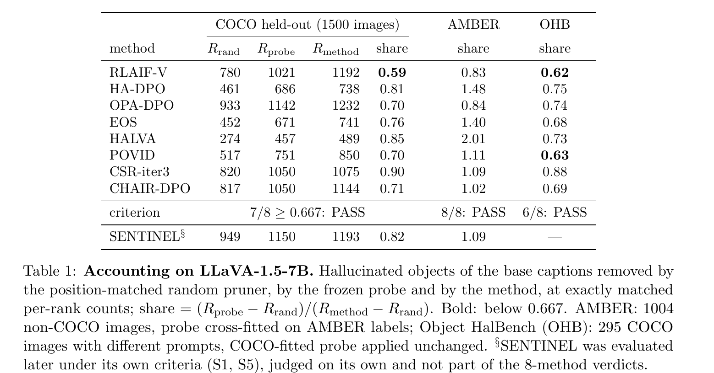

图 15 · 来源：原文 Table 1，物理第 7 页。$`R_{\mathrm{rand}}`$/$`R_{\mathrm{probe}}`$/$`R_{\mathrm{method}}`$ 都是删掉的基座幻觉物体数；share 才是扣掉随机删除后的比例。LLaVA-1.5-7B 的 8 个方法在 COCO/AMBER/OHB 分别有 7/8、8/8、6/8 达到预设 2/3 覆盖门槛。粗体小于门槛；SENTINEL 单独后测，不属于原 8 个方法的分母。

RLAIF-V 的 share 为 0.59/0.83/0.62，是重要例外；不能写成每个方法都能由便宜探针解释。AMBER 某些比例大于 1，意味着探针在这些删除配额下比训练法移除更多基座幻觉，不是超额恢复真实物体。作者自训的 Qwen2.5-VL 满足相应 accounting 标准，但 InternVL2.5 在 COCO 只有 2/4 训练设计通过，低于要求的 3/4，因此该骨干上的审计结论失败。

新增幻觉也很重要：原文 HALVA 移除 489 个基座幻觉，同时新增 467，净数量仅少 22；Qwen 的 SENTINEL 移除 247、新增 181。这是幻觉物体计数差，不等于 CHAIR 的百分点差，因为 CHAIR 的分母也会改变。

### 5.5 便宜信号能否用于真正训练，而不仅是事后删句子

原文另做 DPO：用模型自己的候选回答构成 2527 个偏好对，比较 ground-truth 标签、弱探针标签、物体级 CLIP 标签与长度匹配的随机标签。LoRA rank=16、alpha=32，$`\beta=0.1`$，学习率 2e-5，2 epochs，并加入权重为 1 的 SFT 项。Qwen 比较两种粒度×两个 seed，InternVL 比较 response 粒度的两个 seed；GPU/墙钟/显存/GPU-hours 未披露。

标准 DPO 部分为：

```math
\begin{aligned}
z&=\beta\!\left[\log\frac{\pi_\theta(y_w\mid x)}{\pi_{\mathrm{ref}}(y_w\mid x)}-\log\frac{\pi_\theta(y_l\mid x)}{\pi_{\mathrm{ref}}(y_l\mid x)}\right],\\[4pt]
\mathcal{L}_{\mathrm{DPO}}&=-\log\sigma(z),\\
\mathcal{L}_{\mathrm{total}}&=\mathcal{L}_{\mathrm{DPO}}+\mathcal{L}_{\mathrm{SFT}}.
\end{aligned}
```

最后一行加入权重为 1 的 SFT 项。和 VEPO 不同，这里确实是同图下不同回答。随机标签也要控制长度差，否则它可能主要训练模型短答，而非检验偏好质量。

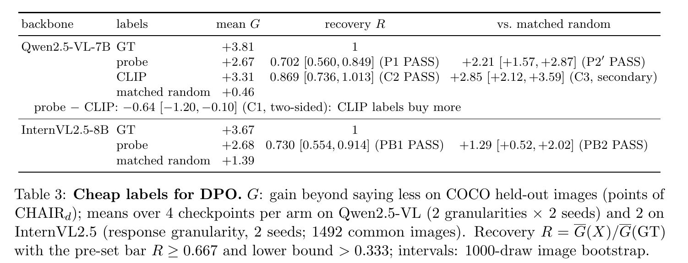

图 16 · 来源：原文 Table 3，物理第 11 页。mean G 为 COCO held-out 的超越少说收益，单位为 $`\mathrm{CHAIR}_d`$ 点；recovery 为相对 GT 标签 DPO 的 G 比例。方括号为图像 bootstrap 区间，不是大规模训练 seed 方差；不要把 1000 次 bootstrap 当 1000 次训练。

| DPO 标签 | Qwen2.5-VL-7B 的 G | 相对 GT 的 recovery |
| --- | --- | --- |
| Ground truth | 3.81 | 1.000 |
| Probe | 2.67 | 0.702，区间 [0.560,0.849] |
| CLIP | 3.31 | 0.869，区间 [0.736,1.013] |
| 长度匹配随机 | 0.46 | 仅作控制 |

InternVL2.5-8B 的 GT/probe/长度匹配随机 G 为 3.67/2.68/1.39，probe recovery=0.730。CLIP 标签在 COCO 上优于 probe，不能扩成所有数据集/骨干的普遍排序。Qwen probe 分 seed recovery 为 0.589 与 0.825，合并后达标不表示每个 seed 都达标。未匹配长度的随机标签版本没有通过作者事先的有效训练检查，不能拿它当成功的“随机标签也行”结论。

```text
fit_probe(on_fit_images_only, fixed_11_features)
for heldout_base_caption:
    objects = normalize_object_mentions(caption)
    deletion_quotas = match_method_removals_by_rank(objects)
    compare(random_prune, frozen_probe_prune, method_removals)
    count_new_hallucinations_separately()
# 训练分支：同源候选对，替换标签来源，长度匹配随机作控制
train_DPO(pairs, label_source=GT_or_probe_or_CLIP, add_SFT_weight=1)
evaluate_at_matched_recall_not_only_raw_CHAIR()
```

### 5.6 人工评估没有过门槛，结论要停在哪里

作者人工核查 CHAIR evaluator precision 的预设门槛为 0.8；COCO 只有 0.683、区间 [0.603,0.762]，AMBER 0.707、区间 [0.561,0.829]，没有通过预设标准；另外两个需一致性门槛的人工判断也因 κ 未达标不能作确定结论。故主结论应限定在这个物体指标/解析器和实验协议，不能宣称已经证明人类眼中的真实幻觉都可便宜消除。

对小 VLM 后训练的直接建议：做低成本 probe/CLIP 标签前，先把匹配召回的截短基线、长度匹配随机偏好、训练前后新增幻觉和人工抽查加入评测。若自己的方法只赢未控制长度的基座，可能还没证明它比“少说”学到更多；但 probe 覆盖高也不证明视觉后训练无用，它只说明某些测得的增益有便宜替代解释。

基础阅读：[DPO 原始论文](https://arxiv.org/abs/2305.18290)、[TRL DPO 文档](https://huggingface.co/docs/trl/dpo_trainer)、[RLHF 图解博客](https://huggingface.co/blog/rlhf)。本次未确认作者独立博客或完整分析代码，不能提供未经验证的所谓“一键复现链接”。

## 6. 可执行的阅读与实验路线

如果目标是低成本复现，先用第 5 篇搭建反幻觉评测，再试第 1 篇跨输入偏好。前者能检查后者是否只改变 yes/no 或输出量，后者不需要在线长工具轨迹。两者不是本文已经组合验证的方法；迁移到更小骨干时应重新验证层位置、语言数据和开放式收益。

视频方向优先读第 3 篇的“先按问题保留证据、后按结构给奖励”，再读第 2 篇的主动取证。一个改变固定输入的表示，另一个改变观测策略；如果两个方法都有效，仍需控制输入 token、工具开销和输出长度，不能直接把论文各自收益相加。

想研究多模态 agent 的长期 RL，再读第 4 篇。它最有价值的实现点是请求与动作监督分布对齐、前缀监督，以及共享优势但隔离梯度通道。它的模型总规模、128 设备 RL 与单卡 LoRA 差距较大，适合先借鉴机制，再在自己预算内缩小实验。

本期未选择已收录论文的新版本；ROAM-GRPO（2611.25926）的一手原文为文本数学方向，不因聚合页面邻接描述而算成 VLM；Structured Role（2605.07274）与 VisionPsyNano（2609.31746）首次公开日期在窗口外。可验证官方仓库为 Reviso、SurgQ-VLM、ZeroVLN；仓库可见与完整训练可复现分开判断。

本次实际执行环境为本地 macOS 补位、现有授权 SSH 发布。云端迁移聊天仍停在环境绑定待核验状态、长期云端任务暂停，尚不能声称已脱离本机，也不删除本地补位任务。Markdown 与 PDF 使用同一全文；图源、去重清单、运行环境和 PDF 检查记录随报告归档。
