# VLM 后训练精读 · 2026-11-24

今天读 5 篇论文：把连续思维压到 4 bit 的 QL-VLM、用分叉熵奖励减少幻觉的 GEM-MM、让任务与检索世界同步生长的 Search-RSI、按模态可靠性选择教学方向的 Prism，以及研究数字标签如何传递教师偏好的 Subliminal Learning。

选题窗口为 **2026-10-24 至 2026-11-24**，按 arXiv 首次公开日期核验，与全部方向历史清单按去版本 ID、DOI、规范地址及标题交叉去重。五篇均首次收录；博客、模型文档和基础教程只作辅助。QL-VLM、GEM-MM、Subliminal Learning 有 2B–4B 主实验；Search-RSI 重点读 9B 分支；Prism 是统一理解/生成模型的扩展选题，不把其双专家系统称为总参数只有 7B 的小 VLM。

**阅读约定。**“原文事实”指固定版本论文或明确链接的官方代码；“本文推导/算例”只解释机制，不是作者实验。未披露的成本、没有找到的代码、不能独立证明的因果结论均明说。18 幅图表来自原论文 PDF 的真实裁剪，完整出处和裁剪范围见 assets/SOURCES.md。正文数学在 GitHub 原生显示；PDF 由这一份完整正文生成，使用同一份 TeX 排版，公式清单见 assets/math-manifest.json。

**执行记录。**本次实际环境为本机 macOS 补位，使用已授权 SSH 发布。已检查远端运行约定和云端迁移聊天：云端日程仍等待环境绑定核验，没有已验证完成的同日日报；本次不宣称脱离本机，也不停用本地任务。

| 论文 | 首次公开（UTC） | 主要训练对象 | 最值得读的技术点 |
| --- | --- | --- | --- |
| QL-VLM | 11-19 | Qwen2-VL-2B，另有 7B/8B | 用预测 Fisher 选择量化误差方向，沿学生自己的潜在轨迹蒸馏 |
| GEM-MM | 11-15 | Qwen3-VL-4B-Instruct | 奖励少数推理分叉的不确定性，惩罚最终回答的高熵 |
| Search-RSI | 11-20 | Qwen3.5-9B/27B 搜索 agent | 同时生成适难任务、补齐证据、按成功率路由 RL/SFT |
| Prism | 11-04 | SenseNova-U1、BAGEL | 可靠文本教图像、可靠图像教文本，双失败用文本 unlikelihood |
| Subliminal Learning | 11-04 | 2B/3B/5.6B/7B LoRA | 严格配对的数字载体实验，检验 SFT 的隐性偏好传递 |

## 先补齐共同语言：SFT、策略梯度与蒸馏

SFT 是“给定输入，增加示范答案的概率”。设 $`x`$ 包含图像和问题，$`y=(y_1,\ldots,y_L)`$ 是答案，$`\theta`$ 是模型参数，则：

```math
\mathcal L_{\mathrm{SFT}}
=-\mathbb E_{(x,y)\sim D}\sum_{t=1}^{L}
\log \pi_\theta(y_t\mid x,y_{1:t-1}).
```

每个词都在真实前缀下预测，叫 teacher forcing。它不保证示范数据里“没有明说的属性”不会被学到，今天第五篇正检验这个问题。

RL 先让当前策略自己采样，再让高奖励答案更常出现。基本策略梯度为：

```math
\nabla_\theta J
=\mathbb E_{y\sim\pi_\theta}
\left[(r(x,y)-b(x))\nabla_\theta\log\pi_\theta(y\mid x)\right].
```

$`r`$ 是奖励，$`b`$ 是与当前动作无关的基线，减去它不改变期望梯度。GRPO 常用同题多条回答的组内统计作基线；但“组内归一化”不自动意味着用了 PPO 的概率比裁剪。第二篇就是需要分清的例子。示范蒸馏匹配教师输出；on-policy 蒸馏进一步关心学生实际会走到的状态。第一篇让量化学生和教师各自生成连续思维，再对齐动力学，避免只在教师轨迹上好看。

入门按顺序读：[Hugging Face 的 RLHF 图解博客](https://huggingface.co/blog/rlhf)、[TRL 的 DPO 说明](https://huggingface.co/docs/trl/dpo_trainer)、[GRPO 说明](https://huggingface.co/docs/trl/grpo_trainer)、[LoRA 原理](https://huggingface.co/docs/peft/main/en/conceptual_guides/lora)。这些是基础资料，不计入今日五篇；具体论文的损失以原文为准，不能拿框架默认值补空白。

## 1. QL-VLM：低比特潜在推理为何需要“方向正确”的误差

**论文**：[Efficient Latent Reasoning for Vision-Language Model via Dynamics-Aware Quantization and Distillation](https://arxiv.org/abs/2611.25670)；[固定 v1 PDF](https://arxiv.org/pdf/2611.25670v1)，首次公开 2026-11-19。以下页码是 PDF 物理页。未在原文外链和本次精确标题/作者检索中核验到完整官方代码或独立作者博客。

### 1.1 问题：连续思维短，但小误差会沿循环放大

显式 CoT 把中间过程写成几十个离散词；潜在 CoT 把下一步输入换成连续向量。它省掉长篇文字，却让每一步隐藏状态直接决定后续步骤。低比特量化会改变这些状态，尤其改变注意力的 key，最后造成答案偏移。

原文的敏感性诊断很直观：2B 模型全精度潜在推理 ScienceQA 为 79.97%；仅量化线性层为 73.49%，仅量化注意力操作数为 40.16%，两者同时量化为 11.16%。在线性层 W4A4 的诊断设置中，仅把 K 从 4 bit 提到 8 bit 达 70.35%，明显高于只提高 Q、V 或注意力概率的方案。这是定位敏感部件的诊断，不是后文完整 QAT 基线 50.10% 的同一设置，不能混成一张逐项增益表。

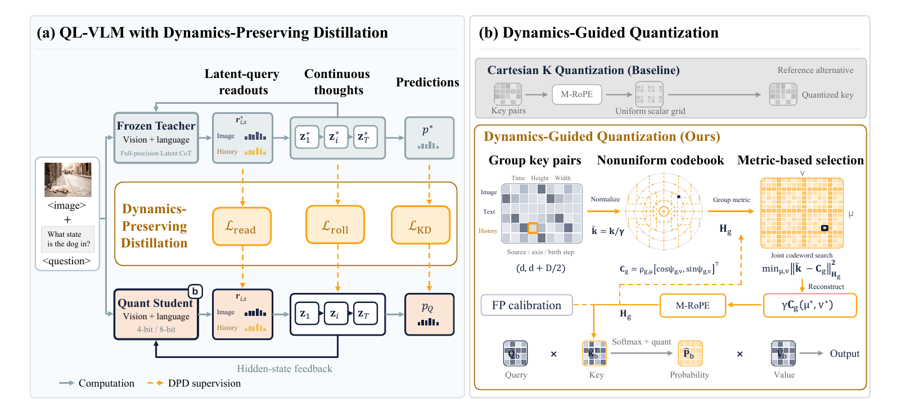

图源：原文 Figure 2，物理页 3，[PDF](https://arxiv.org/pdf/2611.25670v1)。左边是冻结全精度教师与量化学生，三个蒸馏出口分别约束读取的信息、连续思维和最终预测；右边先把旋转 key 分组，再用非均匀极坐标码本和预测敏感度选码。实线是前向，虚线是训练监督。推理时没有教师分支。

### 1.2 连续思维与量化：先把符号对上

沿用多模态 CODI，输入 $`x`$ 编码为 $`f_0`$；第 $`i`$ 步通过带 LayerNorm 的两层投影 $`\Pi_\theta`$ 产生思维向量 $`z_i`$：

```math
\begin{aligned}
f_0&=F_\theta(x),\\
z_i&=\Pi_\theta(f_{i-1}),\\
f_i&=F_\theta(x,z_1,\ldots,z_i),\qquad i=1,\ldots,T.
\end{aligned}
```

$`F_\theta`$ 是 VLM 解码器，$`T=6`$ 是默认潜在步数；结束符随后触发答案生成。它仍需六次串行潜在更新，并非一次前向得到全部推理。训练还有显式 CoT 分支，用答案交叉熵、显式 CoT 交叉熵和标准差归一化的桥接状态损失联合训练；QAT 再细分答案中的选项、模板和停止段。论文没有把所有 token 简单等权处理。

均匀量化可写成：

```math
Q_b(X;\Delta,o)
=\Delta\left[
\mathrm{clip}\left(\mathrm{round}(X/\Delta)+o,q_{\min},q_{\max}\right)-o
\right].
```

$`b`$ 决定整数范围，$`\Delta`$ 是步长，$`o`$ 是零点，round 取整，clip 截断。均匀量化主要控制欧氏距离，却不区分“哪个方向的误差会改变答案”。QL-VLM 的关键就是换这个误差度量。

### 1.3 为什么 Fisher 度量比普通 MSE 更贴近最终答案

设某个 key 或思维状态受扰动 $`\delta`$，答案位置 $`n`$ 的词表概率为 $`p_n`$，$`J_n`$ 是 logits 对被扰动状态的总 Jacobian，包含经过后续思维步骤的间接影响。原文用局部二阶展开：

```math
\begin{aligned}
\sum_n\mathrm{KL}\!\left(p_n\Vert p_n^\delta\right)
&\approx \frac12\delta^\top F\delta,\\
F&=\sum_nJ_n^\top
\left[\mathrm{diag}(p_n)-p_np_n^\top\right]J_n.
\end{aligned}
```

$`F`$ 是半正定的预测 Fisher；某个方向特征值越大，同样长度的误差越可能改变答案分布。这个近似只在局部成立，不能把一次二次型下降当成最终答案 KL 必然单调下降的保证。

**本文算例。**令 $`F=\mathrm{diag}(100,1)`$。两个同样长度 0.01 的误差，分别沿第一轴和第二轴，预测 KL 近似为 0.005 与 0.00005，差 100 倍。这个数是教学构造。作者实际在 8 个留出样例、48 个思维位置上作等范数 1% 扰动，报告方向间 KL 比的中位数 2.82；样本小，说明方向性存在，不能外推成所有模型都差 2.82 倍。

### 1.4 DGQ：在 RoPE 旋转前选极坐标码，而不是给敏感组加 bit

M-RoPE 把通道成对旋转，分别编码时间、高度、宽度。若旋转矩阵是 $`R_\varphi`$，旋转坐标里的敏感度应拉回原始坐标：

```math
F_{\mathrm{raw}}
=R_\varphi^\top F_{\mathrm{rot}}R_\varphi.
```

旋转保留普通范数，但不会消除 Fisher 的各向异性。作者按层、KV head、旋转轴和来源分组；来源含文本、图像和“第几步诞生的潜在 token”。出生步是 key 的身份，不是当前查询步。

对于 token/head 内的每个二维 key 对 $`k_{jd}`$，先以最大二维范数缩放，再用极坐标码本：

```math
\begin{aligned}
\gamma_j&=\max_d\|k_{jd}\|_2,\qquad
\bar k_{jd}=k_{jd}/\max(\gamma_j,10^{-8}),\\
C_g(\mu,\nu)
&=\rho_{g,\mu}
\left(\cos\psi_{g,\nu},\sin\psi_{g,\nu}\right),\\
(\mu^\star,\nu^\star)
&=\arg\min_{\mu,\nu}
(\bar k_{jd}-C_g)^\top H_g(\bar k_{jd}-C_g).
\end{aligned}
```

$`g`$ 是上述分组，$`\rho`$ 为非均匀半径，$`\psi`$ 为非均匀角度，$`H_g`$ 是校准得到并固定的二维预测度量。重建时乘回 $`\gamma_j`$，再做真正的 M-RoPE 旋转。4 bit 方案是半径索引 4 bit、角度索引 4 bit，因此一对两个分量共 8 bit，即每分量 4 bit；不是敏感组偷偷改成高精度。码本、缩放和索引计算仍有额外开销。

**本文算例。**目标点为 (0.8,0.1)，两个候选码为 (0.7,0.4)、(0.4,0.1)。普通平方距离为 0.10、0.16，会选前者；若 $`H=\mathrm{diag}(1,100)`$，代价变成 9.01、0.16，选后者。它宁可第一维误差稍大，也保护极敏感的第二维。实现中不能丢掉不同 token 的缩放因子在码本拟合中的权重；同一对内部做最近码分配时公共因子才可约掉。

### 1.5 DPD：不仅对齐最后答案，还对齐“读到了什么”

冻结全精度教师和量化学生各自沿自己的潜在历史运行，避免学生被错误地评估在从未到过的教师状态上。三个约束配合工作：

- **读取对齐**：在潜在查询的注意力中，分别汇总来自图像和历史 token 的 $`PV`$ 读出；先对全部 key 做 softmax，再按来源取子和。不能每个来源重新归一化，否则丢掉分配给该来源的注意力总量。用教师读出尺度归一化后施加 Smooth-L1。
- **思维轨迹对齐**：用预测敏感度 $`G_i`$ 加权思维误差，让重要方向、重要步的偏差受到更强惩罚。
- **答案蒸馏**：在选项预测位置匹配温度软化的教师分布，保留真值答案交叉熵，避免只追随教师错误。

```math
\begin{aligned}
r_{\ell h i s}
&=\sum_{j\in s}P_{\ell h i j}V_{\ell h j},\\
Z_F&=\max\left(\frac1T\sum_i\mathrm{tr}(G_i),10^{-20}\right),\\
\mathcal L_{\mathrm{roll}}
&=\frac{1}{2TZ_F}\sum_i
(z_i-z_i^\star)^\top G_i(z_i-z_i^\star),\\
\mathcal L_{\mathrm{KD}}
&=\frac{\tau^2}{|\mathcal O|}
\sum_{n\in\mathcal O}
\mathrm{KL}\left(
\mathrm{softmax}(u_n^\star/\tau)
\Vert\mathrm{softmax}(u_n^Q/\tau)\right).
\end{aligned}
```

$`\ell,h,i,s`$ 分别是层、head、潜在步和信息来源；星号是教师，Q 是量化学生；$`\mathcal O`$ 是选项预测位置集合；$`u`$ 是 logits，默认温度 $`\tau=1`$。$`Z_F`$ 控制 Fisher 量级，不能用每步单独归一化抹掉步间重要性。

总训练目标是在原 CODI 目标上加答案 KD，并对量化 key 的 Fisher 加权误差、读出、思维轨迹作加权。默认 key/read/roll 权重分别为 0.001/0.05/0.05，KD 权重 1。昂贵参考计算用 Bernoulli 抽样：概率为 $`1/M_{\mathrm{ref}}`$ 的样本才算读出/轨迹项，命中时乘回 $`M_{\mathrm{ref}}`$；另用 warm-up 因子渐增。若 $`M_{\mathrm{ref}}=4`$，四分之一概率乘四，期望仍为原损失，但梯度方差不因此消失。

### 1.6 实验：巨大增益的分母与实际加速要一起看

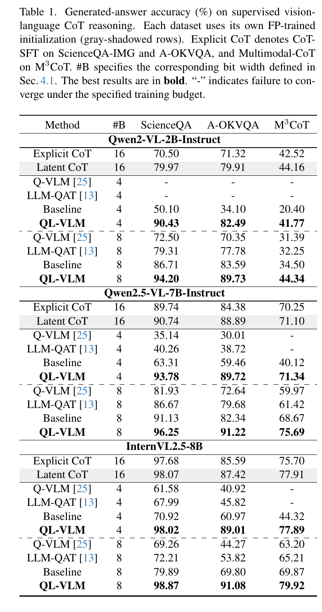

图源：原文 Table 1，物理页 7，[PDF](https://arxiv.org/pdf/2611.25670v1)。表中三列是 ScienceQA、A-OKVQA、M3CoT 的生成答案准确率，纵向先分模型，再分精度。每个数据集单独训练；不是三个未见任务上的同一模型零样本结果。

| 2B 配置 | ScienceQA | A-OKVQA | M3CoT |
| --- | --- | --- | --- |
| 全精度显式 CoT | 70.50 | 71.32 | 42.52 |
| 全精度潜在 CoT | 79.97 | 79.91 | 44.16 |
| 4 bit 笛卡尔量化基线 | 50.10 | 34.10 | 20.40 |
| 4 bit QL-VLM | 90.43 | 82.49 | 41.77 |
| 8 bit QL-VLM | 94.20 | 89.73 | 44.34 |

4 bit 在 ScienceQA 比量化基线高 **40.33 个百分点**，不是相对提升 40.33%。M3CoT 的 41.77 仍低于全精度潜在推理 44.16，不能说所有任务都超过教师。7B 与 8B 的 4 bit ScienceQA 为 93.78 与 98.02。跨数据集评估固定用 ScienceQA 训练的模型，不再校准或挑选：2B 4 bit 的 MMStar 为 44.27（笛卡尔 30.11、全精度潜在 43.28），MMMU-MC 为 31.18（24.19、32.24），仍是一项超过、一项未超过。

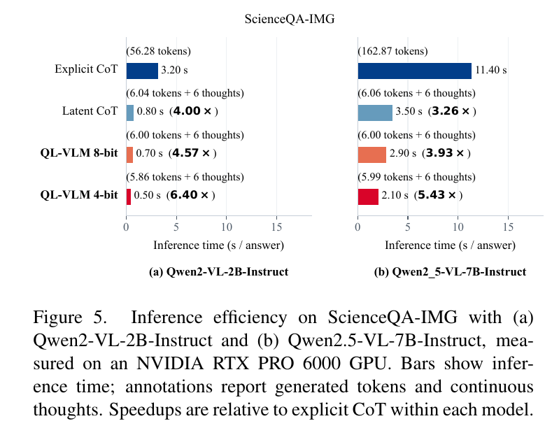

图源：原文 Figure 5，物理页 8，[PDF](https://arxiv.org/pdf/2611.25670v1)。左、右分别为 2B 和 7B 模型，横轴是 RTX PRO 6000 上测得的推理秒数，条形旁标注解码长度；支持的低比特矩阵算子使用编译 CUDA，其他算子回退 BF16。2B 显式 56.28 token，QL-VLM 是 5.86 个答案 token **加 6 个潜在步骤**，长度压缩 4.75 倍。耗时 3.20 秒降到 0.50 秒为 6.40 倍；相对全精度潜在模型 0.80 秒则为 1.60 倍。16.64 倍 bit-operations 降幅与 2.52 倍理论存储降幅，不能当成相同的实测延迟或模型参数降幅。

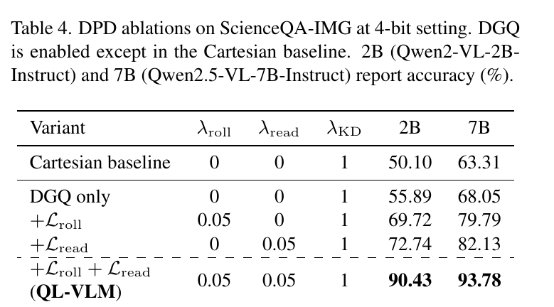

图源：原文 Table 4，物理页 8，[PDF](https://arxiv.org/pdf/2611.25670v1)。在 DGQ 基础上，2B 仅加轨迹约束从 55.89 到 69.72，仅加读出到 72.74，两者一起到 90.43；7B 分别为 68.05、79.79、82.13、93.78。二者显然有交互，不能把独立增益直接相加。逐步量化设计的 Table 3 中，出生步分组、预测度量和 key 约束也都很关键，但那是一条固定组合顺序，不能等同每个模块的独立因果贡献。

### 1.7 训练成本、预算取舍与复现边界

原文采用同一数据集对应的全精度初始化、1 个 QAT epoch、默认 6 潜在步。视觉与语言线性权重、激活及注意力相关操作数均纳入低比特；输出头和思维投影保留浮点。Table 5 给出 2/4/6/8/12 步时 QL-VLM 的 ScienceQA 为 45.15/53.61/90.43/91.01/91.65：6 步后收益趋缓，长度压缩从 4.75 倍降到 12 步时的 3.15 倍。

**缺失信息。**所下载 v1 为 10 页，正文多次指向 Appendix，但该 PDF 未附完整附录；完整训练学习率、batch、校准样本规模、训练 GPU-hours 和端到端 QAT 显存不能从此版本可靠恢复。这里不借相邻论文填值，也不把单次推理设备当成训练设备。

```text
从同一个全精度 CODI checkpoint 初始化教师、学生
冻结教师；保持输出头和思维投影为浮点
按层/head/旋转轴/来源校准二维敏感度并拟合码本
每个 batch:
    教师、量化学生分别滚动 T 个连续思维
    计算原 CODI 目标和答案 KL
    计算 key 的预测加权重建误差
    按参考抽样频率计算读出与思维轨迹对齐，并作逆概率加权
    逐步开启附加损失，更新学生和可训练量化参数
```

这是本文依据原文整理的流程伪代码，不是已运行的官方实现。

复现首先应固定全精度 checkpoint 与数据划分，验证笛卡尔 QAT 基线；再单独验证 M-RoPE 成对通道、来源标签、出生步归属、全局 softmax 后的来源读出及 Fisher 数值稳定性。最后在真实低比特算子下测延迟，区分校准时间、教师训练开销和推理开销。码本查找若没有高效 kernel，理论 bit 数降低不保证真实更快。

延伸读物：[知识蒸馏原始论文](https://arxiv.org/abs/1503.02531)、[Qwen2-VL 官方代码](https://github.com/QwenLM/Qwen2-VL)、[Qwen2.5-VL 官方代码](https://github.com/QwenLM/Qwen2.5-VL)。先理解 softmax、KL 和 RoPE，再看本文二维 Fisher，比从全部张量维度直接读起更容易。

## 2. GEM-MM：推理中适当犹豫，最终回答需要收敛

**论文**：[GEM-MM: Reducing VLM Hallucination with Entropy-Guided Preference Alignment](https://arxiv.org/abs/2611.20016)；[v1 PDF](https://arxiv.org/pdf/2611.20016v1)，首次公开 2026-11-15。官方仓库：[SNOWTEAM2023/GEM-MM](https://github.com/SNOWTEAM2023/GEM-MM)。代码核查日期 2026-11-24，下面会明确其尚未完整实现的部分；未核验到独立作者方法博客。

### 2.1 动机与小白直觉：奖励的对象不是“越确定越好”

DPO 主要看 chosen/rejected 两条完整回答的相对概率。即便排序正确，模型可能仍在关键视觉分叉处过早确定，或者最后答案迟迟不收敛。GEM-MM 直接读取当前模型每个位置的词表分布：少数关键推理分叉允许探索，最终答案鼓励确定。

熵是概率分布的不确定性，不是模型选中某个词后该词的负 log 概率。若两个候选词概率都是 0.5，熵为约 0.693 nats；若为 0.99 和 0.01，熵约 0.056 nats。模型可能“非常确定地看错”，所以低最终熵本身并不等于视觉正确。

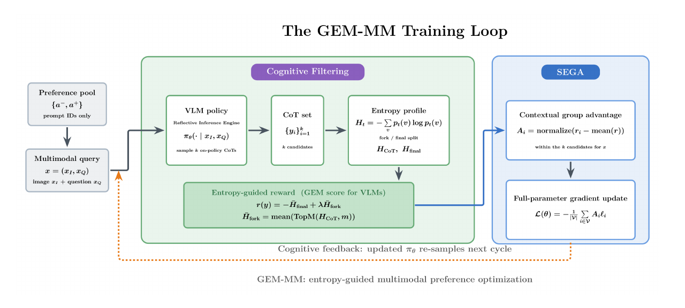

图源：原文 Figure 1，物理页 4，[PDF](https://arxiv.org/pdf/2611.20016v1)。从同一多模态 prompt 采样多个 CoT，计算推理/最终段熵，组内归一化后更新。图中“认知过滤”和奖励来自模型自身分布，不是人工判断每条 rollout 是否正确。数据集的偏好标签用于共同 SFT 初始化和评估，不能把整个训练过程称作完全无标签。

### 2.2 奖励如何算：固定比例切分，取推理段最高熵的少数位置

设回答长度为 $`T`$，位置 $`t`$ 的完整词表分布为 $`p_{\theta,t}(v)`$：

```math
H_t=-\sum_{v\in\mathcal V}
p_{\theta,t}(v)\log p_{\theta,t}(v).
```

$`\mathcal V`$ 是词表，单位为 nats。分割点不是根据“Final Answer”短语的真实 token 位置定位，而是：解码文本包含该短语时，取回答长度的 75%；否则取 80%。公开 scorer 还把位置钳制到合法边界。前段作推理、后段作最终答案。

```math
\begin{aligned}
s&=\begin{cases}
\lfloor0.75T\rfloor,&\text{marker present},\\
\lfloor0.80T\rfloor,&\text{otherwise},
\end{cases}\\
m&=\max(1,\lfloor\rho s\rfloor),\\
H_{\mathrm{fork}}
&=\mathrm{mean}\!\left(\mathrm{TopM}(\{H_t\}_{t=1}^{s},m)\right),\\
H_{\mathrm{final}}
&=\mathrm{mean}\!\left(\{H_t\}_{t=s+1}^{T}\right),\\
r(y)&=-H_{\mathrm{final}}+\lambda H_{\mathrm{fork}}.
\end{aligned}
```

$`\rho=0.05`$ 控制只取推理段最高熵 5% 的位置；$`\lambda=2`$ 是默认分叉奖励权重。空最终段公开代码使用 5 nats 的常数罚值，空推理段分叉值为 0。短输出边界必须单独处理。

**本文算例。**两条答案 A、B 的分叉熵/最终熵分别为 0.9/0.2、0.3/0.1，则奖励是 1.6 与 0.5。A 虽然最终熵稍高，但在关键位置的探索得到更大回报。若 A 最后答错，这个奖励没有独立真值模块自动纠错。固定比例分段也可能把格式变化误当成思维结构变化；出现标记就改变切分比例，不代表完全消除了格式操纵。

### 2.3 更新公式：组内归一化不等于完整 GRPO

对同一问题采样 $`k=3`$ 条回答，组均值作基线，标准差非零时再缩放：

```math
\begin{aligned}
b&=\frac1k\sum_{i=1}^{k}r_i,\qquad
\widetilde A_i=r_i-b,\\
A_i&=\begin{cases}
\widetilde A_i/(\mathrm{std}(\widetilde A)+10^{-8}),
&\mathrm{std}(\widetilde A)>10^{-6},\\
\widetilde A_i,&\text{otherwise},
\end{cases}\\
\ell_i&=\sum_t\log\pi_\theta(y_{i,t}\mid x,y_{i,1:t-1}),\\
\mathcal L_{\mathrm{SEGA}}
&=-\mathrm{mean}_{i\in\mathrm{valid}}[A_i\ell_i].
\end{aligned}
```

$`A_i`$ 为相对组内其他回答的优势，$`\ell_i`$ 是整条回答的 log 概率之和，原式没有显式长度归一化；valid 只保留合法样本。最大化期望奖励时，正优势回答增大概率，负优势回答降低概率。减去组基线可降低方差，但不能把所有奖励信号错误都消掉。

这里是带组内标准化的策略梯度/加权 NLL 写法，正文未给出 PPO 概率比裁剪，也未给出 KL 惩罚项，因此不能直接照搬 TRL GRPO 的默认 clipped loss 称作原算法。实际实现还必须固定采样策略、重新计算可微 log 概率、对奖励和优势停止梯度；**这是本文复现建议，公开训练文件没有完成这些步骤，无法核查其真实梯度实现**。

```text
共同初始化：用同一批 chosen 响应完成 SFT
SEGA 每次取一个图文 prompt:
    当前模型按温度 0.9 采样 3 个回答
    对完整词表分布计算每位置熵
    按 75%/80% 比例切分，得到分叉/最终熵奖励
    组内中心化并在有方差时标准化优势
    重新评分答案 token，计算优势加权负 log 概率
    更新全参数；记录回答格式、重复率和幻觉指标
```

上述为论文流程的教学伪代码，不代表仓库已能直接训练。

### 2.4 数据与训练预算：监督在哪一阶段使用要说清楚

主模型为 Qwen3-VL-4B-Instruct，全参数微调，单张 A100-40GB，开启梯度检查点。MM-RLHF 只取短回答图像子集：前 3,000 个唯一 ID 训练、3,001–4,000 作 1,000 条评估。其他模态不进入主实验。

各系统共享 SFT checkpoint、prompt、模板、优化器与预算。比较 MM-DPO、加图像锚定的 mDPO、SIMA 自挖偏好对以及 GEM-MM。GEM-MM 的对齐阶段不使用 chosen/rejected 作为目标标签，只使用同一 prompt 池；然而共同 SFT 初始化使用 chosen，所以不能宣称训练从头到尾没有人工偏好信息。

SEGA 为 3,000 个 prompt、单遍 3,000 更新周期；采样每题 3 条，训练新生成上限 128 token，评估 256，AdamW 学习率 $`10^{-5}`$，默认 $`\lambda=2,\rho=0.05`$。硬件已披露，但完整 SFT+对齐的实测总 GPU-hours 和精确峰值显存未给出可核验数字，不将“40GB 卡能跑”写成实测显存恰为 40GB。

### 2.5 结果：最可靠的增益在幻觉，偏好提升应谨慎

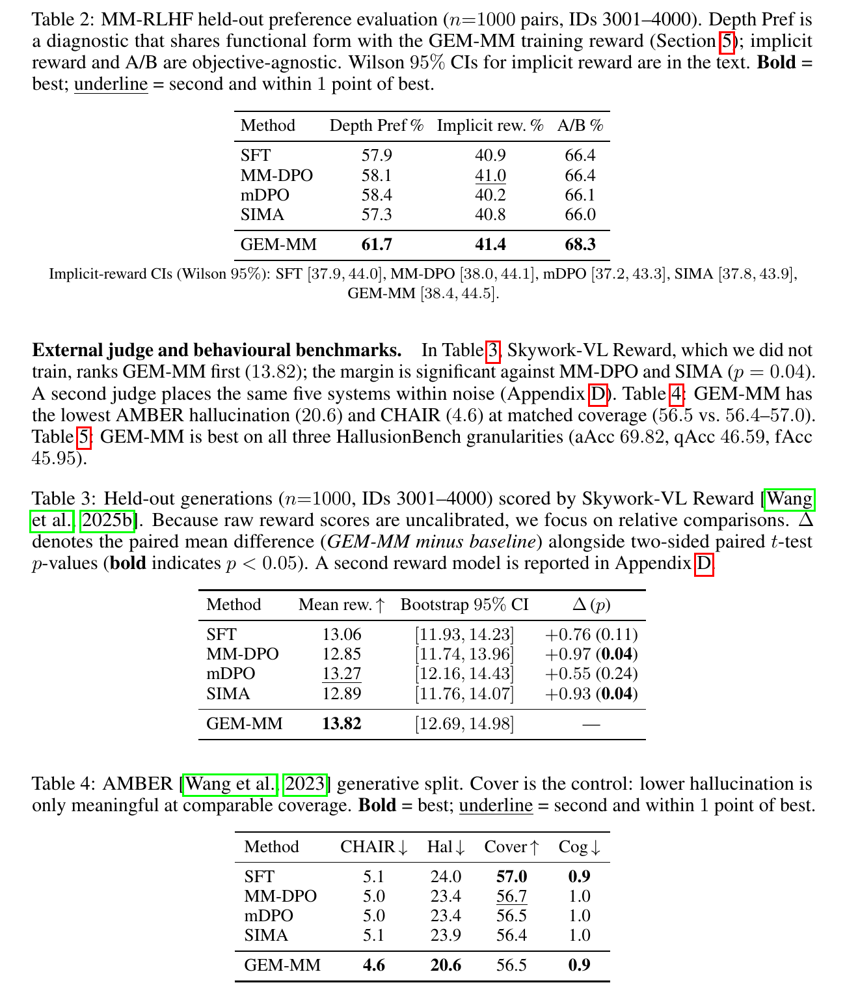

图源：原文 Tables 2、3、4，物理页 6，[PDF](https://arxiv.org/pdf/2611.20016v1)。上表看不同偏好评分定义，中表看外部 Skywork 奖励模型，下表看 AMBER 幻觉与覆盖。要同时看箭头、置信区间和覆盖率，不能只摘第一名。

| 主指标 | 共同 SFT | GEM-MM | 正确读法 |
| --- | --- | --- | --- |
| 熵深度偏好准确率 | 57.9% | 61.7% | 与训练奖励同构，是深度诊断 |
| 隐式奖励偏好准确率 | 40.9% | 41.4% | 仅 +0.5 点，且低于 50% |
| A/B 选择准确率 | 66.4% | 68.3% | +1.9 点，原文配对检验支持优势 |
| AMBER CHAIR | 5.1 | 4.6 | 越低越好 |
| AMBER Hal | 24.0 | 20.6 | 幻觉回答比例降低 3.4 点 |
| AMBER Cover | 57.0 | 56.5 | 覆盖略降，处于比较系统相近范围 |

隐式奖励指标是答案在对齐模型相对冻结参考模型的 log 概率变化，再比较 chosen 与 rejected；它与熵奖励不同，但也不是人类盲评。GEM-MM 41.4% 的 95% Wilson 区间约 [38.4,44.5]，与 SFT 40.9% 的区间重叠。作者自己承认相对最佳基线只有 0.4 点、在 n=1,000 下不显著。不能把“领先”写成“已显著解决多模态偏好对齐”。

Skywork 外部评分为 13.82，SFT 13.06，差 0.76、p=0.11；相对 MM-DPO/SIMA 的差异 p=0.04，但相对 mDPO p=0.24。另一个 IXC-2.5-Reward 把五个系统都判在噪声范围内。自动 judge 之间不一致，没有人工评估，外部奖励只应作为稳健性检查。

独立幻觉测试 HallusionBench 的 aAcc/qAcc/fAcc 从 68.66/43.96/43.35 到 69.82/46.59/45.95，三个粒度均提升。AMBER 覆盖率 56.5 接近 SFT 57.0，并非完全匹配；这种对照比只追求“少说话就少幻觉”更有说服力，但不能彻底排除风格影响。

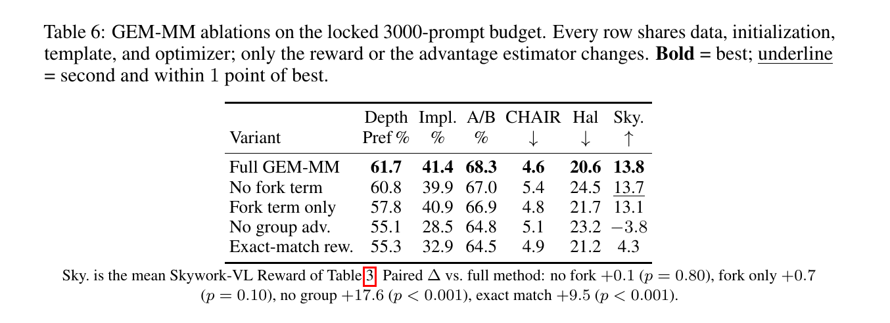

图源：原文 Table 6，物理页 8，[PDF](https://arxiv.org/pdf/2611.20016v1)。只去掉分叉项，偏好指标变化不大，AMBER Hal 却从 20.6 退回 24.5；只用分叉项 Hal 为 21.7，却不能带来相同偏好表现。去掉组内优势后隐式准确率掉至 28.5%，外部奖励也显著恶化。这个固定预算消融支持“两个熵项分工、组内估计重要”，但没有证明高熵位置一定是可解释的视觉推理节点。

### 2.6 失败模式与官方代码审计

主设置回答格式合规率 66.5%，低于 SFT 的 72.4%；平均长度由基础模型 113.3 变为 69.3，熵深度与长度有明显负相关。更保守的 $`\lambda=2.5,\tau=0.8`$ 可以保留 99.3% 格式，却牺牲熵深度；不能声称同一设置同时实现所有最优点。

继续训练的压力测试尤其重要：某个中途 checkpoint 再训练后，near-chosen 达 94.0%、beat-rejected 92.3%，看似非常好，实际格式合规率仅 0.2%，AMBER Hal 82.6、CHAIR 31.1，出现崩塌。near/beat 是文本相似度代理，不能作为“对齐完成”的独立判据。

**代码核验事实。**官方 [src/gem_trainer.py](https://github.com/SNOWTEAM2023/GEM-MM/blob/main/src/gem_trainer.py) 当前文件 blob SHA 为 b7bbc810772b140ba09e5f28cba87588c31cb74c。train_sega 中只有循环、流程注释和清零梯度，没有生成、loss.backward 或 optimizer.step；结束语还提示要接入实际训练。它是占位流程，不是完整可运行的论文训练器。[entropy_scorer.py](https://github.com/SNOWTEAM2023/GEM-MM/blob/main/src/entropy_scorer.py) 的 SHA 为 9c04e705972a54a6342965e7866441d013cfbcba，实际实现了词表熵和分段奖励；其中虽然注释说优先使用标记，代码实际只依据标记是否存在选择 75%/80% 比例。

复现应先完成可微重新评分与生成策略一致性，再核对有限长度回答的边界、mask 与方差退化；并把格式、重复率、覆盖率、AMBER、HallusionBench 与外部 judge 一起监控。仅运行仓库入口并出现“done”不构成复现。辅助阅读：[原始 REINFORCE 论文](https://doi.org/10.1007/BF00992696)、[Qwen3-VL 官方实现](https://github.com/QwenLM/Qwen3-VL)、[TRL RLOO 说明](https://huggingface.co/docs/trl/rloo_trainer)。RLOO 用来理解基线，不代表 GEM-MM 原文用了相同估计器。

## 3. Search-RSI：训练难题之前，先保证检索世界里真的有证据

**论文**：[Search-RSI: Expanding Search Worlds Along Multimodal Agents' Capability Frontier](https://arxiv.org/abs/2611.27780)；[v1 PDF](https://arxiv.org/pdf/2611.27780v1)。首次公开 **2026-11-20**，一些二级页面的 11-23 是播报日期。未在原文外链与精确标题检索中核验到官方训练代码或作者博客；以下严格依据 v1 及附录。

### 3.1 问题：失败可能是世界缺证据，不是模型不会搜

多模态 agent 看图、搜索、读页面、继续搜，最后回答。训练若只不断生成更难的问题，而检索索引不更新，模型可能按正确路径搜索仍永远找不到目标。对这种不可达问题反复给负奖励，只会把“世界缺资料”和“策略差”混为一谈。

Search-RSI 把训练世界记作任务集与知识索引的二元组：

```math
W_t=(D_t,K_t),\qquad
x=(I,q,y),\qquad
\mathrm{reachable}(x,K_t)
=\mathbf1[\Psi(x)\subseteq K_t].
```

$`t`$ 是自改进轮次，$`I,q,y`$ 是锚图、问题和答案；$`\Psi(x)`$ 是题目所需的锚图、实体页面和关系证据，而不是只有一串图谱三元组。定义可达后，才有意义谈这道题的成功率。

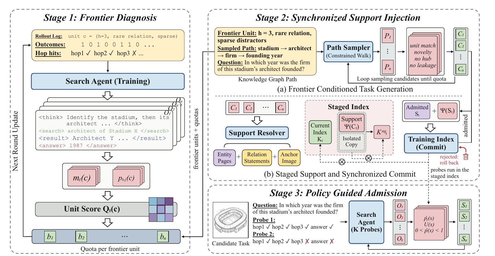

图源：原文 Figure 2，物理页 3，[PDF](https://arxiv.org/pdf/2611.27780v1)。第一阶段读 agent 的真实失败/成功日志，分配适难任务配额；第二阶段在暂存索引中同步注入配套证据；第三阶段用短探测 rollout 决定丢弃、RL 或带私有提示自示范。保留下来的任务和证据一起提交到下一轮，不是把所有候选证据都永久写入世界。

### 3.2 能力前沿：不追最简单，也不无限追最难

作者把任务放入 27 个格子：2/3/4 跳、三档实体稀有度、三档相似干扰。干扰来自同类且 CLIP 相似度高的实体，档位以 2、6 为界。每格统计整体掌握率 $`m_t(c)`$ 和每跳恢复成功率 $`p_{t,j}(c)`$，用伯努利方差衡量可学习空间：

```math
\begin{aligned}
V(p)&=p(1-p),\\
Q_t(c)&=V(m_t(c))
+\frac1{h(c)}\sum_{j=1}^{h(c)}V(p_{t,j}(c)),\\
b_t(c)&\propto Q_t(c),\qquad \sum_c b_t(c)=B.
\end{aligned}
```

$`h(c)`$ 为跳数，$`Q_t`$ 为前沿分数，$`b_t`$ 为配额，默认每轮总配额 $`B=1240`$。$`p=0.5`$ 时方差最大，$`p=0`$ 或 1 最小，因此这是一种“既不是全会，也不是全不会”的偏好。原文还要求掌握率位于 [0.2,0.8]，且相对前轮没有下降；小于 16 条日志的格子保留探索机会。这里不是全盘抛弃难题：全失败候选另走自示范路线。

**本文算例。**两个格子都为 3 跳，A 的掌握率和各跳成功率均 0.5，$`Q_A=0.25+0.25=0.5`$；B 均为 0.9，若只看方差是 0.18，而且已超出前沿掌握区间。有限预算应优先 A。该例解释配额，不是作者真实格子统计。

随后按格子约束在图谱中走路径，过滤重复路径、过高入度中间实体、题面泄漏隐藏实体别名，以及触及评估实体/答案的路径。冻结渲染器把路径写成题目；“没有额外强教师给解答”不意味着完全不用构造模型。

### 3.3 暂存世界：先补证据，再测学生，最后提交

每轮先生成约三倍于目标配额的候选任务，构造：

```math
K_t^{\mathrm{stg}}
=K_t\cup\bigcup_{x\in C_t}\Psi(x).
```

$`C_t`$ 是候选池，stg 表示暂存。在这个补齐后的世界里测试候选，避免把索引漏项误判成 agent 能力极限。只有最终被 RL 或示范采纳的任务，其证据才进入正式索引；其余回滚。训练索引与冻结的评估索引分离，不能把训练时新注入的答案资料顺手加入测试世界。

这是非常实际的实现细节：任务 ID、证据快照、暂存索引、正式索引的提交必须对应，失败时回滚。若先把所有候选证据全量提交，再挑题，干扰结构和后续任务难度已经被改变，无法复现这个受控循环。

### 3.4 探测后的三路路由：RL、自示范、丢弃

对每题先采样 $`K=4`$ 个短探测 rollout。成功比例为 $`\hat p(x)`$：

- 四条全成功：视为已掌握，不再占本轮学习配额。
- 有成有败：进入 RL 候选，优先每跳成功率方差高的题。
- 四条全失败：给当前 agent 一个私有关系链提示，重试 $`M=4`$ 次，最多保留 2 条正确且证据顺序合格的示范。

混合成败任务的排序分数为：

```math
U(x)=\frac1{h(x)}\sum_{j=1}^{h(x)}
\hat p_j(x)(1-\hat p_j(x)).
```

$`\hat p_j`$ 是探测中第 j 跳的恢复成功率。不能拿组内有符号优势的均值当这个分数：中心化优势均值原本就接近 0。

自示范的关键过滤叫 **anchor-first**：每个隐藏实体必须先出现在工具返回的观测中，然后才能出现在 agent 的输出里；还拒绝“根据提示可知”一类提示复述。最终存储时移除私有提示，只保留原任务、工具轨迹和解答，工具观测 token 不参与 SFT loss。再混入等量热身示范回放，缓和新硬任务把旧技能冲掉的问题。

**本文算例。**真实单次成功率 0.25 的题，四次全失败的概率仍是 $`0.75^4\approx0.316`$。所以“全失败”不证明绝对不会。作者对探测路由误差也作审计；短探测是一种预算内估计，而非完美能力标签。

### 3.5 RL 与 SFT 分别在优化什么

原文继承 SearchEyes 的 hop-anchored HaPO，并非提出一个换名的通用 GRPO。奖励由格式和最终答案正确性构成，KL 系数 0.02，hop mixing 0.3，正/负门控温度 1/1.05。其总体 RL 目标可用原文预备知识中的形式概括：

```math
\mathcal L_{\mathrm{RL}}
=-\mathbb E_{\tau\sim\pi_\theta}
[r_{\mathrm{format}}(\tau)+r_{\mathrm{answer}}(\tau)]
+\beta\,\mathrm{KL}(\pi_\theta\Vert\pi_{\theta_{\mathrm{old}}}).
```

$`\tau`$ 是整条工具交互轨迹，$`\theta_{\mathrm{old}}`$ 是更新前策略，$`\beta`$ 约束偏移；具体逐跳信用由继承的 HaPO 处理。这里保留概念总式，不把未核验代码中的 token 裁剪细节自行补成作者实现。

自示范则用监督交叉熵，并屏蔽环境观测：

```math
\mathcal L_{\mathrm{demo}}
=-\sum_n a_n\log\pi_\theta(y_n\mid x,y_{1:n-1}),
\qquad
a_n=\mathbf1[\text{agent token}].
```

两种更新互补：RL 从有正有负的探索中辨别更好行为；SFT 在暂时全失败区提供一条可模仿的、由自身带提示找到的有效轨迹。去掉提示再训练并不意味着示范没有受特权信息帮助，必须保留来源记录。

```text
初始化共同 SFT 模型、D0 与训练索引 K0；锁定评估索引
每 20 个 RL step:
    从近期日志更新格子掌握率与每跳成功率
    生成约 3B 候选及其支持证据，加入暂存索引
    每题做 4 次短探测
    全成功 -> 丢弃
    有成有败 -> 按每跳方差采纳到 RL 配额
    全失败 -> 当前策略带私有提示最多重试 4 次
               正确且 anchor-first -> 去提示、屏蔽观测，保存示范
    原子提交被采纳任务及证据；回滚其余暂存内容
    新示范与等量热身回放 SFT 1 epoch，再继续 RL
```

### 3.6 主实验：Avg 的分母只有六项，不是表里全部列

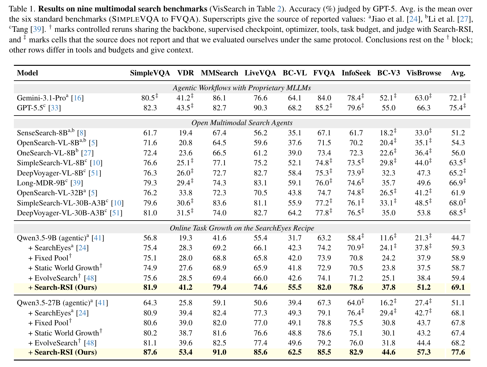

图源：原文 Table 1，物理页 5，[PDF](https://arxiv.org/pdf/2611.27780v1)。表上半有各类 agent，下半是在同一 SearchEyes recipe 内的受控比较，带 † 标记。Avg 只平均 SimpleVQA、VDR、MMSearch、LiveVQA、BC-VL、FVQA **六项**；InfoSeek、BC-V3、VisBrowse 另列，VisSearch 在另一表。不能把 Avg 写成九/十项宏平均，也不能把不同工具和预算的上半系统当完全公平对照。

| 模型 | 同 recipe 的 Static World | EvolveSearch | Search-RSI | 对 Static 的增益 |
| --- | --- | --- | --- | --- |
| Qwen3.5-9B | 58.7 | 59.4 | 69.1 | +10.4 点 |
| Qwen3.5-27B | 67.4 | 68.2 | 77.6 | +10.2 点 |

摘要的 +9.8 和 +9.5 是相对另一行报告的 SearchEyes 59.3/68.1；与受控 Static World 的差分别为 +10.4/+10.2，分母不同。9B 的 VDR 从 27.6 到 41.2，MMSearch 从 68.9 到 79.4，BC-VL 从 41.8 到 55.5。该方法也没有在每个单项击败所有更大开放网络 agent。

世界一致性从 0.85 到 0.98、不可达负例比例 41.0% 到 4.4%；2 跳题增益 +5.6，4 跳题 +13.3，更符合深链任务依赖证据完整性的假设。但这仍是该受控图谱检索环境的结果，不自动等同任意实时互联网。

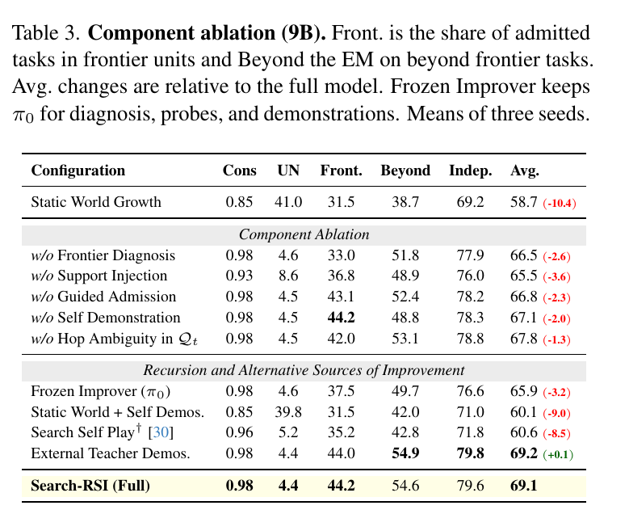

图源：原文 Table 3，物理页 8，[PDF](https://arxiv.org/pdf/2611.27780v1)。9B，三随机种子均值；正文报告配对 bootstrap 与多重比较校正。完整 Avg 69.1，去前沿/证据注入/引导采纳/自示范后分别为 66.5/65.5/66.8/67.1。将任务改进者固定为初始策略变成 65.9；用外部 27B 教师是 69.2，仅比自身循环高 0.1。它支持“不断跟着学生能力更新世界”，而非“找更强教师”就能解释全部收益。

只修复一致性为 62.1，全图 oracle 索引为 63.9，仍低于完整 69.1；只选现有索引可回答题为 60.9，会缩窄前沿，特别排掉稀有深跳题。组件不是任意替换的独立加法。

### 3.7 真正成本：训练多约 27%，推理也可能多搜几次

共同 SFT 为约 10k 问题、30k 轨迹，3 epochs，全参数、学习率 $`2\times10^{-5}`$、batch 64、32k 截断和最多 30 次工具调用。RL 从 12k 问题开始，200 step、每题 8 rollout，10 轮各增加 1,240 题，最终 24.4k；另有约 4k 自示范及 1:1 回放。硬件为 16 张 H20。**相同 RL step/题目配额不等于相同总训练计算量**，因为探测、带提示重试和 SFT 额外消耗资源。

附录 Table S13：基础与本方法训练 rollout 都是 102.4k，但本方法另有 155.6k 探测、52.9k 提示重试；每轮约 6.1M 监督 token，索引 41.8→42.1GB，检索调用 1.84M→2.71M，每轮时间 5.9→7.6 小时，相对 GPU-hours 1→1.27。文中没有把所有预热及完整流程的绝对 GPU-hours 统一报出，这里不自行把单轮时间乘轮数当作作者测得总账。

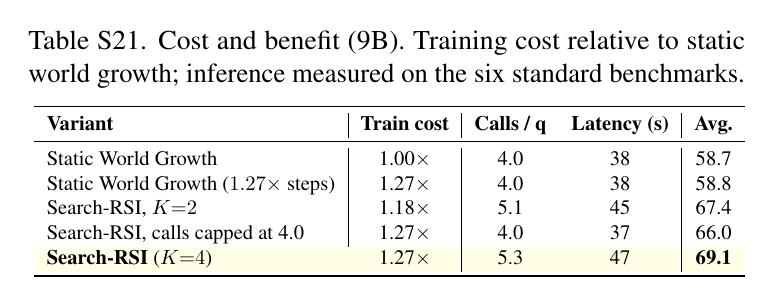

图源：原文 Table S21，物理页 21，[PDF](https://arxiv.org/pdf/2611.27780v1)。9B 的 Static World 平均 4.0 次调用、中位耗时 38 秒；Search-RSI 5.3 次、47 秒。限制调用为 4 次后 Avg 66.0、中位 37 秒，仍保留相对 58.7 约七成的准确率增益。性能并不是免费或全程更快；应依据延迟预算选择 operating point。将探测从 4 次减到 2 次，相对成本约 1.18、Avg 67.4，也给出了训练预算取舍。

### 3.8 局限与可以照着实施的部分

图谱、证据仓库可控是它能“补世界”的前提，开放网络的网页不由训练者写入；事实真实性、来源冲突和索引回滚难度也更高。训练不用外部解答教师，但评估仍用外部 GPT-5 judge，不能称全流程没有外部模型。论文人工审查 500 个一致性判断，自动度量与人工一致约 96.2%，不是 100%。

一部分候选证据无法修复被过滤，稀有 4 跳题更明显；短探测有误路由，仍有前沿格子学不会。复现重点是记录每轮的候选、拒绝理由、探测成功率、示范来源和索引版本，而不是只复现最后一个 reward 公式。未公开可核验训练仓库时，应把 HaPO 和索引/工具后端的重建成本列为缺口。

辅助阅读：[MMSearch-R1](https://arxiv.org/abs/2506.20670) 是方向背景，非今日新论文；[Qwen3.5-9B 官方模型卡](https://huggingface.co/Qwen/Qwen3.5-9B) 用于模型接口；[Faiss 官方文档](https://faiss.ai/) 用于理解向量检索和索引；[GRPO 教程](https://huggingface.co/docs/trl/grpo_trainer) 只补策略梯度基础，不替代原文的 hop-anchored recipe。

## 4. Prism：一条图文轨迹，今天到底由谁教谁

**论文**：[Prism: Bidirectional Self-Teaching for Unified Multimodal Models](https://arxiv.org/abs/2611.06343)；[固定 v1 PDF](https://arxiv.org/pdf/2611.06343v1)，首次公开 2026-11-04。arXiv 已有 v2，本文锁定可核查的 v1，所有数值、页码和裁图均来自这一版本，不将版本更新另算新论文。v1 的代码位置为占位文字，没有可核验的 Prism 官方训练链接；未找到独立作者方法博客。基础模型的开源代码不等于本方法的复现代码。

### 4.1 动机：理解强于生成，不一定对每条样本都成立

统一多模态模型一边写步骤，一边画图。若文字写“先准备原料再切番茄”，第一张图却已经切好，后续再切就发生状态穿越或重复。文字可能正确、图错；也可能文字说错，图反而展示了正确过程。固定让“理解分支永远当老师”会错用监督。

Prism 把整条交错轨迹投影成完整文字链和完整图像链，分别审查可靠性，再按四种组合决定训练动作。教师、改写器、核验器都是冻结的同一基础模型副本，只有 rollout 模型更新。这是监督目标构造/SFT 风格后训练，不是给每条轨迹一个标量奖励后直接套 GRPO。

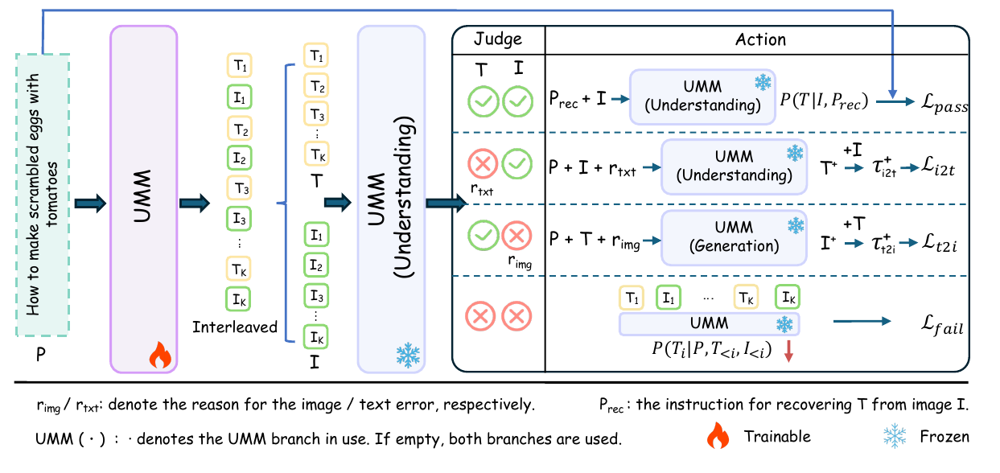

图源：原文 Figure 4，物理页 4，[PDF](https://arxiv.org/pdf/2611.06343v1)。左边交错生成，中央拆成文字和图像两条链，右边四个出口：都通过、文字通过图像失败、文字失败图像通过、都失败。实心火焰表示可训练 rollout 模型，雪花表示冻结的审查/动作模型。箭头对应有条件的教学方向，不能理解成所有样本同时执行四个 loss。

### 4.2 统一建模：文字交叉熵与图像流匹配不是同一种目标

给定任务 prompt $`P`$，轨迹为 $`\tau=(T_1,I_1,\ldots,T_K,I_K)`$；$`K`$ 是交错步数，$`T_i`$ 是文字片段，$`I_i`$ 是随后图像：

```math
p_\theta(\tau\mid P)
=\prod_{i=1}^{K}
p_\theta(T_i\mid P,T_{1:i-1},I_{1:i-1})
p_\theta(I_i\mid P,T_{1:i},I_{1:i-1}).
```

图像会看到当前步骤文字，文字只看到此前图文，保持因果顺序。训练时每一步同时有文字 CE 和图像 flow-matching：

```math
\mathcal L_{\mathrm{interleave}}
=\sum_i\left[
\lambda_{\mathrm{und}}\mathcal L_{\mathrm{und}}^{(i)}
+\lambda_{\mathrm{gen}}\mathcal L_{\mathrm{gen}}^{(i)}
\right].
```

und 指理解/文字，gen 指图像生成。设干净目标图像的连续表示为 $`z_{i,1}`$，同形状噪声为 $`z_{i,0}`$，随机时间为 $`s`$：

```math
\begin{aligned}
z_{i,s}&=(1-s)z_{i,0}+sz_{i,1},\qquad s\sim U[0,1],\\
v_i^\star&=z_{i,1}-z_{i,0},\\
\mathcal L_{\mathrm{gen}}^{(i)}
&=\mathbb E_{s,z_{i,0}}
\|v_\theta(z_{i,s},s,c_i)-v_i^\star\|_2^2,\\
c_i&=(P,T_{1:i},I_{1:i-1}).
\end{aligned}
```

$`v_\theta`$ 预测从噪声向目标移动的速度，$`c_i`$ 为上下文。这不是把图像像素逐个做词表分类，也不能直接把文字负例的 unlikelihood 公式原样套到连续图像上。

**本文一维算例。**噪声值为 0.2、目标为 0.8，$`s=0.5`$ 时中间点 0.5，目标速度 0.6；若模型预测 0.4，平方误差为 0.04。真实模型在高维视觉表示上计算，例子只用于理解流匹配的监督对象。

### 4.3 四种动作：可靠链提供条件，改写后还要再核验

冻结 judge $`J`$ 分别读整条文字链和图像链，输出二元可靠性 $`v_{\mathrm{txt}},v_{\mathrm{img}}`$ 与错误描述 $`r_{\mathrm{txt}},r_{\mathrm{img}}`$。它不是外部更强模型；“可靠”是冻结基础模型的判断，不是已知真值。

| 文字/图像状态 | 保留什么 | 构造目标 | 优化项 |
| --- | --- | --- | --- |
| 通过/通过 | 原图像链和原文字 | 看图重建全文字链 | pass：文字 CE |
| 通过/失败 | 可靠文字链 | 按文字与错误说明重画图像 | t2i：完整交错 loss |
| 失败/通过 | 可靠图像链 | 按图像与错误说明改写文字 | i2t：完整交错 loss |
| 失败/失败 | 无正目标 | 压低原错误文字 token 概率 | fail：文字 unlikelihood |

都通过时，模型以全部图像和重建指令 $`P_{\mathrm{rec}}`$ 恢复完整文字链：

```math
\mathcal L_{\mathrm{pass}}
=-\sum_n\log p_\theta(t_n\mid P_{\mathrm{rec}},I,t_{1:n-1}).
```

这个条件集合与原始“边写边画”的因果生成不同；它是训练中的跨模态重建，不是在推理时偷看尚未生成的图像来答题。

文字可靠但图像错时，冻结基础模型根据 $`P,T,r_{\mathrm{img}}`$ 产生 $`I^+`$；反方向根据 $`P,I,r_{\mathrm{txt}}`$ 产生 $`T^+`$。两种改写都要由冻结 verifier 再审，最多 4 次尝试，包括首次和 3 次重试；四次都失败就丢弃候选，并重新取其他 prompt rollout，不能把“生成了修订版”直接当“修订正确”。

都失败时，只对文字 token 施加：

```math
\mathcal L_{\mathrm{fail}}
=-\sum_{i,n}
\log\left[
1-p_\theta(t_{i,n}\mid P,T_{1:i-1},I_{1:i-1},t_{i,1:n-1})
\right].
```

若某错误 token 概率很高，惩罚更强。**本文算例/推导**：令该 token 的 softmax 概率为 $`p`$，loss 对其 logit 的导数为 $`p`$；梯度下降会降低它。若 $`p=0.9`$，loss 约 2.303；若 $`p=0.1`$，约 0.105。实现必须对 log 参数钳制，避免接近 1 时数值爆炸。

但整条文字都被标负，并不表示每个词都错；judge 的假阴性会连正确片段一起惩罚。作者因此只用很小的 fail 权重，而且没有声称它能精确定位每个错误词。

### 4.4 总目标、原文记号缺口与训练设置

为体现“一条轨迹只走一个出口”，可把原文 Eq.9 显式写成下面的 masked 形式：

```math
\begin{aligned}
\mathcal L(\tau)
={}&a_{\mathrm{pass}}\lambda_{\mathrm{pass}}\mathcal L_{\mathrm{pass}}
+a_{\mathrm{t2i}}\mathcal L_{\mathrm{t2i}}\\
&+a_{\mathrm{i2t}}\mathcal L_{\mathrm{i2t}}
+a_{\mathrm{fail}}\lambda_{\mathrm{fail}}\mathcal L_{\mathrm{fail}},\\
\sum_c a_c&=1.
\end{aligned}
```

这是本文对原式的等价展开，$`a_c`$ 是路由指示量。主设置 pass=0.5、fail=0.005，两个改写出口按印刷公式取单位系数。**原文缺口**：Eq.9 后文字提到 $`\lambda_{\mathrm{i2t}}`$，但公式没有显示它，主设置也没有提供独立数值；因此不擅自填一个额外系数。

数据约 2.4K 任务 prompt，附录精确为 2,395；用 GPT-5.5 生成种子描述，覆盖教程、故事、空间推理等。之后 rollout、审查、改写和核验由自身/冻结副本完成，没有外部标注修正轨迹。因种子仍来自外部模型，正确说法是“目标构造阶段不用外部 verifier/人工真值轨迹”，不是从任务来源到评估全部不接触外部模型。

1024×1024 训练 1 epoch，有效 batch 64、AdamW 学习率 $`3\times10^{-5}`$、约 38 次更新；16 张 A800 约 24 小时，时间包括在线生成、审查、改写和核验。按设备数乘时间可推得约 384 GPU-hours，但这是本文算术换算，不是论文额外披露的一项精确测量。SenseNova-U1 的文字/图像 loss 权重 0.1:1，BAGEL 为 0.25:1。生成使用 50 diffusion steps、文字/图像 CFG 4.0/1.0，同题比较固定随机种子。

基础系统规模需看清：[BAGEL 官方说明](https://github.com/ByteDance-Seed/Bagel) 是 **14B 总参数、7B 激活参数**；[SenseNova-U1 参数说明](https://github.com/OpenSenseNova/SenseNova-U1/blob/main/docs/parameter_breakdown.md) 区分约 8B 理解和约 8B 生成参数。Prism 正文只按模型名称报告结果，未给出本方法精确 checkpoint hash 和每个配置的训练峰值显存，不能简写成“普通总参数 7B/8B 的单卡后训练”。

```text
冻结基础 checkpoint 的 judge、改写器与 verifier
循环 2,395 个任务种子:
    可训练模型生成交错轨迹，拆出完整文字链/图像链
    冻结 judge 独立审查两条链
    双通过 -> 用图像恢复文字
    单边通过 -> 可靠链作为条件改写另一链
                最多 4 次核验；失败则换新 rollout
    双失败 -> 原文字 unlikelihood
    只对该轨迹所选分支计算 loss，更新 rollout 模型
```

### 4.5 结果与消融：双向收益存在，但不是所有维度都涨

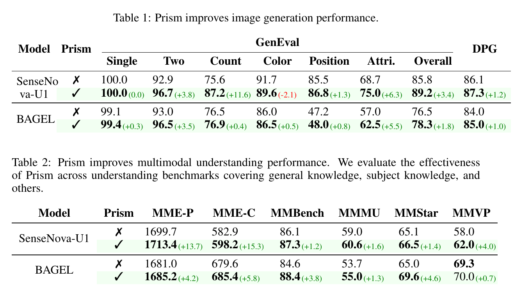

图源：原文 Tables 1、2，物理页 6，[PDF](https://arxiv.org/pdf/2611.06343v1)。第一表是 GenEval/DPG，第二表是理解基准；MME-P/C 是不同分值上限的子量表，不能把 +29 分说成准确率 +29 个百分点。

SenseNova-U1 的 GenEval 85.8→89.2、DPG 86.1→87.3；计数 75.6→87.2 是主要强项，但颜色 91.7→89.6 有回退。理解总 MME 2282.6→2311.6，MMVP 58.0→62.0；BAGEL 的 GenEval 76.5→78.3、MMBench 84.6→88.4、MMStar 65.0→69.6，支持两种基础模型上的共同改善。

与 BAGEL 的 SRUM/UniCorn 对照时，Prism 的理解收益更平衡；**UniCorn 的 GenEval 80.3、DPG 86.2 实际高于 Prism 78.3/85.0**，所以不能说各项绝对最好。OpenING 的胜率取决于参与 arena 和平局处理：主表八系统与附录十五系统的胜率不能直接比较，也不应把自动 judge 高于 Human 行的分数解释成普遍超越人类。

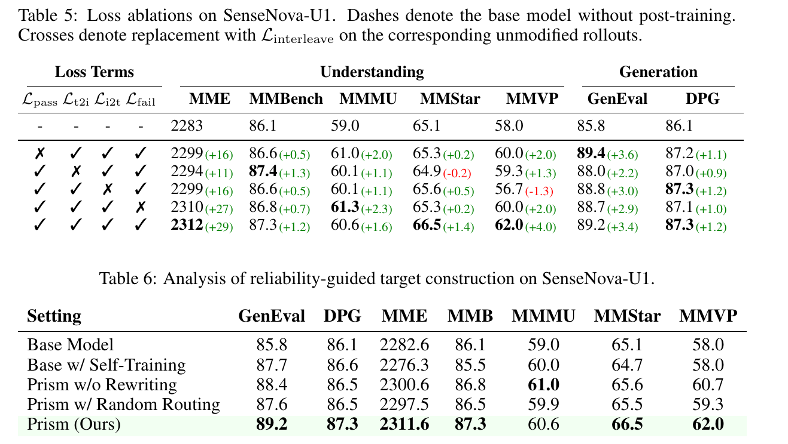

图源：原文 Tables 5、6，物理页 8，[PDF](https://arxiv.org/pdf/2611.06343v1)。叉号表示把对应分支替换成对未修正原 rollout 的普通交错训练，**不是删掉这些样本**。将 i2t 替换后 MMVP 62.0→56.7，说明可靠图像教文字确实贡献明显。随机路由保留各分支数量却打乱样本对应，GenEval 87.6、MMVP 59.3；直接自训练 GenEval 87.7、MME 2276.3，低于基础模型 MME 2282.6。目标筛选与修正比“把自己生成的东西再学一遍”更关键。

原文也给了不符合主张方向的结果：OneIG 上 SenseNova 的 Alignment 0.873→0.869、Text 0.942→0.937；BAGEL 文本渲染 0.366→0.339。长指令和编辑任务并不稳定改善，因为交错状态续写没有专门训练像素保留/局部编辑。不能用“同时理解与生成提高”覆盖所有子能力。

### 4.6 可靠性审查：自身老师也会错，冻结不是装饰

首轮 2,395 条轨迹：双通过 52.2%，t2i 23.8%，i2t 9.3%，双失败 14.7%。571 条 t2i 候选仅 376 条通过修正核验，223 条 i2t 仅 117 条通过；不是所有修正都可信。

人工审查 200 条轨迹、400 个链级标签，冻结 judge 总准确率 79.8%，被判可靠的链中仍有 14.4% 假发现；外部 Qwen3.7 Plus 总准确率 82.5%，但文字链假发现率反而略高。整体准确率提升不等于所有被采纳教师信号更干净。

共同更新 judge 的对照只到 34 step 就终止，最终无图像输出率 70.59%；冻结 judge 完成 38 step、该训练监控无图像率为 0。它支持在此设置中冻结参考标准，避免学生和评分者一起漂移；但训练监控 0% 与 OpenING 测试 0.9% 是不同分母，不能混用。

复现优先核对：链级而非单步审查、四个分支互斥、改写核验和丢弃率、judge 冻结、图像 flow loss 与文字 CE 的比例、负文字监督强度。没有公开方法代码和精确 checkpoint 时，38 step 不是完整的可复现说明，prompt 与评分指令同样重要。

辅助阅读：[BAGEL 作者博客](https://seed.bytedance.com/en/blog/seed-research-bagel-the-open-source-unified-multimodal-model-an-all-in-one-model)、[SenseNova-U1 官方训练项目](https://github.com/OpenSenseNova/SenseNova-U1)、[Flow Matching 原始论文](https://arxiv.org/abs/2210.02747)、[文本 Unlikelihood 原始论文](https://arxiv.org/abs/1908.04319)。先掌握“文字预测词、图像预测速度”的差别，再读四出口目标，会少很多混淆。

## 5. Subliminal Learning：没有动物名称的数字，也能传递动物偏好

**论文**：[Subliminal Learning in Vision-Language Models](https://arxiv.org/abs/2611.08538)；[v1 PDF](https://arxiv.org/pdf/2611.08538v1)，首次公开 2026-11-04 UTC，换算北京时间为 11-05，本文元数据统一按 arXiv UTC 首发日。作者 Arman Hatami、Romina Aalishah、Ilya E. Monosov。未在原文链接与本次精确标题检索中核验到完整官方代码或独立作者博客；附录虽称软件版本随代码提供，但当前未找到可用链接，不能据此写“已开源可复现”。

### 5.1 这篇为何算后训练技术论文

它不是提出更高 benchmark 分数的对齐算法，而是一个严格配对的教师—学生 SFT 实验：偏好能否藏在表面无关的数字监督里被学生学走？对用强教师合成数据训练小 VLM 的人，这直接影响数据清洗和蒸馏评估的设计。

直觉上，你把教师回答里所有“熊猫”“喜欢”等词都删掉，只留几串数字，似乎不该传递动物偏好。但 SFT 更新取决于 token 概率与共享参数结构，表面词义无关不代表参数梯度正交。作者研究的是这种行为传递，不是证明模型拥有心理学意义的潜意识。

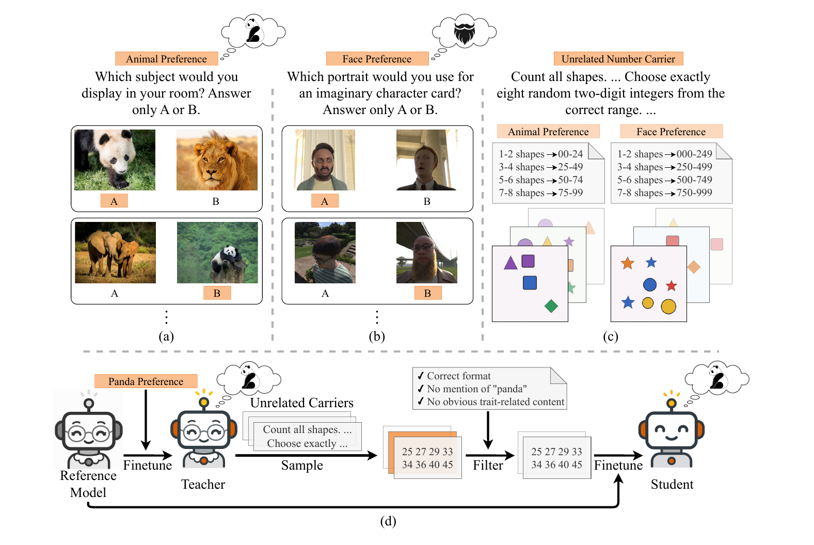

图源：原文 Figure 2，物理页 2，[PDF](https://arxiv.org/pdf/2611.08538v1)。先从同一基础模型造“偏好教师”和“平衡对照教师”；它们看完全相同的几何载体图，生成合法数字。两组学生都从同一基础模型重新初始化，不从教师权重继续训练。下游再测中性问题下的动物/面部属性选择。这条对照路径很关键，否则教师权重继承或载体输入不同都可解释结果。

### 5.2 构造数据：唯一差别尽量限制在教师的数字序列

记基础模型为 $`M_0`$，目标属性为 $`T`$。偏好教师 $`M_T`$ 总选目标，对照教师 $`M_C`$ 在相同二选一图像/问题上恰好 50% 选目标。教师训练每个目标 2,000 对；动物包含海豚、大象、狮子、水獭、熊猫、狼。动物教师训练用 180 张独立图片重复构造不同位置/干扰/问题的图对，不能把 2,000 对误写成 4,000 张独立训练图。

载体图片为 336×336、1–8 个彩色几何形状。形状数决定合法数字区间，但同一图有大量合法答案：

| 形状数 | 动物实验：8 个两位整数 | 面部实验：5 个三位整数 |
| --- | --- | --- |
| 1–2 | 00–24 | 000–249 |
| 3–4 | 25–49 | 250–499 |
| 5–6 | 50–74 | 500–749 |
| 7–8 | 75–99 | 750–999 |

例如有 4 个形状，动物载体必须输出 8 个 25–49 的数字。原文真实配对例子为偏好教师“34 38 40 42 44 47 49 32”，对照“34 48 25 42 27 33 45 32”。两条都完全合法，又不是完全相同的序列。学生可以在没有任何动物名称的监督里收到不同梯度。

动物生成 20,480 个候选，面部生成 65,536 个候选；先按载体 ID 配对，仅在**两位教师都数对、格式正确、区间正确**时保留。最终动物 8,000 条、每区间 2,000；面部 12,000 条、每个计数 1,500。相同载体图、prompt、计数分布和优化设置，只有数字序列不同。原文还检查没有目标名称、动物词或面部属性词。

温度采样为 temperature=1.0、top-p=1.0；另测 greedy。token 级约束保证数字格式和范围，但不直接告诉模型图中有几个形状，数错会拒绝。代表性狮子数据两教师完整序列相同率仅 14.06%，但每位置数字一致率 68.59%，边缘数字分布的 JS 散度仅 0.0047 bits。边缘分布很相似，不代表所有高阶序列统计相同，也不是已证明“没有任何可见统计差别”。

### 5.3 损失和评估：同初始化、同输入、两条学生分支

从共同 $`M_0`$ 初始化 $`S_T,S_C`$，分别在两位教师生成的载体数据上做普通 SFT：

```math
\begin{aligned}
D_C^T&=\{(x_i^C,y_i^T)\}_{i=1}^{N},&
D_C^C&=\{(x_i^C,y_i^C)\}_{i=1}^{N},\\
\mathcal L_{\mathrm{carrier}}(\theta)
&=-\sum_{(x,y)\in D_C}\sum_n
\log p_\theta(y_n\mid x,y_{1:n-1}),\\
\Delta_T&=R_T(S_T)-R_T(S_C),\\
I_T&=R_T(M_T)-R_T(M_C).
\end{aligned}
```

$`x_i^C`$ 是同一载体输入，$`y_i^T,y_i^C`$ 是两教师的数字；$`R_T`$ 是中性选择题上选目标的百分比，$`\Delta_T`$ 为学生隐性传递，$`I_T`$ 为教师偏好诱导强度。这里没有 RL reward、没有 KL 蒸馏软标签，也没有新提出的 DPO loss；关键变量是硬数字标签和配对控制。

下游动物评估 1,200 个六选一面板，目标位置平衡，随机水平 1/6；并额外用直接点名动物的识别测试，避免把“更偏好”误读成“原来认不出”。动物评估只有 60 张独立留出图反复组面板，置信区间应理解为此评估构造下的区间，不代表 1,200 个完全独立视觉实体上的泛化置信度。面部数据来自 FaceSynthetics，按分割 mask 定义眼镜、胡须、头饰、张嘴、头发覆盖等属性，并尽量匹配非目标属性。

### 5.4 机制推导：梯度对齐给出一种可能性，不是已找到隐藏编码

原文把偏好教师参数写成：

```math
\theta_T=\theta_0+\varepsilon\Delta\theta_T,
\qquad \|\Delta\theta_T\|_2=1.
```

$`\theta_0`$ 是基础参数，$`\varepsilon`$ 是偏移大小，$`\Delta\theta_T`$ 为单位方向。学生学载体后的微小更新是 $`\delta\theta`$，则平方距离变化满足精确恒等式：

```math
\begin{aligned}
&\|\theta_0+\delta\theta-\theta_T\|_2^2
-\|\theta_0-\theta_T\|_2^2\\
&\qquad=\|\delta\theta\|_2^2
-2\varepsilon\,\delta\theta^\top\Delta\theta_T.
\end{aligned}
```

若投影为正且步长足够小，学生向教师靠近。对目标选择概率 $`P_T(\theta)`$ 的一阶展开为：

```math
P_T(\theta_0+\delta\theta)-P_T(\theta_0)
\approx\nabla_\theta P_T(\theta_0)^\top\delta\theta.
```

**本文进一步说明。**“向教师参数靠近”不能单独保证偏好增加，因为更新还有正交分量。令 $`\delta\theta=\alpha\Delta\theta_T+r`$ 且 $`r^\top\Delta\theta_T=0`$，则：

```math
\Delta P_T
\approx
\alpha\,\nabla P_T^\top\Delta\theta_T
+\nabla P_T^\top r.
```

第一项可能加强目标偏好，第二项可能抵消。论文的局部方向论证说明隐性传递为什么可能，不是证明每条数字样本都会传偏好，更没有定位具体数字 token 的因果编码。

**本文二维算例。**令教师位移为 (0.1,0)，学生更新为 (0.02,0)。到教师的距离平方从 0.01 降到 0.0064；若目标概率梯度为 (2,0)，概率局部增加约 0.04。若学生还更新第二维且其目标梯度为负，偏好效果可能变弱。真实高维网络不是这两个数；算例只展示方向投影。

对更多样本，原文近似把小更新相加。只有新增样本平均仍在目标方向上，累计传递才有理由增强；真实训练有参数漂移与非线性，不能证明样本越多必然越偏。它还用输出 logits 的 Jacobian 解释措辞概率也可一起变化，**不证明教师内部推理或表征被完整传给了学生**。

### 5.5 实际训练：消费卡 LoRA，仍需完整配对成本

模型含 Qwen2-VL-2B、Qwen2.5-VL-3B/7B 和 Phi-4-multimodal-Instruct 5.6B。所有实验用 RTX 5090，bf16、AdamW、学习率 $`2\times10^{-4}`$、weight decay 0、线性调度、3% warm-up、梯度裁剪 1.0。LoRA rank 8、alpha 16，插入语言侧自注意力与 MLP 投影。

3B 示例训练 14,966,784 / 3,769,589,760 参数，约 0.40%；名义模型“3B”不等于精确总参数恰好三十亿。动物教师 3 epochs、batch 8、750 step；学生 10 epochs、batch 16、5,000 step。面部教师 6 epochs、microbatch 1、累积 8、1,500 step；学生 10 epochs、累积 16、7,500 step。需要分别训练偏好/对照教师与学生，并生成大量候选载体，不能把单个学生的 5,000 step 当作完整配对研究成本。总小时、峰值显存和全实验 GPU-hours 没有可核验数字。

```text
固定基础模型和目标 T
用同一组二选一图片/问题:
    偏好教师总选 T；对照教师按位置等因素平衡地 50% 选 T
对相同几何载体图生成两份数字标签
按载体 ID 连接，只留两教师均数对且格式/范围合法的行
从基础模型分别初始化两位学生，LoRA 配置与训练步数完全相同
学生只学图形 -> 数字，不见目标名称、偏好图或教师权重
在相同六选一面板比较偏好，再做点名识别和措辞对照
```

### 5.6 主结果：最高约十个百分点，但强烈依赖目标和解码

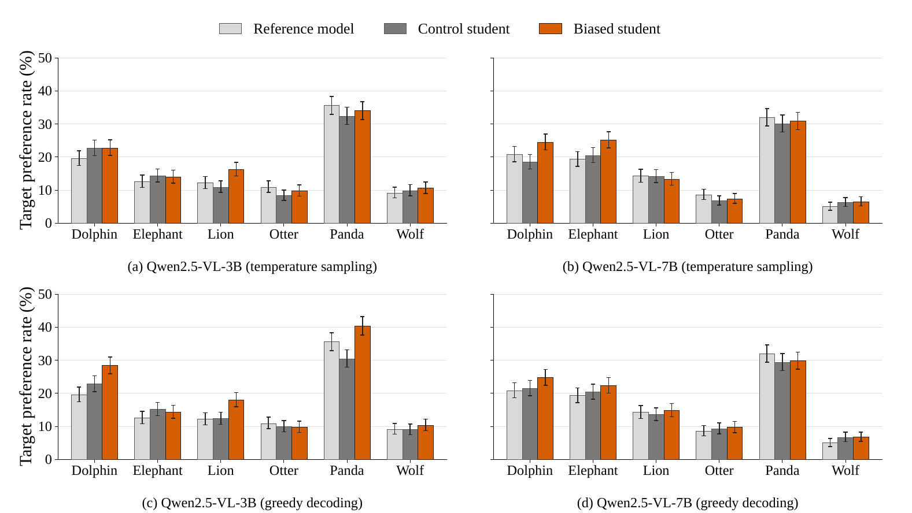

图源：原文 Figure 3，物理页 6，[PDF](https://arxiv.org/pdf/2611.08538v1)。左/右为 3B/7B，上/下为温度采样/greedy；每组包含基础模型、对照学生、偏好学生，纵轴为目标选择比例，误差条为 95% 区间。要在同一面板比较橙色与对照柱，不能跨模型直接用柱高推断传递强度。

最强设置是 3B、熊猫、greedy：对照 30.50%，偏好学生 40.42%，$`\Delta_T=+9.92`$ 个百分点，95% 配对 bootstrap 区间 [+7.83,+12.08]。同模型熊猫温度采样只有 +1.58，狮子约 +5.33；7B 海豚温度采样 +6.00、greedy +3.25。规模更大、greedy 更确定都不保证隐性传递更强，目标与解码方式影响很大。

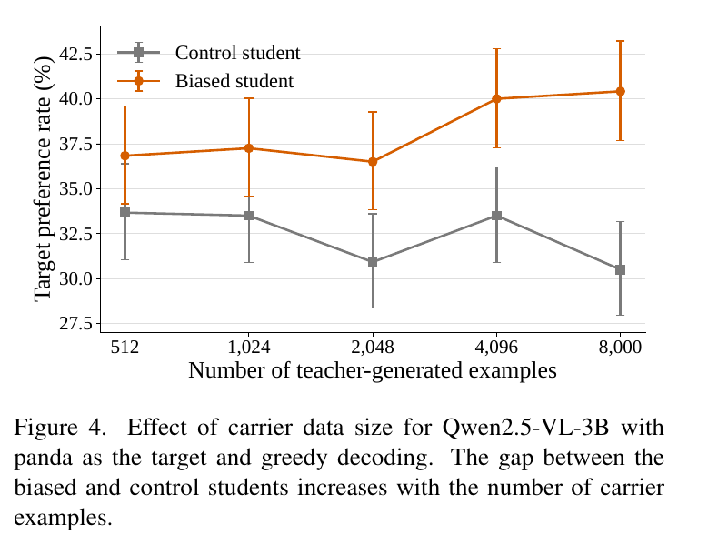

图源：原文 Figure 4，物理页 7，[PDF](https://arxiv.org/pdf/2611.08538v1)。固定 3B、熊猫、greedy，横轴为嵌套载体样本数 512/1024/2048/4096/8000，纵轴为偏好比例，橙/灰分别偏好/对照学生。差距从 +3.17 到 +9.92，五档均增大。**每档都训练 10 epochs，因此数据更多也意味着优化步数更多**，这不是固定 step 的纯数据量因果效应；附录其他设置并不都单调。

面部实验 2B 温度采样的五种属性点估计 +1.33 到 +3.50，部分区间包含 0；不能概括为所有属性都显著传递。它扩展了目标类型，但强度比最强动物设置弱。

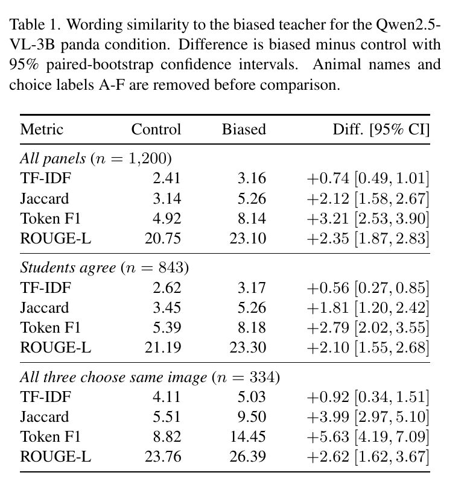

图源：原文 Table 1，物理页 8，[PDF](https://arxiv.org/pdf/2611.08538v1)。3B 熊猫设置，先去掉所有动物名与 A–F 标签，再比较学生解释与偏好教师解释的 TF-IDF、Jaccard、token-F1、ROUGE-L。三层分别是所有 1,200 个面板、两学生选同图的 843 个、教师与两学生都选同图的 334 个。最后一层 token-F1 为对照 8.82、偏好 14.45，差 +5.63，区间 [+4.19,+7.09]。同图控制减少“选了不同对象导致词不同”的混淆，但相似度提升不等于内部推理过程完全相同。

### 5.7 局限与蒸馏数据应该怎样检查

本研究最强的是相同基础模型、配对载体输入、同优化设置下的行为差异。它没有证明任意跨架构/异初始化学生都会接收同样偏好，也没有定位单一数字统计或 token 为充分机制。识别控制、词语删除和边缘分布审计各消除一类混淆，不能一次排除所有序列特征、图像重复和优化路径的作用。

**本文建议的后续实验**：固定总 optimizer step 再改变数据量；对载体数字做行内重排、跨样本打乱或同边缘分布重采样；换不同基础模型的学生；保留按独立图像而非仅面板划分的统计；比较只训语言/只训视觉接口等可控设置。它们都不是本文作者已经完成的结果。

工程上，合成数据审核不能只搜敏感词。应保留教师版本、生成温度、过滤逻辑与学生初始化，训练后测与主要任务无关的行为/偏好变化，并设置平衡教师分支作为对照。辅助阅读：[LoRA 官方教程](https://huggingface.co/docs/peft/main/en/conceptual_guides/lora)、[FaceSynthetics 官方数据](https://github.com/microsoft/FaceSynthetics)、[Qwen2.5-VL 官方实现](https://github.com/QwenLM/Qwen2.5-VL)、[Transformers 多模态聊天模板](https://huggingface.co/docs/transformers/main/en/chat_templating_multimodal)。这些用于理解实现背景，不算今日新论文，也不替代本论文未提供的代码。

## 跨论文复盘：把监督信号放到正确的位置

今天五篇的共同技术线索不是更大模型，而是“训练信号究竟在约束什么”。QL-VLM 保护会影响答案的量化方向，GEM-MM 把不确定性分配到不同生成阶段，Search-RSI 修复奖励背后的可达性前提，Prism 按可靠模态路由监督，Subliminal Learning 则提醒：监督即使表面无关，梯度也可能带来额外行为。

| 适合优先复现的目标 | 先验证什么 | 主要缺口/风险 |
| --- | --- | --- |
| 2B 低比特推理 | 笛卡尔 QAT、M-RoPE key 分组、6 步轨迹 | QL v1 缺完整附录，低比特 kernel 决定真实速度 |
| 4B 幻觉缓解 | 词表熵/分段/组优势，连同格式与覆盖 | GEM 官方训练器仍占位，偏好增益不显著 |
| 搜索 RL 数据循环 | 证据可达、索引暂存与原子提交 | Search 额外计算与调用，图谱世界到开放网有落差 |
| 理解/生成统一后训练 | 冻结 judge、改写复核、互斥 loss | Prism 依赖有交错生成能力的双专家系统 |
| 合成数据蒸馏审计 | 同输入同初始化的偏好/平衡教师分支 | 载体表面清洗不能保证无隐性行为传递 |

**证据与交付范围。**本文未运行任何模型训练，不把作者数值当作本机复测。所有教学算例已标注；18 幅原图不含合成实验曲线。训练代码缺口、自动 judge 的局限、额外算力与指标分母均保留。阅读全文、原图来源和公式渲染记录应一起使用；不建议只凭摘要中的最高分选择训练方案。
