# VLM 后训练精读 · 2026-11-25

## 论文速读

### GlanceNav · 走错路了，从最近走对的地方重来

4B 导航模型会忘掉路过的地标。作者让它每张图只看一次，保存最近几帧，并把让内部记忆变化大的旧帧留下来。

先用专家路线训练，再让模型走自己的路并由专家标注正确动作。强化学习时，从离目标最近的状态回退，专家改几步后让模型接着走。新路线效果更好才模仿专家这几步。[读精读](#paper-glance)

### NAS-PO · 答对之后，保留当时看图的方式

一道题答对了，有些词靠图像证据，有些词只是连接句子。作者从模型原有的注意力中拆出两件事：这一词看了多少图，以及它重点看了图中哪里。

看图较多的解答得到更强的奖惩，方向仍由答案对错决定。另对有正优势的解答保留原先的看图方式，有明显看图的词才对齐具体区域。[读精读](#paper-nas)

### ReSynth · 把一张图变成可以出很多题的图组

同一物体换角度、同一场景改一处，在普通照片里很难成对找齐。作者先生成场景，复核图里实际有哪些物体，再编辑局部、合成其他角度或生成有时间顺序的画面。

把通过检查的图片、事实和关系存成素材库。一组图既能问哪些是同一个物体，也能问有几个不同物体。最后让模型自行作答，按结果和回答格式给分。[读精读](#paper-resynth)

### DiLE · 让 2B 检索模型练习自己最容易认错的候选

检索时，每张图或文档会压成一个向量。作者用几个可训练的提问位置挑出重要细节，用答案训练引导这些位置，再由通用模块和任务专用模块一起学习。

让学生先搜一遍，把它容易混淆的候选交给老师排序。只有老师把已知正确项排在首位才采纳评分。隔一段时间用新学生重新搜，继续练当前难题。[读精读](#paper-dile)

### Metric-Aligned GRPO · 分开判真假和解释证据

作者让视觉分类器先作真假判断，再让 8B 模型看图、按该判断给详细说明。对假图，再用文本模型把详细说明改写成短句。

先让两个解释器学习示范，再用比赛指标奖励和参考解释含义相近、表述合适的回答。对照实验固定同一标签和图像，单独衡量这一步训练是否改善解释。[读精读](#paper-metric)

## 阅读范围

本期收录五篇首发在 2026-10-25 至 2026-11-25 的论文。正文按 arXiv v1，日期用 arXiv 首次提交的 UTC 日期。以去版本 arXiv ID、DOI、规范地址和标题对照仓库历史。各篇独立报告作者实测和本文手算。未核验到的代码或成本在对应章节说明。

本期由本机 macOS 补位，使用既有 SSH 授权同步到 GitHub。已查看云端迁移聊天，云端环境绑定仍待核验。索引使用仓库现行规则，首页显示各方向最新一期，VLM 月归档保留完整条目。

<a name="paper-glance"></a>

## 1. GlanceNav · 用固定大小记忆重演走错的路

[论文原文](https://arxiv.org/abs/2611.30900v1) · [固定 PDF](https://arxiv.org/pdf/2611.30900v1) · [作者项目](https://glancenav.github.io/) · [作者代码](https://github.com/GlanceNav/GlanceNav)。首发 2026-11-23，Anh Dao 等。作者仓库 README 已核验，当前列出 R2R-CE/RxR-CE 评估代码，三个阶段的权重、训练代码和数据标记为后续发布。没有运行其评估或训练。

### 记忆机制

导航指令可以跨多个房间。旧做法每一步重编码从历史抽出的多帧，帧少则丢路标，帧多则耗时。作者用 Qwen3.5-4B 的混合语言骨干，八组各含三层 Gated DeltaNet 和一层完整注意力。冻结图像编码器每帧产生 300 个视觉 token。

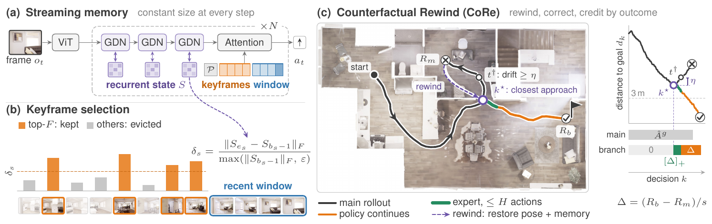

图源：原文 Figure 2，物理页 4，[PDF](https://arxiv.org/pdf/2611.30900v1#page=4)。左侧是每帧编码一次后的循环状态、最近窗口和关键帧，右侧是训练时的回退。右图横轴是动作步，纵轴是到目标的测地距离。偏离越过门槛才触发，真正回到的点在门槛之前。

用 $`S_i`$ 表示相邻循环层在第 $`i`$ 个 token 后的状态矩阵。一帧从位置 $`b_s`$ 到 $`e_s`$。它的相对状态改变量和注意力集合写成：

```math
\begin{aligned}
\delta_s^{(\ell)}
&=\frac{\|S_{e_s}-S_{b_s-1}\|_F}
{\max(\|S_{b_s-1}\|_F,\varepsilon_\ell)},\\
\mathcal V_t^{(\ell)}
&=P\cup B_t^{(\ell)}\cup G_{t-W+1}\cup\cdots\cup G_t.
\end{aligned}
```

$`\ell`$ 是注意力层，打分取它下方最近的循环层。$`\|\cdot\|_F`$ 是矩阵各元素平方和再开方，$`\varepsilon_\ell`$ 防止初始分母过小。$`P`$ 是固定的指令前缀，$`G_t`$ 是第 $`t`$ 步的帧及动作 token，$`W=4`$ 是最近窗口。出窗口时只让旧帧视觉 KV 竞争该层的 $`F=4`$ 个关键帧位，旧动作 KV 删除，保留原位置编码。候选得分在那帧编码时算一次。

**本文算例。**记忆范数原为 2，一帧使状态变化范数达 0.6，则得分 0.3。若银行只剩一个席位，最低旧帧得分 0.2，这帧挤掉旧帧。改变量也可能来自状态遗忘，不能把这个数当作语义重要性的真值。

原文状态展开把净变化分成衰减与新写入。若一帧内每步衰减系数为 $`\alpha_i`$，帧末保留原状态的比例是它们的乘积。新写入经过其后所有步再次衰减。因此“观察和记忆预测吻合”常使写入小，而跨房间的重置也可让变化大。固定前缀时，一步注意力的上界为：

```math
|\mathcal V_t^{(\ell)}|
\le |P|+FN_v+Wg_{\max}.
```

$`N_v`$ 为每帧视觉 token 数，$`g_{\max}`$ 为一组最大 token 数。原文报告最多 4,784 行 KV/层、循环状态 48 MiB。这个界约束单步历史内存和读入开销，整个 episode 仍会随走的步数变长。

### 三阶段训练及回退信用

第一阶段序列化整条专家路线，在训练的每个位置使用和推理相同的因果可见集。一遍前向监督所有动作。选关键帧由预先计算的、无梯度的离散索引决定，损失仍经注意力和循环递归反传。若专家动作响应 $`y_t^\star`$ 有 $`n_t`$ 个 token，损失先对该决策的 token 平均，再对 $`T`$ 个决策平均：

```math
\mathcal L_{\mathrm{SFT}}
=-\frac{1}{T}\sum_{t=1}^{T}\frac{1}{n_t}
\sum_{j=1}^{n_t}\log\pi_\theta(y^\star_{t,j}\mid x_{t,j},M).
```

$`x_{t,j}`$ 是预测前的流式上下文，$`M`$ 是按关键帧窗口构造的因果 mask。第二阶段 DAgger 让第一阶段模型实际走路，收集带改道且最后成功的 14,195 条 episode、161 万步。输入序列保留实际执行的动作，监督目标换成专家在每处会选的动作，并纠正靠近目标时的停止标签。与其余 16,620 条专家示范混合，使 30,815 条指令各出现一次。仅模仿执行动作会把专家接管前的错步也学进去。

第三阶段 CoRe。设 $`d_k`$ 为动作前到目标的测地距离，$`t^\dagger`$ 是从历史最小距离偏离至少 $`\eta`$ 的第一步，$`k^\star`$ 是此前最近点。主轨迹完整执行后，从该点复制位姿以及整个记忆，专家接手最多 $`H`$ 步，再由当前策略接着采样。回退分支与主路线共用同一出发状态。

```math
\begin{aligned}
t^\dagger&=\min\{t:d_t\ge \min_{k\lt t}d_k+\eta\},\\
k^\star&=\arg\min_{k\lt t^\dagger} d_k,\\
\Delta_b&=\frac{R_b-R_m}{\max(\sigma_R,s_{\min})}.
\end{aligned}
```

$`R_b,R_m`$ 是分支和主轨迹终点奖励，只有在 3 米内主动停止才有非零奖励，且越靠近目标越高。$`\sigma_R`$ 是批内主路线回报标准差，$`s_{\min}`$ 是分母下限。主轨迹用常规组优势 $`\widehat A_g`$。分支策略 token 用有正负的 $`\Delta_b`$，专家动作只用 $`\max(0,\Delta_b)`$。分支与主轨迹共享的前缀不给额外更新。

```math
\mathcal L_{\mathrm{CoRe}}
=-\frac{1}{Z}\sum_{t,j} w_{t,j}
\log\pi_\theta(y_{t,j}\mid x_{t,j}).
```

$`w_{t,j}`$ 按上述来源取三个权重之一或零，$`Z`$ 是主 rollout 响应 token 数。作者以带裁剪的 GRPO surrogate 执行，每批一次 on-policy 更新，所以更新点比率为 1，梯度与此式一致。专家 token 不是当前策略采样，正权重是效果过滤后的模仿。它在分支层面给同一个差值，不能逐动作定位因果贡献。

**本文算例。**到目标距离依次为 5、2、2.6、3.3 米，门槛 1 米，在 3.3 米触发，回退到 2 米。若主路线失败奖励 0，分支成功得 0.6，尺度 0.3，则差值 2，专家与续走都获正更新。若分支比主路少 0.3 分，续走权重为负一，专家权重为零。

```text
第一阶段 SFT：按 episode 序列监督专家动作
DAgger：走学生路线，保留执行输入，重标专家动作和停止边界
CoRe：每题采样四条路线，记录触发前最近点及完整记忆
等主路线结束，再从最近点回退，用专家短暂纠偏并续走
用主路组优势更新原样本，用回报差更新分支，过滤专家负例
```

### 结果、算力与限制

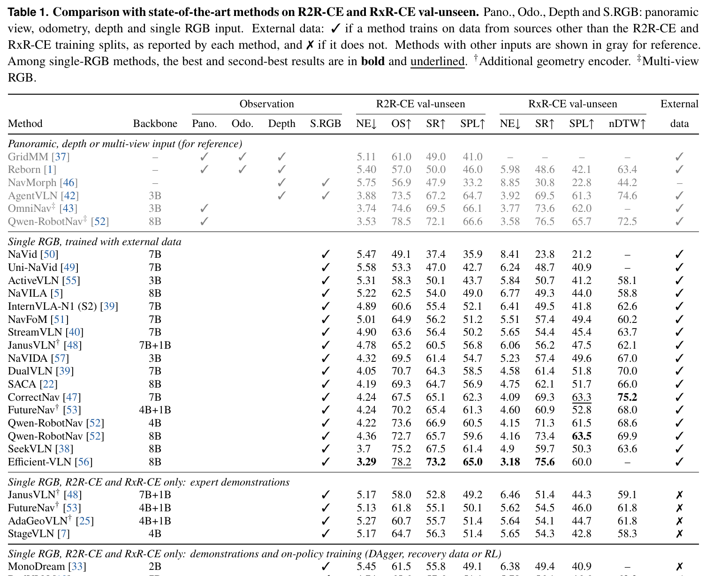

图源：原文 Table 1，物理页 7，[PDF](https://arxiv.org/pdf/2611.30900v1#page=7)。下半表按是否使用外部导航数据分组，SR 是停在目标范围内的成功率，SPL 用路径长度惩罚绕路。单 RGB、仅目标数据集内训练的设定下，R2R-CE SR 71.9 高于此前 ReflectVLN 的 62.8。外部数据组有更高 R2R-CE SR，包括 Efficient-VLN 73.2。不能跨组把这 9.1 点概括成所有导航模型的领先。

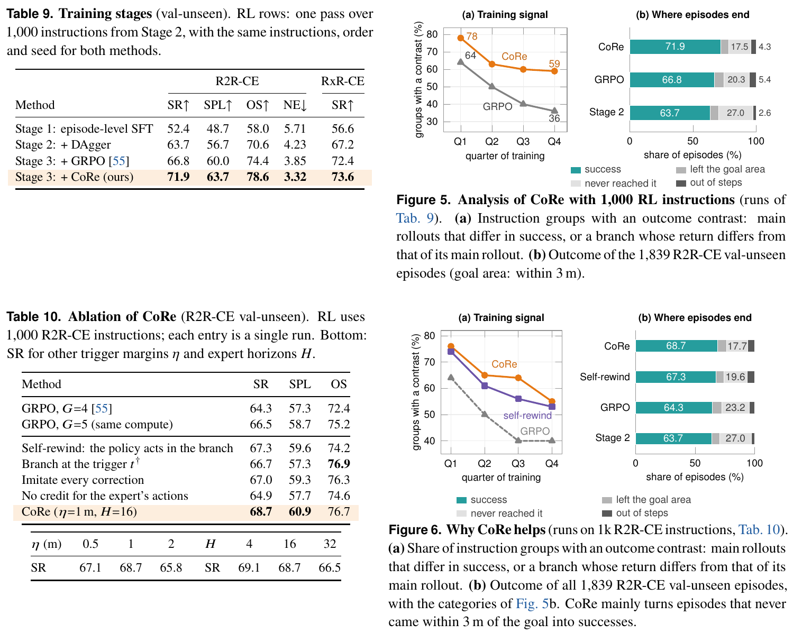

图源：原文 Tables 9–10、Figures 5–6，物理页 11，[PDF](https://arxiv.org/pdf/2611.30900v1#page=11)。Table 9 混合 500 R2R-CE 与 500 RxR-CE 指令，R2R-CE 的 SFT、DAgger、GRPO、CoRe SR 为 52.4、63.7、66.8、71.9。RxR-CE 对应为 56.6、67.2、72.4、73.6。Table 10 单用 R2R-CE 1,000 条，CoRe 68.7，算力近似匹配的五 rollout GRPO 66.5。回退到触发点为 66.7，仅放策略重采样为 67.3，专家动作不给信用为 64.9。每设置只跑一次，同设定波动约两点，接近该量级的差距不宜单独作强结论。Figure 5 横轴训练四段，CoRe 末段仍有约 59% 的组有结果对照，GRPO 约 36%。

同 30.8K episode、313 万动作的 SFT，四张 H100 上整条路线训练 13.5 小时，逐步采样历史为 42.6 小时。CoRe 125 次更新在两张 RTX PRO 6000 上 12.5 小时，约 25 GPU-hours 为本文乘法估算。不含 DAgger 的数据采集。Table 2 的 103.9 ms/步与 8.68 GiB 是 RTX PRO 6000 上 batch 1 推理，不能写成实机导航整任务延迟。Jetson 约 839.1 ms。部分对手一次调用发多动作，还要看动作数的分母。

复现需在训练中保存仿真位姿、GDN 状态、KV 和关键帧索引，确认恢复后同样输入产生一致状态。RxR-CE 的人为路线有合理绕路，最短路专家可能把正确绕路当成偏差。测试时既不需要测地距离，也不回退专家。教程可先看 [Habitat-Lab](https://github.com/facebookresearch/habitat-lab) 的环境接口，再读 [DAgger 原文](https://proceedings.mlr.press/v15/ross11a.html) 和 [Qwen3.5-4B 模型卡](https://huggingface.co/Qwen/Qwen3.5-4B)。

<a name="paper-nas"></a>

## 2. NAS-PO · 把看多少图和看图哪里分开训练

[论文原文](https://arxiv.org/abs/2611.02008v1) · [固定 PDF](https://arxiv.org/pdf/2611.02008v1)。首发 2026-11-01，Ke An 等。原文未给出可核验的官方方法仓库，本次精确标题与作者检索也未确认代码或独立作者博客。8B 主实验、32B 扩展。

### 问题与信号提取

GRPO 用最终答对与否评价整条轨迹。图表问题答出正确选项，可能因为看对图例，也可能因为题目文字泄露答案。整条轨迹共享优势使这两种情况不好区分。NAS-PO 用干净 rollout 上的原始注意力作为内部线索，分别建模是否看图和看图哪里。

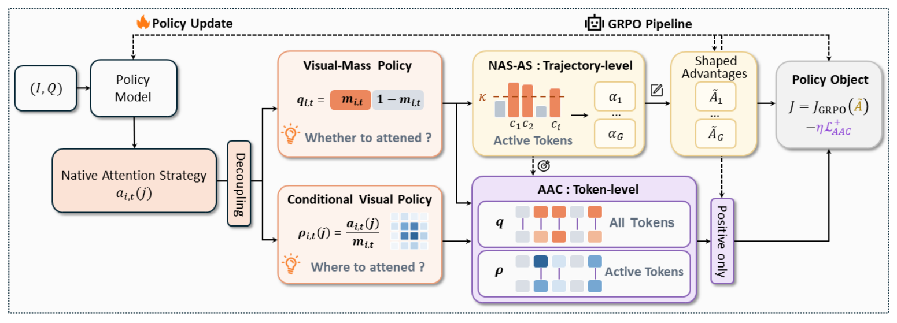

图源：原文 Figure 2，物理页 4，[PDF](https://arxiv.org/pdf/2611.02008v1#page=4)。上支路 NAS-AS 只调轨迹优势幅度，下支路 AAC 对齐当前与旧策略的路由。两路用同份干净回答，门控分别取重标定优势和原始正优势。

对第 $`i`$ 条回答、第 $`t`$ 个 token，最后解码层在真正预测该 token 的前一个位置计算注意力。在因果允许的键位置上做 softmax，按头平均得到 $`a_{i,t}(j)`$。查询与键取 RoPE 后的值。设 $`\mathcal V_i`$ 是视觉 token 的位置集合：

```math
\begin{aligned}
m_{i,t}&=\sum_{j\in\mathcal V_i}a_{i,t}(j),\\
q_{i,t}&=(m_{i,t},1-m_{i,t}),\\
\rho_{i,t}(j)&=a_{i,t}(j)/m_{i,t},\qquad j\in\mathcal V_i.
\end{aligned}
```

$`q`$ 是视觉与其余上下文的二分类边缘分布，$`\rho`$ 是已经选择看图之后图内的位置分布。最后一式要求视觉总质量为正。**本文算例。**三处视觉权重 0.24、0.12、0.04，总质量 0.40，条件位置权重 0.60、0.30、0.10。若都缩半，图内比例完全一样，但看图总预算变成 0.20。两类分布分别约束就能分辨这个变化。读到的信号是注意力统计，单靠它尚不能判定证据一定正确。

### 轨迹奖惩幅度 NAS-AS

用 $`R_i`$ 表示正确性奖励，组标准化得 $`A_i=(R_i-\bar R)/(\sigma_R+\epsilon)`$。只取有效回答 token 的旧视觉总质量，算全批 25% 分位点 $`\kappa`$。$`c_{i,t}`$ 标记严格高于门槛的有效 token，$`T_i`$ 是有效长度。

```math
\begin{aligned}
b_i&=\frac{1}{T_i}\sum_t c_{i,t},\\
u_i&=\frac{\sum_t c_{i,t}\sqrt{\max(m_{i,t}^{\rm old}-\kappa,0)}}
{\sum_t c_{i,t}+\epsilon},\qquad s_i=b_i u_i,\\
\alpha_i&=\beta_{\min}+z_i(\beta_{\max}-\beta_{\min}),\\
\widetilde A_i&=\alpha_i A_i.
\end{aligned}
```

$`b_i`$ 是活跃 token 占比，$`u_i`$ 是活跃项的平方根超额均值，平方根让极高值的相对支配减弱。$`s_i`$ 在更新小批内归一化为 $`z_i\in[0,1]`$。$`\beta_{\min}=0.9`$，非退化小批使 $`\alpha_i`$ 的均值约为 1。本文推导：令均值严格为 1，则 $`\beta_{\max}=0.9+0.1/\bar z`$（$`\bar z>0`$）。若两个轨迹 $`z=0,1`$，两个系数为 0.9、1.1。若第二条答错且原优势为负一，更新后仍是负，绝不会因为“看图多”变成奖励。

### 成功路由的 AAC

$`D_{\mathrm{JS}}`$ 是 Jensen–Shannon 散度，两分布与中点各做一次 KL，取平均。用 $`c^\rho_{i,t}`$ 表示图内路由有可对齐的有效支撑，式中 $`w_{i,t}^{+}`$ 是裁剪的重要性权重，stopgrad 写 sg。

```math
\begin{aligned}
D_{i,t}&=D_{\mathrm{JS}}(q^\theta_{i,t},q^{\rm old}_{i,t})
+c^\rho_{i,t}D_{\mathrm{JS}}(\rho^\theta_{i,t},\rho^{\rm old}_{i,t}),\\
\mathcal L^+_{\mathrm{AAC}}
&=\mathbb E_{\mathrm{valid}}\!
\left[\max(A_i,0)\,\mathrm{sg}(w_{i,t}^{+})\,D_{i,t}\right].
\end{aligned}
```

用原始 $`A_i`$ 门控使看图多的轨迹不会同时获得相同倍率的两路正反馈。失败解答仍进策略 loss，但不会让当前注意力强制远离失败图，它可能是最后算错。对齐参照来自冻结统计，当前查询和键须可微。重建漏掉因果 mask、算在当前 token 而非预测它的位置、在注意力头平均之前就做视觉条件化，都会变成不同实验。

```math
\begin{aligned}
\eta&=\mathrm{clip}\!\left(
0.3\frac{|\mathrm{sg}(J_{\mathrm{PG}})|}
{|\mathrm{sg}(\mathcal L^+_{\mathrm{AAC}})|+\epsilon},0,10\right),\\
J&=J_{\mathrm{PG}}(\widetilde A)-\eta\mathcal L^+_{\mathrm{AAC}}.
\end{aligned}
```

$`J_{\mathrm{PG}}`$ 是现有裁剪策略目标，$`\eta`$ 对齐的是标量损失量级。它不保证两路梯度范数严格成比例。附录实现另外共用采样熵惩罚系数 0.12，关闭 reference KL。训练仍需计算额外注意力与 JSD，不能把没有额外 rollout 写成零成本。

```text
采样干净回答并用准确性评分，获取旧策略的最后一层注意力
用批内分位点构造活跃 token 掩码，计算轨迹优势倍率
用当前 Q/K 重算可微注意力，对正优势轨迹算两类 JSD
按停止梯度的自适应系数合并策略目标和辅助损失
```

### 实验与复现

训练用 ViRL39K 38,870 条图文可验证问答。8B/32B 分别为 8/16 张 H100，202 步，每题 8 rollout，学习率 1e-6，回答最多 256 token。实验附录给出配置和额外重建复杂度，未核验到总 GPU-hours 或峰值显存对照。答对率是同题八次独立回答的均值，不能解读为八次任中一次的 pass@8。

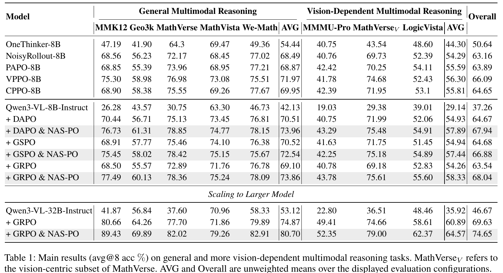

图源：原文 Table 1，物理页 6，[PDF](https://arxiv.org/pdf/2611.02008v1#page=6)。8B GRPO 的 Overall 63.54→68.04，视觉依赖均值 54.26→58.33。对 DAPO 和 GSPO 的同模型比较为 64.67→67.94、64.68→66.88。32B 的 GRPO 69.63→74.65。Overall 是八个配置等权，MathVerse 与其视觉子集均列入，因此不同于七个数据集去重后的平均。过滤一部分开放式问题以做规则判断，指标以作者子集为准。

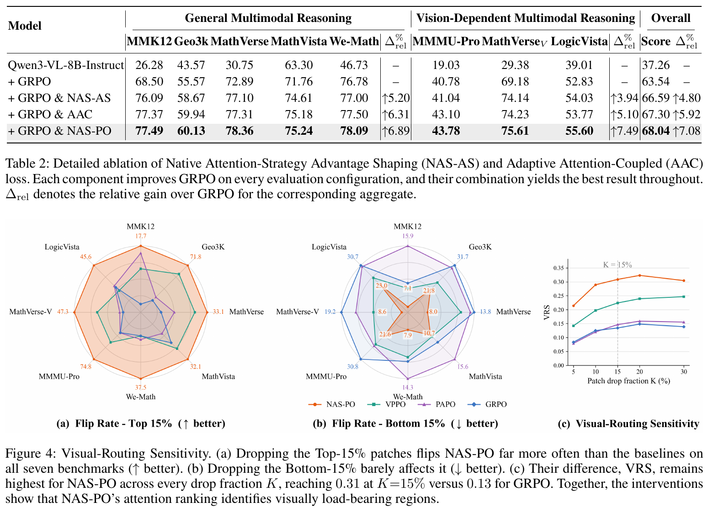

图源：原文 Table 2、Figure 4，物理页 7，[PDF](https://arxiv.org/pdf/2611.02008v1#page=7)。仅 NAS-AS 得 66.59，单 AAC 67.30，合并 68.04。遮挡实验只在原本答对的轨迹上，先用灰图控制估计注意力汇聚位置的基线，再遮挡图像中高/低排名等面积区域。两种错答翻转率相减，15% 面积时 VRS 为 0.31 对 0.13。该干预是评估，不用于训练，也不能因答题准确率提高就推断所有注意力路径有因果解释。训练曲线主要是一条种子，复现应再查不同分位点和显存。

入门可读 [TRL GRPO 文档](https://huggingface.co/docs/trl/grpo_trainer) 和 [Qwen3-VL 官方模型实现](https://github.com/QwenLM/Qwen3-VL)。复现时应先做小规模的输入位置、旧/新权重和遮挡面积单测，再据论文同数据、同长度比较。

<a name="paper-resynth"></a>

## 3. ReSynth · 用可验证关系生成多图监督

[论文原文](https://arxiv.org/abs/2611.23996v1) · [固定 PDF](https://arxiv.org/pdf/2611.23996v1)。首发 2026-11-18，Yilin Wang 等。论文说明计划开放相应代码，本次未核验到可运行的完整构造、训练代码或独立方法博客。下文链接的多视角 LoRA 是文中用到的组件。

### 先把图与事实拆开

真实照片往往只有正面，没有同一相机背面；靠检索拼图也无法知道“红杯和蓝杯是同一个杯子编辑前后”。作者先计划同类/不同类的场景，再生成、核验并把关系缓存成结构化记录。约 440K 是问答数，同一图组可以产生多问，不能按 440K 张唯一图片解释。

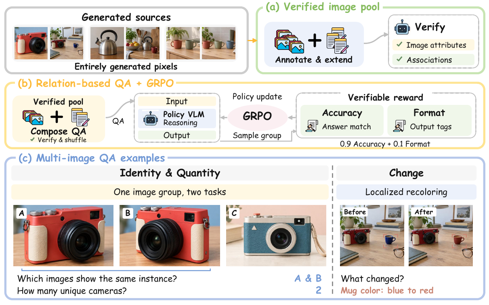

图源：原文 Figure 2，物理页 3，[PDF](https://arxiv.org/pdf/2611.23996v1#page=3)。上面是可复用的已核验素材池，中间是构造问答和 GRPO。左下同一图组能问身份与计数，右下是有方向的颜色变化。图内是训练素材举例，没有当作对照得分。

作者按物体、场景、行为、关系和视觉外观取兼容组合。简单场景适合身份和转视角，复杂场景适合计数和关系对比。Qwen3-VL-8B 扩写画面描述，Qwen-Image-2.1 渲染。然后用 8 次单图观测采样判断图中物体、框、数量及属性。计数未达一致时丢候选，生成提示中说“3 个”不等于画面标签为 3 个。

第二步基于已验证的框做增、删、替换、改色，小目标增加采样覆盖。可先裁区域编辑再合回原图，检查目标变化和周边一致性。改变背景、重画相同实例和近似干扰物后再核对身份。几何投影与部件定位构造对应关系和视角题，生成视频和程序化状态提供时间顺序。重用图组前保存观察事实和验证通过的关系。

第三步从这些事实出数据题。身份 8%、变化 17%、数量 8%、拼合 9%、对应 29%、视角 19%、时间 10%，涵盖 15 类操作。选项加入同类别不同实例和正反方向变化。拼图题的错误块要排除可从已显示内容直接识别并淘汰的候选。缺素材、投影冲突、选项不足或答案映射不一致就跳过。图的语义标签和选项位置应分开存，最后打乱顺序后重新计算答案映射。

**本文算例。**A、B 是同一相机两个角度，C 是同类另一台，相机总实例数为 2。若打乱图序到 C、A、B，匹配对从 A/B 原位置 1、2 变成 2、3，但实例数不变。两题都依赖经核对的实例关联，同图组按原图族切训练划分更能控制图像重复。

### 回答奖励与优化

令 $`o`$ 为生成序列，$`a`$ 为按记录推导的答案。正确性 $`r_{\mathrm{acc}}`$ 检查选项字母、真假标签或整数是否一致，$`r_{\mathrm{fmt}}`$ 检查回答和推理标记：

```math
r(o,a)=0.9r_{\mathrm{acc}}(o,a)+0.1r_{\mathrm{fmt}}(o).
```

规则只打分最终答案和格式，推理文字没有直接逐步评分。格式合规但答案错拿 0.1，答案正确但格式不合规在可提取答案的示例中拿 0.9。实际提取失败是否给正确分应遵照作者解析逻辑， v1 未附完整代码。组内用 $`A_i=(r_i-\bar r)/(\sigma_r+\epsilon)`$ 调整对应的生成概率。若同组整批一样对或一样错且格式一致，标准化后没有差异信号。这个梯度来源与 SFT 对示范 token 逐字匹配的 CE 不同。

```text
从结构化场景计划生成图片，反复复核单图事实
按目标框编辑或做几何、时间关联，校验关联后入池
用事实与关联构造模板题和干扰项，打乱并重算答案
每题采样多条回答，规则打分，组内归一化回报
更新全参数并监控训练奖励，按原协议选择 checkpoint
```

Qwen2.5-VL-7B-Instruct 与 Qwen3-VL-8B-Instruct 都全参 GRPO，学习率 $`10^{-6}`$。视觉训练素材全合成，基础模型原预训练语料不受这个限定。表中 440K 指训练池规模，最终报告 8B 的半程、7B 的全程 checkpoint。原文未核实到组大小、显卡、实际 GPU-hours 和合成图总成本，不能以 440K 问答数反推。原则上合成、八次复核和多次 rollout 分属三个成本来源，应独立计账。

### 效果与反例

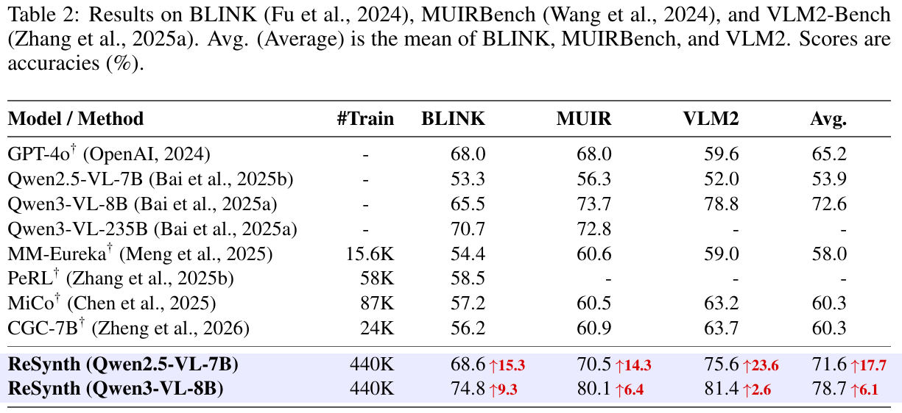

图源：原文 Table 2，物理页 7，[PDF](https://arxiv.org/pdf/2611.23996v1#page=7)。BLINK、MUIRBench、VLM2-Bench 等权平均。7B 分别 53.3→68.6、56.3→70.5、52.0→75.6，均值 53.9→71.6。8B 65.5→74.8、73.7→80.1、78.8→81.4，均值 72.6→78.7。作者按更精确值报告 17.73 与 6.10 点。235B 行没有 VLM2 分数，8B 对它的优势只成立于表中可比较的 BLINK 和 MUIRBench 两项。标 † 的其他训练法用论文报告值，训练数据量和设置不同。

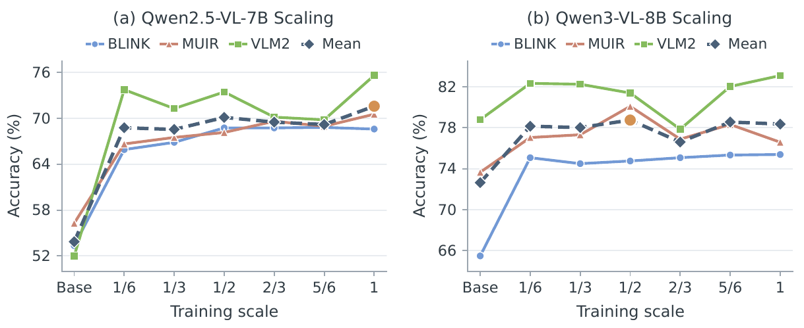

图源：原文 Figure 5，物理页 9，[PDF](https://arxiv.org/pdf/2611.23996v1#page=9)。横轴是完整训练池的比例，虚线 Mean 看跨三个基准的平均。7B 峰值在全量，8B 在一半。它描绘本文训练轨迹，不能直接视作独立抽样不同规模训练集的因果比较。两种约 10K 配方对照中，加入反方向的变化描述使变化跟踪 44.75→72.15，调整拼图错误选项使 40.00→84.67。作者在 Table 3 也报告不同任务间并非同幅迁移。

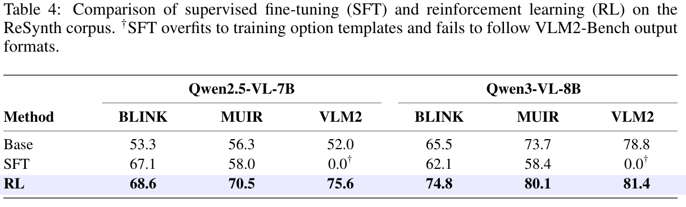

图源：原文 Table 4，物理页 10，[PDF](https://arxiv.org/pdf/2611.23996v1#page=10)。同一数据路线下 7B 的 BLINK SFT 67.1，接近 RL 68.6，但 SFT 两个模型在 VLM2 的结果都是 0，论文归因于选项模板和测试格式不合。这个 0 不能直接解释为视觉理解全丢。复现时除了规则分，还应试对 SFT 放宽答案解析或换格式训练，检验内容错误与解析失败各占多少。

局限包括拥挤场景下的身份漂移，单一验证模型八次一致也可能重犯同一错误，合成分布与真实相机有差异。建议抽检同实例约束和编辑副作用，记录按图族隔离的数据划分，并测试打乱和打乱后恢复答案两个方向。参考 [VLMEvalKit 官方项目](https://github.com/open-compass/VLMEvalKit)、[文中使用的多视角编辑 LoRA](https://huggingface.co/fal/Qwen-Image-Edit-2511-Multiple-Angles-LoRA)、[BLINK 原文](https://arxiv.org/abs/2404.12390)。

<a name="paper-dile"></a>

## 4. DiLE · 用自己的难负例练出更细的检索向量

[论文原文](https://arxiv.org/abs/2611.25419v1) · [固定 PDF](https://arxiv.org/pdf/2611.25419v1)。首发 2026-11-19，Ben Kang 等。使用 Qwen2-VL-2B/7B 与 Qwen3-VL-2B/4B。当前未核验到完整 DiLE 官方实现和独立作者博客。它训练视觉语言骨干来做检索编码，结果指标为检索而非自由问答。

### 阶段一 · 四个查询位置与共享、私有 LoRA

检索时输入一张图或文档，只预存一个向量。只学“这是自行车”会丢掉位置或颜色，而找红色自行车时恰好需要这些细节。作者把任务说明和四个可学习的查询 token 接在输入后面。四个查询最终层状态求平均并作 L2 归一化。

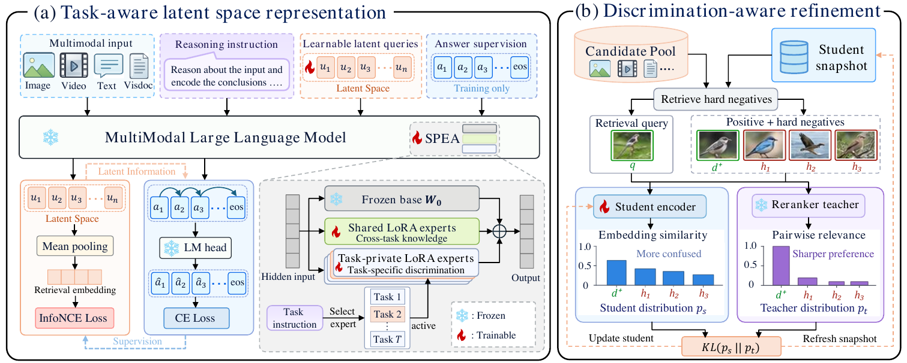

图源：原文 Figure 2，物理页 3，[PDF](https://arxiv.org/pdf/2611.25419v1#page=3)。左上是任务指令、查询、训练专用答案。左下是冻结投影加共享和被任务选择的私有适配器。右侧的快照只负责挖难负例，学生继续训练。教师是能同时读两端的重排器，推理可预计算候选向量再用点积检索。

```math
e_\theta(x,i)=\mathrm{norm}_2\!\left(\frac{1}{N}
\sum_{n=1}^{N} h_{u_n}\right),\qquad N=4.
```

$`x`$ 为多模态输入，$`i`$ 是任务指令，$`u_n`$ 为第 $`n`$ 个查询 token，$`h_{u_n}`$ 为最后层输出，$`\mathrm{norm}_2`$ 除以 L2 范数。答案放在查询之后。因果注意力阻止未来答案泄漏给查询，但答案 CE 可经可见的查询反传训练信号。答案 token 也能看输入，作者没有硬性强迫一切信息都通过查询。推理时去掉答案和生成支路。

设第 $`b`$ 个检索查询的候选为 $`D_b`$，正例集合 $`P_b`$，温度 $`\tau_s=0.02`$。分子是**所有**正例指数相似度之和：

```math
\begin{aligned}
\mathcal L_{\rm ret}
&=-\frac1B\sum_b\log
\frac{\sum_{d\in P_b}\exp(\cos(e_{q_b},e_d)/\tau_s)}
{\sum_{d\in D_b}\exp(\cos(e_{q_b},e_d)/\tau_s)},\\
\mathcal L_{\rm I}
&=\mathcal L_{\rm ret}
+0.1(\mathcal L^q_{\rm ans}+\mathcal L^d_{\rm ans}).
\end{aligned}
```

$`B`$ 为批内查询数。两端答案 CE 都按各自已监督 token 数归一化。单正例概率若为 0.6，检索项为 $`-\log(0.6)\approx0.511`$，若多一个正例占 0.3，合计正例质量 0.9，损失约 0.105。支持多个合法相似项和为每个正例单独求损失不同。

适配时，一个共享 LoRA 始终有效，另选一组私有 LoRA。私有组为图像分类、问答、检索、定位、视频和视觉文档六类。令 $`v`$ 为投影输入、$`W_0`$ 为冻结权重，则：

```math
f_t(v)=W_0v+\Delta W_sv+\Delta W_tv,\qquad
\Delta W=(\alpha/k)LR.
```

$`k`$ 是低秩，$`L,R`$ 是两个小矩阵，$`\alpha`$ 是缩放，$`s,t`$ 分别指共享和任务路。任务 ID 来自指令的预设映射，属于确定性路由。

### 阶段二 · 采学生易错的对象，教师逐对打分

从当前学生快照按余弦检索 top 20，去掉已知相关项和重复项。只留至少比被检索正例均值低 0.02 的高排名负例，降低把真正正确的图片当负例的风险，最多 4 个。把它们与标签正例放入同一候选组 $`G_q`$。冻结 Qwen3-VL-Reranker-8B 逐对打相关性分 $`T(q,d)`$。学生和老师在同一组做 softmax：

```math
\begin{aligned}
p_s(d\mid q)&=\mathrm{softmax}_{d\in G_q}
  \big(\cos(e_q,e_d)/0.02\big),\\
p_T(d\mid q)&=\mathrm{softmax}_{d\in G_q}\big(T(q,d)/0.05\big),\\
\mathcal L_{\rm dist}(q)&=\sum_{d\in G_q}
p_s(d\mid q)\log\frac{p_s(d\mid q)}{p_T(d\mid q)},\\
g_q&=\mathbf 1[\arg\max_{d\in G_q}T(q,d)\in P_q].
\end{aligned}
```

反向 KL 用学生概率加权。**本文算例。**正例/难负例的学生概率为 0.55/0.45，教师为 0.90/0.10，反向 KL 约 $`0.55\log(0.55/0.90)+0.45\log(4.5)=0.406`$ nats，难负项贡献约 0.677，第一项抵消一部分。若教师改把难负例排第一，门控关掉该组蒸馏，标签监督依旧。总损失是检索项加 0.5 倍门控蒸馏，检索对所有组平均，蒸馏只对过门控组平均。

```text
训练查询 token 与共享、私有 LoRA，结合检索损失及两端答案 CE
冻结学生快照，检索 top 20，过滤后取最多 4 个难负例
冻结教师在同组重排，教师同意标签时才进行反向 KL 蒸馏
50k、150k 查询时启动异步挖掘，在 100k、200k 边界切换
线上编码查询及候选，归一化后点积排序，教师不参与
```

训练来自 MMEB-train、LLaVA-Hound、ViDoRe 与 VisRAG 等。阶段一用 1.4M 样本、5000 步、全局 batch 1024。阶段二按 3 个 100K 查询块、batch 128，刷新两次。两阶段 AdamW、学习率 5e-5、预热 100 步、weight decay 0.01。原文未核验到实体硬件、挖掘绝对耗时、GPU-hours 或峰值显存。

### 实验与边界

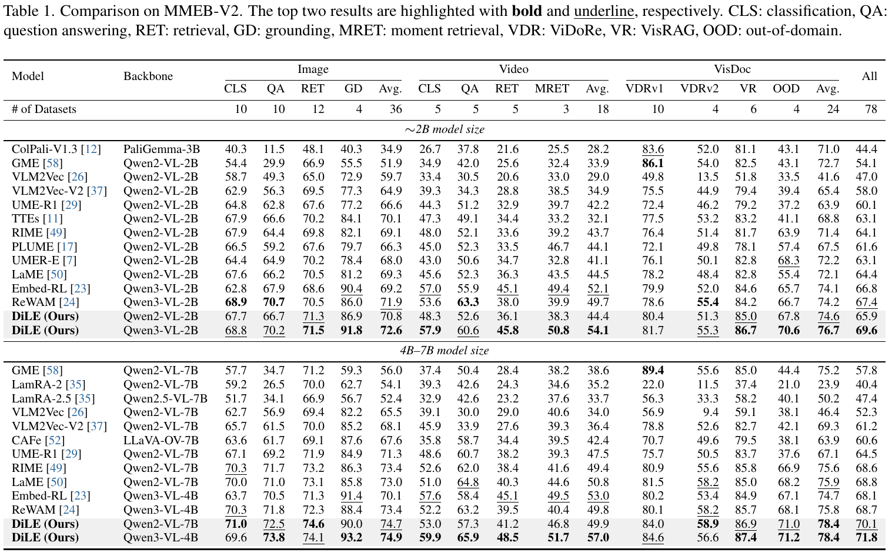

图源：原文 Table 1，物理页 5，[PDF](https://arxiv.org/pdf/2611.25419v1#page=5)。图像、视频和文档分别用不同任务指标，All 是 78 项均值而非三模态再等权平均。Qwen3-VL-2B 总分 69.6，对同骨干 ReWAM 67.4、Embed-RL 66.8。Qwen3-VL-4B 总分 71.8，对 ReWAM 68.7、Embed-RL 68.1。4B 的 UVRB 62.2 对 Embed-RL 60.2，但每个子任务并非都领先。MRMR 除 Negation 外用 nDCG@10，分数不可与同名类别的 Hit@1 混写。

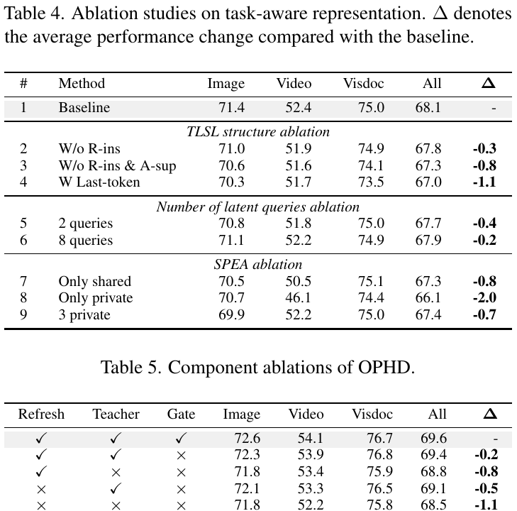

图源：原文 Tables 4–5，物理页 7，[PDF](https://arxiv.org/pdf/2611.25419v1#page=7)。Table 4 是同 2B 阶段一基线 68.1，最后 token 代替查询降到 67.0，只私有到 66.1。Table 5 是阶段二基线 69.6：刷新、教师和门三者全关为 68.5。关闭门后 69.4，差 0.2 点。表 6 还显示每隔 50K 刷新为 69.7，优于默认 0.1，反向 KL 69.6 对前向 69.4 和 JSD 69.2。小差距与开销需一同衡量。另迁移到 EmbeddingGemma2 时总分 59.0→62.4，视频却 50.7→44.2，不能只摘平均。

复现建议记录快照哈希与教师评分版本，测拒绝的伪负例占比、一次刷新 GPU 时间和排序吞吐。师生看到的信息不同，双塔极易过度压缩，教师排序只是软标签。可先读 [Faiss 文档](https://faiss.ai/)、[LoRA 官方教程](https://huggingface.co/docs/peft/main/en/conceptual_guides/lora) 与 [官方 Qwen3-VL-Reranker-8B 模型页](https://huggingface.co/Qwen/Qwen3-VL-Reranker-8B)，再看组内 KL、门控和异步队列。

<a name="paper-metric"></a>

## 5. Metric-Aligned GRPO · 让解释器练习与证据说明匹配

[论文原文](https://arxiv.org/abs/2611.14436v1) · [固定 PDF](https://arxiv.org/pdf/2611.14436v1) · [ACM DOI](https://doi.org/10.1145/3840474.3840547)。首发 2026-11-10，Luka Dragar 等。作品为 MRAC 2026 挑战方案。[比赛网站](https://explainable-deepfake-detection.github.io/) 和 [评估工具](https://github.com/Abhijeet8901/XPlainVerse-ACMChallenge) 提供任务/评分资料。原文链接的 [Bombek1 检测器模型](https://huggingface.co/Bombek1/ai-image-detector-siglip-dinov2) 是检测支路相关基础实现。未核验到本队整体训练代码、最终适配器或独立方法博客。

### 分类与说明的接口

多模态解释器擅长描述自然场景，却容易把“场景说得通”当成图真实。作者给检测器和解释器不同工作。第一支用冻结 SigLIP2-SO400M 与 DINOv2-Large 特征拼接后接二分类 MLP。第二支 DINOv3-Large 取最后四块的 patch 均值、分类 token 及 register token，四头训练，推理只用最后头。论文训练检测器 LoRA rank 32、alpha 64，焦点损失参数 $`\gamma=2,\alpha=0.25`$，分支融合权重 0.6/0.4，决策阈值 0.360 均用 1,000 张留出图校准。

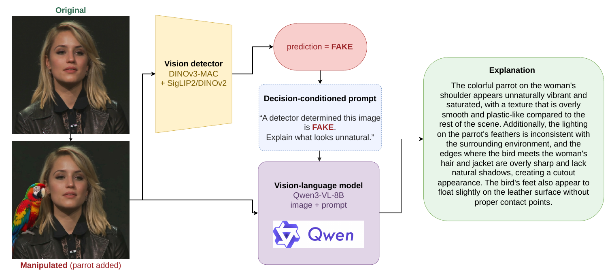

图源：原文 Figure 1，物理页 1，[PDF](https://arxiv.org/pdf/2611.14436v1#page=1)。检测器把二元决定交给提示模板，原图也直接进入 8B VLM。右框是对示例的解释输出。图画的是详细解释的一段，不包含短解释器完整细节。流程假定给定的标签是工作条件，检测器错时解释器仍可能顺着错标签合理化。

训练分开用数据。XPlainVerse 训练、验证、隐藏测试为 450K、110K、200K。复杂说明与短说明只用官方 train 的参考文本。检测器还用验证集除留出外部分及 OpenFake、DFBench、SID-Set，合计约 2.97M 图；DINOv3 分支另加 NTIRE 数据至 3.24M。第一支训练 5 epoch、392×392，第二支 2 epoch、512×512。论文的 8B 仅指解释器骨干规模，两只解释器和分类集成不能合称总共 8B 的系统。

详细解释器用同一个 Qwen3-VL-8B-Instruct，训练约一半直接判别提示、一半真假各 25% 的标签给定提示。假图参考筛至少三句且 80 词，训练真假约 4:1。推理只用检测器决定对应的标签给定提示，输出带 Verdict 行，提交前剥去该行。假图的短解释器只读详细解释文字，真实图按协议把详细说明同时交到两个槽。

### 如何把比赛指标变成训练奖励

两解释器先做 LoRA SFT，用 teacher-forced 答案 token 交叉熵。rank 16、alpha 32，视觉编码器冻结，复杂说明 SFT 1 epoch、学习率 1.5e-4，短说明 1 epoch。接着每个 prompt 采 8 个候选，用如下回报作组相对策略优化：

```math
\begin{aligned}
s_{\mathrm{norm}}
&=\frac{\mathrm{clip}(\mathrm{SLE},-1,4)+1}{5},\\
r_s&=0.7\,F_{\mathrm{BERT}}+0.3\,s_{\mathrm{norm}},\\
r_c&=F_{\mathrm{BERT}}+0.3\,r_{\mathrm{fmt}}.
\end{aligned}
```

$`F_{\mathrm{BERT}}`$ 为与参考解释的 BERTScore-F1，用语境向量匹配近义表达，$`\mathrm{SLE}`$ 是比赛使用的简单度估计，$`r_{\mathrm{fmt}}`$ 检查 Verdict。归一式把下界负一变 0、上界 4 变 1。两套 GRPO 都 1 epoch、学习率 1e-6，复杂解释 KL 系数 0.001、最大长度 400，短解释 KL 系数 0.04、最大长度 128，参照是各自 SFT 策略。本文按常规形式表达其符号：

```math
A_i=\frac{r_i-\bar r}{\sigma_r+\epsilon},\qquad
\mathcal L=\mathcal L_{\mathrm{GRPO}}(A)+
\beta D_{\mathrm{KL}}(\pi_\theta\Vert\pi_{\mathrm{SFT}}).
```

$`i`$ 是同题第 i 个候选，横线均值和标准差仅在同题八条内算，$`\beta`$ 为 KL 强度。两边 $`\beta`$ 不同，具体裁剪和训练采样的完整工程配置未核验。焦点分类损失的思路是对当前真类概率 $`p_t`$ 给 $`(1-p_t)^\gamma`$ 乘权，在 $`p_t`$ 接近 1 时削弱易例；分类器训练与解释器的上述回报是两件事。

**本文算例。**两条短解释 BERTScore 都 0.70，SLE 为 2.5 和 0，则简单度为 0.70 和 0.20，奖励分别 0.70 和 0.55。若一个复杂解释 F1 为 0.65，Verdict 满分则可得 0.95。即使文本很像参考，也不能由这个标量独立判断它看到了对应区域。源代码和完整 GPU 型号、用时、显存预算未核验。

```text
训练两个冻结骨干的检测支路，在留出集选融合及阈值
SFT 详细说明和短说明适配器
同题采样八条输出，按各自规则打分，组内归一，保留 SFT KL
推理先取真伪标签，再给详细解释
若判假，进一步用纯文本压缩器生成短解释
```

### 结果 · 固定检测输入后单独比较解释

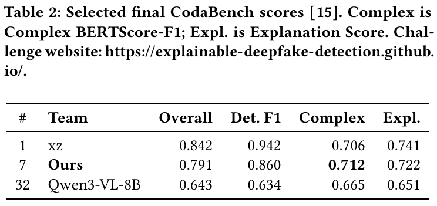

图源：原文 Table 2，物理页 4，[PDF](https://arxiv.org/pdf/2611.14436v1#page=4)。比赛榜单中队伍 Overall 0.791 排第七，复杂 BERTScore-F1 0.712 为第一。整体赢家的检测 F1 是 0.942，相对本队 0.860，可解释说明领先没有保证总体领先。独立 2,000 张验证抽样给正确标签，使复杂 BERTScore-F1 0.698→0.733，和隐藏集的 matched ablation 分开阅读。

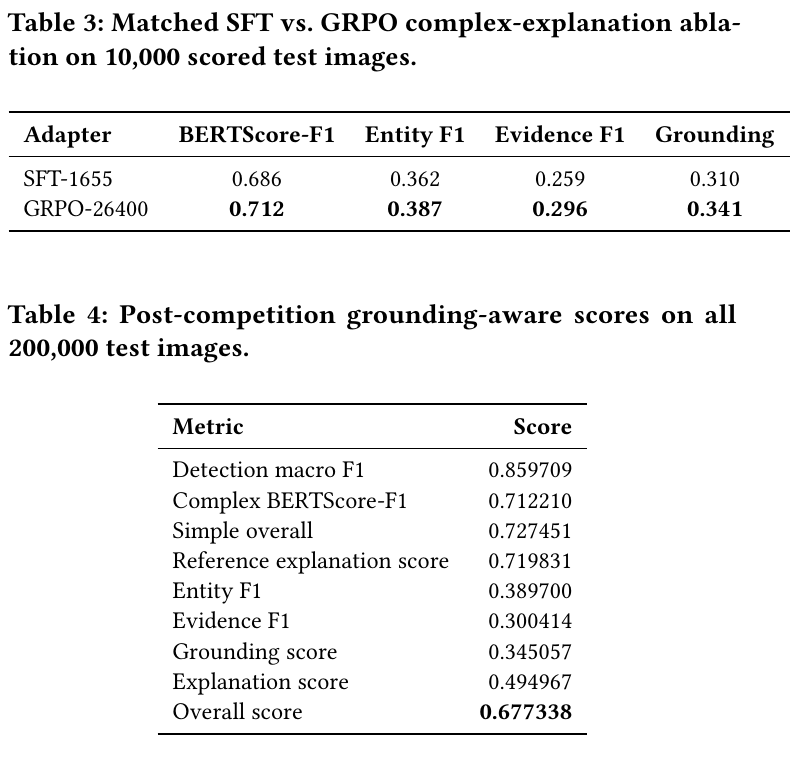

图源：原文 Tables 3–4，物理页 4，[PDF](https://arxiv.org/pdf/2611.14436v1#page=4)。Table 3 同 10,000 张、同检测决定、提示与解码，只换解释器适配器。BERTScore-F1 0.686→0.712，Entity F1 0.362→0.387，Evidence F1 0.259→0.296，Grounding 0.310→0.341。单换短说明适配器报告 simple overall 0.677→0.730。Table 4 是 200,000 全测试重新评分，Grounding 0.345，Overall 0.677。全测试榜后口径把 reference explanation 与 grounding 按 0.4/0.6 加权；不能把 0.677 与竞赛 0.791 当作同口径性能下滑。

榜后判据由固定 Qwen3.5-4B 从参考和预测抽取实体/证据，再双向计算语义覆盖并取调和平均。它没有成为在线 GRPO 奖励，也没有独立逐像素验证每句话。复现应固定分类标签、模板和解码，另看错误标签下的解释行为与跨生成器分层指标。入门看 [BERTScore 原文](https://arxiv.org/abs/1904.09675)、[XPlainVerse 数据论文](https://arxiv.org/abs/2607.03562)、[Hugging Face RLHF 入门博客](https://huggingface.co/blog/rlhf)。

## 选一篇深入读

| 你想解决的任务 | 先读 | 复现时优先对齐 |
| --- | --- | --- |
| 小模型导航的长程记忆和失败恢复 | [GlanceNav](#paper-glance) | 确定性的状态回放、同训练时长对照 |
| 图文 RL 的信用分配 | [NAS-PO](#paper-nas) | 预测位置、RoPE 后注意力、成功路由门控 |
| 收集多视角、前后变化与多图计数数据 | [ReSynth](#paper-resynth) | 关系核验、选项去线索、同图族隔离 |
| 小模型图文检索的蒸馏 | [DiLE](#paper-dile) | 教师/学生同候选、刷新与门控统计 |
| 给模型输出提供可评估的证据说明 | [Metric-Aligned GRPO](#paper-metric) | 固定分类结果，分别核验语义与图像证据 |

图表均从对应论文的固定版本裁切，页码与边界见 assets/SOURCES.md。示例计算只用于教学。本期没有训练、复跑或重新测量论文实验。
