# VLM 后训练精读 · 2026-11-26

## 论文速读

### VC-OPD · 让老师告诉学生该看哪里、看到了什么

只把一小块图放大，有时能解决读字，有时却会丢掉题目需要的整体关系。作者让大模型写出与题目有关的视觉线索，不直接报答案。先选小模型能部分答对的题，再分别查大模型能否答对、线索能否让老师稳定答对。

学生只看原图，按自己的思路写。老师读同一段已写的文字，加上视觉线索，给每个下一词提供更细的指导。上线后学生仍只看原图。[读精读](#paper-vc)

### ARS-VLM · 试几种参数改动，只让稳定的方向留下

逐层反向传播需要存很多训练状态。作者给现有参数加一点正向和反向扰动，直接跑答案，看哪个方向更好。先比较放大缩小后同一位置的特征，找出更不容易被图像网格变化影响的方向。

训练早期沿这些方向找，之后只给浅层保留一些约束，深层可以更自由地调整。每次用原图和缩放图共同打分，只采纳在两种图上表现相对一致的方向。[读精读](#paper-ars)

### MSPO · 把看错图和推错答案当成两种错误

一道几何题可以看对图但算错，也能靠猜测碰巧算对。作者另给每题配一组图上就能回答的小问题，让模型分别作答，并根据答对多少、题数是否足够给视觉分支打分。

视觉编码器只用这份评分训练。连接图像和文字的投影层与语言模型仍看最终答案。两路梯度合在同一步更新。[读精读](#paper-mspo)

### CARE-3D · 查到的证据有用吗？

给定三维场景，模型会挑一个工具去找物体。作者比较同一条调用里，保留或遮掉工具结果时，模型对正确答案各有多大把握。差值用来奖励能帮上忙的证据。

同一题大部分轨迹仍让模型自由挑工具，留两条指定平时用得少的工具。这两条也参与训练，但指定工具的名字本身不当作模型选择来奖励。[读精读](#paper-care)

### ThinkMorph-SSL · 先练画、再练用中间图解题

统一多模态模型有时会画图，却不会用自己画的图继续推理。作者先给它模糊、缺块或打乱的图片，让它描述问题、生成恢复后的图，再读这张图。

第二阶段才加上具体问题，例如生成深度图或不同视角，再根据生成结果写答案。两阶段都用构造好的图文轨迹监督，推理时模型自己决定何时画图。[读精读](#paper-think)

## 来源与范围

本期选择五篇 2026-10-26 至 2026-11-26 首次公开的论文，分析固定 arXiv v1 原文。四篇为 arXiv UTC 11 月 24 日提交，一篇为 11 月 23 日提交。新闻聚合页的 11 月 25 日是公告或收录日。实验数字来自作者，文内手算仅用于说明，未执行新的训练。

本期使用本机 macOS 及已有 SSH 授权发布。远端运行约定仍记录云端任务暂停。已查看迁移聊天的可读记录，尚未核验云端环境绑定或独立执行。当日远端没有已发布的 VLM 清单。

<a name="paper-vc"></a>

## 1. VC-OPD · 视觉线索如何变成逐 token 的监督

首发 2026-11-24，Qinxuan Wang 等。[论文页面](https://arxiv.org/abs/2611.32292) · [固定 v1](https://arxiv.org/pdf/2611.32292v1)。原文和按标题、作者查询均未核验到官方训练代码或单独作者博客。

### 用同一图像提供两种视野

Vision-OPD 一类方法把图像局部放大交给教师。VC-OPD 把教师特权扩展成与题目有关的视觉文字，例如“两条蓝线平行，右侧数字位于交点旁”。整图关系或多个区域共同决定答案时，这类文字比单个裁剪更容易表达。外部大模型可以闭源，因为只使用它生成的文字。真正输出 token 分布的教师与学生同架构、同词表，从同一 Qwen3-VL-Instruct 基座开始。教师先在原训练集做 GRPO warm-up，之后固定。训练学生时从原始基座初始化。

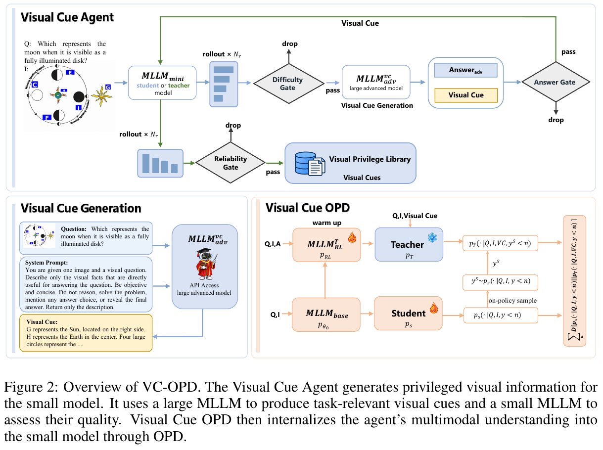

图源：原文 Figure 2，物理第 4 页。[固定 PDF](https://arxiv.org/pdf/2611.32292v1#page=4)。上半部是离线线索库，学生多次答题、外部大模型分别输出答案和线索、教师再验线索。右下是蒸馏，两边共享学生前缀。QA 答案用于验收，教师的额外输入是线索。学生没有直接读取线索的路径。

### 三道门筛出可用样本

原始数据是 ViRL39K。$`I,q,a`$ 分别是图、题、参考答案，$`E(y,a)`$ 是用参考答案验证响应 $`y`$ 的二值函数。$`y_j^{(0)}`$ 由初始学生采样。外部大模型以两个不同提示生成自己的答案 $`\widehat a_{\mathrm{adv}}`$ 和线索 $`v`$。教师有线索时采样 $`y_j^{(v)}`$。论文的筛选可写成

```math
\begin{aligned}
G_{\mathrm{diff}}&=\mathbf{1}\{1\leq\textstyle\sum_{j=1}^{8} E(y_j^{(0)},a)\leq 7\},\\
G_{\mathrm{ans}}&=\mathbf{1}\{E(\widehat a_{\mathrm{adv}},a)=1\},\\
G_{\mathrm{rel}}&=\mathbf{1}\{\textstyle\sum_{j=1}^{8}E(y_j^{(v)},a)\geq 7\}.
\end{aligned}
```

三个指示值相乘为 1 才留存。首门排除 0/8 与 8/8，给教师难度相对适中的题。第二门验证生成者能答对，仍可能给出冗余或站不住脚的线索，所以第三门再测试给同尺度教师是否有用。团队要求外部模型只抽取属性、OCR、空间关系等视觉信息，提示限制并不能证明数据完全不泄漏答案。三门也偏向当前教师强项。

### 同一个学生前缀，两种下一词分布

对学生实际生成的序列 $`y^S`$，取第 $`t`$ 个输出位置，以学生真实前缀 $`y^S_{\lt t}`$ 分别计算学生分布 $`p^S_t`$ 与固定教师分布 $`p^T_t`$。教师的题目上下文多了 $`v`$。下式 $`\mathcal B`$ 为线索库，$`L`$ 是有效响应长度，$`D_{\mathrm{KL}}`$ 是相对熵，$`m_t`$ 是两个预测的平均分布。

```math
\begin{aligned}
p_t^S&=\pi_S(\cdot\mid I,q,y^S_{\lt t}),\\
p_t^T&=\pi_T(\cdot\mid I,q,v,y^S_{\lt t}),\\
m_t&=(p_t^S+p_t^T)/2,\\
D_{\mathrm{JS}}(p_t^S,p_t^T)&=\tfrac12 D_{\mathrm{KL}}(p_t^S\Vert m_t)+\tfrac12 D_{\mathrm{KL}}(p_t^T\Vert m_t),\\
\mathcal L_{\mathrm{VC}}&=\mathbb E_{(I,q,a,v)\sim\mathcal B,\ y^S\sim\pi_S}
\left[\tfrac1L\textstyle\sum_{t=1}^{L}D_{\mathrm{JS}}(p_t^S,p_t^T)\right].
\end{aligned}
```

把每项 KL 展开为 $`\sum_k p_k\log(p_k/m_k)`$ 就能看到，学生把某类证据的相关词预测得太少、把无关词预测得太多，都会推高损失。同前缀保证在同一个决策状态比较。这两个分布还受教师 warm-up 影响，不能把所有差异归因给线索本身。附录 D 按学生分布选 top-100 token、混合系数 0.5。重归一化及尾部质量在工程复现里应记录，两者不能默认等价于全词表 JSD。GRPO 奖励用于暖启动和题目验收，主蒸馏梯度来自 JSD。

**本文算例。**学生在两个候选词上的概率取 (0.5, 0.5)，教师看过证据后取 (0.9, 0.1)，中点为 (0.7, 0.3)。两项 KL 约 0.0872 和 0.1163，等权 JSD 约 0.1017 nat。学生改成 (0.8, 0.2) 后 JSD 约 0.0100，方向正确但仍有信息差。对同一题，如果初始学生答对 3/8，外部模型答对，教师带线索答对 6/8，仍被最后一道门剔除。

```text
用原训练池对同架构教师做 GRPO warm-up，冻结教师
初始学生对每题采样 8 条，保留答对 1 至 7 条的题
让外部大模型分别给答案和短视觉线索，验证答案
教师可见线索，采样至少答对 7/8 才纳入库
当前学生仅看原图和题，采样 8 条解答
在每条的各有效前缀对齐 teacher/student logits
取 student top-100 计算 JSD，只更新学生
```

### 从消融分开看线索、训练效果和成本

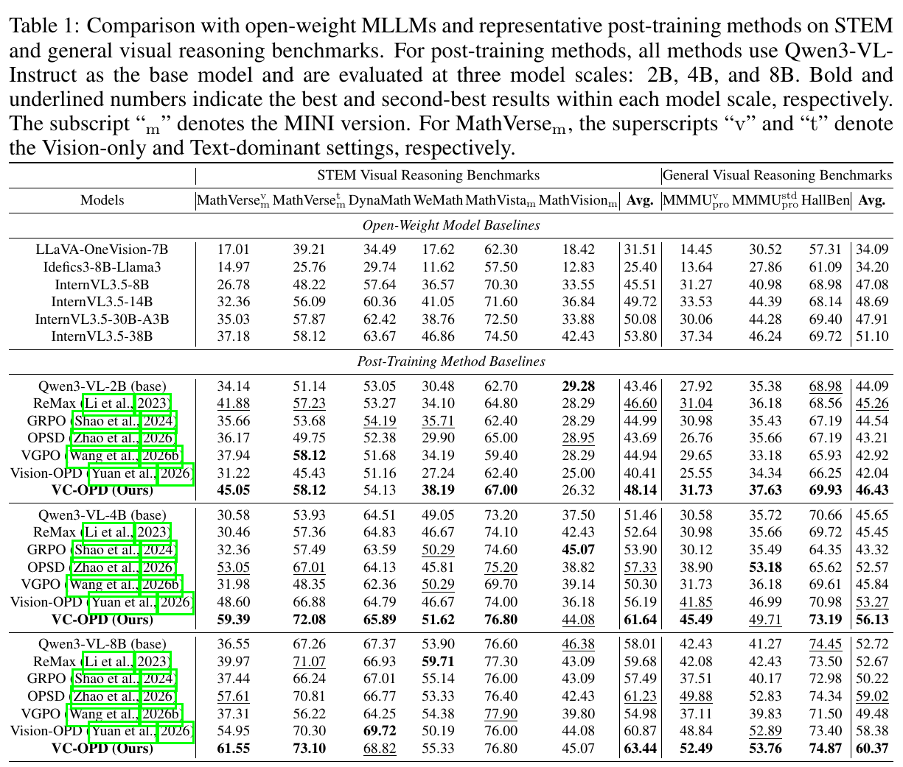

图源：原文 Table 1，物理第 7 页。[固定 PDF](https://arxiv.org/pdf/2611.32292v1#page=7)。同是 Qwen3-VL 4B，STEM 六列均值 51.46→61.64，一般视觉三列均值 45.65→56.13。列组中有 MathVerse 和 MMMU-Pro 的不同配置。8B STEM 58.01→63.44，但 MathVision-mini 46.38→45.07。2B 的 MathVision-mini 29.28→26.32。作者也比较 GRPO、ReMax、VGPO、Vision-OPD 与 OPSD，别把跨模型规模的行当作参数严格匹配。

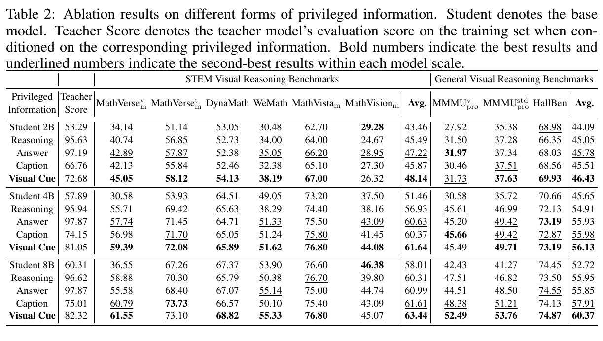

图源：原文 Table 2，物理第 9 页。[固定 PDF](https://arxiv.org/pdf/2611.32292v1#page=9)。4B 教师读标准答案在训练集的 Teacher Score 是 97.87，读视觉线索是 81.05。蒸馏后学生 STEM 平均分别是 60.63 与 61.64。教师自己越会答，学生不一定越能学会从整图恢复信息。表格也比较完整推理与通用 caption。教师分数和学生测试分数的数据划分不同。

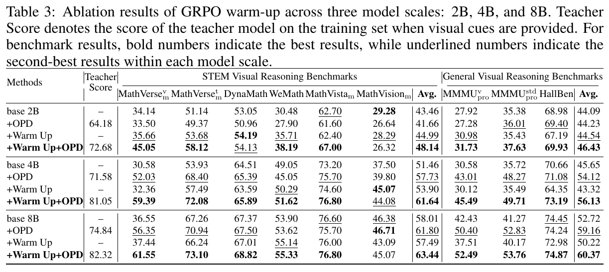

图源：原文 Table 3，物理第 14 页。[固定 PDF](https://arxiv.org/pdf/2611.32292v1#page=14)。逐尺度分别比较 base、base+OPD、只 warm-up、warm-up 教师+OPD。4B 不暖机只 OPD 的 STEM 是 57.73，比基座高 6.27 点。暖机教师参与的完整方案再多 3.91 点，较基座提升 10.18 点。老师和学生的角色要读表头，两个对照不是都从已 warm-up 的学生继续训练。

附录配置用 PyTorch 2.8.0、vLLM 0.18.0，蒸馏 batch 96、每题 8 条、1 epoch，评估判官为 Qwen3.5-27B、temperature 0。判官身份不能当作外部线索生成模型身份。GPU 型号、总用时、峰值显存、外部模型调用成本和可直接复现的最终线索库未核验。复现先做同一 base 混种子的小型分桶，记录每门通过率、教师有无线索的差值、泄漏抽检和部署输入。入门看 [TRL 的 GRPO 说明](https://huggingface.co/docs/trl/grpo_trainer)；进阶看 [Vision-OPD 原论文](https://arxiv.org/abs/2605.18740) 与 [Qwen3-VL 实现](https://github.com/QwenLM/Qwen3-VL)。

<a name="paper-ars"></a>

## 2. ARS-VLM · 不反传，直接用两次前向给参数方向排序

首发 2026-11-24，Xiangwei Wang 等。[论文页面](https://arxiv.org/abs/2611.32147) · [固定 v1](https://arxiv.org/pdf/2611.32147v1)。未核验到作者公开训练实现或独立方法博客。

### 从方向导数到视觉子空间

对已有参数 $`\theta`$，沿向量 $`u`$ 前后各试一次。可微期望奖励在足够小的尺度 $`\sigma`$ 下，$`(J(\theta+\sigma u)-J(\theta-\sigma u))/(2\sigma)`$ 近似 $`\nabla J^\top u`$。二值单样本奖励本身不光滑，实际用批次与前向采样做有噪估计。作者沿用 ARS，只保留排名靠前的随机方向。对 VLM 的两个问题是网格敏感和全空间漂移：代表同一个线段的视觉 token 可因缩放落到不同 patch，深浅层同时被高秩噪声改动又会丢掉先前能力。

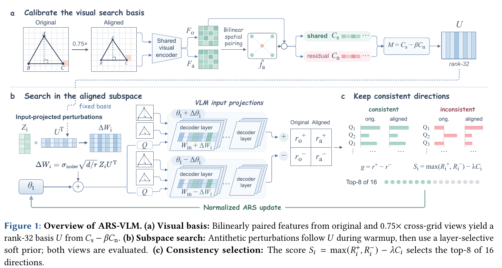

图源：原文 Figure 1，物理第 2 页。[固定 PDF](https://arxiv.org/pdf/2611.32147v1#page=2)。左上从相同内容的两种位置网格配对特征。中间上半是先低秩后软约束。右侧用两种视图各自的正负奖励差剔除不一致的方向。

用 32 张无标签图，一幅保持原图，另一幅在相同画布中心缩至 0.75 并轻微亮度、对比度变化。把原网格 token 的物理中心映到新图连续坐标，取邻近四格双线性插值。设中心化后的配对为 $`f_o,\widetilde f_a`$。$`s`$ 是共享均值，$`n`$ 是视图残差，$`C_s,C_n`$ 是它们的二阶矩。取 $`M_\beta`$ 最大特征值对应的 32 个正交向量作矩阵 $`U`$，$`\beta=0.35`$。

```math
\begin{aligned}
s&=(f_o+\widetilde f_a)/2,\qquad n=f_o-\widetilde f_a,\\
M_\beta&=C_s-\beta C_n
=(\tfrac12-2\beta)C_{\mathrm{pool}}+(\tfrac12+2\beta)C_{\mathrm{cross}}.
\end{aligned}
```

第二个等式把 $`ss^\top`$、$`nn^\top`$ 展开。$`C_{\mathrm{pool}}`$ 对两视图自身外积取平均，$`C_{\mathrm{cross}}`$ 对相互外积取对称平均。实际算的是 $`1.2C_{\mathrm{cross}}-0.2C_{\mathrm{pool}}`$，不求残差协方差的逆。原文的双线性配对把余弦相似度从 .720 提到 .769。与分别对图做 PCA 不同，显式惩罚跨网格差异。结论依赖缩放前后任务答案语义等价。

### 约束浅层、给深层更多自由

每个解码投影 $`W_\ell`$ 有 $`d`$ 输入维度，$`r=32`$，$`Z_f,Z_s`$ 是独立标准高斯，右乘 $`U^\top`$ 沿视觉子空间展开。$`\rho_{t,\ell}`$ 是第 $`t`$ 步、该层的混合系数。

```math
\Delta W_\ell=\sigma_{\mathrm{noise}}\left[
 \sqrt{1-\rho_{t,\ell}^2}\,Z_f+
 \rho_{t,\ell}\sqrt{d/r}\,Z_sU^\top\right].
```

前 20 步 $`\rho=1`$；之后第 0 至 17 层 $`\rho=0.25`$，深层 $`\rho=0`$。两独立项的总期望平方能量相加，子空间项由 $`d/r`$ 补偿维度，等于 $`\sigma_{\mathrm{noise}}^2d_{\mathrm{out}}d`$。例如 8B 的 $`d=4096`$、$`r=32`$，浅层子空间方向有效方差是 $`1-0.25^2+0.25^2(4096/32)=8.9375`$，相对同总能量的各向同性扰动更集中。这个倍数是方向方差，不是准确率或梯度范数的实测倍数。

### 方向要经两种视图检验

对第 $`i`$ 个随机方向与一题 $`b`$，$`r^\pm_{i,b,o/a}`$ 为正负扰动、原视图或变换视图的二值奖励。$`R^\pm_i`$ 是两视图所有题的平均。先按最优一侧扣一致性罚分，选 $`k=8`$，再用正负差决定走向。

```math
\begin{aligned}
C_i&=\tfrac1B\textstyle\sum_b
  |(r^+_{i,b,o}-r^-_{i,b,o})-(r^+_{i,b,a}-r^-_{i,b,a})|,\\
S_i&=\max(R_i^+,R_i^-)-0.1C_i,\qquad K=\mathrm{TopK}(S,k),\\
\theta_{t+1}
 &=\theta_t+\tfrac{\alpha_t}{k\sigma_{\mathrm{eff}}}
  \textstyle\sum_{i\in K}(R_i^+-R_i^-)\tfrac{\Delta\theta_i}{\sigma_{\mathrm{noise}}}.
\end{aligned}
```

$`B`$ 为题数，$`\alpha_t`$ 为退火步长，$`\sigma_{\mathrm{eff}}`$ 取全体和入选奖励标准差中较大者，防止入选分数过于同质时步长膨胀。两视图奖励差都是 1 的方向得 $`C_i=0`$、$`R_i^+=1`$、$`R_i^-=0`$，会获正向更新。如果原图是 (1,0)、缩放图是 (0,1)，两差分别 +1、−1，$`C_i=2`$，两边均值都是 0.5，排名分 0.3，即使选中更新也为 0。这是教学算例。

```text
校准：冻结视觉塔抽取两视图 feature，双线性配对，求 top eig
每步取 16 道 MMK12 题及两视图，按层选扰动混合系数
每个种子试正/负，共 16 个方向、32 组候选权重
在持久推理 worker 重建扰动，清相关缓存，前向验证，再恢复基准
按双视图一致性选 8 方向，积累 FP32 更新后写回 BF16
```

### 为什么省了静态内存，仍需数 rollout

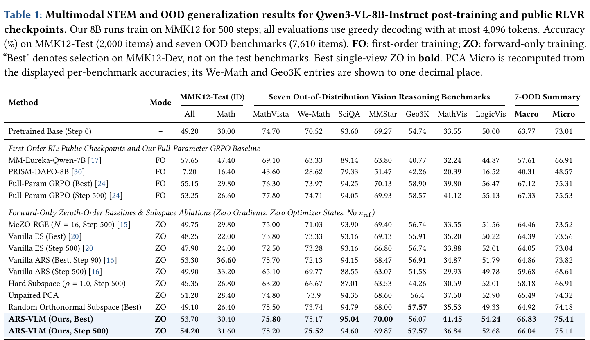

图源：原文 Table 1，物理第 7 页。[固定 PDF](https://arxiv.org/pdf/2611.32147v1#page=7)。8B 的 MMK12-Dev 选点下，7 个 OOD 微平均 75.41 对 GRPO 75.31；GRPO 宏平均 67.12 对 66.83，同域 Test 55.15 对 53.70。都固定第 500 步后，ARS 同域 54.20 对 53.25，而 OOD 微平均 75.11 对 75.53。微平均按题数，宏平均按基准。表中公开 RLVR checkpoints 还可能训练数据不同。

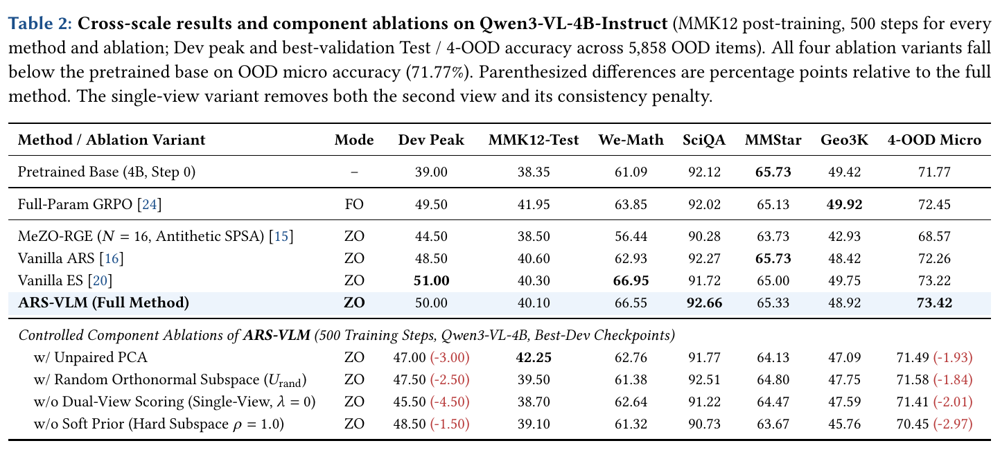

图源：原文 Table 2，物理第 7 页。[固定 PDF](https://arxiv.org/pdf/2611.32147v1#page=7)。4B 对照改用 4 个 OOD 基准，完整 73.42，GRPO 72.45，单视图 71.41，硬子空间 70.45。Unpaired PCA 尽管 OOD 降到 71.49，同域测试 42.25 反高于完整方法 40.10。单视图对照同时移除了第二视图和罚分，不能从该行单独归因给罚分。

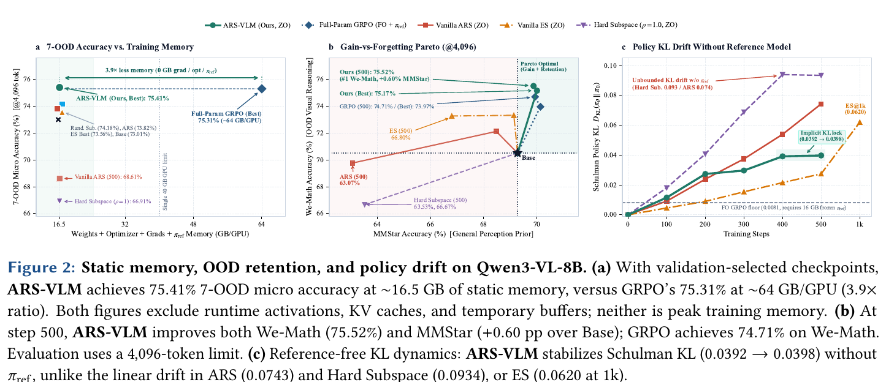

图源：原文 Figure 2，物理第 8 页。[固定 PDF](https://arxiv.org/pdf/2611.32147v1#page=8)。左图静态模型相关内存约 16.5 GB 对 64 GB/GPU，排除了前向激活、KV cache 和临时缓冲。比较策略 KL 走势时，纵轴是与初始策略的漂移诊断，算法没有加载 reference 训练。论文报告达到同一 61.0% Dev 水平用 20 vs 150 步，每步 ARS 用 1024 条轨迹，GRPO 128 条，简单相乘是 20,480 vs 19,200 条，略多约 6.7%。步数倍数不能转换成同比吞吐或耗电收益。

训练基座为 Qwen3-VL-4B/8B，MMK12 两规模各 500 步，附录配置 8 张 A100 80GB，Dev 200 题、同域 Test 2,000，8B OOD 7,610 道。$`\sigma_{\mathrm{noise}}=10^{-3}`$、初始 $`\alpha=10^{-4}`$，基校准约 30 秒。主要对照没有给可直接对齐的端到端 GPU-hours 或峰值显存。复现时先在亮度与网格变化不会改答案的样本运行同一验证器，记录随机种子、权重恢复误差、预算匹配曲线、总 tokens 及墙钟。可看 [ARS 原文](https://arxiv.org/abs/1803.07055)、[MeZO 原文](https://arxiv.org/abs/2305.17333) 和 [TRL GRPO 文档](https://huggingface.co/docs/trl/grpo_trainer)。

<a name="paper-mspo"></a>

## 3. MSPO · 把视觉编码器与语言模块的信用分开

首发 2026-11-24，HuiSeong Cho、Jun Yeong Park、Yu Rang Park。[论文页面](https://arxiv.org/abs/2611.32687v1) · [固定 v1](https://arxiv.org/pdf/2611.32687v1)。未核验到方法代码或独立作者博客。

### 让训练知道哪里看错了

视觉编码器把图片变成特征，projector 接到语言模型输入空间。若所有模块共享最终答案优势，训练会把“看对图但算错”的视觉更新也当作失败；碰巧算对则可能强化错读。MSPO 给每道几何主问题构造与解题相关的视觉清单，例如读出平行标记或线段旁的长度。使用 GPT-5.6 生成与筛选清单，约束答案可从图中直接获取、无需额外算术或完整解题，并过滤不能靠图像判定或无关的题。附录 B 指出 Geo3K 官方训练 2,101 题中修订了 32 道的文本或答案，所有方法同用修订集。视觉分支覆盖 1,949 个问题的 6,628 条 checklist 问答。这个覆盖差异本身也值得记录。

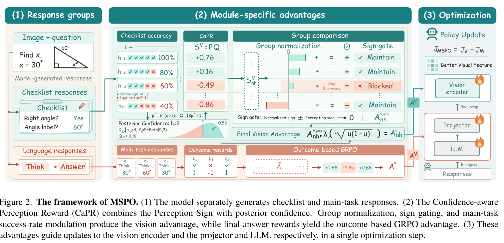

图源：原文 Figure 2，物理第 3 页。[固定 PDF](https://arxiv.org/pdf/2611.32687v1#page=3)。左边上下是同图不同提示的独立采样，中央视觉部分先算 CaPR、归一化、符号门与主任务权重，右边橙蓝箭头是两个 loss 的梯度去向。没有要求把 checklist 答案拼进主任务推理。

### 用 Beta 后验给视觉奖惩加置信度

对第 $`n`$ 道主问题，清单有 $`K_n`$ 个子问题，每题独立采样 $`H=12`$ 个响应。把每个子问题的第 $`h`$ 个答案聚成一次 trial，正确项数 $`s_{nh}`$。经验比例与阈值 $`\tau=0.7`$ 比较，决定奖惩符号。潜在正确率 $`\phi_{nh}`$ 假设来自均匀 Beta 先验，且各小题在给定它时独立。似然中 $`\phi`$ 的幂是成功数，不成功的幂是失败数，乘上均匀先验后直接得到

```math
\begin{aligned}
P_{nh}&=2\mathbf1\{s_{nh}/K_n>\tau\}-1,\\
\phi_{nh}\mid s_{nh},K_n&\sim\mathrm{Beta}(s_{nh}+1,K_n-s_{nh}+1),\\
p^*_{nh}&=\Pr(\phi_{nh}>\tau\mid s_{nh},K_n),\qquad
Q_{nh}=|2p^*_{nh}-1|,\qquad S^V_{nh}=P_{nh}Q_{nh}.
\end{aligned}
```

$`Q`$ 衡量后验更偏向门槛哪侧的程度，乘的是经验符号 $`P`$，因此奖励不等同于后验符号期望 $`2p^*-1`$。边界恰好等于阈值归负。论文的 Bernoulli 假设是估计工具，标记、颜色与位置题的错误可能相关。

**本文算例。**4 小题全对时，后验 Beta(5,1)，门槛右侧质量 $`1-0.7^5\approx0.832`$，奖为 +0.664。只对 1 项时后验 Beta(2,4)，右侧质量约 0.031，奖为 −0.938。只有两条 trial 的教学组，样本标准差归一化后的优势是约 +0.707 与 −0.707。如果主任务半对半错，结果加权乘 $`0.9\sqrt{0.5(1-0.5)}=0.45`$，变成约 ±0.318。如果全对或全错，视觉优势归零。

### 两路 GRPO 如何隔离参数

在每个问题的 $`H`$ 个清单 trial 内，以样本均值 $`\mu^V_n`$ 与样本标准差 $`\sigma^V_n`$ 归一化。归一化可能让原本为正的 trial 变负，只保留符号一致的优势。$`u_n`$ 是 $`G=12`$ 条主响应的最终答对率，$`\lambda_V=0.9`$。

```math
\begin{aligned}
\widetilde A^V_{nh}&=(S^V_{nh}-\mu^V_n)/(\sigma^V_n+\epsilon),\\
A^V_{nh}&=\widetilde A^V_{nh}\mathbf1\{P_{nh}\widetilde A^V_{nh}\geq0\}
                  \lambda_V\sqrt{u_n(1-u_n)},\\
J&=J_M(\mathrm{sg}(\theta_V),\theta_P,\theta_L;A^M)
   +J_V(\theta_V,\mathrm{sg}(\theta_P),\mathrm{sg}(\theta_L);A^V).
\end{aligned}
```

$`A^M`$ 是主任务最终奖励的组相对优势，$`\theta_V,\theta_P,\theta_L`$ 是视觉塔、projector、语言模块 LoRA 参数。$`\mathrm{sg}`$ 表示对该路冻结所列参数的梯度，不是切断链路里所有 Jacobian。视觉 loss 仍要沿语言端的输出传回视觉特征。$`J_M,J_V`$ 使用裁剪的 GRPO 目标和 KL 正则，各清单 trial 的全部子响应 token 共用同一 $`A^V`$。因此可以隔离模块级信号，但不会指出是哪道 checklist 小题引起特定视觉 token 错误。

```text
主题与各 checklist 小题分开做 12 次采样，分别核验
在每个问题内拼 trial，算 Beta 后验、符号和主任务难度权重
主响应梯度只更新 projector 和语言 LoRA
清单响应梯度只更新视觉 LoRA，把两路合成一个 optimizer step
推理仅用主任务路径，不再要求 checklist
```

### 同数据比较与额外成本

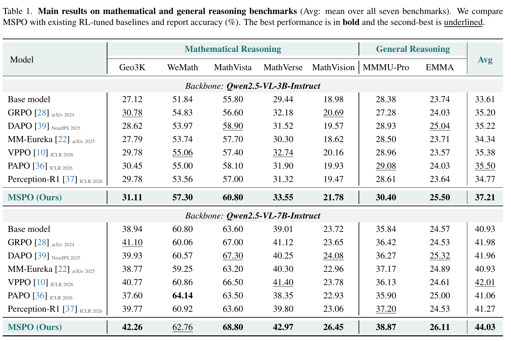

图源：原文 Table 1，物理第 5 页。[固定 PDF](https://arxiv.org/pdf/2611.32687v1#page=5)。同 Qwen2.5-VL-Instruct 3B，七项均值 37.21 vs GRPO 35.20、PAPO 35.50。7B 为 44.03 vs GRPO 41.98、VPPO 42.01；WeMath 一列 PAPO 的 64.14 高于 MSPO 62.76。报告的是任务均值，不是让不同大小的测试集按题数合并。

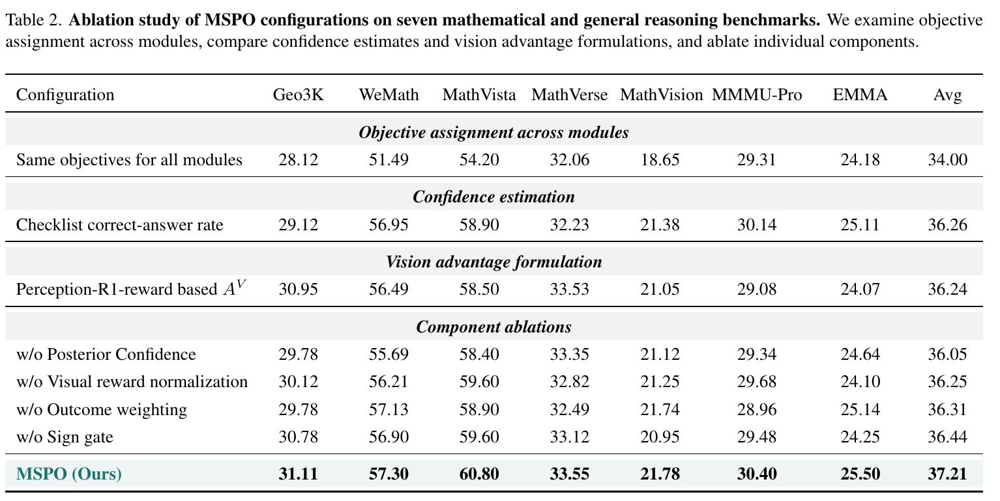

图源：原文 Table 2，物理第 6 页。[固定 PDF](https://arxiv.org/pdf/2611.32687v1#page=6)。3B 完整模型 37.21，共享两路目标给全模型降至 34.00。去后验置信、去归一化、去主任务加权、去符号门分别是 36.05、36.25、36.31、36.44。作者 Table 3 另外给 projector 用视觉优势时 35.36。对应比较的模块位置有实际差异，不能把“两个 loss 都存在”与“两个 loss 路由正确”合成一个因素。

两个规模都冻结基座权重，LoRA rank 64、alpha 256，AdamW LR 5e-6，1 epoch、128 主问题每 batch，主输出上限 2,048。平均每清单题约 3.40 条子问答，主样本与采样数相同不等于总生成量一致。附录 Figure 13 以 3B 训练实测每步比 GRPO 多约 26 分钟；这只是该环境下耗时差，没有把 GPT 清单生成和端到端 GPU-hours 算入。硬件型号和峰值显存未核验。复现优先记录相同修订数据、两路 token 数、模块梯度范数，另以等生成预算和不同人群标注对照。入门 [PEFT LoRA 指南](https://huggingface.co/docs/peft/conceptual_guides/lora)；进阶 [TRL GRPO 指南](https://huggingface.co/docs/trl/grpo_trainer) 与 [DeepSeekMath 原文](https://arxiv.org/abs/2402.03300)。

<a name="paper-care"></a>

## 4. CARE-3D · 用证据遮挡估计一次工具调用的贡献

首发 2026-11-23，Xiaoqian Hu 等。[论文页面](https://arxiv.org/abs/2611.29969) · [固定 v1](https://arxiv.org/pdf/2611.29969v1) · [作者仓库](https://github.com/xiaoqian-UQ/CARE-3D)。已读作者 README，发布了 SFT、RL、评估脚本入口。未核验到独立作者博客或最终完整 checkpoint 分发，脚本未实跑。

### 让同一个 3D grounder 暴露四种证据

给定观察者所在位置和问题，第一轮 VLM 生成短物体引用和一个工具标签，共同组成 $`a_i^{\mathrm{grd}}`$。同一个 3D grounder 可返回语义候选和概率、场景坐标及尺寸、观察者相对角度和距离、或高亮的物体视觉区域。第二轮读工具结果 $`e_i`$，产生推理和答复。看物体颜色用 Crop 可能更直接，问钟点方向则用 Polar 提供相对角度。第一轮只调用一次，地面真值、画面自身质量和可见性都会限制结果。

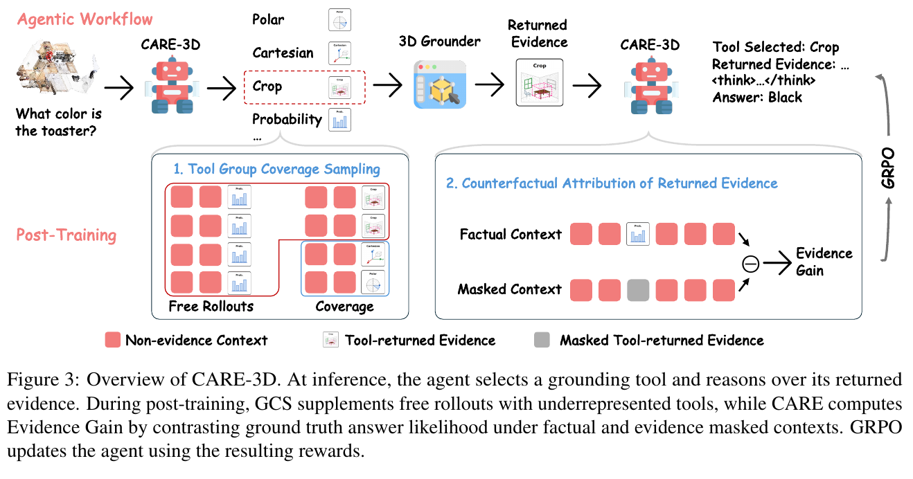

图源：原文 Figure 3，物理第 3 页。[固定 PDF](https://arxiv.org/pdf/2611.29969v1#page=3)。上半是部署中的两轮问答与一次工具交互；下左是先采六个自由样本，再补两条覆盖样本，下右固定问题与请求，只变工具结果。遮挡版本仅用来计分，部署没有奖励支路。

SFT 使用从 SceneCOT-185K 得来的 145.6K MSQA 交互轨迹和 40K GQA3D 轨迹，含视点变化的增强样本。联合更新 agent LoRA、3D encoder/projector 与 grounding head。SFT 让模型学会合法交互并对齐 grounder；RL 阶段冻结 VLM 基座和 grounder，只更新 agent LoRA。后训练只取 MSQA train，Beacon3D 保留作独立评测。

### Group Coverage Sampling 如何增加探索

一组固定 8 条，先自由采 6 条。统计合法调用里各工具出现次数，选最少覆盖的工具给其余 2 条。只指定 tool identifier，引用、证据后的推理和回答仍由模型自己生成；指定标签和工具返回证据 token 从 policy loss 里屏蔽。被覆盖的样本与自由样本共享组均值、组方差。因而 6 条来自当前策略自由选工具，2 条条件于外加标签，不能解读为全组无条件抽样。

### 把有证据和遮住证据的上下文放到同一尺度

给定同一 $`x`$ 和调用 $`a_i^{\mathrm{grd}}`$，取参考答案的 $`L`$ 个 token $`y_k^*`$。固定遮挡符号 $`m(e_i)`$ 替代整条证据，两边都不放模型写过的推理，避免推理已经复述证据导致“遮了还看得到”。师迫打分差如下。

```math
\begin{aligned}
\mathrm{EG}_i
  &=\tfrac1L\textstyle\sum_{k=1}^L
  \left[\log\pi_\theta(y_k^*\mid y^*_{\lt k},x,a_i^{\mathrm{grd}},e_i)
  -\log\pi_\theta(y_k^*\mid y^*_{\lt k},x,a_i^{\mathrm{grd}},m(e_i))\right],\\
z_i&=(\mathrm{EG}_i-\mu_{\mathrm{EG}})/(\sigma_{\mathrm{EG}}+\epsilon),\qquad
r_i^{\mathrm{CARE}}=(1+\exp(-z_i))^{-1},\\
R_i&=w_{\mathrm{fmt}}r_i^{\mathrm{fmt}}+w_{\mathrm{ans}}r_i^{\mathrm{ans}}
      +w_{\mathrm{CARE}}r_i^{\mathrm{CARE}}-p_i.
\end{aligned}
```

第一行是平均对数比，可以理解为参考答案各 token 概率几何平均的相对变化。第二行再同题归一化，效用是相对量。即便每个证据都弱，组内仍可能产生正负优势。最后一行是格式、答案与证据三个奖励，$`p_i`$ 表示非法交互罚分，无法执行的极端非法样本直接得 −1。答案判官的 1–5 分线性压到 0–1。前 200 步三权重 1.2、0.8、0.2，后 400 步 0.8、1.2、0.2。GRPO 对 $`R_i`$ 再做组相对归一化，使用 token 比率裁剪，裁剪宽度 0.2，另加 KL 0.02。证据差是奖励输入，不对 mask 比较直接反传。

**本文算例。**单个答案 token 在完整和遮罩上下文的概率是 .60 与 .30，则 EG 为 ln2≈.693。另一条是 .41 与 .40，则 EG≈.025。为了手算取两条、总体标准差，第一条 z≈1、第二条 z≈−1，映射为 .731 和 .269。在格式和答案相同的情况下，0.2 倍后总奖励差约 .092。遮挡本身可能让输入分布变得陌生，这个差值不能当作物理场景里的严格因果效应。

```text
SFT：交互轨迹监督 agent 与 grounder；保存共同 checkpoint
GRPO：每题 6 条自由采样加 2 条低覆盖工具条件采样
对每条执行调用，评分有效格式与答案，额外用保留/遮挡评分证据
在有效输出 token 上累计 clipped GRPO 与 KL，更新 agent LoRA
固定题目和视点，记录混淆工具、证据变化和后续答案的对应关系
```

### 先看同骨干对照，再看工具分布

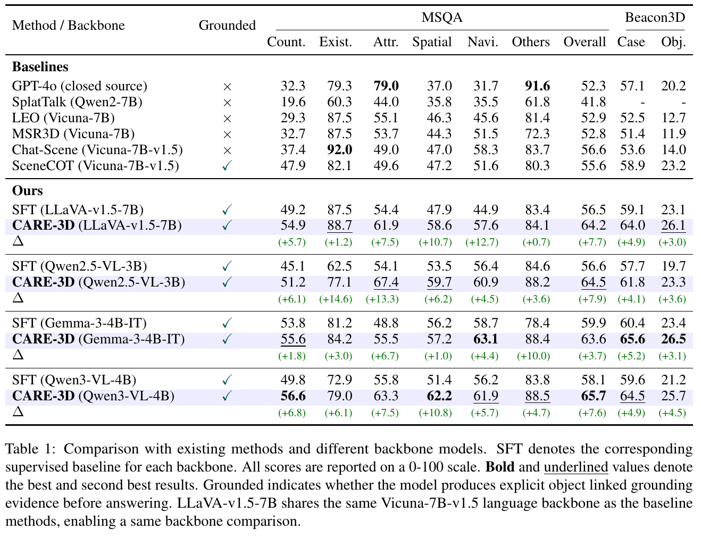

图源：原文 Table 1，物理第 7 页。[固定 PDF](https://arxiv.org/pdf/2611.29969v1#page=7)。Qwen3-VL-4B 的 MSQA Overall 从 SFT 58.1 到 65.7，空间/指代 51.4→62.2；Beacon3D 对象一致性 21.2→25.7。Obj 要同一目标物体的相关问题都答对，严格于 Case。还报告 LLaVA-7B、Qwen2.5-VL-3B、Gemma-3-4B；跨方法对照的骨干和可用证据不同。

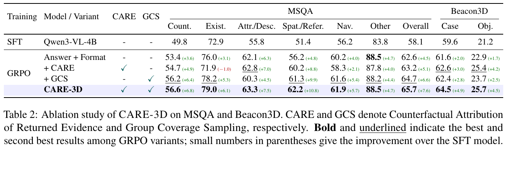

图源：原文 Table 2，物理第 8 页。[固定 PDF](https://arxiv.org/pdf/2611.29969v1#page=8)。同 Qwen3-VL-4B 的纯 Answer+Format GRPO 为 62.6，加入 GCS 为 64.7，完整 65.7。Beacon3D Obj 完整 25.7，Answer+Format 22.9。Table 3 固定组 8，最少覆盖选两条优于随机选两条，选四条则掉分。Table 4 的遮挡、替换随机 token、替换工具也须按相同初始化读。

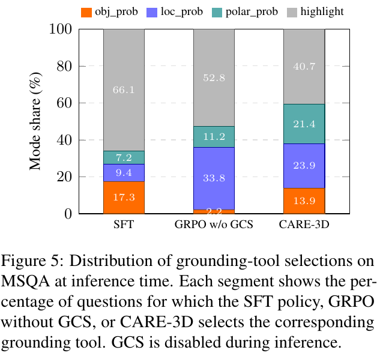

图源：原文 Figure 5，物理第 8 页。[固定 PDF](https://arxiv.org/pdf/2611.29969v1#page=8)。Figure 4 的同题案例由坐标改选能判外形的高亮图。Figure 5 堆叠柱是测试时各工具选择率，部署不强制覆盖。更均匀只支持探索有所变化，不能保证每条工具调用都正确。

主设置两阶段各用 2 张 H100 80GB。SFT 5 epoch、LR 2e-5、全局 batch 40；RL 600 steps、LR 1e-6、24 题 × 8 条＝192 轨迹/步，合计 115,200 条，LoRA rank 16/alpha 32。原文与代码入口还涉及外部评分服务，README 训练判官是 Gemini 2.5 Flash-Lite，评估 GPT-Score 另用 GPT-4o；API 预算、总运行时间和显存峰值未核验。公开 RL 脚本默认第 200 步后每组覆盖项从 2 条降为 1 条，原文 Appendix A.2 用 6+2 描述批次。复现应记录实际调度，并区分固定 6+2 和退火变体。复现先做小规模遮挡一致性、相同题不同视点以及保持答案不变的无关证据干预；核验脚本版本、评估判官与数据许可。基础看 [verl 训练框架](https://verl.readthedocs.io/en/latest/)、[TRL GRPO](https://huggingface.co/docs/trl/grpo_trainer)，进阶看作者仓库与 [ScanNet 数据说明](https://www.scan-net.org/)。

<a name="paper-think"></a>

## 5. ThinkMorph-SSL · 用恢复图像练习能继续读的中间状态

首发 2026-11-24，Jiawei Gu 等。[论文页面](https://arxiv.org/abs/2611.32183) · [固定 v1](https://arxiv.org/pdf/2611.32183v1) · [作者项目与演示](https://thinkmorph.github.io/ssl/) · [官方训练与评估代码](https://github.com/ThinkMorph/ThinkMorph-SSL)。已核验 README 和两个训练 YAML，并核对阶段二以第 5,500 步 EMA 作为发布权重。方法深读入口是作者项目页，未核验另有作者方法博客。

### 先练恢复图、再练用图

有生成能力的统一模型也可能只会“输出一张图”，而不会把那张图作为下一步推理的输入。第一阶段无逐样本编辑指令，只有损坏图、目标图及两段文字。文字先诊断腐蚀情况，图恢复结构，之后文字解释恢复后的可见内容。第二阶段有用户问题和具体答案，模型要生成能支持任务的中间图，再向下推理。模型可以学习在发出图像标记后生成一个连续图像状态，再把所生成图作为理解模块的条件。

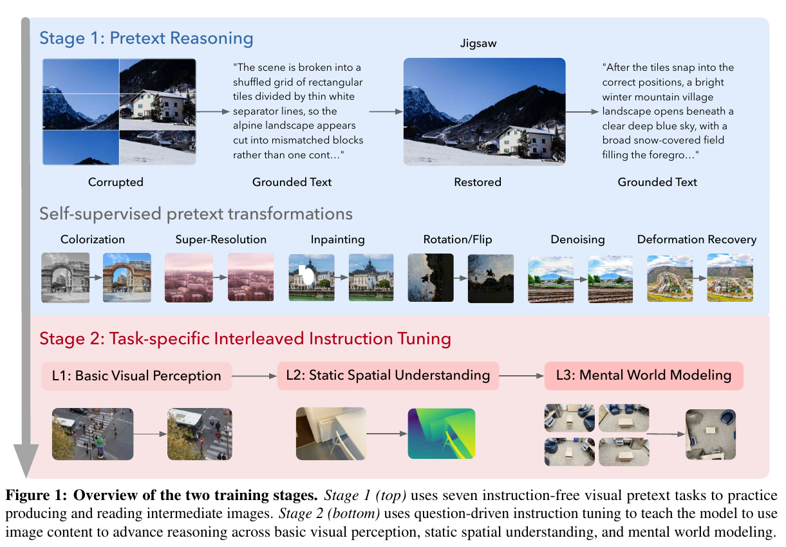

图源：原文 Figure 1，物理第 2 页。[固定 PDF](https://arxiv.org/pdf/2611.32183v1#page=2)。上半示例是拼图，输入被打乱，模型先诊断再恢复并重新读图。下半分为局部感知、静态空间理解和心理世界建模，示例分别为局部放大、深度等空间图、视角转换。箭头表示顺序训练，两个数据集不从第一步就混在一起。

**阶段一数据。**Pretext-270K 有 270,896 条。八个图像来源含 SA-1B、PixMo-Cap、Matterport3D、Realsee3D 等。程序生成七种输入变化：拼图、着色、超分、补缺、旋转翻转、去噪、几何形变。原图作为恢复目标。强多模态模型先 caption 原图，再看原图、损坏图和 caption 产出前后文字；自监督指视觉目标从图像变换获得，文本仍由模型合成。没有直接写“这是去噪”一类的任务指令，但两阶段共享控制生成的系统模板。

**阶段二数据。**Instruct-180K 有 180,490 条，由九类流水线构建。62,100 是基础感知，例如局部 crop；15,144 是静态空间理解，例如多视图重排和深度关系；103,246 是心理世界建模，例如全景、鸟瞰、物体旋转和自我视角转换。自动构造包括选择和验证中间状态，不等于模型训练时自己探索图像或执行环境动作。BAGEL 的预训练图像清单不公开，作者无法核对图像级重叠；准确区分新构造轨迹和从没见过原图。

### 文字 CE 加视觉潜空间 MSE

顺序上可以写成 $`I_c\to T_0\to I_0\to T_1`$。$`I_c`$ 是损坏输入，$`T_0,T_1`$ 是恢复前后的文本，$`I_0`$ 是目标视觉状态。第二阶段输入来自问题与原图，最后一段含答案。两阶段仅对目标位置监督。对 BAGEL 主实验，将 Appendix G 描述写成如下批次内记号：

```math
\begin{aligned}
\mathcal L_T&=-\tfrac1{|\mathcal T|}\textstyle\sum_{t\in\mathcal T}\log p_\theta(w_t\mid h_t),\\
\mathcal L_I&=\tfrac1{|\mathcal V|}\textstyle\sum_{v\in\mathcal V}\|\widehat z_v-z_v\|_2^2,\\
\mathcal L&=\mathcal L_T+\mathcal L_I .
\end{aligned}
```

$`h_t`$ 为先前文字和图的条件，$`\mathcal T,\mathcal V`$ 是各自有效监督位置，$`w_t`$ 为真值文本，$`z_v`$ 表示冻结 VAE 所定义的潜空间下的训练目标，$`\widehat z_v`$ 是生成头对应预测。这里简化了主干噪声时间步、目标参数化和张量约简，复现以 BAGEL 训练器和配置为准。两项权重都为 1，VAE 编码器固定，图像生成路径继续学习。没有强化学习奖励；生成头更新是为了恢复或构造中间视觉状态。

**本文算例。**两个监督词的真值预测概率分别为 0.8、0.5，平均 CE 约 0.458。若某个目标只有两个标量维度，预测误差分别 0.2 和 −0.4，按维平均 MSE 为 (.04+.16)/2=0.10。在同权下该玩具损失 0.558。实际图像 latent 有多位置，混合精度与动态 packing 都会影响有效序列与 token 数，不能拿算例推算成本。

```text
阶段一：从干净图自动做一种破坏，构造诊断文字、干净图、分析文字
用动态 packing 联合训练文本 CE 与图像 latent MSE
阶段二：从阶段一 EMA 继续，在问答和中间图轨迹上监督
推理：根据生成控制标记接上图像模块，把生成图放回上下文
监控输出可读性、推理到图像再到答案的一致性与评估延迟
```

### 用同训练预算和输出干预看增益

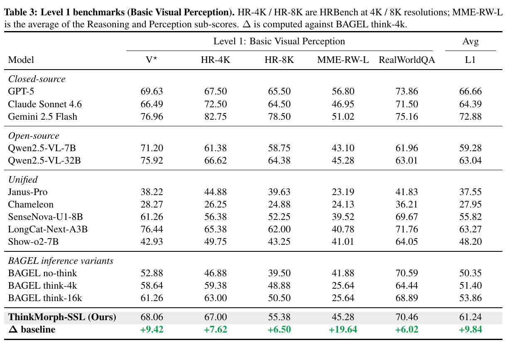

图源：原文 Table 3，物理第 6 页。[固定 PDF](https://arxiv.org/pdf/2611.32183v1#page=6)。L1 均值 61.24 对 BAGEL think-4k 的 51.40，提升 9.84 点。基座改成 think-16k 为 53.86，单增加文字预算有一些收益。若看单列，HR-8K 的 55.38 仍低于 Qwen2.5-VL-32B 的 64.38。不同家族的公共模型与基座参数规模、解码和模态不同。

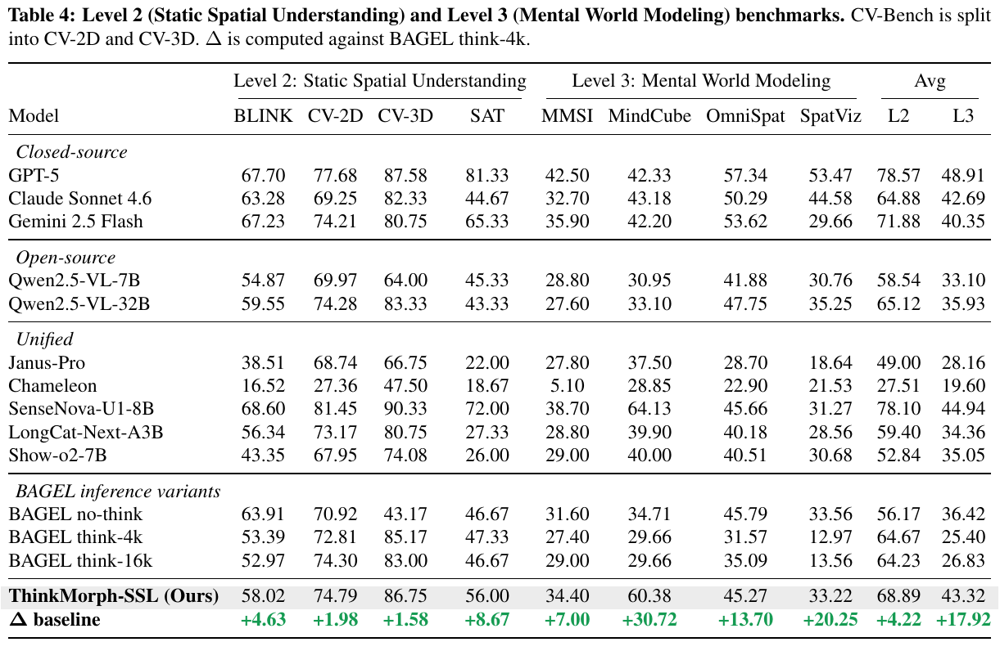

图源：原文 Table 4，物理第 7 页。[固定 PDF](https://arxiv.org/pdf/2611.32183v1#page=7)。同一 BAGEL think-4k 对比，L2 64.67→68.89、L3 25.40→43.32。MMSI 是 29.66→60.38；CV-Bench 分两个子列。与闭源大模型对照时 L3 有领先也有落后，不能把该分组结论扩展到所有感知任务。论文 Figures 3–4 展示了合理合成全景能帮助解题、低保真全景能误导的反例。其强制生成中间图实验即使给真值图，未训练如何使用图的基座也没有普遍获益。

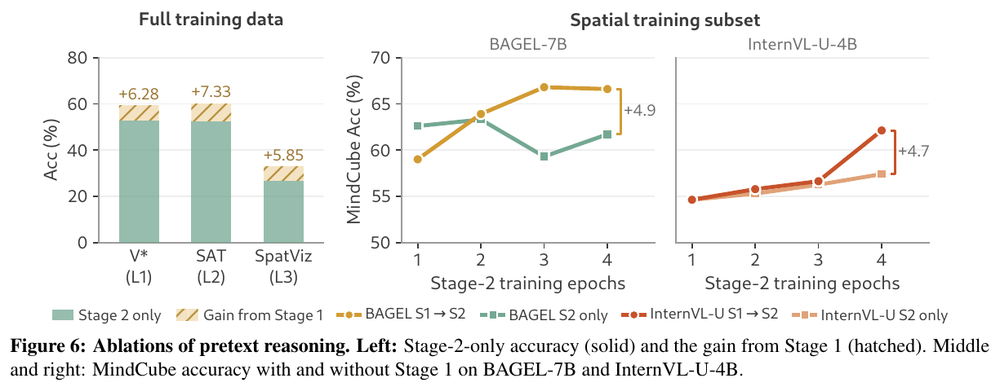

图源：原文 Figure 6，物理第 9 页。[固定 PDF](https://arxiv.org/pdf/2611.32183v1#page=9)。左图基座对照为只做第二阶段，控制约 96K 第二阶段序列，两阶段在 V-star、SAT、SpatialViz 的平均额外增益 6.49 点，加了第一阶段训练成本。中、右图用空间子集固定第二阶段设定，MindCube 最后一段分别提升 BAGEL 4.9 与 InternVL-U-4B 4.72 点；早期差异更小。Figure 7 同指令预算比较混训与分阶段，后者结束约 66.6%，混训约 57%。

### 复现读配置，成本按选点算

主要完整报告基于 BAGEL-7B-MoT，4B 支持来自空间子集跨骨干验证。FSDP2 动态打包，阶段一用 32 张 80 GB GPU、~12 秒/步、训练日程 10K 步，阶段二 48 张、~45 秒/步、日程 12K 步。两阶段的主要 checkpoint 都取 EMA 第 5,500 步。按这些均值和选点算，训练约 587+3,300＝3,887 GPU-hours，不含采集、调参、独立完整日程、推理与数据合成。具体 GPU 型号和真实账单未核验。不能把 max_steps 改成 5,500 再跑，cosine 会提前归零。原文 V-star 的 TeaCache 试验在该设定使总 FLOPs 减少约 77%，延迟由 62.3 到 21.3 秒；这不是所有任务固定加速倍数。

官方仓库含数据卡、训练和评估脚本与已发布权重。受来源数据许可约束，Matterport3D、Ego-Exo4D 部分以 text_only 形式列出，需要合规补原图。配置级可复现不能等同于逐 bit 一致，尤其 world size 变化会改变动态打包。复现应对照基座、只做第二阶段、两阶段，固定解码预算与评估器，单独报告中间图错误率。[Pretext-270K 数据卡](https://huggingface.co/datasets/ThinkMorph/Pretext-270K) · [Instruct-180K 数据卡](https://huggingface.co/datasets/ThinkMorph/Instruct-180K) · [BAGEL 原项目](https://github.com/ByteDance-Seed/Bagel) · [PyTorch FSDP2 入门](https://docs.pytorch.org/tutorials/intermediate/FSDP_tutorial.html)。

## 选一篇深入读

| 感兴趣的问题 | 精读入口 | 看实验先对齐什么 |
| --- | --- | --- |
| 小 VLM 怎么学到关键观察 | [VC-OPD](#paper-vc) | 同尺度教师暖机、特权文本与学生独立输入 |
| 只前向如何做权重更新 | [ARS-VLM](#paper-ars) | 选点、每步及累计轨迹、静态与峰值内存 |
| 视觉和语言能否分开归因 | [MSPO](#paper-mspo) | 主任务与 checklist 预算、梯度路由 |
| 工具查询如何获得中间信用 | [CARE-3D](#paper-care) | 组大小、遮挡后的同一参考答案 |
| 生成的图如何参与下游推理 | [ThinkMorph-SSL](#paper-think) | 指令训练预算、额外阶段成本、图质 |

原图裁剪边界、图号和版本见 assets/SOURCES.md。所列项目、脚本与数据卡是复现入口，本期未复跑作者实验。
