# VLM 后训练精读 · 2026-11-27

## 论文速读

### STAR · 改一个局部，看模型会不会跟着改答案

背景相同，仪表数字或物品颜色变了，模型应给出不同答案。作者成对构造这种图片，让同一学生分别看原图和编辑图、各自作答。老师在每一边都用相应局部的清晰裁剪来点评。

还让老师看一张只有平均颜色的裁剪，比较哪些词确实受到局部细节支持。当学生的注意位置与老师差更远，就加重这部分提示。训练完仍只输入整图。[读精读](#paper-star)

### MemRU · 先练从记忆里读事实，再练用它答题

同一段历史里有很多图和文字。作者先把答题所需事实拆成短问题，例如读一张旧截图的按钮名。训练用模型在高质量文字描述上已经能答对的短答案，再让它回到真实图文记忆完成同样任务。

第二阶段用原始问题给最终答案打分。这样分别处理“有没有找到事实”和“找到后能不能用对”，上线时可接不同的记忆系统。[读精读](#paper-mem)

### ClueRL · 奖励说中能认出实体的视觉线索

识别建筑时，“楼很高”可能没帮助，某个特别的楼顶结构却有用。作者从图中找能把人引向目标实体的线索，剔除看不见的、直接说出答案的和无法帮助认出实体的描述。

强化学习时，每条回答仍有最终答案分。说中线索则另有一份奖励，只加到对应的几个词上。即使最后认错，提到的有效线索也可以得到单独反馈。[读精读](#paper-clue)

### Uni-MOPD · 先把五个专家合起来，再让它们补课

数学、OCR 和界面定位的专家共享同一底座。作者先平均它们相对底座的参数改动，得到已经掌握多项能力的学生。

之后学生自己答题，每道题交给对应领域的固定老师评分。训练用均匀领域采样，逐词对齐整个预测分布。实验重点是起点和短期蒸馏各贡献多少。[读精读](#paper-uni)

### OmniEVIE · 让小模型学会搜索局部证据

一张文档只有某个框能回答问题，一段视频只有几秒包含关键动作。作者在训练中保留多条局部向量，同时要求压缩后的小向量也能找对位置，并用教师排序纠正常见的假负例。

上线时先用便宜的均值找候选，再用二值编码缩小范围，最后用量化的局部向量细排。命中还能返回页上区域或视频时间段。[读精读](#paper-evie)

## 选题与执行环境

本期窗口为 2026-10-27 至 2026-11-27。五篇均核对固定 arXiv v1，日期用 arXiv 首次提交 UTC 日。作者实测与文中手算分开标记。本次在 macOS 本机补位，沿用既有的 SSH 授权。远端运行约定与迁移聊天尚无已验证的独立云端执行记录，启动时未查到当日云端日报。

<a name="paper-star"></a>

## 1. STAR · 训练样本也做一次局部反事实

Yi Zou 等，首发 2026-11-24。[原文](https://arxiv.org/abs/2611.32472) · [固定 PDF](https://arxiv.org/pdf/2611.32472v1) · [作者实现](https://github.com/xiaolingdudu/STAR) · [STAR-6K](https://huggingface.co/datasets/Yizou/STAR-6K)。

### 成对图像和独立 rollout

在原图有某个局部能决定答案时，保留题干、选项、画面周边，只换证据框内的细节。原始问答、框来自 Vision-OPD。作者用 GPT-Image-2 编辑证据裁剪，贴回原坐标，用 GPT-6 Astra 验证答案确实改变、修改限于框内、背景保留，得到 6,176 对。设 $`w=0,1`$ 是原图与编辑图，$`x`$ 是共享问题，$`h_{w,t}`$ 是该世界学生生成到第 $`t`$ 个词前的前缀。每张图分别采样 8 条，老师评分时只对该图的学生前缀做 teacher forcing。禁止跨世界沿用理由，否则新图和旧陈述可能互相冲突。两世界可有不同响应长度，每轮训练仍只更新一个学生。

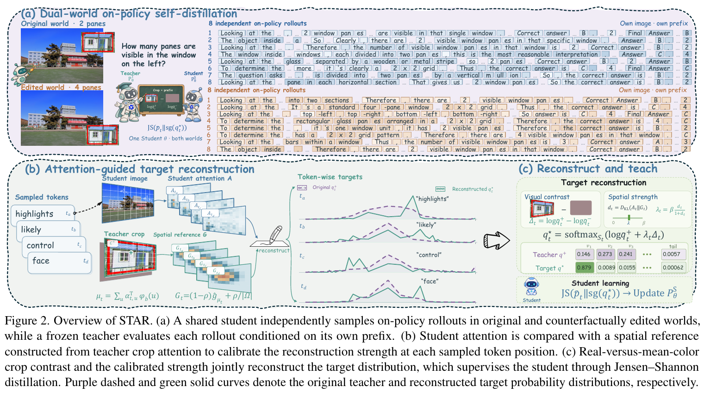

图源：Figure 2，物理第 4 页。[PDF](https://arxiv.org/pdf/2611.32472v1#page=4)。上方两条颜色表示原图和编辑图分别采样；左下把局部老师的注意中心投回整图，右下用真裁剪和均色裁剪的预测差修正目标。箭头不跨两个前缀。

### 注意差决定何时加强监督

老师固定为同源基座。对相同前缀和问题，输入真证据裁剪得到 $`q^+`$，输入同尺寸的均 RGB 裁剪得到 $`q^-`$。学生只看整图，输出 $`p`$。取学生和正老师各自的 top-k 候选的并集，其余词的概率折成一个尾桶，三路都在同一支持集 $`S`$ 比较。对选定的第 20 层，先对各头看图位置 softmax 再头平均得学生空间分布 $`A`$。用正老师局部注意质心回投原图，按框宽高各四分之一作高斯尺度，混入权重 $`\rho=0.1`$ 的均匀分布。混合后的 $`G`$ 保证每个位置有正支持。

```math
\begin{aligned}
G(v)&=(1-\rho)\,\frac{g(v)}{\sum_{u\in\Omega}g(u)}+\frac{\rho}{|\Omega|},\\
d&=D_{\mathrm{KL}}(A\Vert G),\qquad
\lambda=\beta\frac{d}{1+d},\qquad \beta=1.
\end{aligned}
```

$`v`$ 是视觉网格位置、$`\Omega`$ 是网格全集。$`d`$ 越大，$`\lambda`$ 越接近上界，导数为 $`\beta/(1+d)^2`$。用正负老师的对数差 $`\Delta_z`$ 当作细节增益，把正老师作为起点重标定。

```math
\begin{aligned}
\Delta_z&=\log\bar q^+(z)-\log\bar q^-(z),\\
q^*(z)&=\frac{\bar q^+(z)\exp(\lambda\Delta_z)}
                  {\sum_{u\in S}\bar q^+(u)\exp(\lambda\Delta_u)},\\
m&=(\bar p+\mathrm{sg}(q^*))/2,\\
\ell&=\tfrac12 D_{\mathrm{KL}}(\bar p\Vert m)
        +\tfrac12 D_{\mathrm{KL}}(\mathrm{sg}(q^*)\Vert m).
\end{aligned}
```

横杠表示带尾桶的概率，$`\mathrm{sg}`$ 停止目标分支梯度。若真裁剪使候选的相对概率更低，指数项也能压低它，而不只是给某类词加奖励。空间 KL 只是调教师分布，主损失仍是学生对重建目标的 JS，两世界有效输出位置聚合；结果由这个蒸馏目标训练。

**本文算例。**某位置用两个候选词，真裁剪为 (0.8, 0.2)，均色为 (0.5, 0.5)。若空间 KL 为 1，则 $`\lambda=0.5`$。未归一权重约为 (1.012, 0.126)，修正后首词概率约 0.889，比原教师 0.8 更集中。若学生看图位置已接近老师，$`d\approx0`$ 时目标退回正老师。均色基准仍保留平均颜色，并不能移除全部视觉信息。

```text
为每题构造仅证据框不同的原图和编辑图，验新答案
同一学生分别在两张整图采样，保留各自的前缀
冻结老师分别给真裁剪与均色裁剪评分，按位置对齐时间步
按空间注意差设修正系数，构造同支持集的教师目标
在两世界有效输出位置累计 JS，只更新学生
```

### 对照与成本

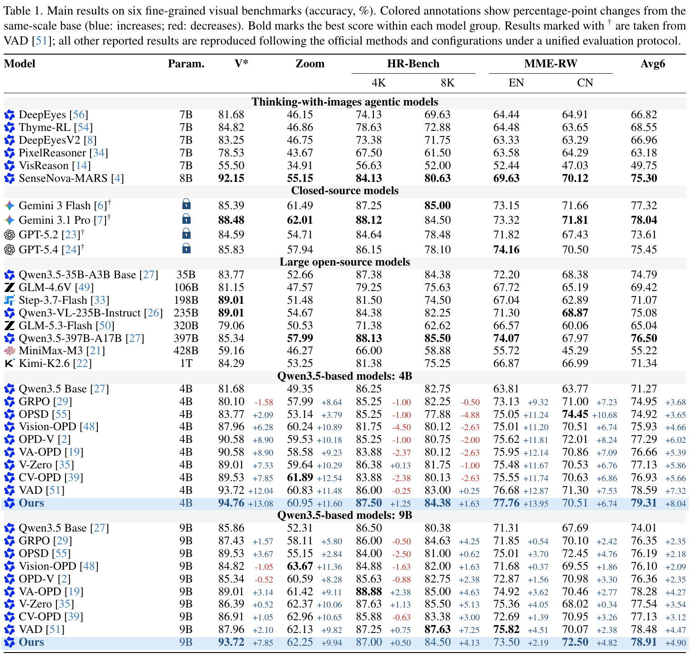

图源：Table 1，物理第 6 页。[PDF](https://arxiv.org/pdf/2611.32472v1#page=6)。Avg6 是 V-star、ZoomBench、HR-Bench 4K/8K、MME-RealWorld 英/中六项等权。单样本评价用 GPT-OSS-120B 判官、非思考解码、temperature 0。Qwen3.5-4B 从 71.27 到 79.31，同基座 VAD 为 78.59。9B 为 74.01→78.91，VAD 为 78.48。4B 的优势不等于逐项第一，例如 9B 的部分 Zoom 和 HR 项有更强基线。

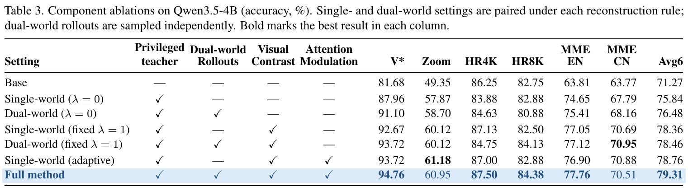

图源：Table 3，物理第 8 页。[PDF](https://arxiv.org/pdf/2611.32472v1#page=8)。无重建的单/双世界是 75.84/76.48；固定强度 78.36/78.46；自适应 78.76/79.31。双世界在固定强度仅有 0.10 点平均增益，部分子项下降。另见 Table 4，冻结老师配 JS 为 79.31，EMA 0.05 为 74.70，结论限于该对照。

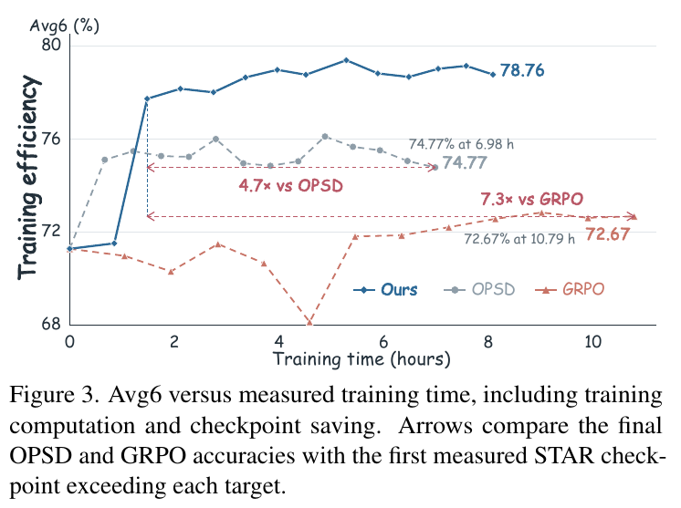

图源：Figure 3，物理第 7 页。[PDF](https://arxiv.org/pdf/2611.32472v1#page=7)。横轴为累计训练时间，纵轴是 Avg6；固定三条曲线的学习率日程和每步 1,536 条响应。STAR 首次越过 OPSD 终点 74.77 时 1.48 小时，对方 6.98 小时，约 4.7 倍是该阈值的到达速度差。图中第 130 步 STAR 是 78.76，和完整方法表的 79.31 是不同实验读数。不能把 4.7 倍推广到数据编辑、判官或每步更新。

公开实现含 4B/9B/27B 训练配方、数据预处理和评估；正文主配置 96 对/步 × 2 × 8，64 张 H20 141GB，130 步，AdamW LR 2e-6、10 步 warm-up、每十步存 checkpoint。端到端编辑/判官成本及实测峰值显存未披露。复现可先检查框外像素一致性、编辑是否引入可猜的痕迹，按图族隔离 split，再报告原图和改图皆答对的配对指标。基础看 [Vision-OPD](https://arxiv.org/abs/2605.18740)；工程看 [verl 文档](https://verl.readthedocs.io/en/latest/) 和作者数据卡。

<a name="paper-mem"></a>

## 2. MemRU · 分清读到了证据和真的用对了证据

Junseok Kim、Kyungmin Min、Kyomin Jung，首发 2026-11-25。[原文](https://arxiv.org/abs/2611.33687) · [固定 PDF](https://arxiv.org/pdf/2611.33687v1) · [作者列出的项目页](https://memru-proj.github.io/)。项目页未能从当前检索通道读回，未核验到公开完整训练代码或独立作者博客。

### 诊断先控制证据是否足够

给同一条长期记忆和原题，把答题必要的视觉和文字事实各变成一题。比如“配置页的图标是什么应用”，然后原始题才问根据那次工具配置接下来该执行哪一步。用参考 caption 构造候选 probe，把“第几张图”这类位置提示换成内容描述。诊断选答题可解的样本，模型答对全部 probe 记 Read=1，答对原始问题记 Use=1。作者在人审中观察到判官一致约 95.1%、probe 参考答案约 92.5% 正确。四个记忆来源的条件诊断中 Read=0、Use=0 约占 20.9%–21.9%，而 Read=1、Use=0 约 28.9%–32.2%。这是经 sufficiency 筛选的小样本诊断，正式测试不只选可解样本。

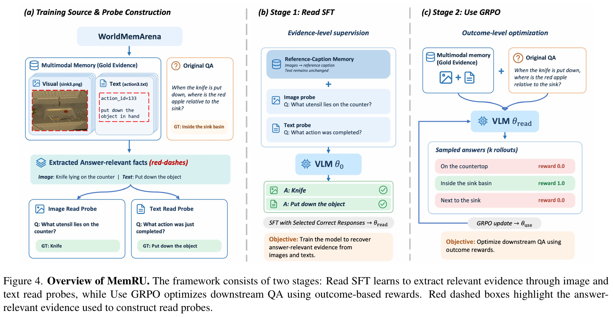

图源：Figure 4，物理第 5 页。[PDF](https://arxiv.org/pdf/2611.33687v1#page=5)。左侧同一轨迹组织 Gold Evidence 与两种 probe；中间从参考描述产生可靠短答案，再配回原始记忆训练；右侧恢复原问题，用答案分优化下游决策。参考 caption 用来选训练目标，部署仍消费原图和文字。

### Read SFT 和 Use GRPO 训练不同的目标

$`M_i`$ 是第 $`i`$ 题的原图文历史，$`M_i^{\mathrm{txt}}`$ 用人工参考 caption 替换视觉观察，$`p_{ij},a_{ij}`$ 是第 $`j`$ 条短 probe 和真值。初始 VLM 在文本版上生成 $`\hat a_{ij}`$，只有验对才把它变成训练目标。视觉与文字短题 1:1，各 3,361 条。下面 $`u_t`$ 是目标答案 token，$`T`$ 是目标串的长度，交叉熵用原始视觉记忆作条件。

```math
\begin{aligned}
\hat a_{ij}&=f_{\theta_0}(p_{ij},M_i^{\mathrm{txt}}),\\
\mathcal L_{\mathrm{read}}
&=-\tfrac1T\textstyle\sum_{t=1}^T
      \log p_\theta(u_t\mid M_i,p_{ij},u_{\lt t}).
\end{aligned}
```

作者训练集来自 WMA 按场景 70/10/20 切分，避免同经历进入两侧。GRPO 阶段用 6,722 道包含图像证据的原题，输入 Gold Evidence，输出 8 条候选。判官 gpt-oss-20b 给正确性 $`s\in[0,1]`$。用单词数 $`L`$ 和至少为 1 的参考单词数 $`G`$ 惩罚超长，报告奖励取

```math
\begin{aligned}
r&=s-\tfrac12\min\left(1,\max(0,(L-2G)/(2G))\right),\\
A_i&=(r_i-\bar r)/(\sigma_r+\epsilon).
\end{aligned}
```

惩罚从 2G 起，到 4G 达 −0.5 后封顶。$`A_i`$ 按同题生成组归一，$`\bar r,\sigma_r`$ 为组均值、标准差，$`\epsilon`$ 是写法中的数值稳定项。实现用 DAPO 的 token 级聚合、clip 0.2、无 KL，对 vLLM rollout 修正上限 2。这个奖励不直接核查推理是否从记忆取了对的事实；Read probe 是第一阶段的监督，并非 RL 的隐式因果证明。

**本文算例。**参考 3 词、正确回答 9 词，罚分 0.25，正确性给 1 则总分 0.75。另一条 5 词也答对，奖励 1。在同题简化二样本、总体标准差算例中，优势约为 −1、+1。反过来，长度同样的错误短答不会因短自动获得正确性奖励。

```text
按场景拆分 WMA，用 Gold Evidence 与参考描述构造短问
用初始模型回答短问并核验，配回原图文，平衡视觉和文字
在短问答案上做 Read SFT，保留两轮后的 checkpoint
换回原题采样八条，判正确性及长度，在组内做 DAPO 更新
在完整测试集上分别接三套固定检索系统，评测所答问题
```

### 结果应分别查 Gold Evidence 和真实检索

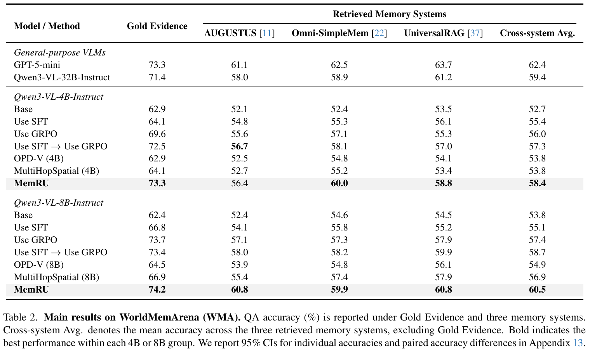

图源：Table 2，物理第 6 页。[PDF](https://arxiv.org/pdf/2611.33687v1#page=6)。共同测试集 2,073 问。8B 三种检索平均 60.5，高于 Use SFT→Use GRPO 58.7 和 Qwen3-VL-32B 59.4，低于 GPT-5-mini 62.4。4B 平均 58.4，对照 57.3，但在 AUGUSTUS 的 56.4 低于对照 56.7。Gold Evidence 不是三系统平均的一项。作者按同问题、三系统配对 bootstrap，在附录报告区间。

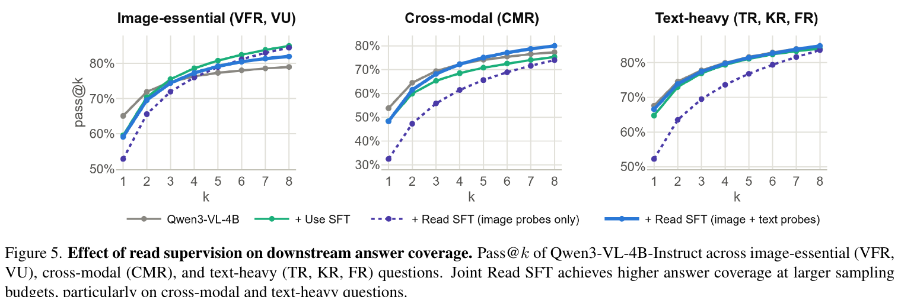

图源：Figure 5，物理第 7 页。[PDF](https://arxiv.org/pdf/2611.33687v1#page=7)。曲线横轴是采样条数，纵轴 pass@k，即是否至少有一个正确候选；不是一次使用的准确率。同页 Table 3 中，4B Read SFT 与 Read SFT+GRPO 的视觉探针准确率是 67.9 和 69.8。Table 4 同一组合的 Use 分是 64.8→73.1，读对情况下的 Use 72.3→80.2。两条曲线和两张表分别测候选覆盖、短事实提取、条件下游答对。

模型用 Qwen3-VL-Instruct 4B/8B，主要四张 A100 80GB，LoRA r16/alpha32、冻结视觉塔和 merger。Read SFT 两 epoch、batch 32、LR 1e-4，GRPO 112 步、60 题每 rollout batch、LR 2e-5，一张卡承载 gpt-oss-20b。作者记 Read 约 7/9、Use 约 86/106 GPU-hours（4B/8B）。约 1,176 GPU-hours 是包含基线、评估和重跑的总项目核算。复现要冻结检索输出、拆分及 judge，区分内容不可读、证据本来缺失和读到后推理错；用只改一项历史证据的干预再检测依赖。基础看 [TRL SFT](https://huggingface.co/docs/trl/sft_trainer)；工程看 [DAPO](https://arxiv.org/abs/2503.14476) 和 [Qwen3-VL](https://github.com/QwenLM/Qwen3-VL)。

<a name="paper-clue"></a>

## 3. ClueRL · 给能唤起实体的短语单独分配信用

Kyungmin Min、Soyeon Kim、Junseok Kim、Kyomin Jung，首发 2026-11-25。[原文](https://arxiv.org/abs/2611.34681) · [固定 PDF](https://arxiv.org/pdf/2611.34681v1)。原文附评测、抽取和生成 prompts，未核验到官方训练实现、模型权重或单独作者博客。

### 从知识问答拆出识别环节

问一个地标的历史通常先要认出是哪一座。普通描述“天空很蓝”可是真的却没助益，塔顶结构之类的细节更可能改变识别。作者构造同图的一跳识别题和二跳知识题，分别比较识别成功与失败；训练只用一跳，数据为 ViQuAE 的训练/验证图和 PopVQA，过滤在任意测试集出现的实体。结合图、问题和实体答案，由 GPT-6.1 Sol 提议线索，剔除不可见、直接说出答案或仅凭线索无法唤起实体者。决定性检查让 GPT-6 Luna 在不看图时试识别。此处测试的是强判官对文字线索的世界知识，不表示小模型投产时也一定能从线索推回实体。

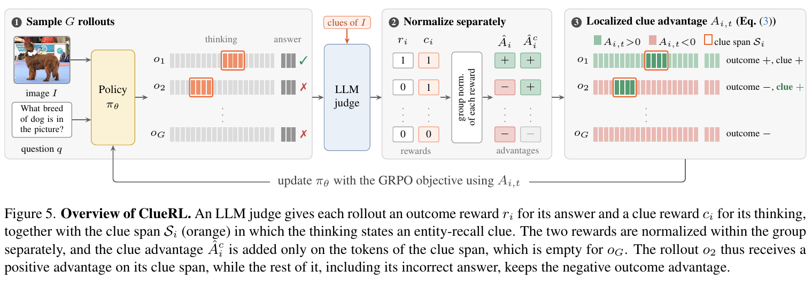

图源：Figure 5，物理第 5 页。[PDF](https://arxiv.org/pdf/2611.34681v1#page=5)。左侧八条 rollout 独立打最终答对和是否提到线索两种分。中间两路分别归一。右侧颜色区分输出每个词的总优势与收到附加信用的短片段，橙红区域外仍有结果回报。

### 分组归一化，然后在 span 内集中信用

对同题组，第 $`i`$ 条 rollout 的输出先思考后作答。GPT-6 Luna 分别给答案 $`r_i\in\{0,1\}`$，以及在思考段是否正确说出至少一个参考线索 $`c_i\in\{0,1\}`$。若说中，抽取各线索第一次出现的片段，映射成 token 的并集 $`S_i`$。未说中或没有预制线索时集合为空。两路按各自组均值和标准差标准化，再把线索优势局部加入，零方差组无区分信号。

```math
\begin{aligned}
\hat A_i&=(r_i-\bar r)/\sigma_r,\qquad
\hat A^c_i=(c_i-\bar c)/\sigma_c,\\
A_{i,t}&=\hat A_i+
\begin{cases}
 \lambda\,(\bar L/|S_i|)\,\hat A^c_i, & t\in S_i,\\
 0, & t\notin S_i .
\end{cases}
\end{aligned}
```

$`t`$ 是输出词位置，$`\bar L`$ 是批次平均输出长度，$`|S_i|`$ 是线索 token 数。$`S_i`$ 非空时，跨片段的附加优势总量恒为 $`\lambda\bar L\hat A^c_i`$，所以同样的线索反馈不会因为写得很短就在 token 平均里几乎消失。它也不能惩罚“没说”的不存在的那段，只能用 outcome 更新当前输出。随后用 $`A_{i,t}`$ 代替 GRPO 中的轨迹共享优势，按旧策略比率裁剪，使用 0.01 KL 向模型参考权重正则，token 归一。对逐词比率 $`\varrho_{i,t}`$，代理目标是

```math
\min\left(
\varrho_{i,t} A_{i,t},
\mathrm{clip}(\varrho_{i,t},1-\epsilon,1+\epsilon) A_{i,t}
\right).
```

**本文算例。**若一个回答最终答错，归一结果优势 −1；它确实指出三词线索，线索优势 +1。简化取全批平均长 30、$`\lambda=0.7`$，三个线索词各得额外 +7，总代入 +6；其他 token 是 −1。奖励不鼓励整个错误推理。短 span 得到的大权重也放大 judge 错切的影响，应记录跨度长度和实际梯度范数。

```text
构造只问实体的一跳题，筛掉与测试重合的实体
从原图与目标提议可见、隐去名称且判官能识别的线索
采样八条，分别判最终答案和思考中的第一次线索片段
分别组归一，按 token span 放大线索优势，用裁剪目标优化
在独立一跳与二跳集测准确率，追踪含/不含真实线索的子集
```

### 报告的是平均抽样准确率

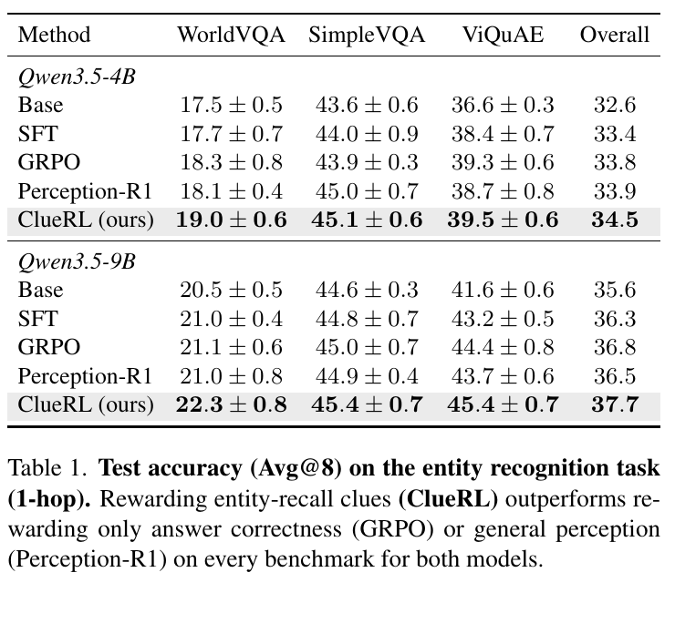

图源：Table 1，物理第 6 页。[PDF](https://arxiv.org/pdf/2611.34681v1#page=6)。同 Qwen3.5-4B 的一跳 Avg@8 为 Base 32.6、GRPO 33.8、Perception-R1 33.9、ClueRL 34.5。9B 为 35.6→37.7。Avg@8 是八次的准确率平均，不是至少一次对。训练同源问题下 Perception-R1 奖励更广的视觉陈述，对照的是“区别对待高信息量线索”的机制。

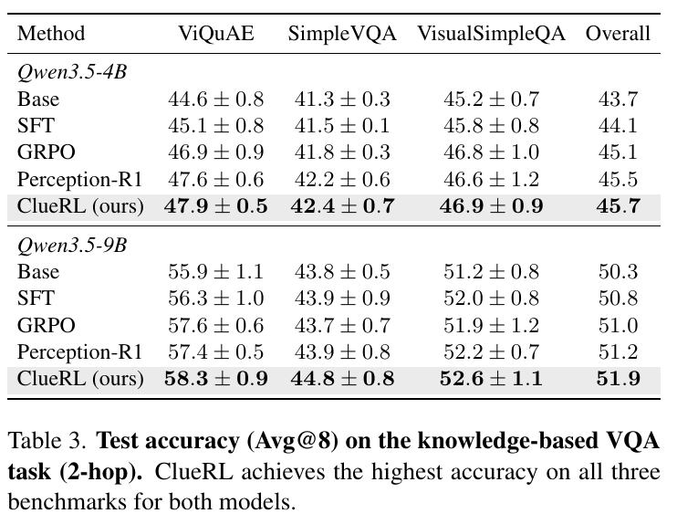

图源：Table 3，物理第 7 页。[PDF](https://arxiv.org/pdf/2611.34681v1#page=7)。表中一跳训练后的二跳知识问答总分 4B 43.7→45.7，9B 50.3→51.9，GRPO 分别 45.1 和 51.0。同页 Figure 6 按基座初始一跳八次采样的答对次数分组，读每组里识别增益与知识问答增益，不能用组均值证明每条链条都被正确改写。

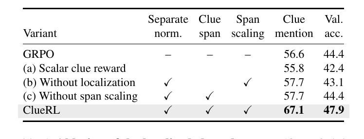

图源：Table 5，物理第 12 页。[PDF](https://arxiv.org/pdf/2611.34681v1#page=12)。4B 验证集，完整 47.9，GRPO 和取消 span 倍率均 44.4，取消局部化 43.1，把线索奖直接并进结果奖为 42.4。训练第二轮的线索提及率完整 67.1%，与测试正确率不是同一口径。

两模型冻结视觉塔，语言 LoRA r16/alpha32，主要四张 A100，LR 5e-5，27 题 × 8 条/步、2 epoch、clip 0.2、temperature 0.6、top-p 0.95，4B/9B 分别取验证上选出的 $`\lambda=0.7,0.4`$。未披露模型训练墙钟、判官总费用或显存峰值。验证应单独测不可见线索的胡编率、span 一致性及跨判官复判。入门 [TRL GRPO](https://huggingface.co/docs/trl/grpo_trainer)；相关数据与模型 [ViQuAE](https://github.com/PaulLerner/ViQuAE) 和 [Qwen3.5-4B](https://huggingface.co/Qwen/Qwen3.5-4B)。

<a name="paper-uni"></a>

## 4. Uni-MOPD · 把蒸馏预算先花在一个好的起点上

Wenzheng Chang 等，首发 2026-11-25。[原文](https://arxiv.org/abs/2611.34397) · [固定 PDF](https://arxiv.org/pdf/2611.34397v1) · [作者代码](https://github.com/AmberHeart/Uni-MOPD) · [权重集合](https://huggingface.co/collections/AmberHeart/uni-mopd)。模型为 30B 总参数、约 3B 激活 MoE，启动与参数存储仍需按 30B 估计。原文列 [作者项目页](https://amberheart.github.io/Uni-MOPD/)，本次主要核验 GitHub 仓库与权重入口。

### 相同底座允许平均专家的改动

五专家从 Qwen3-VL-30B-A3B-Instruct 出发，能力各是 STEM、VQA、OCR/文档、GUI 定位、具身理解。各专家有 SFT 和领域 RL 历史，OCR/GUI 从多域 SFT 出发。原论文比较 merge 前后和均匀训练，不能把已经训练好的权重视为零成本取得。

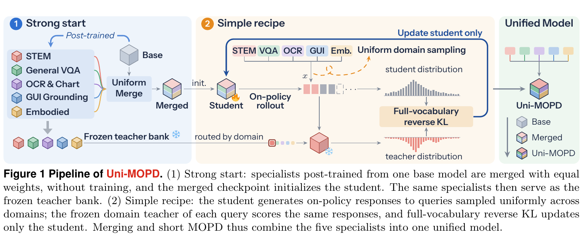

图源：Figure 1，物理第 2 页。[PDF](https://arxiv.org/pdf/2611.34397v1#page=2)。左端合并来自同个底座的专家；中间每批按域均衡、学生生成、对应教师评分；右端只更新合并后的模型，训练后不需要路由五个老师一起服务。

记同源 base 参数 $`\theta_b`$，专家 $`\theta_k`$，$`\Delta_k=\theta_k-\theta_b`$。$`m_k`$ 是每参独立保留概率 $`1-\delta`$ 的 DARE mask，$`\odot`$ 逐元素乘。主对照用相同掩码，$`\delta=0.7`$，各域 $`\alpha_k=0.2`$。

```math
\begin{aligned}
\theta_0&=\theta_b+\sum_{k=1}^5
    \frac{\alpha_k}{1-\delta}(m_k\odot\Delta_k),\\
\mathbb E[\theta_0]&=\theta_b+\sum_{k=1}^5\alpha_k\Delta_k.
\end{aligned}
```

除以保留率保持期望值。这不是保证每个参数匹配平均，也不保证输出分布保持；合并后可能干扰专家功能。**本文算例。**在一个坐标上，两个专家各加 +0.6、−0.3，其余为零。未稀疏的等权更新是 +0.06。若此次只保留第一个，稀疏重标后更新 0.2×0.6/0.3=+0.4，实际值与均值差很多。权重对齐依赖同一 base 与架构，不能对不对齐的专家直接取平均。

### 用学生的轨迹给对应专家逐词评分

每域占 20%，各从候选池无放回抽 40,960 条，组成 204,800 条的长程 query 池并打乱，短跑消耗前 25,600 条。同一学生来采样响应。在问题、输入图和固定的学生前缀 $`h_{it}`$ 上，以题目所属域 $`d_i`$ 选择老师 $`q_{d_i}`$，学生分布 $`p_\theta`$。用 valid response positions $`\mathcal V_i`$，$`N`$ 为整批有效输出 token 数，$`z`$ 为词表索引。

```math
\mathcal L=\frac1N\sum_i\sum_{t\in\mathcal V_i}\sum_z
p_\theta(z\mid h_{it})
\log\frac{p_\theta(z\mid h_{it})}{q_{d_i}(z\mid h_{it})}.
```

这是 reverse KL，按学生质量给权。学生把概率给老师几乎排除的一词会付高损失。全词表算每项，不等同于只奖励所采词。例取 $`p=(0.6,0.4),q=(0.9,0.1)`$，反向 KL 约 0.311 nat，前向约 0.226；同分布会使两者都变零。均匀采题不等于均匀有效输出 token，长回答在 token 平均的目标里占比更高。该阶段没有单独答案奖励，老师先前后训练中的 RL 与这一阶段不同。

```text
准备五个同 base 的领域专家，记录各训练路径和覆写范围
提取任务向量，各用同配置生成 DARE mask，等系数合并
每批按域均衡抽 512 个 query，当前合并学生作答
对应冻结教师沿学生前缀算全词表 logits，按有效 token 平均反向 KL
MoE 训练更新保留 rollout 路由，训练后只部署学生
```

### 同起点比较配方，同配方比较起点

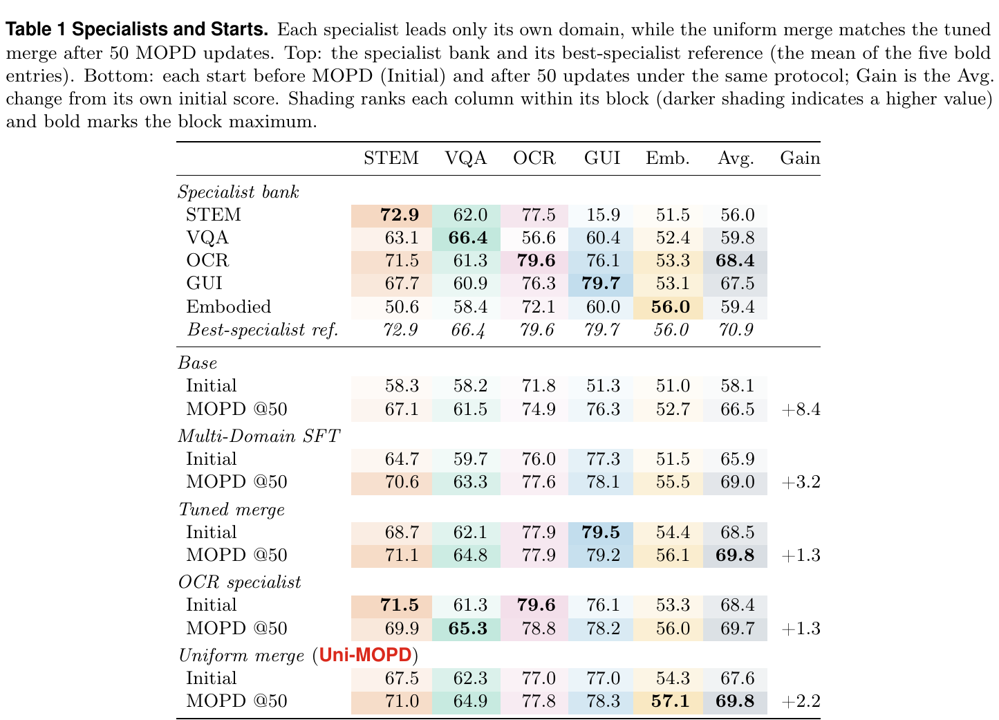

图源：Table 1，物理第 6 页。[PDF](https://arxiv.org/pdf/2611.34397v1#page=6)。分数先对每域基准等权，再对五域等权，共覆盖 19 个公开基准。Base 58.1，整合后还未蒸馏的均匀起点 67.6，50 步后 69.8；更费搜索的 tuned merge 起点 68.5，50 步同样 69.8。每域选最佳专家后拼出的 70.9 是参考值，非一台部署模型。简单等权不消除领域负迁移。

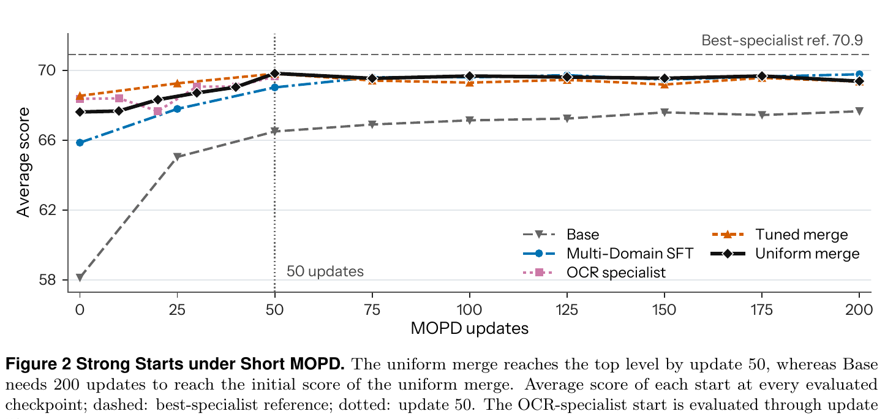

图源：Figure 2，物理第 7 页。[PDF](https://arxiv.org/pdf/2611.34397v1#page=7)。横轴是优化步，纵轴是五域平均，虚线 70.9 是专家拼接。Base 200 步也仅 67.7，均匀合并 50 步已 69.8。更换起点可能比后续目标微调更重要，这条推论的边界是共享底座专家已经存在。

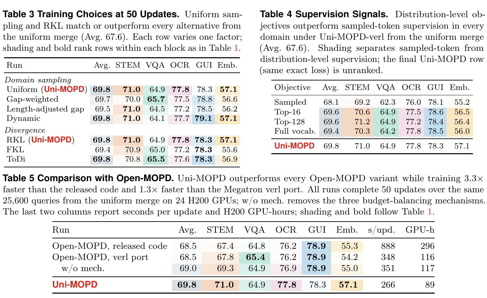

图源：Tables 3–5，物理第 11 页。[PDF](https://arxiv.org/pdf/2611.34397v1#page=11)。同起点的动态采样与均匀采样均 69.8，领域分数不同；反向 KL 69.8，前向 69.4。共同 verl 实现里 sampled-token 68.1，top-16/128 为 69.6，全词表 69.4，说明密集分布有益，不支持全词表此次一定精度最高。ms-swift 主实现 69.8。对 Open-MOPD 同 50 步、25,600 queries、24 H200，主方法 266 秒/步、约 89 GPU-hours，发布版适配 888 秒/步、296 GPU-hours，Megatron 移植 348 秒/步、116 GPU-hours。加速混合了后端、rollout 重用和配方因素。

作者仓库提供合并、分域采样、MoE 训练框架及发布配置。本次核验 README 与模型集合入口，未跑训练。89 GPU-hours 不含五专家训练、调参、评测和数据成本，论文全研究超过 60,000 H200 GPU-hours。复现先按域测 merge 前后，固定 DARE 掩码和 LR，按同后端拆对照；记录高于 0.15 点的变化是否超过该跑法重评波动以及不同种子稳定性。入门 [任务向量](https://arxiv.org/abs/2212.04089)；进阶 [DARE](https://arxiv.org/abs/2311.03099) 与 [ms-swift 文档](https://swift.readthedocs.io/en/latest/)。

<a name="paper-evie"></a>

## 5. OmniEVIE · 让多向量检索的训练目标和线上索引对齐

Zifei Wang 等，arXiv 首发 2026-11-24。[技术论文](https://arxiv.org/abs/2611.32203) · [固定 PDF](https://arxiv.org/pdf/2611.32203v1) · [官方代码](https://github.com/Tencent/OmniEVIE) · [4B 权重卡](https://huggingface.co/tencent/OmniEVIE-4B)。官方仓库可读，提供编码、索引和查询入口，并列出评估复现方式。未核验到复刻约 2M 样本完整训练与合并的可运行作者流水线。本篇是小型视觉语言检索器的后训练，输出检索证据供 agent 或 RAG 用。

### 把相关证据保留在多个局部向量中

单向量会把具体格子、特定动作和大段背景平均在一起。模型基于 Qwen3.5-VL，约 4.5B，总隐层 2,560。patch 经视觉塔、merger 和语言层，full-attention 层用双向 mask，混合骨干里的线性注意块保留原结构。视频把相邻帧一起编码，将每帧单独编码后再平均的做法当作对照。Prefix-MRL 用一个 2,048 维投影，取前缀宽度 64 来构造小索引。部署可以用独立局部向量与查询每个词各自配对。

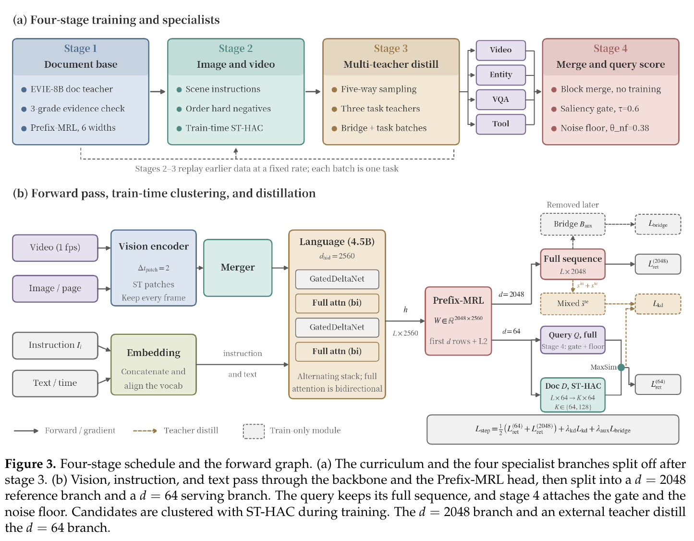

图源：Figure 3，物理第 8 页。[PDF](https://arxiv.org/pdf/2611.32203v1#page=8)。上部从文档到图视频、再到跨域和块级合并；下部视觉、文字和指令进入共享骨干后分为 d=2,048 全分辨率和 d=64 压缩支路。第三条辅助蒸馏连到额外 teacher。压缩不是训练完才尝试。

数据为 57 个公开数据集约 2M 样本，统一成查询、真阳性和候选负例。文档候选分三级，有完整证据的校正为正、部分证据从 loss 分母 mask、无证据负例保留。按现有基座与教师谁排对、margin 大小分组；简单且都对降采样，教师能补基座缺陷提高权重，老师错则保留 gold 监督且不蒸馏。文本/工具、视频、实体等专家后续用分块权重和截断任务向量合并，文本专家对 vision encoder 以及 merger 的系数可为 0。确切打分器差异、教师置信和已公开样本规模要按论文口径，不能把训练全算等同于某一公开 checkpoint。

### 两个宽度共同学，教师排序需要先校准

对查询 $`i`$，记正例的 softmax 概率为 $`\pi_i`$。分母包括同批有效负例及本题 hard negatives。同一标签的共享正例、跨来源无效候选和老师认为至少与正样本同分的候选按规则移出该 loss。使用归一后的 focal 系数 $`a_i`$，从 $`(1-\pi_i)^\gamma`$ 得到，分子分母都停梯度，令批均值为 1。$`\gamma=1`$，softmax 温度 0.02。$`L_{d\to q}`$ 是只在双向可用样本用的反向 CE，$`L_{\mathrm{ord}}`$ 针对有顺序的候选对。$`L_{\mathrm{kd}}`$ 从教师/学生排序分布做 KL 加 margin，$`L_{\mathrm{bridge}}`$ 用线性桥接映射不同宽度并匹配相似关系。

```math
\begin{aligned}
L_{\mathrm{ret}}&=\mathbb E_i[-a_i\log\pi_i]
          +0.5 L_{d\to q}+0.10 L_{\mathrm{ord}},\\
L_{\mathrm{kd}}&=c_i D_{\mathrm{KL}}(p_{\mathrm{te}}\Vert p_{\mathrm{stu}})
                      +\lambda_m L_{\mathrm{margin}},\\
L_{\mathrm{step}}&=\tfrac12(L_{\mathrm{ret}}^{(64)}+L_{\mathrm{ret}}^{(2048)})
                    +\lambda_k L_{\mathrm{kd}}+\lambda_a L_{\mathrm{bridge}}.
\end{aligned}
```

$`p_{\mathrm{te}}`$ 混合宽分支与外部教师的候选分数后构造。先各自在有效候选做 z-score，再用内部分数均值和标准差恢复到学生尺度，降低 teacher 打分范围差异。$`c_i`$ 随教师熵下降提高。$`\lambda_m,\lambda_k,\lambda_a`$ 为原论文对应三种损失的权重，蒸馏权重按早期梯度校定后固定。文档阶段明确以 8B 双向 EVIE 为 teacher；桥接到其维度后才做相似度蒸馏，桥只在训练用。d=64 支路把候选聚类成 K=64 或 K=128，采样概率 0.3 和 0.7；聚类分配停梯度，簇内平均和归一可求导，每个簇内 token 分到重心梯度的 $`1/|C|`$。训练不使用策略 RL 奖励。

**本文算例。**两道题正例概率 .9、.3，focal 原权重 .1、.7，均值 .4，归一权重 .25 和 1.75。两条平均 CE 约 .655，而 focal 加权约 1.067，训练更关心困难题。若一个线索簇有四词，它们在均值之前各分 1/4 梯度，然后再经过 L2 归一的 Jacobian。噪声点或错误标签也会被焦点机制放大，因此负例审核和教师门很重要。

### 索引保留证据指向，再用三段筛选

压缩时用 64 维语义向量混合小幅空间与时间码，只让位置影响簇分配，落盘 centroid 由原语义向量平均并 L2 归一。Ward 合并选簇内平方误差增量最小的一对，减少跨文档栏目和远时间的无关合并。长片段先切分聚类再合成，最短序列保持原样。最大 128 个 64 维 int8，每元素 scale 为 1/127。平均向量与 sign 视图也从同一索引派生。

查询词的权重 $`w_i`$ 用十种语义/邻近/模态特征的小门控模型计算，令总和等于有效查询词长。$`r_i`$ 是查询词到候选内某质心的最大内积，$`\theta=0.38`$ 为噪声底，$`\beta=2.5`$ 放大强匹配超过底值的部分。

```math
r_i=\max_{v\in D}\langle \hat q_i,v\rangle,\qquad
s(Q,D)=\sum_i w_i\big[r_i+\beta\max(0,r_i-\theta)\big].
```

单个词若 $`r=.70`$、权重 1，贡献变成 1.50，若只有 .30 则还是 .30。它不会改变该词已找到的 argmax，也不声称高分就是下游答案正确。保留簇位置信息可回到文档或视频。

```text
用统一格式编码 queries、正例和有效负例，训练宽窄两个支路
训练内对窄支路做 ST-HAC，窄宽均优化检索，按门添加教师信号
合并阶段与多域专家，存均值、sign 视图和 int8 质心
线上全库均值选 5000，二值距离选 1000，再 int8 MaxSim 排序
返回结果及局部证据位置，图文视频分开报告召回和定位
```

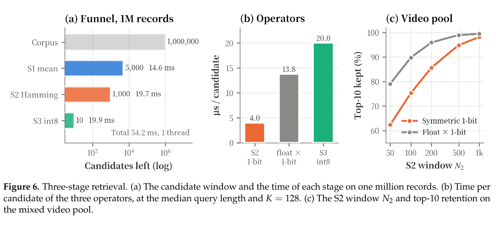

图源：Figure 6，物理第 16 页。[PDF](https://arxiv.org/pdf/2611.32203v1#page=16)。单线程 CPU 百万条，三段分别 14.6、19.7、19.9 ms，合 54.2 ms。另在 500 万条报告 120.2 ms。单条上限容量 128×64=8,192 bytes，sign 加 1,024、均值加 256，合 9,472 bytes。8.82 GiB/百万是该上限估算，实际文档子集索引均摊可更低。横轴的候选窗口变化会改变延迟与召回，表中时间不含查询模型编码。

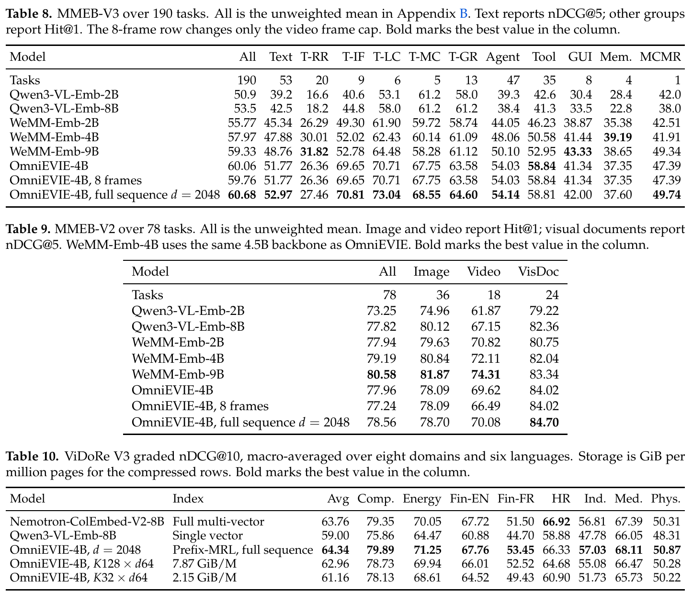

图源：Tables 8–10，物理第 17 页。[PDF](https://arxiv.org/pdf/2611.32203v1#page=17)。MMEB-V3 全集 190 项，4B 完整向量 60.68，压缩 60.06，官方 8 帧条件 59.76；11 个音频任务按零纳入。V2 是 77.96，比 WeMM-Emb-9B 低 2.62，文档子项则占优。ViDoRe V3 以 graded nDCG@10 比较宽向量 64.34、压缩 62.96，固定 K128、d64 时要用同索引成本比较。

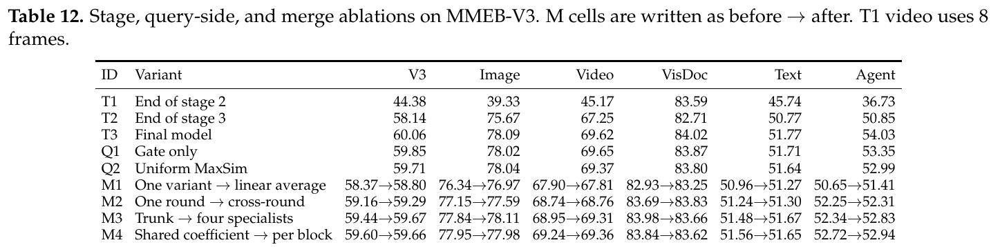

图源：Table 12，物理第 18 页。[PDF](https://arxiv.org/pdf/2611.32203v1#page=18)。V3 经过阶段二、三、最终时是 44.38→58.14→60.06；阶段换数据、模型和分支，不能单归因给一个 loss。在最终模型只用门控是 59.85，均匀 MaxSim 59.71；子项可能下降，不应只挑涨幅。

附录 A 给全局 batch 512、每阶段一 epoch、AdamW、LoRA r64/128、alpha=4r，cosine 与 5% warm-up。未核验到总 GPU-hours、峰值显存和原训练硬件。复现优先冻结索引规模与 CPU 线程数，测 8 帧/32 帧、相同 cutoff 下压缩和不压缩、同样负例的窄宽分支，并审计返回的局部证据。入门 [ColPali](https://github.com/illuin-tech/colpali) 与 [Faiss 文档](https://faiss.ai/)；进阶 [MMEB 官方评测](https://github.com/TIGER-AI-Lab/VLM2Vec) 与权重卡。

## 选一篇深入读

| 兴趣 | 精读 | 比较时先固定 |
| --- | --- | --- |
| 小模型如何盯住有用区域 | [STAR](#paper-star) | 两世界配对、框边界、训练时间口径 |
| 检索到了却答不对 | [MemRU](#paper-mem) | 候选记忆、场景拆分、读探针与答题 |
| 想奖励推理中一小段 | [ClueRL](#paper-clue) | 判官、片段质量、相同采样设置 |
| 多个视觉领域如何合并 | [Uni-MOPD](#paper-uni) | 共享底座、同查询和后端 |
| 快速搜索细粒度视觉证据 | [OmniEVIE](#paper-evie) | 样本数、索引体积、帧数与延迟 |

图表来自各论文固定版，裁剪边界与哈希见 assets/SOURCES.md。作者模型、硬件和判官均未在本期重新训练或测量。
