# VLM 论文精读｜2026-11-28

**本期五篇**：遥感证据蒸馏、多图强化学习、视觉 token 压缩、进度感知导航、全模态视频后训练。检索窗口为 2026-10-28 至 2026-11-28，以 UTC arXiv 初版日期为准。本期由本机补位，按仓库全部方向的历史索引去重。正文将论文原文、教学推导和缺失信息标开，原图以 PDF 物理页号定位。以下实验均为作者报告。

## 论文速读

### 1. GeOPD｜在遥感图里教模型找对那一栋楼

遥感图常有好几栋相似楼房。如果问题问「长屋顶右边那栋的小屋顶是什么颜色」，模型即使答对颜色，也可能看错目标。作者给老师看带目标框、参照框和观察描述的原图，再让学生分别看原图和只挡住目标的图。两次学生预测的差别，显示还原目标后哪些用词变得合理。只有老师的修正和这个变化方向吻合时，才重点蒸馏。

此外，让没有标注提示的老师判断挡住目标后哪些实际生成的词理应掉分，再鼓励学生在这些词上拉开原图与遮挡图的置信度。上线只需要原图和问题。适合想学如何做视觉版 on-policy 蒸馏，以及如何避免老师凭答案或语言习惯指导学生的读者。[读精读](#paper-geopd)

### 2. ASTERISM / CICA｜让多图奖励落到真正需要多图的词上

有些标称多图的问题只看一张就够了。作者先逐题检测文字捷径和单图捷径，再保留或改写需要跨图核对的问题，做出评测与训练集。训练过程中，同一段答案既用全图打分，也分别用每张单图打分。每个词都跟最能解释它的单图版本比，这样只需一张图就能说出的词就不会自动得到跨图奖励。

答案整体仍按原有规则判对错。CICA 只是让正确回答中更依赖跨图证据的词多得到一点更新，让错误回答里同样高度依赖跨图的词多承担一点惩罚。它特别适合横向比较多张图、组合不同图证据的任务。如果你的模型总靠一张图答跨图问题，可先读本篇。[读精读](#paper-asterism)

### 3. Glance-ETD｜在只留 5% 视觉 token 时先找证据，再读局部

大图压到很少的 token 后，OCR 小字和细节特别容易丢失。模型先扫一遍低分辨率全图，根据问题定位可能有用的格子，只把这些格子重新用原分辨率编码。最后保留一组彼此不同又贴近证据的 token，例如既留住门牌数字，又留一点场景来确认是哪扇门。

训练时另有一个小打分器从框标注学习证据位置。语言模型则拿完整图模型做老师，让老师在学生自己写出的同一前缀上告诉它下一词怎么预测。实测的 3.1 倍是 4K 场景下的首 token 加速；论文同时给了端到端和显存数字。做小模型高分辨率 OCR 或视觉搜索前端时，这篇最直接。[读精读](#paper-glance)

### 4. LeaP-VLN｜让导航模型学会判断走到哪一步，走错了回哪儿

只教小模型模仿专家走路，部署时一拐错就容易接着错。作者先让执行器学专家动作，再让自己的模型故意走出可见偏差，给这些偏差状态补上纠错动作和文字进度监督。部署时大模型拆路线、在小模型喊停后复核，小模型负责实际决定往前还是转向。

确认子任务完成才记一个回退点。未完成可以接着走，已走偏就回最近一次确认的位置，重新看一圈再选方向。实验显示它更常走到目标，但回退也可能让路线变长。想把小 VLM 接进会自主调用工具的系统，可以看如何拆分执行、验收、恢复三个职责。[读精读](#paper-leap)

### 5. WeMM-Video｜一个 2B–9B 模型同时听声、看帧、做推理

视频模型很容易凭画面猜声音，也可能把听到的对话安到错误的人身上。作者把视频帧和音频片段按时间排进同一序列，另外用时间戳维持对应关系。完成预训练后，用不同领域的老师教文本、图像、音频和音画推理，让学生自己先回答，老师再沿着学生的回答给指导。

随后把严重啰嗦和重复的回答当作偏好训练里的反例，再在难题上分流，有标准答案的用规则打分，开放题交给模型评估。小模型的带音频视频成绩值得看，完整报告更适合当作训练顺序的参考，因为几次后训练各自贡献多少还难以分开。[读精读](#paper-wemm)

## 技术精读

<a name="paper-geopd"></a>
### 1. Seeing the Right Context｜目标遮挡与证据方向一致的 on-policy 蒸馏

Yichang Luo 等，2026-11-25，Qwen3.5-4B / 9B。

[arXiv 元数据](https://arxiv.org/abs/2611.34700) · [原文 v1](https://arxiv.org/pdf/2611.34700v1) · [作者代码 GeOPD](https://github.com/YeeCharm/GeOPD)

#### 问题、数据与三路评分

面积很大的卫星图里，目标准确定位取决于地标或相对方向。遮整张图虽然给出很强的反事实变化，也会把题目所指的参照物一并抹去。GeOPD 为每题同时标目标和必要的参照框，遮挡视图只盖目标，原来的图幅、坐标、其余建筑和文字保持原状。老师的特权视图保留完整场景并画框，可额外读到描述局部观察事实的文本；测试时学生只看真实输入。作者希望把局部观察从语言答案提示里拆出来。

GeoContext-5K 有 5,394 题，包括 2,658 道选择题和 2,736 道短答题。源图来自 VRSBench、LRS-GRO 和 RSSM。先按可见目标及支撑参照挑任务，再构造问答、可核对的观察描述和证据框；独立模型用**未画框原图**重答，再检查事实、目标以及遮挡部分，人审抽样反馈给数据复核环节。六类任务包括计数、存在/否定、关系、属性对比、区域范围和场景。训练问题的单位是问答与证据记录，同一场景的多条问答可能共享同一视觉先验。复现时应按源图或地理场景划分，逐项核查与评测源的图像重用。

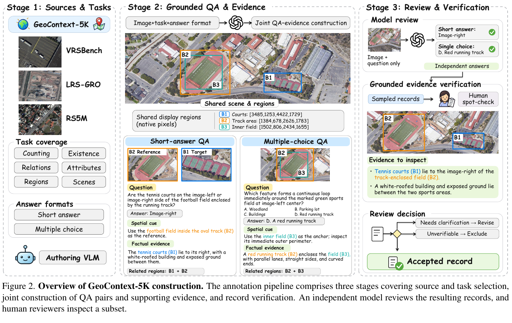

图源：[原论文 Figure 2，第 3 页](https://arxiv.org/pdf/2611.34700v1#page=3)。从左至右看，颜色区分目标和参照框。右列先验证原图问答是否稳定，再检查标出的证据是否能支持答案。该流程提供训练标注，各步骤的质量不能从下游准确率单独反推。

#### 公式一｜先算「变动的方向」，再蒸馏

学生 $`\pi_\theta`$ 先看原图 $`I`$ 和问题 $`q`$，采样一条回答 $`y`$。在位置 $`n`$，三路都固定同一前缀 $`y_{\lt n}`$。$`p^S`$ 是学生原图分布，$`p^M`$ 是同一当前学生的遮挡分布且梯度停止，$`p^T`$ 是冻结教师在特权上下文上的分布。教师从与学生相同的初始权重复制。令 $`u`$ 表示老师想怎样改，$`v`$ 表示「把目标从遮挡图恢复为原图」实际令学生怎样改。

```math
\begin{aligned}
u_k &= p^T_k-p^S_k,\qquad v_k=p^S_k-p^M_k,\\
\langle u,v\rangle_{p^S}
&=\sum_{k\in\mathcal K}\frac{u_kv_k}{\max(p^S_k,\epsilon)},\\
w &= \max\!\left(0,\frac{\langle u,v\rangle_{p^S}}
{\|u\|_{p^S}\|v\|_{p^S}}\right).
\end{aligned}
```

$`k`$ 是候选 token，$`\mathcal K`$ 使用学生 top-100 加合并尾桶，$`\epsilon`$ 保持分母有限；$`\|u\|_{p^S}=\sqrt{\langle u,u\rangle_{p^S}}`$。两范数乘积小于 $`10^{-8}`$ 时直接置零。相同的概率改变量在罕见 token 上相对更大，因此内积按基线概率倒数加权。教学推导：设参考分布 $`p`$，扰动 $`d`$ 满足 $`\sum_k d_k=0`$，且每维扰动远小于正的 $`p_k`$。将 JS 的两项对数在零扰动展开，一阶抵消，使用自然对数时二阶主项为 $`\tfrac18\sum_k d_k^2/p_k`$。这解释权重的局部几何直觉；有限扰动下，论文仍实际计算 JS。

```math
\begin{aligned}
m_n&=(p^T_n+p^S_n)/2,\\
\mathrm{JS}(p^T_n,p^S_n)
&=\tfrac12\mathrm{KL}(p^T_n\Vert m_n)+
\tfrac12\mathrm{KL}(p^S_n\Vert m_n),\\
\mathcal L_{\rm dir}
&=\mathbb E_y\!\left[
\frac{1}{|N(y)|}\sum_{n\in N(y)}
{\rm sg}(w_n)\mathrm{JS}({\rm sg}(p^T_n),p^S_n)\right].
\end{aligned}
```

$`N(y)`$ 是有效位置，$`{\rm sg}`$ 表示值参与计算、梯度不回传，$`\mathrm{KL}(p\Vert m)=\sum_k p_k\log(p_k/m_k)`$。除数是有效位置数，保持「选择权重整体很低」可以降低整条蒸馏的强度。分母若换成权重和，一条只有一个微弱非零权重的回答反而可能获得接近完整权重。小白例子：学生在原图对「蓝」「红」给 $`(0.6,0.4)`$，遮挡视图 $`(0.5,0.5)`$，有框教师 $`(0.8,0.2)`$。两差向量是 $`(0.2,-0.2)`$ 与 $`(0.1,-0.1)`$，加权余弦为 1。若老师给 $`(0.4,0.6)`$，两个向量方向相反，截断后权重是 0。

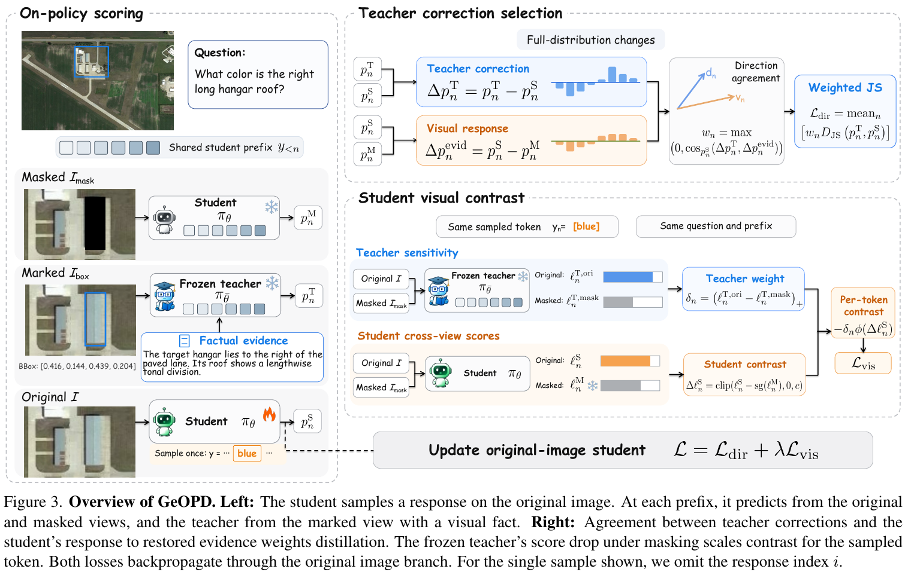

图源：[原论文 Figure 3，第 4 页](https://arxiv.org/pdf/2611.34700v1#page=4)。左侧橙色为原始学生，右上使用完整分布，右下重新用无特权教师给**已经采样的词**打分。图上的两组教师输入对应两个不同问题，分别是应朝什么分布改，以及当前词有多依赖目标。

#### 公式二｜有证据才强化原图与遮挡的差

无特权教师在原图、遮挡图对固定词 $`y_{in}`$ 给对数概率 $`\ell^{T,o}_{in},\ell^{T,m}_{in}`$。$`[z]_+=\max(z,0)`$，学生对应得分是 $`\ell^S_{in},\ell^M_{in}`$。$`A_i`$ 是教师灵敏度为正且未结束的有效位置，$`R`$ 是 batch 中回答数。$`c,K`$ 限制最大间隔和形状幅度，$`\lambda=0.02`$。

```math
\begin{aligned}
\delta_{in}&={\rm sg}\!\left([\ell^{T,o}_{in}-\ell^{T,m}_{in}]_+\right),\\
g_{in}&={\rm clip}\!\left(\ell^S_{in}-{\rm sg}(\ell^M_{in}),0,c\right),\\
\phi(g)&=\min\{K,e^{-g}-1+g\},\\
\mathcal L_{\rm vis}
&=-\frac1R\sum_{i=1}^R
\frac{\sum_{n\in A_i}\delta_{in}\phi(g_{in})}{\max(1,|A_i|)},\\
\mathcal L &= \mathcal L_{\rm dir}+\lambda\mathcal L_{\rm vis}.
\end{aligned}
```

在未裁剪区间，$`\partial[-\delta\phi(g)]/\partial \ell^S=-\delta(1-e^{-g})`$，所以最小化 loss 会把当前词在原图上的置信度拉高。边界上，间隔非正或上端达到裁剪后梯度停住；优势还未建立的位置主要靠方向蒸馏。教学算例：教师原图给「蓝」0.8，遮挡给 0.4，$`\delta=\log 2`$；学生原图 0.6、遮挡 0.5，$`g=\log(1.2)\approx0.1823`$，未触发裁剪时 $`\phi\approx0.01565`$，该活跃位置的对比 loss 约 −0.01085，进总 loss 再乘 0.02。本方法使用概率反事实加权，不另造答对奖励或 RL rollout 组优势。

```text
for each online batch:
    sample replies from student(original image, question)
    score the same reply prefixes in original, target-masked, and privileged contexts
    align teacher-minus-student with student-minus-masked for each token
    teacher without marks scores the sampled token on both image views
    update only the original-image student with directional JS plus visual contrast
```

#### 实验、成本与复现边界

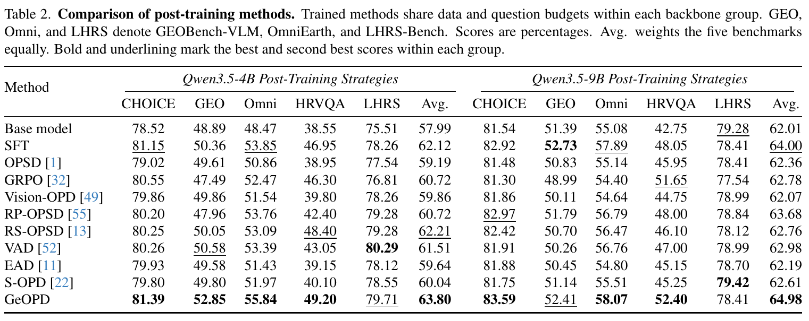

图源：[原论文 Table 2，第 7 页](https://arxiv.org/pdf/2611.34700v1#page=7)。五基准等权平均。4B 基座 57.99，SFT 62.12、GRPO 60.72、遥感蒸馏 RS-OPSD 62.21、GeOPD 63.80。9B 对应基座 62.01、SFT 64.00、RS-OPSD 62.76、GeOPD 64.98。开放题 HRVQA 的 4B 和 9B 基座分别为 38.55、42.75，完整方法为 49.20、52.40。该提升比只看汇总更能反映依赖视觉事实的题目。源图与评分方式见原文分任务定义。

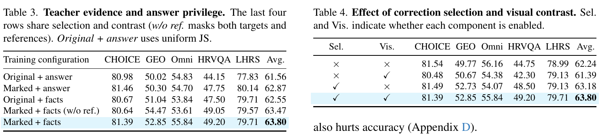

图源：[原论文 Tables 3–4，第 7 页](https://arxiv.org/pdf/2611.34700v1#page=7)。4B 在原图加答案、画框加答案、原图加观察事实、目标和参照一起遮、完整画框加事实的设置中，均值分别为 61.56、62.87、62.55、63.47、63.80。原图加答案一行是均匀 JS，比较时要同时看输入和损失。Table 4 中两项都关、仅对比、仅方向选择、两项全开依次为 62.24、61.39、63.18、63.80，提示「对比单独加」可能强化学生已有但不准确的偏好。

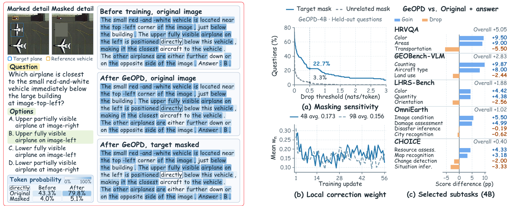

图源：[原论文 Figures 4–5，第 8 页](https://arxiv.org/pdf/2611.34700v1#page=8)。同一个固定回答前缀下，蓝色词级底色看目标遮挡带来的概率下降；右侧上方比较目标遮挡与随机遮挡。最右的分任务条比的是同一 4B 骨干、原图加答案起点；存在负向子任务。遮挡测得的是特定干预下的灵敏度，均色遮挡仍可带来分布偏移，也可能暴露目标位置，不能单独等于「模型像人一样理解」。

Appendix Table S2 的 4B 在线训练用 4×RTX PRO 6000 Blackwell，56 次更新，每个问题 4 条回答，batch 96 问、学习率 2e−6。GeOPD 约 579.53 秒/步、49.88 GiB 峰值、36.06 GPU 小时；RS-OPSD 675.65 秒、57.33 GiB、42.04 GPU 小时，GRPO 430.07 秒、43.85 GiB、26.76 GPU 小时。逻辑评分前向次数和墙钟时间不会线性对应，显存及复用随训练实现变化。计时起点是在线后训练，不含造标注和基础模型训练。作者仓库公开了评估脚本和输入 schema，核心训练框架、完整训练数据和权重标为待发布；本文未复跑。建议先在固定若干样本核对目标框与参照框分离、尾概率守恒、掩码分支无梯度，再跑冻结教师和随机遮挡对照。[原论文计算附录](https://arxiv.org/pdf/2611.34700v1#page=13) · [作者代码](https://github.com/YeeCharm/GeOPD) · [Vision-OPD 项目](https://github.com/VisionOPD/Vision-OPD)

<a name="paper-asterism"></a>
### 2. ASTERISM｜测量单图捷径，给跨图 token 重分配 GRPO 更新

Chanseul Cho 等，2026-11-24 首发，25 日有 v2。此处图、表和数字固定到 v1。

[arXiv 版本记录](https://arxiv.org/abs/2611.32316) · [原文 v1](https://arxiv.org/pdf/2611.32316v1) · [作者代码 ASTERISM](https://github.com/chanseul01/ASTERISM)

#### 从数据抓捷径，到分清「跨图」到底难在哪

一个问答即使输入两张图，也可能让模型只根据第二张读数答题。作者先审计 19 个基准约 33k 样本，双模型复核有 24.2% 可由单图或文字回答。这个比例对应筛查样本及审计标准。被筛出的题中，按基准统计，最强单图对「全图相对纯文本」提升的恢复率中位数为 78%。保留必须做比较、时空对应、推理等的题，另外改写约 2k 带捷径的样本。最终 ASTERISM 约 18.7k，Lite 再经人工核验，训练集 ASTERISM-Train 有 49,105 题；训练来源与评测的重叠图用哈希等筛除。模型评测的最大不确定性之一，是更强审计模型仍可发现早期审计漏掉的解法。

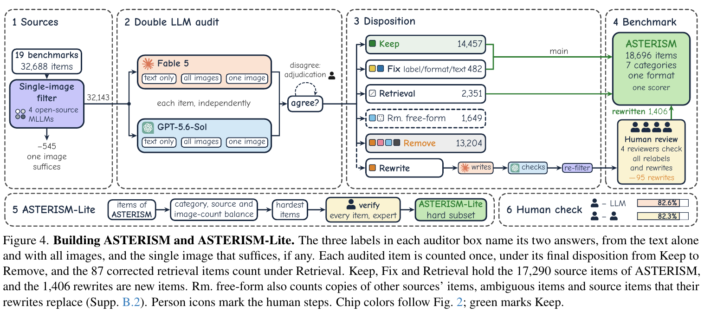

图源：[原论文 Figure 4，第 5 页](https://arxiv.org/pdf/2611.32316v1#page=5)。左侧输入来源，中间是两次审计和处置，右侧分别出完整集和人工复核 Lite。被判整图必要、只需子集的题分开处理。图中颜色用于区分处置分支，不能把改写和保留的行加到起始审计比例上。

#### 公式与推导｜每个词找自己的最佳单图参照

标准 GRPO 先为同一题采样一组回答，以最后答案的可核验正确性给每条 $`r_i`$，再按组归一化成 $`A_i`$；可写成 $`A_i=(r_i-\bar r)/{\rm std}(r)`$。训练跳过同奖励组。CICA 保留这些序列奖励与参考 KL。对于回答 $`i`$ 的词 $`y_{it}`$，把原问题和相同前缀分别给全图和每一个单图视图 $`x^{(j)}`$。删除其余图片时保留文字、图槽分隔符和绝对位置。最佳图 $`j^\star_{it}`$ 可随词改变，模型在单图侧的评分停止梯度。

```math
\begin{aligned}
j^\star_{it}
&=\arg\max_j\log\pi_\theta(y_{it}\mid x^{(j)},y_{i,\lt t}),\\
\sigma_{it}
&=\log\pi_\theta(y_{it}\mid x,y_{i,\lt t})
-\max_j\log\pi_\theta(y_{it}\mid x^{(j)},y_{i,\lt t}).
\end{aligned}
```

$`\sigma`$ 大意味着连最会解释这个词的那张图也难给同样置信度。若全图概率 0.8、两张图单独给 0.75 和 0.1，最佳单图对比只有 $`\log(0.8/0.75)\approx0.065`$；误用随机第二张则会给 $`\log 8\approx2.08`$，把单图可解放大成跨图信号。教学推导：若固定输入和前缀，记词分布为全图 $`p`$、各单图 $`q_j`$，对任意 $`j`$ 有 $`\log p(y)-\max_l\log q_l(y)\le\log p(y)-\log q_j(y)`$，以 $`p`$ 求期望后上界为最小的单图 KL。它刻意要求更强的「跨图必要」证据；实际训练把 $`\sigma`$ 当词级代理，仍可能受输入删除伪影影响。

```math
\begin{aligned}
h_{it}&=\tanh((\sigma_{it}-\bar\sigma_i)/\tau),\\
u_{it}&=(h_{it}-\bar h_i)/2,\\
w_{it}&=1+\beta s_i u_{it},\qquad A_{it}^{\rm CICA}=w_{it}A_i.
\end{aligned}
```

$`\tau=0.5`$ 控制饱和，$`\beta`$ 在前 32 步逐步开到 0.95。带横线的均值在有效位置用更新份额加权；一条正常推理回答内相当于同权。只有能抽取规范答案、且对错与优势符号一致时 $`s_i=1`$。答案标记、思考边界、终止词排除；仅一两个词的短答可在同组同格式短答之间池化。二次居中使有效集合上的 $`u`$ 加权和为零，且 $`|u|\le1`$、$`w`$ 至少 0.05，所以维持符号及应用重要性采样之前的有效权重总量。追加单图计算只改变策略代理项；原文 F.1 的采样比截断、结束词 KL 权重各自按原实现保留。

例子：同一正确回答的两个位置 $`\sigma=(0.8,0)`$，均值 0.4，经过温度 0.5 的 tanh 给约 $`(0.664,-0.664)`$，再得 $`u=(0.332,-0.332)`$、$`w=(1.315,0.685)`$。原优势 +1 时，两个词的优势仍正，总和仍是 2。如果是符合条件的错答原优势 −1，第一个词的负更新绝对值同样放大，防止把「过度依赖某组错误证据」学得更深。

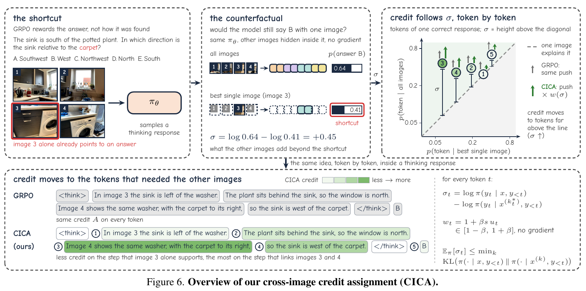

图源：[原论文 Figure 6，第 6 页](https://arxiv.org/pdf/2611.32316v1#page=6)。左上为训练中可从单图走的捷径，中上比较同词的全图与单图，右上展示 对比得分对非线性权重的影响，下面例子把颜色映射到答案词。两个对比条件复用回答，颜色深浅是重分配强度。

```text
sample G responses using the complete multi-image prompt
compute unchanged verifiable correctness and group advantages
score each sampled token in the full view and in every single-image view
take the per-token maximum over single views, then compute eligible weights
stop gradients through weights and substitute weighted advantages in the policy term
```

#### 结果、实现和代价

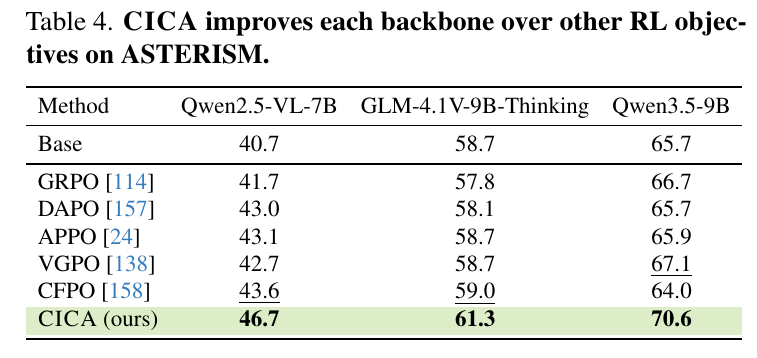

图源：[原论文 Table 4，第 7 页](https://arxiv.org/pdf/2611.32316v1#page=7)。按 Qwen2.5-VL-7B、GLM-4.1V-9B-Thinking、Qwen3.5-9B 顺序，公开基座在 ASTERISM 得 40.7、58.7、65.7，CICA 46.7、61.3、70.6。同表每一骨干最强的非 CICA RL 方法分别达 43.6、59.0、67.1。三列是各自基座在同方向训练的比较，直接跨列比效率会混入架构、输出预算和题目长度差。

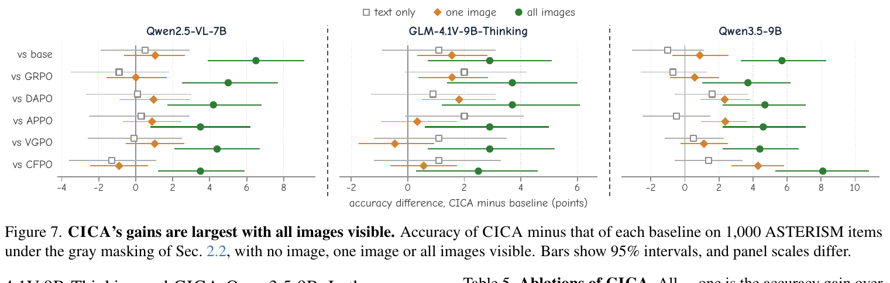

图源：[原论文 Figure 7，第 8 页](https://arxiv.org/pdf/2611.32316v1#page=8)。横轴是 CICA 准确率减去同列基线的准确率，竖向零线标识持平，误差线为 95% bootstrap 区间。绿色「全图」优势更突出，移走多图证据后通常缩小，符合新增信号确实利用多图的假设。Table 5 在 Qwen2.5 上，GRPO 41.7、仅重分配对答 44.1、文字参照 44.4、单图取均值 45.6、正常 CICA 46.7；只有靠标注和遮图对照才能排除部分「答题变熟」解释。

原文 F.2 用 batch 化单图前向并复用已编码的图像。F.1/S8 为 Qwen 两款模型每步 8 题、GLM 32，同题 8 个样本；两种 rollout 最大 3,072 / 8,192 token，学习率 5e−7 / 3e−7，参考 KL 系数 0.02，冻结视觉编码器和投影，单图 batch 以 32,768 token 为上界。F.7 报 Qwen2.5-VL-7B 的单图评分约占训练步 9%，取决于图数、KV 复用以及回答长度。暂无同口径的三骨干端到端 GPU 小时。复现先验证每个单图视图的剩余位置编码和同一输出前缀，再记录全图、最佳单图、空图的配对分差。作者仓库公开了评测、数据组装脚本、数据集和权重入口；CICA 训练代码在 README 标为待发布。本文未复跑。[作者代码](https://github.com/chanseul01/ASTERISM) · [TRL 的 GRPO 机制](https://huggingface.co/docs/trl/grpo_trainer) · [DeepSeekMath 原论文](https://arxiv.org/abs/2402.03300)


<a name="paper-glance"></a>
### 3. Glance, then Select｜带证据偏置的极限视觉 token 压缩

Yuxuan Wang 等，2026-11-15，主实验 Qwen3.5-4B、Gemma 4 E4B-it。

[arXiv 元数据](https://arxiv.org/abs/2611.20006) · [原文 v1](https://arxiv.org/pdf/2611.20006v1)

#### 两段式编码｜从「全都看完再删」改为少读一些高分辨率格子

传统后编码剪枝让语言模型少接收图像 token，但视觉塔仍编码全部 patch。Glance 首先对像素做 2×2 平均池化，以四分之一 patch 跑全注意力，拿到粗格。建模示例是 100 个原生格可归为 25 个粗格。推理时从粗格选相关性最高的 25%，按原生分辨率重编码选中格子里的 patch；这些 patch 合成一个序列做全局注意力，保留原生坐标。没选中的格子将粗特征复制进四个原生槽；多模态旋转位置编码仍用各槽本来的位置。相同特征的复制品在贪心选中同胞后通常没有额外多样性价值。作者对至少 4,096 patch 的图启用该编码路径，小图仍用完整原生编码。这里的两档 25% 与最终只留 5% 是三个不同环节。

第二段 ETD 把前面合成的网格变成最终 token。约 1.9M 参数的证据打分器共享基座视觉特征，将每格投影到 256 维，加二维空间信号，再向问题词做一次交叉注意力。它用本格的特征、跨注意力上下文和与问题均值的逐元素乘积做 MLP 得到分数。这样问「牌子写什么」会定位小字，问「这是什么场景」能得到平缓地图，后者接近纯多样性选择。

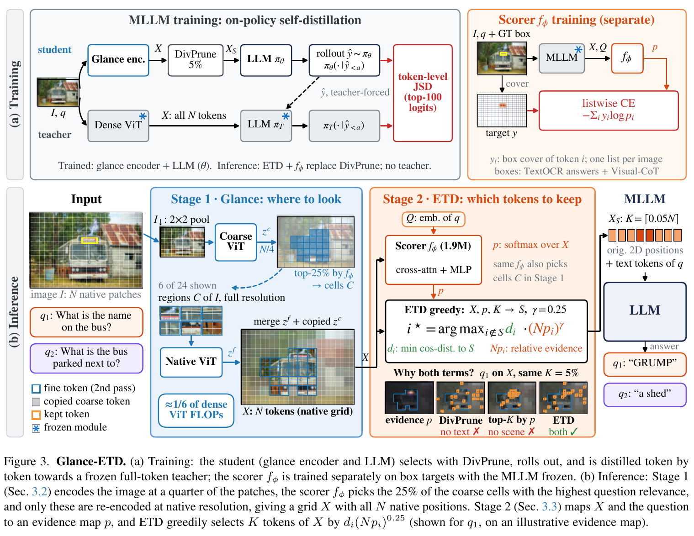

图源：[原论文 Figure 3，第 4 页](https://arxiv.org/pdf/2611.20006v1#page=4)。上半的虚线支路是冻结老师和单独训练的打分器。下半蓝色先按低分辨率选重编码格，橙色再按证据和多样性选最终 token。论文在训练模型时用多样性做离散选格，在推理时才把这两处换成证据打分与 ETD。

#### 两种训练信号与公式

设 $`h_i`$ 为第 $`i`$ 个图像特征，$`d_i`$ 为其与当前保留集合 $`S`$ 内最近特征的余弦**距离**，$`r_i`$ 是证据 logit，$`p_i`$ 是全图 softmax 后概率，$`N`$ 为候选原生槽数，$`K`$ 为保留预算。可把相似的信号想成「重复候选」：距离越小，收第二份收益越低。

```math
\begin{aligned}
p_i &= \frac{\exp(r_i)}{\sum_{j=1}^{N}\exp(r_j)},\\
d_i&=\min_{j\in S}
\left(1-\frac{h_i^\top h_j}{\|h_i\|\|h_j\|}\right),\\
i^\star &=\arg\max_{i\notin S} d_i(Np_i)^{\gamma},
\qquad \gamma=0.25.
\end{aligned}
```

该式是已选择首个种子后的逐步选择规则。把 $`p_i`$ 与均匀概率 $`1/N`$ 相除，均匀分布时乘数恒为 1，即还原 DivPrune。对正项可取对数成 $`\log d_i+\gamma\log(Np_i)`$，利于稳定比较；零距离单独处理。证据指数小于 1 会温和放大利害关系，防止重复读某一块。微型例子：4 个候选中，一个词格 $`p=.7,d=.20`$，旁边另一个物体格 $`p=.1,d=.26`$。纯看距离选后者；ETD 两分约 .259 对 .207，先选词格。如果第二个字格和它非常接近，下一步更新距离变小，候选就轮到远处物体或周边上下文。

打分器的监督不是二分类：$`b_i`$ 为证据框覆盖格子的面积比例，$`y_i=b_i/\sum_j b_j`$ 为整图归一化软标签。每张图是一组空间位置，交叉熵等于 KL 加与预测无关的标签熵，因此监督在同图中分配相对强弱。$`p^F_t`$ 为完整 token 冻结教师，$`p^C_t`$ 是压缩学生，同一位置以学生 rollout 的前缀条件评分。$`m_t=(p^F_t+p^C_t)/2`$，$`T`$ 为有效回答长度。

```math
\begin{aligned}
\mathcal L_{\rm box}&=-\sum_{i=1}^N y_i\log p_i,\\
\mathcal L_{\rm distill}
&=\frac1T\sum_{t=1}^T\left[
\tfrac12\mathrm{KL}(p^F_t\Vert m_t)+
\tfrac12\mathrm{KL}(p^C_t\Vert m_t)\right].
\end{aligned}
```

框监督用 TextVQA 答案词匹配 TextOCR 字框，加 VisualCoT 人工/数据集提供的证据框。作者从 422K 记录中抽样，每轮 60K、3 轮，TextVQA 原池约 28K，VisualCoT 采样权重为前者的 0.3，AdamW、16 图每步、学习率 3e−4。学生从 14K 提示训练，其中 1.5K 替换为空间推理样本。每题采样一次，上限 256 词元，175 步，蒸馏 support 为 top-100 加尾桶，视觉塔学习率提高到 2e−6。两个 loss 分阶段训练，打分器阶段基座冻结，学生阶段不依赖打分器，整个流程无须可验证奖励。

```text
train scorer on box coverage using frozen model features
distill a student that chooses by diversity and rolls out at a strict visual budget
for inference on a large image:
    encode pooled image and score coarse cells against the text question
    encode the top quarter of coarse cells at native resolution
    merge native features and replicated coarse features at original positions
    score the merged grid and greedily select K distinct evidence-bearing tokens
    answer with those selected tokens at their original positions
```

#### 怎样读 91.6% 与 3.1 倍

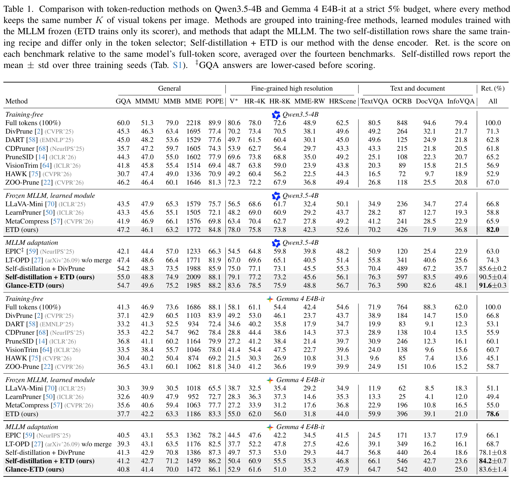

图源：[原论文 Table 1，第 6 页](https://arxiv.org/pdf/2611.20006v1#page=6)。14 个任务各自减到 5% 视觉预算，再用每任务数值除以同骨干满 token 数值，最后宏平均。Qwen3.5-4B 对照 LT-OPD 无 merge 74.3%、同 recipe 的 DivPrune 85.6%、dense+ETD 90.5%、Glance-ETD 91.6%。±0.3 为三个训练种子的波动；LR 和合并方式一起决定了 17.3 个百分点的跨 recipe 差距，用后两行才更接近比较两段式编码。DocVQA 82.6 对满图 94.6，仍有绝对差 12.0；V* 83.6 对 80.6 单项可以超过满 token，宏平均不限定在逐项单调。

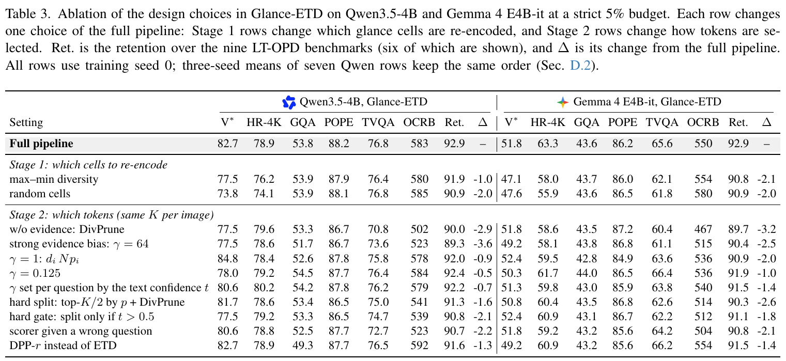

图源：[原论文 Table 3，第 7 页](https://arxiv.org/pdf/2611.20006v1#page=7)。右列 Ret. 采用九任务子集，不和上一表十四项的 91.6 直接相减。Qwen 这一子集的完整 92.9，第二段纯多样性 90.0、过强证据指数 89.3，展示打分器增益；读数时保持骨干、预算和子集一致。论文的 scorer 数据与 DocVQA 有 105/1,284 张源图重叠，D.3另给无重叠 scorer 对照，实际端侧应用仍需按来源拆分评测。

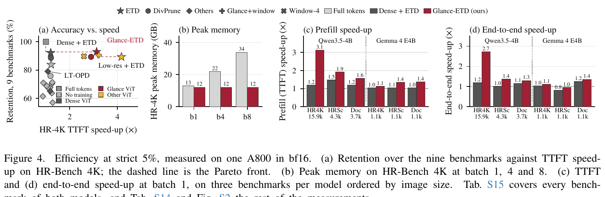

图源：[原论文 Figure 4，第 8 页](https://arxiv.org/pdf/2611.20006v1#page=8)。左图纵轴是九任务保留率、横轴是 4K 首 token 加速，另三图分别看峰值显存、prefill 与端到端。Qwen 4K、A800、batch 1 的 TTFT 约 3.1 倍，不能当成每个生成 token 的倍数。报告的 4.7 小时对 17.4 小时是 8 张 A800 上两种**蒸馏 recipe** 达到相同准确率的墙钟比较；换算已分配 GPU 小时为 37.6 对 139.2，另训打分器与采框成本另计。资源绝对值依赖后端和图片分辨率。检索未核验公开官方训练代码或权重，落地先分开记 ViT 时间、语言 prefill、生成三项，另外核对 M-RoPE 和逐图实留 token 数。[原文训练和附录](https://arxiv.org/pdf/2611.20006v1#page=5) · [DivPrune 原论文](https://arxiv.org/abs/2503.02175) · [Hugging Face 的视觉语言模型入门博客](https://huggingface.co/blog/vlms)

<a name="paper-leap"></a>
### 4. LeaP-VLN｜用纠错轨迹和进度监督训练 4B 导航执行器

Kangjie Zhou 等，2026-11-16，Qwen3.5-VL-4B-Instruct 执行，Qwen-3.7-Plus 规划和验收。

[arXiv 元数据](https://arxiv.org/abs/2611.20676) · [原文 v1](https://arxiv.org/pdf/2611.20676v1)

#### 为什么专家演示不够

「沿着长廊找到沙发，再从沙发左边进门」容易被生成式执行器提前截断。模仿的输入常为专家会走到的图像，自己行动后的误差会带来陌生观察。稍早或稍晚的停止还会把并未做好的一段当作成功，上层就错拆下段。LeaP-VLN 在训练和部署都把进度当独立信号。高层用全局指令、已验证的地标记忆和最近确认帧编出局部指令，小模型根据当前图像和动作历史走路。执行器喊停时，高层另看当前/历史帧与子指令，输出完成、未完成、走偏及视觉依据。仅通过验收的子任务终点成为下一个锚点。

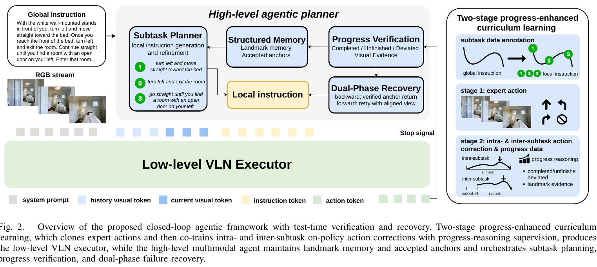

图源：[原论文 Figure 2，第 3 页](https://arxiv.org/pdf/2611.20676v1#page=3)。图左上是全局指令，低层只收局部任务和视觉历史。停止信号向上回送，已验收的语义地标和可回退锚点进入不同的记忆字段。右框展示老师如何从实际滚动的状态做纠错样本。

#### 两阶段训练与优化式

第一阶段是行为克隆。1.4M 专家动作样本来自完整 R2R 路线和按语言片段切分的 RxR 路线；处理时先对齐地标和轨迹片段，再只取同一片段的动作、上下文和结束信号。第二阶段监督 2.2M 动作样本（含 0.8M 新的纠错状态）与约 200K 进度推理样本。子任务内偏差取自该段执行途中；子任务间状态偏差来自上段策略产生、已被接受但不等于专家终点的位置。以专家路径和模拟器可访问状态补标「此时如何拉回」，另用进度描述标明已完成、尚待完成、路线是否偏离。第二阶段重用专家轨迹以保留正常状态的动作能力。

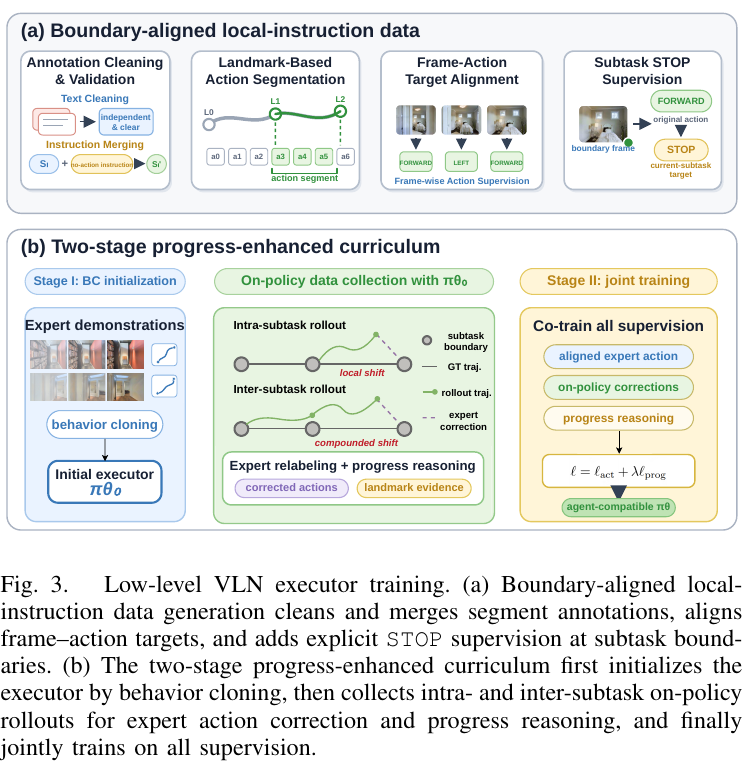

图源：[原论文 Figure 3，第 4 页](https://arxiv.org/pdf/2611.20676v1#page=4)。左下是第一阶段模仿，右下把策略采样的子任务内、跨子任务状态变成第二阶段训练目标。训练阶段接收专家纠错标签，部署时只能靠验收和恢复；两条流程的状态来源有区别。

原文式 (4) 和 (5) 给出动作负对数似然与进度共训。令 $`c_t=(S_i,H_t,o_t)`$ 包括局部指令、最多八张历史帧与当前观察，$`a_{t+k}`$ 是第 $`k`$ 个专家或纠错动作，$`K=4`$ 是预测块长度。令 $`g_1,\ldots,g_M`$ 是进度描述和结构化标签的词元。进度损失用同样的交叉熵。系数 $`\lambda`$ 平衡动作和进度，原文未披露其取值或抽样配比。

```math
\begin{aligned}
\mathcal L_{\rm act}
&=-\sum_{k=0}^{K-1}
\log\pi_\theta(a_{t+k}\mid a_{t:t+k-1},c_t),\\
\mathcal L_{\rm prog}
&=-\sum_{m=1}^{M}\log\pi_\theta(g_m\mid g_{\lt m},c_t),\\
\mathcal L_{\rm stage\,2}
&=\mathcal L_{\rm act}+\lambda\mathcal L_{\rm prog}.
\end{aligned}
```

教学解释：对一个块先用链式法则展开联合动作概率，再取负对数，得到求和。若头两步目标动作预测概率为 .5 和 .25，这两步贡献 $`-\log .5-\log .25\approx2.079`$。纠错动作和进度描述分别把「该往哪转」和「还没到」学到同一模型。论文里的策略 rollout 用于造偏移状态，更新目标仍是 SFT，不包含 GRPO 奖励或环境回报。

#### 部署时的状态机与指标推导

记 $`S_i`$ 是当前子任务、$`V`$ 是独立验收模型、$`d_i`$ 是判断、$`J_i`$ 是依据。输入历史以允许回看已走部分。若只有当前帧，看见沙发不能证明从其左侧通过。

```math
(d_i,J_i)=V(S_i,H_t,o_t),\qquad d_i\in\{C,U,D\}.
```

$`C`$（完成）更新地标和确认锚点后切任务；$`U`$（未完成）保存已确认部分，原任务继续；$`D`$（走偏）不记脏状态，先回最近有效锚点，取得全景候选观察，再据 $`S_i,J_i`$ 选一个更可信的视角重发指令。执行器一次预测四个动作，实际执行头两个后刷新观察。这样动作延迟更低，又能用下次观察重规划。模拟器里能访问状态和候选视角，真实机器人需依赖 SLAM 和控制器完成回退。论文定性演示真实设备，缺可外推的端到端时延和失败率。

```text
initialize validated landmark memory and the first navigation anchor
repeat while the route has unfinished instructions:
    predict four moves from current images and execute the first two
    when the executor stops, ask a separate verifier for evidence and status
    if complete: commit verified memory and use this location as the next anchor
    if unfinished: keep the task and continue from current state
    if deviated: restore the previous anchor, choose a panoramic view, and retry
```

距离指标从表中抽象成下面的教学式。$`s_i`$ 是最终是否在成功半径内停下，$`\ell_i`$ 是最短路径长、$`p_i`$ 是实际走长，$`N`$ 为回合数。OSR 看曾否进入成功半径，NE 看终点距目标。若两次中只一次走到，最短 10 m、实际走了 15 m，则 SR=.5，SPL=.333。回退把成功率往上推但也会增加 $`p_i`$，这是两个指标可能反向的原因。

```math
\mathrm{SR}=\frac1N\sum_i s_i,\qquad
\mathrm{SPL}=\frac1N\sum_i s_i\,\frac{\ell_i}{\max(p_i,\ell_i)}.
```

#### 主实验、消融与复现

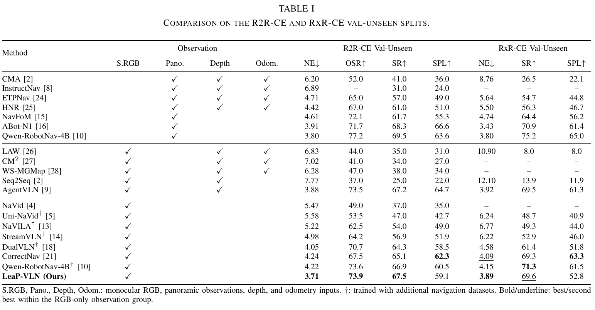

图源：[原论文 Table I，第 6 页](https://arxiv.org/pdf/2611.20676v1#page=6)。看同为单目 RGB 且未使用额外导航训练数据的 CorrectNav 对照。R2R-CE 到达率从 65.1% 到 67.5%，OSR 从 67.5% 到 73.9%，NE 从 4.24 m 降到 3.71 m，SPL 从 62.3 降到 59.1。RxR-CE 到达率 69.3 到 69.6，SPL 63.3 到 52.8；用额外数据的 Qwen-RobotNav-4B 在 RxR 达到 71.3。带深度/里程计的系统与不同感知设定也列于表中，不能拿来当同条件基线。

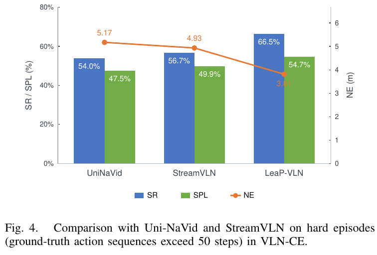

图源：[原论文 Figure 4，第 5 页](https://arxiv.org/pdf/2611.20676v1#page=5)。困难子集按专家动作长度大于 50 来选，柱图为成功指标，橙色折线为导航误差。比较的是 Uni-NaVid、StreamVLN 与本文三种系统，同一条路线跑得更短与更常成功是不同问题。

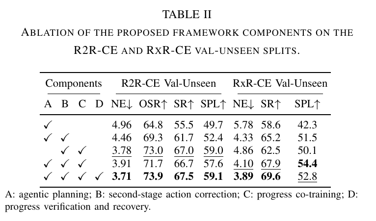

图源：[原论文 Table II，第 6 页](https://arxiv.org/pdf/2611.20676v1#page=6)。A 是规划、B 纠错、C 进度、D 验收与恢复。ABC 加 D 后，RxR-CE 的 SR 67.9→69.6、NE 4.10→3.89，SPL 54.4→52.8。去 A 但保留 BC 的 R2R-CE SR 为 67.0，比 ABC 的 66.7 略高；短任务可能不值得增加规划和再验收。表未提供所有交互组合，故只归因于横向明确打开的条件。

复现证据包括样本量、执行器与规划器、动作刷新频率和模拟器设置。本文未核验独立官方代码与权重，原文也未披露 GPU 小时、规划器累计 token 与完整学习率等。以 Habitat 或原 VLN-CE 环境重做时，需额外固定摄像头、离散动作、成功阈值和回退判据，按场景统计重试次数与接口调用费。[原文方法与实验](https://arxiv.org/pdf/2611.20676v1#page=4) · [VLN-CE 作者仓库与数据](https://github.com/jacobkrantz/VLN-CE) · [TRL 的 SFT 入门](https://huggingface.co/docs/trl/sft_trainer)


<a name="paper-wemm"></a>
### 5. WeMM-Video｜多教师 OPD、去重复 DPO 与专项 RL 怎么分工

腾讯 WeMM-Video 作者团队，2026-11-19。覆盖 Qwen3.5-2B/4B/9B 密集骨干和 Qwen3.6-35B-A3B 的 MoE 骨干。

[arXiv 元数据](https://arxiv.org/abs/2611.26409) · [原文 v1](https://arxiv.org/pdf/2611.26409v1) · [作者项目页](https://tencent.github.io/WeMM-Video/) · [官方推理代码](https://github.com/Tencent/WeMM-Video)

#### 时间对齐、训练语料与预训练

加音频后，难题从「识别物体」变成「在这一段里，谁在说哪些话，音乐和动作是否同步」。WeMM 保留骨干自有视觉塔和视觉投影，音频模块初始化来自 Qwen2.5-Omni。Whisper 系音频塔读取 16 kHz 音频，每 30 秒一种处理分块；窗口级 Q-Former 把每个 0.1 秒压成一个语言空间 token，约 10 token/s。时间顺序交错插入图像与音频 token，显式时间戳帮助对齐。按作者说的压缩率，30 秒纯音频约产生 300 个音频 token，这是教学换算，未计时间戳、帧、提示、输出和其他边界 token。音视频切换密集的样本应核查对齐的是原始绝对采样时刻，而非各片段归零后的局部时间。

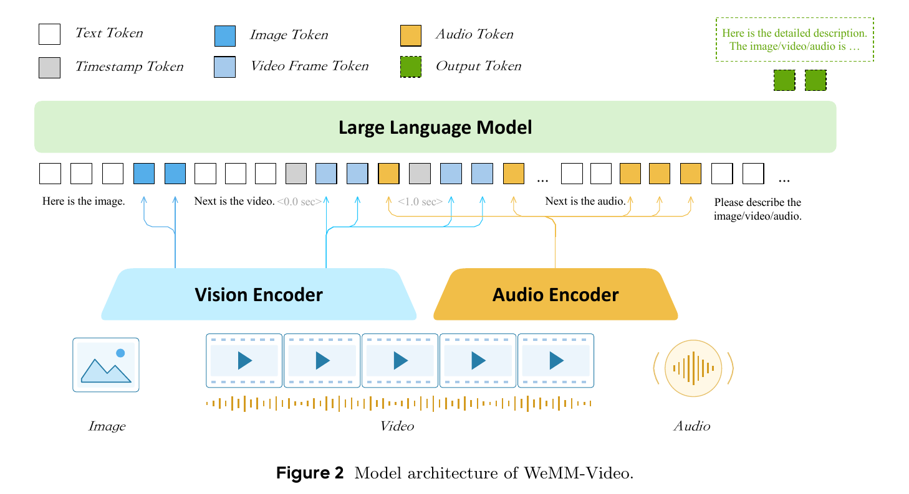

图源：[原论文 Figure 2，第 3 页](https://arxiv.org/pdf/2611.26409v1#page=3)。按图上方序列颜色读，蓝色是视频帧，黄色是音频，灰色是时间戳，绿色是生成；右侧问答是输入输出布局示意。原图不提供每种硬件的训练内存。

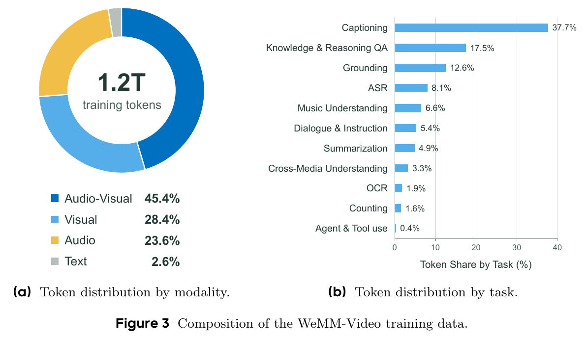

图源：[原论文 Figure 3，第 4 页](https://arxiv.org/pdf/2611.26409v1#page=4)。左边按模态，合计约 1.2T token，联合音画 45.4%；右边按任务，描述 37.7%、知识推理问答 17.5%。左右的桶不是逐行一一对应，1.2T 是报告描述的总体训练语料，不能填写为「后训练 token」。数据包括原生短综、访谈、体育和游戏时间线描述、语音识别与音乐理解、多视频比较，以及带推理轨迹的 STEM 问答。描述语料经过自动品质打分、语义去重和毒性过滤。作者未公开详细数据构建清单、按阶段来源或音频许可分解。

先仅训练 Q-Former，让音频与语言表示接上；再展开上下文，大规模加入文本、单图和联合音视频数据，解冻视觉塔之外的其他参数；最后维持可训练参数组合，处理更长视频和多视频。原文 4.1 给出预训练阶段的顺序，后续 4.2 的三阶段才是本文关注重点。

#### 后训练第一阶段｜教师按任务和输入模态分工

原文 4.2：更强外部教师处理文本和视觉语言任务，同族教师覆盖音频和音画，以保护已学的专用能力；还做文本到音频的跨模态迁移，以改进语音理解和遵从指令。典型做法是学生从自身上下文 $`x_S`$ 采样，老师用适配输入 $`x_T`$ 给同一前缀 $`y_{\lt t}`$ 的下一个词分布。以下是帮助理解的通用 OPD 公式与方向，论文未公布此次训练选用哪种散度、教师名单、每段采样数及全量评分配置。令 $`p_t`$ 为冻结教师词分布、$`q_t`$ 为当前学生；$`T`$ 是采样回答有效 token 数。

```math
\begin{aligned}
p_t(k)&=\pi_T(k\mid x_T,y_{\lt t}),\quad
q_t(k)=\pi_\theta(k\mid x_S,y_{\lt t}),\\
\mathcal L_{\rm KD}^{\rm demo}
&=\mathbb E_{y\sim\pi_\theta}\left[
\frac1T\sum_{t=1}^T\sum_k p_t(k)\log\frac{p_t(k)}{q_t(k)}
\right].
\end{aligned}
```

冻结前缀和目标分布时，KL 等于学生交叉熵减教师熵，梯度只需优化学生概率。若老师认为两个目标词概率 $`p=(.8,.2)`$，学生 $`q=(.6,.4)`$，用自然对数得 $`.8\log(.8/.6)+.2\log(.2/.4)\approx.092`$。模型和数据路由按任务拆开，避免用只有音频的老师评画面颜色；该例只是指导复现的起点。文本教师可用转写作为另一输入是教学设想，报告只确认跨模态迁移，并未给这套输入构造的所有细节。

#### 后训练第二阶段｜稀有重复反例离线挖出，分轮做偏好优化

长视频回答若进入重复循环，期待在每个 RL batch 都遇到足够多同类反例效率很低。作者在视频、音频、图文中离线挖具重复特征的难负例，用多轮 DPO 处理，每轮只训练 LoRA、合并到权重再重置适配器。报告未给偏好对挖掘阈值、保留正样本规则、轮数、rank 或正则系数。

下式为**标准 DPO 教学式**。$`y^+`$ 是较好答案、$`y^-`$ 是重复等较差答案、$`\pi_{\rm ref}`$ 为参考策略、$`\beta>0`$ 控制两者比较尺度。序列 log 概率可由逐 token 条件 log 概率相加，$`\sigma(z)=1/(1+e^{-z})`$。其推导把参考策略约束下的隐式奖励使用 $`\beta\log(\pi_\theta/\pi_{\rm ref})`$ 参数化，两个回答相减时同输入的归一化常数抵消，最后对「正答案被选」做 logistic 负对数似然。

```math
\begin{aligned}
s_\theta(y,x)&=\log\pi_\theta(y\mid x)-\log\pi_{\rm ref}(y\mid x),\\
z&=\beta\big[s_\theta(y^+,x)-s_\theta(y^-,x)\big],\\
\mathcal L_{\rm DPO}^{\rm demo}&=-\log\sigma(z).
\end{aligned}
```

如果正负两条相对参考的 log 分数差为 2，教学取 $`\beta=.5`$，则 $`z=1`$、配对概率约 .731、loss 约 .313。若间隔为零，loss 是 $`\log 2\approx.693`$。优化的是正负的相对偏好，不能把这个指标当无重复率。复现需要另外测模板重复、必要的术语重复、有信息的长回答、重复次数与正确率，避免将「写短」误作目标。[标准 DPO 原论文](https://arxiv.org/abs/2305.18290) · [视频多轮 DPO 来源 video-SALMONN 2](https://arxiv.org/abs/2506.15220)

#### 后训练第三阶段｜把奖励适配到任务

作者用离线推理和评估去掉模型已经稳定会做的题，强化说话人识别、视频音乐匹配、音乐结构理解和复杂音画推理。可判定题采用规则，例如选择题只看规范提取得到的答案；开放题使用 rubric、教师一致性。模式随机抽取，共训直接回答与思考输出，后段扩大覆盖帧数与输入长度。用 $`m(x)`$ 表示题型、$`F_{m(x)}(x,y)`$ 表示相应评分函数，记 $`R(x,y)=F_{m(x)}(x,y)`$ 描述动态路由即可。无法从当前报告还原奖励权重、rollout 组大小、参考 KL、是否固定使用某种 GRPO 或精确系统成本。规则与 rubric 的区分要用人标校准分项得分，避免一个开放题裁判偏好把语言风格当作时序理解。

```text
prepare a time-aligned sequence of video frames, audio windows, and timestamps
route text and vision or audio and audio-video prompts to suitable teachers
distill from those teachers along student-generated prefixes
repeat offline mining and preference training on repetitive hard negatives
merge each round's LoRA adapter before starting the next round
filter already-solved specialist tasks, sample direct or thinking mode
score verifiable outputs by rules and open outputs by rubric or teacher agreement
```

#### 核心实验、消融缺口与资源

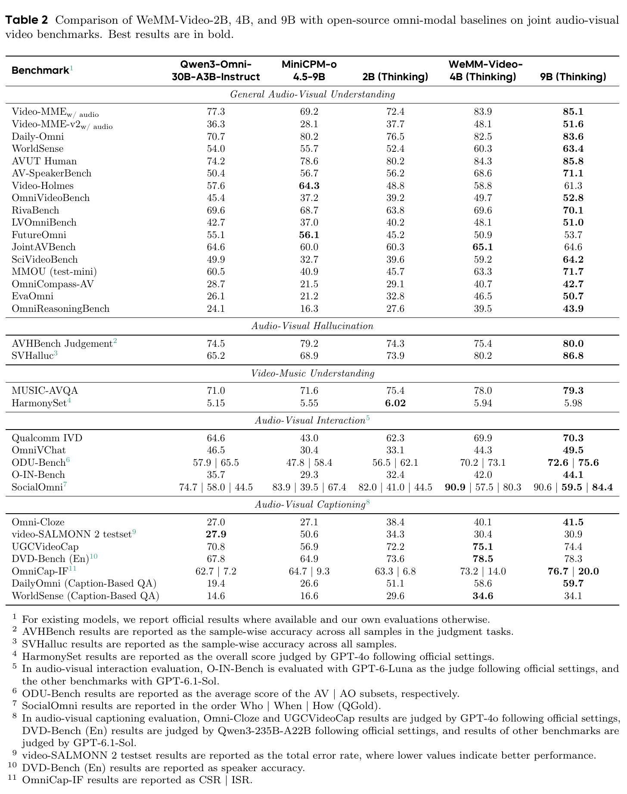

图源：[原论文 Table 2，第 8 页](https://arxiv.org/pdf/2611.26409v1#page=8)。小模型此表为 Thinking 输出，用公开 Omni 模型作对照。带音频 Video-MME 下，WeMM 2B/4B/9B 为 72.4、83.9、85.1；Qwen3-Omni-30B-A3B-Instruct 77.3、MiniCPM-o 4.5-9B 69.2。SVHalluc 的 2B、4B、9B 为 73.9、80.2、86.8，对照 65.2、68.9。FutureOmni 则三个模型 45.2、50.9、53.7，均低于 MiniCPM-o 的 56.1。说明小型公开模型在有声视频和幻觉判断有竞争力，需要同时列出弱项、不同模式和评分器差异。Table 2 下方各题的图表脚注区分逐样本准确率、裁判及更低更好的总错误率；各行单位不同，不宜直接取表内均值。

原报告主要做跨尺寸、模型模式与外部系统比较。较大版本 Table 1 的相同骨干 Instruct 与 Thinking 可看模式差，但缺 2B/4B 上逐项关闭 OPD、MrDPO 与 RL 的隔离消融，不能把这些汇总成绩直接归因于任意一阶段。表也未给本报告统一复跑的误差条。公开作者仓库可比对预处理和加载权重，HF 提供模型产物，完整训练配方、训练卡数、各阶段 token、峰值显存与 GPU 小时未核验公开。部署可复现的起点是固定原采样率、时间戳、帧数、输出模式和裁判，补上有声、静音、错位音轨的配对测试。9B 卡片上权重文件的大小只代表下载体积，部署还要负担 KV cache、音视频编码与框架内存。[作者代码](https://github.com/Tencent/WeMM-Video) · [作者 9B 模型卡](https://huggingface.co/tencent/WeMM-Video-9B) · [TRL DPO 教程](https://huggingface.co/docs/trl/dpo_trainer) · [LoRA 原论文](https://arxiv.org/abs/2106.09685)

## 按实际问题挑一篇

| 我想解决的问题 | 优先读 | 最值得对比的实验 |
| --- | --- | --- |
| 答对了却看错视觉目标 | [GeOPD](#paper-geopd) | Table 3 的教师视图，再看 Table 4 哪项 loss 有效 |
| 多图提示实际只看一张 | [ASTERISM](#paper-asterism) | Figure 7 的全图、单图、无图配对 |
| 高清图提示太长，OCR 被剪掉 | [Glance-ETD](#paper-glance) | Table 1 固定预算与 Figure 4 首 token 和端到端 |
| 导航或工具执行途中走偏 | [LeaP-VLN](#paper-leap) | Table II 的 SR、NE 与 SPL 如何交换 |
| 如何组织小型音视频模型后训练 | [WeMM-Video](#paper-wemm) | 4.2 三阶段和 Table 2 跨尺寸表现、弱项 |

术语建议：第一次读 OPD 时，先理解「学生生成、老师在同一前缀评分」的采样差异；第一次读 CICA，先理解「同题多条回答做组内相对奖励，再更新词概率」；SFT 则从「给定前缀预测标准下一个词」开始。正文用到的老师分数、证据标注、成败奖励是三种不同监督，训练时要记录它实际更新哪一路、应用在哪些位置。[Vision-OPD 作者项目](https://github.com/VisionOPD/Vision-OPD) · [Hugging Face SFT 指南](https://huggingface.co/docs/trl/sft_trainer) · [Hugging Face GRPO 指南](https://huggingface.co/docs/trl/grpo_trainer) · [Hugging Face DPO 指南](https://huggingface.co/docs/trl/dpo_trainer)

图表固定版本、页码、裁剪范围和校验值详见 [当期来源记录](https://github.com/daihuangyu/papers-daily/blob/main/VLM/2026-11-28/assets/SOURCES.md) 和 [清单](https://github.com/daihuangyu/papers-daily/blob/main/VLM/2026-11-28/manifest.json)。
