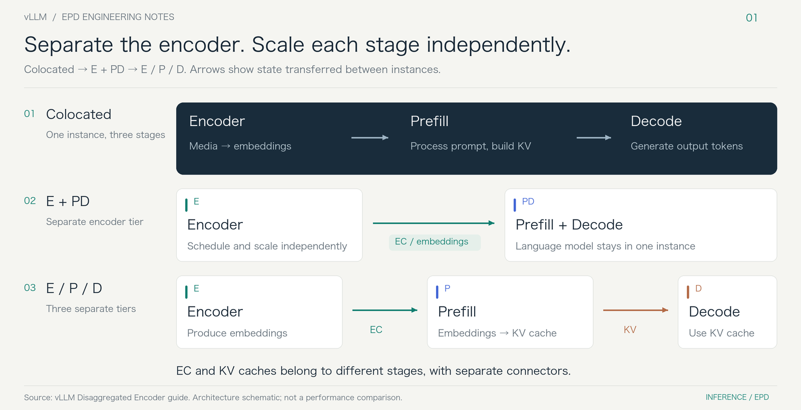

# Linux 中文嵌入字体与原图排版验证

此文件仅用于云端迁移测试，不是每日论文，不计入每日5篇。2026-11-16首日报告保持原样。

## 中文、数学符号与手算

小型视觉语言模型，on-policy蒸馏，SFT，RL/GRPO，偏好优化；希腊字母 α、β、μ，向量转置 xᵀ，公式 KL(p∥q) ≥ 0。

教学手算：目标概率 p=(0.8,0.2)，模型 q=(0.6,0.4)，交叉熵 L=-0.8 ln(0.6)-0.2 ln(0.4)≈0.592。

| 检查项 | 期望 |
| --- | --- |
| Linux 中文字体 | Noto Sans CJK SC 字形转为 TrueType 并嵌入 |
| 来源 | 原论文/作者原图逐图解释；此处借用仓库首日例图测试 |
| 正文与代码 | 中文、英文、数字及数学符号均可读 |

```text
# 伪代码中的中文也需要嵌入字体
loss = -sum(p[i] * log(q[i]) for i in range(2))
```



图 1：此图仅测试分页和原图嵌入；原图来自首日vLLM文章，图源见仓库VLM/2026-11-16/assets/SOURCES.md。上方为编码、预填充和解码分离架构。它不是本测试测得的实验结果。
